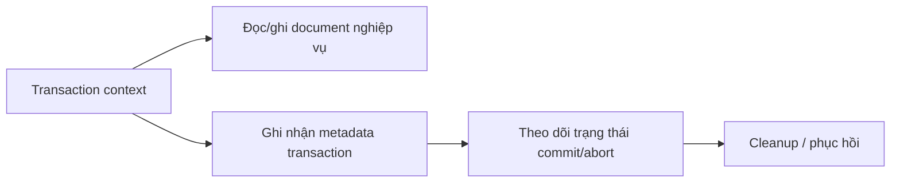
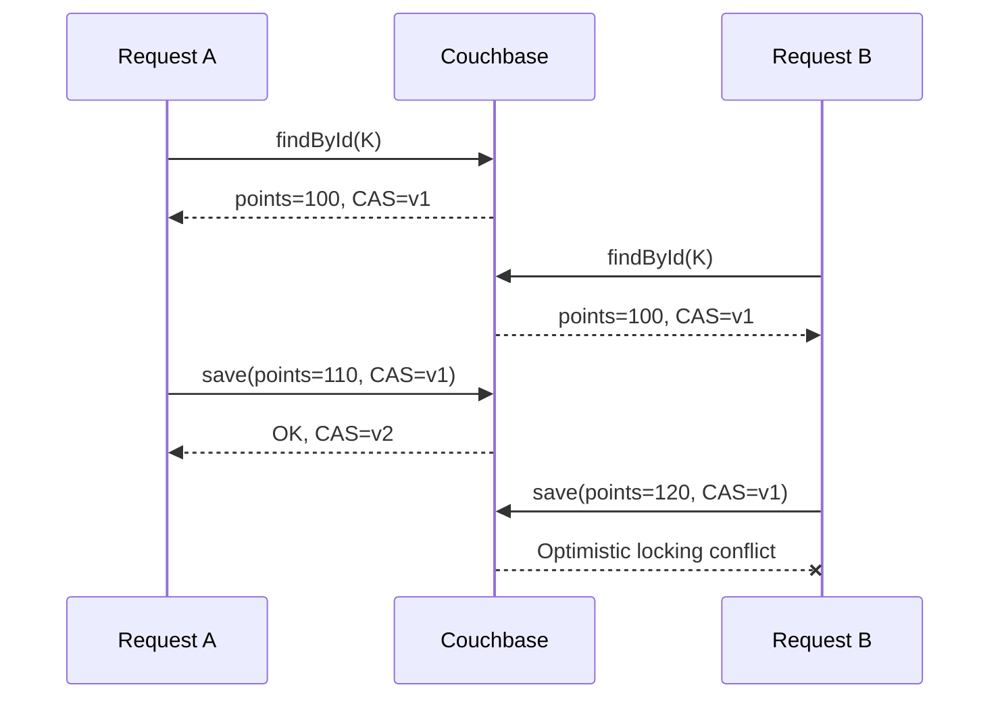

# Yêu cầu phiên bản, cấu hình cụm và trường @Version của entity

Trong chương **Giao dịch** của module **SPRING_DATA_COUCHBASE**, việc viết một đoạn mã chuyển điểm giữa hai document chỉ là một phần của bài toán. Để kết quả thực sự được bảo vệ, môi trường còn phải đáp ứng **khả năng hỗ trợ transaction của Couchbase Server và Java SDK**, cấu hình kết nối đến đúng **bucket/scope/collection**, quyền truy cập dữ liệu và metadata giao dịch, cũng như các lựa chọn timeout, durability và xử lý xung đột.

Đồng thời, Spring Data Couchbase có annotation `@Version` để tích hợp **CAS (Compare-And-Swap)** vào quá trình ghi entity. Đây là một cơ chế quan trọng để chống ghi đè dữ liệu cũ, nhưng **CAS trên một document không tự tạo giao dịch nguyên tử cho nhiều document**. Cần phân biệt rõ phiên bản phần mềm, trường version của entity và transaction context.

Bài này hướng dẫn cách chuẩn bị môi trường, đọc đúng vai trò của `@Version` và xác minh những bảo đảm thật sự khi phối hợp `CouchbaseRepository`, `CouchbaseTemplate`, Couchbase Java SDK, SQL++ và API reactive.

## 1. Mục tiêu học tập

Sau bài học, bạn có thể:

- Lập danh sách những **thành phần cần kiểm tra tương thích** trước khi dùng giao dịch: Couchbase Server, Java SDK, Spring Data Couchbase, Spring Boot và Java.
- Phân biệt hỗ trợ **KV transactions**, **scope/collection**, và **SQL++ trong transaction** theo khả năng của từng phiên bản.
- Xác định dịch vụ Data, Query, Index, bucket, collection và quyền RBAC cần thiết cho một luồng giao dịch.
- Giải thích vai trò **transaction metadata/ATR**, độ bền, timeout, cleanup và những yếu tố vận hành ảnh hưởng đến giao dịch.
- Khai báo `@Version Long` trong entity, đọc giá trị CAS do Spring Data quản lý và nhận biết optimistic locking conflict.
- Chỉ ra khác biệt giữa **entity version/CAS** và **transaction atomicity** trên hai hay nhiều document.
- Không vô tình đưa lời gọi repository thông thường **ra ngoài transaction context** khi dùng Couchbase Java SDK transactions.
- Thiết kế kiểm thử về compatibility, CAS, quyền truy cập, xung đột, TTL, commit không rõ kết quả và retry.

## 2. Ba thứ cùng được gọi là “version” nhưng không giống nhau

Trong một hệ thống Spring Data Couchbase, từ “phiên bản” có thể chỉ ba khái niệm:

| Tên | Ví dụ | Chức năng |
| --- | --- | --- |
| **Phiên bản phần mềm** | Couchbase Server 7.x, Java SDK 3.x, Spring Data Couchbase 5.x | Quyết định API, tính năng và khả năng tương thích |
| **Phiên bản document/CAS** | Giá trị metadata do Couchbase trả về | Phát hiện document đã thay đổi kể từ lúc đọc |
| **Phiên bản nghiệp vụ** | `schemaVersion = 3`, `eventSequence = 24` | Biểu diễn tiến hóa schema hoặc thứ tự sự kiện do ứng dụng định nghĩa |

Không được trộn chúng:

- Nâng phiên bản server không làm `@Version` trở thành một trường nghiệp vụ đếm số lần sửa.
- `@Version` không đảm bảo tất cả document được ghi cùng lúc.
- Trường JSON `schemaVersion` của ứng dụng không thay thế CAS.
- Hệ thống có phiên bản hỗ trợ transactions vẫn cần **gọi đúng API transaction và cấu hình đúng**.

Ví dụ tài khoản điểm thưởng:

```text
Document key: account::tenant-a::A101

Phần JSON:
  tenantId      = tenant-a
  accountCode   = A101
  rewardPoints  = 150
  schemaVersion = 2

Metadata do Couchbase quản lý:
  CAS           = <opaque token>
```

`schemaVersion` do ứng dụng quản lý; CAS là metadata của document. Không mặc định CAS nằm trong JSON và không tự cộng `schemaVersion` để giả lập CAS.

## 3. Yêu cầu phiên bản: kiểm tra theo tính năng sử dụng

Ví dụ bài học dùng **Couchbase Java SDK 3.x** và cú pháp Spring Data Couchbase hiện đại. Để triển khai, cần đối chiếu **bảng tương thích chính thức của bộ phiên bản cụ thể**, thay vì ghép tùy ý những bản mới nhất của từng thành phần.

### 3.1. Các mốc công nghệ cần biết

- **Couchbase Server 6.5** là dòng đã giới thiệu multi-document distributed transactions cho truy cập KV. Điều này **không có nghĩa** môi trường 6.5 hỗ trợ mọi ví dụ về scope/collection hoặc transactional SQL++ trong bài.
- **Couchbase Server 7.0 trở lên** bổ sung mô hình **scope và collection**. Các khả năng giao dịch liên quan SQL++ cũng cần kiểm tra riêng theo dòng server và API tương ứng.
- **Couchbase Java SDK 3.x** cung cấp transaction API theo dạng `cluster.transactions().run(...)`. Các tên lớp, tùy chọn và cách cấu hình có thể khác giữa các minor version.
- **Spring Data Couchbase 5.x** thường được dùng với hệ sinh thái Spring Boot 3.x/Java 17 trở lên. Nếu ứng dụng dùng một dòng Spring Data hoặc Spring Boot khác, phải kiểm tra sự tương thích của SDK và các API repository/template/transaction.

Các mốc trên giúp định hướng học tập, **không phải cam kết rằng mọi tổ hợp phiên bản trong cùng một dòng đều được hỗ trợ**. Ví dụ production có collection riêng và SQL++ trong transaction phải được xác minh theo matrix của server/SDK/Spring Data đang triển khai.

### 3.2. Ma trận kiểm tra trước khi chạy

| Thành phần | Cần ghi nhận | Câu hỏi kiểm tra |
| --- | --- | --- |
| Couchbase Server | Phiên bản và patch level của cluster | Có hỗ trợ loại transaction và keyspace đang dùng không? |
| Java SDK | Artifact và version được dependency resolution chọn | Transaction API có đúng chữ ký mã nguồn không? |
| Spring Data Couchbase | Phiên bản trong dependency tree | `@Version`, Template và transaction integration có đúng behavior không? |
| Spring Boot | Phiên bản BOM/auto-configuration | Có tự cung cấp Cluster, template, transaction manager phù hợp không? |
| Java runtime | Phiên bản JDK | Có đáp ứng mức tối thiểu của Spring Boot/Spring Data không? |
| Query/Index Service | Topology và phiên bản server | Transaction có cần SQL++ query/secondary index không? |
| Cluster config | Timeout, durability, metadata collection | Giao dịch có bị quá hạn hoặc thiếu quyền metadata không? |

**Không trộn các ví dụ của SDK 2.x với 3.x.** Nếu dùng các đoạn code `cluster.transactions().run` hoặc `ctx.replace`, phải chắc rằng dependency thực tế cung cấp API này và server đáp ứng các tính năng cần dùng.

### 3.3. Phân biệt feature với compatibility

Một tổ hợp có thể **kết nối thành công và đọc KV bình thường** nhưng vẫn chưa đủ cho transaction theo yêu cầu, ví dụ:

1. `repository.findById(key)` hoạt động, nhưng transaction bị lỗi vì tính năng server chưa hỗ trợ hoặc cấu hình metadata không phù hợp.
2. KV transaction chạy được, nhưng query trong transaction chưa có dịch vụ Query/Index hoặc index cần thiết.
3. Entity mapping hoạt động, nhưng `@Transactional` của ứng dụng đang chọn **JPA transaction manager**, không phải cơ chế tham gia Couchbase transaction.
4. SDK hỗ trợ transaction, nhưng user của ứng dụng thiếu quyền trên collection giao dịch hoặc metadata collection.

Vì vậy, test “kết nối Couchbase thành công” mới là **kiểm tra tầng kết nối**, chưa phải kiểm tra “transaction đã được cấu hình đúng”.

## 4. Chuẩn bị cụm Couchbase cho giao dịch

Giả sử môi trường thực hành:

```text
Cluster:     couchbase.example.internal
Bucket:      appdata
Scope:       loyalty
Collections:
  - accounts
  - transfers
```

Trong đó:

- `accounts` chứa số điểm tài khoản.
- `transfers` lưu dấu vết lệnh chuyển điểm hoặc idempotency key.
- Transaction metadata có thể được đặt ở một collection thích hợp theo khả năng cấu hình SDK và yêu cầu vận hành.

### 4.1. Dịch vụ cần hoạt động

| Dịch vụ | Vai trò | Khi nào cần |
| --- | --- | --- |
| **Data Service** | Đọc/ghi document KV; transaction stage/commit các thay đổi được hỗ trợ | Trọng yếu với KV transactions |
| **Query Service** | Thực thi SQL++ khi transaction dùng query | Cần nếu luồng giao dịch gọi SQL++ |
| **Index Service** | Phục vụ secondary indexes được SQL++ sử dụng | Cần khi query dựa trên index |
| **Các dịch vụ quản trị/giám sát** | Quan sát trạng thái, tài nguyên, lỗi và độ trễ | Cần cho vận hành và chẩn đoán |

Không nên giả định **Query Service và Index Service phải được sử dụng trong mọi KV transaction**: một giao dịch chỉ thao tác trên các key đã biết có thể không cần SQL++ query. Ngược lại, khi use case tìm các document bằng predicate trong transaction, phải bảo đảm các dịch vụ và index tương ứng hoạt động.

### 4.2. Bucket, scope và collection

Couchbase document key là duy nhất **trong một collection**, không phải duy nhất toàn cluster. Vì vậy:

```text
appdata.loyalty.accounts:
    account::tenant-a::A101

appdata.loyalty.transfers:
    transfer::tenant-a::T9001
```

là hai document có chức năng khác nhau. Ứng dụng phải mở đúng bucket, scope và collection, đặc biệt khi transaction chạm tới nhiều collection.

Nếu repository `AccountRepository` ánh xạ đến `loyalty.accounts` nhưng SDK transaction lại lấy `bucket.defaultCollection()`, các thao tác đó **không cùng một keyspace** dù chuỗi key giống nhau. Việc lựa chọn collection phải được xác minh trước khi kết luận transaction đang bảo vệ đúng dữ liệu.

### 4.3. Có cần cluster nhiều node không?

Không nên coi “nhiều node” là một điều kiện cú pháp duy nhất để gọi transaction trong mọi môi trường. Một môi trường phát triển có thể triển khai khác production; tuy nhiên, **mức durability, khả năng chịu lỗi và topology** sẽ khác nhau.

Trong production cần đánh giá số node, phân bố dịch vụ, replica, tài nguyên lưu trữ, failover và mức durability yêu cầu. Một lần test thành công trên cluster đơn giản **không chứng minh** tính sẵn sàng và khả năng phục hồi của một cluster production.

## 5. Quyền RBAC và metadata giao dịch (ATR)

### 5.1. ATR là gì?

Couchbase transactions sử dụng metadata để theo dõi và phối hợp trạng thái giao dịch. Một khái niệm quan trọng là **Active Transaction Record (ATR)**.

Ở mức ý tưởng:



ATR và metadata liên quan giúp hệ thống quản lý quá trình commit, abort và cleanup theo cơ chế transaction của Couchbase. Ứng dụng không được tự sửa/xóa các document metadata đó để “dọn lỗi” khi chưa hiểu quy trình và tài liệu vận hành.

Tùy cấu hình và phiên bản SDK, **transaction metadata có thể nằm ở collection được lựa chọn hoặc dùng mặc định của SDK**. Không được tự giả định metadata luôn cùng collection với document nghiệp vụ đang cập nhật.

### 5.2. Quyền truy cập

Tài khoản ứng dụng cần đủ quyền cho:

1. Đọc các account cần xử lý.
2. Ghi hoặc thay thế các account trong transaction.
3. Tạo/đọc bản ghi chuyển điểm nếu workflow dùng `transfers`.
4. Truy cập metadata transaction/ATR theo cơ chế SDK.
5. Thực hiện SQL++ query nếu transaction có bước query.
6. Truy cập index/keyspace phù hợp với truy vấn nếu chính sách quyền yêu cầu.

Cấp quyền theo **nguyên tắc tối thiểu** trên đúng bucket/scope/collection. Khi transaction thất bại vì thiếu quyền, đừng chỉ kiểm tra collection `accounts`: còn phải kiểm tra nơi SDK ghi metadata và collection `transfers` nếu có.

### 5.3. Vận hành metadata và cleanup

Giao dịch có thể bị gián đoạn do process crash, timeout, failover hoặc mất kết nối. Cơ chế cleanup của transaction SDK/server có vai trò xử lý trạng thái còn dở theo chính sách hỗ trợ. Cần:

- Cấu hình metadata collection ổn định, đủ quyền và tài nguyên.
- Để các tiến trình cleanup hoạt động theo cơ chế được SDK hỗ trợ.
- Giám sát giao dịch bị timeout/abort, retry và trạng thái metadata bất thường.
- Không thực hiện lệnh xóa metadata thủ công như một thao tác “sửa nhanh”.
- Kiểm tra yêu cầu migration/cleanup trước khi thay đổi vị trí metadata collection.

## 6. Cấu hình Spring Boot: kết nối và định danh keyspace

Ví dụ `application.yml`:

```yaml
spring:
  couchbase:
    connection-string: couchbase://couchbase.example.internal
    username: loyalty_app
    password: ${COUCHBASE_PASSWORD}
  data:
    couchbase:
      bucket-name: appdata
```

Trong ví dụ, thông tin nhạy cảm được lấy từ biến môi trường; ở production nên dùng kết nối TLS, secret manager, quyền tối thiểu và cấu hình chứng chỉ theo chính sách tổ chức. Tên property và cách cấu hình timeout có thể khác theo phiên bản Spring Boot.

**Đây chưa phải cấu hình transaction hoàn chỉnh.** Nó chủ yếu xác định kết nối Couchbase và bucket. Để transaction chạy đúng, ứng dụng còn phải xác minh:

- Couchbase Server và SDK hỗ trợ loại giao dịch đã chọn.
- Transaction context được tạo đúng từ cluster/manager.
- Metadata transaction có vị trí và quyền phù hợp.
- Timeout, durability, retry/cleanup được cấu hình hoặc chấp nhận mặc định có chủ ý.
- Các operation Repository/Template có thực sự tham gia transaction hay không.

### 6.1. Lấy collection qua SDK đúng phạm vi

```java
import com.couchbase.client.java.Bucket;
import com.couchbase.client.java.Cluster;
import com.couchbase.client.java.Collection;
import com.couchbase.client.java.Scope;

public Collection accountCollection(Cluster cluster) {
    Bucket bucket = cluster.bucket("appdata");
    Scope scope = bucket.scope("loyalty");
    return scope.collection("accounts");
}
```

Mẫu này có ích khi một adapter transaction dùng trực tiếp Java SDK trong ứng dụng vốn dùng Spring Data repository. Cần kiểm tra cluster đã sẵn sàng cho bucket và quyền truy cập đã được cấp; vòng đời `Cluster` nên do cấu hình ứng dụng quản lý, không tạo và đóng kết nối mới cho mỗi request.

### 6.2. Không dùng `defaultCollection()` theo thói quen

Với entity được khai báo `@Scope("loyalty")` và `@Collection("accounts")`, thao tác KV transaction phải trỏ đúng collection đó. Tránh:

```java
// Sai phạm vi nếu Account entity được lưu ở loyalty.accounts:
Collection wrong = cluster.bucket("appdata")
        .defaultCollection();
```

Đường key `account::tenant-a::A101` trong default collection (nếu có) và trong `loyalty.accounts` đại diện cho **hai keyspace khác nhau**.

## 7. Timeout, durability và cấu hình transaction SDK

Transaction có nhiều bước và phải phối hợp trạng thái. Hai tham số quan trọng là **timeout** và **durability**.

### 7.1. Timeout/expiration của transaction

Timeout transaction giới hạn khoảng thời gian một giao dịch được phép thực hiện theo semantics của SDK. Trong production cần tính đến:

- Độ trễ mạng giữa ứng dụng và Couchbase.
- Số document được đọc/ghi.
- Xung đột và retry.
- Truy vấn SQL++ cùng thời gian chờ index nếu có.
- Sức tải và tài nguyên cluster.

Đặt timeout quá thấp gây abort thường xuyên; quá cao có thể giữ tài nguyên và tăng thời gian chờ khôi phục. Không nên đặt tất cả transaction ở cùng một giá trị rất lớn để che nguyên nhân query chậm hoặc thiếu index.

### 7.2. Durability không phải atomicity

Một transaction có thể có cấu hình durability. Durability phản ánh mức xác nhận và mức lưu trữ khi xảy ra sự cố; atomicity phản ánh **hoặc toàn bộ các mutation của transaction được commit, hoặc không commit như một đơn vị**.

Durability cao hơn có thể tăng chi phí/độ trễ và có yêu cầu topology. Chọn giá trị theo chính sách mất dữ liệu và khả năng chịu lỗi; không sao chép cấu hình từ dev sang production mà không kiểm tra replica và topology.

### 7.3. Cấu hình phải đối chiếu đúng phiên bản SDK

Các tùy chọn transaction có thể bao gồm:

```text
- transaction timeout/expiration
- durability level
- metadata collection/ATR location
- cleanup behavior
- retry policy và ngưỡng vận hành
```

Tùy phiên bản, những tùy chọn này được đặt ở cấu hình SDK/cluster hoặc qua transaction options tương ứng. **Không tự phát minh property `spring.*` rồi giả định Spring Boot sẽ truyền nó vào Transaction SDK**. Trước khi đưa vào hệ thống, phải kiểm tra API chính xác trong dependency đang dùng, test failure/timeout và quan sát cấu hình có hiệu lực.

### 7.4. Cần xem cả timeout phía Query và KV

Transaction có thể đọc hai key nhanh nhưng chậm vì một truy vấn SQL++ không có index phù hợp. Hãy xác định timeout của transaction tổng thể và timeout operation/query, tránh cấu hình mâu thuẫn khiến tác vụ bị cắt trước thời điểm dự kiến.

## 8. `@Version` của entity Couchbase là gì?

Spring Data Couchbase hỗ trợ annotation:

```java
import org.springframework.data.annotation.Version;
```

Khi gắn `@Version` lên một thuộc tính tương thích trong entity, Spring Data có thể ánh xạ **CAS metadata** của document thành thuộc tính version và dùng giá trị này khi thực hiện các operation ghi có hỗ trợ optimistic locking.

**CAS (Compare-And-Swap)** là token phục vụ điều kiện “chỉ thay đổi document nếu từ lúc đọc đến lúc ghi document chưa bị sửa”. CAS được Couchbase quản lý, không phải trường do ứng dụng tự tăng.

### 8.1. Entity ví dụ

```java
package com.example.loyalty;

import org.springframework.data.annotation.Id;
import org.springframework.data.annotation.Version;
import org.springframework.data.couchbase.core.mapping.Collection;
import org.springframework.data.couchbase.core.mapping.Document;
import org.springframework.data.couchbase.core.mapping.Field;
import org.springframework.data.couchbase.core.mapping.Scope;

@Document
@Scope("loyalty")
@Collection("accounts")
public class Account {

    @Id
    private String id;

    @Field
    private String tenantId;

    @Field
    private String accountCode;

    @Field
    private long rewardPoints;

    @Field
    private String status;

    @Version
    private Long version;

    public Account() {
    }

    public Account(
            String id, String tenantId, String accountCode,
            long rewardPoints, String status) {
        this.id = id;
        this.tenantId = tenantId;
        this.accountCode = accountCode;
        this.rewardPoints = rewardPoints;
        this.status = status;
    }

    public String getId() { return id; }
    public void setId(String id) { this.id = id; }

    public String getTenantId() { return tenantId; }
    public void setTenantId(String tenantId) {
        this.tenantId = tenantId;
    }

    public String getAccountCode() { return accountCode; }
    public void setAccountCode(String accountCode) {
        this.accountCode = accountCode;
    }

    public long getRewardPoints() { return rewardPoints; }
    public void setRewardPoints(long rewardPoints) {
        this.rewardPoints = rewardPoints;
    }

    public String getStatus() { return status; }
    public void setStatus(String status) {
        this.status = status;
    }

    public Long getVersion() { return version; }
    public void setVersion(Long version) {
        this.version = version;
    }
}
```

Những chi tiết cần nắm:

- `@Id` chứa **document key**; `@Version` chứa **CAS metadata** của document.
- Chọn `Long` cho ví dụ để biểu diễn trạng thái chưa có version của entity mới; kiểu được hỗ trợ và cơ chế xác định entity mới phụ thuộc Spring Data version.
- Không gắn thêm `@Field` rồi xem version là một thuộc tính JSON thông thường.
- Không tự tính `version + 1` sau mỗi lần sửa. CAS là **token mờ (opaque)**, không có hợp đồng tăng tuần tự như `1, 2, 3`.
- `@Version` không thay thế `schemaVersion` nếu ứng dụng cần migration dữ liệu JSON.

## 9. Luồng optimistic locking với `@Version`

Repository:

```java
package com.example.loyalty;

import org.springframework.data.couchbase.repository.CouchbaseRepository;

public interface AccountRepository
        extends CouchbaseRepository<Account, String> {
}
```

Luồng cập nhật thông thường:

```java
String key = "account::tenant-a::A101";

Account account = repository.findById(key)
        .orElseThrow();

account.setRewardPoints(
        account.getRewardPoints() + 20);

Account saved = repository.save(account);
```

Khi `findById` đọc document, Spring Data ánh xạ version/CAS phù hợp vào entity. Khi `save` thực hiện ghi được bảo vệ bằng CAS, mutation chỉ thành công nếu document vẫn khớp version mong đợi. Sau khi ghi thành công, entity/kết quả được cập nhật metadata version theo operation tương ứng.

### 9.1. Hai request cùng cập nhật một key



Sau khi A lưu, B đang giữ **version cũ**. Nếu Spring Data sử dụng điều kiện CAS ở bước B, thao tác của B phải bị từ chối thay vì ghi đè mất thay đổi của A.

Trong Spring Data, lỗi được dịch sang nhóm exception optimistic locking, thường gặp `OptimisticLockingFailureException` hoặc biến thể theo đường ghi. Khi dùng SDK trực tiếp, loại exception CAS mismatch có thể khác. Cần kiểm tra/đặt test theo phiên bản đang dùng.

### 9.2. Cách xử lý xung đột

Lựa chọn tùy nghiệp vụ:

1. **Báo conflict:** trả lỗi cho client, yêu cầu tải lại bản mới trước khi sửa.
2. **Tính lại và retry có kiểm soát:** đọc lại document, tính toán từ trạng thái mới và thử ghi với CAS mới.
3. **Dùng operation nguyên tử khác:** với một bộ đếm độc lập, có thể cân nhắc KV sub-document/counter được API hỗ trợ.
4. **Chuyển sang transaction:** khi thao tác cần bảo vệ bất biến trên nhiều document, không chỉ một key.

Không nên retry bằng **cùng object chứa version cũ** một cách vô hạn. Đặc biệt với phép cộng điểm, hãy kiểm soát idempotency để một request không bị áp dụng hai lần khi timeout hoặc retry.

## 10. `@Version` không phải transaction nhiều document

Giả sử chuyển 20 điểm từ A101 sang A102 bằng repository:

```java
Account from = repository.findById(fromKey).orElseThrow();
Account to = repository.findById(toKey).orElseThrow();

from.setRewardPoints(from.getRewardPoints() - 20);
to.setRewardPoints(to.getRewardPoints() + 20);

repository.save(from);
repository.save(to);
```

Cả hai entity đều có `@Version`. Điều này chỉ cho phép phát hiện **xung đột ghi trên từng document**. Nếu `save(from)` thành công và `save(to)` gặp CAS conflict, thay đổi trên `from` **không tự rollback**.

| Câu hỏi | `@Version`/CAS | Transaction nhiều document |
| --- | --- | --- |
| Phát hiện một document đã đổi kể từ lần đọc? | Có, trên operation hỗ trợ CAS | Có cơ chế phối hợp/xung đột riêng |
| Ngăn overwrite của một bản cũ? | Có | Có thể, theo isolation/conflict của transaction |
| A đã ghi thành công, B lỗi, có tự đảo A không? | **Không** | Transaction bảo vệ atomic commit theo contract |
| Bảo vệ bất biến tổng điểm A + B ở commit? | **Không, chỉ CAS riêng lẻ** | **Có**, nếu mọi mutation nằm trong transaction đúng |
| Thay cho kiểm tra quyền tenant? | Không | Không |
| Thay cho idempotency key khi client retry? | Không | Không |
| Tự tạo index SQL++? | Không | Không |

**Cần cả hai khái niệm nhưng ở hai tầng khác nhau:** CAS có thể đủ cho một cập nhật đơn document; transaction cần khi bất biến nghiệp vụ đòi nhiều mutation cùng commit.

## 11. Những sai lầm thường gặp với `@Version`

### 11.1. Tự đặt giá trị version khi tạo entity

Không nên:

```java
Account fresh = new Account(
        "account::tenant-a::A103",
        "tenant-a", "A103", 0, "OPEN");

// Không đặt số version tự chọn để giả lập CAS:
fresh.setVersion(1L);
repository.save(fresh);
```

Trạng thái “mới” có thể được Spring Data xác định một phần dựa trên `@Version`, ID và quy tắc entity state. Một giá trị version được gán tùy tiện có thể làm framework chọn hành vi không như dự kiến hoặc gặp xung đột.

Đối với entity tạo mới, nên để Spring Data/operation tạo và quản lý metadata; khi cần **insert-only**, dùng API thể hiện rõ điều kiện key chưa tồn tại thay vì đoán ngữ nghĩa từ `save`.

### 11.2. Tự tăng version sau khi sửa

```java
// Sai: version không phải biến đếm +1 của ứng dụng.
account.setVersion(account.getVersion() + 1);
```

CAS không có hợp đồng là bộ đếm tuần tự. Thay đổi bằng tay có thể khiến thao tác ghi bị từ chối hoặc làm sai thông tin metadata mà entity đang mang.

### 11.3. Dùng entity cũ sau một mutation ngoài Spring Data

Tình huống:

```text
T1: Repository đọc Account(K), version = CAS1
T2: SDK upsert/replace(Account K) thành công, CAS đổi
T3: Repository save(entity cũ CAS1)
```

Ở T3, entity cũ không phản ánh bản đang lưu. Spring Data có thể phát hiện conflict dựa trên CAS. Khi trộn Repository, Template và SDK, cần xác định rõ adapter nào là chủ của **lần ghi** và lúc nào phải tải lại version.

### 11.4. Bỏ version trong DTO rồi tạo entity cập nhật như mới

Nếu client gửi DTO chỉ có `id`, `rewardPoints` mà server dựng entity mới không có version, có thể mất khả năng phát hiện stale update theo hướng mong muốn. Một giải pháp là **server đọc entity mới nhất** bằng key, kiểm tra ủy quyền và áp dụng thay đổi lên entity mang CAS hiện tại. Nếu muốn phát hiện **client đã sửa dựa trên phiên bản cũ**, cần thiết kế version token/ETag và chính sách kiểm tra có điều kiện, không chỉ đọc bản mới nhất rồi ghi đè.

Không dùng token CAS như một chuỗi có ý nghĩa nghiệp vụ hoặc để client suy luận thứ tự cập nhật. Nếu đưa CAS ra API, cần kiểm soát serialize/deserialize chính xác, quyền truy cập và cách kiểm tra.

### 11.5. Nhầm `@Version` với số thứ tự sự kiện

Một hệ thống cần lịch sử “lần cập nhật thứ 10” nên có trường nghiệp vụ, event log hoặc sequence được thiết kế riêng. CAS có thể đổi theo những điều kiện nội bộ của Couchbase và không phải thứ tự sự kiện cho mọi document.

## 12. Mẫu giao dịch SDK trên hai account

Ví dụ sau minh họa **Couchbase Java SDK transactions** cập nhật hai document trong một transaction context. Nó không gọi `repository.save` bên trong callback, vì repository thông thường không mặc nhiên tham gia SDK transaction.

```java
package com.example.loyalty;

import com.couchbase.client.java.Cluster;
import com.couchbase.client.java.Collection;
import com.couchbase.client.java.json.JsonObject;
import com.couchbase.client.java.transactions.TransactionGetResult;

public class RewardTransferService {

    private final Cluster cluster;
    private final Collection accounts;

    public RewardTransferService(
            Cluster cluster, Collection accounts) {
        this.cluster = cluster;
        this.accounts = accounts;
    }

    public void transfer(
            String authorizedTenantId,
            String sourceKey,
            String targetKey,
            long points) {

        if (points <= 0 || sourceKey.equals(targetKey)) {
            throw new IllegalArgumentException(
                    "Yêu cầu chuyển điểm không hợp lệ");
        }

        // Tenant phải được xác thực/ủy quyền trước khi thực thi.
        cluster.transactions().run(ctx -> {
            TransactionGetResult source =
                    ctx.get(accounts, sourceKey);
            TransactionGetResult target =
                    ctx.get(accounts, targetKey);

            JsonObject sourceJson = source.contentAsObject();
            JsonObject targetJson = target.contentAsObject();

            if (!authorizedTenantId.equals(
                    sourceJson.getString("tenantId"))
                    || !authorizedTenantId.equals(
                    targetJson.getString("tenantId"))) {
                throw new IllegalStateException(
                        "Tài khoản không thuộc tenant được phép");
            }

            if (!"OPEN".equals(sourceJson.getString("status"))
                    || !"OPEN".equals(targetJson.getString("status"))) {
                throw new IllegalStateException(
                        "Tài khoản không ở trạng thái OPEN");
            }

            Long sourcePoints =
                    sourceJson.getLong("rewardPoints");
            Long targetPoints =
                    targetJson.getLong("rewardPoints");

            if (sourcePoints == null || targetPoints == null
                    || sourcePoints < points) {
                throw new IllegalStateException(
                        "Số điểm nguồn không hợp lệ");
            }

            long newTarget = Math.addExact(
                    targetPoints, points);
            long newSource = sourcePoints - points;

            ctx.replace(source,
                    sourceJson.put("rewardPoints", newSource));
            ctx.replace(target,
                    targetJson.put("rewardPoints", newTarget));
        });
    }
}
```

**Các điều kiện để ví dụ đúng về mặt nghiệp vụ:**

- `accounts` trỏ đến collection `appdata.loyalty.accounts`, không phải default collection.
- Transaction được server/SDK hỗ trợ và tài khoản ứng dụng có quyền phù hợp.
- Hai key khác nhau và thuộc tenant đã được ủy quyền.
- Mọi thao tác cần được bảo vệ đều dùng **`ctx.get`/`ctx.replace` trong cùng callback**.
- Không gửi email hoặc message bên trong callback có thể được SDK retry.
- Nếu transfer cần chống thực thi trùng, phải có **transferId/idempotency** và ranh giới lưu dấu vết phù hợp.
- Mã ví dụ dùng `JsonObject` SDK, không tự áp dụng mọi converter hoặc annotation `@Version` của Spring Data entity.

### 12.1. Transaction SDK không tự dùng `@Version` của entity

`TransactionGetResult` là đối tượng đọc trong SDK transaction; `ctx.replace` sử dụng cơ chế xung đột/điều kiện của transaction. Nó **không tự đi qua Spring Data converter** và không tự đồng bộ thuộc tính `Account.version` trong một object Java Spring Data đã được đọc trước đó.

Nếu sau transaction, một service khác cần cập nhật account bằng repository, service đó nên **đọc lại entity** để lấy version/CAS mới. Không dùng lại object cũ mang CAS trước transaction.

### 12.2. Transaction có cần `@Version` không?

**Không nhất thiết.** Một SDK transaction có thể thực thi qua `ctx.get`/`ctx.replace` mà không có entity Spring Data annotated `@Version`. Transaction tự có cơ chế điều phối và xử lý conflict theo API được hỗ trợ.

Ngược lại, một repository entity có `@Version` không có nghĩa mọi `saveAll` hoặc mọi chuỗi `save` đã trở thành transaction. Cả hai công cụ giải quyết hai cấp vấn đề khác nhau.

## 13. `@Transactional`: phải đúng transaction manager và đường thực thi

Trong ứng dụng Spring, annotation `@Transactional` có thể rất quen thuộc khi dùng JPA. Nhưng Couchbase có cơ chế transaction riêng.

```java
import org.springframework.transaction.annotation.Transactional;

@Transactional
public void transferThroughRepositories() {
    // Không được tự kết luận mọi repository.save()
    // ở đây sẽ tham gia Couchbase transaction.
}
```

Muốn tuyên bố một phương thức có giao dịch Couchbase thật, cần xác minh:

1. Phiên bản Spring Data Couchbase có **transaction integration** phù hợp cho các operation đang dùng.
2. Transaction manager được cấu hình và được `@Transactional` lựa chọn đúng.
3. Repository/Template operations **tham gia cùng transaction context** theo integration đó.
4. Có lời gọi SDK trực tiếp nào nằm **ngoài** context hay không.
5. Các exception/rollback rules, timeout, reactive/imperative mode có phù hợp không.
6. Các collection/query thao tác đều được transaction API hỗ trợ.

Nếu ứng dụng đồng thời có JPA transaction manager và Couchbase transaction manager, việc chọn manager còn cần được chỉ định rõ; một transaction JPA không thể mặc nhiên rollback mutation Couchbase.

**Cách kiểm chứng đáng tin cậy:** viết integration test cố tình gây lỗi sau mutation đầu tiên và xác minh document đầu tiên **không được commit như một phần của transaction đã bị abort**. Kiểm tra annotation có tồn tại trong mã không đủ để chứng minh.

## 14. SQL++ trong transaction cần phiên bản và dịch vụ thích hợp

Một ứng dụng không phải lúc nào cũng biết đầy đủ document key; đôi khi cần tìm account/reservation theo trường JSON.

```sql
SELECT META(r).id AS documentKey,
       r.tenantId,
       r.status
FROM `appdata`.`loyalty`.`reservations` AS r
WHERE r.tenantId = $tenantId
  AND r.status = "ACTIVE";
```

Chỉ mục ví dụ:

```sql
CREATE INDEX ix_reservations_tenant_status
ON `appdata`.`loyalty`.`reservations`(
    tenantId,
    status
);
```

Khi dùng SQL++ liên quan transaction:

- Cần **server/SDK hỗ trợ transactional query**, không suy từ việc KV transaction chạy được.
- Cần Query Service/Index Service và index phù hợp với predicate; transaction không tạo index tự động.
- Query bình thường qua `cluster.query` không tự trở thành query trong SDK transaction.
- Với SDK hỗ trợ, dùng API transaction-context query, ví dụ `ctx.query(...)` theo chữ ký của phiên bản triển khai.
- Derived query của repository ở ngoài transaction context có thể quan sát dữ liệu với scan consistency khác và không được tự coi là một phần của cùng giao dịch.
- Phạm vi read set, write set, conflict và predicate cần phân tích theo isolation thực tế, đặc biệt khi invariant là hạn mức theo số lượng hoặc uniqueness theo trường JSON.

### 14.1. `REQUEST_PLUS` không phải transaction

Trong Couchbase, một truy vấn SQL++ thường dựa trên secondary index cập nhật bất đồng bộ. Mức scan consistency như `REQUEST_PLUS` có thể giúp chờ index bắt kịp theo ngữ nghĩa query, nhưng **không tự tạo atomic commit cho nhiều document**.

Một chuỗi:

```text
COUNT reservation ACTIVE
IF count < quota
    INSERT reservation
```

vẫn có thể gặp race condition khi hai request cùng chạy. Nếu quota là invariant bắt buộc, có thể cần transaction cập nhật **quota guard document** cùng reservation, để các request cạnh tranh cùng chạm một document điều phối; chỉ tăng counter bằng CAS riêng rồi insert reservation riêng chưa tự bảo vệ toàn bộ workflow.

## 15. Timeout, conflict, retry và commit ambiguous

Một transaction có thể không trả thành công vì nhiều lý do:

| Hiện tượng | Nhóm nguyên nhân | Hành động |
| --- | --- | --- |
| SDK báo không hỗ trợ transaction | Server/SDK/API không tương thích | Kiểm tra version và feature matrix |
| Transaction lỗi trước commit | Thiếu document, điều kiện nghiệp vụ sai, conflict | Phân loại lỗi và giữ invariant |
| CAS/optimistic locking conflict ở repository | Entity mang version cũ | Đọc lại version và tính toán lại nếu retry |
| Transaction timeout | Callback dài, query chậm, tải cao, retry nhiều | Đo latency, giảm read/write set, tối ưu query |
| Lỗi quyền metadata/ATR | Tài khoản thiếu quyền ở collection metadata | Rà soát RBAC đúng keyspace |
| Transaction commit ambiguous | Client không nhận được kết quả commit rõ ràng | **Đối soát**, không tự kết luận rollback |
| Lỗi SQL++ trong transaction | Query Service/Index thiếu hoặc query không hỗ trợ | Kiểm tra index, version, quyền, timeout |
| Callback đã gửi event rồi transaction abort | Side effect ngoài giao dịch | Đưa event qua outbox/idempotency |

### 15.1. SDK transaction có thể retry callback

Một transaction SDK có thể thử lại callback theo chính sách khi gặp conflict hoặc một số lỗi có thể phục hồi. Vì vậy, callback phải an toàn khi được thực thi **nhiều lần**:

```java
cluster.transactions().run(ctx -> {
    // Được: đọc/ghi qua ctx theo API được hỗ trợ.

    // Không đặt tại đây:
    // emailService.sendReceipt();
    // paymentGateway.chargeCard();
    // externalCounter.increment();
});
```

Một email hoặc lần tính phí ngoài Couchbase không tự rollback khi transaction abort, và có thể lặp lại nếu callback chạy lại.

### 15.2. Timeout không chứng minh rollback

Nếu mất kết nối ở giai đoạn commit, từ phía caller có thể chưa biết transaction đã commit hay chưa. Việc chạy lại một phép chuyển điểm ngay lập tức có thể **trừ/cộng hai lần**.

Thiết kế thực tế nên dùng một `transferId` duy nhất, lưu dấu vết/idempotency key trong một ranh giới nhất quán, và có API tra cứu trạng thái. Khi gặp kết quả chưa rõ, đối soát theo mã nghiệp vụ thay vì retry mù quáng.

### 15.3. Không tạo retry vòng lặp vô hạn

Retry phải có giới hạn, backoff và điều kiện lỗi rõ ràng. Với lỗi bất biến (không đủ điểm, sai tenant, dữ liệu thiếu) cần từ chối, không retry tự động. Với lỗi hạ tầng tạm thời, cần cân nhắc mức an toàn của mutation và tính rõ ràng của kết quả trước khi thử lại.

## 16. TTL, durability và version dưới thay đổi đồng thời

### 16.1. TTL có thể khiến document biến mất giữa các bước

Nếu account/reservation có TTL, document có thể hết hạn trong quá trình ứng dụng xử lý. `findById` trả rỗng vì expiration là tình huống khác với optimistic lock conflict, nhưng cả hai đều ảnh hưởng tới workflow.

Trong transaction, phải hiểu API xử lý document bị xóa/hết hạn hoặc mutation ngoài giao dịch như thế nào. Không tự coi TTL là một cơ chế duy trì quota/counter cho document khác: Couchbase không tự giảm một document `quota::tenant-a` chỉ vì reservation hết hạn.

### 16.2. Đặt TTL khi lưu có thể thay đổi policy

Khi chuyển từ Repository sang Template hoặc SDK, các operation insert/upsert/replace có thể có tùy chọn expiration riêng. Việc giữ hay đặt lại TTL tùy API và cấu hình tương ứng; không mặc định `save` hay transaction giữ nguyên expiration trước đó trong mọi trường hợp.

### 16.3. Durability và version độc lập

- `@Version` kiểm tra dữ liệu đã thay đổi hay chưa.
- Durability xác định mức xác nhận lưu trữ và chịu lỗi.
- Transaction kiểm soát atomic commit trên tập mutation được hỗ trợ.

Không cơ chế nào thay thế hoàn toàn hai cơ chế còn lại. Ví dụ một mutation có durability mạnh và CAS đúng vẫn không đảm bảo mutation khác cũng thành công nếu chúng ở ngoài transaction.

## 17. Mô hình triển khai: Repository thường dùng, SDK transaction cho use case đặc biệt

Một ứng dụng Spring Data Couchbase có thể kết hợp các tầng:

```text
LoyaltyController
       |
       v
LoyaltyService
       |
       +------------------------+
       |                        |
       v                        v
AccountRepository        TransferTransactionAdapter
(CRUD theo key)           (Java SDK transactions)
       |                        |
       +-----------+------------+
                   |
                   v
       appdata.loyalty.accounts
```

Nguyên tắc:

- Đọc hồ sơ đơn giản, tìm theo key, phân trang: Repository.
- Một cập nhật trên một account với CAS: Repository hoặc Template có `@Version`.
- Chuyển điểm hai account như một đơn vị: transaction adapter với SDK/integration được xác minh.
- Query SQL++ theo thuộc tính: Repository `@Query`/derived query hoặc Template; vẫn cần index.
- Side effect ngoài Couchbase: outbox/event hoặc quy trình phục hồi có idempotency.

Điều này giúp tách **quy tắc nghiệp vụ** khỏi chi tiết SDK nhưng vẫn giữ ranh giới transaction rõ. Không cần thay toàn bộ Repository bằng SDK chỉ vì có một use case nhiều document.

## 18. Quy trình kiểm tra một môi trường trước khi bật transactions

### 18.1. Preflight kỹ thuật

1. **Chốt dependency:** ghi rõ Spring Boot, Spring Data Couchbase, Java SDK và Java runtime thực tế.
2. **Kiểm tra Couchbase Server:** xác nhận phiên bản/patch và tính năng transaction, scopes/collections, SQL++ cần dùng.
3. **Kiểm tra topology:** Data Service; Query/Index nếu dùng SQL++; replica/durability hợp với production.
4. **Kiểm tra namespace:** bucket `appdata`, scope `loyalty`, collection `accounts`/`transfers` thực sự tồn tại.
5. **Kiểm tra RBAC:** user có quyền đọc/ghi collections và transaction metadata/ATR.
6. **Kiểm tra config:** timeout, durability, metadata collection/cleanup có hiệu lực.
7. **Kiểm tra mapping:** `@Document`, `@Id`, `@Version Long` đúng import và kiểu dữ liệu.
8. **Kiểm tra transaction context:** mọi operation cần atomicity đều nằm trong context thực sự.
9. **Kiểm tra SQL++:** index phù hợp và query plan; không coi `REQUEST_PLUS` là transaction.
10. **Kiểm tra failure mode:** conflict, timeout, callback retry và commit ambiguous có chính sách xử lý.

### 18.2. Ma trận xác minh

| Kiểm thử | Kết quả mong đợi |
| --- | --- |
| `findById` theo key đúng collection | Đọc được entity và version/CAS được ánh xạ |
| Ghi bằng `save` với version hợp lệ | Thành công, version được cập nhật theo Spring Data |
| Hai request giữ cùng CAS rồi ghi nối tiếp | Một ghi thành công, ghi dùng CAS cũ bị từ chối |
| Tự tăng version `+1` | Không được sử dụng làm cơ chế hợp lệ |
| Transaction chuyển 40 điểm A → B | Tổng điểm không đổi sau commit |
| Gây lỗi trước commit | Không có trạng thái được công bố là hoàn tất một nửa |
| Giao dịch dùng sai collection | Test phát hiện keyspace sai, không im lặng ghi document khác |
| Thiếu quyền ATR/metadata | Tạo lỗi có thể chẩn đoán, không bị chuyển thành “không có dữ liệu” |
| Transaction query không có index | Test bắt được lỗi Query Service/index |
| Commit mất acknowledgment | Có cơ chế đối soát qua transferId |
| Callback chạy lại | Không gửi side effect ngoài Couchbase nhiều lần |
| Dữ liệu có TTL | Chính sách expiration/khôi phục được xác minh |

## 19. Các lỗi cấu hình và mapping hay gặp

| Triệu chứng | Nguyên nhân khả dĩ | Cách kiểm tra |
| --- | --- | --- |
| Repository CRUD chạy nhưng transaction thất bại ngay | SDK/server chưa tương thích, thiếu quyền metadata hoặc context sai | Xem compatibility, RBAC, exception thực tế |
| `findById` không tìm document đã thấy trong Workbench | Sai bucket/scope/collection hoặc key đầy đủ | Kiểm tra `@Scope`/`@Collection` và SDK collection |
| Lỗi permission trong commit/cleanup | Thiếu quyền ở metadata/ATR collection | Xác minh vị trí metadata và RBAC |
| Ghi SDK thành công, repository save sau đó conflict | Entity đang giữ CAS cũ | Đọc lại entity/version sau SDK mutation |
| `@Version` luôn null sau đọc | Mapping/annotation sai import hoặc converter chưa đúng | Kiểm tra entity, dữ liệu, repository version |
| Ghi entity mới bị xử lý như cập nhật | Tự gán version/ID và state detection không phù hợp | Để Spring Data quản lý, dùng insert-only khi cần |
| Callback bị gọi nhiều lần | Transaction retry do conflict/tình huống khác | Không có side effect ngoài transaction trong callback |
| Giao dịch chậm, timeout tăng | Nhiều document, xung đột cao, query/index chậm | Giảm phạm vi, tối ưu index, đo topology |
| SQL++ query không thấy mutation mới | Scan consistency/index chưa bắt kịp | Phân biệt `NOT_BOUNDED`/`REQUEST_PLUS` |
| Transaction đã commit nhưng client báo timeout | Commit acknowledgment bị mất | Đối soát idempotency/transferId |
| `@Transactional` không rollback Couchbase | Transaction manager không đúng hoặc operation không tham gia | Kiểm tra manager, integration, test rollback thực |
| CAS có giá trị “lạ” hoặc thay đổi không tuần tự | CAS là token nội bộ, không phải counter | Không diễn giải số học trên CAS |
| Test dev thành công, production lỗi durability | Topology/replica/durability khác | Xác minh cấp cluster và config |

## 20. Bài thực hành có hướng dẫn

Chuẩn bị cluster thử nghiệm có bucket `appdata`, scope `loyalty` và collection `accounts`. Tạo:

```text
account::tenant-a::A101   rewardPoints = 150, status = OPEN
account::tenant-a::A102   rewardPoints =  50, status = OPEN
```

### Bài 1 — Ghi lại phiên bản hệ thống

Liệt kê server version/patch, Java SDK version, Spring Data Couchbase version, Spring Boot version và JDK. Dựa vào compatibility của phiên bản đó, xác nhận hỗ trợ KV transactions và collection của ví dụ. Nếu dùng SQL++ trong transaction, xác nhận thêm khả năng này.

### Bài 2 — Thử optimistic locking

Đọc A101 thành hai entity trong hai request độc lập. Cập nhật A trước, sau đó dùng entity B mang CAS cũ để lưu. Quan sát optimistic locking conflict và kiểm tra không mất cập nhật của A.

### Bài 3 — Phân biệt version với dữ liệu nghiệp vụ

Thêm `schemaVersion = 2` vào JSON. Giải thích vì sao thay `schemaVersion` không tạo ra cơ chế optimistic locking tương đương `@Version`. Không tự tăng CAS.

### Bài 4 — Thử sai collection

Cố ý trỏ SDK vào default collection trong môi trường test (không ghi dữ liệu quan trọng), trong khi entity ánh xạ `loyalty.accounts`. Quan sát lỗi hoặc khác biệt dữ liệu và khôi phục đúng collection.

### Bài 5 — Transaction chuyển điểm

Dùng SDK transaction cập nhật A101/A102, chuyển 40 điểm, xác nhận A101 = 110 và A102 = 90. So sánh với hai `repository.save` liên tiếp và giải thích giới hạn atomicity.

### Bài 6 — Gây lỗi có kiểm soát

Trong callback transaction, ném exception sau khi stage mutation thứ nhất và trước mutation thứ hai. Xác minh hệ thống không xác nhận chuyển điểm hoàn tất một nửa.

### Bài 7 — RBAC và metadata

Trong môi trường thử nghiệm được phép, xác minh user có quyền trên collection nghiệp vụ và metadata giao dịch. Ghi nhận loại lỗi khi thiếu quyền và không xem đó là “document không tồn tại”.

### Bài 8 — Index và SQL++

Tạo index phù hợp cho truy vấn reservation theo tenant/status, chạy `EXPLAIN`. Phân biệt lỗi query thiếu index với lỗi transaction KV. Giải thích vì sao thay scan consistency không tạo atomicity.

### Bài 9 — Retry và idempotency

Thiết kế `transferId = T9001` và quy trình kiểm tra một lần chuyển đã hoàn tất hay chưa sau timeout. Giải thích vì sao không nên gửi email trong transaction callback.

### Bài 10 — Reactive

Viết phác thảo chuyển điểm bằng reactive repository. Chỉ ra tại sao `Mono.when(saveA, saveB)` không phải transaction; đề xuất dùng reactive transaction context được phiên bản SDK hỗ trợ.

Chỉ thực hiện các bài tập có ghi, xóa hoặc giả lập lỗi trên môi trường thử nghiệm riêng, không can thiệp metadata transaction của production.

## 21. Câu hỏi tự kiểm tra

1. Vì sao một ứng dụng có thể đọc/ghi KV thành công nhưng chưa thể chạy transaction đúng yêu cầu?
2. Những thành phần phiên bản nào cần đối chiếu ngoài Couchbase Server?
3. Vì sao scope/collection trong ví dụ không thể mặc định hoạt động trên mọi dòng server cũ?
4. ATR/transaction metadata phục vụ điều gì và vì sao user cần quyền phù hợp?
5. `@Version` ánh xạ dữ liệu JSON `schemaVersion` hay CAS metadata?
6. Vì sao không được coi CAS là bộ đếm phiên bản tăng 1?
7. Hai request cùng đọc một CAS, request thứ hai ghi sau request thứ nhất sẽ gặp tình huống gì?
8. Nếu `save(from)` thành công còn `save(to)` gặp optimistic locking conflict, tổng điểm có được tự phục hồi không?
9. Vì sao `@Version` không phải điều kiện bắt buộc để SDK transaction vận hành?
10. Trong `cluster.transactions().run(ctx -> ...)`, tại sao không được gọi một `repository.save` thông thường rồi mặc định operation đó thuộc transaction?
11. `@Transactional` sẽ có hiệu lực khi nào trong ứng dụng có cả Couchbase và JPA?
12. Query Service và Index Service có cần cho mọi KV transaction hay chỉ khi có SQL++?
13. `REQUEST_PLUS` bảo đảm điều gì, và điều gì nó không bảo đảm?
14. Vì sao commit ambiguous cần đối soát theo transferId trước khi retry?
15. Những hệ quả gì xảy ra nếu transaction callback gửi email và SDK chạy callback nhiều lần?
16. TTL ảnh hưởng thế nào khi một document được dùng để duy trì quota nghiệp vụ?

## 22. Ghi nhớ

**Giao dịch nhiều document chỉ đáng tin khi phiên bản phần mềm, cấu hình cụm, quyền metadata, keyspace và transaction context đều đáp ứng yêu cầu.** Hãy xác minh Couchbase Server, SDK, Spring Data, Spring Boot, Java và các dịch vụ Query/Index theo use case cụ thể. Chọn timeout/durability phù hợp và chuẩn bị xử lý conflict, cleanup, retry và commit ambiguous.

Trong Spring Data Couchbase, **`@Version` là cơ chế optimistic locking dựa trên CAS của một document**, không phải counter nghiệp vụ hay transaction nhiều document. Dùng Repository/Template với `@Version` để phát hiện bản cũ; dùng **transaction API/context** khi nhiều mutation phải cùng commit. Không trộn lời gọi SDK và repository ngoài context, không tự tăng CAS, không coi `@Transactional` là bằng chứng transaction đã hoạt động, và luôn kiểm thử đường lỗi lẫn đồng thời trước khi triển khai.
