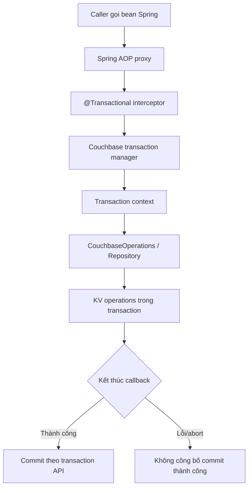

# CouchbaseTransactionManager và kích hoạt quản lý giao dịch

Trong module **SPRING_DATA_COUCHBASE**, việc gọi hai phương thức `repository.save(...)` liên tiếp không đủ bảo đảm “hoặc cả hai document được thay đổi, hoặc không document nào được thay đổi”. Khi nghiệp vụ có bất biến xuyên nhiều document, ứng dụng cần **transaction context thực sự** để phối hợp các thao tác. Một cách tích hợp với Spring là dùng cơ chế transaction manager của Spring Data Couchbase cùng `@EnableTransactionManagement` và `@Transactional`.

Tên **CouchbaseTransactionManager** thường xuất hiện trong phần mô tả của tài liệu như tên gọi chung cho transaction manager Couchbase. Nhưng trong các dòng API Spring Data Couchbase hiện hành, lớp cụ thể được công bố là **`org.springframework.data.couchbase.transaction.CouchbaseCallbackTransactionManager`**; bean mặc định thường được đặt tên **`couchbaseTransactionManager`**. Đây là khác biệt giữa **tên chức năng/bean** và **tên class Java** cần đặc biệt lưu ý khi import.

Bài thuộc chương **Giao dịch**. Chúng ta sẽ đi từ cách kích hoạt quản lý giao dịch trong Spring, hiểu luồng proxy/interceptor, chọn đúng transaction manager khi có nhiều datastore, sử dụng `CouchbaseRepository` hoặc `CouchbaseTemplate` trong phạm vi được hỗ trợ, đến giao dịch reactive, xử lý lỗi, CAS, TTL, SQL++ và kiểm thử rollback thực tế.

## 1. Mục tiêu học tập

Sau bài này, bạn có thể:

- Giải thích vai trò của **`CouchbaseCallbackTransactionManager`**, bean `couchbaseTransactionManager`, `@EnableTransactionManagement` và `@Transactional`.
- Phân biệt **kích hoạt Spring transaction interception** với **việc các Couchbase operation thực sự tham gia một transaction**.
- Cấu hình một ứng dụng mẫu dựa trên `AbstractCouchbaseConfiguration`, đồng thời biết khi nào phải dựa vào auto-configuration thay vì khai báo bean trùng.
- Áp dụng `@Transactional` trên **public service method được gọi qua Spring proxy**, nhận ra lỗi self-invocation.
- Phối hợp các thao tác Spring Data Couchbase **được hỗ trợ** trong cùng transaction; không nhầm với mọi SDK/SQL++/JPA operation bất kỳ.
- Sử dụng `CouchbaseTransactionalOperator` cho trường hợp cần quản lý phạm vi giao dịch bằng API chương trình, đặc biệt trong reactive pipeline.
- Lý giải yêu cầu `@Version Long`, CAS, keyspace, transaction metadata, timeout, durability và các giới hạn rollback/isolation.
- Kiểm chứng tính nguyên tử bằng **integration test có lỗi có kiểm soát**, xử lý conflict, callback retry và trạng thái commit chưa rõ kết quả.

## 2. Bài toán: chuyển điểm giữa hai document

Giả sử hệ thống loyalty có hai document tại:

```text
Bucket:     appdata
Scope:      loyalty
Collection: accounts

account::tenant-a::A101   rewardPoints = 150
account::tenant-a::A102   rewardPoints =  50
```

Yêu cầu chuyển 40 điểm từ A101 sang A102, với bất biến:

\[A101 \ge 0,\qquad A101 + A102 = 200\]

Khi chuyển thành công, dữ liệu phải là:

```text
account::tenant-a::A101   rewardPoints = 110
account::tenant-a::A102   rewardPoints =  90
```

Nếu thao tác trừ điểm thành công nhưng thao tác cộng điểm thất bại, tổng điểm sẽ trở thành 160. Đối với nghiệp vụ này, kết quả hoàn tất một phần không được công bố là thành công.

Mã **không có transaction**:

```java
Account source = repository.findById(sourceKey).orElseThrow();
Account target = repository.findById(targetKey).orElseThrow();

source.setRewardPoints(source.getRewardPoints() - 40);
repository.save(source); // Có thể đã commit.

target.setRewardPoints(target.getRewardPoints() + 40);
repository.save(target); // Có thể thất bại.
```

Cả hai entity có `@Version` cũng chỉ bảo vệ **CAS của từng document**; xung đột trên document đích không tự đảo ngược thao tác đã ghi trên document nguồn.

Chúng ta cần đặt những thao tác có liên quan vào **một ranh giới giao dịch được Spring Data Couchbase thực sự hỗ trợ**, hoặc dùng trực tiếp API transactions của Couchbase Java SDK.

## 3. Các thành phần của một giao dịch Spring



Trong luồng này:

1. `@EnableTransactionManagement` cho phép Spring cấu hình phần **interception** cần thiết.
2. `@Transactional` mô tả method cần chạy trong một transaction.
3. Spring AOP proxy chặn lời gọi từ bean khác, chọn đúng transaction manager.
4. **`CouchbaseCallbackTransactionManager`** tích hợp cơ chế transaction có callback của Couchbase.
5. Các operation Spring Data Couchbase **được hỗ trợ và nằm trong context** tham gia đơn vị giao dịch.
6. Cơ chế transaction thực hiện commit/abort, xử lý conflict và retry theo API hỗ trợ.

**Không phải mọi phương thức Java được đặt trong cùng một method đều tự trở thành transaction.** Một lệnh gửi email, thao tác JDBC/JPA, lời gọi HTTP hoặc SDK operation ngoài context không tự được quản lý bởi Couchbase transaction manager.

## 4. Phân biệt tên `CouchbaseTransactionManager` và class thực tế

Một nguồn gây lỗi biên dịch là sao chép tên class từ mô tả mà không đối chiếu Java API.

| Thuật ngữ | Vai trò | Điều cần kiểm tra |
| --- | --- | --- |
| *Couchbase transaction manager* | Tên khái quát của thành phần quản lý transaction Couchbase | Không phải lúc nào cũng là tên class để import |
| `CouchbaseCallbackTransactionManager` | Class trong package `org.springframework.data.couchbase.transaction` ở các dòng API hiện hành | Đây là lớp được JavaDoc công bố; implements `CallbackPreferringPlatformTransactionManager` |
| `couchbaseTransactionManager` | Tên bean Spring được dùng trong cấu hình thông thường | Cần xác minh bean thực sự tồn tại trước khi dùng làm qualifier |
| `@EnableTransactionManagement` | Bật cơ chế interceptor/proxy cho giao dịch Spring | Không tự tạo cluster, bucket, quyền hay index |
| `@Transactional` | Khai báo phạm vi giao dịch trên method/class | Phải chọn đúng manager và đi qua proxy |
| `CouchbaseTransactionalOperator` | API chương trình để xây transaction scope trong Spring Data Couchbase | Cần dùng operator Couchbase theo phiên bản |
| `cluster.transactions().run(...)` | API transaction của Couchbase Java SDK | Không cần Spring `@Transactional` để hoạt động |

Khi gặp ví dụ import kiểu:

```java
// Không tự sao chép tên class này nếu dependency không có:
import org.springframework.data.couchbase.transaction.CouchbaseTransactionManager;
```

hãy kiểm tra package/class thật trong **Javadoc của phiên bản đang dùng**. Với API có `CouchbaseCallbackTransactionManager`, import đúng là:

```java
import org.springframework.data.couchbase.transaction.CouchbaseCallbackTransactionManager;
```

Lưu ý: tên bean và cách cung cấp bean có thể phụ thuộc Spring Data/Boot version và tùy chỉnh ứng dụng. Tránh kết luận class Java hoặc bean tồn tại chỉ vì thấy một từ trong bài viết cũ.

## 5. Yêu cầu phiên bản và hạ tầng trước khi bật quản lý giao dịch

Tài liệu Spring Data Couchbase cho các dòng tích hợp Spring transaction nêu những yêu cầu như:

- Couchbase Server có hỗ trợ distributed transactions, với mốc yêu cầu cụ thể tùy dòng tài liệu (ví dụ **6.6.1 trở lên** trong hướng dẫn Spring Data hiện đại).
- Spring Data Couchbase từ dòng có tích hợp Spring transaction, ví dụ **5.0.0-M5 trở lên** ở tài liệu tương ứng.
- Node Couchbase được đồng bộ thời gian qua **NTP**, đặc biệt có ích cho xử lý metadata cleanup.
- Entity dùng qua Spring Data transaction có **`@Version Long`** để giữ CAS.
- Java SDK, Spring Boot và Spring Data phải là một **bộ phiên bản tương thích**, không kết hợp tùy ý các major version.

**Đừng hiểu các mốc trên là một ma trận tương thích đầy đủ.** Trước khi vận hành, cần kiểm tra release notes và API reference của đúng phiên bản Couchbase Server, SDK, Spring Data, Spring Boot và Java runtime được triển khai.

### 5.1. Kiểm tra từng lớp trách nhiệm

| Thành phần | Trách nhiệm | Cần xác minh |
| --- | --- | --- |
| Couchbase Server | Cung cấp KV và transaction engine | Phiên bản, topology, tính năng transaction |
| Data Service | Đọc/ghi document theo key | Có thể truy cập các collection nguồn/đích |
| Query/Index Service | Phục vụ SQL++ khi use case dùng query | Có index và quyền đúng collection |
| Java SDK | Giao tiếp cluster, transactions API | Phiên bản tương thích, timeout và transaction options |
| Spring Data Couchbase | Mapping, Repository/Template và Spring transaction integration | Bean manager, `@Version`, operation được hỗ trợ |
| Spring transaction infrastructure | `@EnableTransactionManagement`, proxy/interceptor | Method thực sự chạy qua proxy và manager đúng |
| RBAC/metadata | Quyền thao tác và transaction metadata/ATR | Không thiếu quyền ở collection metadata |
| Ứng dụng | Bất biến, idempotency, phân quyền tenant | Không đưa side effect ngoài Couchbase vào callback |

`@EnableTransactionManagement` không sửa được lỗi thiếu quyền, sai collection, thiếu secondary index hoặc SDK không tương thích. Nó chỉ xử lý một phần trong toàn bộ luồng.

## 6. Khai báo entity có `@Version Long`

Ví dụ sử dụng bucket `appdata`, scope `loyalty`, collection `accounts`:

```java
package com.example.loyalty.domain;

import org.springframework.data.annotation.Id;
import org.springframework.data.annotation.Version;
import org.springframework.data.couchbase.core.mapping.Collection;
import org.springframework.data.couchbase.core.mapping.Document;
import org.springframework.data.couchbase.core.mapping.Field;
import org.springframework.data.couchbase.core.mapping.Scope;

@Document
@Scope("loyalty")
@Collection("accounts")
public class Account {

    @Id
    private String id;

    @Field
    private String tenantId;

    @Field
    private String accountCode;

    @Field
    private long rewardPoints;

    @Field
    private String status;

    @Version
    private Long version;

    public Account() {
    }

    public Account(String id, String tenantId,
                   String accountCode, long rewardPoints,
                   String status) {
        this.id = id;
        this.tenantId = tenantId;
        this.accountCode = accountCode;
        this.rewardPoints = rewardPoints;
        this.status = status;
    }

    public String getId() { return id; }
    public void setId(String id) { this.id = id; }

    public String getTenantId() { return tenantId; }
    public void setTenantId(String tenantId) {
        this.tenantId = tenantId;
    }

    public String getAccountCode() { return accountCode; }
    public void setAccountCode(String accountCode) {
        this.accountCode = accountCode;
    }

    public long getRewardPoints() { return rewardPoints; }
    public void setRewardPoints(long rewardPoints) {
        this.rewardPoints = rewardPoints;
    }

    public String getStatus() { return status; }
    public void setStatus(String status) {
        this.status = status;
    }

    public Long getVersion() { return version; }
    public void setVersion(Long version) { this.version = version; }
}
```

Điểm cần nắm:

- `@Id` ánh xạ **document key**; ví dụ `account::tenant-a::A101`.
- `@Scope`/`@Collection` chỉ đích lưu trữ; chúng **không tự tạo** bucket/scope/collection.
- `@Version` của Spring Data ánh xạ **CAS metadata** để hỗ trợ optimistic locking và transaction integration.
- `Long` là kiểu được tài liệu Spring Data Couchbase transaction yêu cầu trong các dòng tương ứng. Không đổi sang `Integer` rồi giả định tương đương.
- CAS là một **token mờ**, không phải bộ đếm do ứng dụng tăng `1, 2, 3`.
- `schemaVersion` của JSON, nếu có, là trường nghiệp vụ/migration riêng; không thay thế `@Version`.

Repository:

```java
package com.example.loyalty.repository;

import com.example.loyalty.domain.Account;
import org.springframework.data.couchbase.repository.CouchbaseRepository;

public interface AccountRepository
        extends CouchbaseRepository<Account, String> {
}
```

`findById` thường dùng KV theo key đầy đủ; các truy vấn theo JSON có thể dùng SQL++ và cần index. Việc thao tác nằm trong transaction hay không phụ thuộc context chứ **không chỉ** vì interface kế thừa `CouchbaseRepository`.

## 7. Kích hoạt Spring transaction với cấu hình Java

Một cách cấu hình tường minh là dùng `AbstractCouchbaseConfiguration` và `@EnableTransactionManagement`.

```java
package com.example.loyalty.config;

import org.springframework.beans.factory.annotation.Value;
import org.springframework.context.annotation.Configuration;
import org.springframework.data.couchbase.config.AbstractCouchbaseConfiguration;
import org.springframework.data.couchbase.repository.config.EnableCouchbaseRepositories;
import org.springframework.transaction.annotation.EnableTransactionManagement;

@Configuration(proxyBeanMethods = false)
@EnableTransactionManagement
@EnableCouchbaseRepositories(
        basePackages = "com.example.loyalty.repository")
public class CouchbaseDataConfiguration
        extends AbstractCouchbaseConfiguration {

    @Value("${spring.couchbase.connection-string}")
    private String connectionString;

    @Value("${spring.couchbase.username}")
    private String username;

    @Value("${spring.couchbase.password}")
    private String password;

    @Value("${spring.data.couchbase.bucket-name}")
    private String bucketName;

    @Override
    public String getConnectionString() {
        return connectionString;
    }

    @Override
    public String getUserName() {
        return username;
    }

    @Override
    public String getPassword() {
        return password;
    }

    @Override
    public String getBucketName() {
        return bucketName;
    }
}
```

Đây là một **cách cấu hình tham khảo** cho Spring Data Couchbase khi chủ động quản lý cấu hình. Các dòng Spring Boot có thể đã tự auto-configure cluster, template, repository và transaction manager. **Không sao chép cấu hình thủ công song song với auto-configuration gây bean trùng** mà không kiểm tra ứng dụng hiện tại.

Các property môi trường phát triển tương ứng:

```yaml
spring:
  couchbase:
    connection-string: couchbase://localhost
    username: loyalty_app
    password: ${COUCHBASE_PASSWORD}
  data:
    couchbase:
      bucket-name: appdata
```

Không commit mật khẩu thật; môi trường production cần TLS, secret manager, tài khoản RBAC tối thiểu, timeout và durability phù hợp.

### 7.1. `AbstractCouchbaseConfiguration` cung cấp gì?

Trong các dòng Spring Data hỗ trợ, cấu hình nền này tạo hoặc đăng ký các bean phục vụ:

- Couchbase SDK cluster/client factory.
- Mapping context và converter.
- `CouchbaseTemplate` và các operations tương ứng.
- Repository operations mapping.
- Transaction manager Couchbase và `CouchbaseTransactionalOperator` theo API dòng phiên bản.

Không nên tự khai báo thêm `new CouchbaseCallbackTransactionManager(...)` khi đã có một bean tương đương mà chưa kiểm tra tên, cấu hình và nhu cầu override. Nhiều bean transaction manager cùng loại có thể làm tăng rủi ro chọn nhầm.

### 7.2. `@EnableTransactionManagement` làm gì?

Annotation này kích hoạt cơ chế Spring transaction advice, thường dựa trên **AOP proxy**. Nó không tự:

- Tạo một transaction cho mọi method của mọi bean.
- Đưa SDK operation ngoài context vào transaction.
- Gộp các lời gọi JPA/PostgreSQL với Couchbase thành một distributed transaction.
- Tạo bucket/scope/collection hoặc index.
- Cấp quyền metadata transaction hay xử lý dữ liệu bị thiếu.

Để method giao dịch thực sự hoạt động, phải **được Spring quản lý** và **được gọi qua proxy**. Các phiên bản có thể dùng cơ chế interception đặc thù cho callback transactions, nên cần xác minh qua integration test.

## 8. Chọn đúng manager khi ứng dụng có nhiều datastore

Một ứng dụng có thể dùng cả `CouchbaseRepository` và `JpaRepository`. Khi đó có thể có nhiều `PlatformTransactionManager` hoặc các bean transaction management khác.

Ví dụ service muốn chọn rõ Couchbase manager:

```java
import org.springframework.transaction.annotation.Transactional;

@Transactional(transactionManager = "couchbaseTransactionManager")
public void transferPoints(...) {
    // Thao tác Couchbase được hỗ trợ.
}
```

Tên `couchbaseTransactionManager` ở trên là tên bean chuẩn thường được Spring Data Couchbase công bố; cần kiểm tra context thực tế nếu dự án tùy chỉnh bean name.

Nếu không chỉ định manager:

```java
@Transactional
public void transferPoints(...) {
    // Manager nào được chọn?
}
```

Spring phải phân giải transaction manager theo cấu hình. Khi có nhiều bean, có thể xảy ra nhập nhằng, dùng manager mặc định không đúng hoặc cấu hình không phù hợp.

### 8.1. Ranh giới không thể vượt qua chỉ bằng annotation

```text
CheckoutService
   +-- OrderRepository (PostgreSQL/JPA)
   +-- AccountRepository (Couchbase)
```

Gắn `@Transactional(transactionManager = "couchbaseTransactionManager")` lên toàn method **không** khiến transaction manager JPA tự tham gia transaction Couchbase. Gắn annotation chọn JPA manager cũng không khiến Couchbase mutation tự rollback theo JPA.

Nếu nghiệp vụ cần phối hợp giữa hai datastore, cân nhắc **outbox, saga, idempotency, reconciliation** hoặc thiết kế lại nguồn sự thật; không hứa ACID xuyên hai hệ thống chỉ vì có annotation.

### 8.2. Kiểm tra bean manager thật

Có thể quan sát các transaction manager bằng một integration test khởi động application context:

```java
import java.util.Map;
import org.junit.jupiter.api.Test;
import org.springframework.beans.factory.annotation.Autowired;
import org.springframework.boot.test.context.SpringBootTest;
import org.springframework.context.ApplicationContext;
import org.springframework.transaction.TransactionManager;

import static org.junit.jupiter.api.Assertions.assertTrue;

@SpringBootTest
class TransactionManagerBootstrapTest {

    @Autowired
    ApplicationContext applicationContext;

    @Test
    void couchbaseTransactionManagerExists() {
        Map<String, TransactionManager> managers =
                applicationContext.getBeansOfType(
                        TransactionManager.class);

        assertTrue(
                managers.containsKey("couchbaseTransactionManager"));
    }
}
```

Test chỉ xác minh **bean có mặt và tên đúng** trong context. Nó chưa chứng minh các operation thật sự commit/abort nguyên tử; phải có integration test thao tác dữ liệu.

## 9. `@Transactional` phải đi qua Spring proxy

Đây là một nguyên nhân phổ biến khiến người viết tin rằng transaction đã được bật nhưng thực tế không có interception.

### 9.1. Cách đúng: caller lấy service bean từ Spring

```java
@Service
public class RewardControllerService {

    private final TransferService transfers;

    public RewardControllerService(TransferService transfers) {
        this.transfers = transfers;
    }

    public void handleTransfer(
            String tenantId, String sourceKey,
            String targetKey, long amount) {

        transfers.transfer(
                tenantId, sourceKey, targetKey, amount);
    }
}
```

Nếu `TransferService.transfer` là public method được đánh dấu `@Transactional` và được gọi trên Spring bean/proxy, interceptor có cơ hội thiết lập transaction.

### 9.2. Cách sai: self-invocation

```java
@Service
public class TransferService {

    public void handleRequest() {
        // Gọi trực tiếp trong cùng class, bỏ qua Spring proxy.
        transferInternal();
    }

    @Transactional(transactionManager = "couchbaseTransactionManager")
    public void transferInternal() {
        // Đừng mặc định interceptor đã chạy.
    }
}
```

Trong mô hình proxy mặc định, `this.transferInternal()` **không đi qua proxy**. Do đó, đừng xem annotation trên method được gọi nội bộ như bằng chứng có transaction.

Giải pháp thường là tách method giao dịch sang một Spring service riêng được inject, hoặc dùng cơ chế interception phù hợp đã kiểm chứng. Tránh cố vá bằng việc tự gọi `new TransferService()`; object đó không được Spring quản lý và không nhận được transaction advice.

### 9.3. Những bẫy cấu trúc khác

- Method không nằm trên bean do Spring quản lý.
- Đặt `@Transactional` trên method không được proxy/intercept theo cấu hình thực tế.
- Throw exception rồi bắt và **nuốt lỗi ngay trong method** khiến transaction callback đi đến kết thúc “thành công”.
- Đưa thao tác ghi vào một thread/asynchronous callback không mang transaction context.
- Dùng bean transaction manager khác với bean Couchbase operations của repository.
- Khi dùng reactive, trộn blocking `block()` hoặc subscribe thủ công khiến pipeline không còn ở đúng phạm vi.

**Cách chắc chắn nhất:** viết integration test rollback và kiểm tra dữ liệu thực sau lỗi, không chỉ nhìn annotation.

## 10. Ví dụ service giao dịch bằng `CouchbaseOperations`

`CouchbaseTemplate`/`CouchbaseOperations` cung cấp các thao tác đọc/ghi entity được Spring Data mapping. Những operation insert, find, replace, delete được Spring Data hỗ trợ có thể tham gia transaction khi chạy trong context phù hợp.

Ví dụ dùng `findById` và `replaceById` để chuyển điểm:

```java
package com.example.loyalty.service;

import com.example.loyalty.domain.Account;
import java.util.Objects;
import org.springframework.data.couchbase.core.CouchbaseOperations;
import org.springframework.stereotype.Service;
import org.springframework.transaction.annotation.Transactional;

@Service
public class TransferService {

    private final CouchbaseOperations operations;

    public TransferService(CouchbaseOperations operations) {
        this.operations = operations;
    }

    @Transactional(transactionManager = "couchbaseTransactionManager")
    public void transfer(
            String authorizedTenantId,
            String sourceKey,
            String targetKey,
            long amount) {

        if (amount <= 0 || Objects.equals(
                sourceKey, targetKey)) {
            throw new IllegalArgumentException(
                    "Yêu cầu chuyển điểm không hợp lệ");
        }

        Account source = operations.findById(Account.class)
                .one(sourceKey);
        Account target = operations.findById(Account.class)
                .one(targetKey);

        if (source == null || target == null) {
            throw new IllegalStateException(
                    "Thiếu tài khoản nguồn hoặc đích");
        }

        if (!authorizedTenantId.equals(source.getTenantId())
                || !authorizedTenantId.equals(
                        target.getTenantId())) {
            throw new IllegalStateException(
                    "Tài khoản không thuộc tenant được phép");
        }

        if (!"OPEN".equals(source.getStatus())
                || !"OPEN".equals(target.getStatus())) {
            throw new IllegalStateException(
                    "Tài khoản không sẵn sàng");
        }

        if (source.getRewardPoints() < amount) {
            throw new IllegalStateException(
                    "Không đủ điểm");
        }

        long newTargetPoints = Math.addExact(
                target.getRewardPoints(), amount);
        long newSourcePoints =
                source.getRewardPoints() - amount;

        source.setRewardPoints(newSourcePoints);
        target.setRewardPoints(newTargetPoints);

        operations.replaceById(Account.class).one(source);
        operations.replaceById(Account.class).one(target);
    }
}
```

Giải thích:

- `authorizedTenantId` phải lấy từ **ngữ cảnh xác thực đã ủy quyền**, không tin trực tiếp query parameter của client.
- Đọc và replace được thực hiện **bên trong method transactional được gọi qua proxy**.
- Spring Data transaction integration phải được cấu hình đúng để hai operation tham gia cùng Couchbase transaction; `@Version Long` giúp mapping CAS theo yêu cầu tài liệu.
- Không gọi `repository.save` hoặc SDK `collection.upsert` bên ngoài context rồi mặc định chúng cùng commit.
- Đặt kiểm tra invariant và tính toán trong phạm vi có thể được transaction callback **thử lại** nếu conflict.
- Khi transaction commit thành công, kết quả 110/90 bảo toàn tổng 200. Nếu không có transaction thực, code sẽ có nguy cơ hoàn tất một phần.

**Lưu ý về compatibility:** Mẫu `CouchbaseOperations`, `findById(...).one(...)`, `replaceById(...).one(...)` và tên transaction manager cần được đối chiếu với đúng phiên bản Spring Data Couchbase triển khai. Đoạn mã giả định các bean hạ tầng và repository đã được cấu hình phù hợp.

## 11. Mở rộng bằng Repository khi đã có transaction context

Không nhất thiết mọi use case giao dịch phải viết hoàn toàn bằng Template. Spring Data Couchbase hỗ trợ một tập các repository method đi qua operations được tích hợp transaction.

Ví dụ về cấu trúc service:

```java
@Service
public class AccountMaintenanceService {

    private final AccountRepository accounts;

    public AccountMaintenanceService(AccountRepository accounts) {
        this.accounts = accounts;
    }

    @Transactional(transactionManager = "couchbaseTransactionManager")
    public void changeTwoStatuses(
            String accountA, String accountB) {

        Account a = accounts.findById(accountA)
                .orElseThrow();
        Account b = accounts.findById(accountB)
                .orElseThrow();

        a.setStatus("SUSPENDED");
        b.setStatus("SUSPENDED");

        accounts.save(a);
        accounts.save(b);
    }
}
```

**Không đánh đồng “có `@Transactional`” với “mọi repository method đều hỗ trợ transaction”.** Cần xác minh phiên bản, operation thực tế được repository gọi và cách Spring Data gắn nó với transaction context. Những API đặc biệt, bulk/stream, custom SDK calls hoặc SQL++ query có thể có quy tắc và giới hạn riêng.

Nếu method `save` thực hiện thao tác khác với `replaceById` mong đợi, hoặc module/phiên bản hiện tại không hỗ trợ đường transaction đó, dùng một operation đã được tài liệu hỗ trợ hoặc chuyển sang adapter SDK transaction rõ ràng. Test rollback là điều kiện cần trước khi dựa vào lời hứa atomicity trong nghiệp vụ.

## 12. Callback manager và vấn đề rollback attributes

**`CouchbaseCallbackTransactionManager`** tích hợp với Spring thông qua mô hình callback transaction. Điều này có một số khác biệt so với JPA `PlatformTransactionManager` truyền thống.

Tài liệu Spring Data Couchbase cho các dòng tích hợp mô tả:

- Transaction có **read-committed isolation** trong phạm vi hỗ trợ.
- Các thuộc tính rollback tùy biến của `@Transactional` có thể **không được áp dụng theo cách người dùng quen thuộc với JPA**; một số tài liệu ghi rõ `rollback attributes` bị bỏ qua trong release tương ứng.
- Callback/method body có thể được **thực thi lại** khi transaction thất bại ở tình huống có thể retry.

Vì vậy, **đừng** giả định có thể dùng `rollbackFor` hoặc `noRollbackFor` theo đúng semantics JPA cho mọi phiên bản Couchbase transaction integration.

Ví dụ dễ gây hiểu lầm:

```java
@Transactional(
    transactionManager = "couchbaseTransactionManager",
    noRollbackFor = IllegalStateException.class
)
public void riskyOperation() {
    // Đừng suy từ annotation rằng Couchbase sẽ
    // commit các mutation đã stage khi throw exception.
}
```

Cần kiểm tra tài liệu đúng phiên bản và thực nghiệm behavior thực tế. Với bất biến bắt buộc, thiết kế method transactional theo hướng **lỗi nghiệp vụ hoặc lỗi hệ thống có nghĩa không công bố commit thành công**, rồi xây quy trình đối soát khi kết quả commit không rõ.

### 12.1. Bắt exception trong method có thể làm mất ý nghĩa rollback

```java
@Transactional(transactionManager = "couchbaseTransactionManager")
public void dangerousWorkflow() {
    try {
        performFirstMutation();
        performSecondMutation();
    } catch (RuntimeException e) {
        logger.warn("Failed", e);
        // Nếu nuốt lỗi, method trở về bình thường!
    }
}
```

Đây là mẫu **không nên dùng** cho một invariant all-or-nothing. Callback có thể kết thúc bình thường dù thao tác cuối thất bại; ngữ nghĩa thực tế còn tùy SDK/context. Tốt hơn là phân loại lỗi và **ném tiếp** hoặc đánh dấu/abort theo API transaction tương ứng, sau đó xử lý phản hồi ở tầng ngoài.

Đối với code production, phải quyết định rõ liệu exception có được chuyển sang lỗi nghiệp vụ, có phải abort transaction hay là tình trạng commit chưa rõ.

## 13. Không đưa side effect ngoài Couchbase vào callback có thể retry

Ví dụ nguy hiểm:

```java
@Transactional(transactionManager = "couchbaseTransactionManager")
public void transferAndNotify(...) {
    // Cập nhật hai account.
    emailService.sendTransferNotice(); // Không an toàn!
}
```

Nếu method body được transaction infrastructure thực thi lại do conflict, email có thể được gửi nhiều lần hoặc được gửi trước khi transaction cuối cùng abort. Những điều tương tự áp dụng cho:

- Thanh toán bằng dịch vụ ngoài.
- Gửi Kafka/RabbitMQ message không có deduplication.
- Gọi API tạo đơn hàng ở hệ thống khác.
- Ghi vào datasource JPA không nằm cùng transaction.
- Tăng counter ngoài Couchbase.

Đối với sự kiện cần phát **sau commit**, cân nhắc **outbox** được quản lý trong ranh giới nhất quán của hệ thống nguồn và consumer có idempotency; hoặc workflow saga với bù trừ. Một callback có thể chạy lại không nên chứa side effect không thể đảo ngược.

### 13.1. Idempotency key cho lệnh chuyển điểm

Một `transferId` như `transfer::tenant-a::T9001` có thể được ghi nhận bằng một document insert-only trong cùng workflow được bảo vệ. Nếu client retry sau timeout, hệ thống tìm trạng thái theo ID và không trừ/cộng điểm thêm lần nữa.

Chỉ kiểm tra `existsById(transferId)` rồi mới ghi không đủ để tránh race condition giữa hai request; việc ghi nhận duy nhất phải được bảo vệ **ngay tại mutation** và gắn với logic chuyển điểm phù hợp.

## 14. `CouchbaseTransactionalOperator` cho phạm vi giao dịch theo chương trình

Đối với những nơi không tiện dùng annotation trên service method, Spring Data Couchbase cung cấp **`CouchbaseTransactionalOperator`**.

Điểm quan trọng: dùng operator **chuyên biệt của Couchbase**, không tự giả định một `org.springframework.transaction.reactive.TransactionalOperator` thông thường tương đương cho callback-based transaction integration.

### 14.1. Ví dụ với reactive operations

```java
import org.springframework.data.couchbase.core.ReactiveCouchbaseTemplate;
import org.springframework.data.couchbase.transaction.CouchbaseTransactionalOperator;
import reactor.core.publisher.Flux;

public Flux<Account> suspend(
        CouchbaseTransactionalOperator operator,
        ReactiveCouchbaseTemplate template,
        String accountId) {

    return operator.execute(status ->
            template.findById(Account.class)
                    .one(accountId)
                    .flatMap(account -> {
                        account.setStatus("SUSPENDED");
                        return template.replaceById(Account.class)
                                .one(account);
                    }));
}
```

Đoạn mã minh họa cách **bọc một publisher trong transaction operator Couchbase**, sử dụng reactive template operations. `execute(...)` trả publisher theo API tương ứng; subscription mới kích hoạt pipeline và có thể kích hoạt lại khi resubscribe/retry.

Nếu muốn tạo operator thủ công, tài liệu Spring Data hướng dẫn dùng:

```java
CouchbaseTransactionalOperator operator =
        CouchbaseTransactionalOperator.create(
                couchbaseCallbackTransactionManager);
```

Thay vì cố dùng factory của operator reactive chung, phải kiểm tra **kiểu manager và overload đúng theo Javadoc**. Khi `AbstractCouchbaseConfiguration` đã tạo sẵn bean operator, ưu tiên inject bean đó.

### 14.2. Reactive `@Transactional`

Trong các dòng Spring Data hỗ trợ, một method trả `Mono<T>` hoặc `Flux<T>` có thể được đánh dấu `@Transactional` và tham gia Couchbase transaction theo cơ chế intercept đặc thù. Nhưng phải phân biệt:

- **Đăng ký publisher** khác với **thực thi publisher**.
- Các operator như `Mono.when` hoặc `Flux.merge` không tự tạo transaction.
- Retry/resubscribe có thể thực thi side effect nhiều lần.
- Không gọi `block()` trên event-loop chỉ để “đợi commit”.
- Không trộn reactive API với imperative API bên ngoài transaction context và kỳ vọng chúng cùng commit.

Ví dụ:

```java
@Service
public class ReactiveAccountService {

    private final ReactiveCouchbaseTemplate template;

    public ReactiveAccountService(
            ReactiveCouchbaseTemplate template) {
        this.template = template;
    }

    @Transactional(transactionManager = "couchbaseTransactionManager")
    public reactor.core.publisher.Mono<Account> suspend(String key) {
        return template.findById(Account.class)
                .one(key)
                .flatMap(account -> {
                    account.setStatus("SUSPENDED");
                    return template.replaceById(Account.class)
                            .one(account);
                });
    }
}
```

Đây là ví dụ một document để tập trung vào cơ chế interception. Đối với nhiều document, phải đảm bảo **toàn bộ publisher cần tham gia** được xây bên trong cùng phạm vi transaction hỗ trợ và kiểm thử lỗi giữa các mutation.

## 15. API giao dịch trực tiếp của Couchbase SDK là một lựa chọn khác

Không phải use case nào cũng phải dùng Spring `@Transactional`. Couchbase Java SDK có API riêng:

```java
import com.couchbase.client.java.Cluster;

cluster.transactions().run(ctx -> {
    // Dùng các thao tác transactions SDK được hỗ trợ,
    // ví dụ ctx.get(), ctx.replace(), ctx.insert(), ctx.remove().
});
```

Tài liệu Spring Data Couchbase cũng mô tả **các Spring Data operations được hỗ trợ có thể tham gia trong lambda SDK transaction** nhờ integration của thư viện. Ví dụ:

```java
import com.couchbase.client.java.Cluster;
import org.springframework.data.couchbase.core.CouchbaseOperations;

cluster.transactions().run(ctx -> {
    Account account = operations.findById(Account.class)
            .one(accountKey);

    account.setStatus("SUSPENDED");
    operations.replaceById(Account.class).one(account);
});
```

Đây là mẫu ý tưởng, giả định `cluster` và `operations` đã được inject/cấu hình trên cùng Couchbase client infrastructure và phiên bản Spring Data hỗ trợ context propagation tương ứng.

**Không suy ra mọi SDK call hay mọi method repository đều tự động được đưa vào transaction.** Những thao tác nằm ngoài callback/context, hoặc loại operation không được transaction integration hỗ trợ, có thể chạy độc lập. Đối với code cần độ tin cậy cao, kiểm tra API và integration test ở đúng phiên bản.

So sánh:

| Phương án | Ai tạo context? | Dùng khi nào? |
| --- | --- | --- |
| `@Transactional` + manager Couchbase | Spring transaction interception | Service giao dịch rõ ràng, có proxy |
| `CouchbaseTransactionalOperator` | Operator Couchbase | Muốn điều khiển phạm vi bằng code, đặc biệt reactive |
| `cluster.transactions().run(...)` | Java SDK | Cần trực tiếp điều khiển transaction callback/SDK operations |
| `repository.saveAll(...)` không có transaction | Không có transaction context chung | Chỉ khi cho phép kết quả từng phần |
| Hai `save(...)` liên tiếp | Không có transaction context chung | Không đáp ứng invariant xuyên hai document |

## 16. SQL++, index và scan consistency khi ở trong giao dịch

Khi đã biết document key, có thể dùng KV find/replace trong transaction. Khi cần tìm theo `tenantId`, `status` hoặc predicate JSON, có thể phải dùng SQL++ với index phù hợp.

Ví dụ:

```sql
SELECT META(a).id AS documentKey, a.rewardPoints
FROM `appdata`.`loyalty`.`accounts` AS a
WHERE a.tenantId = $tenantId
  AND a.status = "OPEN";
```

Một chỉ mục minh họa:

```sql
CREATE INDEX ix_accounts_tenant_status
ON `appdata`.`loyalty`.`accounts`(
    tenantId,
    status
);
```

**Phải phân biệt:**

- SQL++ query độc lập thông qua `cluster.query(...)` **không mặc nhiên** tham gia transaction Java SDK.
- Query trong transaction phải dùng **API và context được phiên bản hỗ trợ**.
- Derived query repository tham gia transaction hay không cần xem integration và kiểu operation thực thi.
- Secondary index vẫn có yêu cầu về Index/Query Service và scan consistency; transaction **không tự tạo index**.
- `REQUEST_PLUS` giúp index bắt kịp theo một mức nhất quán query; nó không biến thao tác `count` rồi `save` ngoài transaction thành một giao dịch.

Nếu nghiệp vụ bảo vệ invariant trên **tập document theo predicate** như quota, việc chỉ truy vấn `COUNT(*)` rồi insert key mới có thể cần thêm một document **quota guard** hoặc thiết kế xung đột chung để tránh write skew theo mức isolation thực tế.

## 17. Timeout, durability, metadata và cleanup

Cơ chế quản lý giao dịch chỉ là một phần của hệ thống transaction; vẫn cần lựa chọn vận hành phù hợp.

### 17.1. Transaction timeout

Một giao dịch có thể gồm nhiều KV operation, truy vấn SQL++, conflict/retry và commit. Timeout quá thấp gây lỗi thường xuyên; quá cao có thể làm tài nguyên bị giữ lâu.

Cấu hình transaction timeout/durability có thể thực hiện qua **Couchbase SDK environment/transactions configuration** theo API của phiên bản, không tự đặt property Spring không tồn tại rồi kỳ vọng nó có hiệu lực.

Một mẫu khái niệm:

```text
Cluster environment / transactions config
    timeout: khoảng thời gian phù hợp workload
    durability: mức đáp ứng yêu cầu chịu lỗi
    metadata location: collection theo chính sách
```

Phải đọc API thực tế trước khi hiện thực; không có một giá trị timeout tốt cho mọi topology.

### 17.2. Durability không tự tạo atomicity

Một mutation có durability cao vẫn không kéo mutation khác vào cùng transaction. Atomicity đến từ **giao dịch đúng context**; durability là một phần chính sách xác nhận lưu trữ. Mức durability có thể ảnh hưởng độ trễ và yêu cầu replica/topology.

### 17.3. Metadata/ATR và đồng bộ thời gian

Couchbase transactions dùng metadata như **Active Transaction Record (ATR)**. Tài khoản ứng dụng cần quyền trên collection metadata theo cấu hình, không chỉ trên account collection. Cluster nên đồng bộ thời gian bằng NTP để quá trình cleanup ổn định.

Không tự xóa transaction metadata/ATR khi có timeout. Hãy dựa trên cơ chế cleanup và công cụ chẩn đoán được tài liệu hỗ trợ.

## 18. Kết quả commit chưa rõ và retry an toàn

Có thể xảy ra tình trạng client không nhận được xác nhận commit do timeout/mất kết nối ở giai đoạn nhạy cảm. Khi ấy, không thể suy “throw exception” đồng nghĩa “mọi thứ đã rollback”.

| Tình huống | Ý nghĩa | Hành động |
| --- | --- | --- |
| Transaction commit được xác nhận | Giao dịch đã hoàn tất thành công | Trả success và transferId |
| Điều kiện nghiệp vụ bị từ chối trước commit | Ví dụ không đủ điểm, sai tenant | Trả lỗi nghiệp vụ, không retry vô hạn |
| Conflict/abort đã xác định | Có thể retry theo chính sách transaction | Đánh giá lại dữ liệu trong callback mới |
| Commit ambiguous | Client chưa biết kết quả cuối | Tra cứu/đối soát theo transferId |
| Timeout query hoặc thiếu index | Lỗi hạ tầng/query plan | Tối ưu/config; không biến thành “không có dữ liệu” |
| Callback gửi side effect rồi retry | Có nguy cơ side effect lặp | Chuyển sang outbox/idempotency |

Trong các nghiệp vụ cộng/trừ điểm, **retry nguyên request sau timeout** chỉ an toàn khi có idempotency key và cách xử lý kết quả trùng đã được bảo vệ tại thời điểm ghi.

Một transaction manager đúng không thể thay cho **thiết kế trạng thái nghiệp vụ** khi có commit ambiguous hoặc khi caller gửi lại yêu cầu.

## 19. Integration test: chứng minh `@Transactional` thực sự được kích hoạt

Đây là bước quan trọng nhất sau khi cấu hình manager. Chỉ assert bean có mặt hay thấy annotation trong source code **không đủ**.

### 19.1. Setup dữ liệu

Trong collection thử nghiệm:

```text
account::tenant-a::A101   rewardPoints = 150, status = OPEN
account::tenant-a::A102   rewardPoints =  50, status = OPEN
```

Trước mỗi test, khởi tạo lại hai document theo cách cô lập và ghi nhận version.

### 19.2. Thêm một đường lỗi có chủ ý trong service

Ví dụ method khác trên `TransferService`, dùng cùng `CouchbaseOperations`:

```java
@Transactional(transactionManager = "couchbaseTransactionManager")
public void transferThenFail(
        String tenantId, String sourceKey,
        String targetKey, long amount) {

    Account source = operations.findById(Account.class)
            .one(sourceKey);

    if (source == null
            || !tenantId.equals(source.getTenantId())) {
        throw new IllegalArgumentException(
                "Tài khoản không hợp lệ");
    }

    source.setRewardPoints(
            source.getRewardPoints() - amount);
    operations.replaceById(Account.class).one(source);

    // Tạo lỗi sau mutation đầu, trước mutation thứ hai.
    throw new IllegalStateException("FORCED_ABORT_FOR_TEST");
}
```

Đoạn này chỉ dùng trong **test**, không đặt đường cố tình abort trên service production.

### 19.3. Gọi qua Spring bean/proxy và đọc lại

```java
@SpringBootTest
class TransferTransactionIntegrationTest {

    @Autowired
    TransferService transfers;

    @Autowired
    AccountRepository accounts;

    @Test
    void abortDoesNotCommitOnlySourceDeduction() {
        assertThrows(
                IllegalStateException.class,
                () -> transfers.transferThenFail(
                        "tenant-a",
                        "account::tenant-a::A101",
                        "account::tenant-a::A102",
                        40));

        Account source = accounts.findById(
                "account::tenant-a::A101").orElseThrow();

        Account target = accounts.findById(
                "account::tenant-a::A102").orElseThrow();

        assertEquals(150L, source.getRewardPoints());
        assertEquals(50L, target.getRewardPoints());
    }
}
```

Ví dụ giả định đã import JUnit 5/Spring Boot Test tương ứng (`Test`, `Autowired`, `SpringBootTest`, `assertThrows`, `assertEquals`). Test cần chạy với **Couchbase thật hoặc test container tương thích**, môi trường và quyền hỗ trợ transaction. Việc rollback sau lỗi phải được quan sát trong trạng thái lưu trữ, không chỉ ở object Java trong bộ nhớ.

Nếu test thất bại (source đã trừ 40), hãy điều tra **manager được chọn, proxy, operation support, transaction context, bean wiring** trước khi tiếp tục use case production.

### 19.4. Các test bổ sung bắt buộc với nghiệp vụ

1. **Happy path:** chuyển 40, kết quả 110/90, tổng 200.
2. **Không đủ điểm:** không thay đổi account nào.
3. **Khác tenant:** từ chối ngay cả khi key tồn tại.
4. **Conflict:** hai transfer cùng thay đổi source, bảo đảm không âm và không nhân điểm.
5. **Self-invocation:** chứng minh gọi nội bộ không có interception ở cấu hình proxy.
6. **Nhiều managers:** bật JPA và Couchbase, xác minh qualifier chọn đúng.
7. **Commit ambiguous:** có transferId và đường đối soát an toàn.
8. **Reactive:** thực thi subscribe qua operator/context; kiểm tra rollback và resubscribe.
9. **Sai keyspace:** SDK/repository trỏ khác scope/collection phải phát hiện.
10. **Sai quyền metadata:** lỗi được báo rõ, không bị nuốt.

## 20. Các lỗi thường gặp khi kích hoạt Spring transaction

| Triệu chứng | Nguyên nhân có thể | Hướng chẩn đoán |
| --- | --- | --- |
| Import `CouchbaseTransactionManager` không biên dịch | Tài liệu dùng tên mô tả, API cung cấp `CouchbaseCallbackTransactionManager` | Xem JavaDoc/dependency của phiên bản |
| `@Transactional` không bảo vệ hai ghi | Interception không chạy hoặc manager/context sai | Kiểm tra `@EnableTransactionManagement`, proxy và rollback test |
| Gọi method nội bộ nhưng transaction không chạy | Self-invocation bypass proxy | Tách service, gọi qua bean Spring |
| Bean manager không tồn tại | Cấu hình/auto-configuration thiếu hoặc version khác | Kiểm tra application context và `AbstractCouchbaseConfiguration` |
| Nhiều transaction managers | JPA + Couchbase hoặc bean trùng | Chọn manager qua qualifier, tách phạm vi |
| Service ném exception nhưng mutation đã commit | Operation nằm ngoài context hoặc lỗi bị nuốt | Kiểm tra đường execution và dữ liệu thực |
| `@Version` bằng null ở entity đã đọc | Sai mapping hoặc không đúng entity/operation | Kiểm tra `@Version Long`, converter, keyspace |
| `save` bị optimistic lock conflict | CAS cũ | Đọc lại, xử lý conflict; không retry vô hạn |
| Giao dịch query lỗi index | Thiếu Query/Index Service hoặc index | Kiểm tra `EXPLAIN`, keyspace và query |
| SQL++ vừa ghi xong chưa thấy document | Index chưa bắt kịp theo scan consistency | Chọn consistency phù hợp, không nhầm transaction |
| Callback gửi email hai lần | Callback retry hoặc app retry | Outbox/idempotency |
| Transaction timeout nhiều | Thời gian dài, conflict, tài nguyên hoặc query chậm | Tối ưu read/write set, index và cấu hình |
| Lỗi metadata/ATR | Sai RBAC/metadata collection | Kiểm tra quyền và transaction cleanup |
| Reactive publisher có lỗi hoặc không commit | Sai context, subscribe/resubscribe hoặc trộn blocking | Dùng operator Couchbase, test end-to-end |
| `@Transactional` trên Couchbase và JPA cùng method | Không có distributed transaction chung | Thiết kế outbox/saga/reconciliation |

## 21. Bài thực hành

Chuẩn bị ứng dụng Spring Boot với Couchbase thử nghiệm, bucket `appdata`, scope `loyalty`, collection `accounts` và hai document A101/A102 ở trạng thái ban đầu 150/50.

**Bài 1 — Kiểm tra manager.** Xem Spring Data version và Javadoc. Xác định class transaction manager thực tế và bean name được tạo trong application context. Giải thích khác nhau giữa `CouchbaseTransactionManager` (tên gọi) và `CouchbaseCallbackTransactionManager` (class).

**Bài 2 — Bật transaction.** Dùng `@EnableTransactionManagement` với cấu hình Spring Data phù hợp. Đảm bảo account repository, template và manager đúng client factory và bucket.

**Bài 3 — Triển khai service.** Viết public method `@Transactional(transactionManager="couchbaseTransactionManager")` để chuyển 40 điểm, kiểm tra tenant, trạng thái OPEN, điểm không âm.

**Bài 4 — Rollback test.** Ném exception có kiểm soát sau thao tác thay đổi A101 và trước A102. Gọi method từ bean khác, kiểm tra hai giá trị không đổi sau abort.

**Bài 5 — Self-invocation.** Gọi method transactional từ một method trong cùng class, quan sát khác biệt so với gọi qua Spring proxy. Giải thích nguyên nhân.

**Bài 6 — Nhiều managers.** Thêm một JPA datasource thử nghiệm. Chọn manager rõ ràng cho transaction Couchbase, xác minh manager JPA không tham gia như một distributed commit.

**Bài 7 — Reactive.** Dùng `ReactiveCouchbaseTemplate` và `CouchbaseTransactionalOperator` để cập nhật account, có một nhánh lỗi gây abort và integration test publisher.

**Bài 8 — CAS.** Hai request cùng đọc version của một account rồi lưu, quan sát optimistic locking conflict; giải thích tại sao CAS chưa đủ cho transfer hai account.

**Bài 9 — SQL++.** Tạo index tenant/status, thử derived query theo status trong/ngoài transaction theo API được hỗ trợ; phân biệt lỗi index và vấn đề scan consistency.

**Bài 10 — Side effect.** Phác thảo outbox event cho lần chuyển điểm; chứng minh gửi email trực tiếp trong callback có thể lặp khi retry.

Chỉ thử trong môi trường riêng có thể tạo lại dữ liệu. Không cố tình làm lỗi transaction, xóa metadata hoặc tạo conflict tải cao trên cụm production.

## 22. Câu hỏi tự kiểm tra

1. `@EnableTransactionManagement` chịu trách nhiệm gì và không chịu trách nhiệm gì?
2. “CouchbaseTransactionManager” có phải luôn là tên class import trong Java API hiện hành không?
3. `CouchbaseCallbackTransactionManager` khác `CouchbaseTransactionalOperator` ở vai trò nào?
4. Vì sao phải kiểm tra bean name `couchbaseTransactionManager` khi dùng `@Transactional(transactionManager = "...")`?
5. Một method `@Transactional` bị gọi từ chính class của nó có chắc đi qua proxy không?
6. Hai entity có `@Version Long` có đủ bảo đảm transfer điểm all-or-nothing không?
7. Vì sao `@Transactional` được chọn bằng JPA manager không tự rollback Couchbase?
8. Những operation nào của Spring Data Couchbase thường có thể tham gia transaction integration?
9. Có phải mọi SDK call bên trong một Spring method transactional tự tham gia cùng context không?
10. Tại sao rollback/noRollbackFor của Couchbase cần kiểm tra theo version chứ không áp dụng máy móc từ JPA?
11. Vì sao không gửi email trong callback có thể retry?
12. Khi nào dùng `CouchbaseTransactionalOperator` thay vì annotation?
13. Vì sao `Mono.when(saveA, saveB)` không tự tạo transaction?
14. `REQUEST_PLUS` có thay thế transaction context không?
15. Vì sao cần integration test sau khi cố tình ném lỗi giữa hai mutation?
16. Commit ambiguous nên được xử lý theo transferId như thế nào?
17. Vì sao timeout, durability, ATR và RBAC vẫn ảnh hưởng transaction dù manager đã được tạo?
18. Khi có thêm một datastore khác, nên kiểm soát ranh giới atomicity thế nào?

## 23. Ghi nhớ

**Kích hoạt quản lý giao dịch Couchbase gồm hai việc riêng:** bật Spring transaction interception bằng `@EnableTransactionManagement`/`@Transactional` và bảo đảm **transaction manager cùng các Couchbase operations tham gia đúng một context được hỗ trợ**. Trong những dòng Spring Data Couchbase hiện hành, class Java thường là **`CouchbaseCallbackTransactionManager`**, trong khi tên bean thường là `couchbaseTransactionManager`; đừng suy class import chỉ từ tên khái quát.

Hãy khai báo entity có **`@Version Long`**, gọi method transactional **qua Spring proxy**, chọn đúng manager khi ứng dụng có nhiều datastore, không nuốt lỗi trong callback và không thực hiện side effect ngoài Couchbase ở phần có thể retry. **Repository, Template và SDK** có thể được kết hợp trong kiến trúc, nhưng phải xác minh đường operation nào thật sự tham gia transaction. Cuối cùng, một rollback integration test dưới lỗi có kiểm soát mới chứng minh cấu hình đang bảo vệ bất biến, thay vì chỉ nhìn thấy annotation hoặc bean trong mã nguồn.

### Tài liệu tham khảo để đối chiếu theo phiên bản

- [Spring Data Couchbase — Couchbase Transactions](https://docs.spring.io/spring-data/couchbase/reference/6.1/couchbase/transactions.html): yêu cầu, cấu hình `@EnableTransactionManagement`, `@Transactional`, operator và SDK callback.
- [JavaDoc — CouchbaseCallbackTransactionManager](https://docs.spring.io/spring-data/couchbase/reference/api/java/org/springframework/data/couchbase/transaction/CouchbaseCallbackTransactionManager.html): tên lớp, interface và constructor.
- [JavaDoc — AbstractCouchbaseConfiguration](https://docs.spring.io/spring-data/couchbase/reference/api/java/org/springframework/data/couchbase/config/AbstractCouchbaseConfiguration.html): bean manager, template và transactional operator.
- [Couchbase Java SDK — Distributed ACID Transactions](https://docs.couchbase.com/java-sdk/current/concept-docs/transactions.html): transaction context, retry, durability, cleanup và các giới hạn SDK.

Luôn chọn **tài liệu ứng với dependency thực tế** của dự án; không sao chép API hoặc cấu hình của phiên bản khác mà chưa kiểm thử.
