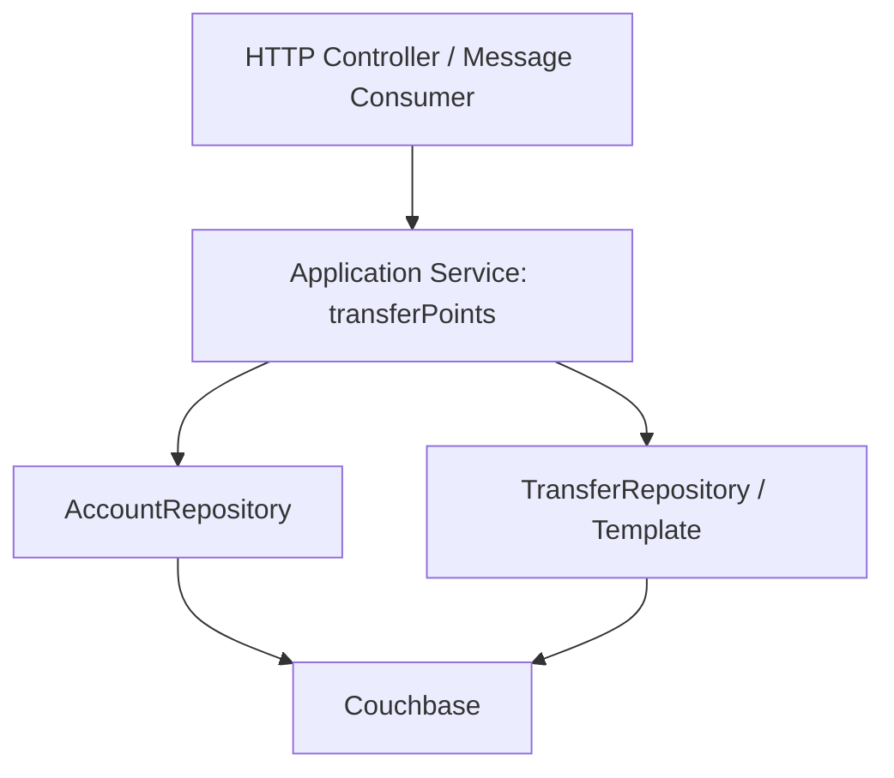
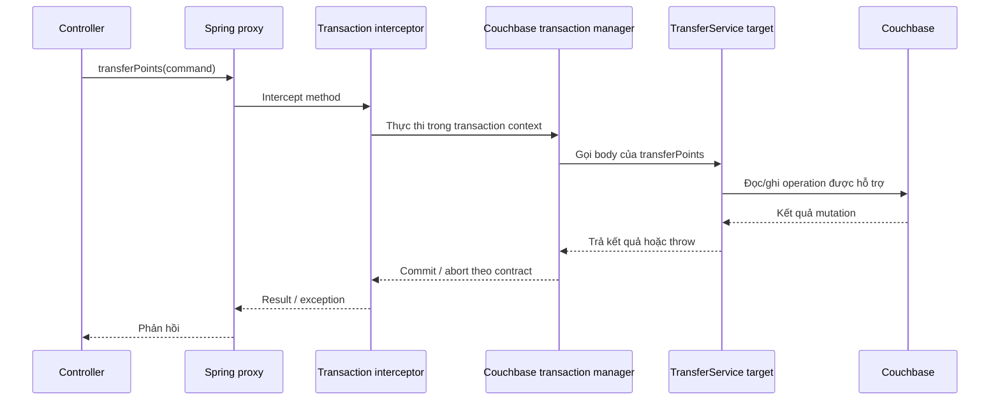
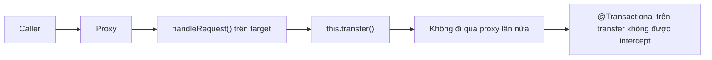

# @Transactional tại ranh giới dịch vụ và cơ chế Spring proxy

Trong chương **Giao dịch** của **SPRING_DATA_COUCHBASE**, việc thêm `@Transactional` vào một method trông rất đơn giản. Tuy nhiên, annotation chỉ có ý nghĩa khi **Spring thực sự chặn được lời gọi**, **chọn đúng transaction manager** và **những thao tác Couchbase cần bảo vệ đều tham gia cùng transaction context**. Nếu một trong ba điều kiện này không đúng, ứng dụng vẫn có thể ghi thành công document thứ nhất nhưng thất bại khi ghi document thứ hai.

Bài học tập trung vào **ranh giới dịch vụ (service boundary)** và **cơ chế Spring AOP proxy**: nên đặt giao dịch ở đâu, vì sao gọi method nội bộ có thể bỏ qua interceptor, exception quyết định kết quả ra sao, và cách kiểm chứng transaction bằng dữ liệu thật. Kiến thức này gắn với Spring Data Couchbase repository, `CouchbaseTemplate`, document mapping, CAS/`@Version`, bucket/scope/collection, truy vấn SQL++, TTL và những khác biệt khi dùng reactive API.

**Thông điệp cốt lõi:** một method có `@Transactional` **chưa đủ là bằng chứng** rằng dữ liệu đã được bảo vệ bởi giao dịch nhiều document.

## 1. Mục tiêu học tập

Sau bài này, bạn có thể:

- Chọn **public application-service method** làm ranh giới cho một thao tác nghiệp vụ cần atomicity trên nhiều document.
- Giải thích chuỗi **caller → Spring proxy → transaction interceptor → transaction manager → target method**.
- Nhận biết khi nào `@Transactional` **không được áp dụng** do self-invocation, đối tượng không do Spring quản lý, method không thể được proxy hoặc lời gọi chuyển sang thread/context khác.
- Phân biệt `@EnableTransactionManagement` với cấu hình **Couchbase transaction manager** và khả năng hỗ trợ giao dịch của Couchbase Server/SDK/Spring Data.
- Dùng `@Transactional(transactionManager = "couchbaseTransactionManager")` khi cần chọn đúng manager trong ứng dụng có nhiều datastore.
- Giải thích exception/rollback, hạn chế của `rollbackFor`/`noRollbackFor` tùy implementation Couchbase và lý do không nuốt lỗi.
- Nhận biết khác biệt giữa giao dịch imperative, reactive `Mono`/`Flux` và callback transaction SDK.
- Thiết kế integration test **chủ động gây lỗi sau mutation đầu tiên** để xác nhận transaction thật sự abort thay vì hoàn tất một phần.
- Phân biệt lỗi proxy/transaction với xung đột CAS, sai keyspace, thiếu index, scan consistency và commit ambiguous.

## 2. Bắt đầu bằng nghiệp vụ: chuyển điểm giữa hai tài khoản

Giả sử hai account ở bucket `appdata`, scope `loyalty`, collection `accounts`:

```text
account::tenant-a::A101  rewardPoints = 150
account::tenant-a::A102  rewardPoints =  50
```

Ứng dụng cần chuyển 40 điểm từ A101 sang A102. Điều kiện nghiệp vụ:

- Hai account thuộc **tenant đã được ủy quyền** và có trạng thái `OPEN`.
- Số điểm chuyển lớn hơn 0, nguồn có đủ điểm, không chuyển cho chính mình.
- Khi chuyển **được xác nhận thành công**, nguồn có 110 điểm, đích có 90 điểm.
- Tổng điểm hai tài khoản **vẫn là 200**.

Bất biến:

\[
P_{\text{nguồn}} \ge 0,\qquad
P_{\text{nguồn}}+P_{\text{đích}}=200
\]

Nếu chỉ cập nhật nguồn rồi lỗi khi cập nhật đích, hệ thống sẽ thấy 110 + 50 = 160: trạng thái vi phạm bất biến nếu thao tác đã được công bố hoàn tất.

Mã **không có transaction**:

```java
Account from = accounts.findById(fromKey).orElseThrow();
Account to = accounts.findById(toKey).orElseThrow();

from.setRewardPoints(from.getRewardPoints() - 40);
accounts.save(from); // Có thể đã commit độc lập.

to.setRewardPoints(to.getRewardPoints() + 40);
accounts.save(to);   // Có thể lỗi.
```

Dù cả hai entity có `@Version` để kiểm tra CAS, `save(from)` thành công **không tự rollback** khi `save(to)` bị lỗi. `saveAll(List.of(from, to))` cũng không mặc nhiên tạo một transaction nhiều document.

Đây là use case để thảo luận `@Transactional`, **nhưng phải bảo đảm annotation được thực thi thật**.

## 3. Ranh giới dịch vụ là gì?

Một ứng dụng Spring thường có các tầng:



**Ranh giới dịch vụ** là method biểu diễn **một lần thực hiện use case trọn vẹn**, chẳng hạn `transferPoints(command)` hoặc `reserveStock(orderId)`.

Một transaction thường nên bao trùm:

1. Đọc những document cần thiết để kiểm tra điều kiện.
2. Kiểm tra quyền truy cập và bất biến trong ngữ cảnh thích hợp.
3. Thực hiện những mutation bắt buộc cùng commit.
4. Ghi document idempotency/audit cần nằm trong đơn vị commit nếu nghiệp vụ yêu cầu.
5. Kết thúc hoặc abort trước khi công bố kết quả.

Không nên đặt transaction theo từng thao tác repository riêng lẻ nếu nghiệp vụ cần **cả hai mutation được commit cùng nhau**. Ngược lại, không nên mở một transaction bao trùm toàn bộ HTTP request, gồm cả gọi dịch vụ ngoài, gửi email và render response, vì nó làm transaction dài, tăng conflict và rủi ro retry side effect.

| Vị trí đặt `@Transactional` | Ý nghĩa | Đánh giá |
| --- | --- | --- |
| **Application service** thực hiện một use case | Ranh giới trùng bất biến nghiệp vụ | **Thường phù hợp nhất** |
| Từng method `save` riêng lẻ | Mỗi lời gọi có ranh giới độc lập | Không đủ cho chuyển điểm hai account |
| Controller cho mọi request | Có thể ôm cả xác thực, network và serialization | Thường quá rộng, khó kiểm soát |
| Domain entity/POJO tự `new` | Không có Spring transaction proxy | Không có hiệu lực theo proxy mặc định |
| Worker batch xử lý hàng nghìn item độc lập | Một transaction lớn dễ quá hạn | Nên chia theo bất biến, batch/checkpoint |
| Repository fragment cho thao tác đặc biệt | Hợp lý nếu nghiệp vụ thực sự chỉ là thao tác đó | Phải hiểu nơi service phối hợp các thao tác |

**Ranh giới tốt nhất được quyết định bởi bất biến**, không phải số lượng dòng code hay thói quen đặt annotation lên mọi class.

## 4. Spring AOP proxy thực thi `@Transactional` như thế nào?

Theo cơ chế **proxy-based transaction management** thông thường, Spring tạo một proxy bao quanh bean được quản lý. Caller phải gọi **qua proxy** thì transaction interceptor mới có cơ hội chạy.



Ở mức ý tưởng:

- **Proxy** là điểm chặn lời gọi.
- **Interceptor** diễn giải `@Transactional` và chọn transaction manager.
- **Transaction manager** điều phối transaction context phù hợp với datastore.
- **Method body** chứa logic nghiệp vụ và các thao tác cần tham gia transaction.
- **Spring Data Couchbase operations** phải thực sự hỗ trợ và tham gia context tương ứng; proxy không biến mọi lời gọi bất kỳ thành transactional.

Những chi tiết implementation và callback retry của Spring Data Couchbase có thể thay đổi giữa phiên bản, nên không nên coi sơ đồ là một hợp đồng về từng internal method call.

### 4.1. Tên transaction manager

Trong các dòng Spring Data Couchbase sử dụng Spring transaction integration, tài liệu/API có lớp **`org.springframework.data.couchbase.transaction.CouchbaseCallbackTransactionManager`** và bean thường có tên **`couchbaseTransactionManager`**.

Đây là những khái niệm khác nhau:

| Tên | Là gì? |
| --- | --- |
| `CouchbaseCallbackTransactionManager` | Class Java của implementation trong những phiên bản cung cấp API này |
| `couchbaseTransactionManager` | Tên bean dùng để phân giải manager trong `@Transactional` |
| “CouchbaseTransactionManager” | Có thể xuất hiện như tên mô tả/khái quát trong tài liệu; không được suy ra đó luôn là class import hợp lệ |
| `@EnableTransactionManagement` | Bật phần xử lý annotation transaction bằng Spring |
| `@Transactional` | Khai báo transaction boundary trên method/class |

Hãy kiểm tra **class, bean name và kiểu manager thật** trong ứng dụng ở phiên bản đang dùng; tránh thêm một bean thủ công trùng với bean đã được Spring Data/Boot cung cấp.

## 5. Điều kiện để annotation có hiệu lực

Một method được gắn `@Transactional` **không đủ**. Cần đồng thời:

1. **Bean được Spring quản lý**, không phải object tạo bằng `new` ngoài container.
2. **Spring transaction management được bật** qua cấu hình phù hợp, ví dụ `@EnableTransactionManagement` hoặc auto-configuration tương ứng.
3. **Có transaction manager phù hợp** và manager đó được chọn đúng.
4. **Lời gọi thực sự đi qua proxy/interceptor**, không bypass do gọi nội bộ.
5. **Method có thể được intercept** trong kiểu proxy sử dụng.
6. **Operation Couchbase được hỗ trợ** thực sự tham gia transaction context của manager.
7. **Server/SDK/bucket/quyền** đáp ứng khả năng giao dịch.

Nếu thiếu bất kỳ điều kiện nào, annotation trên mã nguồn vẫn tồn tại nhưng không chứng minh atomicity.

### 5.1. Kiểu proxy JDK và class-based (CGLIB)

Trong Spring AOP:

- **JDK dynamic proxy** thường được sử dụng khi proxy theo interface; những lời gọi cần được phơi bày qua interface proxy.
- **Class-based proxy** thường sử dụng cơ chế tạo subclass; **final class/final method** không thể được override để intercept theo cách này.
- Spring Boot và cấu hình `proxyTargetClass` có thể chọn cơ chế class-based; không giả định mọi ứng dụng đang dùng cùng một kiểu proxy.
- Để mã dễ dự đoán ở nhiều phiên bản, ưu tiên **public method trên non-final Spring service bean**, được caller khác inject và gọi.

Các phiên bản Spring Framework mới có hỗ trợ visibility rộng hơn cho một số method trong class-based proxy, nhưng **đừng mặc định private method hay mọi lời gọi nội bộ được intercept**.

## 6. Kích hoạt quản lý giao dịch trong Spring

Ví dụ cấu hình tường minh cho một ứng dụng chủ động cấu hình Spring Data Couchbase:

```java
package com.example.loyalty.config;

import org.springframework.context.annotation.Configuration;
import org.springframework.data.couchbase.repository.config.EnableCouchbaseRepositories;
import org.springframework.transaction.annotation.EnableTransactionManagement;

@Configuration(proxyBeanMethods = false)
@EnableTransactionManagement
@EnableCouchbaseRepositories(
        basePackages = "com.example.loyalty.repository")
public class RepositoryTransactionConfiguration {
}
```

Đoạn này chủ yếu **bật transaction interception** và giới hạn quét repository. Nó **không tự cung cấp toàn bộ** cluster, bucket, Couchbase operations hay transaction manager nếu chúng chưa được tạo từ cấu hình Spring Data/Boot khác.

Trong Spring Boot, auto-configuration có thể đã đăng ký một số bean hạ tầng; khi sử dụng `AbstractCouchbaseConfiguration` thủ công cũng có thể tạo các bean đó tùy phiên bản. Tránh khai báo **hai bộ hạ tầng trùng nhau** chỉ để bật `@Transactional`.

Ví dụ property kết nối (môi trường thử nghiệm):

```yaml
spring:
  couchbase:
    connection-string: couchbase://localhost
    username: loyalty_app
    password: ${COUCHBASE_PASSWORD}
  data:
    couchbase:
      bucket-name: appdata
```

Mật khẩu phải được cung cấp từ secret/environment, không commit giá trị thật. Keyspace, quyền truy cập metadata giao dịch và compatibility Server/SDK vẫn phải cấu hình phù hợp.

### 6.1. Những thứ `@EnableTransactionManagement` không làm

Nó không:

- Tự tạo bucket `appdata`, scope `loyalty` hoặc collection `accounts`.
- Tự cấp quyền RBAC hoặc quyền transaction metadata/ATR.
- Tự tạo SQL++ index.
- Biến transaction JPA thành giao dịch Couchbase.
- Đưa các thao tác Java SDK chạy ngoài transaction context vào transaction.
- Xóa bỏ sự khác nhau giữa imperative và reactive transaction infrastructure.

## 7. Entity Couchbase và `@Version`

Ví dụ entity dùng cho use case chuyển điểm:

```java
package com.example.loyalty.domain;

import org.springframework.data.annotation.Id;
import org.springframework.data.annotation.Version;
import org.springframework.data.couchbase.core.mapping.Collection;
import org.springframework.data.couchbase.core.mapping.Document;
import org.springframework.data.couchbase.core.mapping.Field;
import org.springframework.data.couchbase.core.mapping.Scope;

@Document
@Scope("loyalty")
@Collection("accounts")
public class Account {

    @Id
    private String id;

    @Field
    private String tenantId;

    @Field
    private String accountCode;

    @Field
    private long rewardPoints;

    @Field
    private String status;

    @Version
    private Long version;

    public Account() {
    }

    public Account(
            String id,
            String tenantId,
            String accountCode,
            long rewardPoints,
            String status) {
        this.id = id;
        this.tenantId = tenantId;
        this.accountCode = accountCode;
        this.rewardPoints = rewardPoints;
        this.status = status;
    }

    public String getId() { return id; }
    public void setId(String id) { this.id = id; }

    public String getTenantId() { return tenantId; }
    public void setTenantId(String tenantId) {
        this.tenantId = tenantId;
    }

    public String getAccountCode() { return accountCode; }
    public void setAccountCode(String accountCode) {
        this.accountCode = accountCode;
    }

    public long getRewardPoints() { return rewardPoints; }
    public void setRewardPoints(long rewardPoints) {
        this.rewardPoints = rewardPoints;
    }

    public String getStatus() { return status; }
    public void setStatus(String status) {
        this.status = status;
    }

    public Long getVersion() { return version; }
    public void setVersion(Long version) {
        this.version = version;
    }
}
```

Giải thích:

- `@Id` ánh xạ tới **document key**, ví dụ `account::tenant-a::A101`.
- `@Scope` và `@Collection` xác định namespace trong bucket, không tự tạo collection.
- `@Version Long` giúp Spring Data Couchbase mang CAS metadata và kiểm tra ghi đồng thời trong các operation được hỗ trợ.
- CAS **không phải số thứ tự nghiệp vụ**; không tự tăng `version + 1`.
- Có `@Version` không đồng nghĩa hai entity sẽ được cập nhật trong một transaction.

Repository:

```java
package com.example.loyalty.repository;

import com.example.loyalty.domain.Account;
import org.springframework.data.couchbase.repository.CouchbaseRepository;

public interface AccountRepository
        extends CouchbaseRepository<Account, String> {
}
```

Khi gọi `findById(key)`, repository thường dùng KV lookup theo key. Các method query theo trường JSON thường cần SQL++ và index. Dù có manager, phải kiểm tra từng loại operation thực sự tham gia transaction integration ở phiên bản dùng.

## 8. Mẫu chuẩn: `@Transactional` tại public service method

Đặt annotation tại method đại diện cho **toàn bộ lệnh chuyển điểm**:

```java
package com.example.loyalty.service;

import com.example.loyalty.domain.Account;
import com.example.loyalty.repository.AccountRepository;
import java.util.Objects;
import org.springframework.stereotype.Service;
import org.springframework.transaction.annotation.Transactional;

@Service
public class TransferService {

    private final AccountRepository accounts;

    public TransferService(AccountRepository accounts) {
        this.accounts = accounts;
    }

    @Transactional(transactionManager = "couchbaseTransactionManager")
    public void transfer(
            String authorizedTenantId,
            String sourceKey,
            String targetKey,
            long amount) {

        if (amount <= 0 || Objects.equals(sourceKey, targetKey)) {
            throw new IllegalArgumentException(
                    "Yêu cầu chuyển điểm không hợp lệ");
        }

        Account source = accounts.findById(sourceKey)
                .orElseThrow(() ->
                        new IllegalArgumentException(
                                "Tài khoản nguồn không tồn tại"));

        Account target = accounts.findById(targetKey)
                .orElseThrow(() ->
                        new IllegalArgumentException(
                                "Tài khoản đích không tồn tại"));

        if (!authorizedTenantId.equals(source.getTenantId())
                || !authorizedTenantId.equals(
                        target.getTenantId())) {
            throw new IllegalStateException(
                    "Tài khoản không thuộc tenant được phép");
        }

        if (!"OPEN".equals(source.getStatus())
                || !"OPEN".equals(target.getStatus())) {
            throw new IllegalStateException(
                    "Tài khoản không được phép chuyển điểm");
        }

        if (source.getRewardPoints() < amount) {
            throw new IllegalStateException(
                    "Không đủ điểm");
        }

        long newTarget = Math.addExact(
                target.getRewardPoints(), amount);
        long newSource =
                source.getRewardPoints() - amount;

        source.setRewardPoints(newSource);
        target.setRewardPoints(newTarget);

        accounts.save(source);
        accounts.save(target);
    }
}
```

**Điều kiện quan trọng của ví dụ:**

- `authorizedTenantId` phải được lấy từ **ngữ cảnh xác thực/ủy quyền**, không tin tenant do client tự gửi.
- Service được Spring tạo và caller **gọi qua bean/proxy**.
- `couchbaseTransactionManager` là bean **đúng và có hiệu lực**.
- Phiên bản Spring Data Couchbase đang dùng hỗ trợ transaction cho đường `findById`/`save` trong phạm vi này. Nếu không, phải dùng operations/transaction SDK được tài liệu phiên bản hỗ trợ.
- Tất cả các mutation thuộc bất biến phải tham gia **cùng** transaction context.
- Tài khoản ở đúng collection `appdata.loyalty.accounts`; metadata, quyền và timeout đã cấu hình.
- Nếu callback có thể retry, code không tạo side effect bên ngoài và kiểm tra lại dữ liệu trong lần chạy mới.
- Cần có **transferId/idempotency key** nếu client có thể retry một chuyển điểm sau timeout.

**Không suy luận atomicity chỉ từ ví dụ code**. Phải chạy integration test abort sau mutation thứ nhất trên bộ phiên bản thực tế.

### 8.1. Vì sao đặt annotation ở service thay vì từng repository?

Nếu một method `save` được transaction hóa độc lập, hai lần `save` có thể là hai đơn vị commit riêng, không bảo vệ tổng điểm. Service boundary cho phép Spring đặt **cùng một transaction** quanh cả quá trình kiểm tra điều kiện và thay đổi hai account — với điều kiện các operations tham gia context đúng.

### 8.2. Transaction không thay thế phân quyền

Một transaction commit nguyên tử vẫn có thể commit **dữ liệu sai tenant** nếu service không kiểm tra quyền. Atomicity nói về **tính thống nhất của commit**, không tự chứng minh yêu cầu nghiệp vụ được phép.

## 9. Caller đúng: gọi qua bean do Spring cung cấp

Giả sử controller hoặc service điều phối inject `TransferService`:

```java
package com.example.loyalty.web;

import com.example.loyalty.service.TransferService;
import org.springframework.stereotype.Component;

@Component
public class TransferEntryPoint {

    private final TransferService transfers;

    public TransferEntryPoint(TransferService transfers) {
        this.transfers = transfers;
    }

    public void execute(
            String authorizedTenantId,
            String sourceKey,
            String targetKey,
            long amount) {

        // Đây là lời gọi qua reference bean được inject.
        transfers.transfer(
                authorizedTenantId,
                sourceKey,
                targetKey,
                amount);
    }
}
```

Vì `TransferEntryPoint` và `TransferService` là hai bean riêng, lời gọi có thể đi qua proxy của `TransferService`. Đây là cấu trúc dễ quan sát và kiểm thử.

Nếu cần tách input validation không có side effect ra ngoài transaction để rút ngắn thời gian giữ transaction, có thể validate định dạng command ở tầng caller. Nhưng **những điều kiện phụ thuộc trạng thái Couchbase và phải đúng tại commit** cần được kiểm tra lại **bên trong transaction**.

## 10. Bẫy self-invocation: `this.transfer()` bỏ qua proxy

Đây là lỗi phổ biến nhất khi tưởng đã có giao dịch.

```java
@Service
public class BadTransferService {

    public void handleRequest(
            String tenantId,
            String sourceKey,
            String targetKey,
            long amount) {

        // Gọi từ method cùng object:
        this.transfer(tenantId, sourceKey, targetKey, amount);
    }

    @Transactional(transactionManager = "couchbaseTransactionManager")
    public void transfer(
            String tenantId,
            String sourceKey,
            String targetKey,
            long amount) {
        // Các mutation ở đây có thể chạy không qua interceptor.
    }
}
```

Khi `handleRequest` chạy trên object target, lời gọi `this.transfer(...)` **không đi qua proxy Spring** trong mô hình proxy-based AOP. Do đó annotation trên `transfer` không bảo đảm transaction được mở.



### 10.1. Cách sửa ưu tiên: tách thành hai bean

```java
@Service
public class TransferCoordinator {

    private final TransferService transfers;

    public TransferCoordinator(TransferService transfers) {
        this.transfers = transfers;
    }

    public void handleRequest(
            String tenantId,
            String sourceKey,
            String targetKey,
            long amount) {

        transfers.transfer(
                tenantId, sourceKey, targetKey, amount);
    }
}
```

Trong cấu trúc này, `TransferCoordinator` làm điều phối còn `TransferService.transfer` là transaction boundary. Cách này thường dễ hiểu hơn self-injection hoặc cố lấy proxy hiện tại trong business code.

### 10.2. Một phương án khác: đưa transaction ra method ngoài

Nếu `handleRequest` chính là use case và không cần phân biệt transaction của `transfer`, có thể đặt `@Transactional` **trên `handleRequest`** được caller bên ngoài gọi qua proxy. Khi đó những thao tác bên trong nó có thể tham gia transaction đang hoạt động, nhưng vẫn cần kiểm tra manager và cách Spring Data Couchbase tích hợp.

### 10.3. Không sửa bằng cách tự `new` object

```java
TransferService service = new TransferService(repository);
service.transfer(...); // Không phải Spring bean/proxy.
```

Object được tạo thủ công không nhận transaction advice do Spring container tạo. Dùng dependency injection hoặc một cách cấu hình proxy có chủ đích, không tự lắp object giao dịch bằng `new`.

## 11. Những lời gọi và method không được intercept như mong đợi

| Tình huống | Vấn đề | Hướng xử lý |
| --- | --- | --- |
| **Self-invocation** | `this.method()` không đi qua proxy | Tách service, gọi qua bean khác |
| `new TransferService(...)` | Object không do Spring quản lý | Dùng `@Service` và inject bean |
| `private` method có `@Transactional` | Không phải điểm intercept phù hợp cho proxy-based AOP | Đặt annotation trên public boundary |
| `final` method/class với class-based proxy | Không override để intercept được | Để service/method non-final hoặc cấu hình phù hợp |
| Method được gọi từ constructor | Proxy chưa sẵn sàng | Không thực hiện workflow transaction trong constructor |
| `@PostConstruct` gọi method transactional nội bộ | Khởi tạo bean không phải lời gọi proxy thông thường | Dùng bean khác sau khi context sẵn sàng nếu thực sự cần |
| Annotation ở interface nhưng proxy strategy thay đổi | Việc phát hiện annotation phụ thuộc hình thức/config | Ưu tiên annotate implementation public method và test |
| Method không nằm trên interface của JDK proxy | Caller không gọi được qua contract proxy đó | Dùng interface phù hợp hoặc class-based proxy |
| `@Async`/thread mới | Context có thể không được truyền sang thread khác | Thiết kế giao dịch ở nơi công việc thực thi |
| Callback SDK chạy ngoài Spring context | Không tự tham gia Spring-managed transaction | Dùng context/API phù hợp |
| Nhiều transaction managers | Có thể chọn manager sai | Dùng qualifier rõ ràng, kiểm tra bean |
| Exception bị bắt và nuốt | Boundary tưởng hoàn thành bình thường | Phân loại lỗi, báo/abort đúng contract |

### 11.1. Ghi chú về Kotlin

Class và method Kotlin mặc định thường `final`. Nếu dùng Spring AOP class-based proxy, hãy sử dụng cấu hình **kotlin-spring/all-open plugin** hoặc làm cho những method cần intercept có thể được mở theo cơ chế phù hợp. Không dựa vào một test dùng Java class để kết luận Kotlin service đang được proxy đúng.

### 11.2. Có thể nhìn proxy qua test

```java
import org.junit.jupiter.api.Test;
import org.springframework.aop.support.AopUtils;
import org.springframework.beans.factory.annotation.Autowired;
import org.springframework.boot.test.context.SpringBootTest;

import static org.junit.jupiter.api.Assertions.assertTrue;

@SpringBootTest
class ProxyWiringTest {

    @Autowired
    TransferService transferService;

    @Test
    void beanIsAopProxy() {
        assertTrue(AopUtils.isAopProxy(transferService));
    }
}
```

Test này chứng minh bean được proxy bởi AOP, **không chứng minh interceptor transaction đúng** và **không chứng minh hai mutation rollback cùng nhau**. Có nhiều kiểu advice khác cũng tạo proxy. Cần một test dữ liệu như mục 21.

## 12. Chọn đúng transaction manager khi có JPA hoặc module khác

Một ứng dụng Spring Boot có thể đồng thời dùng:

- `CouchbaseRepository` và manager Couchbase.
- `JpaRepository` và `JpaTransactionManager`.
- Các thành phần transactional cho message hoặc datastore khác.

Nếu chỉ viết:

```java
@Transactional
public void transfer(...) {
    // Manager nào sẽ được Spring chọn?
}
```

Spring phải phân giải một manager theo cấu hình. Khi có nhiều candidate, có thể chọn manager không mong muốn hoặc gặp lỗi mơ hồ.

Dùng tên bean rõ ràng khi thích hợp:

```java
@Transactional(transactionManager = "couchbaseTransactionManager")
public void transfer(...) {
    // Các Couchbase operations được hỗ trợ.
}
```

Và với nghiệp vụ chỉ thuộc RDBMS, chọn manager JPA tương ứng theo bean name thực tế, chẳng hạn `transactionManager` hoặc tên được dự án cấu hình.

**Không có transaction phân tán xuyên Couchbase + JPA** chỉ nhờ một annotation. Chọn Couchbase manager không làm PostgreSQL tham gia commit Couchbase; chọn JPA manager cũng không làm các mutation Couchbase rollback theo JPA.

Một workflow xuyên datastore thường cần **nguồn sự thật**, **outbox**, **saga**, **idempotency** và đối soát theo yêu cầu nghiệp vụ.

### 12.1. Xác minh bean trong application context

```java
import java.util.Map;
import org.springframework.context.ApplicationContext;
import org.springframework.transaction.TransactionManager;

public void inspectManagers(ApplicationContext context) {
    Map<String, TransactionManager> managers =
            context.getBeansOfType(TransactionManager.class);

    managers.forEach((name, manager) ->
            System.out.println(name + ": " +
                    manager.getClass().getSimpleName()));
}
```

Kết quả phụ thuộc các bean đang được tạo. Không suy ra bean tên `couchbaseTransactionManager` chỉ vì tên được tài liệu sử dụng; nếu cần, kiểm tra trong context và xác minh class/manager đúng.

## 13. `@Transactional` và quy tắc lỗi/rollback

Trong Spring transaction thông thường, rollback mặc định thường xảy ra khi method ném **unchecked exception** (`RuntimeException` hoặc `Error`), trong khi checked exception có thể có quy tắc khác. Tuy nhiên, Spring Data Couchbase có **callback-based transaction integration**; một số dòng phiên bản mô tả các thuộc tính `rollbackFor`/`noRollbackFor` hoặc những metadata transaction khác **không được áp dụng y hệt manager JPA**.

Vì vậy phải phân biệt:

1. **Quy tắc Spring ở mức tổng quát**.
2. **Hành vi thực sự của `CouchbaseCallbackTransactionManager`** trong phiên bản được dùng.
3. **Lỗi transaction SDK**, gồm conflict/retry, abort và trạng thái commit chưa rõ.

Đừng khẳng định `noRollbackFor = IllegalStateException.class` sẽ luôn làm Couchbase commit một phần mutation đã stage. Cũng không áp dụng máy móc `isolation = SERIALIZABLE` nếu Couchbase manager không hỗ trợ mức đó.

### 13.1. Tránh dựa vào checked exception để điều khiển commit

Ví dụ:

```java
@Transactional(transactionManager = "couchbaseTransactionManager")
public void transfer() throws BusinessCheckedException {
    // Stage mutation, rồi throw checked exception.
}
```

Không nên quyết định “checked exception thì commit, unchecked thì rollback” bằng cảm tính. Cần kiểm tra compatibility của transaction integration và viết test abort theo từng loại exception nếu hợp đồng nghiệp vụ phụ thuộc vào điều này.

Cách đơn giản hơn là thiết kế **một lỗi nghiệp vụ bắt buộc abort** bằng exception được cơ chế transaction thực tế xử lý rõ ràng, và kiểm chứng qua integration test.

### 13.2. Nuốt exception trong method làm thay đổi tín hiệu hoàn tất

Ví dụ nguy hiểm:

```java
@Transactional(transactionManager = "couchbaseTransactionManager")
public void unsafeTransfer() {
    try {
        applySourceMutation();
        applyTargetMutation();
    } catch (RuntimeException ex) {
        logger.error("Transfer failed", ex);
        // Lỗi bị nuốt. Method có thể kết thúc bình thường.
    }
}
```

Transaction infrastructure có thể thấy method body trả về bình thường, trong khi nghiệp vụ đã không hoàn tất. Tùy SDK/context, một operation có thể đã khiến transaction bị đánh dấu thất bại; nhưng **không được dựa vào sự mơ hồ đó để bảo vệ dữ liệu**.

Hãy phân loại exception ở tầng phù hợp, bảo đảm transaction abort theo API/context hỗ trợ và phát tín hiệu lỗi ra caller. Chỉ chuyển exception thành response sau khi transaction outcome đã được xử lý đúng.

### 13.3. Return value không thay cho rollback

```java
@Transactional(transactionManager = "couchbaseTransactionManager")
public boolean tryTransfer() {
    if (!businessCondition()) {
        return false;
    }
    // Các mutation khác...
    return true;
}
```

`return false` tự thân là **kết thúc bình thường**, không phải một tín hiệu “rollback transaction”. Nếu không có mutation nào trước đó thì return sớm có thể phù hợp. Nếu đã stage một phần mutation, phải sử dụng cơ chế abort được hỗ trợ hoặc ném exception phù hợp, không dùng boolean để mặc định rollback.

## 14. Callback transaction có thể được thực thi lại

Couchbase transactions có cơ chế xử lý xung đột và retry. Trong những integration sử dụng callback, phần code nghiệp vụ bên trong một transaction có thể được thực thi lại theo chính sách SDK/manager.

Hậu quả: không đặt **tác động ngoài Couchbase không thể rollback** trực tiếp trong callback có thể retry.

Không nên:

```java
@Transactional(transactionManager = "couchbaseTransactionManager")
public void transferAndNotify() {
    updateAccounts();
    emailService.sendReceipt(); // Có thể gửi trước commit hoặc bị lặp.
}
```

Tương tự cần tránh:

- Gọi cổng thanh toán rồi giả định rollback Couchbase sẽ hoàn tiền.
- Gửi thông điệp broker trước khi transaction commit.
- Gọi một API bên ngoài không có idempotency key.
- Tăng counter ở một datastore khác.
- Sinh một mã yêu cầu mới *mỗi lần callback retry* khiến hệ thống không thể phát hiện yêu cầu trùng.

Một phương án phổ biến là **transactionally ghi business record và outbox event** trong cùng nguồn sự thật, rồi dispatcher gửi sự kiện sau commit theo cơ chế idempotent. Đối với nghiệp vụ cross-datastore, dùng saga/reconciliation nếu yêu cầu.

### 14.1. Idempotency xử lý retry bên ngoài transaction

Client có thể gửi lại lệnh chuyển điểm sau HTTP timeout. Dù transaction SDK có cơ chế retry nội bộ, **retry từ client là một lần gọi nghiệp vụ mới** nếu không có định danh ổn định.

Thiết kế:

```text
transferId = transfer::tenant-a::T9001

Trong cùng đơn vị nghiệp vụ được bảo vệ:
  bảo đảm transferId chỉ được ghi nhận một lần
  trừ điểm A101
  cộng điểm A102
  lưu trạng thái transfer
```

Khi client retry cùng `transferId`, hệ thống trả lại kết quả/trạng thái đã có, không chuyển điểm thêm lần nữa. `existsById` rồi ghi không đủ để bảo vệ tính duy nhất trước nhiều request đồng thời; cần insert-only hoặc điều kiện ghi được bảo vệ trong transaction tương ứng.

## 15. Transaction context không tự truyền qua mọi luồng thực thi

Trong các mô hình imperative truyền thống, Spring thường ràng buộc transaction context với việc thực thi trong cùng luồng theo hạ tầng của manager. Couchbase callback integration có cơ chế riêng; **không nên suy rằng context sẽ tự lan qua thread hoặc API bất kỳ**.

Ví dụ có nguy cơ tách khỏi context:

```java
@Transactional(transactionManager = "couchbaseTransactionManager")
public void transfer() {
    accounts.save(source);

    new Thread(() -> {
        accounts.save(target);
    }).start(); // Đừng giả định tham gia transaction ngoài thread.
}
```

Tương tự, với `@Async` hoặc `CompletableFuture.supplyAsync(...)`, công việc có thể chạy sau khi method ngoài đã kết thúc hoặc trong thread/context khác. Đặt annotation lên method ngoài không tự kéo mutation bất đồng bộ vào cùng transaction.

Nếu nghiệp vụ cần nhiều operation nguyên tử, ưu tiên thực hiện chúng trong **cùng một callback/context được API transaction hỗ trợ**. Với công việc thực sự bất đồng bộ, cân nhắc transaction boundary riêng và cơ chế saga/outbox thay vì cố kéo dài context xuyên thread.

### 15.1. Không giữ transaction qua gọi HTTP dài

Ví dụ:

```text
1. Mở transaction
2. Gọi payment gateway (mất 4 giây)
3. Ghi hai document
4. Gửi email
5. Commit
```

Đây là luồng dễ làm transaction kéo dài, tăng conflict và có side effect ngoài Couchbase. Một thiết kế tốt hơn thường chia rõ:

- Xác nhận/giữ trạng thái nghiệp vụ ngắn trong datastore.
- Gọi dịch vụ ngoài với idempotency key.
- Cập nhật trạng thái hoàn tất/bù trừ theo workflow.
- Phát sự kiện hậu commit một cách có thể retry.

## 16. Reactive `@Transactional` khác với imperative

Spring Data Couchbase có `ReactiveCouchbaseRepository`/`ReactiveCouchbaseTemplate` trả `Mono` hoặc `Flux`. Trong reactive, một method có thể **trả về publisher trước khi thao tác dữ liệu thật bắt đầu**; subscription mới khởi động quá trình.

```java
import reactor.core.publisher.Mono;

public Mono<Account> load(String key) {
    return reactiveRepository.findById(key);
}
```

Vì vậy:

- Transaction context cho reactive phải được gắn vào **subscription/publisher** theo cơ chế reactive transaction integration được hỗ trợ.
- Không tự giả định `ThreadLocal` của transaction imperative là đủ cho toàn bộ pipeline reactive.
- `Mono.when(saveA, saveB)` chỉ phối hợp kết quả các publisher; **không tự tạo transaction nhiều document**.
- `retryWhen`/resubscribe có thể khiến mutation chạy lại: cần idempotency.
- `block()` trong event loop có thể gây nghẽn, và không phải cách “giữ transaction sống”.

### 16.1. Ví dụ cấu trúc reactive service

```java
package com.example.loyalty.service;

import com.example.loyalty.domain.Account;
import org.springframework.data.couchbase.core.ReactiveCouchbaseTemplate;
import org.springframework.stereotype.Service;
import org.springframework.transaction.annotation.Transactional;
import reactor.core.publisher.Mono;

@Service
public class ReactiveAccountService {

    private final ReactiveCouchbaseTemplate template;

    public ReactiveAccountService(
            ReactiveCouchbaseTemplate template) {
        this.template = template;
    }

    @Transactional(transactionManager = "couchbaseTransactionManager")
    public Mono<Account> suspend(String key) {

        return template.findById(Account.class)
                .one(key)
                .switchIfEmpty(Mono.error(
                        new IllegalArgumentException(
                                "Account không tồn tại")))
                .flatMap(account -> {
                    account.setStatus("SUSPENDED");
                    return template.replaceById(Account.class)
                            .one(account);
                });
    }
}
```

Ví dụ chỉ thao tác trên **một document** để tập trung vào cơ chế phương thức reactive. Nó giả định phiên bản Spring Data Couchbase hỗ trợ interception và reactive operations tương ứng. Với nhiều document, kiểm tra **toàn bộ các publisher** được thực thi trong cùng transaction context chứ không chỉ có annotation ở method trả publisher.

### 16.2. `CouchbaseTransactionalOperator`

Spring Data Couchbase có API **`CouchbaseTransactionalOperator`** dành cho phạm vi giao dịch được xây bằng code trong các dòng phiên bản hỗ trợ.

```java
import org.springframework.data.couchbase.transaction.CouchbaseTransactionalOperator;
import reactor.core.publisher.Mono;

public Mono<Account> suspendWithinOperator(
        CouchbaseTransactionalOperator operator,
        ReactiveCouchbaseTemplate template,
        String key) {

    return operator.execute(status ->
            template.findById(Account.class)
                    .one(key)
                    .flatMap(account -> {
                        account.setStatus("SUSPENDED");
                        return template.replaceById(Account.class)
                                .one(account);
                    }))
            .single();
}
```

Đây là ví dụ về **ý tưởng dùng operator chuyên biệt**; kiểu trả về và chữ ký `execute`/cách chuyển từ publisher cần được đối chiếu Javadoc đúng phiên bản. Không được thay bằng một operator chung khác rồi giả định callback-based manager hoạt động tương đương.

### 16.3. Reactor context khác với gọi nội bộ Java

Ngay cả khi reactive transaction được cấu hình đúng, việc gọi method nội bộ từ `this` trước khi publisher được bọc có thể bỏ qua **transaction advice**. Cần bảo đảm publisher thực sự đi qua proxy hoặc được bọc bằng operator. Không trộn imperative repository calls trong reactive pipeline rồi mặc định chúng tham gia transaction reactive.

## 17. Spring `@Transactional` và SDK transaction callback

Couchbase Java SDK cũng có API giao dịch độc lập với Spring:

```java
cluster.transactions().run(ctx -> {
    // ctx.get(...), ctx.replace(...), ctx.insert(...), ctx.remove(...)
});
```

Ví dụ ngắn cho hai document:

```java
import com.couchbase.client.java.Collection;
import com.couchbase.client.java.Cluster;
import com.couchbase.client.java.json.JsonObject;
import com.couchbase.client.java.transactions.TransactionGetResult;

public void transferWithSdk(
        Cluster cluster,
        Collection accounts,
        String sourceKey,
        String targetKey,
        long amount) {

    cluster.transactions().run(ctx -> {
        TransactionGetResult from = ctx.get(accounts, sourceKey);
        TransactionGetResult to = ctx.get(accounts, targetKey);

        JsonObject source = from.contentAsObject();
        JsonObject target = to.contentAsObject();

        long oldSource = source.getLong("rewardPoints");
        long oldTarget = target.getLong("rewardPoints");

        if (amount <= 0 || oldSource < amount) {
            throw new IllegalStateException("Không đủ điểm");
        }

        long newTarget = Math.addExact(oldTarget, amount);

        ctx.replace(
                from,
                source.put("rewardPoints", oldSource - amount));
        ctx.replace(
                to,
                target.put("rewardPoints", newTarget));
    });
}
```

Ví dụ này **chỉ minh họa transaction SDK**: production cần kiểm tra tenant đã ủy quyền, trạng thái account, source/target khác nhau, idempotency và quyền truy cập. `Collection` phải trỏ đúng `appdata.loyalty.accounts`.

Điều quan trọng:

- `ctx.get` và `ctx.replace` là thao tác trong **cùng transaction SDK context**.
- `repository.save(...)` gọi ở bên ngoài callback/context không tự tham gia transaction SDK.
- Một Spring service có `@Transactional` không tự kéo mọi `cluster.collection(...).upsert(...)` thô vào Spring transaction.
- Spring Data Couchbase có thể hỗ trợ tích hợp operations trong SDK callback theo phiên bản, nhưng phải xác minh API và kiểm thử, **không suy từ việc method Java nằm trong lambda**.

Nếu kiến trúc chỉ cần một use case transaction đặc biệt, có thể viết một adapter transaction SDK riêng, giữ Repository cho CRUD thông thường.

## 18. Proxy không giải quyết CAS, SQL++ hoặc keyspace sai

Khi transaction đã được intercept đúng, các yêu cầu Couchbase khác vẫn tồn tại.

### 18.1. CAS và `@Version`

`@Version` cho biết entity đang mang CAS metadata của document. Nó giúp phát hiện cập nhật từ một bản cũ trong các operation được hỗ trợ, nhưng **không tự tạo atomicity nhiều document**. Nếu SDK mutation bên ngoài transaction sửa account, entity Spring Data đọc trước đó có thể mang CAS cũ; service phải tải lại và tính toán theo trạng thái mới.

### 18.2. Bucket, scope, collection

Repository entity có:

```java
@Document
@Scope("loyalty")
@Collection("accounts")
class Account { /* ... */ }
```

Điều đó chọn `appdata.loyalty.accounts` khi bucket của ứng dụng là `appdata`. Cùng key trong một collection khác là **document khác**; một transaction trên sai collection không bảo vệ đúng bất biến, dù proxy và annotation đều chạy.

### 18.3. SQL++ và chỉ mục

Đọc theo key thường là KV lookup. Nhưng query theo JSON như:

```sql
SELECT META(a).id
FROM `appdata`.`loyalty`.`accounts` AS a
WHERE a.tenantId = $tenantId
  AND a.status = "OPEN";
```

thường cần SQL++ index phù hợp:

```sql
CREATE INDEX ix_accounts_tenant_status
ON `appdata`.`loyalty`.`accounts`(
    tenantId,
    status
);
```

Transaction không tự tạo index. Query độc lập có thể dùng scan consistency như `NOT_BOUNDED` hoặc `REQUEST_PLUS`; chúng **không thay thế transaction**, cũng không tự bảo vệ một quota được kiểm tra bằng `COUNT(*)` trước khi insert.

### 18.4. Bất biến theo tập có thể cần guard document

Nếu quy tắc là tenant chỉ có tối đa 100 reservation ACTIVE, hai request có thể cùng đếm 99 rồi tạo hai document khác key. Chỉ có transaction chưa đủ nếu mức isolation và cách nhận diện xung đột không bảo vệ predicate theo kỳ vọng. Một giải pháp là cùng đọc/cập nhật **`quota::tenant-a`** trong transaction tạo reservation, tạo điểm tranh chấp chung và bảo vệ invariant.

### 18.5. TTL và durability

- Document có TTL có thể hết hạn độc lập; không tự cập nhật counter/quota document khác.
- Cần kiểm tra thao tác `save`/replace giữ hay đặt lại expiration ở API cụ thể.
- Durability là chính sách xác nhận lưu trữ, **không thay thế atomicity**.
- Timeout/cluster topology/ATR metadata/RBAC vẫn ảnh hưởng giao dịch dù service đã có `@Transactional`.

## 19. Vì sao transaction nên ngắn?

Một service boundary tốt **không nên lớn hơn bất biến cần bảo vệ**.

Ví dụ có hai thiết kế:

```text
Thiết kế A:
@Transactional
  đọc 5000 document
  gọi external API
  gửi email
  cập nhật 2 account
  tính báo cáo PDF
  commit

Thiết kế B:
  xác thực và kiểm tra request
  @Transactional:
      đọc 2 account
      kiểm tra điểm/trạng thái/tenant
      ghi 2 account + transfer record
  sau commit:
      phát sự kiện qua outbox/dispatcher
      cập nhật báo cáo bất đồng bộ
```

Thiết kế B thường dễ kiểm soát hơn vì:

- Ít read/write set, giảm conflict.
- Không kéo dài transaction qua network/IO ngoài.
- Xác định retry/idempotency ở ranh giới use case.
- Tách phần không cần atomicity khỏi phần cần bảo vệ.
- Dễ kiểm thử rollback và đối soát khi commit chưa rõ.

Một transaction lâu và rộng làm tăng khả năng timeout, xung đột và chi phí điều phối. “Đặt `@Transactional` trên method lớn nhất” không phải mặc định đúng.

## 20. Chẩn đoán khi `@Transactional` không có tác dụng

| Dấu hiệu | Khả năng nguyên nhân | Kiểm tra |
| --- | --- | --- |
| Hai mutation vẫn hoàn tất một phần | Proxy không chạy, manager sai hoặc operation ngoài context | Integration test có lỗi giữa hai ghi |
| Method được annotate nhưng gọi nội bộ | Self-invocation bypass proxy | Tách bean, xác minh đường gọi |
| Unit test trực tiếp `new Service` vẫn pass | Không có container/proxy trong test | `@SpringBootTest` với bean được inject |
| Bean `TransferService` không phải AOP proxy | Transaction advice không được cấu hình/phát hiện | Kiểm tra `@EnableTransactionManagement` và context |
| Bean có proxy nhưng vẫn không rollback | Manager/operation integration hoặc rollback behavior sai | Kiểm tra manager, mapping, version và lỗi thực |
| Có cả JPA và Couchbase managers | Chọn sai `TransactionManager` | Dùng qualifier, quan sát bean |
| Exception bị bắt trong method rồi return | Interceptor không nhận tín hiệu lỗi | Propagate/abort theo contract |
| `@Transactional` trên private/final method | Không được proxy phù hợp | Public non-final method/bean |
| Gọi `@Async` sau khi mở transaction | Công việc chạy ngoài thread/context | Tạo transaction boundary tại nơi thực thi |
| Đặt annotation lên method reactive nhưng không subscribe | Publisher chưa thực thi | Test subscription và transaction outcome |
| `Mono.when` ghi một phần | Phối hợp publisher không phải transaction | Dùng reactive transaction context |
| Callback chạy lặp và gửi email hai lần | Retry nội bộ/application retry | Outbox/idempotency |
| Query theo JSON lỗi | Thiếu Query/Index Service/index | Kiểm tra SQL++ `EXPLAIN` |
| Repository và SDK thấy key khác nhau | Sai bucket/scope/collection | Kiểm tra keyspace thực |
| `@Version` conflict | CAS đã cũ | Tải lại hoặc xử lý optimistic conflict |
| Timeout commit | Kết quả có thể chưa rõ | Đối soát theo transferId |
| Production lỗi transaction metadata | RBAC/ATR hoặc topology khác dev | Kiểm tra quyền, timeout và cleanup |

## 21. Integration test chứng minh rollback trên dữ liệu thật

Test phù hợp nhất phải **tạo lỗi sau mutation đầu tiên** rồi kiểm tra cả hai document vẫn ở trạng thái ban đầu.

### 21.1. Chuẩn bị dữ liệu test

```text
account::tenant-a::A101   rewardPoints = 150
account::tenant-a::A102   rewardPoints =  50
```

Dùng Couchbase thử nghiệm với bucket/scope/collection đã tạo, quyền metadata phù hợp và SDK/Server tương thích. Khởi tạo lại fixture trước mỗi test để không phụ thuộc thứ tự chạy.

### 21.2. Public method chủ động abort

Ví dụ trong `TransferService` có thêm method dành **riêng cho test**:

```java
@Transactional(transactionManager = "couchbaseTransactionManager")
public void subtractThenThrow(
        String tenantId,
        String sourceKey,
        long amount) {

    Account source = accounts.findById(sourceKey)
            .orElseThrow();

    if (amount <= 0
            || !tenantId.equals(source.getTenantId())
            || source.getRewardPoints() < amount) {
        throw new IllegalArgumentException(
                "Yêu cầu không hợp lệ");
    }

    source.setRewardPoints(
            source.getRewardPoints() - amount);

    accounts.save(source);

    // Bắt buộc phát tín hiệu lỗi sau mutation đã stage:
    throw new IllegalStateException("FORCED_ABORT_TEST_ONLY");
}
```

Không đưa method cố tình gây abort vào API production. Nếu test thất bại, đó là tín hiệu cấu hình transaction hoặc đường operations đang không bảo vệ được mutation như mong đợi.

### 21.3. Test gọi qua Spring-injected bean

```java
package com.example.loyalty;

import com.example.loyalty.repository.AccountRepository;
import com.example.loyalty.service.TransferService;
import org.junit.jupiter.api.Test;
import org.springframework.beans.factory.annotation.Autowired;
import org.springframework.boot.test.context.SpringBootTest;

import static org.junit.jupiter.api.Assertions.assertEquals;
import static org.junit.jupiter.api.Assertions.assertThrows;

@SpringBootTest
class TransferBoundaryIntegrationTest {

    @Autowired
    TransferService transfers;

    @Autowired
    AccountRepository accounts;

    @Test
    void failedTransactionDoesNotCommitSourceOnly() {
        String source = "account::tenant-a::A101";
        String target = "account::tenant-a::A102";

        // Fixture đã đặt A101 = 150 và A102 = 50.
        assertThrows(
                IllegalStateException.class,
                () -> transfers.subtractThenThrow(
                        "tenant-a", source, 40));

        Account actualSource = accounts.findById(source)
                .orElseThrow();

        Account actualTarget = accounts.findById(target)
                .orElseThrow();

        assertEquals(150L, actualSource.getRewardPoints());
        assertEquals(50L, actualTarget.getRewardPoints());
    }
}
```

**Điều test chứng minh nếu pass:** khi method transactional được gọi qua bean do Spring inject, một lỗi sau mutation đầu không khiến dữ liệu nguồn bị commit như thao tác hoàn tất độc lập. Nó là bằng chứng thực nghiệm cho tổ hợp server, SDK, Spring Data, manager và repository operations đang dùng.

**Điều test chưa chứng minh:** mọi loại query, SDK call, reactive publisher, cấu hình timeout hoặc workload concurrency đều được bảo vệ. Cần test riêng cho từng đường operations quan trọng.

### 21.4. Thử đối chứng bỏ qua proxy

Trong môi trường test, tạo một phiên bản service có self-invocation rồi quan sát chênh lệch. **Không được đặt các test này cùng fixture có rủi ro ghi bẩn mà không reset**, vì đối chứng cố tình có thể để lại dữ liệu bị trừ điểm.

Việc so sánh “gọi qua proxy” và “gọi trực tiếp target” giúp xác định lỗi nằm ở transaction advice hay ở hoạt động Couchbase.

## 22. Kiểm thử đồng thời và trạng thái commit không rõ

Sau kiểm thử rollback, mở rộng sang các tình huống khó hơn.

### 22.1. Hai chuyển điểm đồng thời

Giả sử A101 có 100 điểm, hai request cùng muốn chuyển 70 điểm sang hai đích khác nhau.

- Không được công bố thành công cho cả hai nếu điều đó làm nguồn âm.
- Transaction có thể gặp conflict và retry; kiểm tra số điểm nguồn ở từng lần thực thi hợp lệ.
- Nếu transaction retry nội bộ, side effect bên ngoài không được lặp.
- Cần ghi nhận outcome thực tế thay vì chỉ xem request nào chạy trước trong log.

### 22.2. Commit ambiguous

Nếu client mất kết nối khi commit, kết quả có thể chưa rõ. Đừng mặc định “exception nghĩa là rollback”; cũng không tự gọi lại `transfer` với một transferId mới.

Quy trình an toàn cần một **idempotency key ổn định** và đường **tra cứu/đối soát kết quả**:

```text
Request transfer T9001
    |
    v
Transaction đang chạy
    |
    +-- COMMITTED: Trả thành công
    |
    +-- REJECTED: Trả lỗi nghiệp vụ
    |
    +-- UNKNOWN: Tra cứu transferId và đối soát
                        |
                        +-- Đã hoàn tất: Trả outcome cũ
                        +-- Chưa hoàn tất: Retry có kiểm soát
```

Không thể giải quyết commit ambiguous chỉ bằng lựa chọn proxy hoặc manager.

### 22.3. Kiểm thử các giới hạn khác

- Gọi service dưới `@Async` rồi xác nhận transaction được tạo đúng nơi.
- Bật đồng thời JPA/Couchbase managers, kiểm tra qualifier.
- Dùng reactive publisher, subscribe một lần, rồi kiểm tra kết quả.
- Thử CAS conflict khi hai update một key.
- Tạo lỗi thiếu index cho query SQL++, phân biệt với lỗi transaction.
- Kiểm tra TTL/expiration và thiếu quyền metadata.
- Đo p95/p99 latency, abort rate, retry count, commit ambiguous và kích thước read/write set.

## 23. Thực hành có hướng dẫn

Thực hành trên **Couchbase thử nghiệm**, không dùng document production.

| Bài tập | Nhiệm vụ | Tiêu chí hoàn thành |
| --- | --- | --- |
| 1 | Vẽ đường gọi từ controller tới service | Chỉ ra đúng vị trí proxy và transaction interceptor |
| 2 | Tạo entity `Account` có `@Version Long` | Document key và CAS mapping đúng |
| 3 | Viết `AccountRepository` | Đọc/ghi KV cơ bản ở đúng collection |
| 4 | Tạo `TransferService.transfer` public, có `@Transactional` | Bất biến được kiểm tra trong transaction |
| 5 | Gọi service qua bean inject | Xác minh proxy/interception |
| 6 | Gọi `this.transfer` từ method cùng class | Giải thích vì sao transaction advice bị bỏ qua |
| 7 | Bật thêm JPA manager | Chọn đúng `couchbaseTransactionManager` |
| 8 | Viết `subtractThenThrow` và integration test | Cả hai account vẫn ở trạng thái ban đầu sau abort |
| 9 | Bắt rồi nuốt exception trong bản đối chứng | Phân tích vì sao kết thúc bình thường nguy hiểm |
| 10 | Thử conflict CAS với hai request | Không ghi đè bản mới bằng version cũ |
| 11 | Viết workflow reactive dùng `Mono.when` | Chứng minh nó không phải transaction, thay bằng API hỗ trợ |
| 12 | Xây idempotency key `transferId` | Retry cùng yêu cầu không cộng/trừ hai lần |
| 13 | Tạo derived query theo status | Kiểm tra index/scan consistency, không nhầm proxy |
| 14 | Thiết kế outbox cho thông báo chuyển điểm | Không gửi side effect ngay trong callback có thể retry |

Mỗi bài tập cần trả lời: **đang kiểm tra điều kiện proxy, manager, operation hay nghiệp vụ?** Một test chỉ chứng minh proxy có tồn tại không đủ để kết luận mutation đã atomic.

## 24. Câu hỏi tự kiểm tra

1. Vì sao `@Transactional` đặt trên method Java chưa chứng minh transaction Couchbase đã hoạt động?
2. Application service boundary nên bao gồm những bước nào của lệnh chuyển điểm?
3. Spring proxy đóng vai trò gì trong transaction interception?
4. Vì sao `this.transfer(...)` thường không kích hoạt `@Transactional` trên `transfer`?
5. Tại sao gọi `new TransferService(...)` không tương đương với inject Spring bean?
6. Khi nào `final` method hoặc Kotlin class có thể ngăn class-based proxy intercept?
7. `@EnableTransactionManagement` có tự tạo Couchbase cluster và metadata collection không?
8. Vì sao phải chọn `transactionManager = "couchbaseTransactionManager"` khi có thêm JPA?
9. Có thể dùng một `@Transactional` để commit nguyên tử cả PostgreSQL và Couchbase không?
10. Vì sao Spring Data Couchbase `rollbackFor`/`noRollbackFor` phải được kiểm tra theo version?
11. Điều gì nguy hiểm khi bắt exception sau mutation thứ nhất rồi trả về bình thường?
12. Vì sao `return false` không phải lệnh rollback?
13. Gửi email trong callback transaction có thể gây lỗi nào khi callback retry?
14. Một method `@Async` gọi bên trong transaction có tự tham gia context không?
15. `Mono.when(saveA, saveB)` tạo ra atomic commit trên hai document không?
16. Reactive transaction context khác gì với việc chỉ gọi method trả `Mono`?
17. `@Version`/CAS bảo vệ điều gì, và giới hạn gì khi có hai document?
18. SQL++ `REQUEST_PLUS` có thay thế transaction manager được không?
19. Một test chỉ assert `AopUtils.isAopProxy(service)` chứng minh được điều gì?
20. Vì sao test chủ động throw sau mutation đầu tiên quan trọng hơn việc kiểm tra annotation?
21. Nếu commit timeout và outcome chưa rõ, nên xử lý transferId như thế nào?
22. Dấu hiệu nào cho thấy transaction boundary đang quá dài hoặc ôm side effect không phù hợp?

## 25. Ghi nhớ

**`@Transactional` tại ranh giới dịch vụ chỉ bảo vệ nghiệp vụ khi method được gọi qua Spring proxy, transaction manager phù hợp được chọn, và mọi Couchbase operation cần bảo vệ thực sự tham gia cùng transaction context.** Gọi nội bộ `this.method()`, object tự tạo bằng `new`, method không thể intercept, thread mới hoặc publisher ngoài context đều có thể khiến kỳ vọng transaction không đúng.

Đặt transaction tại **public use-case method**, giữ phạm vi ngắn, kiểm tra bất biến trong context, không nuốt lỗi và không đặt side effect ngoài Couchbase trong callback có thể retry. Phân biệt `@Version`/CAS với atomicity nhiều document; phân biệt scan consistency SQL++ với giao dịch; và luôn chọn đúng manager khi ứng dụng có nhiều datastore.

**Bằng chứng quyết định là integration test trên Couchbase thật:** gây lỗi sau mutation thứ nhất, gọi qua Spring-injected service, rồi đọc lại cả hai document và xác minh không có trạng thái hoàn tất một phần. Chỉ sau khi kiểm chứng rollback, conflict, idempotency và trạng thái commit chưa rõ mới nên dựa vào giao dịch để bảo vệ một bất biến nghiệp vụ quan trọng.
