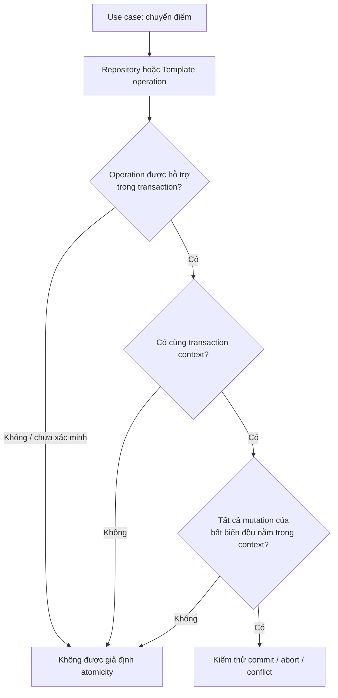
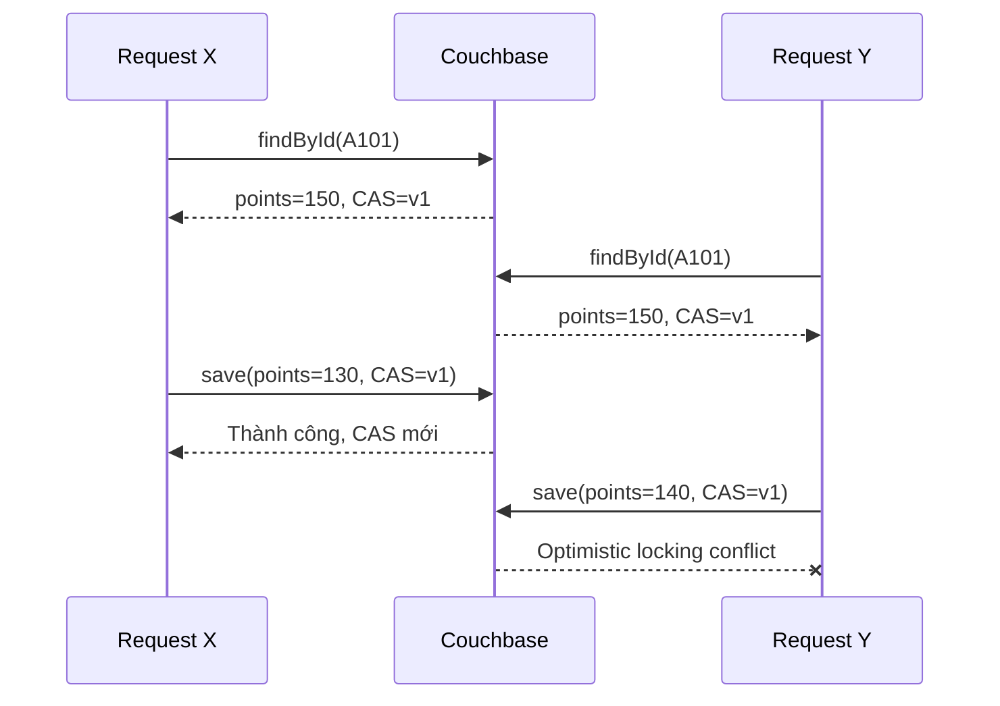

# Những thao tác Repository và Template có thể tham gia giao dịch

Trong chương **Giao dịch** của **SPRING_DATA_COUCHBASE**, một câu hỏi rất dễ bị trả lời quá nhanh là: “Nếu tôi đặt `@Transactional` lên service thì mọi lệnh `CouchbaseRepository` và `CouchbaseTemplate` bên trong đều trở thành một giao dịch đúng không?”.

**Không thể kết luận như vậy chỉ từ annotation hoặc tên phương thức.** Một thao tác muốn tham gia giao dịch Couchbase phải đồng thời thỏa ba điều kiện:

1. **Được hỗ trợ** bởi cơ chế Spring Data Couchbase transaction integration của đúng phiên bản đang dùng.
2. **Chạy trong đúng transaction context** qua Spring transaction manager, operator hoặc SDK transaction API tương ứng.
3. **Truy cập đúng dữ liệu và đúng phạm vi** của bất biến nghiệp vụ, gồm bucket, scope, collection, key và điều kiện ghi cần bảo vệ.

Repository mang lại API ngắn gọn cho CRUD và truy vấn khai báo; Template cho phép chọn các operation tường minh hơn. Cả hai có thể được sử dụng trong cùng một kiến trúc, nhưng **không phải mọi bulk operation, derived query, SQL++ statement hay lệnh SDK trực tiếp đều có cùng khả năng tham gia transaction**.

Bài học hướng dẫn phân loại các thao tác thường gặp, xây dựng use case có nhiều mutation, nhận ra những đường truy cập có nguy cơ thoát transaction và kiểm thử được kết quả commit/abort trên Couchbase thật.

## 1. Mục tiêu học tập

Sau bài này, bạn có thể:

- Giải thích sự khác nhau giữa **API có khả năng giao dịch** và **một lời gọi thực sự đang tham gia transaction**.
- Nhận diện các thao tác KV theo key của Repository và Template phù hợp để kiểm tra trong Spring-managed transaction.
- Phân biệt `findById` với derived query, `@Query`, `findByQuery`, `countBy...` và SQL++ thực thi bên ngoài context.
- Hiểu tại sao `saveAll`, `deleteAllById` và tên gọi “batch” **không tự bảo đảm all-or-nothing**.
- Kết hợp Repository và `CouchbaseTemplate` một cách có kiểm soát khi cả hai dùng cùng client infrastructure/transaction context.
- Nhận diện lệnh Couchbase Java SDK trực tiếp có thể **bỏ qua Spring-managed transaction**.
- Dùng `@Version Long` để hỗ trợ CAS/optimistic locking và phân biệt với giao dịch nhiều document.
- Giải thích vai trò của Spring proxy, `CouchbaseCallbackTransactionManager` và `CouchbaseTransactionalOperator`.
- Thiết kế integration test xác minh **lỗi giữa hai mutation không để lại trạng thái hoàn tất một phần**.
- Phân loại lỗi commit ambiguous, thiếu index, TTL, sai collection và retry không an toàn.

## 2. Tình huống xuyên suốt: chuyển điểm giữa hai account

Giả sử khách hàng của tenant A có hai tài khoản điểm thưởng trong Couchbase:

```text
Bucket:     appdata
Scope:      loyalty
Collection: accounts

Key account::tenant-a::A101
  rewardPoints: 150
  status: OPEN

Key account::tenant-a::A102
  rewardPoints: 50
  status: OPEN
```

Người dùng yêu cầu chuyển **40 điểm** từ A101 sang A102.

Trạng thái hoàn tất hợp lệ:

```text
A101 = 110
A102 = 90
Tổng điểm = 200
```

Bất biến:

\[
P_{\text{A101}} \ge 0,\qquad
P_{\text{A101}} + P_{\text{A102}} = 200
\]

Nếu chỉ cập nhật A101 còn A102 vẫn là 50, tổng thành 160. Khi đó hệ thống không thể tuyên bố lệnh chuyển điểm đã hoàn tất thành công.

Để bảo vệ nghiệp vụ này, mọi bước ảnh hưởng tổng điểm cần nằm trong **một đơn vị commit** được Couchbase hỗ trợ. Không thể chỉ dựa vào việc hai phương thức được gọi kế tiếp trong cùng một service method.

## 3. Ba lớp cần phân biệt: method, context, bất biến



### 3.1. Hỗ trợ ở mức phương thức

Một API có thể tồn tại và thực thi thành công ở chế độ thông thường, nhưng không được transaction integration hỗ trợ theo cùng cách. Ví dụ, một thao tác KV theo key khác về thực thi với một derived query theo thuộc tính JSON.

### 3.2. Tham gia transaction context

Cùng một lời gọi `repository.save(entity)` có thể:

- Thực hiện một mutation độc lập nếu không có giao dịch.
- Được transaction integration điều phối nếu chạy trong context được hỗ trợ.
- Bị gọi ở thread/publisher khác và không còn thuộc context mà developer tưởng đang sử dụng.

**Hỗ trợ API** và **tham gia thực sự** là hai thuộc tính khác nhau.

### 3.3. Bảo vệ trọn bất biến

Ngay cả khi hai thao tác được bọc giao dịch, nếu thao tác thứ ba ghi document ngoài context hoặc gửi side effect tới hệ thống khác, toàn bộ workflow vẫn không có tính nguyên tử xuyên mọi hệ thống liên quan.

Transaction bảo vệ **tập thao tác được hỗ trợ bên trong phạm vi của nó**, không tự tạo distributed transaction với PostgreSQL, email, Kafka hoặc payment gateway.

## 4. Entity Spring Data Couchbase có `@Version`

Entity `Account` được ánh xạ tới `appdata.loyalty.accounts`:

```java
package com.example.loyalty;

import org.springframework.data.annotation.Id;
import org.springframework.data.annotation.Version;
import org.springframework.data.couchbase.core.mapping.Collection;
import org.springframework.data.couchbase.core.mapping.Document;
import org.springframework.data.couchbase.core.mapping.Field;
import org.springframework.data.couchbase.core.mapping.Scope;

@Document
@Scope("loyalty")
@Collection("accounts")
public class Account {

    @Id
    private String id;

    @Field
    private String tenantId;

    @Field
    private String accountCode;

    @Field
    private long rewardPoints;

    @Field
    private String status;

    @Version
    private Long version;

    public Account() {
    }

    public Account(
            String id, String tenantId,
            String accountCode, long rewardPoints,
            String status) {
        this.id = id;
        this.tenantId = tenantId;
        this.accountCode = accountCode;
        this.rewardPoints = rewardPoints;
        this.status = status;
    }

    public String getId() { return id; }
    public void setId(String id) { this.id = id; }

    public String getTenantId() { return tenantId; }
    public void setTenantId(String tenantId) {
        this.tenantId = tenantId;
    }

    public String getAccountCode() { return accountCode; }
    public void setAccountCode(String accountCode) {
        this.accountCode = accountCode;
    }

    public long getRewardPoints() { return rewardPoints; }
    public void setRewardPoints(long rewardPoints) {
        this.rewardPoints = rewardPoints;
    }

    public String getStatus() { return status; }
    public void setStatus(String status) { this.status = status; }

    public Long getVersion() { return version; }
    public void setVersion(Long version) {
        this.version = version;
    }
}
```

Các thành phần cần hiểu:

- `@Id` ánh xạ **document key**, ví dụ `account::tenant-a::A101`. Nó không phải thuộc tính JSON `accountCode`.
- `@Scope` và `@Collection` chọn keyspace, **không tự tạo** scope/collection trên server.
- `@Version Long` giúp Spring Data Couchbase mang metadata **CAS** của document và sử dụng nó trong thao tác ghi được hỗ trợ.
- CAS là token mờ do Couchbase quản lý, **không phải counter tăng tuần tự** và không thay thế trường `schemaVersion` nghiệp vụ.
- Hai entity có `@Version` vẫn **không tự tạo transaction**; CAS là điều kiện ghi trên từng document.

Tài liệu giao dịch Spring Data Couchbase ở những dòng có Spring transaction integration đặt yêu cầu về trường `@Version Long` cho các entity tham gia. Luôn đối chiếu yêu cầu và kiểu dữ liệu với **phiên bản Spring Data Couchbase thực tế** trước khi triển khai.

## 5. Repository: những API cần phân loại

Ví dụ interface:

```java
package com.example.loyalty;

import java.util.List;
import org.springframework.data.couchbase.repository.CouchbaseRepository;

public interface AccountRepository
        extends CouchbaseRepository<Account, String> {

    List<Account> findByTenantIdAndStatus(
            String tenantId, String status);

    long countByTenantIdAndStatus(
            String tenantId, String status);
}
```

`CouchbaseRepository` cho phép CRUD theo entity và derived query. Nhưng đừng coi mọi phương thức là cùng một kiểu hoạt động.

### 5.1. Các thao tác theo document key

- `findById(id)`: tìm **một document theo key**.
- `save(entity)`: lưu entity theo semantics của Spring Data, gồm xác định mới/cũ và mapping version.
- `deleteById(id)`: xóa một document theo key.
- `delete(entity)`: xóa document được entity định danh, có thể liên quan trạng thái/version tùy đường ghi.
- `existsById(id)`: kiểm tra sự tồn tại của một key.

Đây là **nhóm cần ưu tiên kiểm tra** khi xây giao dịch dựa trên các KV operation được Spring Data hỗ trợ. Với từng method cụ thể, khả năng tham gia transaction phải được đối chiếu theo **phiên bản và đường implementation**, không suy ra chỉ từ tên.

### 5.2. Các thao tác theo thuộc tính JSON

- `findByTenantIdAndStatus(...)`: tìm theo `tenantId` và `status`.
- `countByTenantIdAndStatus(...)`: đếm theo điều kiện.
- `@Query`: SQL++ tự khai báo.
- Paging, sorting, projection và các derived methods phức tạp.

Nhóm này thường cần **SQL++ Query Service** và chỉ mục phù hợp. Nó phải được đánh giá riêng: một truy vấn SQL++ bình thường **không tự trở thành transactional SQL++** chỉ vì service bên ngoài có annotation.

### 5.3. Các thao tác nhiều đối tượng

- `saveAll(entities)`.
- `deleteAllById(ids)`.
- `deleteAll(entities)`.
- `deleteAll()`.

Nếu **không có context giao dịch**, batch có thể hoàn tất một phần khi lỗi giữa chừng. Nếu **có transaction context**, còn phải xác minh implementation có chạy từng mutation qua operation hỗ trợ trong context đó hay không; không suy ra tính nguyên tử từ tiền tố `All`.

## 6. Template: những operation cần phân loại

`CouchbaseTemplate` là API thấp hơn Repository nhưng vẫn giữ entity mapping, converter và các annotation của Spring Data.

Một số nhóm operation thường gặp:

| Nhóm | Ví dụ | Mục đích |
| --- | --- | --- |
| Đọc theo key | `findById(Account.class).one(id)` | Đọc một document |
| Tạo mới theo key | `insertById(Account.class).one(entity)` | Insert-only, key phải chưa tồn tại |
| Thay thế theo key | `replaceById(Account.class).one(entity)` | Replace document đã tồn tại |
| Xóa theo key | `removeById(Account.class).one(id)` | Remove document được định danh |
| Lưu tổng quát | Các operation save/upsert được phiên bản hỗ trợ | Cần hiểu rõ insert/update/upsert |
| Truy vấn theo thuộc tính | `findByQuery(Account.class).matching(query).all()` | SQL++ qua query API |
| Đếm/kiểm tra theo điều kiện | Query/count operations | Có thể sử dụng Query Service |
| Thao tác nâng cao | Tuỳ chọn expiration, CAS, scope/collection | Phải kiểm tra API và context hỗ trợ |

**Điểm chính:** transaction integration có thể hỗ trợ một **tập con** operations của `CouchbaseTemplate`. Chỉ vì template có một fluent method không chứng minh method đó có đường thực thi transactional; đặc biệt chú ý tới SQL++, batch, bulk và các operation tùy chọn đặc thù.

## 7. Ma trận quyết định theo thao tác và phạm vi

Bảng sau dành cho **thiết kế và lập kế hoạch kiểm thử**, không phải bảng cam kết support mọi method trên mọi phiên bản. Cột “đánh giá” biểu thị **ứng viên hợp lý** hay **phải kiểm tra thêm**.

| API | Loại thao tác thường gặp | Đánh giá trước khi đưa vào transaction |
| --- | --- | --- |
| Repository `findById` | KV đọc một key | **Ứng viên chính**; xác minh context của phiên bản |
| Repository `save` | Ghi một entity theo mapping | **Ứng viên chính**; xác minh `@Version`, trạng thái mới/cũ |
| Repository `deleteById` | KV remove một key | **Ứng viên chính**; test rollback khi xóa |
| Repository `delete(entity)` | Xóa một entity | Kiểm tra implementation, version/CAS và context |
| Repository `existsById` | Kiểm tra tồn tại theo key | Có thể dùng khi kiểm tra, **không tự bảo vệ TOCTOU** |
| Repository `saveAll` | Nhiều thao tác ghi | **Không suy ra all-or-nothing**; xác minh từng đường ghi |
| Repository `deleteAllById` | Nhiều key | **Không suy ra all-or-nothing**; xác minh theo version |
| Repository `deleteAll()` | Phạm vi rộng | Tránh dùng trong use case thông thường; kiểm tra keyspace |
| Derived `findBy...` | SQL++ theo thuộc tính | **Cần kiểm tra transactional query support** |
| `countBy...`, `count()` | SQL++/aggregation tùy implementation | Không xem count là khóa predicate/quota |
| `@Query` | SQL++ tự khai báo | **Cần xác minh đường query trong context** |
| Template `findById` | KV đọc entity theo key | **Ứng viên chính** nếu cùng transaction-aware operations |
| Template `insertById` | KV insert-only | **Ứng viên chính**; kiểm tra duplicate-key/rollback |
| Template `replaceById` | KV replace | **Ứng viên chính**; kiểm tra CAS và context |
| Template `removeById` | KV remove | **Ứng viên chính**; kiểm tra keyspace/rollback |
| Template `findByQuery` | Query Service | **Cần xác minh riêng** SQL++ trong transaction |
| SDK `collection.upsert` | SDK KV ngoài Spring mapping | **Không mặc định** tham gia Spring-managed transaction |
| SDK `cluster.query` | SQL++ độc lập | **Không mặc định** tham gia SDK transaction |
| SDK `ctx.get`/`ctx.insert`/`ctx.replace`/`ctx.remove` | KV trong SDK transaction callback | **Được thiết kế để tham gia** context `ctx` tương ứng |
| SDK `ctx.query` | SQL++ trong SDK transaction callback | Theo khả năng SDK/server và các giới hạn transactional query |

### Cách sử dụng bảng

Với mỗi thao tác bạn muốn dùng trong một use case:

1. **Xác định đường dữ liệu**: KV theo document key hay SQL++ theo thuộc tính.
2. **Đọc API reference đúng dependency**: phương thức đó có được transaction integration hỗ trợ trong phiên bản hay không?
3. **Kiểm tra context**: Spring-managed manager, operator, hay SDK callback? Có operation nào thoát context không?
4. **Test thành công và abort**: nếu ghi A rồi cố tình lỗi trước ghi B, dữ liệu cuối ra sao?
5. **Test đồng thời**: CAS/transaction conflict có ngăn lost update và vi phạm bất biến không?
6. **Test keyspace**: mọi operation trỏ tới đúng bucket/scope/collection chưa?

Một integration test trên một tổ hợp version **không tự chứng minh** mọi method khác trong bảng có cùng bảo đảm.

## 8. Kích hoạt Spring-managed Couchbase transaction

Ở các dòng Spring Data Couchbase hỗ trợ Spring transaction integration, thành phần manager thường là **`CouchbaseCallbackTransactionManager`** với bean được gọi **`couchbaseTransactionManager`**.

```java
import org.springframework.data.couchbase.transaction.CouchbaseCallbackTransactionManager;
import org.springframework.transaction.annotation.Transactional;
```

Tên “CouchbaseTransactionManager” trong phần mô tả không nhất thiết là tên class import có thật. Hãy kiểm tra Javadoc và bean trong context.

Spring transaction management có thể được kích hoạt thông qua cấu hình phù hợp với ứng dụng:

```java
import org.springframework.context.annotation.Configuration;
import org.springframework.transaction.annotation.EnableTransactionManagement;

@Configuration(proxyBeanMethods = false)
@EnableTransactionManagement
public class TransactionConfiguration {
}
```

Cấu hình trên **chỉ minh họa bật interceptor**. Nó không tự tạo cluster, bucket, operations hoặc transaction manager nếu ứng dụng chưa có Spring Data/Boot configuration tương ứng.

Để một method service dùng Couchbase manager:

```java
@Transactional(transactionManager = "couchbaseTransactionManager")
public void performBusinessOperation() {
    // Những Couchbase operations được hỗ trợ.
}
```

Khi có nhiều manager (ví dụ Couchbase và JPA), qualifier giúp chọn rõ bean. Tuy nhiên, **có annotation và manager bean thôi vẫn chưa đủ**: method phải được Spring proxy intercept và operations cần tham gia cùng context.

### 8.1. Trường hợp không nên tự khai báo thêm manager

Spring Boot hoặc `AbstractCouchbaseConfiguration` có thể đã cung cấp bean hạ tầng ở phiên bản tương ứng. Đừng thêm một manager mới chỉ vì thấy ví dụ dùng constructor ở tài liệu cũ; điều đó có thể tạo bean trùng hoặc quản lý một client factory khác với repository đang dùng.

Nên kiểm tra application context hiện tại, cách wiring của `CouchbaseTemplate`/repository và tình trạng tương thích SDK trước khi tùy biến bean.

## 9. Ví dụ Repository: chuyển điểm trong ranh giới service

```java
package com.example.loyalty;

import java.util.Objects;
import org.springframework.stereotype.Service;
import org.springframework.transaction.annotation.Transactional;

@Service
public class TransferService {

    private final AccountRepository accounts;

    public TransferService(AccountRepository accounts) {
        this.accounts = accounts;
    }

    @Transactional(transactionManager = "couchbaseTransactionManager")
    public void transfer(
            String authorizedTenantId,
            String fromKey,
            String toKey,
            long points) {

        if (points <= 0 || Objects.equals(fromKey, toKey)) {
            throw new IllegalArgumentException(
                    "Yêu cầu chuyển điểm không hợp lệ");
        }

        Account from = accounts.findById(fromKey)
                .orElseThrow(() ->
                        new IllegalArgumentException(
                                "Tài khoản nguồn không tồn tại"));
        Account to = accounts.findById(toKey)
                .orElseThrow(() ->
                        new IllegalArgumentException(
                                "Tài khoản đích không tồn tại"));

        if (!authorizedTenantId.equals(from.getTenantId())
                || !authorizedTenantId.equals(to.getTenantId())) {
            throw new IllegalStateException(
                    "Account không thuộc tenant được ủy quyền");
        }

        if (!"OPEN".equals(from.getStatus())
                || !"OPEN".equals(to.getStatus())) {
            throw new IllegalStateException(
                    "Tài khoản chưa sẵn sàng");
        }

        if (from.getRewardPoints() < points) {
            throw new IllegalStateException(
                    "Số điểm không đủ");
        }

        long newTarget = Math.addExact(
                to.getRewardPoints(), points);
        long newSource =
                from.getRewardPoints() - points;

        from.setRewardPoints(newSource);
        to.setRewardPoints(newTarget);

        accounts.save(from);
        accounts.save(to);
    }
}
```

**Điều kiện của ví dụ:**

- `authorizedTenantId` xuất phát từ ngữ cảnh **xác thực/ủy quyền**, không tin chuỗi tenant client tự khai.
- Method `transfer` được caller **gọi qua Spring bean/proxy**.
- Bean `couchbaseTransactionManager` đúng và có khả năng điều phối những repository operations này ở phiên bản triển khai.
- Repository `AccountRepository` ánh xạ đúng `appdata.loyalty.accounts`.
- Những thao tác `findById`/`save` **thực sự tham gia cùng context**, không được suy từ việc chúng nằm trong một method Java.
- Có xử lý idempotency nếu client có thể gửi lại cùng một yêu cầu chuyển điểm.
- Luồng kiểm thử cố tình throw sau `accounts.save(from)` phải cho thấy mutation nguồn **không được commit như một phần giao dịch bị abort**.

Không dùng ví dụ làm bằng chứng atomicity khi chưa test integration. Một số operation hoặc phiên bản có các giới hạn riêng; nếu tổ hợp hiện tại không hỗ trợ, cần dùng đường API transactions được tài liệu xác nhận.

## 10. Ví dụ Template: đọc và thay thế hai document

`CouchbaseTemplate` có fluent API cho các thao tác theo key. Ví dụ dưới đây tách rõ đường truy cập bằng entity mapping:

```java
package com.example.loyalty;

import java.util.Objects;
import org.springframework.data.couchbase.core.CouchbaseOperations;
import org.springframework.stereotype.Service;
import org.springframework.transaction.annotation.Transactional;

@Service
public class TemplateTransferService {

    private final CouchbaseOperations operations;

    public TemplateTransferService(CouchbaseOperations operations) {
        this.operations = operations;
    }

    @Transactional(transactionManager = "couchbaseTransactionManager")
    public void transfer(
            String authorizedTenantId,
            String fromKey,
            String toKey,
            long points) {

        if (points <= 0 || Objects.equals(fromKey, toKey)) {
            throw new IllegalArgumentException(
                    "Yêu cầu không hợp lệ");
        }

        Account from = operations.findById(Account.class)
                .one(fromKey);
        Account to = operations.findById(Account.class)
                .one(toKey);

        if (from == null || to == null) {
            throw new IllegalStateException(
                    "Tài khoản không tồn tại");
        }

        if (!authorizedTenantId.equals(from.getTenantId())
                || !authorizedTenantId.equals(to.getTenantId())) {
            throw new IllegalStateException(
                    "Sai tenant");
        }

        if (!"OPEN".equals(from.getStatus())
                || !"OPEN".equals(to.getStatus())) {
            throw new IllegalStateException(
                    "Trạng thái không hợp lệ");
        }

        if (from.getRewardPoints() < points) {
            throw new IllegalStateException(
                    "Không đủ điểm");
        }

        long newTarget = Math.addExact(
                to.getRewardPoints(), points);
        long newSource =
                from.getRewardPoints() - points;

        from.setRewardPoints(newSource);
        to.setRewardPoints(newTarget);

        operations.replaceById(Account.class).one(from);
        operations.replaceById(Account.class).one(to);
    }
}
```

Đoạn này minh họa `findById` và `replaceById` của Spring Data Couchbase operations. **Chữ ký fluent API và tập operation hỗ trợ transaction cần được đối chiếu theo version.** `CouchbaseOperations` được inject phải là operations đúng với transaction infrastructure, không phải một template tự tạo trỏ sang cluster khác.

### 10.1. Khi nên chọn Template

- Muốn thể hiện rõ **insert-only**, thay thế hoặc xóa theo key.
- Cần lựa chọn tùy chọn mutation có sẵn ở Template.
- Muốn xây custom repository fragment chứa thao tác đặc biệt.
- Cần một adapter có thể kiểm thử riêng theo từng use case.

**Không chuyển sang Template chỉ để “có transaction”.** Repository và Template có thể dùng cùng Spring Data transaction infrastructure; điều quyết định là **operation và context được hỗ trợ**.

## 11. Kết hợp Repository và Template trong một transaction

Một use case có thể đọc bằng Repository, ghi qua Template:

```java
@Service
public class MixedAccountService {

    private final AccountRepository repository;
    private final CouchbaseOperations operations;

    public MixedAccountService(
            AccountRepository repository,
            CouchbaseOperations operations) {
        this.repository = repository;
        this.operations = operations;
    }

    @Transactional(transactionManager = "couchbaseTransactionManager")
    public void suspendTwo(String firstKey, String secondKey) {
        Account first = repository.findById(firstKey)
                .orElseThrow();
        Account second = repository.findById(secondKey)
                .orElseThrow();

        first.setStatus("SUSPENDED");
        second.setStatus("SUSPENDED");

        operations.replaceById(Account.class).one(first);
        operations.replaceById(Account.class).one(second);
    }
}
```

Đoạn code chỉ đúng về transaction khi:

1. **Cả Repository và Operations** thuộc cùng Spring Data Couchbase infrastructure/transaction context.
2. Những method đang dùng là các operation **được transaction integration hỗ trợ**.
3. Entity cùng loại và cùng keyspace mong muốn.
4. Caller đi qua Spring proxy, manager chọn đúng, không có lỗi bị nuốt.
5. Có test rollback và conflict trên cluster phù hợp.

**Không thể chứng minh điều 1–4 chỉ bằng cách compile code.** Nếu `repository` dùng client factory A còn `operations` do ứng dụng tự tạo với cluster B, chúng có thể truy cập dữ liệu khác hoặc nằm ngoài cùng transaction context.

### 11.1. Không phải mọi tham chiếu cùng tên key đều cùng document

```text
appdata.loyalty.accounts:
    account::tenant-a::A101

appdata.loyalty.archived_accounts:
    account::tenant-a::A101
```

Hai key giống chuỗi nhưng nằm ở hai collection là **hai document riêng**. Transaction phải trỏ đúng bucket/scope/collection và có quyền trên mọi collection được dùng.

## 12. Tạo mới: `save` và `insertById` có ý nghĩa khác nhau

Khi nghiệp vụ phải tạo một account mới **chỉ nếu key chưa tồn tại**, không nên chỉ kiểm tra trước bằng `existsById` rồi gọi `save`.

```java
// Có race condition giữa kiểm tra và ghi:
if (!repository.existsById(newAccount.getId())) {
    repository.save(newAccount);
}
```

Hai request có thể cùng thấy key chưa tồn tại. Nếu cần điều kiện “key phải trống” **ngay tại mutation**, hãy dùng insert-only operation được transaction integration hỗ trợ:

```java
Account created = operations.insertById(Account.class)
        .one(newAccount);
```

Trong workflow cần tạo **account + transfer record** cùng commit, phải kiểm tra insert-only operation thật sự được thực hiện trong transaction context. Nếu một insert duplicate key khiến transaction thất bại, xử lý thành lỗi nghiệp vụ thay vì chuyển sang upsert một cách im lặng.

### 12.1. Ý nghĩa của `upsert`

`upsert` có thể thêm mới hoặc thay thế document hiện có. Đó không phải ngữ nghĩa tương đương `insert` hoặc `replace`. Không mặc định một API upsert độc lập sẽ tham gia transaction như các API insert/replace được transaction SDK hỗ trợ.

Khi transaction cần phân biệt “đã tồn tại” và “chưa tồn tại”, chọn đúng operation thay vì dựa vào precheck `existsById`.

### 12.2. Cập nhật có điều kiện CAS

`@Version` trên entity giúp Spring Data duy trì CAS cho các đường ghi thích hợp. Nếu cần điều kiện CAS đặc biệt hoặc SDK option chưa được Template phơi bày, hãy dùng một adapter SDK transaction-aware **trong context được hỗ trợ**, không gọi `collection.replace(...)` độc lập giữa hai lời gọi Repository rồi giả định tất cả đều atomic.

## 13. Xóa trong transaction: theo key và theo điều kiện

### 13.1. Xóa theo document key

`repository.deleteById(id)` và Template remove-by-ID là những thao tác cần xem xét trong nhóm KV đơn document.

Ví dụ nghiệp vụ “chuyển document hiện tại sang archive và xóa bản gốc” gồm:

```text
1. Đọc account ở collection chính
2. Tạo archive document
3. Xóa account document nguồn
4. Commit nếu cả hai thay đổi hợp lệ
```

Nếu cả ba thao tác dữ liệu thuộc một transaction, cần đảm bảo API hỗ trợ **cả insert archive và remove source** trong cùng context, kể cả khi chạm hai collection khác nhau. Kiểm tra quyền, bucket/scope/collection và transaction metadata.

### 13.2. Xóa theo điều kiện SQL++

Một câu `DELETE ... WHERE` khác với xóa một key:

```sql
DELETE FROM `appdata`.`loyalty`.`accounts` AS a
WHERE a.tenantId = $tenantId
  AND a.status = "CLOSED";
```

Đây là thao tác SQL++ trên **tập document theo predicate**, không phải một KV remove theo key. Nếu muốn nó tham gia transaction, phải xác minh hỗ trợ **transactional query** của phiên bản và sử dụng đúng API/query context.

Không suy rằng một câu SQL++ mutation nhiều document luôn là atomic transaction cho **toàn bộ workflow**. Đặc biệt không ghép `DELETE WHERE` ngoài context với `repository.save` trong context rồi tin cả hai sẽ rollback cùng nhau.

### 13.3. Kiểm tra điều kiện trước khi xóa không đủ

```java
if (repository.existsById(id)) {
    repository.deleteById(id);
}
```

Giữa kiểm tra và xóa, document có thể bị thay đổi hoặc bị xóa bởi request khác. Nếu nghiệp vụ yêu cầu **chỉ xóa bản đã duyệt**, cần CAS/điều kiện ghi hoặc transaction thích hợp, không chỉ có hai lời gọi API được đặt cạnh nhau.

## 14. `saveAll` và các thao tác bulk: phân tích đúng phạm vi

Ví dụ:

```java
List<Account> accountsToUpdate = List.of(a101, a102, a103);
repository.saveAll(accountsToUpdate);
```

Phương thức này tiện lợi để ghi nhiều entity, nhưng có hai trường hợp rất khác nhau.

**Không có transaction context:**

- Một phần document có thể ghi thành công trước khi mutation tiếp theo lỗi.
- Thứ tự và cách thực thi phụ thuộc implementation.
- Exception không tự khôi phục các document đã ghi.

**Có transaction context phù hợp:**

- Cần xác minh implementation của `saveAll` trong phiên bản đang dùng có đưa **tất cả mutation** qua các operation transaction-aware.
- Cần hiểu giới hạn số document, timeout, retry và conflict.
- Phải test có lỗi giữa batch và xác minh **không có commit một phần**.

### 14.1. Bulk không phải tối ưu transaction mặc định

Không nên đưa 10.000 document độc lập vào **một transaction lớn** chỉ vì dùng được `saveAll`. Nó có thể làm tăng latency, conflict và tài nguyên, trong khi yêu cầu nghiệp vụ cho phép mỗi document hoàn thành độc lập.

Nếu chấp nhận kết quả từng phần, xử lý theo batch/checkpoint/idempotency và đối soát thường hợp lý hơn. **Phạm vi transaction phải bắt nguồn từ bất biến**, không phải kích thước danh sách API trả về.

### 14.2. `deleteAll()` không có bộ lọc tenant

`repository.deleteAll()` có thể có phạm vi rộng theo entity mapping/implementation. Không dùng nó như thể chắc chắn chỉ xóa document của tenant hiện tại.

Đối với xóa hàng loạt trong một use case, hãy giới hạn đúng keyspace, điều kiện tenant/type và tập key; thiết kế backup/khôi phục và xác minh transaction support. Không coi transaction là “tấm chắn” chống xóa sai phạm vi.

## 15. Derived query, `@Query`, SQL++ và transaction

Các query sau đây nhìn giống thao tác Repository thông thường:

```java
List<Account> openAccounts =
        repository.findByTenantIdAndStatus(
                "tenant-a", "OPEN");

long count = repository.countByTenantIdAndStatus(
        "tenant-a", "OPEN");
```

Nhưng chúng khác `findById` theo một key: truy vấn theo thuộc tính thường cần SQL++ và secondary index.

Ví dụ chỉ mục:

```sql
CREATE INDEX ix_accounts_tenant_status
ON `appdata`.`loyalty`.`accounts`(
    tenantId,
    status
);
```

Query tương ứng:

```sql
SELECT META(a).id, a.rewardPoints
FROM `appdata`.`loyalty`.`accounts` AS a
WHERE a.tenantId = $tenantId
  AND a.status = $status;
```

Nếu muốn dùng các kết quả này **để ra quyết định trong transaction**, cần đặc biệt chú ý:

1. Query có tham gia **transaction context** ở phiên bản Spring Data/SDK hiện hành không?
2. Có Query Service, Index Service và index phù hợp không?
3. Transaction isolation bảo vệ loại predicate cần thiết tới mức nào?
4. Có lệnh mutation khác làm tập kết quả thay đổi đồng thời không?
5. Tên bucket/scope/collection và điều kiện tenant/type có đúng không?

**Một derived query nằm về mặt cú pháp trong method `@Transactional` chưa tự chứng minh nó là transactional SQL++.**

### 15.1. `@Query` không tự giải quyết vấn đề context

```java
import org.springframework.data.couchbase.repository.Query;

@Query("#{#n1ql.selectEntity} " +
       "WHERE #{#n1ql.filter} " +
       "AND tenantId = $1 AND status = $2")
List<Account> findOpenAccounts(String tenantId, String status);
```

Các macro `#{#n1ql.selectEntity}` và `#{#n1ql.filter}` giúp mapping/type filter ở những phiên bản Spring Data hỗ trợ cú pháp này. **Chúng không phải annotation kích hoạt transaction**. Muốn query tham gia giao dịch, đường query phải đi qua API context hỗ trợ.

### 15.2. SQL++ trong SDK transaction

Couchbase Java SDK hỗ trợ query trong transaction qua API transaction-context ở các phiên bản hỗ trợ, ví dụ `ctx.query(...)`. Nó khác với gọi `cluster.query(...)` độc lập.

```java
cluster.transactions().run(ctx -> {
    // Dùng ctx.get/ctx.replace/ctx.insert/ctx.remove cho KV.
    // Nếu cần SQL++, dùng API ctx.query được SDK/server hỗ trợ.
});
```

Các chi tiết về API, isolation, index và những statement được hỗ trợ phải được kiểm tra theo version. Không dùng `cluster.query(...)` trong callback và suy luận nó tự được gắn vào `ctx`.

## 16. Quy tắc quota: ngay cả transactional count cũng cần đánh giá invariant

Giả sử tenant chỉ được có tối đa 100 reservation ACTIVE:

\[
N_{\mathrm{ACTIVE}}(\text{tenant-a}) \le 100
\]

Mẫu dễ gặp:

```java
long count = reservationRepository
        .countByTenantIdAndStatus("tenant-a", "ACTIVE");

if (count < 100) {
    reservationRepository.save(newReservation);
}
```

Hai request đồng thời có thể cùng thấy count = 99 rồi tạo hai reservation key khác nhau. Mức SQL++ scan consistency mạnh hơn không tự khóa khoảng trống giữa COUNT và INSERT.

Ngay cả khi query và insert được thực hiện trong một transaction context, phải đánh giá **isolation và cách phát hiện conflict cho predicate trên tập**. Một thiết kế dùng chung **quota guard document** thường rõ ràng hơn:

```text
quota::tenant-a
  limit = 100
  occupied = 99

Trong một transaction:
  đọc quota::tenant-a
  kiểm tra occupied < limit
  tăng occupied
  insert reservation::R501
  commit
```

Các request cùng tenant cạnh tranh trên một quota document, tạo điểm xung đột chung. Khi reservation hết hạn TTL, workflow phải tính đến việc giảm/đối soát quota; Couchbase không tự cập nhật guard document chỉ vì document khác expire.

**Transaction API bảo vệ các mutation tham gia, nhưng bất biến nghiệp vụ vẫn phải được mô hình hóa đúng.**

## 17. Lệnh SDK trực tiếp có thể thoát Spring-managed transaction

Khi ứng dụng dùng Spring Data repository nhưng có thêm một lời gọi SDK:

```java
@Transactional(transactionManager = "couchbaseTransactionManager")
public void unsafeMixedWorkflow() {
    repository.save(accountA);

    sdkCollection.upsert(
            accountB.getId(),
            JsonObject.create()
                    .put("rewardPoints", accountB.getRewardPoints()));
}
```

Đoạn code này là **mẫu không nên dùng** khi cần atomicity: `sdkCollection.upsert` là lời gọi KV SDK trực tiếp và **không được mặc định** tham gia Spring-managed transaction chỉ vì method có annotation.

Trong Couchbase Java SDK, các operation thực sự tham gia SDK transaction được biểu diễn rõ qua `ctx`:

```java
import com.couchbase.client.java.Collection;
import com.couchbase.client.java.Cluster;
import com.couchbase.client.java.json.JsonObject;
import com.couchbase.client.java.transactions.TransactionGetResult;

public void suspendTwoSdk(
        Cluster cluster, Collection collection,
        String firstKey, String secondKey) {

    cluster.transactions().run(ctx -> {
        TransactionGetResult first =
                ctx.get(collection, firstKey);
        TransactionGetResult second =
                ctx.get(collection, secondKey);

        JsonObject firstJson = first.contentAsObject();
        JsonObject secondJson = second.contentAsObject();

        ctx.replace(
                first,
                firstJson.put("status", "SUSPENDED"));
        ctx.replace(
                second,
                secondJson.put("status", "SUSPENDED"));
    });
}
```

Trong ví dụ này, mọi KV mutation thuộc **cùng SDK transaction context**. Tuy nhiên, SDK làm việc trực tiếp với `JsonObject`; nó **không tự áp dụng** mọi Spring Data converter, annotation và mapping của entity `Account`.

### 17.1. Có thể trộn Spring Data operations trong SDK callback không?

Một số dòng Spring Data Couchbase có cơ chế transaction integration cho phép các Spring Data operations **được hỗ trợ** tham gia context SDK. Nhưng cần xác minh tính năng trong đúng API/version và cùng Couchbase infrastructure.

Đừng dựa vào logic “đang nằm trong lambda” để kết luận một thao tác Repository/Template/SDK bất kỳ thuộc cùng context. Cách an toàn là **chọn một đường API được tài liệu xác nhận cho từng use case**, rồi viết test rollback.

### 17.2. Không tạo một cluster khác giữa transaction

Nếu repository dùng cluster đã cấu hình bởi Spring còn custom SDK adapter tạo cluster mới và trỏ bucket khác, chúng có thể không chia sẻ transaction infrastructure. Một method vẫn có thể đọc/ghi được tài liệu nhưng **không bảo vệ đúng tập document**.

Dùng dependency injection, quản lý lifecycle cluster, chọn namespace theo cấu hình tin cậy và kiểm tra context propagation.

## 18. Spring proxy, self-invocation và transaction boundary

Một method transactional thường phải được **gọi qua Spring AOP proxy**:

```java
@Service
public class TransferEntryPoint {

    private final TransferService transferService;

    public TransferEntryPoint(
            TransferService transferService) {
        this.transferService = transferService;
    }

    public void handleTransfer(
            String tenantId, String fromKey,
            String toKey, long amount) {

        transferService.transfer(
                tenantId, fromKey, toKey, amount);
    }
}
```

Caller inject Spring bean `TransferService`, nên lời gọi có cơ hội đi qua transaction advice.

Ngược lại:

```java
@Service
public class WrongBoundary {

    public void execute() {
        this.transferInternal(); // Self-invocation.
    }

    @Transactional(transactionManager = "couchbaseTransactionManager")
    public void transferInternal() {
        // Annotation có thể không được proxy intercept.
    }
}
```

Với proxy-based Spring AOP mặc định, `this.transferInternal()` đi thẳng vào target, **bỏ qua proxy**. Một object được tạo qua `new WrongBoundary()` cũng không được Spring quản lý.

Những bẫy khác:

- `private` method hoặc `final` method/class không được intercept như kỳ vọng.
- Gọi method giao dịch trong constructor hoặc `@PostConstruct`.
- `@Async`/thread mới làm thay đổi context và thời điểm thực thi.
- Gọi repository operations ngoài method transactional rồi mong chúng cùng commit.
- Bắt/nuốt exception khiến callback trả về bình thường.

Ranh giới giao dịch nên nằm ở **public application-service method** đại diện cho một use case, không nhất thiết là mọi method repository.

## 19. Reactive Repository và Reactive Template

Spring Data Couchbase có API reactive, ví dụ `ReactiveCouchbaseRepository` và `ReactiveCouchbaseTemplate`.

```java
package com.example.loyalty;

import org.springframework.data.couchbase.repository.ReactiveCouchbaseRepository;

public interface ReactiveAccountRepository
        extends ReactiveCouchbaseRepository<Account, String> {
}
```

Khi method trả `Mono` hoặc `Flux`, publisher có thể chỉ thực thi khi được **subscribe**. Không thể bê nguyên giả định về thread/context từ imperative sang reactive.

### 19.1. Phối hợp publisher không có nghĩa transaction

```java
Mono<Void> workflow = Mono.when(
        reactiveRepository.save(accountA).then(),
        reactiveRepository.save(accountB).then()
);
```

`Mono.when` phối hợp hai publisher, **không tự tạo transaction**. Nếu một mutation đã hoàn tất còn mutation kia lỗi, không có bảo đảm tự rollback, nhất là nếu chúng không được thực thi trong một reactive transaction context.

### 19.2. Reactive transaction phải dùng cơ chế được hỗ trợ

Ở những dòng Spring Data Couchbase tích hợp reactive transactions, có `CouchbaseTransactionalOperator` và khả năng interception phù hợp cho reactive service method.

Một ví dụ về ý tưởng:

```java
import org.springframework.data.couchbase.transaction.CouchbaseTransactionalOperator;
import org.springframework.data.couchbase.core.ReactiveCouchbaseTemplate;
import reactor.core.publisher.Flux;

public Flux<Account> suspendOne(
        CouchbaseTransactionalOperator operator,
        ReactiveCouchbaseTemplate template,
        String id) {

    return operator.execute(status ->
            template.findById(Account.class)
                    .one(id)
                    .flatMap(account -> {
                        account.setStatus("SUSPENDED");
                        return template.replaceById(Account.class)
                                .one(account);
                    }));
}
```

Đây là mẫu để **minh họa phạm vi transaction operator**. Chữ ký `execute`, kiểu kết quả, reactive transaction manager và các operations được hỗ trợ **phải kiểm tra theo phiên bản**; không sao chép một snippet từ phiên bản khác rồi coi nó là hợp đồng.

Đối với nhiều document, mọi publisher cần thiết phải nằm **trong cùng scope được operator quản lý**. Không tự subscribe một nhánh ở service khác hoặc gọi `block()` tùy tiện trong event loop.

### 19.3. Reactive không mở rộng tập hỗ trợ API

Chuyển từ imperative Repository sang Reactive Template không tự làm `findByQuery` hoặc SQL++ statement ngoài context trở nên transactional. Phải kiểm tra **đúng reactive operation**, hạ tầng, transaction manager và giới hạn SDK.

Đồng thời, retry/resubscribe có thể làm mutation thực thi lại; dùng idempotency key và phân loại lỗi rõ ràng.

## 20. `@Version`, CAS và lỗi đồng thời

Giả sử hai request cùng đọc A101 với CAS ban đầu `v1`:



`@Version` giúp phát hiện bản cũ trong những operation Spring Data hỗ trợ CAS. Nhưng:

- CAS **không** tự đảo mutation trên B khi ghi A thành công.
- Một transaction có cách phát hiện conflict/retry riêng theo SDK và manager.
- Không tự tăng `version` bằng số học.
- Khi nhận conflict, đọc lại trạng thái rồi **tính lại nghiệp vụ**, không retry vô hạn với object mang CAS cũ.
- Đối với chuyển điểm, retry nguyên request còn phải kiểm tra **transferId/idempotency** để tránh chuyển hai lần.

Đặc biệt khi kết hợp SDK trực tiếp và entity Spring Data, một SDK mutation có thể đổi CAS khiến object `Account` đọc trước đó trở nên stale. Phải đọc lại hoặc dùng đúng transaction API.

## 21. Commit, rollback, exception và kết quả không rõ

### 21.1. Exception không tự đồng nghĩa rollback tất cả

Một method service có `@Transactional` có thể thất bại vì:

- Exception nghiệp vụ trước bất kỳ mutation nào.
- Xung đột CAS/transaction conflict.
- Lỗi giữa các mutation.
- Query thiếu index hoặc timeout.
- Lỗi RBAC/metadata.
- Timeout/mất phản hồi ở **giai đoạn commit**.

Chỉ khi có transaction context thực sự và outcome được xác định, chúng ta mới có thể nói điều gì đã commit hoặc abort. **Một exception đơn lẻ không chứng minh mọi thao tác đã rollback**, đặc biệt với timeout ở giai đoạn commit.

### 21.2. Không nuốt exception sau mutation đầu

```java
@Transactional(transactionManager = "couchbaseTransactionManager")
public void unsafeTransfer() {
    try {
        accounts.save(source);
        accounts.save(target);
    } catch (RuntimeException ex) {
        logger.warn("Partial failure?", ex);
        // Sai: callback/method có thể kết thúc bình thường.
    }
}
```

Nếu framework coi method hoàn thành bình thường, trạng thái có thể không đúng kỳ vọng. Một số transaction SDK có cơ chế tự đánh dấu lỗi; tuy nhiên, **không nên xây bảo đảm nghiệp vụ trên hành vi lỗi mơ hồ**. Phân loại và truyền tín hiệu lỗi/abort theo API hỗ trợ.

Các thuộc tính `rollbackFor`/`noRollbackFor` của `@Transactional` cần kiểm tra theo Spring Data Couchbase version vì callback-based manager có thể không áp dụng hoàn toàn như JPA manager. Đừng dùng quy tắc exception JPA làm bằng chứng cho Couchbase rollback.

### 21.3. Commit ambiguous

Khi mất phản hồi trong giai đoạn commit, caller có thể không biết transaction đã hoàn tất hay chưa. Với phép chuyển điểm, retry mù quáng có nguy cơ **trừ và cộng thêm một lần**.

Một thiết kế production cần:

```text
transferId = transfer::tenant-a::T9001

COMMITTED: kết quả được xác nhận
REJECTED: điều kiện nghiệp vụ không đạt
UNKNOWN: kết quả commit chưa rõ, phải đối soát
```

Dùng transferId ổn định và một dấu vết/idempotency record được bảo vệ tại thời điểm mutation. Không chỉ dựa vào `existsById(transferId)` trước khi ghi, vì hai request có thể đồng thời thấy key chưa tồn tại.

### 21.4. Side effect ngoài transaction

Không gửi email, gọi payment gateway hoặc phát message không idempotent **bên trong callback có thể được retry**. Các side effect này không tự rollback theo Couchbase. Cân nhắc outbox/saga và consumer idempotent nếu chúng cần theo sau một commit.

## 22. TTL, namespace, index và transaction metadata

### 22.1. TTL

Một reservation có TTL có thể hết hạn trong lúc workflow khác đang cập nhật quota. Couchbase không tự giảm counter/quota document khác khi document hết hạn. Nếu bất biến cần số lượng chính xác, phải thiết kế xử lý expiration và đối soát.

Các operation ghi có thể giữ, cập nhật hoặc đặt lại TTL tùy API/tùy chọn. Không giả định `repository.save`, Template replace và SDK upsert luôn áp dụng cùng chính sách expiration.

### 22.2. Bucket/scope/collection

Transaction chỉ bảo vệ **đúng những document mà các operation thực sự truy cập**. Key giống nhau ở hai collection khác nhau là hai document độc lập.

Cần kiểm tra:

- Account repository và Template có cùng bucket `appdata` không?
- Mapping `@Scope("loyalty")`/`@Collection("accounts")` có được áp dụng không?
- SDK adapter có dùng `bucket.scope("loyalty").collection("accounts")` hay vô tình dùng `defaultCollection()`?
- Khi có archive/guard/transfer collection khác, manager có quyền và transaction API hỗ trợ truy cập không?

### 22.3. Index SQL++

`findById` theo key thường không cần secondary index. `findByTenantIdAndStatus` cần một con đường SQL++ Query/Index phù hợp. Transaction không tự tạo index và không bảo đảm query không phải chờ secondary index.

`REQUEST_PLUS` là tùy chọn scan consistency cho query, **không phải lệnh bắt đầu transaction**.

### 22.4. ATR, timeout và durability

Couchbase transactions sử dụng metadata như **Active Transaction Record (ATR)**. Transaction cần quyền phù hợp trên dữ liệu nghiệp vụ và metadata. Timeout, durability, cleanup, network và topology có ảnh hưởng tới khả năng commit/abort.

Một bài kiểm thử chỉ kiểm tra `repository.findById` hoạt động không chứng minh transaction metadata đã được cấu hình đúng.

## 23. Integration test: chứng minh một operation đã tham gia transaction

Một test đúng cho nghiệp vụ chuyển điểm cần tạo lỗi **sau mutation đầu tiên**, rồi xác minh **không có trạng thái hoàn tất một phần**.

### 23.1. Tạo fixture độc lập

```text
account::tenant-a::A101  rewardPoints = 150
account::tenant-a::A102  rewardPoints = 50
```

Dùng cluster thử nghiệm có server/SDK transaction support, bucket/scope/collection tồn tại và quyền metadata phù hợp. Mỗi test phải reset fixture để không phụ thuộc test khác.

### 23.2. Test method chủ động abort

Ví dụ bổ sung trong `TransferService` chỉ dành cho test:

```java
@Transactional(transactionManager = "couchbaseTransactionManager")
public void subtractThenFail(String sourceKey, long amount) {
    Account source = accounts.findById(sourceKey)
            .orElseThrow();

    if (amount <= 0 || source.getRewardPoints() < amount) {
        throw new IllegalArgumentException("Không đủ điểm");
    }

    source.setRewardPoints(
            source.getRewardPoints() - amount);

    accounts.save(source);

    // Giả lập lỗi sau mutation đầu tiên.
    throw new IllegalStateException("FORCED_ABORT_TEST_ONLY");
}
```

Chỉ đưa method này vào test fixture hoặc môi trường thử nghiệm; **không cung cấp public endpoint gây lỗi trên production**.

### 23.3. Integration test gọi qua proxy

```java
import org.junit.jupiter.api.Test;
import org.springframework.beans.factory.annotation.Autowired;
import org.springframework.boot.test.context.SpringBootTest;

import static org.junit.jupiter.api.Assertions.assertEquals;
import static org.junit.jupiter.api.Assertions.assertThrows;

@SpringBootTest
class TransferTransactionIntegrationTest {

    @Autowired
    TransferService transfers;

    @Autowired
    AccountRepository accounts;

    @Test
    void failureAfterFirstSaveDoesNotCommitPartialResult() {
        String sourceKey = "account::tenant-a::A101";
        String targetKey = "account::tenant-a::A102";

        assertThrows(
                IllegalStateException.class,
                () -> transfers.subtractThenFail(sourceKey, 40));

        Account source = accounts.findById(sourceKey)
                .orElseThrow();
        Account target = accounts.findById(targetKey)
                .orElseThrow();

        assertEquals(150L, source.getRewardPoints());
        assertEquals(50L, target.getRewardPoints());
    }
}
```

Test này chỉ có ý nghĩa nếu dữ liệu ban đầu đã được tạo trong fixture cô lập. Nó xác nhận **lời gọi đang test không commit mutation nguồn khi giao dịch bị abort**; chưa chứng minh mọi `@Query`, `saveAll` hoặc SDK call khác cũng tham gia transaction.

### 23.4. Cần thêm test cho Template và trộn API

- Thực hiện `findById`/`replaceById` hai lần qua Template, throw sau lần replace đầu.
- Nếu trộn Repository + Template, throw sau khi một bên stage mutation; xác minh không có commit một phần.
- Thử `insertById` một document mới và một mutation khác, abort ở bước sau; key mới không được công bố là đã tạo thành công.
- Thử remove-by-ID trong transaction rồi abort; document phải còn sau khi kết quả abort được xác định.
- Thử `saveAll` hoặc bulk API **riêng** nếu use case production cần dùng chúng trong transaction.
- Nếu dùng `@Query` hay `findByQuery` trong giao dịch, phải kiểm thử SQL++ context và index riêng.
- Gây conflict đồng thời và kiểm tra invariant sau khi tất cả tác vụ hoàn tất.

**Không chỉ kiểm tra bean transaction manager đã tồn tại**; bằng chứng quan trọng là thay đổi dữ liệu thật sau commit/abort.

## 24. Bảng chẩn đoán nhanh

| Hiện tượng | Khả năng nguyên nhân | Cần làm |
| --- | --- | --- |
| `@Transactional` có nhưng ghi một phần | Method không qua proxy, manager sai hoặc operation ngoài context | Kiểm tra call path, manager và test abort |
| `save` Repository tham gia nhưng `@Query` không | Đường KV và SQL++ có transaction support khác nhau | Kiểm tra transactional query của version |
| `saveAll` lỗi giữa batch và còn document đã ghi | Không có transaction hoặc bulk API không tham gia context như mong đợi | Kiểm tra từng mutation, đổi cách triển khai |
| `findById` hoạt động nhưng derived query lỗi | Thiếu secondary index hoặc Query Service | Tạo index đúng collection, chạy `EXPLAIN` |
| Template đọc/ghi document khác Repository | Sai bucket/scope/collection hoặc client factory | Kiểm tra mapping/keyspace/wiring |
| SDK `upsert` vẫn commit khi Spring transaction abort | SDK call độc lập ngoài context | Dùng `ctx` hoặc integration được hỗ trợ |
| `@Version` conflict | CAS của entity đã cũ | Đọc lại và tính lại thay đổi nếu retry an toàn |
| Hai request vẫn vượt quota | Predicate count không được bảo vệ ở mức invariant | Dùng guard/counter document và transaction |
| Reactive `Mono.when` chỉ ghi một phần | Không có reactive transaction context | Dùng operator/manager hỗ trợ và test |
| Callback gửi email hai lần | Transaction retry hoặc application retry | Outbox/idempotency |
| Timeout khi commit | Outcome có thể chưa rõ | Đối soát theo transferId |
| Giao dịch lỗi dù KV CRUD chạy | SDK/version/metadata RBAC/ATR/timeout không phù hợp | Kiểm tra cluster và cấu hình transaction |
| `deleteAll()` tác động quá rộng | Phạm vi repository hoặc điều kiện không được kiểm soát | Giới hạn keyspace/tenant và preflight |
| SQL++ query chưa thấy document vừa ghi | Index/scan consistency | Chọn consistency phù hợp, không nhầm atomicity |
| TTL làm sai số quota | Expiration không cập nhật guard document | Xây reconciliation/expiry workflow |

## 25. Bài thực hành

Chuẩn bị Couchbase thử nghiệm tại `appdata.loyalty.accounts` với hai account A101 = 150 và A102 = 50.

**Bài 1 — Phân loại API.** Tạo bảng từ chính code của bạn: `findById`, `save`, `deleteById`, `saveAll`, `countBy...`, Template `replaceById`, `findByQuery` và SDK `collection.upsert`. Đánh dấu KV, SQL++, bulk hoặc SDK trực tiếp.

**Bài 2 — Bật manager.** Xác minh ứng dụng có bean `couchbaseTransactionManager`/manager phù hợp theo phiên bản, và `TransferService.transfer` được gọi qua Spring proxy.

**Bài 3 — Repository transaction.** Viết service chuyển 40 điểm qua `findById`/`save`. Kiểm tra invariant 110 + 90 = 200 sau commit.

**Bài 4 — Abort có chủ ý.** Ném exception sau lần `save` thứ nhất. Xác minh A101 vẫn 150 và A102 vẫn 50 sau abort.

**Bài 5 — Template transaction.** Thay đường thao tác bằng `findById`/`replaceById` của `CouchbaseTemplate`. Lặp lại test abort.

**Bài 6 — Mixed operations.** Đọc qua Repository, replace qua Template. Xác minh cùng context và cùng collection.

**Bài 7 — Bulk.** Dùng `saveAll` với ba account thử nghiệm; thiết kế lỗi một phần tử và kiểm tra behavior ở ngoài và trong transaction context hỗ trợ.

**Bài 8 — SQL++.** Gọi derived query `findByTenantIdAndStatus` và dùng `EXPLAIN`; thử query trong context theo API được hỗ trợ. Chỉ ra sự khác biệt với KV `findById`.

**Bài 9 — SDK trực tiếp.** Viết một mẫu cố ý gọi `collection.upsert` giữa hai thao tác Spring Data, chứng minh vì sao không thể tuyên bố atomicity cho toàn workflow. Viết lại bằng SDK `ctx` khi phù hợp.

**Bài 10 — CAS.** Hai request cùng đọc A101, một request ghi trước. Quan sát optimistic locking conflict với `@Version` và giải thích vì sao nó không thay transaction hai account.

**Bài 11 — Quota.** Cho hai request cùng count 99 reservation và thêm document riêng. Thiết kế quota guard và transaction để bảo vệ limit 100.

**Bài 12 — Reactive.** So sánh `Mono.when` với transaction operator Couchbase. Thử thất bại sau mutation thứ nhất và kiểm tra kết quả bằng subscription thật.

**Bài 13 — Idempotency.** Tạo `transferId` ổn định, mô phỏng client timeout và gửi lại cùng yêu cầu. Chứng minh điểm không bị chuyển hai lần.

**Bài 14 — Vận hành.** Ghi nhận các giới hạn thật: timeout, quyền metadata, CAS conflict, số document transaction, chỉ mục và phạm vi keyspace.

Chỉ thực hiện trên dữ liệu thử nghiệm có thể tạo lại. Không cố tình xóa, phá index hoặc làm gián đoạn giao dịch production.

## 26. Câu hỏi tự kiểm tra

1. Vì sao phương thức có khả năng tham gia transaction không có nghĩa lời gọi hiện tại đang tham gia transaction?
2. Ba điều kiện tối thiểu để bảo vệ một bất biến nhiều document là gì?
3. `repository.findById` thường dùng đường truy cập nào, và khác derived `findByStatus` ở điểm nào?
4. Vì sao `saveAll` không đồng nghĩa all-or-nothing nếu không có transaction context?
5. Khi nào Template `insertById` thích hợp hơn `save`?
6. `@Version Long` giúp điều gì và không giúp điều gì?
7. Tại sao `@Query` được đặt trong interface Repository không tự kích hoạt transactional SQL++?
8. `REQUEST_PLUS` có thay thế transaction context hay không?
9. Điều gì xảy ra nếu repository dùng `loyalty.accounts` còn SDK adapter dùng default collection?
10. Vì sao `collection.upsert` SDK trực tiếp có thể thoát Spring-managed transaction?
11. `ctx.get`/`ctx.replace` khác lời gọi SDK KV thông thường ở đâu?
12. Khi nào có thể kết hợp Repository và Template trong một service transactional?
13. Vì sao `this.transfer()` có thể bỏ qua `@Transactional`?
14. Khi có Couchbase và JPA managers, vì sao nên chọn manager rõ ràng?
15. Vì sao đếm 99 reservation rồi insert thêm có thể vượt quota dưới concurrency?
16. Lệnh `deleteAll()` có tự giới hạn theo tenant của người gọi không?
17. `Mono.when(saveA, saveB)` có bảo đảm atomic commit không?
18. Vì sao email không nên được gửi trong transaction callback có thể retry?
19. Timeout ở giai đoạn commit có chứng minh transaction đã rollback không?
20. Test “bean manager tồn tại” khác gì với test gây lỗi sau mutation đầu tiên?
21. Nếu test Repository pass nhưng Template chưa test, có được kết luận Template operation khác cũng transactional không?
22. Khi nào nên chọn batch có checkpoint thay vì giao dịch khổng lồ?

## 27. Ghi nhớ

**Repository và Template không tự mang atomicity; chính transaction context được hỗ trợ mới quyết định nhóm thao tác có thể cùng commit.** Các đường KV đơn document như `findById`, `save`, `insertById`, `replaceById` hay `removeById` là những ứng viên quan trọng để xem xét; còn derived query, `@Query`, `findByQuery`, count, bulk và SDK trực tiếp cần kiểm tra riêng theo phiên bản và đường thực thi.

Khi dùng **`@Transactional`**, hãy xác minh method được gọi qua Spring proxy, manager Couchbase đúng, các operation cùng infrastructure, cùng keyspace và cùng context. **`@Version`/CAS** giúp phát hiện ghi đè stale document nhưng không thay thế giao dịch nhiều document. **SQL++ index/scan consistency** giải quyết việc tìm và quan sát dữ liệu, không tự tạo transaction. Trong reactive, chỉ phối hợp `Mono`/`Flux` cũng không bảo đảm all-or-nothing.

Trước khi đưa một use case nhiều document vào production, cần kiểm thử **commit thành công, abort sau mutation đầu tiên, conflict đồng thời, retry/idempotency, metadata/RBAC và commit ambiguous**. Chỉ sau những xác minh này mới có thể khẳng định các thao tác Repository và Template cụ thể đang bảo vệ đúng bất biến nghiệp vụ.
