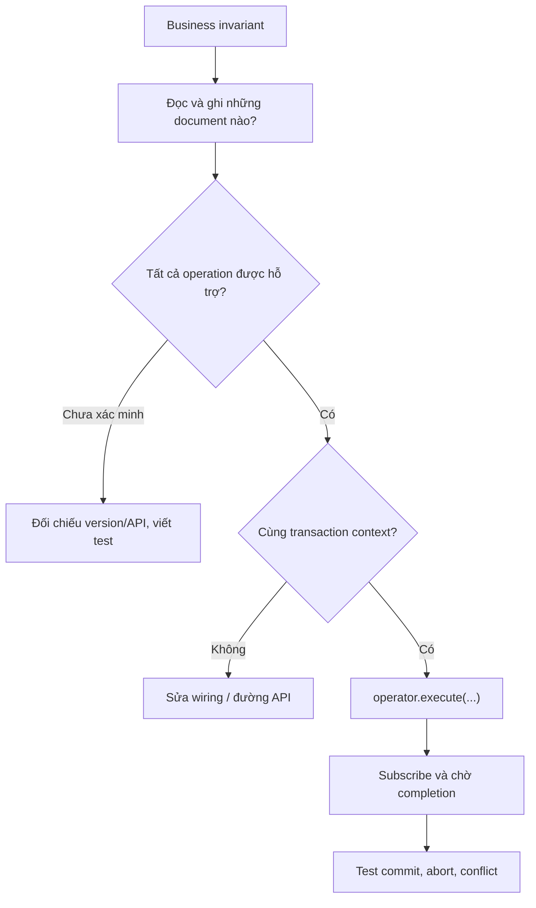

# CouchbaseTransactionalOperator cho giao dịch lập trình

Trong chương **Giao dịch** của **SPRING_DATA_COUCHBASE**, ta thường gặp `@Transactional` trên phương thức service. Đây là cách khai báo ranh giới giao dịch quen thuộc, nhưng không phải lúc nào cũng phù hợp: một workflow reactive có thể được xây dựng từ nhiều `Mono`/`Flux`, một đoạn xử lý muốn quyết định phạm vi giao dịch bằng code, hoặc hệ thống cần đặt logic giao dịch ở một adapter riêng thay vì trên toàn bộ phương thức.

Spring Data Couchbase cung cấp **`CouchbaseTransactionalOperator`**, công cụ lập trình để đặt các thao tác Couchbase được hỗ trợ trong **transaction scope**. Mục tiêu của operator là **biểu đạt ranh giới giao dịch trực tiếp ở nơi xây pipeline**, thay vì chỉ dựa vào annotation và Spring AOP proxy.

Điểm then chốt: **operator không biến mọi Publisher, mọi SDK call hay mọi hệ thống ngoài Couchbase thành giao dịch**. Nó chỉ hữu ích khi được tạo từ hạ tầng transaction Couchbase phù hợp và **toàn bộ thao tác cần bảo vệ thật sự tham gia transaction context**. Người lập trình vẫn phải hiểu entity mapping, `@Version`/CAS, bucket/scope/collection, SQL++, timeout, lỗi commit chưa rõ kết quả và idempotency.

Bài học này tập trung vào cách dùng operator, phân biệt với `@Transactional`, giải thích lifecycle của reactive transaction, trình bày ví dụ chuyển điểm giữa hai document và cách kiểm thử.

## 1. Mục tiêu học tập

Sau bài này, bạn có thể:

- Giải thích **giao dịch lập trình** và vai trò của `CouchbaseTransactionalOperator` trong Spring Data Couchbase.
- Biết các điều kiện hạ tầng cần có: Couchbase Server/Java SDK tương thích, transaction manager, template/repository được cấu hình đúng, quyền truy cập metadata giao dịch.
- Viết một pipeline reactive có **phạm vi transaction tường minh** bằng `operator.execute(...)`.
- Hiểu vì sao **assembly, subscription, completion, error và cancellation** là các thời điểm khác nhau trong Reactor.
- Bảo đảm các lệnh đọc–kiểm tra–ghi của bất biến nghiệp vụ chạy trong **cùng một transaction context**.
- Phân biệt `CouchbaseTransactionalOperator` với `@Transactional`, `TransactionalOperator` chung của Spring và `cluster.transactions().run(...)` của Couchbase Java SDK.
- Nhận diện giới hạn của `Mono.when`, `retryWhen`, `block()`, side effect trong callback và việc tự `subscribe()`.
- Tách **`@Version`/CAS** trên một document khỏi **atomicity nhiều document**, và phân biệt transaction với SQL++ scan consistency.
- Kiểm thử **commit thành công, rollback khi lỗi, cạnh tranh, kết quả commit không rõ và idempotency** trên môi trường Couchbase thử nghiệm.

## 2. Giao dịch lập trình khác giao dịch khai báo như thế nào?

Một giao dịch nghiệp vụ chỉ hợp lệ nếu những mutation cần bảo vệ **được cam kết như một đơn vị**.

Ví dụ chuyển 40 điểm từ tài khoản A101 sang A102:

```text
Ban đầu:
  account::tenant-a::A101 = 150
  account::tenant-a::A102 =  50

Khi giao dịch thành công:
  account::tenant-a::A101 = 110
  account::tenant-a::A102 =  90

Bất biến:
  Điểm nguồn không âm.
  Tổng điểm hai tài khoản luôn bằng 200 ở trạng thái commit.
```

Nếu trừ nguồn rồi lỗi trước khi cộng đích, không được công bố chuyển điểm thành công.

Có hai phong cách quản lý transaction ở tầng Spring:

| Phong cách | Điểm xác định ranh giới | Điểm mạnh | Điểm cần thận trọng |
| --- | --- | --- | --- |
| **Khai báo** bằng `@Transactional` | Annotation trên service method; Spring transaction advice | Ngắn gọn, ranh giới use case dễ đọc | Spring proxy, chọn đúng manager, method thực sự được intercept |
| **Lập trình** bằng `CouchbaseTransactionalOperator` | Đoạn Publisher được bao trong `operator.execute(...)` | Rõ transaction scope ngay trong code, hợp pipeline reactive | Phải hiểu subscription, context propagation, error/cancel/retry |
| **SDK callback** bằng `cluster.transactions().run(...)` | Callback nhận `ctx` từ SDK | Thao tác transaction KV/SQL++ theo API SDK tường minh | Không tự dùng converter/entity mapping của Spring Data, không tự phối hợp với JPA |

**Cả ba cách đều có thể đúng**, tùy phiên bản và đường API. Không có lựa chọn nào tự động thay thế yêu cầu thiết kế business invariant, quyền truy cập, idempotency hoặc kiểm thử.

## 3. Khi nào nên dùng CouchbaseTransactionalOperator?

### 3.1. Các tình huống phù hợp

- Service muốn trả `Mono<Result>` hoặc `Flux<Result>`, và ranh giới transaction cần bao một **đoạn pipeline cụ thể**.
- Một adapter thực hiện thao tác nhiều document cần được gọi từ nhiều use case; muốn **đóng gói scope** để caller không phải đặt `@Transactional`.
- Cần chủ động tạo một transaction cho một bước trong workflow lớn, nhưng giữ các bước như gọi HTTP, phát sự kiện hoặc tạo báo cáo **ngoài transaction**.
- Muốn tránh phụ thuộc vào Spring AOP proxy ở nơi không phù hợp, ví dụ khi xây pipeline trong helper được sử dụng có chủ đích và operator được inject từ context.
- Muốn kiểm thử rõ ràng publisher nào **nằm trong** và publisher nào **nằm ngoài** transaction.

### 3.2. Khi không cần dùng operator

- Chỉ đọc một document bằng `findById`, không có yêu cầu nhất quán xuyên nhiều mutation.
- Chỉ cập nhật một document có CAS/`@Version` phù hợp; transaction nhiều document có thể không cần thiết.
- Một batch nhiều document độc lập được phép thành công từng phần, có checkpoint và retry.
- Một use case imperative đã có service method `@Transactional` hoạt động đúng và đã được integration test; không cần bọc thêm operator chỉ để tăng số abstraction.
- Muốn giao dịch ACID xuyên Couchbase và PostgreSQL, Kafka, email hoặc payment gateway: operator **không** giải quyết distributed transaction.

**Lựa chọn bắt đầu từ invariant**, không phải từ việc ứng dụng đã sử dụng Reactor hay Spring Data.

## 4. Ba câu hỏi phải trả lời trước khi dùng operator

Trước khi viết `operator.execute(...)`, hãy xác minh:

1. **Couchbase operations có được giao dịch hỗ trợ không?** KV find/insert/replace/remove thường là nhóm cần xem xét trước; SQL++ query, derived query và bulk operations có giới hạn riêng theo version.
2. **Những operations đó có cùng transaction-aware infrastructure không?** Template, repository, manager và cluster phải được cấu hình đúng; không trộn một SDK Collection lấy từ cluster khác.
3. **Tập read/write có bao trùm bất biến nghiệp vụ không?** Nếu chuyển điểm cần đồng thời cập nhật source, target và transfer record, cả ba mutation cần nằm trong ranh giới nhất quán được thiết kế.



**Không nên đưa một mutation rất quan trọng vào operator rồi mặc định là nó transactional chỉ vì không phát sinh lỗi biên dịch.**

## 5. Hạ tầng Spring Data Couchbase cần có

Ví dụ ứng dụng Spring Boot dùng bucket `appdata`:

```yaml
spring:
  couchbase:
    connection-string: couchbase://localhost
    username: loyalty_app
    password: ${COUCHBASE_PASSWORD}
  data:
    couchbase:
      bucket-name: appdata
```

Đây là cấu hình kết nối **minh họa cho môi trường thử nghiệm**, chưa phải đầy đủ cho production. Mật khẩu không được hard-code; hệ thống thực cần TLS, RBAC tối thiểu, secret manager, cấu hình timeout/durability và giám sát.

Để sử dụng giao dịch, cần xác minh:

- **Couchbase Server, Java SDK, Spring Data Couchbase, Spring Boot và JDK** là bộ phiên bản tương thích với cơ chế transaction được dùng.
- Data Service truy cập được bucket/collection. Query/Index Service và secondary index cần thiết nếu giao dịch dùng SQL++.
- Transaction metadata, thường liên quan **Active Transaction Record (ATR)**, có nơi lưu phù hợp và được cấp quyền.
- Spring Data đã cấu hình các bean **`CouchbaseTemplate`, `ReactiveCouchbaseTemplate`, repository, transaction manager/operator** phù hợp với version.
- Các document liên quan cùng loại hoặc khác loại trỏ đúng bucket/scope/collection và có quyền đọc/ghi.
- Cơ chế transaction được thử nghiệm thật: CRUD KV thành công **không đủ** để chứng minh transaction có thể commit/abort đúng.

### 5.1. Không tự tạo cấu hình transaction trùng nhau

`AbstractCouchbaseConfiguration` hoặc Spring Boot auto-configuration có thể đã đăng ký các bean hạ tầng tùy phiên bản. Đừng tự tạo nhiều transaction managers/operators cùng loại khi chưa kiểm tra application context.

Nếu dự án dùng nhiều Couchbase clusters hoặc buckets, cần xác định **operator/manager tương ứng với operations nào**. Một template trỏ cluster A không mặc nhiên có cùng transaction context với operator được tạo cho cluster B.

### 5.2. Chọn đúng manager

Trong những dòng Spring Data Couchbase có callback-based transaction integration, API công bố class **`org.springframework.data.couchbase.transaction.CouchbaseCallbackTransactionManager`**, và bean thường có tên **`couchbaseTransactionManager`**.

Tên class Java và tên bean không giống nhau. Tên gọi chung “CouchbaseTransactionManager” trong tài liệu không có nghĩa class import cùng tên luôn tồn tại.

Khi app còn dùng JPA, tránh nhầm manager Couchbase với `JpaTransactionManager`. Một manager JPA không làm các mutation Couchbase tự rollback và ngược lại.

## 6. Tạo hoặc inject CouchbaseTransactionalOperator

Cách được ưu tiên trong ứng dụng Spring Data đã cấu hình đúng là **inject operator bean**:

```java
package com.example.loyalty;

import org.springframework.data.couchbase.transaction.CouchbaseTransactionalOperator;
import org.springframework.stereotype.Service;

@Service
public class LoyaltyTransactionAdapter {

    private final CouchbaseTransactionalOperator operator;

    public LoyaltyTransactionAdapter(
            CouchbaseTransactionalOperator operator) {
        this.operator = operator;
    }
}
```

Khi cần tạo operator bằng code và dòng API hỗ trợ factory tương ứng, có thể dùng dạng:

```java
import org.springframework.data.couchbase.transaction.CouchbaseCallbackTransactionManager;
import org.springframework.data.couchbase.transaction.CouchbaseTransactionalOperator;

// Manager phải được cấu hình trên cùng hạ tầng Couchbase.
CouchbaseTransactionalOperator operator =
        CouchbaseTransactionalOperator.create(
                couchbaseCallbackTransactionManager);
```

Ở đây `couchbaseCallbackTransactionManager` là **một biến/bean đã được inject**, không phải constructor cần tạo ngẫu nhiên trong method. Tên class, overload `create(...)` và cách cung cấp bean phải được đối chiếu với **JavaDoc của Spring Data Couchbase version đang sử dụng**.

Không nhầm với:

```java
// Không tự giả định operator chung này tương đương:
org.springframework.transaction.reactive.TransactionalOperator
```

Couchbase có integration callback và operator chuyên biệt; không thể thay bằng bất kỳ operator nào khác chỉ vì cùng có chữ “Transactional”.

## 7. Entity mẫu có @Version: dữ liệu nào được bảo vệ?

Trong bucket `appdata`, scope `loyalty` và collection `accounts`:

```java
package com.example.loyalty;

import org.springframework.data.annotation.Id;
import org.springframework.data.annotation.Version;
import org.springframework.data.couchbase.core.mapping.Collection;
import org.springframework.data.couchbase.core.mapping.Document;
import org.springframework.data.couchbase.core.mapping.Field;
import org.springframework.data.couchbase.core.mapping.Scope;

@Document
@Scope("loyalty")
@Collection("accounts")
public class Account {

    @Id
    private String id;

    @Field
    private String tenantId;

    @Field
    private String accountCode;

    @Field
    private long rewardPoints;

    @Field
    private String status;

    @Version
    private Long version;

    public Account() {
    }

    public Account(
            String id,
            String tenantId,
            String accountCode,
            long rewardPoints,
            String status) {
        this.id = id;
        this.tenantId = tenantId;
        this.accountCode = accountCode;
        this.rewardPoints = rewardPoints;
        this.status = status;
    }

    public String getId() { return id; }
    public void setId(String id) { this.id = id; }

    public String getTenantId() { return tenantId; }
    public void setTenantId(String tenantId) {
        this.tenantId = tenantId;
    }

    public String getAccountCode() { return accountCode; }
    public void setAccountCode(String accountCode) {
        this.accountCode = accountCode;
    }

    public long getRewardPoints() { return rewardPoints; }
    public void setRewardPoints(long rewardPoints) {
        this.rewardPoints = rewardPoints;
    }

    public String getStatus() { return status; }
    public void setStatus(String status) {
        this.status = status;
    }

    public Long getVersion() { return version; }
    public void setVersion(Long version) { this.version = version; }
}
```

- `@Id` là document key, ví dụ `account::tenant-a::A101`.
- `@Scope("loyalty")` và `@Collection("accounts")` xác định keyspace, không tự tạo namespace trên server.
- `@Version Long` gắn với metadata **CAS**; trong các dòng Spring Data Couchbase transaction integration, trường này là yêu cầu quan trọng để mapping entity tham gia transaction phù hợp.
- Không tự tăng `version + 1` vì CAS không phải business counter.
- `@Version` chỉ là cơ chế optimistic locking trên **từng document**; transaction nhiều document yêu cầu context của operator/SDK.

Nếu ứng dụng thêm trường JSON `schemaVersion` để version hóa cấu trúc dữ liệu, hãy giữ nó **độc lập** với CAS.

## 8. ReactiveCouchbaseTemplate là gì trong ví dụ này?

`ReactiveCouchbaseTemplate` cung cấp API Spring Data reactive cho đọc và ghi entity:

```java
import org.springframework.data.couchbase.core.ReactiveCouchbaseTemplate;
import reactor.core.publisher.Mono;

public Mono<Account> read(
        ReactiveCouchbaseTemplate template,
        String key) {
    return template.findById(Account.class)
            .one(key);
}
```

Các operation tương ứng có thể gồm:

- `findById(Account.class).one(key)`: đọc theo document key.
- `insertById(Account.class).one(entity)`: insert-only theo key.
- `replaceById(Account.class).one(entity)`: thay thế document có sẵn.
- `removeById(Account.class).one(key)`: xóa document theo key.
- `findByQuery(Account.class).matching(query).all()`: truy vấn SQL++ theo entity mapping.

Chữ ký fluent API và **tập operations thực sự hỗ trợ transaction** cần kiểm tra theo version. Đặc biệt, `findByQuery`/SQL++, bulk, tùy chọn expiry hoặc một số operation đặc thù có thể có giới hạn khác với KV find/replace.

**Template không phải SDK thuần**: nó áp dụng mapping entity của Spring Data. Ngược lại, gọi `Collection.upsert(id, JsonObject)` qua Java SDK không tự sử dụng Spring Data converter hoặc tự tham gia operator.

## 9. Cơ chế `operator.execute(...)`

Đoạn mã cơ bản:

```java
import org.springframework.data.couchbase.transaction.CouchbaseTransactionalOperator;
import reactor.core.publisher.Flux;
import reactor.core.publisher.Mono;

public Flux<Account> suspendAccounts(
        CouchbaseTransactionalOperator operator,
        ReactiveCouchbaseTemplate template,
        String key) {

    return operator.execute(status ->
            template.findById(Account.class)
                    .one(key)
                    .switchIfEmpty(Mono.error(
                            new IllegalArgumentException(
                                    "Account không tồn tại")))
                    .flatMap(account -> {
                        account.setStatus("SUSPENDED");
                        return template.replaceById(Account.class)
                                .one(account);
                    }));
}
```

Ở phiên bản có API `execute(...)` như ví dụ, operator nhận một callback xây **Publisher**. Kết quả được biểu diễn bằng publisher để caller subscribe.

`status` trong callback đại diện trạng thái/ngữ cảnh transaction theo API; ví dụ chưa cần thao tác trực tiếp với đối tượng đó. Không xem `status` là một `EntityManager` hay SQL++ query context của SDK.

### 9.1. Điều gì thuộc transaction scope?

Trong ví dụ:

1. Đọc Account bằng reactive template.
2. Nếu không tìm thấy, phát lỗi.
3. Đổi trạng thái trong object Java.
4. Replace document bằng reactive template.
5. Khi pipeline hoàn tất theo contract, transaction có thể được commit.

Điều này chỉ hợp lệ nếu template/operation đang dùng **tham gia context mà operator quản lý**, bean đã được cấu hình tương thích và publisher không bị cắt ngang sai cách.

### 9.2. `Flux<T>` và `Mono<T>`

Một số biến thể API `execute(...)` trả `Flux<T>` dù callback bên trong tạo `Mono<T>`. Nếu service muốn trả đúng một kết quả, có thể dùng:

```java
public Mono<Account> suspendOne(
        CouchbaseTransactionalOperator operator,
        ReactiveCouchbaseTemplate template,
        String key) {

    return operator.execute(status ->
            template.findById(Account.class)
                    .one(key)
                    .switchIfEmpty(Mono.error(
                            new IllegalArgumentException(
                                    "Không tìm thấy account")))
                    .flatMap(account -> {
                        account.setStatus("SUSPENDED");
                        return template.replaceById(Account.class)
                                .one(account);
                    }))
            .single();
}
```

`single()` yêu cầu đúng một phần tử và phải đợi publisher hoàn tất. Không dùng `next()` một cách máy móc để lấy phần tử đầu của `Flux` giao dịch, vì nó có thể **hủy subscription sớm** trước khi phần còn lại hoàn tất.

**Ghi chú phiên bản:** nếu phiên bản API khác trả về kiểu hoặc chữ ký khác, cần điều chỉnh theo JavaDoc thực tế. Điều quan trọng là **không phát thành công cho caller trước khi biết giao dịch đã kết thúc theo contract**.

## 10. Assembly, subscription và completion là các thời điểm khác nhau

Reactor thường xử lý theo mô hình **lazy subscription**.

```java
Mono<Account> workflow = suspendOne(
        operator, template, accountKey);

// Chỉ tạo publisher, chưa chứng minh mutation đã thực thi.
```

Khi caller subscribe, pipeline mới được thực thi:

```java
workflow.subscribe(
        result -> System.out.println(result.getStatus()),
        error -> System.err.println(error.getMessage()));
```

Đoạn `subscribe(...)` chỉ để minh họa lifecycle. Trong service WebFlux, **thường không tự gọi `subscribe()`**; hãy **trả publisher** cho framework hoặc cho tầng điều phối có trách nhiệm subscribe và xử lý kết quả. Tự subscribe rồi return ngay thường khiến transaction chạy độc lập với request, làm mất khả năng biết đúng khi nào commit và xử lý lỗi.

### 10.1. Vì sao không tự gọi `subscribe()` bên trong transaction?

Mẫu sai:

```java
return operator.execute(status -> {
    template.replaceById(Account.class)
            .one(accountA)
            .subscribe(); // Subscription tách rời!

    return template.replaceById(Account.class)
            .one(accountB);
});
```

Publisher thứ nhất được subscribe riêng, có thể chạy **ngoài phạm vi điều phối mà operator quản lý** hoặc hoàn tất sau khi publisher chính kết thúc. Vì vậy không được coi hai mutation là một transaction.

Cách đúng là **trả về một pipeline duy nhất** nối các thao tác cần thiết.

### 10.2. Sử dụng `flatMap`, `then` để nối tuần tự

```java
return operator.execute(status ->
        template.replaceById(Account.class)
                .one(accountA)
                .then(Mono.defer(() ->
                        template.replaceById(Account.class)
                                .one(accountB)))
);
```

`then(...)` chỉ chạy bước sau khi bước trước hoàn tất thành công; `Mono.defer(...)` trì hoãn việc tạo publisher bước sau đến lúc cần. Cách nối này giúp mọi lỗi đi theo cùng pipeline và đi qua transaction scope, **nếu operations và context được hỗ trợ**.

Đối với mutation có phụ thuộc vào trạng thái vừa đọc, ưu tiên đặt **kiểm tra và tính toán** trong một `flatMap` được thực thi bên trong pipeline, thay vì đọc trước ở một method ngoài transaction rồi dùng object stale.

## 11. Ví dụ đầy đủ: chuyển điểm qua CouchbaseTransactionalOperator

### 11.1. Interface nghiệp vụ

Giả sử ứng dụng đã xác thực caller, cung cấp tenant đã được ủy quyền, source key, target key và số điểm:

```java
package com.example.loyalty;

public record TransferCommand(
        String authorizedTenantId,
        String sourceKey,
        String targetKey,
        long amount) {
}
```

Để giữ ví dụ tập trung vào transaction, ta trả về một bản ghi kết quả đơn giản:

```java
package com.example.loyalty;

public record TransferReceipt(
        String sourceKey,
        String targetKey,
        long amount,
        long sourceBalance,
        long targetBalance) {
}
```

Trong production, cần có **transferId/idempotency key** ổn định để xử lý retry và commit ambiguous. Ví dụ dưới đây chưa phải implementation giao dịch tài chính production hoàn chỉnh.

### 11.2. Service reactive dùng operator

```java
package com.example.loyalty;

import java.util.Objects;
import org.springframework.data.couchbase.core.ReactiveCouchbaseTemplate;
import org.springframework.data.couchbase.transaction.CouchbaseTransactionalOperator;
import org.springframework.stereotype.Service;
import reactor.core.publisher.Mono;

@Service
public class ReactiveTransferService {

    private final CouchbaseTransactionalOperator operator;
    private final ReactiveCouchbaseTemplate template;

    public ReactiveTransferService(
            CouchbaseTransactionalOperator operator,
            ReactiveCouchbaseTemplate template) {
        this.operator = operator;
        this.template = template;
    }

    public Mono<TransferReceipt> transfer(TransferCommand command) {
        if (command.amount() <= 0 ||
                Objects.equals(
                        command.sourceKey(), command.targetKey())) {
            return Mono.error(new IllegalArgumentException(
                    "Yêu cầu chuyển điểm không hợp lệ"));
        }

        return operator.execute(status ->
                template.findById(Account.class)
                        .one(command.sourceKey())
                        .switchIfEmpty(Mono.error(
                                new IllegalArgumentException(
                                        "Nguồn không tồn tại")))
                        .flatMap(source ->
                                template.findById(Account.class)
                                        .one(command.targetKey())
                                        .switchIfEmpty(Mono.error(
                                                new IllegalArgumentException(
                                                        "Đích không tồn tại")))
                                        .flatMap(target ->
                                                stageTransfer(
                                                        command,
                                                        source,
                                                        target))))
                .single();
    }

    private Mono<TransferReceipt> stageTransfer(
            TransferCommand command,
            Account source,
            Account target) {

        String tenantId = command.authorizedTenantId();

        if (!tenantId.equals(source.getTenantId())
                || !tenantId.equals(target.getTenantId())) {
            return Mono.error(new IllegalStateException(
                    "Sai tenant đã được ủy quyền"));
        }

        if (!"OPEN".equals(source.getStatus())
                || !"OPEN".equals(target.getStatus())) {
            return Mono.error(new IllegalStateException(
                    "Tài khoản không sẵn sàng"));
        }

        if (source.getRewardPoints() < command.amount()) {
            return Mono.error(new IllegalStateException(
                    "Nguồn không đủ điểm"));
        }

        final long newSource =
                source.getRewardPoints() - command.amount();
        final long newTarget;
        try {
            newTarget = Math.addExact(
                    target.getRewardPoints(), command.amount());
        } catch (ArithmeticException ex) {
            return Mono.error(new IllegalStateException(
                    "Tràn số điểm đích", ex));
        }

        source.setRewardPoints(newSource);
        target.setRewardPoints(newTarget);

        return template.replaceById(Account.class)
                .one(source)
                .then(Mono.defer(() ->
                        template.replaceById(Account.class)
                                .one(target)))
                .thenReturn(new TransferReceipt(
                        command.sourceKey(),
                        command.targetKey(),
                        command.amount(),
                        newSource,
                        newTarget));
    }
}
```

### 11.3. Đọc luồng thực thi

- `transfer(...)` kiểm tra định dạng cơ bản trước khi tạo transaction scope.
- `operator.execute(...)` tạo phạm vi chứa **đọc source, đọc target, kiểm tra bất biến và thay đổi cả hai document**.
- Hai lần đọc được nối tuần tự, giúp tránh giả định ngầm về hai mutation chạy song song trong transaction.
- `stageTransfer` tính toán trên **các entity vừa được đọc trong pipeline**.
- `replaceById` của source chạy trước target; nếu bước sau phát lỗi, **transaction phải abort theo contract hỗ trợ**, không commit nguồn như một ghi độc lập.
- `thenReturn(...)` chỉ phát receipt khi hai Publisher ghi đã hoàn tất theo luồng; operator còn phải hoàn tất transaction theo semantics của chính nó.
- `single()` chờ một kết quả và completion thay vì cắt publisher sau phần tử đầu.

**Điều kiện bắt buộc:** `ReactiveCouchbaseTemplate`, `CouchbaseTransactionalOperator`, transaction manager và Couchbase client factory phải được cấu hình tương thích. Những đường fluent operation cụ thể phải có **transaction support trong phiên bản dùng**. Trước production phải chứng minh abort bằng integration test trên Couchbase thật.

### 11.4. Không tự đặt toàn bộ niềm tin vào một ví dụ code

Ví dụ chưa giải quyết mọi vấn đề:

- Chưa có `transferId` để ngăn client retry chuyển điểm hai lần.
- Chưa xử lý trạng thái `UNKNOWN` khi commit response bị mất.
- Chưa ghi ledger/audit record cùng transaction.
- Chưa phân tích durability/timeout và chính sách retry theo workload.
- Chưa quy định cơ chế trả lỗi ra HTTP và đối soát.
- Chưa chứng minh đúng version có hỗ trợ mọi operation bằng integration test.

Đây là **mẫu xây pipeline**, không phải giao dịch tiền tệ có thể triển khai nguyên trạng.

## 12. Tại sao `Mono.when` không tự tạo transaction?

Ví dụ sai nếu không có transaction context:

```java
Mono<Void> workflow = Mono.when(
        template.replaceById(Account.class).one(accountA).then(),
        template.replaceById(Account.class).one(accountB).then());
```

`Mono.when(...)` chỉ chờ các publisher hoàn tất; nó **không tạo atomicity**. Nếu A đã ghi rồi B lỗi, A không tự rollback.

Khi đã có operator, vấn đề cần phân biệt:

- `operator.execute(...)` mới là API biểu diễn transaction scope.
- `Mono.when(...)` chỉ là cách phối hợp nhiều publisher.
- Thao tác parallel trên cùng transaction context có thể làm tăng xung đột hoặc vi phạm giới hạn API transaction theo version.

Đối với quy trình đọc–kiểm tra–ghi có phụ thuộc trạng thái, **ưu tiên nối tuần tự** bằng `flatMap`/`then` để dễ kiểm soát thứ tự và lỗi. Không dùng concurrency như một cách tối ưu mặc định trong giao dịch nhiều document.

## 13. Error trong publisher quyết định đường abort

Một pipeline reactive có các loại tín hiệu:

| Tín hiệu | Ý nghĩa ở mức Reactor | Ý nghĩa cần kiểm tra với transaction |
| --- | --- | --- |
| `onNext(value)` | Phát một giá trị | Chưa nhất thiết là commit đã được xác nhận |
| `onComplete()` | Publisher kết thúc thành công | Operator có thể hoàn tất commit theo contract |
| `onError(error)` | Publisher thất bại | Operator/manager cần xử lý abort theo API hỗ trợ |
| `cancel()` | Subscription bị hủy | Phải xem semantics cancellation/cleanup của phiên bản, không tự giả định rollback đã xác nhận |
| Không có subscription | Publisher chưa được chạy | Không coi transaction đã diễn ra |

### 13.1. Propagate lỗi, không âm thầm thay bằng success

Ví dụ nguy hiểm:

```java
return operator.execute(status ->
        template.replaceById(Account.class)
                .one(source)
                .then(template.replaceById(Account.class).one(target))
                .onErrorResume(error -> {
                    logger.warn("Failed", error);
                    return Mono.just(source); // Nuốt lỗi!
                }));
```

Nếu mutation đích lỗi nhưng callback chuyển thành một kết quả thành công, operator có thể không nhận được tín hiệu lỗi như kỳ vọng. Một vài lỗi SDK có thể đã đánh dấu transaction thất bại, nhưng **không nên phụ thuộc vào sự mơ hồ**.

Thay vì vậy:

```java
return operator.execute(status ->
        template.replaceById(Account.class)
                .one(source)
                .then(template.replaceById(Account.class).one(target))
                .doOnError(error ->
                        logger.warn("Transaction operation failed", error))
);
```

`doOnError` dùng để ghi log có kiểm soát nhưng **không nuốt tín hiệu lỗi**. Việc chuyển sang response nghiệp vụ nên thực hiện sau khi transaction outcome đã được xác định phù hợp.

### 13.2. `onErrorResume` không luôn sai

`onErrorResume` có thể phù hợp khi xử lý một lỗi **trước bất kỳ mutation** và chủ động từ chối use case, hoặc khi phục hồi có quy tắc bảo đảm rõ. Tuy nhiên, đừng biến lỗi mutation sau khi đã stage thay đổi thành kết quả “thành công” rồi kỳ vọng operator biết phải rollback.

## 14. Cancellation và timeout: kết quả có thể chưa rõ

Ví dụ:

```java
return transferService.transfer(command)
        .timeout(Duration.ofSeconds(3));
```

`timeout` có thể hủy subscription upstream khi thời gian vượt ngưỡng. Tùy thời điểm, một transaction có thể:

- Chưa bắt đầu.
- Đang thực thi và có khả năng abort/cleanup.
- Đang commit nhưng caller chưa biết outcome.

Vì vậy, **timeout ở phía caller không chứng minh transaction đã rollback**. Với nghiệp vụ chuyển điểm, cần tra cứu theo `transferId` hoặc cơ chế đối soát trước khi retry.

### 14.1. Client disconnect

Một HTTP client ngắt kết nối có thể dẫn đến cancellation trong một WebFlux pipeline. Không được tự kết luận “client không nhận được response thì transaction chưa commit”. Thiết kế API phải hỗ trợ truy vấn trạng thái giao dịch bằng mã nghiệp vụ ổn định.

### 14.2. Timeout bên trong transaction khác timeout bên ngoài

Có thể tồn tại:

- Transaction expiration của SDK.
- Timeout cho KV/query operation.
- Timeout của service/HTTP gateway.
- Operator Reactor `timeout` bên ngoài.

Các timeout này **không đồng nhất**. Cần cấu hình theo thứ tự và chính sách rõ ràng, đo latency và hiểu trạng thái chưa rõ khi đường mạng đứt ở giai đoạn commit.

## 15. Retry có hai tầng và dễ gây xử lý trùng

Transaction SDK có thể retry callback trong những tình huống xung đột/lỗi được hỗ trợ. Reactor cũng có `retry`/`retryWhen` để resubscribe publisher.

```java
return transferService.transfer(command)
        .retryWhen(
                Retry.backoff(2, Duration.ofMillis(100)));
```

Đoạn này chỉ minh họa cú pháp Reactor, **không phải khuyến nghị áp dụng nguyên trạng cho chuyển điểm**. Nếu lần trước đã commit nhưng acknowledgement bị mất, resubscribe có thể chuyển điểm **lần nữa**.

Cần phân biệt:

1. **Internal transaction retry:** SDK/manager có thể thực thi lại callback theo contract.
2. **Reactive resubscribe:** `retryWhen` chạy lại toàn bộ source publisher.
3. **External request retry:** client hoặc message broker gửi lại lệnh nghiệp vụ.

Một giải pháp cần **idempotency key** ổn định xuyên cả ba tầng.

### 15.1. Bản ghi transferId

Ví dụ document:

```json
{
  "transferId": "T9001",
  "tenantId": "tenant-a",
  "sourceKey": "account::tenant-a::A101",
  "targetKey": "account::tenant-a::A102",
  "amount": 40,
  "status": "COMMITTED"
}
```

Nó có thể dùng key `transfer::tenant-a::T9001` trong collection `transfers`.

Nếu muốn đảm bảo chỉ xử lý một lần:

- Dùng insert-only hoặc điều kiện ghi tại thời điểm mutation, không chỉ `existsById` trước đó.
- Ghi nhận transfer record theo một **ranh giới transaction được hỗ trợ** cùng thay đổi số dư.
- Nếu client retry với cùng transferId, trả lại outcome đã được xác định; không tự cộng/trừ lần nữa.
- Với commit ambiguous, áp dụng logic tra cứu/đối soát thay vì kết luận rollback từ exception.

## 16. Callback có thể retry: không đặt side effect bên ngoài

Không nên:

```java
return operator.execute(status ->
        doCouchbaseTransfer()
                .doOnSuccess(receipt ->
                        emailService.sendReceipt(receipt)));
```

`doOnSuccess` ở **bên trong scope** có thể chạy trước khi commit cuối cùng hoặc bị gọi lại nếu callback/publisher được thử lại theo cơ chế transaction. Email không tự rollback và có thể gửi trùng.

Tương tự tránh:

- Gọi cổng thanh toán.
- Ghi PostgreSQL không thuộc transaction Couchbase.
- Phát Kafka/RabbitMQ message không được bảo vệ bởi outbox.
- Tăng một external counter.
- Gọi API bên ngoài có side effect.

Một thiết kế phù hợp hơn là **transactionally ghi event/outbox record** trong Couchbase cùng mutation nghiệp vụ, rồi xử lý gửi thông điệp **sau khi transaction được xác nhận** bằng dispatcher có retry và consumer idempotent.

### 16.1. Log và metric cũng cần đặt đúng chỗ

Một callback có thể chạy lại khiến metric “transaction started” hoặc log “transfer completed” bị đếm sai nếu phát tại mỗi lần callback. Phân biệt:

- **Attempt count:** số lần callback/transaction thử.
- **Committed count:** số use case được xác nhận đã commit.
- **Unknown count:** số outcome cần đối soát.
- **Rejected count:** số yêu cầu bị từ chối bởi điều kiện nghiệp vụ.

Không đưa dữ liệu nhạy cảm như số tài khoản hoặc document body đầy đủ vào log.

## 17. Bài toán nhiều collection và keyspace

Entity `Account` ánh xạ đến:

```java
@Document
@Scope("loyalty")
@Collection("accounts")
class Account {
    // ...
}
```

Giả sử có thêm `TransferRecord` trong collection `transfers`. Hai collection khác nhau có thể nằm trong cùng bucket hoặc khác scope/bucket tùy kiến trúc.

Một giao dịch có thể cần:

```text
Transaction:
    đọc account nguồn trong loyalty.accounts
    đọc account đích trong loyalty.accounts
    replace hai account
    insert transfer record trong loyalty.transfers
Commit
```

Cần xác minh SDK/version hỗ trợ phạm vi keyspace mong muốn, quyền RBAC trên cả hai collection và vị trí transaction metadata/ATR. Cùng chuỗi document key trong hai collection là **hai document khác nhau**.

**Không ghép tên bucket/scope/collection từ input không tin cậy vào SQL++**. Nếu hệ thống multi-tenant dùng nhiều collection, chọn bằng cấu hình/allowlist có kiểm soát. Operator không tự kiểm tra quyền tenant của người gọi.

## 18. CAS và `@Version` trong transaction

`@Version Long` ánh xạ CAS metadata, giúp phát hiện cập nhật trên một document bằng phiên bản cũ trong những operation được hỗ trợ.

Ví dụ ngoài transaction:

```java
Account account = repository.findById(key)
        .orElseThrow();

account.setRewardPoints(account.getRewardPoints() + 10);
repository.save(account);
```

Nếu một request khác đã sửa document sau lần đọc, thao tác `save` với CAS cũ có thể bị từ chối bằng optimistic locking conflict.

**CAS không thay thế operator**:

- CAS bảo vệ một document theo giá trị version đã đọc.
- Operator điều phối các operation được hỗ trợ của **nhiều document** trong một transaction context.
- Hai document đều có CAS vẫn không bảo đảm `saveAll` hoặc hai `save` độc lập có all-or-nothing.
- SDK transaction có cơ chế conflict/rollback riêng; không dùng object Spring Data mang CAS cũ sau một SDK mutation mà không đọc lại.
- Khi conflict xảy ra, callback có thể retry và **phải kiểm tra lại trạng thái nghiệp vụ** ở lần thử mới.

### 18.1. Không ghi version như field JSON tự tăng

CAS là token metadata. Không nên:

```java
account.setVersion(account.getVersion() + 1);
```

Hãy để mapping/SDK quản lý CAS. Nếu cần version hóa schema hoặc event sequence, dùng trường nghiệp vụ riêng.

## 19. SQL++ trong giao dịch lập trình

Một pipeline có thể cần tìm document theo thuộc tính JSON thay vì ID. Ví dụ:

```java
Flux<Account> openAccounts =
        reactiveRepository.findByTenantIdAndStatus(
                "tenant-a", "OPEN");
```

Đây thường là SQL++ query, khác với KV `findById`. Với bucket `appdata`, scope `loyalty`, collection `accounts`, truy vấn tương ứng có thể là:

```sql
SELECT META(a).id AS documentKey,
       a.rewardPoints
FROM `appdata`.`loyalty`.`accounts` AS a
WHERE a.tenantId = $tenantId
  AND a.status = $status;
```

Index minh họa:

```sql
CREATE INDEX ix_accounts_tenant_status
ON `appdata`.`loyalty`.`accounts` (
    tenantId,
    status
);
```

Nếu query này dùng trong transaction:

- Phải xác minh **transactional query** được Couchbase Server/SDK/Spring Data version hỗ trợ.
- `@Query`/derived query không tự bảo đảm nó sẽ tham gia operator context theo mọi implementation.
- Query Service/Index Service và index vẫn cần hoạt động.
- `REQUEST_PLUS` là cơ chế scan consistency của SQL++, **không phải** cơ chế transaction.
- Nếu invariant dựa trên predicate như “có tối đa 100 reservation ACTIVE”, cần đánh giá isolation và cách tránh write skew. Một quota guard document được cập nhật trong transaction thường giúp các request cạnh tranh cùng một điểm xung đột.

**Không thay một phép KV read bằng SQL++ query chỉ để “đưa nó vào operator”**. Khi đã biết key, KV thường đơn giản và tiết kiệm hơn; SQL++ thích hợp khi cần tìm theo điều kiện.

## 20. Reactive Repository có thể phối hợp với operator không?

Ví dụ:

```java
package com.example.loyalty;

import org.springframework.data.couchbase.repository.ReactiveCouchbaseRepository;
import reactor.core.publisher.Flux;

public interface ReactiveAccountRepository
        extends ReactiveCouchbaseRepository<Account, String> {

    Flux<Account> findByTenantIdAndStatus(
            String tenantId, String status);
}
```

Trong những phiên bản Spring Data Couchbase có integration tương ứng, các method repository **được hỗ trợ** có thể tham gia transaction context của operator.

Một mẫu dùng repository:

```java
public Mono<Account> suspend(
        CouchbaseTransactionalOperator operator,
        ReactiveAccountRepository repository,
        String key) {

    return operator.execute(status ->
            repository.findById(key)
                    .switchIfEmpty(Mono.error(
                            new IllegalArgumentException("Thiếu account")))
                    .flatMap(account -> {
                        account.setStatus("SUSPENDED");
                        return repository.save(account);
                    }))
            .single();
}
```

**Không phải mọi method repository đều được bảo đảm transaction support giống nhau.** Đặc biệt `saveAll`, bulk, derived SQL++ query, `@Query` hoặc các custom fragments gọi SDK cần kiểm tra riêng. Nếu một custom fragment mở client riêng hay gọi `cluster.query` độc lập, operator không tự đưa lệnh đó vào đúng context.

Có thể kết hợp Repository và Template trong cùng transaction **nếu chúng được cấu hình trên cùng transaction-aware infrastructure và từng operation đều được hỗ trợ**. Hãy chứng minh bằng integration test, không chỉ bằng code compile.

## 21. Phân biệt CouchbaseTransactionalOperator và @Transactional

```java
@Transactional(transactionManager = "couchbaseTransactionManager")
public Mono<Account> suspend(String key) {
    return reactiveTemplate.findById(Account.class)
            .one(key)
            .flatMap(account -> {
                account.setStatus("SUSPENDED");
                return reactiveTemplate.replaceById(Account.class)
                        .one(account);
            });
}
```

Với `@Transactional`, transaction advice thường được áp dụng khi method được **gọi qua Spring proxy**. Nếu một method được gọi bằng `this.suspend(...)` trong cùng class, proxy có thể bị bỏ qua.

Với operator:

```java
return operator.execute(status ->
        reactiveTemplate.findById(Account.class)
                .one(key)
                .flatMap(account -> {
                    account.setStatus("SUSPENDED");
                    return reactiveTemplate.replaceById(Account.class)
                            .one(account);
                }));
```

Transaction scope được biểu diễn trực tiếp trong code. Đây là lợi thế khi có self-invocation hoặc một đoạn pipeline cần transaction cục bộ.

### 21.1. Operator không yêu cầu method bên ngoài có annotation

Nếu `operator` đã được inject và pipeline được trả về đúng cách, method tạo pipeline **không cần `@Transactional`** chỉ để bao scope đó. Tránh lồng cả annotation và operator tùy tiện mà chưa xác định quy tắc nesting/reuse context.

### 21.2. Lồng transaction không có nghĩa savepoint

Nếu một service đã có transaction Couchbase rồi lại gọi `operator.execute(...)`, phải xác minh behavior ở phiên bản đang dùng: context có được dùng lại, transaction có bị lồng không, hay một ranh giới mới không được hỗ trợ?

Không giả định có **nested transaction/savepoint** tương tự một số cơ chế RDBMS. Với invariant nhiều document, ưu tiên **một boundary rõ** và tất cả mutation tham gia boundary đó.

## 22. Programmatic operator và transaction SDK callback

Couchbase Java SDK cung cấp đường API khác:

```java
cluster.transactions().run(ctx -> {
    TransactionGetResult a = ctx.get(collection, firstKey);
    TransactionGetResult b = ctx.get(collection, secondKey);

    JsonObject aBody = a.contentAsObject();
    JsonObject bBody = b.contentAsObject();

    ctx.replace(a, aBody.put("status", "SUSPENDED"));
    ctx.replace(b, bBody.put("status", "SUSPENDED"));
});
```

Ví dụ giả định đã có import SDK thích hợp cho `TransactionGetResult` và `JsonObject`, và `collection` là collection SDK đúng keyspace.

So sánh:

| Tiêu chí | `CouchbaseTransactionalOperator` | SDK `transactions().run(ctx -> ...)` |
| --- | --- | --- |
| API | Spring Data transaction integration | Couchbase Java SDK |
| Cách biểu đạt | Bọc reactive Publisher vào `execute` | Callback dùng `ctx` |
| Entity mapping | Có thể dùng Spring Data converter qua Template/Repository | SDK `JsonObject` không tự áp dụng Spring Data mapping |
| Quản lý context | Operator/manager đã cấu hình | SDK transaction context |
| Kiểu bất đồng bộ | Reactor `Mono`/`Flux` | SDK có imperative và reactive transactions APIs theo version |
| Gọi SDK KV ngoài context | Không mặc nhiên được bảo vệ | Không dùng lệnh thô bên ngoài `ctx` nếu cần atomicity |
| SQL++ | Cần support Spring Data/SDK theo version | Dùng query API trên context được hỗ trợ |
| Retry/commit ambiguous | Vẫn phải xử lý | Vẫn phải xử lý |

**Không trộn hai mô hình một cách ngẫu nhiên.** Một lệnh `collection.upsert(...)` trên SDK Collection độc lập không tự tham gia `CouchbaseTransactionalOperator`. Nếu cần tính năng SDK đặc biệt, cân nhắc một adapter transaction SDK thống nhất cho cả use case.

## 23. Cancellation, rollback và cleanup khi có lỗi

Transaction metadata như **Active Transaction Record (ATR)** có thể được dùng để điều phối commit/abort và cleanup. Nếu process crash hoặc mạng lỗi, SDK/server có cơ chế xử lý trạng thái dở dang theo phạm vi hỗ trợ.

Đừng tự xóa ATR/metadata để “đảm bảo rollback”. Cần:

- Cấu hình vị trí metadata và RBAC phù hợp.
- Kiểm tra timeout, cleanup và durability.
- Theo dõi số transaction abort/retry/timeout.
- Ghi nhận transaction ID/biz transferId ở mức an toàn để đối soát.
- Không hứa rằng `cancel()` hoặc `timeout` trả về luôn đồng nghĩa rollback đã được xác nhận.

Một phép transfer thất bại trước commit và một phép transfer đã commit nhưng **mất acknowledgement** đòi hỏi cách xử lý khác nhau. Cần phân loại **COMMITTED**, **REJECTED**, **UNKNOWN** thay vì map mọi exception sang “không thực hiện”.

## 24. Kiểm thử integration: happy path và abort giữa hai ghi

### 24.1. Fixture

Chuẩn bị Couchbase thử nghiệm có:

```text
appdata.loyalty.accounts

account::tenant-a::A101 -> rewardPoints = 150, status = OPEN
account::tenant-a::A102 -> rewardPoints =  50, status = OPEN
```

Dùng cấu hình server, SDK, Spring Data, metadata RBAC và collection tương ứng; reset fixture trước mỗi test để không bị ảnh hưởng bởi bài test khác.

### 24.2. Happy path

```java
@Test
void transferShouldUpdateBothBalances() {
    TransferCommand command = new TransferCommand(
            "tenant-a",
            "account::tenant-a::A101",
            "account::tenant-a::A102",
            40);

    StepVerifier.create(transferService.transfer(command))
            .assertNext(receipt -> {
                assertEquals(110L, receipt.sourceBalance());
                assertEquals(90L, receipt.targetBalance());
            })
            .verifyComplete();

    Account source = blockingRepository.findById(
            "account::tenant-a::A101").orElseThrow();
    Account target = blockingRepository.findById(
            "account::tenant-a::A102").orElseThrow();

    assertEquals(110L, source.getRewardPoints());
    assertEquals(90L, target.getRewardPoints());
}
```

Đoạn test giả định đã import JUnit 5, Reactor Test `StepVerifier` và đã cấu hình `transferService`/`blockingRepository` trên Couchbase test. Dùng Repository imperative để đối chiếu **sau khi publisher hoàn tất** là cách quan sát; không gọi blocking repository trên event loop.

### 24.3. Cố tình lỗi sau mutation đầu

Tạo một phương thức test-only sử dụng cùng operator/template:

```java
public Mono<Void> subtractThenFailForTest(
        String sourceKey, long amount) {

    return operator.execute(status ->
            template.findById(Account.class)
                    .one(sourceKey)
                    .switchIfEmpty(Mono.error(
                            new IllegalArgumentException(
                                    "Nguồn không tồn tại")))
                    .flatMap(source -> {
                        source.setRewardPoints(
                                source.getRewardPoints() - amount);

                        return template.replaceById(Account.class)
                                .one(source)
                                .then(Mono.error(
                                        new IllegalStateException(
                                                "FORCED_ABORT_TEST_ONLY")));
                    }))
            .then();
}
```

`Mono.error(...)` được phát **sau bước replace đã hoàn tất trong pipeline**. Nếu operation tham gia transaction đúng, transaction phải xử lý abort thay vì commit mutation nguồn như một ghi độc lập.

Test:

```java
@Test
void errorAfterFirstReplaceMustNotCommitPartialTransfer() {
    StepVerifier.create(
            transferService.subtractThenFailForTest(
                    "account::tenant-a::A101", 40))
            .expectError(IllegalStateException.class)
            .verify();

    Account source = blockingRepository.findById(
            "account::tenant-a::A101").orElseThrow();

    Account target = blockingRepository.findById(
            "account::tenant-a::A102").orElseThrow();

    assertEquals(150L, source.getRewardPoints());
    assertEquals(50L, target.getRewardPoints());
}
```

Đây là phép kiểm tra **rất quan trọng**: nếu source còn 110 sau lỗi, transaction boundary, context hoặc operation support đang không như mong đợi. Không đưa đường cố tình abort này vào public API production.

### 24.4. Vì sao cần test kết quả trên dữ liệu thật?

Một test chỉ assert:

```java
assertNotNull(couchbaseTransactionalOperator);
```

chứng minh bean tồn tại, **không chứng minh atomicity**. Tương tự, test mock `ReactiveCouchbaseTemplate` chỉ chứng minh flow gọi method, không xác nhận cluster đã stage/commit/abort đúng.

Cần một integration test trên server/SDK/keyspace đại diện cho production.

## 25. Kiểm thử chuyên sâu về reactive lifecycle và concurrency

Ngoài happy path và forced-abort, nên có các test sau:

| Bài kiểm thử | Mục tiêu |
| --- | --- |
| Chỉ tạo publisher, không subscribe | Xác định không xem thao tác là đã hoàn tất |
| Subscribe một lần, đợi completion | Bảo đảm kết quả chỉ được công bố khi flow hoàn tất |
| Tự subscribe một nhánh ngoài callback | Chứng minh rủi ro operation thoát scope |
| Gắn `retryWhen` vào transfer không idempotent | Thấy nguy cơ xử lý trùng, sau đó sửa bằng transferId |
| Hủy subscription lúc đang chờ | Phân loại cancellation và trạng thái cần đối soát |
| Timeout ngay trước/đang commit | Không tự kết luận rollback; dùng transferId |
| Hai transaction cùng trừ một nguồn | Conflict/retry phải giữ nguồn không âm |
| Giao dịch có insert-only transfer record | Hai request cùng transferId không chuyển hai lần |
| Reactive repository + template trong một operator | Kiểm tra cùng transaction-aware infrastructure |
| Derived SQL++ query trong operator | Kiểm tra support, index, Query Service và consistency |
| Sai collection | Phát hiện mapping `@Collection` và SDK collection không khớp |
| Thiếu quyền ATR/metadata | Transaction thất bại có thể chẩn đoán |
| TTL hết hạn giữa các bước | Không làm lệch invariant hoặc có cơ chế đối soát |

Các test cần sử dụng dữ liệu **có thể tạo lại**, không gây xung đột cưỡng bức hoặc thay cấu hình metadata ở production.

## 26. Vận hành: đo đúng các hiện tượng transaction

Một transaction cần được quan sát ở cả lớp ứng dụng và Couchbase:

- **Latency**: tổng thời gian từ subscribe tới completion/được xác nhận commit, p50/p95/p99.
- **Abort/conflict**: tỷ lệ giao dịch thất bại do cạnh tranh.
- **Retry**: số lần callback được thử lại và số request nghiệp vụ được gửi lại.
- **Commit ambiguous**: số outcome phải đối soát; không gom chung với “đã rollback”.
- **Timeout**: phân biệt timeout giao dịch, KV/query, HTTP gateway và Reactor.
- **Transaction size**: số document đọc/ghi trong mỗi use case, fan-out và hot keys.
- **Query plan**: SQL++ index, `EXPLAIN` và chi phí scan.
- **Metadata/cleanup**: ATR, quyền, trạng thái bất thường và độ trễ dọn dẹp.
- **Idempotency effectiveness**: số yêu cầu trùng được nhận diện mà không áp dụng mutation lần nữa.
- **TTL**: expiration của những document đang được dùng trong invariant, nhất là quota/reservation.

Không có con số latency hay throughput tối ưu áp dụng cho mọi cluster. Hãy kiểm thử với topology, network, document sizes và concurrency đại diện.

## 27. Bảng lỗi thường gặp

| Triệu chứng | Nguyên nhân có thể | Kiểm tra |
| --- | --- | --- |
| Import `CouchbaseTransactionalOperator` không biên dịch | Version/package API không khớp | Đối chiếu dependency và JavaDoc Spring Data |
| Bean operator không tồn tại | Cấu hình transaction hạ tầng thiếu hoặc Boot version khác | Kiểm tra `AbstractCouchbaseConfiguration`, bean factory |
| Có operator nhưng hai mutation không rollback cùng nhau | Operation ngoài context hoặc không được hỗ trợ | Kiểm tra wiring, forced-abort integration test |
| `Mono.when` chạy một phần | Không có transaction, hoặc các publisher không trong scope | Dùng `execute` và pipeline tuần tự |
| `Flux.next()` trả kết quả nhưng transaction không đúng | Subscription bị cancel sau phần tử đầu | Chờ completion; dùng đúng kiểu kết quả/contract |
| `subscribe()` trong callback | Subscription tách rời scope | Trả một Publisher tổng hợp duy nhất |
| `onErrorResume` nuốt lỗi | Callback trông như hoàn tất thành công | Propagate lỗi/abort theo API |
| `retryWhen` chuyển điểm hai lần | Resubscribe lặp nghiệp vụ không idempotent | TransferId và đối soát |
| Client timeout nhưng điểm đã đổi | Commit đã xảy ra, phản hồi bị mất | Trạng thái `UNKNOWN` và tra cứu transferId |
| Có `@Version` nhưng mất cân đối hai account | CAS riêng lẻ không tạo multi-document transaction | Đưa mọi mutation vào context |
| Query theo status lỗi index | SQL++ thiếu index | `EXPLAIN`, Query/Index Service |
| SDK `upsert` không rollback với operator | SDK call ngoài transaction context | Dùng API transaction được hỗ trợ |
| Entity khác keyspace SDK | Sai bucket/scope/collection | Xác minh mapping và client factory |
| Callback gửi email hai lần | Retry hoặc resubscribe | Outbox/idempotency |
| Transaction chậm | Read/write set lớn, conflict, query chậm | Đo latency, giảm phạm vi, tối ưu index |
| Giao dịch bị từ chối dù CRUD hoạt động | Thiếu quyền metadata/ATR hoặc version không hỗ trợ | Xác minh RBAC, server/SDK |

## 28. Bài thực hành

Chuẩn bị Spring Boot/WebFlux và Couchbase test có bucket `appdata`, scope `loyalty`, collection `accounts` với hai account 150/50.

1. **Xác minh dependency:** ghi rõ Spring Boot, Spring Data Couchbase, Java SDK và JDK; xác nhận API `CouchbaseTransactionalOperator` đúng phiên bản.
2. **Xác minh hạ tầng:** kiểm tra transaction manager, operator bean, `ReactiveCouchbaseTemplate`, RBAC và transaction metadata.
3. **Đọc một document:** gọi reactive `findById`, quan sát khác nhau giữa tạo publisher và subscribe.
4. **Bọc bằng operator:** viết `operator.execute(...)` đọc một account, đổi status và replace.
5. **Chuyển hai account:** xây flow đọc source/target, kiểm tra tenant/điểm, replace tuần tự hai document.
6. **Happy path:** xác minh 110/90 và tổng điểm 200.
7. **Forced abort:** phát lỗi sau replace nguồn và trước replace đích; xác minh 150/50 sau abort.
8. **Đối chứng sai:** tạo một publisher `Mono.when` ngoài transaction, phân tích khả năng ghi một phần.
9. **Đối chứng self-subscribe:** tự `subscribe()` một mutation trong callback và giải thích vì sao không an toàn.
10. **Error handling:** so sánh `doOnError` với `onErrorResume` nuốt lỗi sau mutation.
11. **Resubscription:** đặt `retryWhen` lên transfer, chứng minh nhu cầu transferId/idempotency.
12. **Cancellation:** áp dụng `timeout` bên ngoài, xây đường tra cứu trạng thái giao dịch khi kết quả chưa rõ.
13. **Reactive repository:** chuyển một số operation Template sang Repository, kiểm tra transaction support bằng integration test.
14. **SQL++:** thêm derived query theo tenant/status, tạo index và xác minh behavior khi dùng trong transaction.
15. **Multiple collections:** mở rộng thêm transfer record trong `loyalty.transfers`, kiểm tra quyền và atomicity.
16. **Concurrency:** chạy hai yêu cầu cạnh tranh điểm nguồn, bảo đảm bất biến không bị vi phạm sau các kết quả cuối.
17. **Quan sát:** thống kê số commit, abort, retry, conflict, timeout và outcome UNKNOWN.

Bài thực hành chỉ chạy trên cluster test với dữ liệu có thể tạo lại. Không tự xóa ATR, tạo lỗi tải cao hoặc thay đổi timeout/durability của môi trường production.

## 29. Câu hỏi tự đánh giá

1. Giao dịch lập trình giải quyết bài toán gì so với `@Transactional` trên service?
2. `CouchbaseTransactionalOperator` khác operator reactive chung của Spring ở điểm nào?
3. Vì sao phải kiểm tra operator và template cùng transaction-aware infrastructure?
4. `execute(status -> publisher)` biểu diễn ranh giới transaction như thế nào?
5. Vì sao chỉ tạo `Mono<...>` không có nghĩa mutation đã thực thi?
6. Tại sao không tự `subscribe()` một thao tác bên trong callback?
7. `flatMap` và `then` giúp diễn đạt thứ tự thao tác trong giao dịch như thế nào?
8. Vì sao `Flux.next()` có thể không phù hợp khi cần chờ giao dịch hoàn tất?
9. Khi một Publisher phát lỗi giữa hai mutation, điều gì cần được kiểm chứng bằng integration test?
10. Vì sao `onErrorResume` trả giá trị thành công sau một lỗi ghi có thể nguy hiểm?
11. Hủy subscription do HTTP client disconnect có chứng minh transaction rollback không?
12. `retryWhen` tạo rủi ro gì với lệnh chuyển điểm không có idempotency key?
13. Tại sao side effect email/Kafka không nên đặt trong callback có thể retry?
14. `@Version Long` bảo vệ điều gì, và có thay thế multi-document transaction không?
15. Transaction operator có tự tạo SQL++ index không?
16. Làm thế nào để bảo vệ quota theo predicate khi hai request cùng thấy count 99?
17. Có thể dùng transaction operator để commit chung Couchbase và PostgreSQL không?
18. Vì sao Repository `saveAll` không tự là một giao dịch?
19. Khi nào nên chuyển use case từ operator sang SDK transaction callback?
20. Test chỉ kiểm tra operator bean tồn tại khác test forced-abort ở điểm nào?
21. Commit ambiguous cần được xử lý như thế nào với transferId?
22. Những metric nào giúp phân biệt retry nội bộ với request nghiệp vụ bị gửi lại?

## 30. Ghi nhớ

**`CouchbaseTransactionalOperator` là cách đặt transaction scope bằng code cho những Publisher Couchbase được hỗ trợ.** Nó hữu ích khi muốn kiểm soát ranh giới chính xác trong pipeline reactive, nhưng chỉ có tác dụng khi template/repository, transaction manager, Couchbase SDK và mọi operation đều sử dụng đúng context.

Hãy nhớ bốn nguyên tắc:

1. **Bảo vệ bất biến:** mọi mutation cần cùng commit phải nằm trong phạm vi được operator quản lý.
2. **Tôn trọng lifecycle Reactor:** publisher cần được subscribe và hoàn tất; không tự subscribe nhánh phụ, không cắt sớm bằng `next()` hoặc ngầm coi cancellation là rollback.
3. **Thiết kế retry an toàn:** callback retry, `retryWhen` và client retry là các lớp khác nhau; dùng transferId, idempotency, outbox và đối soát khi commit chưa rõ.
4. **Kiểm thử trên dữ liệu thật:** forced-abort sau mutation đầu tiên, conflict đồng thời, sai keyspace, SQL++/index và permission/ATR mới chứng minh được bảo đảm nghiệp vụ.

Repository, Template, SQL++ và CAS vẫn có vai trò riêng. **Giao dịch không đến từ tên API, mà từ một transaction context đã được cấu hình, sử dụng và kiểm chứng đúng.**
