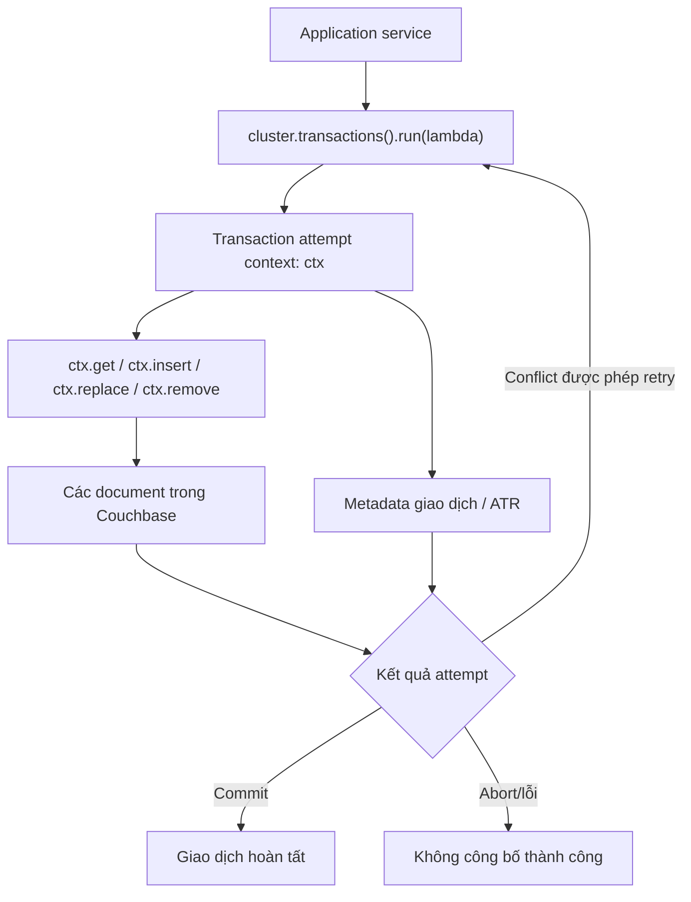
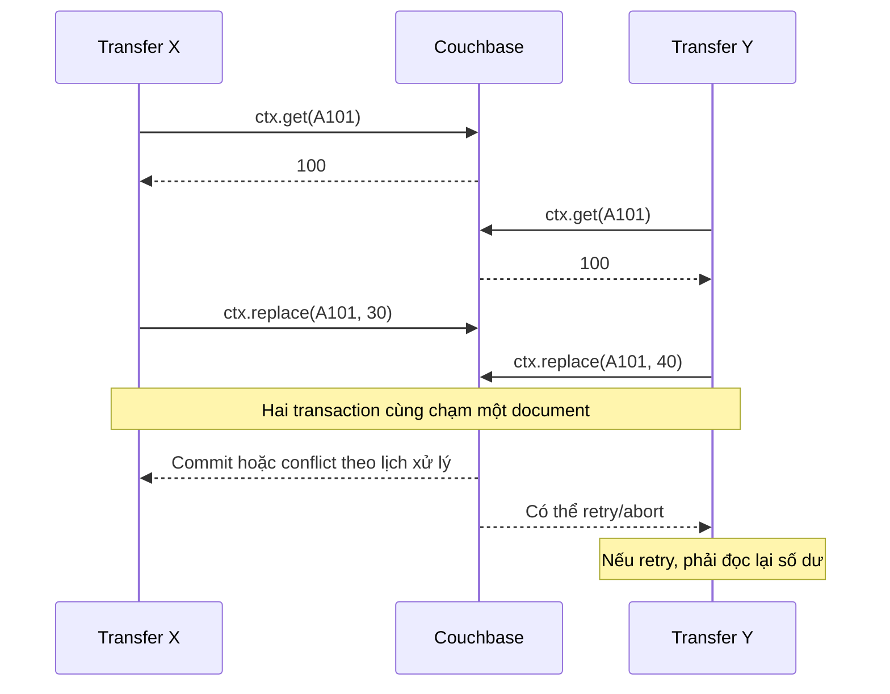

# Giao dịch trực tiếp trong lambda của Java SDK

Trong chương **Giao dịch** của module **SPRING_DATA_COUCHBASE**, chúng ta đã có những cách truy cập dữ liệu thuận tiện như `CouchbaseRepository`, `CouchbaseTemplate`, truy vấn SQL++ và các API reactive. Nhưng khi nghiệp vụ yêu cầu **nhiều document phải được thay đổi như một đơn vị**, đôi khi cách rõ ràng nhất là sử dụng **Couchbase Java SDK Transactions API** và khai báo toàn bộ thao tác trong lambda:

```java
cluster.transactions().run(ctx -> {
    // Đọc/ghi thông qua ctx, không dùng lệnh KV thông thường.
});
```

Lambda ở đây không chỉ là một khối mã Java cho gọn. Tham số `ctx` biểu thị **transaction attempt context**: những thao tác transaction-aware được gọi qua context này mới thuộc nhóm thay đổi mà SDK phối hợp để commit hoặc abort. Nếu xen vào `collection.upsert(...)`, `collection.remove(...)` hoặc `cluster.query(...)` ngoài transaction context, ta có thể vô tình tạo thao tác độc lập.

Bài này trình bày **giao dịch trực tiếp trong lambda của Java SDK**, từ nguyên tắc đọc–kiểm tra–ghi, API `ctx.get`/`ctx.insert`/`ctx.replace`/`ctx.remove`, ví dụ chuyển điểm giữa hai tài khoản, đến conflict, retry, trạng thái commit chưa rõ, idempotency, metadata/ATR, SQL++, `@Version`/CAS, TTL, các ranh giới với Spring Data và kiểm thử tích hợp. **SPECIAL_NOTE không có yêu cầu bổ sung**; nội dung bám vào phạm vi Spring Data Couchbase đã được giao.

## 1. Mục tiêu học tập

Sau bài này, bạn có thể:

1. Giải thích khi nào một **bất biến nghiệp vụ xuyên nhiều document** cần transaction thay vì hai mutation độc lập.
2. Tạo transaction bằng `Cluster.transactions().run(...)` và hiểu chức năng của `ctx`.
3. Dùng `ctx.get`, `ctx.insert`, `ctx.replace` và `ctx.remove` đúng mục đích.
4. Phân biệt **transaction-aware SDK operations** với KV/query SDK thông thường được gọi bên trong cùng lambda.
5. Viết service chuyển điểm nhiều document, kiểm tra tenant, trạng thái và số dư trong cùng transaction attempt.
6. Nhận biết **lambda có thể được SDK chạy lại**; không đặt thanh toán, email hoặc gửi message không idempotent trong callback.
7. Phân biệt **retry attempt của SDK**, retry toàn use case của ứng dụng và retry HTTP từ client.
8. Xử lý kết quả **commit thành công, bị từ chối, abort và commit ambiguous** mà không chuyển điểm hai lần.
9. Hiểu `@Version`/CAS của Spring Data vẫn khác với cơ chế transaction của SDK.
10. Chuẩn bị cluster/collection, quyền metadata, transaction timeout, durability và SQL++ index phù hợp.
11. Viết integration test cố tình gây lỗi sau mutation đầu, xác minh không xuất hiện trạng thái commit một nửa.
12. Chọn giữa SDK transaction, `@Transactional`, `CouchbaseTransactionalOperator` và thiết kế eventual consistency.

## 2. Bài toán trung tâm: chuyển điểm giữa hai tài khoản

Ứng dụng loyalty quản lý hai document trong Couchbase:

```text
Cluster:     couchbase.internal
Bucket:      appdata
Scope:       loyalty
Collection:  accounts

Document key: account::tenant-a::A101
  tenantId: tenant-a
  rewardPoints: 150
  status: OPEN

Document key: account::tenant-a::A102
  tenantId: tenant-a
  rewardPoints: 50
  status: OPEN
```

Người dùng muốn **chuyển 40 điểm** từ A101 sang A102. Điều kiện nghiệp vụ:

- Hai key khác nhau; số điểm chuyển lớn hơn 0.
- Hai tài khoản còn tồn tại, cùng tenant đã được ủy quyền và đều `OPEN`.
- Tài khoản nguồn có đủ điểm và không được âm.
- Khi chuyển điểm đã được xác nhận thành công, **tổng điểm hai tài khoản không đổi**.

Bất biến:

\[
P_{\text{nguồn}} \ge 0,\qquad
P_{\text{nguồn}} + P_{\text{đích}} = 200
\]

Kết quả hợp lệ:

```text
A101: 110
A102:  90
Tổng: 200
```

Nếu chỉ trừ A101 mà không cộng A102, hệ thống vi phạm bất biến tại trạng thái được công bố là hoàn tất. Đây chính là lý do dùng multi-document transaction.

### 2.1. Mẫu không có transaction

```java
GetResult a = accounts.get(sourceKey);
GetResult b = accounts.get(targetKey);

JsonObject source = a.contentAsObject();
JsonObject target = b.contentAsObject();

source.put("rewardPoints", 110);
accounts.replace(sourceKey, source); // Có thể commit ngay.

target.put("rewardPoints", 90);
accounts.replace(targetKey, target); // Có thể lỗi.
```

Khi mutation thứ hai thất bại, thao tác đầu tiên không tự rollback. `collection.replace` hoạt động trên một document; gọi nhiều lần trong một method Java **không tạo atomicity xuyên các key**.

### 2.2. Transaction khác với batch

Một lời gọi batch/multi-get/multi-save cũng không tự động trở thành giao dịch ACID. **Batch** nói về cách nhóm xử lý; **transaction** nói về việc phối hợp commit/abort và isolation của tập thao tác được hỗ trợ.

## 3. Kiến trúc Java SDK Transactions API



Couchbase Java SDK cung cấp transaction API ở mức thấp hơn Spring Data Repository/Template:

- `Cluster` là client kết nối tới Couchbase.
- `transactions()` cung cấp entrypoint cho transactions.
- `run(...)` chạy callback theo chính sách và context của SDK.
- `ctx` là đối tượng dành cho **transaction attempt**; những lệnh `ctx.*` hoạt động trong ngữ cảnh đó.
- SDK xử lý commit, abort, conflict, retry và cleanup theo khả năng hỗ trợ của phiên bản.

**Không nên tự mô phỏng transaction** bằng cách ghi document A rồi lưu dữ liệu cũ để “bù trừ” document A nếu B thất bại. Bù trừ có thể là thiết kế saga hợp lệ ở nơi khác, nhưng nó không tương đương atomic commit.

## 4. Yêu cầu phiên bản và điều kiện môi trường

Các ví dụ Java dùng phong cách **Couchbase Java SDK 3.x** với `cluster.transactions().run(ctx -> ...)`. Những API cụ thể, tên lớp exception, option và phạm vi tính năng thay đổi theo SDK/Server version; hãy đối chiếu bản đang triển khai.

| Thành phần | Điều cần kiểm tra |
| --- | --- |
| **Couchbase Server** | Hỗ trợ distributed transactions; bản dùng scope/collection và transactional SQL++ phải có tính năng tương ứng |
| **Couchbase Java SDK** | SDK 3.x với transaction API và version tương thích Server |
| **Spring Boot / Spring Data Couchbase** | Bộ dependency tương thích, tránh ghi đè SDK version không được kiểm thử |
| **Data Service** | Có thể truy cập các document KV của transaction |
| **Query/Index Service** | Cần khi transaction có SQL++ query dựa trên index |
| **Bucket/scope/collection** | Tồn tại thật và được mở đúng |
| **RBAC** | Đọc/ghi document nghiệp vụ và metadata/ATR phù hợp |
| **Durability/replica** | Tương ứng yêu cầu chịu lỗi, topology và policy |
| **NTP/thời gian đồng bộ** | Nên duy trì cho các node để xử lý metadata/cleanup ổn định |
| **Timeout/expiry** | Chọn theo workload và hiểu cách kết quả có thể không rõ ở giai đoạn commit |

Không được coi “`repository.findById` hoạt động” hoặc “SDK `collection.upsert` chạy được” là bằng chứng transactions đã hoạt động đúng. Transaction còn phụ thuộc **metadata, quyền, context và cơ chế commit**.

## 5. Mở đúng bucket, scope và collection

Một document key chỉ duy nhất **bên trong một collection**. Các key cùng chuỗi ở hai collection khác nhau đại diện cho hai document khác nhau.

Ví dụ adapter SDK nhận `Cluster` được quản lý vòng đời và truy cập collection:

```java
package com.example.loyalty;

import com.couchbase.client.java.Bucket;
import com.couchbase.client.java.Cluster;
import com.couchbase.client.java.Collection;
import com.couchbase.client.java.Scope;

public class LoyaltyCollections {

    private final Collection accounts;
    private final Collection transfers;

    public LoyaltyCollections(Cluster cluster) {
        Bucket bucket = cluster.bucket("appdata");
        Scope scope = bucket.scope("loyalty");
        this.accounts = scope.collection("accounts");
        this.transfers = scope.collection("transfers");
    }

    public Collection accounts() { return accounts; }
    public Collection transfers() { return transfers; }
}
```

Với Spring Data entity:

```java
@Document
@Scope("loyalty")
@Collection("accounts")
class Account {
    @Id
    String id;
    @Version
    Long version;
}
```

repository của entity này phải trỏ tới keyspace tương ứng khi bucket là `appdata`. Nhưng SDK không tự đọc annotation `@Scope` và `@Collection` của entity: adapter phải lấy đúng collection thông qua SDK.

**Cạm bẫy:** `bucket.defaultCollection()` không tương đương `bucket.scope("loyalty").collection("accounts")`. Giao dịch thành công trên collection sai vẫn có thể tạo dữ liệu sai nghiệp vụ.

## 6. Cú pháp cơ bản của lambda

```java
import com.couchbase.client.java.Cluster;

public void runTransaction(Cluster cluster) {
    cluster.transactions().run(ctx -> {
        // Chỉ dùng các operation được transaction SDK hỗ trợ.
    });
}
```

Chính `ctx` làm cho lambda này trở thành một transaction callback, không phải vì ký hiệu `->` có khả năng đặc biệt. Mã trong callback có thể được thực thi nhiều lần khi SDK retry attempt.

### 6.1. Khi nào được xem là thành công?

Theo API synchronous `run(...)`, lời gọi hoàn tất bình thường sau khi transaction được SDK xác nhận theo contract. Trường hợp callback ném exception, transaction thất bại hoặc kết quả commit chưa rõ, caller phải phân loại lỗi theo API của phiên bản.

Không được suy rằng:

```java
// Sai nhận thức:
cluster.transactions().run(ctx -> {
    ctx.replace(...);
    logger.info("Committed!"); // Log có thể chạy trước commit.
});
```

Dòng log trong lambda **không phải chứng cứ commit**. Nó có thể chạy trước commit cuối cùng hoặc chạy trong attempt sau đó bị retry/abort.

### 6.2. Callback là transaction attempt, không phải callback một lần duy nhất

SDK có thể thực thi lambda lại vì một số conflict hoặc lỗi có thể retry theo chính sách. Vì vậy những tính toán phụ thuộc dữ liệu cần **được thực hiện lại từ tài liệu vừa đọc** ở mỗi attempt; không dùng trạng thái đã tính từ một attempt cũ.

## 7. Bốn thao tác KV cốt lõi bên trong ctx

| Operation | Ý nghĩa | Tình huống phù hợp |
| --- | --- | --- |
| `ctx.get(collection, key)` | Đọc một document trong transaction context | Đọc trạng thái cần quyết định |
| `ctx.insert(collection, key, body)` | Tạo document với điều kiện key chưa tồn tại | Tạo transfer record, reservation, unique guard |
| `ctx.replace(transactionGetResult, body)` | Thay thế document đã đọc trong context | Cập nhật số dư, trạng thái |
| `ctx.remove(transactionGetResult)` | Xóa document đã đọc trong context | Xóa trạng thái cũ khi bảo vệ invariant |

Đoạn minh họa:

```java
cluster.transactions().run(ctx -> {
    TransactionGetResult current =
            ctx.get(accounts, "account::tenant-a::A101");

    JsonObject body = current.contentAsObject();
    body.put("status", "SUSPENDED");

    ctx.replace(current, body);
});
```

Điểm quan trọng:

- `ctx.get` trả một **`TransactionGetResult`** dành cho các thao tác trong attempt.
- `ctx.replace` nhận kết quả đọc và content mới, không chỉ nhận key trần như `collection.replace`.
- `ctx.insert` có nghĩa **insert-only**; không giống `upsert`.
- `ctx.remove` dùng document/result thuộc context.
- Không tự đem một result từ transaction khác hoặc attempt trước vào `ctx.replace`.

Các phương thức trên là mẫu SDK 3.x; import và option chi tiết cần kiểm tra theo dependency.

## 8. Insert-only không giống upsert

Một nghiệp vụ tạo lệnh chuyển điểm với mã `transferId` duy nhất nên dùng điều kiện **không ghi đè**.

```java
ctx.insert(
        transfers,
        "transfer::tenant-a::T9001",
        JsonObject.create()
                .put("tenantId", "tenant-a")
                .put("status", "APPLIED")
                .put("amount", 40));
```

Nếu key đã tồn tại, transaction không nên âm thầm ghi đè bằng dữ liệu mới. Điều này giúp xây **idempotency/unique guard**, nhưng một bản ghi tồn tại còn phải được **đối chiếu nội dung** trước khi trả lại kết quả cũ.

Không thay bằng:

```java
// Tránh cho giao dịch idempotency:
// transfers.upsert(transferKey, body);
// Đây là SDK mutation độc lập và có thể ghi đè record.
```

### 8.1. Vì sao kiểm tra rồi insert chưa đủ?

```java
if (!transfers.exists(transferKey).exists()) {
    // Race: hai client có thể cùng thấy key chưa tồn tại.
    transfers.insert(transferKey, body);
}
```

Đây là TOCTOU. Trong transaction, dùng `ctx.insert` hoặc cơ chế unique/guard được hỗ trợ để tính duy nhất được kiểm tra ở thời điểm ghi.

## 9. Replace phải gắn với document vừa đọc trong attempt

Mẫu hợp lệ:

```java
cluster.transactions().run(ctx -> {
    TransactionGetResult current =
            ctx.get(accounts, accountKey);

    JsonObject body = current.contentAsObject();
    body.put("rewardPoints", 120L);

    ctx.replace(current, body);
});
```

Mẫu có rủi ro:

```java
GetResult old = accounts.get(accountKey); // Ngoài transaction.

cluster.transactions().run(ctx -> {
    JsonObject body = old.contentAsObject();
    body.put("rewardPoints", 120L);

    // Dữ liệu đọc trước callback có thể đã cũ.
    // Không dùng kết quả KV ngoài context như TransactionGetResult.
});
```

Đọc một document trước callback không sai trong mọi use case, nhưng **nếu quyết định ghi phụ thuộc vào trạng thái phải còn đúng tại commit**, hãy đọc lại bằng `ctx.get` và kiểm tra bên trong callback.

### 9.1. Không dựa vào thứ tự số CAS

Couchbase quản lý CAS của document. CAS là token để phát hiện document đã thay đổi; không có hợp đồng là “phiên bản nghiệp vụ tăng 1” hoặc “CAS mới luôn bằng CAS cũ + 1”.

SDK transaction quản lý conflict và điều kiện ghi theo API riêng. Không tự truyền một CAS lấy từ Spring entity vào `ctx.replace` nếu không có contract hỗ trợ.

## 10. Ví dụ đầy đủ: chuyển điểm hai account trong một lambda

Đoạn code dưới đây là **ví dụ đồng bộ (imperative)** dùng Java SDK. Toàn bộ thao tác cần atomicity nằm trong cùng `ctx`.

```java
package com.example.loyalty;

import java.util.Objects;

import com.couchbase.client.java.Cluster;
import com.couchbase.client.java.Collection;
import com.couchbase.client.java.json.JsonObject;
import com.couchbase.client.java.transactions.TransactionGetResult;

public class SdkTransferService {

    private final Cluster cluster;
    private final Collection accounts;

    public SdkTransferService(
            Cluster cluster,
            Collection accounts) {
        this.cluster = cluster;
        this.accounts = accounts;
    }

    public void transfer(
            String authorizedTenantId,
            String sourceKey,
            String targetKey,
            long amount) {

        if (authorizedTenantId == null
                || authorizedTenantId.isBlank()) {
            throw new IllegalArgumentException(
                    "Thiếu tenant đã được xác thực");
        }
        if (sourceKey == null || targetKey == null
                || Objects.equals(sourceKey, targetKey)
                || amount <= 0) {
            throw new IllegalArgumentException(
                    "Yêu cầu chuyển điểm không hợp lệ");
        }

        cluster.transactions().run(ctx -> {
            TransactionGetResult from =
                    ctx.get(accounts, sourceKey);
            TransactionGetResult to =
                    ctx.get(accounts, targetKey);

            JsonObject fromBody = from.contentAsObject();
            JsonObject toBody = to.contentAsObject();

            if (!authorizedTenantId.equals(
                    fromBody.getString("tenantId"))
                    || !authorizedTenantId.equals(
                    toBody.getString("tenantId"))) {
                throw new IllegalStateException(
                        "Account không thuộc tenant được phép");
            }

            if (!"OPEN".equals(fromBody.getString("status"))
                    || !"OPEN".equals(toBody.getString("status"))) {
                throw new IllegalStateException(
                        "Account không ở trạng thái OPEN");
            }

            Long fromPoints = fromBody.getLong("rewardPoints");
            Long toPoints = toBody.getLong("rewardPoints");

            if (fromPoints == null || toPoints == null
                    || fromPoints < 0 || toPoints < 0
                    || fromPoints < amount) {
                throw new IllegalStateException(
                        "Số điểm nguồn/đích không hợp lệ");
            }

            long newFrom = fromPoints - amount;
            long newTo = Math.addExact(toPoints, amount);

            ctx.replace(from,
                    fromBody.put("rewardPoints", newFrom));
            ctx.replace(to,
                    toBody.put("rewardPoints", newTo));
        });
    }
}
```

Giả định `accounts` là đối tượng `Collection` SDK trỏ tới **`appdata.loyalty.accounts`**, và `cluster` do hạ tầng ứng dụng quản lý.

### 10.1. Đọc từng bước

1. Kiểm tra định dạng request trước callback; những điều kiện không phụ thuộc DB có thể kiểm tra ở bên ngoài.
2. Bắt đầu transaction bằng `cluster.transactions().run(...)`.
3. Đọc cả hai account bằng `ctx.get`.
4. Kiểm tra tenant, trạng thái và số dư **bên trong transaction**.
5. Tính giá trị mới, dùng `Math.addExact` để phát hiện tràn số ở đích.
6. Stage cả hai `ctx.replace` trong cùng attempt.
7. Để SDK thực hiện commit/abort theo transaction contract.
8. Chỉ sau khi `run(...)` trả thành công mới công bố lệnh đã commit thành công theo góc nhìn của lần gọi.

### 10.2. Vì sao dùng kiểm tra tenant bên trong lambda?

Giả sử kiểm tra account đang `OPEN` trước khi gọi `run`, nhưng một request khác khóa account ngay sau đó. Nếu nghiệp vụ yêu cầu “chỉ chuyển khi đang OPEN”, việc chỉ kiểm tra trước callback tạo **khoảng race condition**.

Kiểm tra bên trong callback bằng kết quả `ctx.get` giúp kết hợp quyết định với transaction attempt. Nó không thay thế xác thực/ủy quyền của người dùng; `authorizedTenantId` phải đến từ ngữ cảnh tin cậy, không tin tenant do client tự đặt.

### 10.3. Không gửi email trong lambda

Không thêm:

```java
cluster.transactions().run(ctx -> {
    // Hai ctx.replace(...).
    emailService.sendTransferSuccess(); // Sai ranh giới.
});
```

Lambda có thể được thử lại hoặc abort, còn email không tự rollback. Dùng outbox hoặc cơ chế hậu commit có idempotency thay vì side effect trực tiếp.

## 11. Vì sao callback có thể được chạy lại?

Khi hai transaction cùng sửa một account:

```text
A101 ban đầu có 100 điểm.

Request X chuyển 70 điểm.
Request Y chuyển 60 điểm.

Cả hai cùng đọc A101 = 100 ở một thời điểm gần nhau.
```

Nếu cả hai chuyển thành công mà không điều phối, account có thể bị âm hoặc mất cập nhật. SDK transaction có cơ chế conflict detection/retry/abort theo isolation và policy của phiên bản.



**Không viết callback dựa trên giả định “chỉ chạy đúng một lần”.** Callback cần an toàn khi SDK thử lại: đọc lại dữ liệu, kiểm tra lại bất biến và tránh thay đổi trạng thái ngoài transaction.

### 11.1. Biến local có thể bị ảnh hưởng bởi retry

Mẫu nguy hiểm:

```java
AtomicInteger localCounter = new AtomicInteger();

cluster.transactions().run(ctx -> {
    localCounter.incrementAndGet();
    // Ghi business data qua ctx...
});

// localCounter không nhất thiết bằng 1.
```

Nếu callback được thực thi nhiều attempt, counter ngoài transaction thay đổi nhiều lần. Đừng dùng biến đó như số giao dịch đã commit, cũng không dùng nó làm `transferId`.

### 11.2. Timestamp và ID ở mỗi attempt

Nếu `transferId` thay đổi mỗi lần retry, hệ thống khó nhận diện cùng một ý định nghiệp vụ. Hãy cấp `transferId` ổn định **trước** khi bắt đầu giao dịch, rồi sử dụng cùng key trong tất cả attempt.

Timestamp nghiệp vụ cũng cần định nghĩa rõ: thời điểm request được tiếp nhận, thời điểm commit hoặc thời điểm sự kiện được ghi? Không mặc định mọi lần callback retry tạo timestamp có thể thay thế nhau.

## 12. Idempotency: retry cùng yêu cầu không được chuyển điểm lần nữa

Chỉ dùng transaction SDK chưa đủ để tránh lặp *một use case* khi HTTP client gửi lại sau timeout. Một transaction đã commit có thể bị client tưởng là thất bại nếu acknowledgement bị mất.

### 12.1. Lưu transfer record trong cùng transaction

Ví dụ thêm collection `appdata.loyalty.transfers` và key:

```text
transfer::tenant-a::T9001
```

Trong cùng callback, sau khi tính số dư mới:

```java
ctx.replace(from,
        fromBody.put("rewardPoints", newFrom));
ctx.replace(to,
        toBody.put("rewardPoints", newTo));

ctx.insert(transfers, transferKey,
        JsonObject.create()
                .put("transferId", transferId)
                .put("tenantId", authorizedTenantId)
                .put("sourceKey", sourceKey)
                .put("targetKey", targetKey)
                .put("amount", amount)
                .put("sourceBalance", newFrom)
                .put("targetBalance", newTo)
                .put("status", "APPLIED"));
```

Ví dụ này giả định có các biến `transfers`, `transferKey` và `transferId` được cấp trước callback. Ba mutation cùng transaction nhằm giữ bất biến **số dư và record đã áp dụng đồng bộ với nhau**.

### 12.2. Xử lý yêu cầu trùng

Nếu một request khác dùng cùng `transferKey`:

- `ctx.insert` phải từ chối khi key đã tồn tại, thay vì ghi đè.
- Service cần **đối chiếu payload**: tenant, source, target, amount; không coi cùng transferId với nội dung khác là cùng một yêu cầu hợp lệ.
- Nếu record đã xác nhận APPLIED/COMMITTED theo thiết kế, trả kết quả trước đó mà không sửa số dư lần nữa.
- Nếu outcome chưa rõ, đối soát trạng thái thực tế trước khi retry.

**Không có bước “tự động retry mọi exception”.** Lỗi trùng key do một transfer đã thành công khác với lỗi mạng ở giai đoạn commit và khác với lỗi số dư không đủ.

### 12.3. Unique key không phải unique field tự động

Couchbase bảo đảm document key duy nhất trong collection. Nó không tự áp đặt unique constraint cho mọi field JSON như email hoặc mã ngoài key.

Nếu nghiệp vụ yêu cầu uniqueness theo field, có thể thiết kế guard document với key chuẩn hóa, được `ctx.insert` cùng entity chính trong transaction. Đừng chỉ `SELECT COUNT(*) WHERE email = ...` rồi tạo document khác key: hai transaction cạnh tranh có thể cùng thấy chưa có tùy isolation/predicate behavior.

## 13. `ctx.remove` và ràng buộc xóa nhiều document

Ngoài đọc/insert/replace, transaction có thể xóa bằng `ctx.remove`.

Ví dụ archive một document rồi xóa bản đang hoạt động:

```java
cluster.transactions().run(ctx -> {
    TransactionGetResult original =
            ctx.get(activeCollection, sourceKey);

    JsonObject body = original.contentAsObject();

    ctx.insert(
            archiveCollection,
            archiveKey,
            body);

    ctx.remove(original);
});
```

Nếu nghiệp vụ yêu cầu “archive và xóa nguồn” như một đơn vị, cả `ctx.insert` và `ctx.remove` phải nằm trong cùng transaction context. Nếu archive insert bị lỗi, không được công bố đã xóa nguồn thành công.

**Lưu ý về keyspace:** hai collection có thể khác scope hoặc bucket trong phạm vi API/version hỗ trợ. Cần quyền đọc/ghi và metadata phù hợp. Khi chuyển dữ liệu sang archive, kiểm tra key, loại document, thời hạn lưu trữ, audit và khả năng idempotency; ví dụ chỉ minh họa mutation.

### 13.1. Xóa theo điều kiện khác xóa theo key

Một câu SQL++ `DELETE ... WHERE` có thể ảnh hưởng nhiều document theo predicate. Nó không giống `ctx.remove(TransactionGetResult)` trên một key đã đọc. Nếu cần thực hiện SQL++ mutation trong transaction, phải dùng transaction query API được phiên bản hỗ trợ, không gọi `cluster.query(...)` rồi giả định nó tham gia transaction.

## 14. Những lệnh SDK không được tùy tiện gọi trong callback

Đặt cạnh nhau:

| Lệnh | Thuộc transaction `ctx` theo cách mặc định? | Ghi chú |
| --- | --- | --- |
| `ctx.get(collection, key)` | **Có**, theo contract SDK | Đọc qua attempt context |
| `ctx.insert(collection, key, body)` | **Có**, theo contract SDK | Insert-only |
| `ctx.replace(result, body)` | **Có**, theo contract SDK | Replace document đọc trong context |
| `ctx.remove(result)` | **Có**, theo contract SDK | Xóa document trong context |
| `collection.get(key)` | **Không mặc định** | KV SDK thông thường |
| `collection.upsert(key, body)` | **Không** | KV mutation độc lập |
| `collection.replace(key, body)` | **Không** | Không tự đi qua ctx |
| `collection.remove(key)` | **Không** | Xóa độc lập |
| `cluster.query(statement)` | **Không mặc định** | SQL++ query ngoài context |
| `ctx.query(statement)` | **Có nếu SDK/Server hỗ trợ câu query đó** | Phải kiểm tra transactional query API |
| `repository.save(entity)` | **Tùy Spring Data integration và context** | Không suy từ việc mã nằm trong lambda |
| `template.replaceById(...).one(entity)` | **Tùy Spring Data integration và context** | Cần cùng hạ tầng và operation được hỗ trợ |

Lỗi tinh vi nhất là gọi `ctx.replace` trên account A rồi gọi `collection.upsert` lên account B, vì cả hai đều dùng Couchbase và nằm cùng lambda Java nên nhìn rất giống một transaction. **Thực tế mutation B có thể độc lập**, khiến abort chỉ ảnh hưởng A.

### 14.1. Không dùng query ngoài context để kiểm tra điều kiện giao dịch

Ví dụ:

```java
cluster.transactions().run(ctx -> {
    // Sai về kỳ vọng atomic snapshot/transactional query:
    QueryResult result = cluster.query(
            "SELECT COUNT(*) ...");
    // Sau đó ctx.insert(...) dựa trên count.
});
```

Một SQL++ query ngoài transaction có cách quan sát và tính nhất quán riêng. Nếu quyết định phải nằm trong transaction, dùng API transaction query được hỗ trợ, hoặc thay mô hình bằng guard document được transaction đọc/ghi.

## 15. Giao dịch với SQL++: khi nào cần ctx.query?

Các thao tác `ctx.get` theo key thường đi qua KV và không cần secondary index. Nhưng khi cần lọc document theo `tenantId`, `status` hoặc khoảng thời gian, ứng dụng có thể cần SQL++.

Ví dụ SQL++:

```sql
SELECT META(a).id AS documentKey,
       a.tenantId,
       a.rewardPoints
FROM `appdata`.`loyalty`.`accounts` AS a
WHERE a.tenantId = $tenantId
  AND a.status = $status;
```

Index tham khảo:

```sql
CREATE INDEX ix_accounts_tenant_status
ON `appdata`.`loyalty`.`accounts` (
    tenantId,
    status
);
```

Trong Java SDK, transaction-aware query được truy cập qua API `ctx.query(...)` trong những phiên bản hỗ trợ. Cú pháp truyền tham số, statement được hỗ trợ và kiểu trả về phải đối chiếu với SDK đang sử dụng.

### 15.1. SQL++ index không tự xuất hiện vì có transaction

- Truy vấn theo key đầy đủ thường không cần secondary index.
- Truy vấn WHERE theo JSON thường cần Query/Index Service và index phù hợp.
- `EXPLAIN` giúp đánh giá kế hoạch sử dụng index; transaction không tự làm query nhanh hơn.
- `REQUEST_PLUS` là chế độ scan consistency trong những đường SQL++ thích hợp; **không phải một lệnh bắt đầu giao dịch**.

### 15.2. Predicate và write skew

Giả sử tenant chỉ được có tối đa 100 reservation ACTIVE:

```text
COUNT reservation ACTIVE hiện tại = 99

Request A: thấy 99, tạo reservation::A
Request B: thấy 99, tạo reservation::B
```

Nếu hai request ghi **hai key khác nhau** và chỉ kiểm tra COUNT, cần phân tích isolation và cách transaction phát hiện xung đột predicate. Không tự giả định transaction sẽ có **serializable predicate locking** cho mọi câu truy vấn.

Một lựa chọn thường dễ chứng minh hơn là document guard:

```text
quota::tenant-a
  limit = 100
  occupied = 99

Trong transaction:
  ctx.get(quotaCollection, quotaKey)
  kiểm tra occupied < limit
  ctx.replace(quota, occupied + 1)
  ctx.insert(reservations, reservationKey, body)
```

Các request cùng tenant tranh chấp cùng quota key; khi reservation bị hủy hoặc hết hạn, cần cập nhật/đối soát quota theo cùng chính sách. TTL không tự giảm guard document.

## 16. Spring Data Couchbase và Java SDK transactions khác nhau như thế nào?

Ứng dụng vẫn có thể dùng Repository/Template cho các use case thường ngày:

```java
Account account = accountRepository.findById(key)
        .orElseThrow();

account.setStatus("OPEN");
accountRepository.save(account);
```

Spring Data cung cấp entity mapping, converter, derived query và các operation thuận tiện. SDK transaction lại làm việc trực tiếp với `Collection`, `JsonObject` và context.

| Tiêu chí | Repository / Template | Java SDK lambda |
| --- | --- | --- |
| API chính | Spring Data `CouchbaseRepository`/`CouchbaseTemplate` | `cluster.transactions().run(ctx -> ...)` |
| Domain mapping | `@Document`, `@Field`, converter | JSON/SDK transcoder trực tiếp |
| Đọc theo key | `findById` | `ctx.get` |
| Tạo document | `save` hoặc `insertById` | `ctx.insert` |
| Thay document | `save`/`replaceById` | `ctx.replace` |
| Xóa document | `deleteById`/`removeById` | `ctx.remove` |
| Transaction scope | Spring manager/operator khi operation được hỗ trợ | Callback/`ctx` tường minh |
| Xử lý CAS | `@Version`/optimistic locking | Conflict/transaction mechanism của SDK |
| Query theo JSON | Derived query, `@Query`, Template | `ctx.query` khi có support |
| Reactive | Reactive Repository/Template | Reactive transactions API của SDK theo version |
| Dễ chọn mọi tùy chọn SDK | Phụ thuộc abstraction | Thường kiểm soát trực tiếp hơn |

**Không nên đổi toàn bộ Repository thành SDK** chỉ vì một use case cần transaction. Một thiết kế tốt có thể giữ Repository cho CRUD và tạo một **transaction adapter SDK** riêng cho thao tác nhiều document.

### 16.1. `@Version Long` và CAS

Entity Spring Data có thể khai báo:

```java
import org.springframework.data.annotation.Id;
import org.springframework.data.annotation.Version;

@Document
@Scope("loyalty")
@Collection("accounts")
class Account {
    @Id
    private String id;

    @Version
    private Long version;
}
```

`@Version` giúp Spring Data mang metadata CAS và kiểm tra optimistic locking khi ghi từng document qua đường API tương ứng.

Nhưng:

- Java SDK transaction **không yêu cầu mọi dữ liệu JSON phải có trường `@Version` của Spring**.
- `ctx.get`/`ctx.replace` dùng transaction context SDK, không tự cập nhật `version` trên object Spring Data đã đọc từ trước.
- Sau SDK transaction, object Spring Data cũ có thể giữ CAS stale; service khác nên đọc lại trước khi ghi.
- CAS một document **không thay thế** giao dịch hai document.

### 16.2. Có thể gọi Repository trong lambda không?

Một số dòng Spring Data Couchbase có transaction integration cho các operations được hỗ trợ trong SDK transaction callback. **Không phải mọi version, operation, custom fragment hoặc bean được tạo thủ công đều giống nhau.**

Đừng tự suy:

```java
cluster.transactions().run(ctx -> {
    // Chưa đủ bằng chứng rằng mọi lệnh sau là transactional:
    accountRepository.save(a);
    accountRepository.save(b);
});
```

Hãy kiểm tra tài liệu phiên bản cụ thể, transaction-aware infrastructure và integration test abort. Nếu không chắc chắn, **dùng `ctx` cho tất cả mutation của cùng use case**.

## 17. Spring @Transactional và CouchbaseTransactionalOperator

Hai lựa chọn khác với SDK lambda là:

```java
@Transactional(transactionManager = "couchbaseTransactionManager")
public void transfer(...) {
    // Các Spring Data operations được hỗ trợ.
}
```

và với reactive:

```java
return couchbaseTransactionalOperator.execute(status ->
        reactiveTemplate.findById(Account.class)
                .one(accountKey)
                .flatMap(account -> {
                    account.setStatus("SUSPENDED");
                    return reactiveTemplate.replaceById(Account.class)
                            .one(account);
                }));
```

Điểm khác:

- `@Transactional` cần method được Spring transaction interceptor áp dụng, thường qua **Spring proxy**.
- `CouchbaseTransactionalOperator` biểu đạt scope bằng code cho pipeline Publisher, phụ thuộc manager/integration reactive tương ứng.
- SDK `cluster.transactions().run(...)` trực tiếp tạo context cho những operation SDK transaction-aware.
- **Không nên lồng các cơ chế tùy tiện**, rồi giả định transaction nested hoặc savepoint tương tự RDBMS.
- Khi Spring application có cả JPA và Couchbase, phải chọn manager rõ ràng; một transaction JPA không tự phối hợp commit Couchbase.

SDK lambda hữu ích khi một workflow cần các tính năng SDK cụ thể và muốn quản lý transaction rõ ràng trong một adapter.

## 18. Reactive Java SDK transaction khác callback đồng bộ

Java SDK 3.x cũng có API transaction reactive ở những phiên bản hỗ trợ, thường tiếp cận qua dạng reactive transaction entrypoint; nó khác với callback synchronous `cluster.transactions().run(...)`.

**Không** gói một chuỗi `Mono` bằng cách tùy tiện gọi `subscribe()` trong một callback synchronous:

```java
cluster.transactions().run(ctx -> {
    reactiveRepository.save(a).subscribe(); // Không an toàn.
    reactiveRepository.save(b).subscribe(); // Không an toàn.
});
```

Các subscription chạy độc lập, có thể hoàn tất sau khi lambda kết thúc và không mặc nhiên tham gia transaction SDK context.

Nếu cần reactive:

1. Chọn **reactive transactions API** thực sự được SDK/Server hỗ trợ.
2. Trả về và phối hợp publisher theo contract của reactive attempt context.
3. Không tự subscribe nhánh phụ.
4. Đảm bảo mọi read/write cần atomicity nằm trong cùng context.
5. Xử lý cancel/timeout/retry và idempotency.
6. Kiểm tra bằng integration test sử dụng subscription thật.

Cũng không coi `Mono.when(saveA, saveB)` là một transaction: nó chỉ phối hợp publisher, không tạo atomic commit nếu không có transaction scope.

## 19. Xử lý exception trong callback

### 19.1. Lỗi nghiệp vụ

Nếu số dư không đủ hoặc tenant không hợp lệ, callback có thể ném exception. Không nên stage mutation rồi **nuốt lỗi**:

```java
cluster.transactions().run(ctx -> {
    TransactionGetResult source = ctx.get(accounts, sourceKey);

    try {
        validateAndStageMutation(ctx, source);
    } catch (RuntimeException ex) {
        logger.warn("Business operation failed", ex);
        // Nguy hiểm: callback trả bình thường.
    }
});
```

Một callback trả bình thường có thể khiến SDK tiếp tục đường commit theo contract hoặc một operation đã đánh dấu lỗi; **đừng phụ thuộc vào hành vi mơ hồ**. Giữ tín hiệu lỗi rõ ràng để transaction được abort/được xử lý phù hợp.

### 19.2. Lỗi trùng key

`ctx.insert` trên key đã tồn tại có thể gây lỗi không tạo mới. Với idempotency record, đây có thể là “request này đã được áp dụng” hoặc “ID bị dùng cho payload khác”. Phải xác minh record thực tế; không tự chuyển mọi lỗi trùng key thành thành công.

### 19.3. Conflict và retry

SDK có thể tự retry một attempt sau conflict có thể phục hồi. Nhưng nếu điều kiện nghiệp vụ trở nên sai trong attempt mới, phải **từ chối**; không được ép mutation bằng version cũ.

### 19.4. Kết quả commit chưa rõ

Ở một số thời điểm lỗi mạng hoặc timeout, phía client có thể không biết transaction đã commit hay chưa. **Không coi mọi exception là rollback chắc chắn.**

Cần phân loại lỗi theo Java SDK version thực tế (ví dụ nhóm transaction failed/expired/commit ambiguous tương ứng), rồi đối soát qua `transferId`. Tránh chỉ nhìn message text của exception để quyết định retry.

## 20. Bảng xử lý kết quả nghiệp vụ

| Trạng thái ứng dụng | Ý nghĩa | Xử lý phù hợp |
| --- | --- | --- |
| `COMMITTED` | Transaction đã được xác nhận commit | Trả kết quả/receipt |
| `REJECTED` | Điều kiện nghiệp vụ không đạt | Trả lỗi nghiệp vụ, không tự retry vô hạn |
| `ABORTED` | Transaction thất bại và outcome được xác định | Có thể retry có kiểm soát nếu lỗi retryable |
| `UNKNOWN` | Client chưa biết commit đã xảy ra chưa | Đối soát theo idempotency key/transferId |
| `DUPLICATE_MATCH` | TransferId đã dùng cho cùng nội dung và đã xác nhận outcome | Trả lại kết quả cũ |
| `DUPLICATE_CONFLICT` | Cùng transferId nhưng payload khác | Từ chối, không ghi đè |

**Lưu ý:** đây là **mô hình trạng thái ở tầng ứng dụng**, không phải bảng tên exception hoặc kết quả trả về cố định của SDK. Phải ánh xạ từ SDK outcome theo đúng version.

### 20.1. Retry nào an toàn?

- Retry **attempt nội bộ**: do transaction SDK quản lý; callback phải side-effect-safe.
- Retry **service method**: chỉ khi đã phân loại lỗi và có cơ chế idempotency phù hợp.
- Retry **HTTP/message delivery**: dùng cùng mã nghiệp vụ ổn định, không tạo một transfer mới.

Không retry ngay một transfer chỉ vì nhận timeout, bởi lần trước **có thể đã commit**.

## 21. Metadata/ATR, durability, timeout và cleanup

Couchbase distributed transactions sử dụng metadata như **Active Transaction Record (ATR)** để theo dõi và xử lý trạng thái transaction. Tùy SDK/version, metadata được đặt tại collection mặc định hoặc location được cấu hình.

Ứng dụng cần:

- Quyền đọc/ghi document nghiệp vụ và quyền metadata transaction tương ứng.
- Không xóa ATR/metadata bằng tay như một phương án “rollback nhanh”.
- Cấu hình expiration/timeout phù hợp với khối lượng công việc.
- Hiểu durability level và yêu cầu replica/topology.
- Giám sát transaction conflict, retry, abort, ambiguous commit và cleanup.
- Giữ đồng bộ thời gian giữa các node khi vận hành cluster.

### 21.1. Durability khác atomicity

Atomicity là việc các mutation trong transaction **cùng commit theo contract**. Durability liên quan mức độ lưu trữ/khả năng chịu lỗi được xác nhận. Đặt durability cao cho hai lệnh KV độc lập **không** biến chúng thành transaction.

### 21.2. Giao dịch nên ngắn

Không đưa hàng nghìn document độc lập, HTTP call chậm hoặc render báo cáo vào một callback chuyển điểm chỉ có hai account. Transaction rộng làm tăng read/write set, contention, timeout và chi phí phối hợp.

### 21.3. Expiration của document không phải transaction timeout

Cần phân biệt:

- **Transaction expiration/timeout**: giới hạn vòng đời giao dịch.
- **Document TTL**: khi document hết hạn trong Couchbase.
- **KV/query timeout**: giới hạn cho một operation.
- **HTTP deadline**: thời hạn client chờ phản hồi.

Đặc biệt, trong nhiều transaction API, tùy chọn TTL/expiry cho mutation có thể có giới hạn riêng; không tự suy rằng mọi `collection.upsert(..., expiry(...))` đều có bản transactional tương đương trong `ctx`. Hãy kiểm tra API version trước khi dùng expiry với document tham gia transaction.

## 22. Kiểm thử: đường thành công

Dùng Couchbase thử nghiệm (hoặc môi trường tích hợp tương đương), tạo fixture:

```text
appdata.loyalty.accounts

A101 = 150
A102 =  50
```

Ví dụ với JUnit 5, giả định `service` và `accounts` đã được khởi tạo trong fixture:

```java
@Test
void transferUpdatesBothDocuments() {
    service.transfer(
            "tenant-a",
            "account::tenant-a::A101",
            "account::tenant-a::A102",
            40);

    long a = accounts.get("account::tenant-a::A101")
            .contentAsObject().getLong("rewardPoints");

    long b = accounts.get("account::tenant-a::A102")
            .contentAsObject().getLong("rewardPoints");

    assertEquals(110L, a);
    assertEquals(90L, b);
    assertEquals(200L, Math.addExact(a, b));
}
```

Test này chỉ có giá trị nếu data fixture ban đầu được tạo trong môi trường cô lập và transaction đã thực sự chạy. Đọc kết quả bằng SDK thường sau khi `run(...)` thành công để kiểm tra trạng thái cuối.

## 23. Kiểm thử: lỗi sau mutation đầu tiên

Một kiểm thử quan trọng là **đặt lỗi có chủ ý sau khi stage mutation A nhưng trước mutation B**, rồi kiểm tra A không được commit một mình.

```java
public void subtractThenAbortForTest(
        Collection accounts,
        Cluster cluster,
        String sourceKey,
        long amount) {

    cluster.transactions().run(ctx -> {
        TransactionGetResult source =
                ctx.get(accounts, sourceKey);

        JsonObject body = source.contentAsObject();
        long current = body.getLong("rewardPoints");

        if (current < amount) {
            throw new IllegalStateException("Không đủ điểm");
        }

        ctx.replace(
                source,
                body.put("rewardPoints", current - amount));

        throw new IllegalStateException(
                "FORCED_ABORT_TEST_ONLY");
    });
}
```

Test:

```java
@Test
void abortDoesNotCommitOnlySourceDeduction() {
    assertThrows(
            RuntimeException.class,
            () -> subtractThenAbortForTest(
                    accounts,
                    cluster,
                    "account::tenant-a::A101",
                    40));

    long source = accounts.get("account::tenant-a::A101")
            .contentAsObject().getLong("rewardPoints");

    long target = accounts.get("account::tenant-a::A102")
            .contentAsObject().getLong("rewardPoints");

    assertEquals(150L, source);
    assertEquals(50L, target);
}
```

Các import JUnit và SDK đã được lược bỏ để tập trung vào logic; tên exception cụ thể có thể được SDK bọc lại nên assertion dùng `RuntimeException.class` làm ví dụ.

**Không đưa phương thức cố tình gây abort vào production API.** Đây chỉ là bài kiểm chứng trên dữ liệu có thể reset. Test phải chờ transaction kết thúc và kết quả abort được xác định; không dùng lỗi mạng giả lập gây commit ambiguous làm bằng chứng rollback.

### 23.1. Vì sao test này mạnh hơn nhìn log?

Nhìn thấy “Transaction started” hoặc “`ctx.replace` được gọi” chỉ cho thấy **đã chạy một phần callback**. Test đọc lại dữ liệu sau khi transaction abort mới cho thấy mutation A không bị commit độc lập.

## 24. Kiểm thử cạnh tranh và idempotency

Ngoài happy path và forced abort, cần test:

| Trường hợp | Đầu vào | Bất biến cần xác nhận |
| --- | --- | --- |
| Hai transfer cùng nguồn | Cùng A101, tổng yêu cầu vượt số dư | Không tài khoản nào âm; kết quả được phân loại |
| Đích bị cập nhật đồng thời | Một request đổi A102 trong khi transfer | Không mất cập nhật; conflict/retry theo contract |
| Trùng transferId | Cùng T9001, cùng payload | Không chuyển điểm hai lần |
| Trùng transferId nhưng khác payload | T9001 dùng cho hai lệnh khác | Từ chối thay vì trả nhầm kết quả |
| Client timeout sau commit | Lần đầu đã áp dụng nhưng không nhận response | Tra cứu T9001, không gửi transfer mới |
| Tài khoản bị khóa | `status` đổi `OPEN` → `SUSPENDED` | Không chuyển khi điều kiện đã không còn đúng |
| Account khác tenant | Source hoặc target tenant khác | Không commit, không lộ dữ liệu trái quyền |
| Một account không tồn tại | `ctx.get` không tìm thấy | Không trừ/cộng document còn lại |
| Thêm archive + xóa nguồn | Một bước thất bại | Không để mất document do hoàn tất một phần |
| Thiếu quyền metadata | Transaction không có quyền ATR | Báo lỗi đúng, không coi là key không tồn tại |
| Keyspace sai | SDK dùng default collection thay vì `accounts` | Test phát hiện sai namespace |
| SQL++ thiếu index | Query theo tenant/status thất bại | Không coi query error là “không có document” |

Với các kiểm thử đồng thời, không chỉ assert từng request trả status. Hãy **đọc trạng thái cuối** của những document liên quan và kiểm tra bất biến khi tất cả request/transaction đã kết thúc.

## 25. Những hiểu lầm thường gặp

| Nhận định | Vì sao sai hoặc thiếu? |
| --- | --- |
| “Các lệnh nằm trong một lambda thì cùng transaction” | Chỉ các operation transaction-aware qua `ctx`/integration hỗ trợ |
| “`collection.upsert` bên trong `run` là transactional” | KV mutation thường độc lập; không tự theo ctx |
| “`ctx.insert` giống upsert” | Insert-only từ chối key đã tồn tại |
| “Callback chắc chắn chạy một lần” | SDK có thể retry attempt |
| “Log thành công ở cuối callback chứng minh commit” | Commit còn diễn ra theo SDK sau callback |
| “Một exception chắc chắn đã rollback” | Commit ambiguous vẫn có thể xảy ra |
| “`@Version` bảo vệ hai document cùng lúc” | CAS bảo vệ một document, không phải group commit |
| “Repository và SDK chia sẻ context vì dùng cùng cluster” | Còn phụ thuộc integration và operation |
| “Dùng `REQUEST_PLUS` là có transaction” | Scan consistency khác atomicity |
| “Bật transaction sẽ tự tạo index” | SQL++ query vẫn cần index thích hợp |
| “Transaction tự gửi lại Kafka message một lần duy nhất” | Kafka không tự tham gia transaction Couchbase |
| “Retry HTTP sau timeout chắc chắn an toàn” | Có thể trừ/cộng thêm một lần nếu commit trước đó đã xảy ra |
| “Xóa ATR thủ công giúp sửa transaction treo” | Có thể phá cơ chế cleanup/khôi phục |
| “Transaction thay thế kiểm tra tenant và RBAC” | Atomicity không tự thực thi phân quyền |
| “TTL của reservation tự cập nhật quota” | Document expiration không tự đổi guard/counter khác |

## 26. Kiến trúc kết hợp SDK transaction và Spring Data

Một ứng dụng không cần chọn “chỉ Repository” hoặc “chỉ SDK” cho mọi nghiệp vụ:

```text
LoyaltyController
       |
       v
LoyaltyApplicationService
       |
       +-------------------+--------------------+
       |                   |                    |
       v                   v                    v
AccountRepository    AccountSearchTemplate   TransferAdapter
(CRUD theo key)      (SQL++/mapping)        (SDK transactions)
       |                   |                    |
       +-------------------+--------------------+
                           |
                           v
                 Couchbase cluster
```

Ví dụ trách nhiệm:

- `AccountRepository.findById`: đọc một account theo key.
- Derived query hoặc `@Query`: tìm account theo tenant/status, có index phù hợp.
- `CouchbaseTemplate`: operation mapping có điều kiện hoặc query linh hoạt.
- `TransferAdapter.transfer`: chuyển điểm xuyên hai account bằng `ctx`.
- Dispatcher/outbox: phát event sau commit và có idempotency.
- Monitoring: đo conflict/retry/abort/timeout và đối soát outcome.

**Tránh để controller cầm trực tiếp `Cluster` và `Collection`** nếu nghiệp vụ đòi phân quyền, kiểm tra bất biến và idempotency. Nên đóng gói SDK transaction vào một adapter/service được test rõ.

## 27. Bài thực hành

Chuẩn bị cluster thử nghiệm với bucket `appdata`, scope `loyalty`, hai collection `accounts` và `transfers`.

### Bài 1 — Transaction nhỏ nhất

Viết `cluster.transactions().run(ctx -> ...)` đọc một document và đổi `status` bằng `ctx.replace`. Giải thích sự khác nhau với `collection.replace`.

### Bài 2 — Chuyển hai account

Triển khai theo mục 10, chạy chuyển 40 điểm và kiểm chứng A101 = 110, A102 = 90.

### Bài 3 — Forced abort

Ném `IllegalStateException` ngay sau `ctx.replace` nguồn, kiểm tra cả hai số dư không đổi.

### Bài 4 — Lệnh thoát context

Trong môi trường test, thay một `ctx.replace` bằng `collection.upsert`, quan sát nguy cơ độc lập với transaction và giải thích vì sao không nên làm vậy trong production.

### Bài 5 — Cạnh tranh

Chạy hai transfer từ cùng nguồn với tổng amount lớn hơn số điểm hiện có. Quan sát conflict/retry/từ chối, bảo đảm nguồn không âm.

### Bài 6 — Idempotency record

Thêm `ctx.insert(transfers, transferKey, body)` vào giao dịch. Gửi lại cùng transferId và xác minh không chuyển điểm hai lần.

### Bài 7 — Sai payload

Thử cùng transferId với source/target/amount khác; đảm bảo hệ thống trả conflict, không tái sử dụng kết quả không khớp.

### Bài 8 — Xóa và archive

Dùng `ctx.insert` vào archive collection và `ctx.remove` bản nguồn trong cùng transaction. Gây lỗi để kiểm tra không mất dữ liệu.

### Bài 9 — SQL++

Tạo index cho query tenant/status và tìm hiểu `ctx.query` của phiên bản SDK. Phân biệt query ngoài context, query trong transaction và scan consistency.

### Bài 10 — Spring Data

Đọc Account qua Repository rồi thực hiện SDK transaction trên key tương ứng. Giải thích vì sao entity `@Version` cũ có thể stale sau commit.

### Bài 11 — Reactive

So sánh SDK synchronous callback, reactive transaction API và Spring Data `CouchbaseTransactionalOperator`. Không dùng `subscribe()` tách rời trong transaction.

### Bài 12 — Lỗi mạng và outcome

Thiết kế `transferId` và API kiểm tra trạng thái khi caller nhận timeout. Phân biệt COMMITTED, REJECTED, UNKNOWN.

### Bài 13 — TTL và quota

Nếu reservation có TTL, giải thích vì sao quota document không tự giảm; đề xuất transaction/expiration workflow và reconciliation.

### Bài 14 — Vận hành

Quan sát và ghi nhận số attempt, conflict, abort, timeout, ambiguous commit, latency p95/p99, quyền metadata và tình trạng query index.

Thực hiện hoàn toàn trên dữ liệu test có thể tạo lại. Không tự xóa metadata ATR, thay durability hoặc tiêm lỗi trên cluster production.

## 28. Câu hỏi tự kiểm tra

1. Vì sao lambda Java không tự tạo transaction nếu chỉ chứa `collection.upsert` thông thường?
2. `ctx.get` khác `collection.get` ở ngữ cảnh nào?
3. `ctx.insert` khác `upsert` về điều kiện tồn tại ra sao?
4. Vì sao `ctx.replace` cần `TransactionGetResult` của attempt?
5. Khi nào một giao dịch chuyển điểm được xem là hoàn tất thành công?
6. Vì sao log trong lambda chưa chứng minh commit?
7. Nếu callback bị retry, biến đếm ngoài callback có còn bằng một lần commit không?
8. Tại sao kiểm tra tenant/trạng thái/số dư phải thực hiện trong transaction attempt?
9. `@Version Long` của Spring Data có tự động điều khiển giao dịch SDK không?
10. Sau SDK transaction, vì sao object Repository đã đọc trước đó có thể stale?
11. Vì sao không gửi email trong callback?
12. Khi client timeout ở giai đoạn commit, có thể retry ngay lệnh trừ điểm không?
13. `transferId` cần được bảo vệ ở thời điểm ghi như thế nào?
14. Khi key transfer trùng, vì sao phải kiểm tra payload?
15. Query `cluster.query` gọi trong callback có tự là transactional SQL++ không?
16. `ctx.query` có tự tạo secondary index không?
17. Vì sao `COUNT(*)` rồi insert một key mới có thể không bảo vệ quota theo predicate?
18. ATR/transaction metadata có vai trò gì?
19. Durability khác atomicity như thế nào?
20. Vì sao document TTL khác transaction expiration?
21. `saveAll` của Repository có thay thế SDK multi-document transaction không?
22. Có thể đặt một JPA write vào `ctx` để có ACID xuyên PostgreSQL và Couchbase không?
23. Tại sao SDK callback synchronous không nên tự subscribe reactive publisher?
24. Test cố tình throw sau mutation đầu chứng minh điều gì?
25. Khi nào nên chọn saga/outbox thay vì transaction nhiều document?
26. Những dấu hiệu nào cho thấy transaction quá rộng hoặc thường xuyên conflict?

## 29. Ghi nhớ

**Giao dịch trực tiếp bằng lambda Java SDK được xác định bởi transaction context `ctx`, không phải bởi dấu ngoặc lambda hay số lượng lệnh Java nằm cạnh nhau.** Dùng `ctx.get` để đọc, `ctx.insert` để tạo mới có điều kiện, `ctx.replace` để thay document đã đọc và `ctx.remove` để xóa; không chen một mutation SDK thông thường ra ngoài context khi nghiệp vụ cần all-or-nothing.

Hãy viết callback như mã có thể được chạy lại: đọc lại dữ liệu, kiểm tra bất biến trong attempt, không gửi email/charge payment hoặc thay biến đếm bên ngoài. Bảo vệ các lần retry bằng **transferId/idempotency**, phân biệt commit chắc chắn với outcome chưa rõ, và không suy rằng timeout nghĩa là rollback.

Cuối cùng, **Spring Data Repository/Template vẫn hữu ích** cho CRUD, entity mapping và SQL++ query; SDK transaction là công cụ thích hợp khi cần một ranh giới nhiều document tường minh. Đúng phiên bản, đúng cluster/collection, đúng quyền metadata, đúng transaction context và **integration test abort/conflict** mới tạo nên một thiết kế giao dịch đáng tin cậy.
