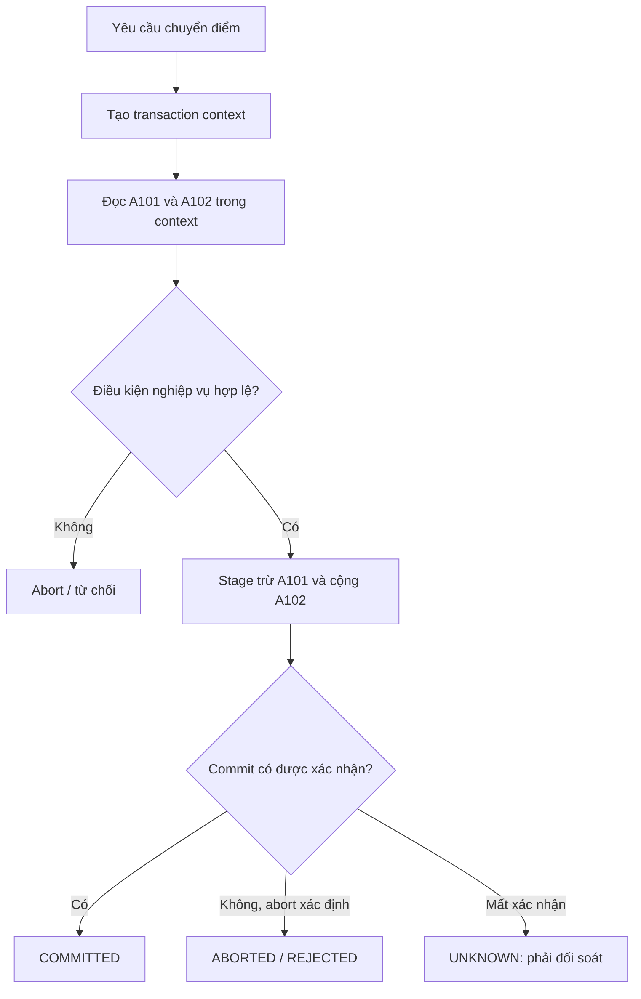
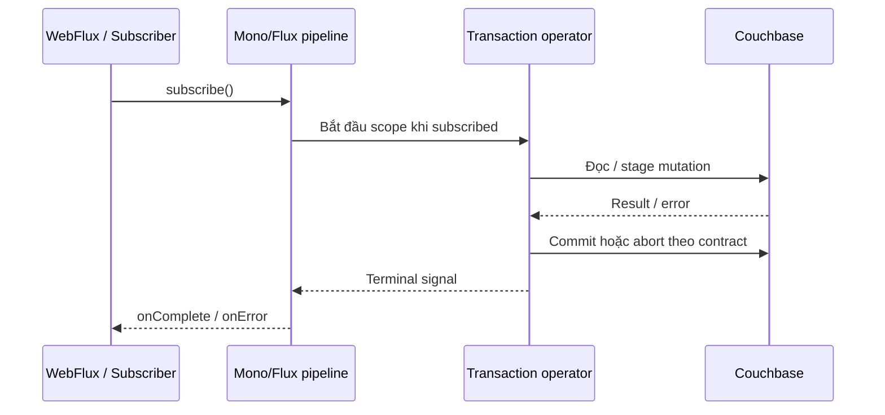
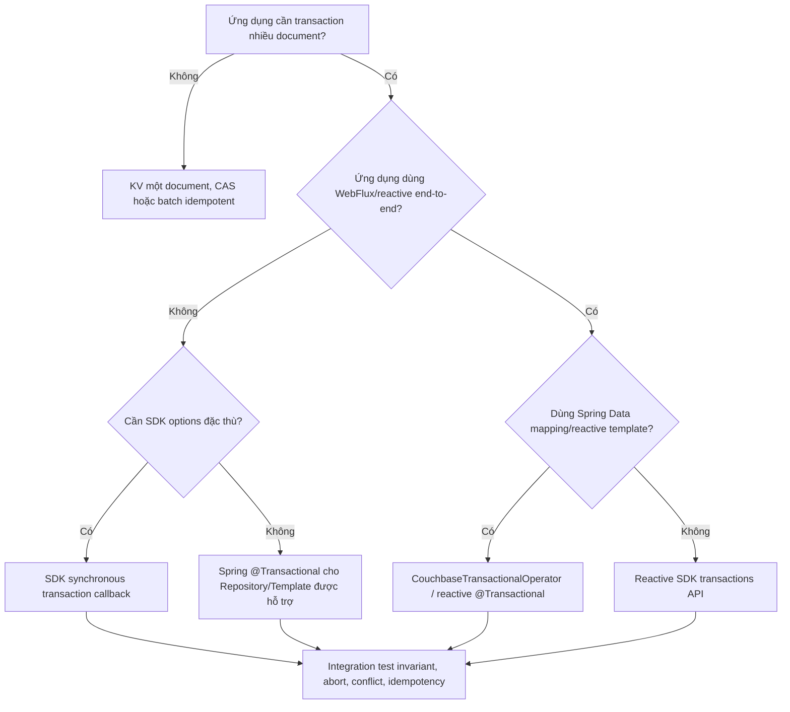

# Giao dịch đồng bộ và giao dịch phản ứng

Trong module **SPRING_DATA_COUCHBASE**, việc xây dựng tầng truy cập dữ liệu không dừng ở `CouchbaseRepository`, `CouchbaseTemplate` hay truy vấn SQL++. Khi một bất biến nghiệp vụ trải qua **nhiều document**, ứng dụng cần phối hợp các thay đổi bằng giao dịch. Hai mô hình thực thi thường gặp là **đồng bộ (imperative/synchronous)** và **phản ứng (reactive)**.

Ở mô hình đồng bộ, code thường gọi các bước đọc, kiểm tra và ghi theo thứ tự, rồi chỉ tiếp tục khi lời gọi hiện tại trả kết quả hoặc ném lỗi. Ở mô hình phản ứng, service xây một `Mono` hoặc `Flux`: các thao tác được điều phối qua **Publisher**, thường chỉ bắt đầu sau khi có **subscription**, và kết quả xuất hiện qua tín hiệu `onNext`, `onComplete` hoặc `onError`.

Cả hai mô hình có thể bảo vệ cùng một bất biến nếu được xây đúng **transaction context** của Couchbase. Nhưng **đổi từ synchronous sang reactive không tự tạo atomicity**, và **gói hai lệnh lưu trong `Mono.when(...)` không tương đương một giao dịch**. Ngoài ra, reactive còn phát sinh các vấn đề riêng: context propagation, subscription tách rời, cancellation, timeout, resubscription và retry.

Bài thuộc chương **Giao dịch**, sử dụng cùng một ví dụ chuyển điểm giữa hai document để so sánh giao dịch bằng Couchbase Java SDK, Spring Data `@Transactional` và `CouchbaseTransactionalOperator`; liên hệ CAS/`@Version`, bucket/scope/collection, chỉ mục SQL++, TTL, idempotency và kiểm thử vận hành.

## 1. Mục tiêu học tập

Hoàn thành bài này, bạn có thể:

1. Phân biệt **synchronous/imperative code** với **reactive Publisher** về thời điểm thực thi, trả kết quả và truyền lỗi.
2. Mô tả vòng đời giao dịch: tạo context, đọc, kiểm tra, stage mutation, commit/abort và phản hồi caller.
3. Viết giao dịch đồng bộ qua `cluster.transactions().run(ctx -> ...)` với `ctx.get`/`ctx.replace`.
4. Giải thích điều kiện để một service Spring Data Couchbase dùng `@Transactional` thực sự có giao dịch.
5. Biểu diễn một giao dịch phản ứng bằng `CouchbaseTransactionalOperator.execute(...)` với `ReactiveCouchbaseTemplate`.
6. Hiểu vì sao phải nối các Publisher trong một scope, không gọi `subscribe()` tùy tiện hoặc trộn blocking API vào event loop.
7. Phân biệt lỗi `onError`, cancellation, client timeout và **commit ambiguous**; không vội tuyên bố rollback.
8. Thiết kế retry an toàn ở cả SDK attempt, Reactor resubscribe và HTTP/message request retry.
9. Hiểu vai trò `@Version`/CAS, `SQL++` query/index, TTL và transaction metadata trong cả hai mô hình.
10. Chọn mô hình phù hợp với Spring MVC, WebFlux, khối lượng truy cập, nhu cầu tích hợp và độ phức tạp vận hành.
11. Viết integration test cho **commit thành công, abort sau mutation đầu, xung đột đồng thời, timeout và idempotency**.

## 2. Bất biến nghiệp vụ giữ nguyên dù API thay đổi

Giả sử hệ thống loyalty lưu hai account tại:

```text
Bucket: appdata
Scope: loyalty
Collection: accounts

Document key                         rewardPoints  status
account::tenant-a::A101             150           OPEN
account::tenant-a::A102              50           OPEN
```

Người dùng muốn **chuyển 40 điểm** từ A101 sang A102. Bất biến nghiệp vụ:

\[
P_A \ge 0,\qquad P_A+P_B=200
\]

Nếu lệnh chuyển được xác nhận thành công, kết quả phải là:

```text
A101 = 110
A102 =  90
Total = 200
```

Các điều kiện cần kiểm tra tại trạng thái thích hợp:

- Số điểm chuyển lớn hơn 0 và source/target là hai key khác nhau.
- Cả hai account tồn tại, đều `OPEN` và thuộc tenant đã được xác thực/ủy quyền.
- Source đủ điểm; phép cộng vào target không tràn số.
- Thay đổi cả hai số dư phải nằm trong **cùng một đơn vị commit**.
- Nếu client gửi lại sau timeout, cùng một lệnh không được áp dụng hai lần.

Đây là các quy tắc **nghiệp vụ**, không phụ thuộc vào việc code trả `void`, `Mono<Receipt>` hay `Flux<...>`.

### 2.1. Điều gì sai khi thực hiện độc lập?

```java
accounts.replace(sourceKey, newSourceBody); // Thành công.
accounts.replace(targetKey, newTargetBody); // Timeout hoặc CAS conflict.
```

Hai lời gọi KV độc lập có thể để lại trạng thái 110 + 50 = 160. Viết chúng trong một method Java, một `for` loop, một `saveAll` hoặc một pipeline reactive **không tự bảo vệ atomicity**.

### 2.2. “Nhiều document” chưa luôn có nghĩa cần transaction

Nếu 1.000 document được cập nhật nhãn độc lập và cho phép thành công một phần, batch + checkpoint + idempotency có thể phù hợp. Nhưng khi **kết quả được công bố hoàn tất chỉ hợp lệ nếu nhiều mutation cùng commit**, transaction hoặc mô hình dữ liệu khác bảo vệ bất biến là cần thiết.

## 3. So sánh đồng bộ và phản ứng ở mức thực thi

| Khía cạnh | Đồng bộ / imperative | Phản ứng / reactive |
| --- | --- | --- |
| Giá trị trả | `Account`, `void`, `Result` hoặc exception | `Mono<Account>`, `Mono<Void>`, `Flux<Account>` |
| Lúc I/O thường bắt đầu | Khi gọi operation đồng bộ | Khi subscription kích hoạt pipeline lạnh thông thường |
| Thứ tự thao tác | Các statement tuần tự theo luồng gọi | Phải khai báo quan hệ bằng `flatMap`, `then`, `concatMap`... |
| Chờ kết quả | Thread gọi có thể bị block trong lúc I/O | Không cần block thread trong khi chờ I/O nếu pipeline non-blocking |
| Truyền lỗi | `throw`/`catch` | `onError` và các operator xử lý tín hiệu |
| Scope transaction | Callback đồng bộ hoặc interceptor service | Context/callback/operator gắn với Publisher và subscription |
| Retry | SDK callback hoặc vòng retry ở service | SDK attempt + Reactor `retryWhen`/resubscribe + client retry |
| Cancellation | Thường là interrupt/deadline theo API | `cancel()` từ subscriber, timeout, disconnect |
| Song song | Thread/task riêng, cần bảo vệ context | Dễ biểu diễn concurrency nhưng transaction không mặc nhiên cho phép parallel mutation |
| Rủi ro đặc trưng | Chặn nhiều request threads, transaction dài | Subscription tách rời, mất context, cancel sớm, side effect lặp |
| Nguyên tử | Phụ thuộc transaction API/context | **Vẫn phụ thuộc transaction API/context** |

**Synchronous và reactive là mô hình điều phối công việc, không phải hai mức bảo đảm tính nhất quán.** Một transaction phản ứng được viết đúng không “mạnh” hơn một transaction đồng bộ tương đương; lợi ích chủ yếu liên quan cách tổ chức I/O và sử dụng tài nguyên.

## 4. Vòng đời của cùng một giao dịch



Ở mô hình **đồng bộ**, caller thường đợi `run(...)` trả về hoặc ném exception. Ở mô hình **reactive**, caller chờ **tín hiệu terminal của publisher đã được transaction operator điều phối**.

Hai mô hình cùng có ba trạng thái đáng quan tâm ở tầng nghiệp vụ:

| Trạng thái ứng dụng | Ý nghĩa | Có nên tự retry ngay? |
| --- | --- | --- |
| `COMMITTED` | Đã xác nhận commit | Không; trả receipt |
| `REJECTED/ABORTED` | Điều kiện sai hoặc transaction thất bại, kết quả được phân loại rõ | Chỉ retry lỗi phù hợp, kiểm tra lại dữ liệu |
| `UNKNOWN` | Không biết commit đã xảy ra hay chưa | **Không retry mù quáng**; đối soát theo mã nghiệp vụ |

Tên trạng thái trên là **mô hình của ứng dụng**, không phải enum bắt buộc của mọi phiên bản SDK.

## 5. Điều kiện hạ tầng chung cho cả hai mô hình

Một application có thể đọc KV thành công nhưng transaction chưa chạy được. Trước khi lựa chọn synchronous hay reactive, xác minh:

1. **Couchbase Server + Java SDK + Spring Data Couchbase + Spring Boot + JDK** tạo thành bộ phiên bản tương thích với khả năng transaction sẽ dùng.
2. Các collection thực sự tồn tại và ứng dụng mở đúng bucket/scope/collection.
3. **Data Service** hoạt động; nếu dùng SQL++ thì cần Query Service, Index Service và index phù hợp.
4. User Couchbase có quyền đọc/ghi document nghiệp vụ **và metadata giao dịch/ATR** ở collection được cấu hình.
5. Timeout, durability, replica/topology và cleanup được lựa chọn có chủ ý.
6. Nếu dùng Spring integration, manager/operator và template/repository phải cùng transaction-aware infrastructure.
7. Các thao tác thực tế, nhất là SQL++ hoặc bulk, thuộc **tập API được transaction hỗ trợ trong phiên bản**.
8. Có integration test kiểm tra **lỗi sau mutation đầu tiên không để lại commit một phần**.

### 5.1. Mốc phiên bản không phải phép đoán tính năng

Java SDK 3.x có những API transaction với kiểu thực thi khác nhau. Nhưng chữ ký class/option, hỗ trợ transactional SQL++ và cách tích hợp với Spring Data thay đổi theo phiên bản cụ thể. Một ví dụ về SDK `run(...)` không đồng nghĩa mọi cluster có SDK 3.x đều hỗ trợ mọi scope, collection, query statement và retry behavior.

Khi dùng các đoạn code trong bài, **đối chiếu API reference đúng dependency đang triển khai** và xác minh trên Couchbase thử nghiệm. Đừng trộn mã Java SDK 2.x với SDK 3.x, hoặc một operator của Spring Data khác version.

### 5.2. Transaction metadata và ATR

Couchbase distributed transactions sử dụng metadata như **Active Transaction Record (ATR)** để theo dõi các giai đoạn giao dịch và hỗ trợ cleanup. Điều này ảnh hưởng cả synchronous lẫn reactive:

- Cần quyền tại keyspace metadata và keyspace nghiệp vụ.
- Không tự xóa metadata để “rollback nhanh”.
- Phải hiểu timeout/cleanup khi process hoặc client ngắt kết nối.
- Đồng bộ thời gian, khả năng lưu trữ và topology tác động tới vận hành.

`@Transactional`, `operator.execute` và `ctx` không tự tạo quyền RBAC hoặc secondary index.

## 6. Entity Spring Data và `@Version`

Ví dụ entity truy cập qua Spring Data Repository/Template:

```java
package com.example.loyalty;

import org.springframework.data.annotation.Id;
import org.springframework.data.annotation.Version;
import org.springframework.data.couchbase.core.mapping.Collection;
import org.springframework.data.couchbase.core.mapping.Document;
import org.springframework.data.couchbase.core.mapping.Field;
import org.springframework.data.couchbase.core.mapping.Scope;

@Document
@Scope("loyalty")
@Collection("accounts")
public class Account {

    @Id
    private String id;

    @Field
    private String tenantId;

    @Field
    private String accountCode;

    @Field
    private long rewardPoints;

    @Field
    private String status;

    @Version
    private Long version;

    public Account() {}

    public Account(String id, String tenantId,
                   String accountCode, long rewardPoints,
                   String status) {
        this.id = id;
        this.tenantId = tenantId;
        this.accountCode = accountCode;
        this.rewardPoints = rewardPoints;
        this.status = status;
    }

    public String getId() { return id; }
    public void setId(String id) { this.id = id; }

    public String getTenantId() { return tenantId; }
    public void setTenantId(String tenantId) {
        this.tenantId = tenantId;
    }

    public String getAccountCode() { return accountCode; }
    public void setAccountCode(String accountCode) {
        this.accountCode = accountCode;
    }

    public long getRewardPoints() { return rewardPoints; }
    public void setRewardPoints(long rewardPoints) {
        this.rewardPoints = rewardPoints;
    }

    public String getStatus() { return status; }
    public void setStatus(String status) { this.status = status; }

    public Long getVersion() { return version; }
    public void setVersion(Long version) { this.version = version; }
}
```

Trong những dòng Spring Data Couchbase có transaction integration yêu cầu `@Version Long`, trường này ánh xạ **CAS metadata** của document:

- `@Id` là document key, không phải accountCode.
- `@Scope`/`@Collection` chọn keyspace, không tạo namespace trên server.
- `@Version` hỗ trợ optimistic locking trên từng document ở đường ghi thích hợp.
- CAS là **opaque token**, không phải giá trị ứng dụng tự tăng `version + 1`.
- Một update có CAS đúng vẫn không khiến mutation ở document khác tự rollback nếu chúng được ghi độc lập.
- SDK `JsonObject` không tự đọc converter/annotation `@Version` của Spring Data entity.

Điểm khác biệt giữa **CAS đơn document** và **atomicity nhiều document** vẫn tồn tại trong cả hai mô hình thực thi.

## 7. Repository đồng bộ và Reactive Repository

Interface đồng bộ:

```java
import org.springframework.data.couchbase.repository.CouchbaseRepository;

public interface AccountRepository
        extends CouchbaseRepository<Account, String> {
}
```

Interface reactive:

```java
import org.springframework.data.couchbase.repository.ReactiveCouchbaseRepository;

public interface ReactiveAccountRepository
        extends ReactiveCouchbaseRepository<Account, String> {
}
```

Nhìn vào chữ ký:

```java
// Synchronous:
Account a = repository.findById(key).orElseThrow();

// Reactive:
Mono<Account> aMono = reactiveRepository.findById(key);
```

`Account a` là một entity đã được truy xuất sau lời gọi đồng bộ; `aMono` là một mô tả công việc/bộ phát dữ liệu. **Không lấy account từ `Mono` bằng cách truy cập trực tiếp getter**; cần chuyển đổi trong pipeline qua `map`/`flatMap`.

### 7.1. Đường KV và đường SQL++ vẫn khác nhau

`findById` là lookup theo document key. Derived query như `findByTenantIdAndStatus` thường dùng SQL++ và secondary index. Dù ở interface đồng bộ hay reactive, **chế độ trả dữ liệu không quyết định Query Service hay tính nguyên tử**.

Một query được gọi ngoài transaction context không trở nên transactional chỉ vì nó nằm trong service có tên `Reactive...`.

## 8. Giao dịch đồng bộ trực tiếp bằng Couchbase Java SDK

Cách tường minh nhất để thấy ranh giới transaction đồng bộ là sử dụng `cluster.transactions().run(ctx -> ...)`.

Ví dụ chuyển điểm:

```java
package com.example.loyalty;

import java.util.Objects;
import com.couchbase.client.java.Cluster;
import com.couchbase.client.java.Collection;
import com.couchbase.client.java.json.JsonObject;
import com.couchbase.client.java.transactions.TransactionGetResult;

public class SynchronousTransferAdapter {

    private final Cluster cluster;
    private final Collection accounts;

    public SynchronousTransferAdapter(
            Cluster cluster, Collection accounts) {
        this.cluster = cluster;
        this.accounts = accounts;
    }

    public void transfer(
            String authorizedTenant,
            String sourceKey,
            String targetKey,
            long amount) {

        if (authorizedTenant == null
                || authorizedTenant.isBlank()
                || sourceKey == null || targetKey == null
                || Objects.equals(sourceKey, targetKey)
                || amount <= 0) {
            throw new IllegalArgumentException(
                    "Yêu cầu không hợp lệ");
        }

        cluster.transactions().run(ctx -> {
            TransactionGetResult source =
                    ctx.get(accounts, sourceKey);
            TransactionGetResult target =
                    ctx.get(accounts, targetKey);

            JsonObject sourceJson = source.contentAsObject();
            JsonObject targetJson = target.contentAsObject();

            if (!authorizedTenant.equals(
                    sourceJson.getString("tenantId"))
                    || !authorizedTenant.equals(
                    targetJson.getString("tenantId"))) {
                throw new IllegalStateException(
                        "Sai tenant được ủy quyền");
            }
            if (!"OPEN".equals(sourceJson.getString("status"))
                    || !"OPEN".equals(targetJson.getString("status"))) {
                throw new IllegalStateException(
                        "Tài khoản không sẵn sàng");
            }

            Long sourcePoints =
                    sourceJson.getLong("rewardPoints");
            Long targetPoints =
                    targetJson.getLong("rewardPoints");

            if (sourcePoints == null || targetPoints == null
                    || sourcePoints < amount
                    || sourcePoints < 0 || targetPoints < 0) {
                throw new IllegalStateException(
                        "Số điểm không hợp lệ");
            }

            long newSource = sourcePoints - amount;
            long newTarget =
                    Math.addExact(targetPoints, amount);

            ctx.replace(source,
                    sourceJson.put("rewardPoints", newSource));
            ctx.replace(target,
                    targetJson.put("rewardPoints", newTarget));
        });
    }
}
```

**Điều kiện của ví dụ:**

- `accounts` phải là SDK `Collection` đúng `appdata.loyalty.accounts`, do ứng dụng quản lý và có quyền cần thiết.
- `authorizedTenant` lấy từ ngữ cảnh **xác thực/ủy quyền đáng tin cậy**, không tin tenant client tự gửi.
- Hai lần `ctx.get` và `ctx.replace` chạy trong **cùng transaction attempt**.
- Phần quyết định nghiệp vụ được kiểm tra trong callback, nên có thể đánh giá lại ở lần attempt mới sau conflict.
- SDK điều phối commit/abort; **không phát email hoặc gọi API ngoài** từ callback.
- Ví dụ chưa có `transferId`/idempotency record; production phải bổ sung nếu request có thể gửi lại.
- Java SDK 3.x được giả định; tùy chọn, class và exception chính xác cần đối chiếu theo phiên bản.

### 8.1. Lambda có thể được thực thi lại

`run(...)` có thể retry callback trong các tình huống được SDK hỗ trợ. Những giá trị đọc từ Couchbase phải được lấy lại ở attempt mới. Không dùng một `Account` đọc **trước callback** rồi giả định nó còn đúng; cũng không tăng biến đếm ngoài transaction rồi coi số đếm bằng số commit.

### 8.2. Kết quả `run(...)` và commit

Với API đồng bộ, caller chỉ tiếp tục khi `run(...)` hoàn tất bình thường hoặc ném exception. Tuy nhiên, **exception không phải lúc nào cũng chứng minh đã rollback**: timeout/mất kết nối ở giai đoạn commit có thể để lại **outcome không rõ**.

Do đó, một method transfer production cần trả về/truy vấn trạng thái theo `transferId` thay vì chỉ có “`void` hoặc exception” nếu nghiệp vụ đòi chống xử lý trùng.

## 9. Vì sao không dùng KV SDK thông thường trong lambda?

Đặt hai cách cạnh nhau:

```java
cluster.transactions().run(ctx -> {
    TransactionGetResult from = ctx.get(accounts, sourceKey);
    JsonObject body = from.contentAsObject();

    ctx.replace(from,
            body.put("rewardPoints", 110L));

    // KHÔNG dùng thao tác này cho document đích
    // nếu yêu cầu cả hai cùng commit:
    accounts.upsert(targetKey,
            JsonObject.create().put("rewardPoints", 90L));
});
```

`ctx.replace` là operation transaction-aware; `accounts.upsert` là mutation KV SDK độc lập, **không tự tham gia transaction chỉ vì nằm cùng lambda**. Nếu callback bị abort, upsert có thể vẫn thành công và gây lệch dữ liệu.

Sử dụng rõ API trong context:

| Trong transaction | Ngoài transaction thông thường |
| --- | --- |
| `ctx.get(collection, key)` | `collection.get(key)` |
| `ctx.insert(collection, key, body)` | `collection.insert(key, body)` |
| `ctx.replace(result, body)` | `collection.replace(key, body)` |
| `ctx.remove(result)` | `collection.remove(key)` |
| `ctx.query(...)` khi được SDK/Server hỗ trợ | `cluster.query(...)` |

Tương tự, không suy rằng mọi lời gọi `repository.save` hoặc `template.replaceById` đặt trong SDK callback tự tham gia transaction. Điều đó phụ thuộc **Spring Data integration, đường operation và version**; nếu dùng trộn, phải có integration test.

## 10. Giao dịch đồng bộ qua Spring `@Transactional`

Với một ứng dụng chủ yếu dùng Spring Data Couchbase, có thể khai báo ranh giới ở service:

```java
import java.util.Objects;
import org.springframework.stereotype.Service;
import org.springframework.transaction.annotation.Transactional;

@Service
public class RepositoryTransferService {

    private final AccountRepository accounts;

    public RepositoryTransferService(AccountRepository accounts) {
        this.accounts = accounts;
    }

    @Transactional(transactionManager = "couchbaseTransactionManager")
    public void transfer(
            String authorizedTenant, String fromKey,
            String toKey, long amount) {

        if (amount <= 0 || Objects.equals(fromKey, toKey)) {
            throw new IllegalArgumentException(
                    "Yêu cầu chuyển không hợp lệ");
        }

        Account from = accounts.findById(fromKey).orElseThrow();
        Account to = accounts.findById(toKey).orElseThrow();

        if (!authorizedTenant.equals(from.getTenantId())
                || !authorizedTenant.equals(to.getTenantId())) {
            throw new IllegalStateException("Sai tenant");
        }
        if (!"OPEN".equals(from.getStatus())
                || !"OPEN".equals(to.getStatus())
                || from.getRewardPoints() < amount) {
            throw new IllegalStateException(
                    "Tài khoản hoặc số điểm không hợp lệ");
        }

        long targetNew = Math.addExact(
                to.getRewardPoints(), amount);
        from.setRewardPoints(
                from.getRewardPoints() - amount);
        to.setRewardPoints(targetNew);

        accounts.save(from);
        accounts.save(to);
    }
}
```

Ví dụ này **chỉ có bảo đảm transaction** nếu:

1. Phiên bản Spring Data Couchbase hỗ trợ `findById`/`save` trong transaction integration đang dùng.
2. Bean `couchbaseTransactionManager` thực sự được cấu hình và là manager được chọn.
3. Caller gọi method thông qua **Spring proxy**, không qua `this.transfer(...)` trong cùng target.
4. Repository và transaction infrastructure sử dụng cùng client/context.
5. Các operation cần atomicity nằm trong transaction; không có lệnh SDK/JPA độc lập lọt vào.
6. Test abort thực tế chứng minh không có commit một phần.

Trong các dòng API Spring Data Couchbase hiện đại, tên class manager có thể là **`CouchbaseCallbackTransactionManager`**, còn `couchbaseTransactionManager` là **tên bean**. Không tự suy ra class `CouchbaseTransactionManager` tồn tại để import.

### 10.1. Vì sao service boundary quan trọng?

Transaction nên bao **toàn bộ use case** (đọc, kiểm tra, ghi), không chỉ một method repository. Nếu mỗi `save` là một đơn vị commit riêng, lỗi ở `save(to)` không rollback `save(from)`.

### 10.2. Bẫy Spring proxy

```java
@Service
public class BadService {

    public void handle() {
        this.transfer(); // Bỏ qua proxy trong proxy AOP thông thường.
    }

    @Transactional(transactionManager = "couchbaseTransactionManager")
    public void transfer() {
        // Không được mặc định interceptor đã chạy.
    }
}
```

Một object tự tạo bằng `new BadService()` cũng không có Spring AOP transaction advice. Nếu ứng dụng có cả JPA và Couchbase managers, hãy chọn manager rõ ràng thay vì dựa vào mặc định không chắc chắn.

## 11. Cơ bản về Reactive Streams: Publisher chưa phải mutation đã hoàn tất

Ví dụ:

```java
Mono<Account> source =
        reactiveRepository.findById(sourceKey);

Mono<Account> target =
        reactiveRepository.findById(targetKey);
```

Ở các Publisher lạnh điển hình của Reactor/Spring Data, đoạn code trên **xây một pipeline**. Nó không chứng minh hai lần đọc đã hoàn thành.



Những khái niệm quan trọng:

- **Assembly:** lập trình viên xây chuỗi operator.
- **Subscription:** consumer yêu cầu thực thi Publisher.
- **`onNext`:** phát dữ liệu; **chưa mặc nhiên là xác nhận commit**.
- **`onComplete`:** tín hiệu kết thúc thành công của Publisher.
- **`onError`:** tín hiệu lỗi đi theo pipeline.
- **`cancel`:** subscriber ngừng yêu cầu; không được suy ra rollback đã được xác nhận.
- **Resubscribe:** chạy lại một source lạnh, có thể thực thi mutation lần nữa.

**Reactive có thể không block thread chờ I/O, nhưng vẫn phải đợi kết quả transaction để công bố thành công.**

## 12. Tạo phạm vi giao dịch phản ứng với CouchbaseTransactionalOperator

Spring Data Couchbase có API **`CouchbaseTransactionalOperator`** trong các dòng hỗ trợ programmatic transaction integration.

Ví dụ inject bean:

```java
import org.springframework.data.couchbase.core.ReactiveCouchbaseTemplate;
import org.springframework.data.couchbase.transaction.CouchbaseTransactionalOperator;
import org.springframework.stereotype.Service;

@Service
public class ReactiveTransferAdapter {

    private final CouchbaseTransactionalOperator operator;
    private final ReactiveCouchbaseTemplate template;

    public ReactiveTransferAdapter(
            CouchbaseTransactionalOperator operator,
            ReactiveCouchbaseTemplate template) {
        this.operator = operator;
        this.template = template;
    }
}
```

Nếu ứng dụng đã cung cấp operator bean, **ưu tiên inject**. Ở các phiên bản hỗ trợ factory tương ứng, operator có thể được tạo từ manager đã cấu hình theo dạng:

```java
CouchbaseTransactionalOperator operator =
        CouchbaseTransactionalOperator.create(
                couchbaseCallbackTransactionManager);
```

Không tự tạo manager/cluster mới mỗi request, và không nhầm `CouchbaseTransactionalOperator` với `org.springframework.transaction.reactive.TransactionalOperator` chung của Spring mà chưa xác nhận integration tương thích.

### 12.1. Cú pháp `execute`

Mẫu cơ bản:

```java
Flux<Account> result = operator.execute(status ->
        template.findById(Account.class)
                .one(accountKey)
                .switchIfEmpty(Mono.error(
                        new IllegalArgumentException("Account không tồn tại")))
                .flatMap(account -> {
                    account.setStatus("SUSPENDED");
                    return template.replaceById(Account.class)
                            .one(account);
                }));
```

Ví dụ dựa trên kiểu API Spring Data có `execute(callback)` trả `Flux<T>`. Kiểu callback/result, tên overload và khả năng tham gia của operation phải được **đối chiếu đúng Javadoc phiên bản**. Mục đích quan trọng hơn cú pháp: operator điều phối **Publisher được callback trả về**, không phải những Publisher được subscribe độc lập ở nơi khác.

### 12.2. Vì sao dùng `single()`?

Nếu callback tạo đúng một kết quả, service có thể muốn trả `Mono<Account>`:

```java
Mono<Account> result = operator.execute(status ->
        template.findById(Account.class)
                .one(accountKey)
                .flatMap(account -> {
                    account.setStatus("SUSPENDED");
                    return template.replaceById(Account.class)
                            .one(account);
                }))
        .single();
```

`single()` mong đợi đúng một phần tử **và yêu cầu luồng hoàn tất**. Không tùy tiện đổi sang `next()` để lấy phần tử đầu, bởi `next()` có thể **cancel nguồn sớm** khi còn phần tử/việc khác và làm lifecycle transaction không như dự định.

## 13. Ví dụ reactive: chuyển điểm trong một pipeline

Định nghĩa dữ liệu đầu vào:

```java
public record TransferCommand(
        String authorizedTenant,
        String sourceKey,
        String targetKey,
        long amount) {
}

public record TransferReceipt(
        String sourceKey,
        String targetKey,
        long amount,
        long sourceBalance,
        long targetBalance) {
}
```

Ví dụ service dùng Reactive Template:

```java
package com.example.loyalty;

import java.util.Objects;
import org.springframework.data.couchbase.core.ReactiveCouchbaseTemplate;
import org.springframework.data.couchbase.transaction.CouchbaseTransactionalOperator;
import org.springframework.stereotype.Service;
import reactor.core.publisher.Mono;

@Service
public class ReactivePointsTransferService {

    private final CouchbaseTransactionalOperator operator;
    private final ReactiveCouchbaseTemplate template;

    public ReactivePointsTransferService(
            CouchbaseTransactionalOperator operator,
            ReactiveCouchbaseTemplate template) {
        this.operator = operator;
        this.template = template;
    }

    public Mono<TransferReceipt> transfer(TransferCommand command) {
        if (command.authorizedTenant() == null
                || command.authorizedTenant().isBlank()
                || command.sourceKey() == null
                || command.targetKey() == null
                || Objects.equals(
                        command.sourceKey(), command.targetKey())
                || command.amount() <= 0) {
            return Mono.error(new IllegalArgumentException(
                    "Yêu cầu chuyển điểm không hợp lệ"));
        }

        return operator.execute(status ->
                template.findById(Account.class)
                        .one(command.sourceKey())
                        .switchIfEmpty(Mono.error(
                                new IllegalArgumentException(
                                        "Nguồn không tồn tại")))
                        .flatMap(source ->
                                template.findById(Account.class)
                                        .one(command.targetKey())
                                        .switchIfEmpty(Mono.error(
                                                new IllegalArgumentException(
                                                        "Đích không tồn tại")))
                                        .flatMap(target ->
                                                applyTransfer(
                                                        command,
                                                        source,
                                                        target))))
                .single();
    }

    private Mono<TransferReceipt> applyTransfer(
            TransferCommand command,
            Account source,
            Account target) {

        if (!command.authorizedTenant().equals(
                source.getTenantId())
                || !command.authorizedTenant().equals(
                        target.getTenantId())) {
            return Mono.error(new IllegalStateException(
                    "Account không thuộc tenant được phép"));
        }

        if (!"OPEN".equals(source.getStatus())
                || !"OPEN".equals(target.getStatus())) {
            return Mono.error(new IllegalStateException(
                    "Account không ở trạng thái OPEN"));
        }

        if (source.getRewardPoints() < command.amount()
                || source.getRewardPoints() < 0
                || target.getRewardPoints() < 0) {
            return Mono.error(new IllegalStateException(
                    "Số điểm không hợp lệ"));
        }

        final long newSource =
                source.getRewardPoints() - command.amount();
        final long newTarget;
        try {
            newTarget = Math.addExact(
                    target.getRewardPoints(),
                    command.amount());
        } catch (ArithmeticException ex) {
            return Mono.error(new IllegalStateException(
                    "Tràn điểm ở tài khoản đích", ex));
        }

        source.setRewardPoints(newSource);
        target.setRewardPoints(newTarget);

        return template.replaceById(Account.class)
                .one(source)
                .then(Mono.defer(() ->
                        template.replaceById(Account.class)
                                .one(target)))
                .thenReturn(new TransferReceipt(
                        command.sourceKey(),
                        command.targetKey(),
                        command.amount(),
                        newSource,
                        newTarget));
    }
}
```

### 13.1. Điều kiện để ví dụ bảo vệ invariant

- `CouchbaseTransactionalOperator` và `ReactiveCouchbaseTemplate` phải cùng hạ tầng transaction-aware và được cấu hình đúng.
- `findById`/`replaceById` có transaction support theo đúng phiên bản.
- Entity `Account` có mapping đúng collection và `@Version` theo yêu cầu transaction integration tương ứng.
- Mọi lệnh đọc–kiểm tra–ghi cần giữ invariant đều nằm trong callback `execute`.
- Không có Publisher con bị tự subscribe rồi chạy ngoài scope.
- `authorizedTenant` phải đến từ ngữ cảnh xác thực đã được ủy quyền.
- SDK có thể retry transaction attempt: callback và logic tính toán phải side-effect-safe.
- Đã có integration test forced-abort và conflict dưới concurrency thực tế.

**Ví dụ cố ý chưa có `transferId`**; nó là bài tập về xây pipeline, không phải implementation điểm thưởng production có thể xử lý retry HTTP an toàn.

### 13.2. Vì sao nối `then` tuần tự?

Việc thay hai document được biểu đạt:

```java
template.replaceById(Account.class)
        .one(source)
        .then(Mono.defer(() ->
                template.replaceById(Account.class)
                        .one(target)));
```

`then` chỉ bắt đầu giai đoạn sau khi giai đoạn trước hoàn tất thành công. `Mono.defer` trì hoãn việc tạo Publisher đến khi cần. Nếu bước đầu lỗi, bước hai không chạy theo pipeline này.

Cách nối tuần tự còn giúp dễ quan sát lỗi và tránh giả định transaction SDK cho phép nhiều operation **song song** trên cùng attempt.

### 13.3. Không trộn blocking repository

Không nên dùng:

```java
return operator.execute(status -> {
    Account source =
            blockingRepository.findById(sourceKey).orElseThrow();

    // Block trên thread reactive, và operation đồng bộ này
    // không tự được bảo đảm tham gia cùng reactive context.
    return reactiveTemplate.replaceById(Account.class)
            .one(source);
});
```

Blocking operation có thể chiếm event loop, phá kỳ vọng non-blocking và tham gia sai transaction context. Nếu cần tích hợp một API chỉ có blocking, hãy thiết kế ranh giới rõ ràng, chọn scheduler phù hợp cho I/O blocking **và không giả định nó sẽ cùng transaction reactive**.

## 14. Có nên dùng `@Transactional` cho method reactive?

Trong các dòng Spring Data Couchbase có transaction integration hỗ trợ reactive execution, một service method trả `Mono`/`Flux` có thể dùng `@Transactional` theo quy tắc interception của phiên bản.

Ví dụ cấu trúc:

```java
@Service
public class ReactiveAccountService {

    private final ReactiveCouchbaseTemplate template;

    public ReactiveAccountService(
            ReactiveCouchbaseTemplate template) {
        this.template = template;
    }

    @Transactional(transactionManager = "couchbaseTransactionManager")
    public Mono<Account> suspend(String key) {
        return template.findById(Account.class)
                .one(key)
                .switchIfEmpty(Mono.error(
                        new IllegalArgumentException("Không tồn tại")))
                .flatMap(account -> {
                    account.setStatus("SUSPENDED");
                    return template.replaceById(Account.class)
                            .one(account);
                });
    }
}
```

Chỉ sử dụng theo **Spring Data version/manager thực sự hỗ trợ** và kiểm tra hành vi subscribe/abort. `@Transactional` không tự biến một blocking `JpaRepository` hay SDK `Collection.upsert` thành operation trong cùng reactive Couchbase transaction.

### 14.1. Bẫy self-invocation

Với Spring AOP proxy thông thường:

```java
public void handle() {
    this.suspend(key); // Lời gọi nội bộ không qua proxy.
}
```

Tương tự, không tạo service bằng `new` rồi kỳ vọng transaction advice. Operator theo chương trình có lợi thế ở chỗ **scope nằm trong pipeline được gọi**, nhưng nó cũng cần transaction-aware infrastructure thực sự hoạt động.

### 14.2. Không lồng transaction tùy tiện

Đừng bọc `operator.execute` bên trong một `@Transactional` khác rồi mặc định có nested transaction hoặc savepoint như RDBMS. Kiểm tra propagation/nesting support của manager phiên bản dùng; một use case thường nên có **một boundary rõ ràng**.

## 15. Reactive SDK Transactions API: cùng nguyên lý, khác chữ ký

Couchbase Java SDK cũng có **Reactive Transactions API** ở những phiên bản hỗ trợ, ngoài entrypoint synchronous `cluster.transactions().run(...)`.

Mô hình khái niệm:

```text
Reactive transaction entrypoint
    .run(attemptContext ->
        attemptContext.get(collection, keyA)
            .flatMap(readA ->
                attemptContext.get(collection, keyB)
                    .flatMap(readB ->
                        attemptContext.replace(readA, nextA)
                            .then(attemptContext.replace(readB, nextB)))))
```

**Đây là pseudocode, không phải Java snippet có thể copy và biên dịch.** Cách lấy reactive transaction entrypoint, loại `ReactiveCollection`, kiểu result và method signature phải đối chiếu **Java SDK version** thực tế. Mục tiêu là nhận ra sự tương đồng:

- SDK synchronous callback trả kết quả trực tiếp hoặc ném exception.
- SDK reactive attempt callback trả **Publisher** để SDK điều phối.
- Trong cả hai trường hợp, phải dùng **API trên transaction attempt context**, không gọi KV operation bên ngoài context.
- Không tự `subscribe()` các operation con hoặc dùng `block()` để biến reactive callback thành synchronous giả tạo.

Nếu ứng dụng đã dùng Spring Data entity mapping và Reactive Template, `CouchbaseTransactionalOperator` là lựa chọn để đánh giá; nếu cần tùy chọn SDK đặc thù, có thể viết một reactive SDK transaction adapter riêng.

## 16. `Mono.when`, `zip` và concurrency không thay cho transaction

Xét:

```java
Mono<Void> workflow = Mono.when(
        reactiveRepository.save(source).then(),
        reactiveRepository.save(target).then());
```

`Mono.when` chờ nhiều Publisher, nhưng **không tạo transaction context**. Nếu một mutation đã commit còn mutation kia lỗi, không có cơ chế all-or-nothing chỉ từ `Mono.when`.

Nếu dùng `zip` để đọc hai document:

```java
Mono<Tuple2<Account, Account>> pair = Mono.zip(
        reactiveRepository.findById(sourceKey),
        reactiveRepository.findById(targetKey));
```

`zip` có thể giúp ghép kết quả, nhưng:

- Không tự tạo snapshot giao dịch.
- Không tự thêm CAS hay isolation.
- Có thể tạo nhiều thao tác đồng thời; không nên mặc định giao dịch SDK hỗ trợ mọi kiểu parallel access trên cùng attempt.
- Cần kiểm tra cả hai lookup thuộc scope transactional nếu kết quả được dùng quyết định ghi.

**Ưu tiên pipeline tuần tự** trong ví dụ read–check–write nhiều document để dễ chứng minh invariant. Chỉ tối ưu concurrency khi SDK/API và kiểm thử xác nhận nó được hỗ trợ và mang lại lợi ích thực tế.

## 17. `subscribe()` tách rời và cancellation sớm

Mẫu **sai** bên trong operator:

```java
return operator.execute(status -> {
    template.replaceById(Account.class)
            .one(source)
            .subscribe(); // Tách khỏi publisher chính!

    return template.replaceById(Account.class)
            .one(target);
});
```

Publisher nguồn tự subscribe độc lập, có thể chạy ngoài transaction context, ngoài lifecycle mà operator theo dõi hoặc sau khi publisher chính hoàn tất. Không được hứa cả hai mutation cùng commit.

Mẫu **đúng về tổ chức pipeline**:

```java
return operator.execute(status ->
        template.replaceById(Account.class)
                .one(source)
                .then(Mono.defer(() ->
                        template.replaceById(Account.class)
                                .one(target))));
```

Toàn bộ thao tác nằm trong **một Publisher trả về**. Còn việc chúng có thật sự transactional phụ thuộc API support/context và phải được test.

### 17.1. `next()` có thể cắt sớm

`Flux.next()` lấy phần tử đầu rồi có thể cancel upstream. Nếu một transaction publisher có nhiều giá trị hoặc còn phần việc khi phát giá trị đầu tiên, cắt sớm có thể làm lifecycle không như dự tính.

Ưu tiên dùng API trả `Mono` phù hợp hoặc `single()` khi đúng một kết quả và cần chờ completion. Với các thao tác nhiều phần tử, phải hiểu transaction operator cam kết terminal signal nào mang outcome.

### 17.2. Đừng tự subscribe trong Spring WebFlux service

Service thường nên **trả `Mono`/`Flux`** cho controller/framework:

```java
public Mono<TransferReceipt> transfer(
        TransferCommand command) {
    return transferAdapter.transfer(command);
}
```

Không gọi `transferAdapter.transfer(command).subscribe()` rồi lập tức trả HTTP 200 vì điều đó có thể xác nhận thành công **trước khi giao dịch commit** và làm lỗi không được xử lý theo request.

## 18. Lỗi: exception đồng bộ và `onError` phản ứng

Trong synchronous code:

```java
try {
    adapter.transfer(tenant, sourceKey, targetKey, 40);
    // Chỉ trả success nếu outcome đã được xác nhận.
} catch (RuntimeException ex) {
    // Phân loại: lỗi nghiệp vụ, conflict, timeout,
    // commit ambiguous...
}
```

Trong reactive code:

```java
return adapter.transfer(command)
        .doOnError(ex -> log.warn(
                "Transfer pipeline failed", ex));
```

`doOnError` ghi log nhưng vẫn **giữ tín hiệu lỗi** trong pipeline. Ngược lại, đoạn dưới có thể gây nguy hiểm:

```java
return operator.execute(status ->
        replaceSource()
                .then(replaceTarget())
                .onErrorResume(ex -> Mono.just(fakeSuccess)));
```

Nếu bước target lỗi nhưng callback chuyển sang kết quả thành công, operator có thể nhận tín hiệu hoàn tất không phản ánh thất bại nghiệp vụ. Một số lỗi SDK tự khiến transaction abort, nhưng **không được dựa vào cách xử lý mơ hồ đó**.

### 18.1. Phân loại lỗi ở ranh giới đúng

- **Lỗi điều kiện nghiệp vụ**: số điểm không đủ, account khóa, tenant không hợp lệ → từ chối và không retry vô hạn.
- **Conflict có thể retry**: để SDK/manager xử lý theo chính sách hoặc retry được thiết kế.
- **Lỗi hạ tầng**: thiếu quyền ATR, thiếu index, timeout, network → sửa cấu hình hoặc đối soát.
- **Commit ambiguous**: không rõ transaction đã commit chưa → tra cứu theo idempotency key.
- **Cancellation**: client ngừng nghe; không suy rằng datastore chưa commit.

Đừng map mọi loại exception thành “`NOT_FOUND`” hay “`ROLLED_BACK`” trong HTTP response.

## 19. Timeout và cancellation trong mô hình phản ứng

Ví dụ:

```java
return transferService.transfer(command)
        .timeout(Duration.ofSeconds(3));
```

`timeout` của Reactor có thể hủy subscription upstream khi deadline đạt tới. Điều này **không chứng minh transaction chưa commit**. Có thể client đã ngắt ngay khi giao dịch đang commit hoặc xác nhận commit đang trên đường trả về.

Cần phân biệt:

| Timeout | Phạm vi | Nguy cơ |
| --- | --- | --- |
| Transaction expiration | Toàn vòng đời transaction SDK | Attempt có thể không còn hợp lệ |
| KV/query timeout | Một operation | Điều kiện đọc/ghi chưa hoàn tất |
| HTTP gateway timeout | Caller chờ response | Transaction có thể còn chạy/đã commit |
| Reactor `timeout` | Publisher upstream | Cancellation không đồng nghĩa rollback xác nhận |
| Client disconnect | HTTP connection | Người dùng có thể gửi lại cùng lệnh |

**Không thể khắc phục commit ambiguous bằng cách tăng deadline vô hạn.** Cần transferId ổn định và đường đối soát trạng thái.

## 20. Retry trong hai mô hình

Couchbase SDK có thể retry **attempt của một transaction** khi gặp lỗi phù hợp. Bên cạnh đó, một ứng dụng synchronous có thể gọi lại method, còn reactive có thể `retryWhen`/resubscribe.

Ví dụ reactive:

```java
return transferService.transfer(command)
        .retryWhen(Retry.backoff(
                2, Duration.ofMillis(100)));
```

Đây là **minh họa cú pháp Reactor, không phải khuyến nghị áp dụng nguyên trạng** cho chuyển điểm. Nếu transaction đã commit nhưng client mất xác nhận, resubscribe có thể **chuyển thêm một lần nữa**.

### 20.1. Ba tầng retry

| Tầng retry | Ai thực hiện? | Cần lưu ý |
| --- | --- | --- |
| Transaction attempt retry | SDK/manager | Callback có thể chạy nhiều lần; phải side-effect-safe |
| Application pipeline/method retry | `retryWhen` hoặc service retry loop | Cần phân loại lỗi và biết outcome có rõ không |
| HTTP/message delivery retry | Client, gateway, broker | Cần cùng idempotency key và chính sách đối soát |

### 20.2. Callback không nên sửa trạng thái ngoài giao dịch

```java
AtomicInteger attempts = new AtomicInteger();

cluster.transactions().run(ctx -> {
    attempts.incrementAndGet(); // Có thể tăng nhiều lần.
    // ctx.get/ctx.replace...
});
```

Đừng xem `attempts.get()` là số giao dịch đã commit. Tương tự, không cấp transferId mới trong mỗi attempt, không charge payment hoặc gửi email bên trong callback có thể được chạy lại.

### 20.3. Retry chỉ khi an toàn

Đối với nghiệp vụ điểm thưởng:

- Lỗi không đủ điểm: **không retry**.
- Conflict transient: **có thể** retry theo contract, đọc lại trạng thái.
- Lỗi thiếu index/quyền: **sửa hệ thống**, không thử lặp vô hạn.
- Commit ambiguous: **đối soát trước**, không chạy lại một phép cộng/trừ chưa rõ.

## 21. Idempotency: cùng một lệnh chỉ áp dụng một lần

Một transaction bảo vệ **một lần thực thi**; nó không tự ngăn client gửi lại cùng use case hai lần sau timeout.

Hãy định danh lệnh chuyển điểm bằng `transferId`, ví dụ:

```text
transfer::tenant-a::T9001

Transfer payload:
  sourceKey: account::tenant-a::A101
  targetKey: account::tenant-a::A102
  amount: 40
  authorizedTenant: tenant-a
```

Một thiết kế chặt chẽ có thể tạo **transfer record insert-only** cùng hai mutation số dư trong **một transaction**.

### 21.1. Synchronous SDK transaction với transfer record

Đoạn minh họa đặt bên trong callback đã tính `newSource` và `newTarget`:

```java
ctx.replace(source,
        sourceJson.put("rewardPoints", newSource));
ctx.replace(target,
        targetJson.put("rewardPoints", newTarget));

ctx.insert(transfers, transferKey,
        JsonObject.create()
                .put("transferId", transferId)
                .put("sourceKey", sourceKey)
                .put("targetKey", targetKey)
                .put("tenantId", authorizedTenant)
                .put("amount", amount)
                .put("status", "APPLIED"));
```

Điều kiện: `transfers` là SDK `Collection` thuộc keyspace đã cấu hình và API cho phép thao tác nhiều collection như use case yêu cầu. `transferKey` phải ổn định qua các attempt. Khi duplicate key, cần kiểm tra record/payload để phân biệt **retry cùng ý định** với **xung đột ID khác nội dung**.

### 21.2. Reactive transaction với transfer record

Một pipeline có thể nối:

```text
operator.execute:
    find source
      -> find target
      -> validate
      -> replace source
      -> replace target
      -> insert transfer record (insert-only)
      -> complete
```

Tất cả mutation phải nằm trong cùng transaction-aware Publisher. Không tạo Publisher ghi record rồi `subscribe()` riêng bên ngoài, vì đó có thể trở thành mutation độc lập.

### 21.3. Tại sao `existsById` rồi insert chưa đủ?

Hai request có thể cùng thấy transferId chưa tồn tại. Điều kiện duy nhất cần bảo vệ **ở thời điểm insert**, chẳng hạn qua insert-only trong transaction, không chỉ bằng precheck.

### 21.4. Đối soát kết quả chưa rõ

Nếu outcome là `UNKNOWN`, API có thể trả trạng thái “đang xác minh” cùng `transferId` để client tra cứu. Nếu record cho biết đã áp dụng với payload khớp, trả receipt cũ; nếu chưa xác định, áp dụng quy trình reconciliation theo thiết kế chứ không suy chỉ từ việc request trước timeout.

## 22. CAS/`@Version` và xung đột đồng thời

Giả sử hai transaction cùng chuyển điểm từ A101:

```text
A101 ban đầu = 100

Request X chuyển 70.
Request Y chuyển 60.
```

Nếu cả hai chỉ đọc `100` rồi ghi độc lập, có thể làm mất cập nhật hoặc không bảo đảm số điểm hợp lệ. Transaction API có cơ chế conflict/retry/abort theo contract; callback phải kiểm tra lại số dư khi attempt được chạy lại.

Đối với một document đơn lẻ, Spring Data `@Version`/CAS giúp phát hiện bản cũ. Nhưng:

- `@Version` không tự điều phối hai document.
- Trong SDK `ctx.replace`, transaction context dùng cơ chế kiểm soát xung đột riêng; không cần một field JSON tên `version`.
- Sau SDK transaction, entity Spring Data đọc trước đó có thể mang CAS **stale**.
- Không retry vô hạn với entity đang giữ version cũ; cần đọc lại và tính toán lại.
- Việc kiểm tra cuối cùng sau các concurrent transfers phải đọc dữ liệu **sau khi tất cả transaction liên quan hoàn tất**, hoặc dùng cơ chế snapshot/consistency phù hợp.

### 22.1. Transaction không tự thay thế mọi khóa predicate

Đối với invariant theo số đếm, ví dụ một tenant chỉ có tối đa 100 reservation ACTIVE, hai request có thể cùng `COUNT(*) = 99` và thêm hai document khác key. Mức isolation/predicate conflict thực tế phải được phân tích.

Một giải pháp rõ ràng là document `quota::tenant-a` được **đọc và cập nhật trong cùng transaction** với insert reservation. Các request cạnh tranh cùng quota key, tạo điểm xung đột chung.

## 23. SQL++ và index trong giao dịch đồng bộ/phản ứng

Repository có thể tìm theo document key:

```java
repository.findById(accountKey);
reactiveRepository.findById(accountKey);
```

Khi tìm theo thuộc tính JSON, thường phải dùng SQL++:

```sql
SELECT META(a).id AS documentKey,
       a.tenantId,
       a.rewardPoints
FROM `appdata`.`loyalty`.`accounts` AS a
WHERE a.tenantId = $tenantId
  AND a.status = $status;
```

Chỉ mục minh họa:

```sql
CREATE INDEX ix_accounts_tenant_status
ON `appdata`.`loyalty`.`accounts` (
    tenantId,
    status
);
```

### 23.1. SQL++ bình thường khác transactional SQL++

- `cluster.query(...)` là API query SDK thông thường, **không mặc nhiên thuộc `ctx`**.
- SDK `ctx.query(...)` là đường transactional query ở phiên bản SDK/Server hỗ trợ.
- Derived query, `@Query` hay Template `findByQuery` của Spring Data có khả năng tham gia transaction **tùy integration/operation/version**.
- Reactive Publisher của query cũng **không tự làm nó transactional** chỉ vì trả `Flux`.
- Query Service/Index Service và index vẫn cần thiết cho truy vấn theo điều kiện.
- `REQUEST_PLUS` là một mức **scan consistency**, không phải API tạo transaction.

### 23.2. Tránh sử dụng SQL++ cho key đã biết mà không có lý do

Nếu nghiệp vụ đã biết `account::tenant-a::A101`, KV lookup thường đơn giản hơn và tránh phụ thuộc secondary index. Query theo predicate dùng khi cần tìm tập dữ liệu; cần đánh giá plan qua `EXPLAIN` và nghĩa của isolation nếu query dùng quyết định ghi.

## 24. TTL, bucket/scope/collection và nhiều loại document

### 24.1. TTL không phải timeout transaction

`TTL` của document quyết định khi nào dữ liệu hết hạn; transaction expiration quyết định giới hạn thời gian cho một giao dịch. Chúng giải quyết hai việc khác nhau.

Nếu reservation có TTL nhưng quota được lưu ở một document khác, expiration **không tự giảm quota counter**. Bất biến phải được bảo vệ qua workflow expiry/reconciliation, không trông chờ transaction hoặc reactive publisher tự sửa document khác.

### 24.2. Namespace là một phần của hợp đồng

`account::tenant-a::A101` trong `appdata.loyalty.accounts` là document khác với cùng key trong `appdata.loyalty.archive`.

Khi dùng Spring Data:

```java
@Document
@Scope("loyalty")
@Collection("accounts")
public class Account {
    // ...
}
```

Với SDK cần mở đúng:

```java
Collection accounts = cluster.bucket("appdata")
        .scope("loyalty")
        .collection("accounts");
```

SDK không tự đọc annotation Spring Data trên entity nếu chỉ nhận `JsonObject`. Dùng sai `defaultCollection()` có thể dẫn tới “transaction chạy thành công nhưng không sửa đúng tài khoản”.

### 24.3. Transaction across collections

Một lệnh chuyển điểm có thể cần sửa hai account ở `accounts` và thêm transfer record ở `transfers`. Cần kiểm tra SDK/server hỗ trợ phạm vi thao tác mong muốn, quyền trên cả hai collection và nơi lưu metadata/ATR. Đừng giả định các collection có cùng key hoặc cùng bucket tự động được tham gia transaction.

## 25. Side effects bên ngoài transaction

Synchronous callback:

```java
cluster.transactions().run(ctx -> {
    // Các mutation qua ctx.
    emailService.sendReceipt(); // KHÔNG NÊN.
});
```

Reactive callback:

```java
return operator.execute(status ->
        updateAccounts()
                .doOnSuccess(result ->
                        emailService.sendReceipt(result)));
```

Cả hai đều nguy hiểm:

- Callback/Publisher có thể chạy lại khi conflict/retry.
- Email không rollback khi transaction abort.
- Email có thể được gửi trước khi commit cuối.
- Callback có thể chạy nhiều lần dù chỉ có một lần commit.
- Một lệnh payment gateway còn có rủi ro nghiêm trọng hơn nếu bị lặp.

Thiết kế phổ biến là **ghi outbox event trong transaction** cùng business data, rồi dispatcher gửi thông điệp sau commit có thể xác nhận; consumer cần idempotency.

Đối với workflow xuyên PostgreSQL/JPA và Couchbase, transaction Couchbase **không tự tạo ACID trên cả hai datastore**. Cân nhắc outbox/saga/reconciliation thay vì bọc một method bằng `@Transactional` rồi xem cả hai cùng commit.

## 26. Reactive có luôn nhanh hơn synchronous không?

**Không.** Reactive thường giúp giảm số lượng thread bị block khi có nhiều I/O đồng thời, nhưng không xóa bỏ:

- Chi phí network tới Couchbase.
- Chi phí commit/metadata của transaction.
- Conflict khi nhiều request ghi cùng một hot key.
- Thời gian chờ Query Service/index.
- Tải CPU do JSON mapping và xử lý nghiệp vụ.
- Hạn chế tài nguyên của cluster hoặc số connection.

Một hệ thống lưu lượng thấp có thể thấy synchronous code **đơn giản hơn và đủ hiệu quả**. Với WebFlux có nhiều request I/O bất đồng bộ, reactive phù hợp hơn về cách sử dụng threads nếu mọi thành phần trong chuỗi thực sự non-blocking.

### 26.1. Những lý do reactive có thể chậm hơn mong đợi

- Vô tình gọi `block()` hoặc Repository đồng bộ trên event loop.
- Tạo quá nhiều Publisher và resubscribe không kiểm soát.
- `flatMap` với concurrency lớn trên cùng transaction/hot key.
- Transaction quá dài, nhiều query hoặc index không phù hợp.
- Retry lặp liên tục khi conflict.
- Serialization/JSON mapping quá tốn CPU.
- Đo thời gian xây Publisher thay vì thời gian từ subscribe tới commit.

**Chọn mô hình dựa trên workload, kiến trúc ứng dụng và số đo thực tế**, không dựa vào khẩu hiệu “reactive luôn nhanh hơn”.

## 27. Kiểm thử đồng bộ: commit và forced abort

Chuẩn bị fixture trên Couchbase thử nghiệm:

```text
A101 = 150
A102 =  50
```

### 27.1. Happy path

```java
@Test
void synchronousTransferCommitsBothDocuments() {
    adapter.transfer(
            "tenant-a",
            "account::tenant-a::A101",
            "account::tenant-a::A102",
            40);

    long source = accounts.get(
            "account::tenant-a::A101")
            .contentAsObject().getLong("rewardPoints");

    long target = accounts.get(
            "account::tenant-a::A102")
            .contentAsObject().getLong("rewardPoints");

    assertEquals(110L, source);
    assertEquals(90L, target);
}
```

Test giả định JUnit 5, SDK client và fixture đã được cấu hình; không sử dụng document production.

### 27.2. Test abort sau mutation đầu

```java
public void subtractThenFailForTest(
        Cluster cluster,
        Collection accounts,
        String key) {

    cluster.transactions().run(ctx -> {
        TransactionGetResult source = ctx.get(accounts, key);
        JsonObject body = source.contentAsObject();

        long current = body.getLong("rewardPoints");
        ctx.replace(source,
                body.put("rewardPoints", current - 40));

        throw new IllegalStateException(
                "FORCED_ABORT_TEST_ONLY");
    });
}
```

Kiểm thử:

```java
@Test
void synchronousAbortDoesNotCommitFirstMutation() {
    assertThrows(RuntimeException.class,
            () -> subtractThenFailForTest(
                    cluster, accounts,
                    "account::tenant-a::A101"));

    long source = accounts.get(
            "account::tenant-a::A101")
            .contentAsObject().getLong("rewardPoints");

    long target = accounts.get(
            "account::tenant-a::A102")
            .contentAsObject().getLong("rewardPoints");

    assertEquals(150L, source);
    assertEquals(50L, target);
}
```

Tên exception cụ thể có thể được SDK bọc lại theo version; test xác minh **dữ liệu cuối**, không chỉ exception. Dùng lỗi trong callback để có outcome abort xác định; **không dùng mất kết nối đúng giai đoạn commit để chứng minh rollback**.

## 28. Kiểm thử phản ứng với StepVerifier

Reactor Test cung cấp `StepVerifier` để subscribe và kiểm tra tín hiệu của Publisher.

### 28.1. Happy path reactive

```java
@Test
void reactiveTransferCommitsBothDocuments() {
    TransferCommand command = new TransferCommand(
            "tenant-a",
            "account::tenant-a::A101",
            "account::tenant-a::A102",
            40);

    StepVerifier.create(reactiveService.transfer(command))
            .assertNext(receipt -> {
                assertEquals(110L, receipt.sourceBalance());
                assertEquals(90L, receipt.targetBalance());
            })
            .verifyComplete();

    // Đối chiếu sau completion trên fixture đã cô lập:
    Account source = blockingRepository.findById(
            "account::tenant-a::A101").orElseThrow();
    Account target = blockingRepository.findById(
            "account::tenant-a::A102").orElseThrow();

    assertEquals(110L, source.getRewardPoints());
    assertEquals(90L, target.getRewardPoints());
}
```

Dùng blocking repository **trong test sau khi Publisher đã hoàn tất**, không gọi nó bên trong event-loop production. Test giả định đã import JUnit 5, `StepVerifier`, và đã tạo các bean/fixture tương ứng.

### 28.2. Reactive forced abort

Method test-only:

```java
public Mono<Void> subtractThenFailReactive(
        String sourceKey, long amount) {

    return operator.execute(status ->
            template.findById(Account.class)
                    .one(sourceKey)
                    .switchIfEmpty(Mono.error(
                            new IllegalArgumentException(
                                    "Nguồn không tồn tại")))
                    .flatMap(source -> {
                        if (source.getRewardPoints() < amount) {
                            return Mono.error(
                                    new IllegalStateException(
                                            "Không đủ điểm"));
                        }

                        source.setRewardPoints(
                                source.getRewardPoints() - amount);

                        return template.replaceById(Account.class)
                                .one(source)
                                .then(Mono.error(
                                        new IllegalStateException(
                                                "FORCED_ABORT_TEST_ONLY")));
                    }))
            .then();
}
```

Test:

```java
@Test
void reactiveAbortDoesNotCommitFirstMutation() {
    StepVerifier.create(
            reactiveService.subtractThenFailReactive(
                    "account::tenant-a::A101", 40))
            .expectError(IllegalStateException.class)
            .verify();

    Account source = blockingRepository.findById(
            "account::tenant-a::A101").orElseThrow();
    Account target = blockingRepository.findById(
            "account::tenant-a::A102").orElseThrow();

    assertEquals(150L, source.getRewardPoints());
    assertEquals(50L, target.getRewardPoints());
}
```

Test này chứng minh **đường reactive đang kiểm thử** không để lại mutation nguồn đã commit một mình nếu transaction abort. Nó **chưa chứng minh** mọi Repository derived query, SDK call hoặc bulk operation khác đều transaction-aware.

### 28.3. Không nhầm `expectError` với bằng chứng rollback

Một `StepVerifier.expectError(...)` pass chỉ xác nhận Publisher phát lỗi. Phải **đọc lại document** để xác minh trạng thái lưu trữ, vì một pipeline không có transaction cũng có thể phát lỗi sau khi đã ghi document thứ nhất.

## 29. Ma trận kiểm thử cần có trước production

| Kịch bản | Synchronous | Reactive | Kỳ vọng |
| --- | --- | --- | --- |
| Commit hai account | `run(...)`/service method | `StepVerifier.verifyComplete()` | 110/90, tổng 200 |
| Abort sau mutation đầu | Throw trong callback | `Mono.error` trong scope | 150/50 |
| Hai transfer cùng nguồn | Threads/tasks cạnh tranh | Publishers được subscribe đồng thời | Không âm, không mất cập nhật |
| Không đủ điểm | Exception nghiệp vụ | `Mono.error` | Không mutation |
| Sai tenant | Validate trong transaction | Validate trong pipeline/context | Từ chối |
| Trùng transferId | Insert-only / đối chiếu | Reactive insert-only / đối chiếu | Không chuyển hai lần |
| Timeout trước commit | Deadline/SDK error | `timeout`/cancel | Phân loại, không suy commit |
| Commit ambiguous | Xử lý exception tương ứng | Phân loại `onError` tương ứng | Tra cứu/reconcile |
| Client retry | Gọi lại service | Resubscribe/retry HTTP | Idempotent |
| SDK call ngoài context | `collection.upsert` | Reactive SDK call ngoài scope | Test phát hiện thiếu atomicity |
| Query theo thuộc tính | SQL++/index | Reactive SQL++/index | Đúng query context |
| TTL document hết hạn | KV read/mutation | Reactive read/mutation | Quy tắc expiration rõ |
| Thiếu quyền ATR | Lỗi transaction | Publisher error | Chẩn đoán RBAC |
| Side effect callback | Kiểm tra được gọi >1 attempt | Resubscribe/callback retry | Không phát lặp ngoài ý định |

Các test đồng thời cần chờ toàn bộ transaction hoàn tất rồi kiểm tra invariant. Hai lần đọc KV độc lập trong lúc transaction khác đang chạy **không phải snapshot toàn cục**, nên không dùng chúng như bằng chứng isolation ở mọi thời điểm.

## 30. Bảng lựa chọn kiến trúc



Đây là sơ đồ **gợi ý**, không phải luật bắt buộc. Một ứng dụng Spring MVC vẫn có thể sử dụng API reactive ở một adapter; một ứng dụng WebFlux có thể phải làm việc với hệ thống blocking. Khi pha trộn, hãy quyết định rõ **ranh giới transaction, context propagation, thread và cách chờ kết quả**, không kỳ vọng compiler tự bảo vệ invariant.

### 30.1. Cân nhắc sự đơn giản

Chọn synchronous khi:

- Ứng dụng là Spring MVC/imperative, workflow vừa phải và SDK synchronous transactions đáp ứng yêu cầu.
- Số lượng kết nối/chờ I/O được đo và chấp nhận được.
- Muốn code tuần tự, dễ kiểm soát context và exception.

Chọn reactive khi:

- Ứng dụng vận hành WebFlux/reactive end-to-end.
- Nhiều lời gọi I/O bất đồng bộ và mục tiêu tối ưu thread usage được đo thực tế.
- Đội ngũ nắm rõ subscription, backpressure, cancellation, retry và cách test Publisher.

**Không chọn reactive chỉ vì nghĩ nó làm transaction atomic hơn.**

## 31. Những hiểu lầm thường gặp

| Hiểu lầm | Điều đúng |
| --- | --- |
| “Reactive tự động là transaction” | Reactive chỉ là mô hình thực thi; cần transaction context |
| “`Mono.when` là all-or-nothing” | Nó phối hợp completion, không tạo atomic commit |
| “Có `@Transactional` thì mọi Publisher transactional” | Phải có đúng manager, proxy/context và operation support |
| “`run(ctx -> ...)` cho phép gọi `collection.upsert` tùy ý” | SDK KV thường không tự tham gia transaction ctx |
| “`@Version` đủ cho chuyển điểm hai tài khoản” | CAS chỉ bảo vệ từng document |
| “Tạo `Mono` nghĩa là dữ liệu đã được ghi” | Publisher lạnh thường chờ subscription |
| “`onNext` nghĩa là đã commit” | Phải dựa trên outcome/terminal contract của operator |
| “Có thể `subscribe()` một nhánh rồi return nhánh khác” | Dễ tách mutation khỏi transaction lifecycle |
| “`Flux.next()` luôn an toàn” | Có thể cancel upstream trước completion |
| “`retryWhen` luôn an toàn sau timeout” | Có thể chạy lại use case đã commit |
| “Client disconnect chứng minh rollback” | Outcome có thể UNKNOWN |
| “`doOnSuccess` là hook hậu commit” | Có thể chạy trước commit hoặc ở attempt retry |
| “Reactive gọi blocking Repository vẫn non-blocking” | Blocking I/O vẫn block thread gọi |
| “`REQUEST_PLUS` là ACID transaction” | Đó là scan consistency của SQL++ |
| “TTL tự cập nhật quota document” | Expiration không tự sửa counter/guard khác |
| “Spring @Transactional bao Couchbase và JPA” | Không tự tạo distributed transaction xuyên datastore |
| “Có transaction sẽ không còn conflict” | Conflict/retry/abort vẫn có thể xảy ra |
| “Tăng transaction timeout sẽ giải quyết mọi lỗi” | Có thể che query chậm/hot key, tăng tài nguyên |

## 32. Bài thực hành

Chuẩn bị Couchbase thử nghiệm với `appdata.loyalty.accounts` và hai account A101 = 150, A102 = 50.

**Bài 1 — Phân tích semantics.** Viết hai phương thức `getAccount`: một trả `Account`, một trả `Mono<Account>`. Nêu chính xác khi nào I/O thường chạy và exception xuất hiện ở đâu.

**Bài 2 — SDK synchronous.** Sử dụng `cluster.transactions().run(ctx -> ...)` chuyển 40 điểm. Kiểm tra hai số dư và tổng.

**Bài 3 — Forced abort.** Ném lỗi sau `ctx.replace` đầu, kiểm tra nguồn và đích đều giữ nguyên.

**Bài 4 — Spring service.** Tạo `@Transactional` public method gọi Repository, bảo đảm caller đi qua Spring proxy và manager Couchbase đúng. Dùng forced-abort test chứng minh operation tham gia context.

**Bài 5 — Reactive operator.** Tạo `ReactiveCouchbaseTemplate` và `CouchbaseTransactionalOperator`; xây pipeline chuyển điểm qua `execute` và `then`.

**Bài 6 — StepVerifier.** Subscribe, chờ `verifyComplete()` và đọc lại dữ liệu. Không chỉ assert Publisher phát receipt.

**Bài 7 — Lỗi reactive.** Phát `Mono.error` sau replace nguồn, xác minh rollback trên dữ liệu thực.

**Bài 8 — Subscription tách rời.** Trong môi trường thử nghiệm, tạo phiên bản sai tự `subscribe()` một nhánh rồi phân tích nguy cơ outside context.

**Bài 9 — `Mono.when` và `zip`.** So sánh với `flatMap`/`then` tuần tự; giải thích vì sao chúng không thay transaction.

**Bài 10 — Cancellation.** Tạo timeout phía caller và đưa outcome vào trạng thái cần đối soát; không lập tức chuyển lại.

**Bài 11 — Retry.** Thử `retryWhen` với transferId ổn định, xác minh không áp dụng mutation hai lần.

**Bài 12 — Concurrency.** Cho hai request cùng chuyển từ nguồn chỉ có 100 điểm, tổng yêu cầu vượt 100; sau khi cả hai hoàn tất, invariant phải đúng.

**Bài 13 — SQL++.** Tạo index tenant/status, phân biệt `findById` KV với derived query và `ctx.query` theo version.

**Bài 14 — TTL/quota.** Thiết kế workflow reservation có expiry và quota guard; giải thích cách đối soát counter khi TTL tác động.

**Bài 15 — Observability.** Đo latency từ `subscribe` tới completion, retry count, conflict, abort, timeout, commit ambiguous và so sánh với synchronous dưới tải đại diện.

Không cố tình tiêm lỗi hoặc xóa metadata trên production. Không coi một unit test mock Repository là bằng chứng transaction Couchbase đã hoạt động.

## 33. Câu hỏi tự kiểm tra

1. Synchronous và reactive transaction khác nhau ở cách thực thi hay ở định nghĩa business invariant?
2. `Mono<Account>` có phải là một `Account` đã được đọc không?
3. Vì sao `Mono.when(saveA, saveB)` không đủ cho atomicity?
4. Synchronous `cluster.transactions().run(ctx -> ...)` bảo vệ những operation nào?
5. Vì sao `collection.upsert` trong lambda SDK không tự tham gia `ctx`?
6. Trong reactive, vì sao mọi mutation phải thuộc cùng Publisher/context?
7. Vì sao không tự gọi `subscribe()` trong callback?
8. `single()` khác `next()` ra sao khi cần chờ Publisher hoàn tất?
9. `onErrorResume` nuốt lỗi sau mutation đầu có nguy cơ gì?
10. Client disconnect hoặc `timeout` có chứng minh transaction đã abort không?
11. Có mấy tầng retry và vì sao chúng cần phối hợp?
12. `transferId` cần được cấp và bảo vệ như thế nào?
13. `@Version Long`/CAS bảo vệ điều gì nhưng không bảo vệ điều gì?
14. Giao dịch có làm derived SQL++ query hết cần index không?
15. `REQUEST_PLUS` có thể thay transaction context không?
16. Vì sao kiểm tra quota bằng COUNT rồi insert có nguy cơ race?
17. `@Transactional` trên method gọi bằng `this.method()` có chắc được intercept không?
18. Tại sao không gọi blocking repository trong event-loop WebFlux?
19. Khi nào nên chọn SDK synchronous thay vì Spring Data reactive operator?
20. Side effect nào tuyệt đối cần tránh trong callback có thể retry?
21. Làm thế nào một test `expectError` có thể pass trong khi dữ liệu đã bị ghi một phần?
22. Những yếu tố nào ngoài API code ảnh hưởng transaction: metadata, timeout, RBAC, topology, durability?
23. Một object entity Spring Data đọc trước SDK transaction có thể bị stale như thế nào?
24. Vì sao một transaction rất dài có thể giảm throughput thay vì tăng?
25. Những metric nào cần để so sánh synchronous và reactive công bằng?

## 34. Ghi nhớ

**Giao dịch đồng bộ và giao dịch phản ứng bảo vệ cùng một loại bất biến, nhưng có vòng đời thực thi khác nhau.** Synchronous SDK gọi `run(ctx -> ...)` và chờ kết quả; reactive cần một Publisher hoàn chỉnh được transaction operator hoặc reactive SDK context điều phối, được subscribe và kết thúc theo contract.

Trong cả hai cách, **tính nguyên tử đến từ đúng transaction context và các operation được hỗ trợ**, không đến từ từ khóa `lambda`, `@Transactional`, `Mono`, `Flux` hay `saveAll`. Giữ các bước đọc–kiểm tra–ghi cùng phạm vi; không phát side effect ngoài Couchbase trong callback có thể retry; không coi timeout/cancellation là rollback xác định; thiết kế idempotency và đối soát theo transferId.

Khi kết hợp Spring Data Repository, `CouchbaseTemplate`, SQL++, CAS/`@Version`, TTL và SDK, phải xác minh **đúng phiên bản, đúng keyspace, đúng manager, đúng transaction context và đúng operation support**. Chỉ có integration test trên dữ liệu Couchbase thật — gồm commit, forced abort, conflict và retry — mới chứng minh thiết kế đang bảo vệ bất biến như mong muốn.
