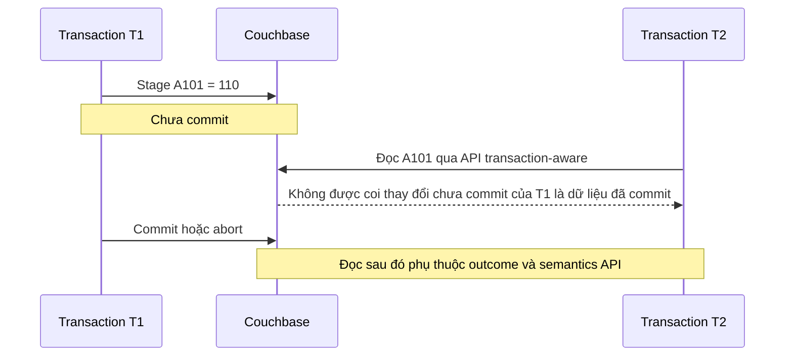
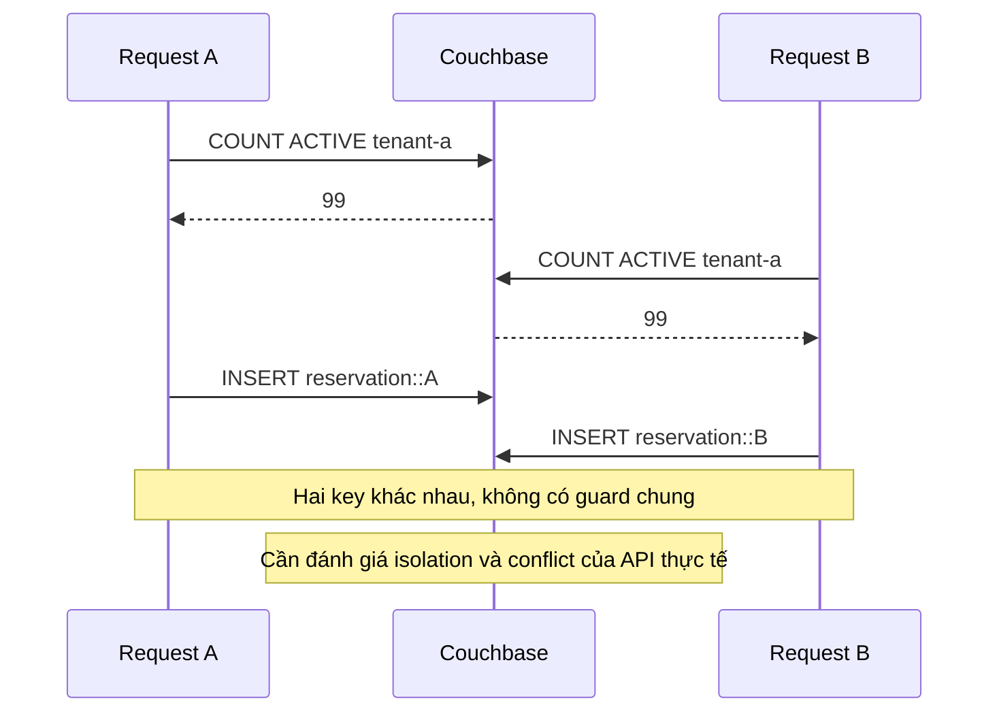

# Mức cô lập và các thuộc tính @Transactional cần xác minh phạm vi hỗ trợ

Trong chương **Giao dịch** của module **SPRING_DATA_COUCHBASE**, một phương thức service có thể được đánh dấu `@Transactional` nhưng điều đó **không đồng nghĩa mọi thuộc tính của annotation đều được Couchbase thực thi như một cơ sở dữ liệu quan hệ**. Đặc biệt, `isolation = Isolation.SERIALIZABLE`, `propagation = Propagation.REQUIRES_NEW`, `readOnly = true` hoặc `timeout = 3` là **yêu cầu ở tầng Spring**; ý nghĩa có hiệu lực phụ thuộc vào **transaction manager, SDK, phiên bản và đường operation**.

Couchbase distributed transactions thường được mô tả với **read-committed isolation**, thay vì một lựa chọn tùy ý mọi mức ANSI SQL. Chúng giúp phối hợp nhiều mutation trong một transaction, nhưng **atomic commit**, **isolation**, **durability**, **CAS**, **SQL++ index consistency** và **quy tắc nghiệp vụ** là những khía cạnh khác nhau. Không thể dùng một thuộc tính annotation để thay thế mọi khía cạnh đó.

Bài này tập trung vào **mức cô lập** và **các thuộc tính `@Transactional` cần xác minh phạm vi hỗ trợ** khi sử dụng Spring Data Couchbase cùng Repository, `CouchbaseTemplate`, Java SDK transactions và reactive API. Ví dụ xuyên suốt là chuyển điểm giữa hai account và giới hạn số lượng reservation theo tenant.

> **Quy tắc an toàn:** Chỉ khẳng định một thuộc tính được hỗ trợ sau khi đối chiếu **tài liệu/API của đúng phiên bản** và chứng minh bằng integration test trên đường truy cập dữ liệu thật. Một annotation được biên dịch thành công **không phải bằng chứng** rằng Couchbase đã thực thi tất cả những tùy chọn bên trong.

## 1. Mục tiêu học tập

Sau bài học, bạn có thể:

1. Phân biệt **atomicity, consistency nghiệp vụ, isolation, durability** và **scan consistency**.
2. Giải thích ý nghĩa **read committed** và những tình huống cần xem xét như dirty read, non-repeatable read, phantom, lost update và write skew.
3. Biết vì sao transaction Couchbase không được mặc định coi là `SERIALIZABLE` khi service đặt `Isolation.SERIALIZABLE`.
4. Xác định phạm vi thực tế của các thuộc tính `@Transactional`: `transactionManager`/`value`, `propagation`, `isolation`, `timeout`/`timeoutString`, `readOnly`, `rollbackFor`, `noRollbackFor` và `label`.
5. Giải thích khác nhau giữa thuộc tính Spring và cấu hình **expiration/durability/retry** của Couchbase Java SDK.
6. Nhận ra vai trò của `CouchbaseCallbackTransactionManager`, Spring proxy, SDK `ctx` và `CouchbaseTransactionalOperator`.
7. Mô hình hóa invariant trên nhiều document sao cho transaction thật sự bảo vệ được, đặc biệt với **quota guard**.
8. Phân biệt `@Version`/CAS, truy vấn SQL++/index consistency và transaction isolation.
9. Thiết kế test đo **rollback, conflict, read consistency, timeout, retry và commit ambiguous**.
10. Viết checklist chứng minh những bảo đảm hệ thống trước khi đưa nghiệp vụ quan trọng vào production.

## 2. Ví dụ xuyên suốt: hai account cần cùng commit

Trong bucket `appdata`, scope `loyalty`, collection `accounts`:

```text
account::tenant-a::A101
  tenantId: tenant-a
  rewardPoints: 150
  status: OPEN

account::tenant-a::A102
  tenantId: tenant-a
  rewardPoints: 50
  status: OPEN
```

Một lệnh chuyển 40 điểm cần đưa hệ thống về:

```text
A101 = 110
A102 =  90
Tổng = 200
```

Bất biến nghiệp vụ:

\[
P_A \ge 0,\qquad P_A + P_B = 200.
\]

Nếu cập nhật A101 thành công nhưng A102 thất bại, tổng 160 là trạng thái không hợp lệ để công bố là đã chuyển điểm xong.

### 2.1. Hai lệnh `save` độc lập có gì sai?

```java
Account from = repository.findById(fromKey).orElseThrow();
Account to = repository.findById(toKey).orElseThrow();

from.setRewardPoints(from.getRewardPoints() - 40);
to.setRewardPoints(to.getRewardPoints() + 40);

repository.save(from);
repository.save(to);
```

Nếu `save(from)` đã commit còn `save(to)` ném exception, Spring Data **không tự đảo ngược** mutation đầu tiên chỉ vì hai lệnh nằm cạnh nhau. Hai entity có `@Version` cũng chỉ bảo vệ cập nhật của **từng document** bằng CAS.

Phải xác định cả hai mutation **cùng thuộc một Couchbase transaction context được hỗ trợ**, hoặc thay đổi mô hình dữ liệu để invariant nằm trong một đơn vị atomic khác.

### 2.2. Isolation chưa đủ nếu phạm vi transaction thiếu

Ngay cả transaction có mức cô lập mạnh cũng không bảo vệ được một `collection.upsert(...)` SDK **ngoài context** được gọi giữa hai operation Spring Data. Trước khi bàn về isolation, phải chắc chắn **tất cả operation có liên quan nằm trong giao dịch**.

## 3. ACID: bốn chữ nhưng bốn câu hỏi khác nhau

| Khía cạnh | Câu hỏi | Ví dụ chuyển điểm |
| --- | --- | --- |
| **Atomicity** | Nhiều mutation được commit/abort như một đơn vị hay không? | Không công bố A101 đã trừ nếu A102 chưa được cộng |
| **Consistency** | Bất biến nghiệp vụ có được giữ sau trạng thái commit hợp lệ? | Tổng 200, nguồn không âm |
| **Isolation** | Các transaction đồng thời được phép quan sát và tác động lẫn nhau như thế nào? | Hai transfer từ A101 có thể cùng đọc số dư nào? |
| **Durability** | Khi commit được xác nhận, dữ liệu được duy trì theo mức chịu lỗi nào? | Chọn mức xác nhận lưu trữ phù hợp topology |

**Consistency trong ACID không thay thế việc viết validation.** Database không tự biết tài khoản thuộc tenant nào được ủy quyền, hoặc tổng điểm phải là 200, trừ khi ứng dụng mô hình hóa invariant thành điều kiện đọc/ghi và ràng buộc được bảo vệ.

**Isolation không đồng nghĩa “không có xung đột”.** Transaction có thể bị conflict hoặc phải retry. Chính các cơ chế đó là một phần của bảo vệ dữ liệu khi nhiều request cùng cập nhật.

### 3.1. Scan consistency không phải một chữ mới của ACID

SQL++ sử dụng secondary indexes có cơ chế cập nhật và scan consistency riêng. Những lựa chọn như `NOT_BOUNDED` hoặc `REQUEST_PLUS` ảnh hưởng việc truy vấn đợi index theo semantics API, **không biến các lệnh KV độc lập thành một transaction**.

## 4. Mức cô lập (isolation) giải quyết vấn đề gì?

Giả sử có hai request A và B chạy gần đồng thời. Nếu không có quy tắc cô lập, các bước của chúng có thể đan xen, dẫn tới kết quả trái kỳ vọng.

Các hiện tượng cơ bản cần phân biệt:

| Hiện tượng | Mô tả | Điều cần quan sát |
| --- | --- | --- |
| **Dirty read** | A đọc một thay đổi chưa commit của B | A nhìn thấy dữ liệu B rồi B abort |
| **Non-repeatable read** | A đọc cùng document hai lần trong một transaction nhưng nhận hai phiên bản khác vì B đã commit | Giá trị lần hai có khác lần một? |
| **Phantom read** | A chạy cùng predicate hai lần nhưng tập kết quả thay đổi vì B đã thêm/xóa document phù hợp | `COUNT(*)` hoặc danh sách kết quả có đổi? |
| **Lost update** | Một cập nhật ghi đè thay đổi của request khác mà không phát hiện | Hai phép cộng cùng đọc bản cũ, một phép cộng bị mất |
| **Write skew** | Hai transaction đọc cùng điều kiện/tập nhưng ghi các key khác nhau, kết hợp lại làm sai invariant | Hai request đều thấy còn một suất rồi đặt hai suất |
| **Read-your-own-writes** | Một transaction có nhìn được mutation chính nó đã stage không? | Đọc lại key sau `ctx.replace` |

Đây là **tên các hiện tượng cần thử nghiệm**, không phải lời khẳng định rằng Couchbase chắc chắn cho phép hoặc chặn mọi hiện tượng theo cùng cách trên mọi đường KV, SQL++, Server và SDK version.

### 4.1. Read committed: trực giác phù hợp

**Read committed** nhằm ngăn việc ứng dụng quan sát những mutation **chưa commit của transaction khác** qua các đường đọc giao dịch được hỗ trợ. Tuy nhiên, read committed nói chung **không hứa một snapshot bất biến cho toàn bộ vòng đời transaction**.

Vì vậy phải xem xét:

- Một transaction có thể đọc một bản đã commit mới hơn trong lần đọc sau theo semantics API.
- Những predicate query chạy lại có thể trả tập kết quả khác.
- Hai transaction ghi những document khác nhau vẫn có thể tạo **write skew** nếu không có điểm xung đột chung.
- Việc transaction đã đọc hoặc stage một document có thể kích hoạt quy tắc conflict riêng; không suy biểu hiện cụ thể chỉ từ tên isolation level.

**Không tự mặc định “read committed = tất cả các lần đọc trong transaction đều luôn giống nhau”.** Mức cam kết chính xác với KV và SQL++ phải đối chiếu tài liệu version.

## 5. Couchbase transactions và read-committed isolation

Ở những dòng Couchbase distributed transactions được tích hợp với Spring Data, **read committed** là mô hình isolation được tài liệu mô tả. Nó không có nghĩa ứng dụng có thể chỉ việc thêm:

```java
@Transactional(isolation = Isolation.SERIALIZABLE)
```

và database sẽ hỗ trợ serializable isolation.

Những yếu tố cần phân biệt:

1. **Mức cô lập transaction engine thực sự cung cấp.**
2. **Metadata `isolation` của annotation Spring** và cách manager tiếp nhận hoặc bỏ qua.
3. **Đường operation**: SDK KV transaction, SDK transactional SQL++, Spring Repository/Template, query thông thường.
4. **Cơ chế phát hiện conflict/retry**, có thể làm một số lịch xen kẽ bị abort thay vì trả giá trị.
5. **Scan consistency của SQL++** khi query dùng secondary index.

### 5.1. Không áp đặt mức SQL quan hệ lên Couchbase

Spring Framework có enum:

```java
import org.springframework.transaction.annotation.Isolation;

Isolation.DEFAULT
Isolation.READ_UNCOMMITTED
Isolation.READ_COMMITTED
Isolation.REPEATABLE_READ
Isolation.SERIALIZABLE
```

Các giá trị này là **mô tả yêu cầu trong hợp đồng Spring**. Không phải transaction manager nào cũng triển khai toàn bộ mức cô lập. Với Couchbase, hãy dùng **mức isolation engine thực sự hỗ trợ** và thiết kế invariant phù hợp, thay vì suy rằng một lựa chọn enum buộc SDK phải thực hiện isolation khác.

### 5.2. Không suy từ một test tuần tự

Nếu bạn chạy hai request lần lượt và cả hai thành công, điều đó không chứng minh isolation dưới concurrency. Kiểm thử mức cô lập cần **hai hay nhiều transaction có lịch chạy đan xen** và phải quan sát cả kết quả commit/abort, phiên bản dữ liệu và số lần callback retry.

## 6. Lịch chạy minh họa: dirty read và commit

Giả sử document `account::A101` ban đầu có `rewardPoints = 150`.



Mục tiêu của mô hình read committed là không cho T2 coi mutation chưa commit của T1 là trạng thái đã được commit.

**Quan trọng:** biểu đồ diễn đạt ý tưởng. Một reader hoặc writer cùng key có thể gặp conflict, retry, chờ hoặc thất bại theo API; không khẳng định T2 luôn nhận đúng một giá trị cụ thể ở tất cả thời điểm.

### 6.1. Reader ngoài transaction cũng cần phân loại

Một lệnh SDK KV bình thường, một query SQL++ thông thường và một `ctx.get` trong transaction **không có cùng hợp đồng quan sát**. Nếu bạn muốn kiểm tra dirty read, phải ghi rõ đường đọc, phiên bản client/server, thời điểm commit và scan consistency, không dùng một query qua index rồi coi đó là kết quả KV transaction.

## 7. Lịch chạy minh họa: non-repeatable read

```text
T1: bắt đầu transaction
T1: đọc A101 = 150
T2: cập nhật và commit A101 = 130
T1: đọc lại A101
```

Đối với read committed nói chung, không có lời hứa snapshot cố định kéo dài cả transaction. Nhưng khi Couchbase transaction đã đọc hoặc thao tác cùng key, **quy tắc conflict/retry** có thể ảnh hưởng lần đọc sau.

Vì thế, với thí nghiệm thực tế, bạn phải ghi nhận:

- T1 có được phép đọc lại hay bị conflict/abort/retry?
- Nếu đọc lại, giá trị là bản nào?
- Nếu callback bị SDK chạy lại, phép đọc “lần hai” có còn thuộc **cùng attempt** không?
- Operation có phải KV `ctx.get` hay SQL++ query?
- T2 commit vào thời điểm nào?

Không được lấy kết quả của attempt mới để kết luận **non-repeatable read trong cùng attempt cũ**.

### 7.1. Bài học thiết kế

Nếu logic cần “đã đọc số dư rồi thì dùng chính trạng thái đó để ghi”, hãy thực hiện **đọc–kiểm tra–ghi trong cùng callback** bằng operation được hỗ trợ và dựa vào cơ chế conflict/validation của transaction. Không đọc trước ngoài transaction rồi để callback dùng object stale.

## 8. Phantom và write skew: bất biến theo tập document

Đây là trường hợp quan trọng hơn nhiều so với việc chỉ kiểm tra một account.

Giả sử mỗi tenant được phép có tối đa **100 reservation ACTIVE**:

\[
N_{\mathrm{ACTIVE}}(\text{tenant-a}) \le 100.
\]

Hai request cùng chạy:

```text
Ban đầu: ACTIVE count = 99

Request A:
  query COUNT = 99
  tạo reservation::A

Request B:
  query COUNT = 99
  tạo reservation::B

Sau cả hai commit: ACTIVE count = 101
```

Cả A và B ghi **hai key khác nhau**. Nếu chỉ dựa vào `COUNT(*) < 100` mà không thiết kế điểm cạnh tranh, một hệ thống ở mức read committed có thể không bảo vệ được invariant trên predicate.



Không nên hứa rằng “`@Transactional` tự chặn phantom/write skew” nếu transaction engine và cách mô hình hóa dữ liệu không cho bảo đảm đó.

### 8.1. Giải pháp: quota guard document

Tạo một document chung:

```json
{
  "tenantId": "tenant-a",
  "limit": 100,
  "occupied": 99
}
```

Key: `quota::tenant-a` trong collection `loyalty.quotas`.

Trong một transaction:

1. Đọc guard `quota::tenant-a`.
2. Nếu `occupied >= limit`, từ chối.
3. Tăng `occupied` trong guard.
4. Insert reservation mới bằng **insert-only**.
5. Commit cả hai mutation cùng nhau.

```text
Transaction A --> ctx.get(quota::tenant-a) --> ctx.replace(quota)
              \--> ctx.insert(reservation::A)

Transaction B --> ctx.get(quota::tenant-a) --> ctx.replace(quota)
              \--> ctx.insert(reservation::B)
```

Hai request phải đụng **cùng guard document**; cơ chế conflict của transaction có điểm chung để phối hợp thay vì chỉ tranh chấp những key reservation khác nhau.

### 8.2. Guard phải được duy trì ở mọi đường nghiệp vụ

Nếu reservation bị hủy, chuyển trạng thái hoặc hết hạn TTL, hệ thống phải cập nhật/đối soát guard tương ứng. Couchbase **không tự giảm `occupied`** khi một document khác biến mất vì TTL.

Guard cũng có thể trở thành **hot key**. Khi workload lớn, cần đánh giá phân vùng quota, contention, latency và lựa chọn kiến trúc thay thế; không xem guard là lời giải hiệu năng miễn phí.

## 9. Cơ chế CAS và optimistic locking không phải isolation level

Spring Data Couchbase có annotation:

```java
import org.springframework.data.annotation.Version;
```

Ví dụ entity:

```java
package com.example.loyalty;

import org.springframework.data.annotation.Id;
import org.springframework.data.annotation.Version;
import org.springframework.data.couchbase.core.mapping.Collection;
import org.springframework.data.couchbase.core.mapping.Document;
import org.springframework.data.couchbase.core.mapping.Field;
import org.springframework.data.couchbase.core.mapping.Scope;

@Document
@Scope("loyalty")
@Collection("accounts")
public class Account {

    @Id
    private String id;

    @Field
    private String tenantId;

    @Field
    private long rewardPoints;

    @Field
    private String status;

    @Version
    private Long version;

    public Account() {}

    public Account(String id, String tenantId,
                   long rewardPoints, String status) {
        this.id = id;
        this.tenantId = tenantId;
        this.rewardPoints = rewardPoints;
        this.status = status;
    }

    public String getId() { return id; }
    public void setId(String id) { this.id = id; }
    public String getTenantId() { return tenantId; }
    public void setTenantId(String tenantId) { this.tenantId = tenantId; }
    public long getRewardPoints() { return rewardPoints; }
    public void setRewardPoints(long points) { this.rewardPoints = points; }
    public String getStatus() { return status; }
    public void setStatus(String status) { this.status = status; }
    public Long getVersion() { return version; }
    public void setVersion(Long version) { this.version = version; }
}
```

- `@Id` là document key.
- `@Scope` và `@Collection` định vị document; chúng không tự tạo namespace.
- `@Version Long` mang **CAS metadata** phục vụ optimistic locking trong những Spring Data operations được hỗ trợ.
- CAS là token do Couchbase quản lý, **không phải counter nghiệp vụ cộng 1**.
- Hai lần `repository.save` dùng CAS trên hai key vẫn có thể commit một nửa nếu không có transaction context.

**Isolation** điều chỉnh quan hệ quan sát giữa các transaction; **CAS** là điều kiện ghi để phát hiện một document đã thay đổi. Chúng bổ trợ nhau nhưng không thay thế nhau.

## 10. `@Transactional` là metadata, không phải lệnh cưỡng bức server

Annotation của Spring:

```java
import org.springframework.transaction.annotation.Transactional;

@Transactional
public void transfer(...) {
    // ...
}
```

Khi được áp dụng qua Spring transaction infrastructure, annotation cung cấp **metadata** cho transaction interceptor/manager. Manager được chọn mới quyết định cách triển khai trên datastore.

Trong Spring Data Couchbase, cần xác minh:

- Spring transaction infrastructure đã được bật.
- Public service method thực sự được gọi **qua Spring proxy** trong cấu hình đang dùng.
- Manager Couchbase tồn tại và được chọn đúng.
- Repository/Template operations tương thích và **tham gia đúng context**.
- Cấu hình SDK và server đáp ứng các yêu cầu transaction.
- Những thuộc tính annotation ngoài transaction-manager selection có thực sự được implementation hỗ trợ không.

Bảng ở mục 11 là **checklist thẩm định**, không phải lời hứa tất cả thuộc tính luôn có hiệu lực.

## 11. Bảng thuộc tính `@Transactional` cần kiểm chứng

| Thuộc tính | Ý nghĩa trong Spring | Điều cần xác minh với Couchbase |
| --- | --- | --- |
| `transactionManager` / `value` | Chọn bean transaction manager theo tên/qualifier | **Đúng manager Couchbase**, không nhầm JPA |
| `propagation` | Cách method tham gia hoặc mở transaction khi đã có transaction khác | Callback manager có hỗ trợ `REQUIRED`, `REQUIRES_NEW`, `NESTED`… đến mức nào? |
| `isolation` | Mức cô lập yêu cầu | **Không suy** server chuyển sang `REPEATABLE_READ`/`SERIALIZABLE` |
| `timeout` / `timeoutString` | Deadline transaction do manager hiểu | Có được mapping sang SDK transaction expiration không? |
| `readOnly` | Hint để tối ưu/xác định giao dịch chỉ đọc | Không coi là quyền cấm ghi hoặc bảo đảm SDK từ chối mutation |
| `rollbackFor` / `rollbackForClassName` | Quy tắc rollback theo exception type | Callback Couchbase manager có áp dụng không? |
| `noRollbackFor` / `noRollbackForClassName` | Ngoại lệ không rollback theo rule của Spring | Không giả định có thể commit mutation stage dù callback ném lỗi |
| `label` | Metadata/nhãn cho transaction trong các phiên bản Spring hỗ trợ | Manager có đọc/xuất nhãn hay không, hay bỏ qua? |

**Mức hỗ trợ phụ thuộc phiên bản.** Một số tài liệu Spring Data Couchbase mô tả callback-based transaction management chỉ hỗ trợ một phần thuộc tính và có các rollback attributes không được áp dụng theo cách JPA. Vì thế, mỗi dòng trong bảng cần một kết quả thẩm định cụ thể, không đủ chỉ với “annotation có tham số này”.

## 12. `transactionManager`: thuộc tính ưu tiên kiểm tra đầu tiên

Ví dụ:

```java
@Transactional(transactionManager = "couchbaseTransactionManager")
public void transfer(...) {
    // Các Spring Data Couchbase operations được hỗ trợ.
}
```

`couchbaseTransactionManager` là **tên bean** thường gặp trong cấu hình Spring Data Couchbase; class thực tế ở một số dòng API là **`CouchbaseCallbackTransactionManager`**.

Điều này đặc biệt quan trọng nếu ứng dụng có thêm PostgreSQL/JPA:

```text
ApplicationContext
    couchbaseTransactionManager
    transactionManager  (có thể là JPA)
```

Nếu không chỉ định manager, Spring phải phân giải theo bean/configuration. Có thể dẫn đến chọn sai manager hoặc lỗi khi có nhiều candidate.

### 12.1. Kiểm tra tên và kiểu bean thật

```java
import java.util.Map;
import org.springframework.context.ApplicationContext;
import org.springframework.transaction.TransactionManager;

public void inspectManagers(ApplicationContext context) {
    Map<String, TransactionManager> managers =
            context.getBeansOfType(TransactionManager.class);

    managers.forEach((name, manager) ->
            System.out.println(name + ": " +
                    manager.getClass().getName()));
}
```

Đây là bước **diagnostic**, không đủ để chứng minh atomicity. Một manager bean có tồn tại chưa có nghĩa Repository operation đang tham gia transaction; vẫn cần integration test.

### 12.2. Một manager không biến hai datastore thành một

Gắn `@Transactional(transactionManager = "couchbaseTransactionManager")` lên method có cả JPA `save` và Couchbase `save` **không** tạo ACID xuyên PostgreSQL và Couchbase. Cần outbox, saga, idempotency hoặc thiết kế lại nguồn sự thật theo yêu cầu nghiệp vụ.

## 13. `isolation`: vì sao đặt SERIALIZABLE chưa đủ?

Ví dụ nhiều người dễ thử:

```java
import org.springframework.transaction.annotation.Isolation;
import org.springframework.transaction.annotation.Transactional;

@Transactional(
    transactionManager = "couchbaseTransactionManager",
    isolation = Isolation.SERIALIZABLE
)
public void reserve(...) {
    // Không được khẳng định Couchbase đang SERIALIZABLE.
}
```

Spring annotation có thể nhận `Isolation.SERIALIZABLE` ở mức cú pháp, nhưng manager Couchbase có thể **không hỗ trợ tùy chọn này hoặc không áp dụng nó như developer tưởng**. Sự khác biệt có thể là cấu hình không có hiệu lực hoặc exception, tùy phiên bản/đường tích hợp.

### 13.1. Phương án thiết kế đúng

1. Ghi nhận isolation mà **Couchbase Server/SDK transaction API thực sự hỗ trợ**.
2. Dùng `Isolation.DEFAULT` nếu đó là contract được manager hỗ trợ, hoặc cấu hình được docs chỉ rõ.
3. Đối với invariant có nguy cơ write skew, **mô hình hóa điểm xung đột chung** (quota guard/unique guard) thay vì chỉ tăng enum isolation.
4. Chạy test concurrency có thể tái hiện lịch đọc–ghi quan trọng.
5. Theo dõi conflict/retry/abort trong production.

**Không dùng kết quả `Isolation.SERIALIZABLE` được compile thành công làm cơ sở ghi trong tài liệu kiến trúc rằng hệ thống đã serializable.**

## 14. `propagation`: không tự suy ra REQUIRES_NEW hoặc NESTED

Spring có các giá trị như:

```java
import org.springframework.transaction.annotation.Propagation;

Propagation.REQUIRED
Propagation.REQUIRES_NEW
Propagation.NESTED
Propagation.SUPPORTS
Propagation.NOT_SUPPORTED
Propagation.MANDATORY
Propagation.NEVER
```

Chúng mô tả kỳ vọng về cách method phối hợp khi đã có transaction từ caller. Với callback-based Couchbase integration, phải **xác minh propagation nào được hỗ trợ thật**.

### 14.1. Ví dụ dễ hiểu sai

```java
@Transactional(transactionManager = "couchbaseTransactionManager")
public void outerOperation() {
    repository.save(accountA);
    innerService.updateB();
}
```

```java
@Transactional(
    transactionManager = "couchbaseTransactionManager",
    propagation = Propagation.REQUIRES_NEW
)
public void updateB() {
    repository.save(accountB);
}
```

Người quen JPA có thể tin inner luôn tạo transaction độc lập, commit trước và không bị rollback theo outer. **Không được mang kỳ vọng đó sang Couchbase** nếu manager/version không công bố hỗ trợ đầy đủ `REQUIRES_NEW`.

### 14.2. `NESTED` không tự tạo savepoint

Nhiều hệ thống quan hệ có thể triển khai nested transaction qua savepoint. Couchbase Java SDK transactions không nên bị coi có **database savepoint** chỉ vì Spring enum `Propagation.NESTED` tồn tại.

Nếu workflow cần hai ranh giới khác nhau, hãy thiết kế hai **use case/transaction độc lập** với outcome rõ ràng hoặc dùng saga, thay vì dựa vào nested behavior chưa xác minh.

### 14.3. Self-invocation còn là vấn đề trước cả propagation

```java
public void outer() {
    this.inner(); // Bỏ qua Spring proxy trong proxy-based AOP.
}

@Transactional(propagation = Propagation.REQUIRES_NEW)
public void inner() {
    // Không được tự kết luận có transaction mới.
}
```

Ngay cả manager có hỗ trợ propagation thì lời gọi nội bộ trực tiếp **có thể không được intercept**. Trước tiên hãy kiểm tra call path và bean proxy, rồi mới bàn về propagation.

## 15. `timeout` và `timeoutString` không phải mọi deadline đều giống nhau

Ví dụ:

```java
@Transactional(
    transactionManager = "couchbaseTransactionManager",
    timeout = 3
)
public void slowTransfer() {
    // Đừng tự suy rằng SDK expiration = 3 giây.
}
```

Spring Framework có thuộc tính timeout, nhưng Couchbase Java SDK cũng có **transaction expiration/timeout** và các timeout operation khác. Spring Data integration có thể không map trực tiếp `timeout` từ annotation sang SDK expiration ở mọi version.

| Deadline | Tầng | Tác động cần hiểu |
| --- | --- | --- |
| Spring `@Transactional(timeout)` | Transaction manager nếu hỗ trợ | Có được manager áp dụng thực sự? |
| SDK transaction expiration | SDK transaction | Vòng đời attempt/transaction |
| KV operation timeout | Một lệnh đọc/ghi | Operation có thể timeout trước commit |
| SQL++ query timeout | Query Service/SDK query | Query bị cắt khi chờ index/kết quả |
| Reactor `timeout` | Publisher phía ứng dụng | Có thể hủy subscription |
| HTTP client/gateway timeout | Caller/network | Client có thể không nhận kết quả commit |

### 15.1. Kiểm thử có kiểm soát

1. Cấu hình **một** nguồn timeout mục tiêu theo docs version.
2. Dùng test transaction có delay có giới hạn hoặc mô phỏng điều kiện chậm trên môi trường cô lập.
3. Đo thời gian tới exception/terminal signal.
4. Kiểm tra outcome commit/abort và loại lỗi.
5. Thử lặp với transaction expiration SDK để phân biệt.
6. Không chỉ dựa vào chuỗi message “timed out”.

### 15.2. Timeout không chứng minh rollback

Nếu acknowledgement bị mất ở giai đoạn commit, transaction **có thể đã commit** dù phía client nhận timeout. Đây là trường hợp **commit ambiguous**; cần idempotency và đường đối soát thay vì retry mù quáng.

## 16. `readOnly`: hint, không phải kiểm soát quyền

Ví dụ:

```java
@Transactional(
    transactionManager = "couchbaseTransactionManager",
    readOnly = true
)
public Account load(String key) {
    return repository.findById(key).orElseThrow();
}
```

Trong Spring, `readOnly` là **hint/metadata** cho transaction manager và đôi khi cho ORM, **không phải một cơ chế RBAC**. Với Couchbase transaction integration, có thể nó không có tác động hạn chế mutation mà developer mong đợi.

Không khẳng định:

- Service có `readOnly=true` thì mọi `save` chắc chắn bị chặn.
- Có thể dùng `readOnly` để bảo vệ dữ liệu khỏi client không được phép.
- Nó tối ưu query SQL++ hoặc thay đổi isolation mức server.
- Nó thay thế việc dùng user Couchbase có quyền phù hợp.

### 16.1. Kiểm tra read-only behavior

Viết một integration test riêng trong môi trường test cho method có `readOnly=true` nhưng **cố gắng ghi** một document, rồi quan sát manager xử lý ra sao. Chỉ triển khai hợp đồng nghiệp vụ dựa trên kết quả nếu tài liệu version thực sự bảo đảm behavior đó.

Trong sản phẩm thật, phân quyền dựa trên authentication/authorization, RBAC và thiết kế API; không dùng `readOnly` như biên giới bảo mật.

## 17. `rollbackFor` và `noRollbackFor`: không sao chép quy tắc JPA

Spring transaction kiểu JDBC/JPA thường có các quy tắc rollback theo checked/unchecked exception. Người dùng hay viết:

```java
@Transactional(
    transactionManager = "couchbaseTransactionManager",
    rollbackFor = IOException.class
)
public void importData() throws IOException {
    // ...
}
```

hoặc:

```java
@Transactional(
    transactionManager = "couchbaseTransactionManager",
    noRollbackFor = IllegalStateException.class
)
public void transfer() {
    // ...
}
```

Nhưng ở một số dòng Spring Data Couchbase callback transaction integration, tài liệu ghi nhận các **rollback attributes có thể bị bỏ qua** hoặc không hoạt động giống `PlatformTransactionManager` của JPA.

**Điều phải xác minh:** exception nào được callback manager/SDK coi là làm transaction thất bại, và nó có áp dụng các rule tùy chỉnh không?

### 17.1. Đừng biến một callback thất bại thành commit một phần

Nếu nghiệp vụ từ chối sau mutation thứ nhất, hãy phát tín hiệu lỗi/abort theo transaction API được hỗ trợ. **Không thiết kế “đã stage thay đổi rồi throw, nhưng `noRollbackFor` sẽ commit một phần”** nếu không có contract rõ ràng của manager.

### 17.2. Bắt exception trong callback

```java
@Transactional(transactionManager = "couchbaseTransactionManager")
public void unsafeTransfer() {
    try {
        repository.save(from);
        repository.save(to);
    } catch (RuntimeException ex) {
        logger.warn("Transfer failed", ex);
        // Nuốt lỗi: method có thể trở về bình thường.
    }
}
```

Nếu method trả bình thường, transaction infrastructure có thể không nhận được tín hiệu lỗi phù hợp. Một số lỗi SDK có thể đã làm context không còn hợp lệ, nhưng **không nên phụ thuộc vào hành vi mơ hồ**. Hãy truyền lỗi ra ranh giới và xác định outcome rõ ràng.

### 17.3. Checked exception không phải bằng chứng commit

Cũng không được suy “checked exception thì vẫn commit” theo thói quen Spring JDBC. Callback manager có contract riêng; cần **test dữ liệu sau exception**, không chỉ test loại exception đã ném.

## 18. `label` và các metadata ít ảnh hưởng tới thực thi

Một số phiên bản Spring cung cấp `label` để gắn nhãn transaction:

```java
@Transactional(
    transactionManager = "couchbaseTransactionManager",
    label = {"loyalty-transfer"}
)
public void transfer(...) {
    // ...
}
```

Đây là **metadata Spring**. Nếu manager không xử lý/expose nhãn, nó không tự tạo Couchbase transaction tag, index, telemetry hoặc thay đổi isolation.

Đối với quan sát, nên xây **business operation ID/transferId**, transaction attempt metrics và tracing phù hợp với SDK, nhưng **không ghi document body/mật khẩu vào log**.

## 19. Đặt giao dịch tại đúng ranh giới service

Một use case chuyển điểm nên có một **public application-service method**, được caller khác gọi qua Spring bean/proxy:

```java
@Service
public class TransferApplicationService {

    private final AccountRepository accounts;

    public TransferApplicationService(
            AccountRepository accounts) {
        this.accounts = accounts;
    }

    @Transactional(transactionManager = "couchbaseTransactionManager")
    public void transfer(
            String authorizedTenantId,
            String sourceKey,
            String targetKey,
            long points) {

        // Đọc, kiểm tra, tính toán và ghi cả hai document
        // bằng các Spring Data operations được hỗ trợ.
    }
}
```

Điều kiện:

- Spring transaction advice đã được bật, chẳng hạn với `@EnableTransactionManagement` và hạ tầng cấu hình thích hợp.
- `couchbaseTransactionManager` đúng manager của operations đang dùng.
- Method được **gọi qua proxy**, không phải `this.transfer(...)` từ chính target.
- Repository/Template operation tương thích và tham gia transaction context.
- Những điều kiện cần đúng tại commit được kiểm tra **trong transaction**.
- Không có SDK call trực tiếp độc lập hoặc side effect ngoài transaction lẫn vào.

### 19.1. Những lỗi proxy thường gặp

- Object service tự tạo bằng `new` thay vì inject từ Spring.
- `this.innerMethod()` không đi qua proxy.
- Private/final method không được intercept trong mô hình proxy hiện tại.
- `@Async`/thread mới làm mutation thoát transaction scope.
- Có nhiều managers nhưng annotation chọn nhầm JPA.
- Unit test mock không khởi tạo transaction infrastructure thật.

Một test `AopUtils.isAopProxy(bean)` hữu ích, nhưng **chưa đủ chứng minh** mutation Couchbase rollback cùng nhau.

## 20. Mẫu Spring Data Repository có transaction: các giả định phải công khai

Repository:

```java
package com.example.loyalty;

import org.springframework.data.couchbase.repository.CouchbaseRepository;

public interface AccountRepository
        extends CouchbaseRepository<Account, String> {
}
```

Service minh họa:

```java
package com.example.loyalty;

import java.util.Objects;
import org.springframework.stereotype.Service;
import org.springframework.transaction.annotation.Transactional;

@Service
public class SpringTransferService {

    private final AccountRepository accounts;

    public SpringTransferService(AccountRepository accounts) {
        this.accounts = accounts;
    }

    @Transactional(transactionManager = "couchbaseTransactionManager")
    public void transfer(String authorizedTenant,
                         String sourceKey, String targetKey,
                         long amount) {
        if (amount <= 0 || Objects.equals(sourceKey, targetKey)) {
            throw new IllegalArgumentException("Request không hợp lệ");
        }

        Account source = accounts.findById(sourceKey).orElseThrow();
        Account target = accounts.findById(targetKey).orElseThrow();

        if (!authorizedTenant.equals(source.getTenantId())
                || !authorizedTenant.equals(target.getTenantId())) {
            throw new IllegalStateException("Sai tenant");
        }

        if (!"OPEN".equals(source.getStatus())
                || !"OPEN".equals(target.getStatus())
                || source.getRewardPoints() < amount
                || source.getRewardPoints() < 0
                || target.getRewardPoints() < 0) {
            throw new IllegalStateException("Không được chuyển");
        }

        long nextTarget = Math.addExact(
                target.getRewardPoints(), amount);
        source.setRewardPoints(
                source.getRewardPoints() - amount);
        target.setRewardPoints(nextTarget);

        accounts.save(source);
        accounts.save(target);
    }
}
```

**Mẫu này có điều kiện**, không phải lời hứa transaction tự có:

1. Server/SDK/Spring Data hỗ trợ Couchbase transaction integration.
2. Bean manager Couchbase tồn tại và được sử dụng.
3. `findById`/`save` tham gia context theo phiên bản.
4. Entity `@Version Long` đáp ứng yêu cầu transaction integration.
5. Caller gọi service qua Spring proxy.
6. Keyspace và RBAC/ATR metadata đúng.
7. Integration test forced-abort xác nhận hai mutation cùng rollback/abort.

Nếu một điều kiện không đúng, phải sửa cấu hình hoặc dùng SDK transaction trực tiếp trước khi tuyên bố phương thức này có atomic commit.

## 21. SDK transaction giúp quan sát isolation độc lập với Spring annotation

Để phân biệt behavior thực của Couchbase Server/SDK với Spring interception, có thể viết test trực tiếp bằng SDK:

```java
package com.example.loyalty;

import com.couchbase.client.java.Cluster;
import com.couchbase.client.java.Collection;
import com.couchbase.client.java.json.JsonObject;
import com.couchbase.client.java.transactions.TransactionGetResult;

public class SdkTransferAdapter {

    private final Cluster cluster;
    private final Collection accounts;

    public SdkTransferAdapter(
            Cluster cluster, Collection accounts) {
        this.cluster = cluster;
        this.accounts = accounts;
    }

    public void transfer(
            String authorizedTenant, String sourceKey,
            String targetKey, long amount) {

        cluster.transactions().run(ctx -> {
            TransactionGetResult source =
                    ctx.get(accounts, sourceKey);
            TransactionGetResult target =
                    ctx.get(accounts, targetKey);

            JsonObject from = source.contentAsObject();
            JsonObject to = target.contentAsObject();

            if (!authorizedTenant.equals(from.getString("tenantId"))
                    || !authorizedTenant.equals(to.getString("tenantId"))
                    || !"OPEN".equals(from.getString("status"))
                    || !"OPEN".equals(to.getString("status"))
                    || amount <= 0 || sourceKey.equals(targetKey)) {
                throw new IllegalStateException("Không được phép chuyển");
            }

            Long fromPoints = from.getLong("rewardPoints");
            Long toPoints = to.getLong("rewardPoints");

            if (fromPoints == null || toPoints == null
                    || fromPoints < amount || fromPoints < 0
                    || toPoints < 0) {
                throw new IllegalStateException("Không đủ điểm");
            }

            long nextTarget = Math.addExact(toPoints, amount);
            long nextSource = fromPoints - amount;

            ctx.replace(source,
                    from.put("rewardPoints", nextSource));
            ctx.replace(target,
                    to.put("rewardPoints", nextTarget));
        });
    }
}
```

Các lệnh `ctx.get`/`ctx.replace` dùng context do SDK quản lý. **Không** thay `ctx.replace` bằng `accounts.upsert(...)` trong lambda, vì KV SDK thông thường không tự tham gia transaction.

### 21.1. Đây không phải annotation Spring

Mã SDK trên hoạt động qua transaction API trực tiếp; nó **không đọc `@Transactional(isolation = ...)`**. Đây là một cách hữu ích để kiểm chứng giới hạn engine và phân biệt vấn đề SDK với vấn đề manager/proxy Spring.

### 21.2. SDK callback có thể chạy lại

Khi có conflict, SDK có thể retry attempt theo chính sách. Mọi kiểm tra bất biến cần thực hiện lại trên dữ liệu vừa đọc. Không gửi email, charge payment hoặc tăng biến đếm nghiệp vụ ngoài transaction **bên trong callback**.

## 22. Spring Data Template, SQL++ và phạm vi query

`CouchbaseTemplate`/`CouchbaseOperations` có các operation đọc/ghi theo key; SQL++ query có đường thực thi khác.

Ví dụ query theo thuộc tính:

```sql
SELECT META(a).id AS documentKey,
       a.tenantId,
       a.rewardPoints
FROM `appdata`.`loyalty`.`accounts` AS a
WHERE a.tenantId = $tenantId
  AND a.status = $status;
```

Index:

```sql
CREATE INDEX ix_accounts_tenant_status
ON `appdata`.`loyalty`.`accounts` (
    tenantId,
    status
);
```

Những điều phải xác minh:

- Query qua `repository.findBy...` hoặc `template.findByQuery(...)` có **transactional query support** trong phiên bản Spring Data không?
- Nếu dùng Java SDK trực tiếp, query được gọi qua `ctx.query(...)` hay `cluster.query(...)` độc lập?
- SQL++ Query/Index Service và index tương ứng có tồn tại không?
- Scan consistency đặt ở đâu và có tương thích đường query không?
- Query được dùng để quyết định invariant theo predicate hay chỉ để hiển thị dữ liệu?
- Read committed của transaction API áp dụng cụ thể thế nào với query trong cùng attempt?

### 22.1. `REQUEST_PLUS` không nâng transaction lên SERIALIZABLE

`REQUEST_PLUS` giúp query chờ index theo contract của scan consistency, nhưng nó không biến `COUNT(*)` rồi `INSERT` ngoài context thành một transaction serializable. **Index freshness** và **transaction isolation** là hai chiều độc lập.

### 22.2. `@Query` không tự tham gia transaction

Một method có `@Query` được gọi trong service annotated `@Transactional` vẫn cần xác minh đường query có gắn đúng transaction context không. Compiler không kiểm tra điều kiện này.

## 23. Reactive: isolation vẫn là chuyện của Couchbase engine

Spring Data Couchbase có API reactive:

```java
import org.springframework.data.couchbase.repository.ReactiveCouchbaseRepository;

public interface ReactiveAccountRepository
        extends ReactiveCouchbaseRepository<Account, String> {
}
```

Với Reactor, một `Mono`/`Flux` thường chỉ bắt đầu thực thi khi được subscribe. `Mono.when(...)` hoặc `Flux.merge(...)` **không tự tạo transaction**.

Trong các dòng Spring Data hỗ trợ, có `CouchbaseTransactionalOperator` để đặt transaction scope cho một Publisher:

```java
import org.springframework.data.couchbase.core.ReactiveCouchbaseTemplate;
import org.springframework.data.couchbase.transaction.CouchbaseTransactionalOperator;
import reactor.core.publisher.Mono;

public Mono<Account> suspend(
        CouchbaseTransactionalOperator operator,
        ReactiveCouchbaseTemplate template,
        String key) {

    return operator.execute(status ->
            template.findById(Account.class)
                    .one(key)
                    .switchIfEmpty(Mono.error(
                            new IllegalArgumentException("Không tồn tại")))
                    .flatMap(account -> {
                        account.setStatus("SUSPENDED");
                        return template.replaceById(Account.class)
                                .one(account);
                    }))
            .single();
}
```

**Lưu ý phiên bản:** chữ ký `execute(...)` và các operation được transaction integration hỗ trợ phải đối chiếu Javadoc thực tế. Nếu API version khác, phải điều chỉnh code. Operator không tự tăng isolation lên `SERIALIZABLE`; nó chủ yếu cung cấp **phạm vi transaction theo chương trình**.

### 23.1. `@Transactional(isolation = ...)` trên Mono cũng cần kiểm chứng

Ngay cả khi method trả `Mono` và annotation được áp dụng, mức isolation thực sự vẫn do Couchbase engine/manager quyết định. Thêm một enum isolation không làm Reactor tạo snapshot serialization hoặc predicate locks.

### 23.2. Tránh tự subscribe và mất context

```java
return operator.execute(status -> {
    reactiveTemplate.replaceById(Account.class)
            .one(accountA)
            .subscribe(); // Nhánh tách rời!

    return reactiveTemplate.replaceById(Account.class)
            .one(accountB);
});
```

Đây là cách tổ chức pipeline **không an toàn** cho atomicity. Phải trả về **một Publisher tổng hợp**, nối các thao tác bằng `flatMap`/`then` để operator theo dõi cùng lifecycle.

### 23.3. Cancellation không chứng minh rollback

`timeout(Duration.ofSeconds(3))` phía Reactor hoặc client disconnect có thể hủy subscription khi commit đang diễn ra. Không được coi `cancel` hoặc HTTP timeout là xác nhận transaction abort. Dùng transferId/idempotency và đối soát outcome.

## 24. Phân biệt isolation, CAS, durability và TTL

| Cơ chế | Bảo vệ điều gì? | Không tự bảo vệ điều gì? |
| --- | --- | --- |
| Transaction atomicity | Các mutation được hỗ trợ trong cùng context commit/abort như một đơn vị | Mutation ngoài context; side effect ngoài Couchbase |
| Read-committed isolation | Hạn chế quan sát thay đổi chưa commit theo contract | Không mặc định serializable predicate locking |
| `@Version`/CAS | Phát hiện ghi từ bản document cũ ở operation hỗ trợ | Atomicity của hai document |
| SDK durability level | Mức xác nhận lưu trữ/khả năng chịu lỗi | Transaction scope hoặc quyền tenant |
| SQL++ `REQUEST_PLUS` | Đợi index theo scan-consistency semantics | Atomic commit hoặc ngăn write skew |
| Document TTL | Thời điểm document hết hạn | Không tự giảm counter document khác |
| `@Transactional(readOnly)` | Metadata/hint cho manager | RBAC, cấm ghi chắc chắn, isolation mạnh hơn |

Một thiết kế đúng có thể sử dụng **nhiều cơ chế đồng thời**, nhưng phải áp dụng chúng cho đúng vấn đề.

### 24.1. TTL và business invariant

Nếu reservation tự hết hạn sau 15 phút nhưng quota guard document vẫn đếm reservation là ACTIVE, quota sẽ bị sai. Transaction chỉ bảo vệ những thay đổi **được thực thi trong context**, không tự sinh mutation giảm quota khi TTL xóa reservation. Cần expiration workflow, reconciliation hoặc thay mô hình dữ liệu.

## 25. Phạm vi callback và vấn đề commit ambiguous

Trong một transaction có thể xảy ra:

- **COMMITTED:** SDK/manager xác nhận transaction hoàn tất.
- **REJECTED:** điều kiện nghiệp vụ sai, không có commit.
- **ABORTED/FAILED:** transaction bị abort/lỗi và outcome được xác định.
- **UNKNOWN:** caller không biết commit đã xảy ra hay chưa do mất kết nối hoặc timeout ở giai đoạn nhạy cảm.

**Đây là các nhãn nghiệp vụ để xử lý**, không nhất thiết là tên enum/exception của SDK.

### 25.1. Không retry mù quáng

Một phép chuyển điểm đã commit nhưng response bị mất có thể bị client gửi lại. Transaction mới vẫn có thể commit **một lần chuyển điểm nữa** nếu không có idempotency.

Thiết kế nên dùng:

```text
transferId = transfer::tenant-a::T9001

Trong cùng transaction:
  kiểm tra/tạo record transferId bằng insert-only có bảo vệ
  trừ điểm A101
  cộng điểm A102
  lưu receipt/status chuyển điểm

Nếu client retry:
  tra cứu transferId
  so payload
  trả outcome cũ hoặc tiếp tục đối soát
```

Điều kiện “transferId chưa tồn tại” không nên chỉ kiểm tra bằng `existsById` trước khi ghi; hai request có thể chạy đua giữa precheck và insert.

### 25.2. Callback phải side-effect-safe

SDK hoặc manager có thể thử lại callback trong các tình huống được hỗ trợ. Không gửi email, phát message không idempotent, tính phí qua HTTP hoặc ghi vào PostgreSQL **bên trong callback có thể retry**.

Dùng outbox/saga/reconciliation nếu cần phối hợp tác động ngoài Couchbase.

## 26. Kiểm thử các thuộc tính `@Transactional` đúng cách

Một kế hoạch test nên tách **mục tiêu kiểm tra** thay vì thay đổi tất cả annotation options cùng lúc.

| Kiểm thử | Thực hiện | Điều cần ghi nhận |
| --- | --- | --- |
| Manager selection | Chọn `couchbaseTransactionManager` | Bean nào được interceptor sử dụng? |
| Atomicity | Gây lỗi sau mutation đầu | A và B có được commit cùng nhau không? |
| Proxy | Gọi qua Spring bean và đối chứng self-invocation | Transaction advice có chạy không? |
| Isolation | Hai transaction đọc/ghi đan xen | Giá trị đọc, conflict, retry và attempt count |
| `propagation` | Outer gọi inner với một giá trị cụ thể | Có hành vi được docs hỗ trợ hay fail fast? |
| `timeout` | Delay có kiểm soát trong test | Annotation timeout có tác dụng hay SDK expiration chi phối? |
| `readOnly` | Thử một mutation trong test | Manager có thực sự từ chối write không? |
| `rollbackFor` | Ném checked exception sau stage mutation | Outcome và rule có hiệu lực không? |
| `noRollbackFor` | Ném unchecked exception sau stage mutation | Có bị bỏ qua/ràng buộc bởi SDK abort không? |
| `label` | Gắn nhãn và quan sát tracing/metadata | Có đi vào telemetry không? |
| SQL++ query | Dùng cùng predicate với KV tests | Query có thuộc context và index đúng không? |
| Reactive | Subscribe, lỗi, cancel/timeout | Publisher có đi qua transaction scope không? |
| Commit ambiguous | Mô phỏng phản hồi commit bị mất trên môi trường riêng | Có tra cứu/đối soát được transferId không? |

**Không dùng một thành công ngẫu nhiên để chứng nhận API support.** Khi một thuộc tính không được hỗ trợ hoặc bị bỏ qua, nên ghi nó thành **ràng buộc kiến trúc** để developer không hiểu lầm annotation.

## 27. Integration test quan trọng nhất: abort sau mutation đầu

Giả sử fixture:

```text
account::tenant-a::A101 = 150
account::tenant-a::A102 = 50
```

Trong một service Spring-managed dành riêng cho test, đặt method:

```java
@Transactional(transactionManager = "couchbaseTransactionManager")
public void subtractThenThrow(
        String tenantId, String sourceKey, long amount) {

    Account source = repository.findById(sourceKey)
            .orElseThrow();

    if (!tenantId.equals(source.getTenantId())
            || amount <= 0
            || source.getRewardPoints() < amount) {
        throw new IllegalArgumentException("Không hợp lệ");
    }

    source.setRewardPoints(
            source.getRewardPoints() - amount);

    repository.save(source);

    throw new IllegalStateException("FORCED_ABORT_TEST_ONLY");
}
```

Gọi method này **qua bean được Spring inject**, không phải `this.subtractThenThrow(...)`.

Test:

```java
import org.junit.jupiter.api.Test;
import org.springframework.beans.factory.annotation.Autowired;
import org.springframework.boot.test.context.SpringBootTest;

import static org.junit.jupiter.api.Assertions.assertEquals;
import static org.junit.jupiter.api.Assertions.assertThrows;

@SpringBootTest
class CouchbaseTransactionIntegrationTest {

    @Autowired
    TestTransferService transferService;

    @Autowired
    AccountRepository repository;

    @Test
    void abortDoesNotPublishOnlySourceMutation() {
        assertThrows(
                IllegalStateException.class,
                () -> transferService.subtractThenThrow(
                        "tenant-a",
                        "account::tenant-a::A101", 40));

        Account source = repository.findById(
                "account::tenant-a::A101").orElseThrow();
        Account target = repository.findById(
                "account::tenant-a::A102").orElseThrow();

        assertEquals(150L, source.getRewardPoints());
        assertEquals(50L, target.getRewardPoints());
    }
}
```

Ví dụ giả định có `TestTransferService` chứa method trên và fixture độc lập. Nếu một SDK/manager version bọc exception trong kiểu khác, assertion về exception cần phù hợp contract thực tế; **trọng tâm vẫn là trạng thái lưu trữ cuối cùng**.

Nếu test fail vì source còn 110, phải kiểm tra:

- Manager đã được chọn đúng chưa?
- Lời gọi có đi qua proxy không?
- `repository.save` có tham gia transaction context không?
- Callback có nuốt exception không?
- Client factory/bucket/scope/collection có đúng không?
- Một operation SDK ngoài context có ghi trực tiếp không?

**Đây là kiểm tra atomicity**, chưa đủ để chứng minh isolation level; isolation cần các test concurrency riêng.

## 28. Test isolation bằng hai transaction: thiết kế trước khi đo

### 28.1. Test cùng một key

Trong môi trường test:

1. T1 bắt đầu và đọc A101.
2. T2 bắt đầu và đọc A101.
3. T1 chuẩn bị thay A101.
4. T2 chuẩn bị thay A101.
5. Quan sát commit, conflict, abort hoặc retry theo SDK.

Kỳ vọng kiến trúc: **không bị mất cập nhật một cách im lặng** khi hai transaction tranh chấp cùng account. Cần ghi nhận callback attempt count để không nhầm retry với một lịch xen kẽ trong cùng attempt.

### 28.2. Test read-committed/no dirty read

1. T1 stage thay A101 nhưng **chưa commit**.
2. T2 đọc A101 bằng **đường API transaction-aware được hỗ trợ**.
3. Quan sát xem T2 có nhìn thấy uncommitted value của T1 không.
4. Cho T1 abort, kiểm tra giá trị cuối.
5. Ghi rõ nếu T2 chờ, retry hoặc conflict; không buộc một lịch timing không ổn định.

Kết quả cần được diễn giải theo **API/version**, không lấy việc T2 timeout làm bằng chứng dirty read.

### 28.3. Test non-repeatable read

1. Trong một attempt T1, đọc A101.
2. T2 sửa và commit A101.
3. Trong **chính attempt T1**, cố đọc A101 lần nữa.
4. Ghi nhận giá trị/exception/retry và phân biệt attempt mới nếu SDK retry.
5. Lặp riêng với SDK KV và transactional SQL++ nếu cả hai được hỗ trợ.

Không tuyên bố “read committed luôn cho non-repeatable read” từ một kết quả; có thể có conflict behavior cụ thể trong implementation.

### 28.4. Test write skew theo quota

1. Quota 100, hiện có 99 reservation ACTIVE.
2. Chạy hai transaction cùng đọc count và insert hai key khác nhau.
3. Quan sát outcome với query API đang dùng.
4. Thêm `quota::tenant-a` guard được đọc/replace trong mỗi transaction.
5. Lặp lại và chứng minh sau commit `occupied <= 100`, số reservation đúng theo chính sách.
6. Khi có TTL, kiểm tra thêm hủy/expiry và reconciliation.

Bài học quan trọng là **phải thay đổi mô hình invariant**, không chỉ thay `@Transactional(isolation=...)`.

## 29. Testing Spring annotation attributes: tránh false positives

Một test viết sai có thể trông “đạt” nhưng không chứng minh gì:

```java
@Test
void annotationExists() {
    assertNotNull(
        SpringTransferService.class
            .getMethod("transfer", String.class,
                String.class, String.class, long.class)
            .getAnnotation(Transactional.class));
}
```

Test này chỉ chứng minh annotation tồn tại trong bytecode. Nó **không chứng minh** manager được chọn đúng hoặc Couchbase hỗ trợ `isolation`/`propagation`/`timeout`.

### 29.1. Test manager selection

Ghi log/tracing manager bean name trong integration environment, dùng `ApplicationContext` quan sát loại bean và chạy forced-abort test. Không coi việc bean tồn tại là bằng chứng atomicity.

### 29.2. Test timeout

Đặt `timeout` annotation, chạy một workload chậm có thể lặp và so với SDK transaction expiration. Nếu kết quả không thay đổi, ghi nhận thuộc tính **chưa được chứng minh** hoặc **không được hỗ trợ** theo docs, thay vì giả định config đã tác động.

### 29.3. Test rollback attributes

Gây lỗi checked và unchecked sau mutation đã stage. Quan sát dữ liệu cuối sau khi outcome xác định. **Không** dùng `noRollbackFor` để cố tình commit một phần business invariant ở production.

### 29.4. Test propagation

Tạo hai service bean riêng để tránh self-invocation; kiểm tra contract của manager khi outer và inner dùng `REQUIRED`, `REQUIRES_NEW` hoặc `NESTED`. Nếu docs không hỗ trợ một giá trị, không cần cố mô phỏng bằng thủ thuật proxy.

## 30. Những dấu hiệu vận hành cần quan sát

Một hệ thống transaction cần metric ở cả ứng dụng và Couchbase:

- **Committed business operations**: số transferId đã xác nhận thành công.
- **Rejected operations**: sai tenant, không đủ điểm, trạng thái account không hợp lệ.
- **Transaction attempts**: tổng số attempt; không đồng nhất với số commit.
- **Conflict/abort**: số lần tranh chấp trên hot key hoặc invalid transaction state.
- **Retry**: tách SDK retry, app retry, client retry.
- **Commit ambiguous/UNKNOWN**: số trường hợp cần tra cứu, đối soát.
- **Latency**: từ lúc transaction thực thi đến outcome xác định; p50/p95/p99.
- **Read/write set**: số document và collection tham gia.
- **SQL++ latency/index plan**: query có index thích hợp hay scan quá rộng.
- **Metadata/cleanup**: ATR, quyền, lỗi cleanup, transaction timeout.
- **TTL/reconciliation**: tài liệu hết hạn và sự lệch giữa reservation với quota guard.

Không đưa dữ liệu nhạy cảm hoặc nội dung đầy đủ của document vào log. **Attempt success** hay log trong callback không nên được đếm thành **business commit** trước khi transaction outcome được xác nhận.

## 31. Bảng chẩn đoán khi kỳ vọng isolation/annotation không đúng

| Dấu hiệu | Nguyên nhân khả dĩ | Cách kiểm tra |
| --- | --- | --- |
| `isolation = SERIALIZABLE` nhưng quota vẫn vượt | Engine/manager không hỗ trợ isolation đó hoặc invariant thiếu conflict guard | Kiểm tra docs và concurrency test |
| `@Transactional` có nhưng hai `save` commit một phần | Proxy, manager hoặc operation participation sai | Forced-abort test, bean wiring |
| `rollbackFor` không như JPA | Callback manager có contract khác | Kiểm tra tài liệu version và outcome |
| `noRollbackFor` không commit như kỳ vọng | Exception SDK khiến attempt abort; custom rule không có hiệu lực | Không dựa vào rule chưa hỗ trợ |
| `REQUIRES_NEW` không tách transaction | Propagation không được hỗ trợ hoặc lời gọi nội bộ | Đối chiếu docs/proxy và test |
| `NESTED` không có savepoint | Couchbase không cung cấp semantics nested tương ứng | Thiết kế lại workflow |
| `timeout = 3` mà transaction chạy lâu hơn | Annotation timeout không map SDK expiration | Đo và cấu hình SDK thật |
| `readOnly=true` vẫn có write | ReadOnly không phải RBAC và có thể chỉ là hint | Test operation và phân quyền |
| Có AOP proxy nhưng không rollback Couchbase | Proxy advice khác hoặc manager/operation sai | Test dữ liệu thực |
| `@Version` conflict | CAS cũ | Đọc lại, tính toán lại |
| Derived query cho kết quả khác KV | Scan consistency/index hoặc context khác nhau | Tách test KV và SQL++ |
| `REQUEST_PLUS` nhưng hai request vượt quota | Index freshness không khóa predicate | Quota guard và concurrency |
| Query trong transaction lỗi | SQL++ transactional support/index/RBAC thiếu | API và Query/Index Service |
| SDK `upsert` ngoài context đã commit | Lệnh không transaction-aware | Dùng `ctx`/integration được hỗ trợ |
| Reactive timeout nhưng dữ liệu đã đổi | Cancellation/ack lost khi commit | TransferId và đối soát |
| Client retry làm chuyển hai lần | Không có idempotency | Record insert-only trong transaction |
| Sau TTL quota không giảm | Expiry không cập nhật guard | Expiration workflow/reconciliation |
| Hai tenant tác động nhầm nhau | Sai keyspace/tenant validation | Kiểm tra namespace và quyền |

## 32. Checklist thẩm định trước production

### 32.1. Hạ tầng

- [ ] Chốt Couchbase Server/patch, SDK, Spring Data, Spring Boot, Java versions.
- [ ] Xác nhận distributed transactions, scope/collection và transactional SQL++ theo nhu cầu.
- [ ] Data Service hoạt động; Query/Index Service/index có đủ khi cần.
- [ ] Bucket/scope/collection và quyền RBAC đúng; metadata/ATR có vị trí phù hợp.
- [ ] Timeout/expiration, durability, replica/topology và cleanup được kiểm thử.
- [ ] Có giám sát commit, abort, conflict, retries và UNKNOWN.

### 32.2. Spring integration

- [ ] `@EnableTransactionManagement`/auto-configuration phù hợp.
- [ ] Transaction manager Couchbase thật sự tồn tại và được chọn đúng.
- [ ] Method use case được gọi qua Spring proxy.
- [ ] Repository/Template operations cần atomicity tham gia đúng context.
- [ ] Mỗi thuộc tính `@Transactional` dự định sử dụng đã có **bằng chứng hỗ trợ**.
- [ ] Không giả định serializable, nested savepoints hay timeout mapping từ cú pháp annotation.

### 32.3. Nghiệp vụ

- [ ] Invariant được viết rõ, gồm các document/collection tham gia.
- [ ] Các validation phụ thuộc trạng thái được làm trong transaction.
- [ ] Tất cả mutation quan trọng cùng commit; không có SDK call ngoài context.
- [ ] Invariant theo predicate có guard/điểm conflict được thiết kế.
- [ ] Có transferId/idempotency và quy trình đối soát commit ambiguous.
- [ ] Side effect ngoài Couchbase dùng outbox/saga nếu cần.
- [ ] Có test commit, forced abort, conflict, timeout, TTL và concurrency.

## 33. Bài thực hành có hướng dẫn

Thực hành trong Couchbase thử nghiệm với `appdata.loyalty.accounts`. Mỗi bài phải có fixture riêng, reset sau test và không tác động production.

**Bài 1 — Định nghĩa ACID.** Viết lại bất biến chuyển 40 điểm và giải thích atomicity khác isolation thế nào.

**Bài 2 — Ma trận annotation.** Lập bảng tất cả thuộc tính `@Transactional` trong mục 11; ghi “được hỗ trợ / không hỗ trợ / chưa xác minh” dựa trên đúng SDK và Spring Data version đang dùng.

**Bài 3 — Manager.** Kiểm tra bean `couchbaseTransactionManager` và tách manager JPA nếu ứng dụng có PostgreSQL.

**Bài 4 — Proxy.** So sánh gọi `transfer` qua Spring bean với `this.transfer` trong cùng class. Tạo forced-abort test, không chỉ assert proxy tồn tại.

**Bài 5 — SDK baseline.** Dùng `ctx.get`/`ctx.replace` chuyển điểm và kiểm chứng 110/90.

**Bài 6 — Rollback.** Sau `ctx.replace` đầu, throw exception. Xác minh A101/A102 vẫn 150/50.

**Bài 7 — Concurrent writes.** Chạy hai transfer cùng nguồn, ghi nhận conflict/retry/abort và bảo đảm nguồn không âm.

**Bài 8 — Dirty read.** Stage thay đổi trong T1 chưa commit, dùng T2 đọc qua transaction-aware API. Ghi loại kết quả và exception, không ép một lịch không ổn định.

**Bài 9 — Non-repeatable read.** T1 đọc account, T2 commit thay đổi, T1 đọc lại **trong cùng attempt** nếu có thể. Phân biệt retry attempt và non-repeatable read.

**Bài 10 — Write skew.** Hai transaction cùng thấy quota 99, insert hai reservation khác key. Thêm guard document và kiểm chứng invariant.

**Bài 11 — Isolation annotation.** Đặt `Isolation.SERIALIZABLE` trong môi trường test; xác minh liệu manager chấp nhận, bỏ qua hay báo lỗi. Không đưa giả định chưa kiểm chứng vào production.

**Bài 12 — Propagation.** Outer và inner service bean riêng, thử `REQUIRED`/`REQUIRES_NEW`/`NESTED` theo docs hỗ trợ. Ghi nhận hành vi và giới hạn.

**Bài 13 — Timeout.** So sánh `@Transactional(timeout=...)` với SDK expiration và query timeout; ghi thời gian/loại outcome.

**Bài 14 — Read-only và rollback rules.** Thử `readOnly=true` với mutation test-only; thử checked/unchecked exception khi dùng `rollbackFor`/`noRollbackFor`.

**Bài 15 — SQL++.** Tạo index tenant/status, so sánh KV read, query bình thường, query transaction-aware và scan consistency `REQUEST_PLUS`.

**Bài 16 — Reactive.** Dùng `CouchbaseTransactionalOperator` bọc một pipeline, thử `Mono.error` sau mutation đầu và kiểm chứng dữ liệu bằng StepVerifier cùng readback.

**Bài 17 — Idempotency.** Tạo transfer record insert-only, mô phỏng phản hồi commit bị mất và gửi lại cùng transferId. Không chuyển điểm lần hai.

**Bài 18 — TTL/reconciliation.** Reservation hết hạn nhưng quota guard còn đếm: xây kế hoạch giảm/đối soát counter.

**Bài 19 — Monitoring.** Thiết kế dashboard phân biệt committed business operations, attempts, conflicts, aborts, retries và unknown outcomes.

**Bài 20 — Viết kết luận kiến trúc.** Tóm tắt isolation thực tế và thuộc tính `@Transactional` được hỗ trợ bằng **bằng chứng tài liệu + integration tests** của bộ phiên bản đã chọn.

## 34. Câu hỏi tự kiểm tra

1. Vì sao atomicity của chuyển điểm và isolation giữa hai transaction là hai yêu cầu khác nhau?
2. Read committed có nghĩa mọi lần đọc trong một transaction luôn thuộc một snapshot cố định không?
3. Dirty read khác non-repeatable read ra sao?
4. Phantom read thường xuất hiện trong bài toán dùng predicate như thế nào?
5. Tại sao hai transaction ghi hai reservation key khác nhau vẫn có thể vi phạm quota?
6. Quota guard document tạo điểm tranh chấp chung như thế nào?
7. `@Version Long`/CAS giúp gì và không giúp gì với multi-document transaction?
8. `Isolation.SERIALIZABLE` trong annotation có đủ để Couchbase cung cấp serializable isolation không?
9. Vì sao các giá trị `propagation` của Spring cần được kiểm tra theo callback manager?
10. `Propagation.NESTED` có mặc nhiên tạo savepoint Couchbase không?
11. Khi nào `transactionManager = "couchbaseTransactionManager"` đặc biệt quan trọng?
12. `@Transactional(timeout=3)` có luôn đồng nghĩa SDK transaction expiration 3 giây không?
13. `readOnly=true` có phải một cơ chế chặn mutation về bảo mật không?
14. Vì sao `rollbackFor`/`noRollbackFor` không nên áp dụng máy móc từ JPA?
15. Điều gì nguy hiểm khi bắt exception sau mutation rồi trả bình thường?
16. `label` có tự làm transaction server thay đổi mức isolation không?
17. Vì sao Spring proxy/self-invocation quan trọng ngay cả khi manager đã hỗ trợ transaction?
18. `ctx.get`/`ctx.replace` khác `collection.get`/`upsert` bên trong lambda thế nào?
19. `REQUEST_PLUS` khác isolation ở điểm nào?
20. Vì sao derived SQL++ query cần xác minh transaction participation riêng?
21. Reactive `Mono.when` có tự tạo atomic commit không?
22. Cancellation ở phía client có nghĩa dữ liệu chắc chắn không được commit không?
23. Vì sao commit ambiguous cần transferId/idempotency trước khi retry?
24. TTL của reservation có tự cập nhật quota guard không?
25. Một test chỉ kiểm tra annotation có mặt chứng minh được điều gì?
26. Vì sao phải ghi số lần retry/attempt khi đo non-repeatable read?
27. Những dấu hiệu nào giúp xác định transaction đang quá dài hoặc hot key gây contention?
28. Khi nào nên dùng saga/outbox thay vì cố gộp một transaction qua Couchbase và PostgreSQL?
29. Vì sao test rollback và test isolation phải là **hai nhóm test khác nhau**?
30. Bằng chứng nào cần có trước khi tài liệu kiến trúc tuyên bố “hỗ trợ `SERIALIZABLE`”?

## 35. Ghi nhớ

**`@Transactional` mô tả mong muốn ở tầng Spring; Couchbase transaction manager và SDK quyết định bảo đảm thực sự.** Không suy rằng `Isolation.SERIALIZABLE`, `Propagation.REQUIRES_NEW`, `Propagation.NESTED`, `timeout`, `readOnly` hoặc các rollback attributes đều có hiệu lực chỉ vì annotation biên dịch thành công. Hãy đối chiếu **phiên bản, class/bean manager, operation support và transaction context**, rồi kiểm thử.

Trong Couchbase, **read-committed isolation** không tự giải quyết mọi invariant theo predicate. Cần phân biệt dirty read, non-repeatable read, phantom/write skew và cách conflict detection hoạt động. Với quota, một **guard document** có thể tạo điểm xung đột chung; với chuyển điểm, cả hai số dư và transfer record phải thuộc cùng transaction.

Cuối cùng, **atomicity, isolation, durability, CAS, SQL++ scan consistency và TTL không thể thay thế cho nhau**. Đảm bảo bằng **integration test trên dữ liệu thật**: commit, forced abort, concurrency, read behavior, retry, commit ambiguous và idempotency. Những gì chưa được xác minh phải được ghi rõ là **chưa có bảo đảm**, không được chuyển thành tuyên bố hỗ trợ trong production.
