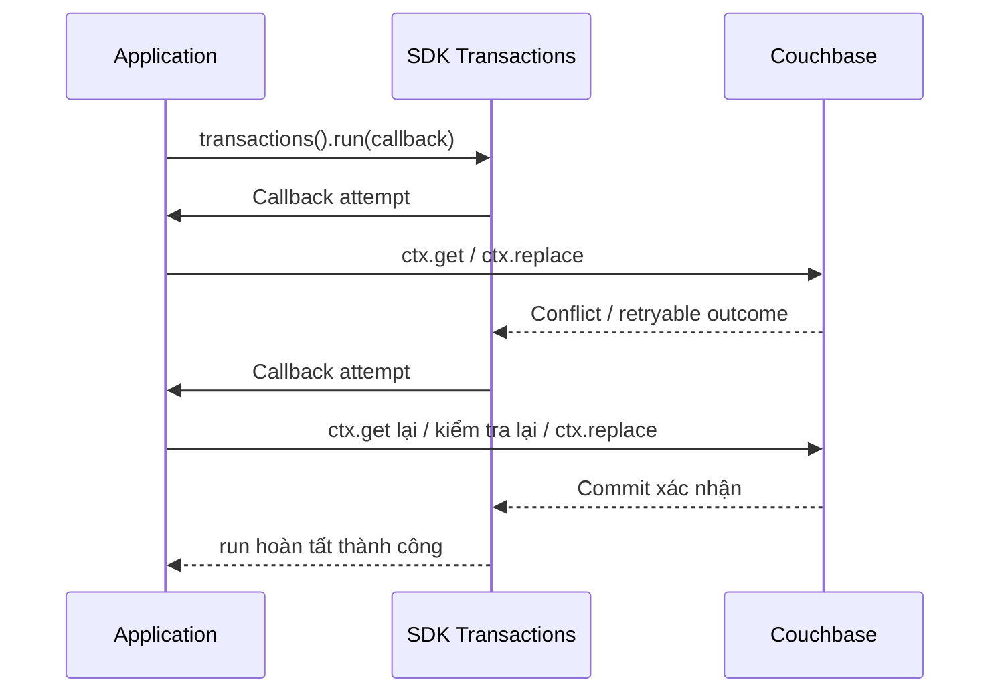
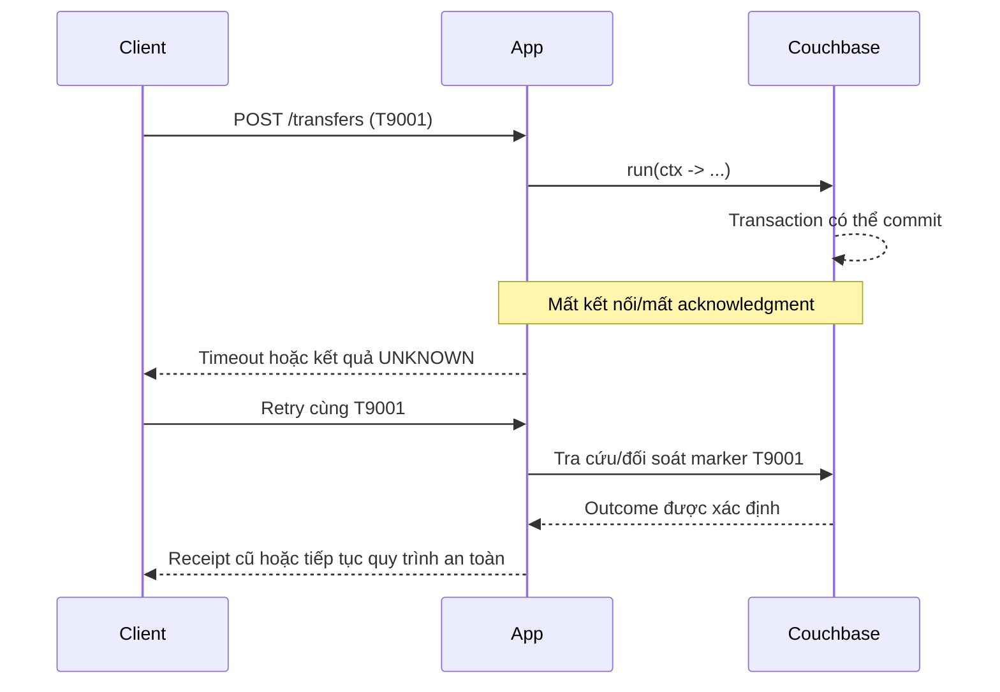
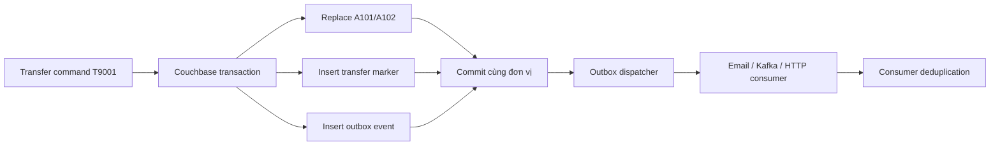

# Thử lại thân giao dịch và kiểm soát tác dụng phụ

Trong module **SPRING_DATA_COUCHBASE**, khi một nghiệp vụ cập nhật nhiều document, giao dịch có thể giữ các thay đổi Couchbase trong cùng một đơn vị commit. Tuy nhiên, **một thân giao dịch (transaction body) không được bảo đảm chỉ chạy một lần**. Couchbase Java SDK Transactions API có thể **thực thi lại lambda giao dịch** trong một số tình huống xung đột hoặc lỗi có khả năng phục hồi. Ngoài ra, Spring, Reactor, tầng HTTP, message broker hoặc chính người dùng cũng có thể tạo **những lần thử lại ở cấp cao hơn**.

Điều này đặt ra hai câu hỏi thiết kế quan trọng:

1. **Nếu cùng đoạn mã giao dịch chạy lại, những phép tính/ghi dữ liệu nào vẫn đúng?**
2. **Nếu tác dụng phụ bên ngoài Couchbase đã xảy ra rồi giao dịch bị thử lại hoặc hủy, có thể bảo đảm không gửi email, tính phí, phát sự kiện hoặc chuyển điểm hai lần không?**

Bài học thuộc chương **Giao dịch**, tập trung vào **thử lại thân giao dịch và kiểm soát tác dụng phụ**. Bối cảnh là Spring Data Couchbase với document mapping, Repository, `CouchbaseTemplate`, SQL++, bucket/scope/collection, CAS/`@Version`, TTL và API reactive. Ta sẽ phân biệt retry của **SDK transaction attempt**, retry ở **service/Publisher** và retry do **client/broker**, rồi xây thiết kế sử dụng **idempotency key**, **insert-only guard**, **transactional outbox**, xử lý **commit ambiguous** và kiểm thử lỗi.

**Nguyên tắc cốt lõi:** Lambda transaction phải được viết như một **hàm có thể thực thi lại**. Chỉ những thay đổi được điều phối bởi **transaction context** mới có cơ chế commit/abort tương ứng. Những thứ như email, HTTP payment, Kafka publish, metric tăng đếm nghiệp vụ hoặc ghi cơ sở dữ liệu khác **không tự rollback theo Couchbase**.

## 1. Mục tiêu học tập

Sau bài này, bạn có thể:

- Giải thích khái niệm **transaction attempt** và vì sao SDK có thể gọi lại lambda trước khi một transaction hoàn tất.
- Phân biệt **attempt retry**, **application retry**, **reactive resubscription** và **client/message redelivery**.
- Viết `cluster.transactions().run(ctx -> ...)` sao cho **đọc lại dữ liệu, tính toán lại và kiểm tra bất biến** ở mỗi attempt.
- Nhận diện việc nào an toàn trong callback và việc nào phải đưa ra **sau commit**.
- Thiết kế `transferId`/`requestId` ổn định, phân biệt duplicate cùng payload với **key reuse sai payload**.
- Dùng `ctx.insert` cho một **marker insert-only**, phối hợp marker với các mutation nghiệp vụ trong cùng transaction.
- Xây **transactional outbox** và giải thích vì sao dispatcher/consumer vẫn cần idempotency.
- Phân loại **commit confirmed, rejected, aborted và unknown**; không coi timeout là rollback chắc chắn.
- Xử lý đúng exception, rollback, conflict, CAS/`@Version` và side effects trong Spring `@Transactional`.
- Dùng reactive `CouchbaseTransactionalOperator` mà không tự `subscribe()` và không `retryWhen` bừa bãi.
- Viết integration tests chứng minh **không commit một phần**, **không chuyển điểm hai lần** và **không phát tác dụng phụ sai**.

## 2. Bài toán chuyển điểm làm lộ rủi ro retry

Ứng dụng loyalty có hai document trong `appdata.loyalty.accounts`:

```text
Key: account::tenant-a::A101
  tenantId: tenant-a
  rewardPoints: 150
  status: OPEN

Key: account::tenant-a::A102
  tenantId: tenant-a
  rewardPoints: 50
  status: OPEN
```

Một người dùng gửi lệnh chuyển 40 điểm với mã duy nhất `T9001`. Khi được xác nhận thành công:

```text
A101 = 110
A102 = 90
Tổng = 200
```

Bất biến:

\[
P_{\mathrm{nguồn}}\ge 0,\qquad
P_{\mathrm{nguồn}}+P_{\mathrm{đích}}=200.
\]

Yêu cầu **không chỉ** là hai mutation cùng commit. Nếu client nhận HTTP timeout rồi gửi lại **cùng yêu cầu T9001**, không được trừ A101 thêm 40 và cộng A102 thêm 40 một lần nữa.

### 2.1. Hai lỗi độc lập

**Lỗi A — commit một phần:** A101 đã trừ điểm, A102 chưa cộng điểm. Một transaction nhiều document đúng ngữ cảnh giải quyết mục tiêu atomicity này.

**Lỗi B — thực hiện lại nghiệp vụ:** Giao dịch thứ nhất đã commit cả A101 và A102, nhưng phản hồi mất; request mới chạy thêm một giao dịch hợp lệ nữa. Cả hai giao dịch riêng lẻ đều atomic, song **cùng một ý định nghiệp vụ đã được áp dụng hai lần**.

Transaction giải quyết lỗi A. **Idempotency và đối soát** cần thiết để ngăn lỗi B.

### 2.2. Vì sao email còn khó hơn

Nếu trong callback sau khi thay A101 và A102 có lệnh:

```java
emailService.sendTransferSuccess(
        "T9001", "Chuyển điểm thành công");
```

thì email có thể được gửi trước commit. Nếu transaction abort hoặc callback bị retry, email có thể trở thành **thông báo sai** hoặc **được gửi nhiều lần**.

Cần tách **mutation Couchbase có transaction** khỏi **tác dụng phụ ngoài transaction**.

## 3. Transaction body có thể chạy lại nghĩa là gì?

Với Couchbase Java SDK 3.x, cú pháp đồng bộ thông dụng:

```java
cluster.transactions().run(ctx -> {
    // Transaction body / transaction attempt callback.
});
```

`ctx` là **transaction attempt context**. SDK có thể gọi lambda với một attempt context mới nếu một attempt gặp tình trạng được hỗ trợ retry. Những lần gọi lại này nằm trong **một lời gọi `run` của ứng dụng**, nhưng không đồng nghĩa lambda chỉ thực thi một lần.



Biểu đồ minh họa trường hợp **có retry**. Không phải mọi lỗi đều được retry, và số attempt thực tế phụ thuộc loại lỗi, phiên bản SDK, deadline và chính sách của transaction.

### 3.1. Thân callback không phải post-commit hook

Đoạn code:

```java
cluster.transactions().run(ctx -> {
    ctx.replace(...);
    log.info("Transaction committed");
});
```

sai về **ý nghĩa thông điệp log**: tại thời điểm `log.info`, callback có thể **chưa commit**. Transaction còn các bước điều phối sau khi body kết thúc. Nếu attempt bị thử lại, log này có thể xuất hiện nhiều lần.

Hãy phân biệt `attempt completed` với `business operation committed` trong log và metric.

### 3.2. Retry có thể dẫn đến giá trị đọc mới

Mỗi attempt cần **đọc lại document** và **đánh giá lại điều kiện**. Nếu trong attempt đầu A101 có 150 điểm, một transaction khác có thể đã cập nhật thành 120 trước attempt thứ hai. Không được dùng số dư 150 từ biến ngoài callback để quyết định trong attempt mới.

## 4. Ba tầng retry phải được theo dõi riêng

| Tầng | Ai quyết định chạy lại? | Đoạn mã có thể lặp | Rủi ro điển hình |
| --- | --- | --- | --- |
| **SDK transaction attempt** | Couchbase Java SDK | Callback `ctx -> {...}` | Side effect bên trong callback bị gọi lại |
| **Application/Publisher retry** | Service, Resilience4j, Reactor `retryWhen` hoặc mã tự viết | Toàn `run(...)` hoặc toàn `Mono` | Một transaction mới sau outcome chưa rõ |
| **Client / broker redelivery** | HTTP client, gateway, cron, Kafka/RabbitMQ consumer | Toàn command nghiệp vụ | Lệnh đã commit bị áp dụng lần nữa |

Một **attempt retry** không tương đương với một **request nghiệp vụ mới**. Nhưng khi đã rời một lời gọi `run(...)` và caller tự gửi lại, hệ thống có thể bắt đầu transaction mới.

### 4.1. Ví dụ đếm sai

```java
AtomicInteger executions = new AtomicInteger();

cluster.transactions().run(ctx -> {
    executions.incrementAndGet();
    // Các thao tác transaction-aware.
});

System.out.println(executions.get());
```

`executions.get()` có thể lớn hơn 1 vì callback được gọi lại. Giá trị này **không phải số transaction đã commit**.

### 4.2. Chỉ retry lỗi đã được phân loại

Không nên:

```java
while (true) {
    try {
        transferService.transfer(command);
        return;
    } catch (Exception ignored) {
        // Retry mọi exception vô hạn: rất nguy hiểm.
    }
}
```

Lỗi “không đủ điểm”, “sai tenant”, duplicate payload khác nhau, thiếu quyền metadata, timeout lúc commit và conflict transient **không cùng chính sách retry**.

## 5. Ma trận: được và không được làm trong transaction body

| Thao tác | Đặt trong callback? | Vì sao |
| --- | --- | --- |
| `ctx.get` đọc account | **Có** | Đọc trong attempt context |
| Kiểm tra số dư, tenant, trạng thái | **Có** | Đánh giá lại khi retry |
| Tính số dư mới bằng phép toán xác định | **Có** | Không tác động ngoài transaction |
| `ctx.replace` hai account | **Có** | Stage mutation được điều phối |
| `ctx.insert` transfer marker | **Có** | Insert-only trong cùng commit |
| `ctx.insert` outbox event | **Có** | Event record được commit cùng nghiệp vụ |
| Tạo một danh sách tạm chỉ tồn tại trong callback | **Được nếu không lộ tác động** | Dữ liệu có thể bị bỏ khi retry |
| Sinh `transferId` mới trong mỗi attempt | **Không nên** | Không giữ định danh nghiệp vụ ổn định |
| `collection.upsert` ngoài `ctx` | **Không** khi cần atomicity | SDK KV mutation độc lập |
| `cluster.query` độc lập | **Không tự coi transactional** | Query có context khác |
| Gửi email/SMS | **Không** | Không rollback; có thể lặp |
| Thanh toán qua API ngoài | **Không** | Có thể thu tiền nhiều lần |
| Publish Kafka/RabbitMQ trực tiếp | **Không** | Broker không rollback theo Couchbase |
| Ghi PostgreSQL/JPA | **Không tự thuộc cùng transaction** | Hai transaction managers không tạo distributed commit |
| Tăng một counter metric “committed” | **Không** | Attempt có thể abort/retry |
| Log attempt có gắn nhãn đúng | **Được** | Phải ghi rõ chưa xác nhận commit |
| Gọi HTTP có side effect | **Không** | Kéo dài transaction và không thể abort phía ngoài |

**Quy tắc:** Callback nên chứa **đọc và mutation Couchbase được hỗ trợ + tính toán/validation thuần**. Side effect bên ngoài cần chuyển sang workflow hậu commit có kiểm soát.

## 6. Phân biệt mutation SDK transaction-aware với SDK KV thông thường

Trong Java SDK 3.x, những API cơ bản của transaction context gồm:

```java
ctx.get(collection, key);
ctx.insert(collection, key, jsonBody);
ctx.replace(transactionGetResult, updatedBody);
ctx.remove(transactionGetResult);
```

Trong khi những lệnh sau là SDK KV độc lập:

```java
collection.get(key);
collection.insert(key, jsonBody);
collection.upsert(key, jsonBody);
collection.replace(key, jsonBody);
collection.remove(key);
```

Đừng viết:

```java
cluster.transactions().run(ctx -> {
    TransactionGetResult first =
            ctx.get(accounts, sourceKey);

    JsonObject from = first.contentAsObject();
    ctx.replace(first, from.put("rewardPoints", 110L));

    // KHÔNG cùng transaction chỉ vì nằm trong lambda:
    accounts.upsert(targetKey, someBody);
});
```

Nếu transaction abort, `accounts.upsert(...)` có thể **đã commit độc lập**, phá vỡ bất biến.

### 6.1. SQL++ cũng có ranh giới context

`cluster.query(...)` không tự trở thành transactional SQL++ vì được gọi trong callback. Khi cần SQL++ trong transaction, dùng **transaction query API tương ứng trên `ctx`**, nếu SDK/Server version hỗ trợ, và kiểm tra Query/Index Service, statement và consistency.

## 7. Chuẩn bị document và keyspace cho ví dụ

Ví dụ một hệ thống loyalty có:

```text
Bucket: appdata
Scope: loyalty
Collections:
  accounts
  transfers
  outbox
```

Document key:

```text
account::tenant-a::A101
account::tenant-a::A102

transfer::tenant-a::T9001
outbox::tenant-a::transfer::T9001
```

Tính duy nhất của document key **nằm trong từng collection**, không phải trên toàn cluster. Hai key giống nhau ở hai collection là hai document độc lập.

Spring Data entity có thể ánh xạ bằng `@Document`, `@Scope`, `@Collection`, nhưng Java SDK khi thao tác `JsonObject` **không tự đọc các annotation này**.

### 7.1. Mở đúng collection bằng SDK

```java
import com.couchbase.client.java.Bucket;
import com.couchbase.client.java.Cluster;
import com.couchbase.client.java.Collection;
import com.couchbase.client.java.Scope;

Bucket bucket = cluster.bucket("appdata");
Scope loyalty = bucket.scope("loyalty");

Collection accounts = loyalty.collection("accounts");
Collection transfers = loyalty.collection("transfers");
Collection outbox = loyalty.collection("outbox");
```

Cùng document key đặt trong `bucket.defaultCollection()` sẽ là **document khác**. Cần kiểm tra RBAC ở các collection nghiệp vụ và metadata transaction/ATR.

### 7.2. Quyền và tương thích phiên bản

Cần bộ phiên bản **Couchbase Server / Java SDK / Spring Data Couchbase / Spring Boot / Java** tương thích. Data Service phục vụ KV; SQL++ cần Query/Index Service và index tương ứng. Transactions còn dùng metadata như **Active Transaction Record (ATR)** và cần quyền phù hợp.

Các API code minh họa sử dụng phong cách **Java SDK 3.x**; tên overload, exception và cấu hình transaction phải đối chiếu với đúng version triển khai. Không suy rằng mọi chức năng hiện diện giống nhau trên mọi bản Server/SDK.

## 8. Thiết kế command có định danh ổn định

Một yêu cầu chuyển điểm nên có một **idempotency key** sinh từ phía client hoặc service biên **một lần cho một ý định nghiệp vụ**, ví dụ `T9001`.

```java
public record TransferCommand(
        String transferId,
        String authorizedTenantId,
        String sourceKey,
        String targetKey,
        long amount) {
}
```

Với request này:

```json
{
  "transferId": "T9001",
  "authorizedTenantId": "tenant-a",
  "sourceKey": "account::tenant-a::A101",
  "targetKey": "account::tenant-a::A102",
  "amount": 40
}
```

`authorizedTenantId` trong ví dụ phải được service nhận từ **ngữ cảnh xác thực/ủy quyền đáng tin cậy**, không tin trường client tự khai. Trong API public, định danh tenant có thể được rút từ principal; không để người gọi mạo danh tenant khác.

### 8.1. Định danh một ý định nghiệp vụ

- **Cùng transferId, cùng payload**: phải nhận lại outcome của cùng ý định, không áp dụng lại.
- **Cùng transferId, payload khác**: từ chối xung đột/khả năng lạm dụng key.
- **TransferId khác**: là ý định khác, dù các giá trị source/target/amount bằng nhau.
- **TransferId ổn định qua attempt**: SDK retry callback không làm đổi key.
- **TransferId ổn định qua HTTP retry**: client gửi lại cùng mã sau timeout.

### 8.2. Tạo transferId ở đâu?

Không tạo ID ngẫu nhiên **bên trong lambda**:

```java
cluster.transactions().run(ctx -> {
    String transferId = UUID.randomUUID().toString();
    // Sai: attempt retry có thể sinh ID khác.
});
```

Thay vào đó, tạo ID tại boundary nghiệp vụ **trước `run(...)`**, hoặc nhận một ID đã được cấp và kiểm tra định dạng/ủy quyền. Với request retry, giữ nguyên ID ban đầu.

## 9. Pure function: tách phép tính khỏi side effect

Một cách làm callback dễ an toàn khi retry là tách **phép tính thuần** khỏi I/O:

```java
public record NewBalances(
        long source,
        long target) {
}

public static NewBalances calculate(
        long oldSource,
        long oldTarget,
        long amount) {

    if (amount <= 0 || oldSource < amount
            || oldSource < 0 || oldTarget < 0) {
        throw new IllegalStateException(
                "Điều kiện số dư không hợp lệ");
    }

    long nextSource = oldSource - amount;
    long nextTarget = Math.addExact(
            oldTarget, amount);

    return new NewBalances(nextSource, nextTarget);
}
```

Hàm này:

- Không gọi email, HTTP, database, broker hoặc đồng hồ.
- Không sửa biến singleton/shared state.
- Trả cùng kết quả nếu đầu vào giống nhau.
- Có thể được gọi lại khi SDK retry attempt mà không tạo tác dụng phụ.

**Tuy nhiên**, kết quả cần được tính **từ dữ liệu `ctx.get` của attempt hiện tại**, không cache phép tính từ attempt trước.

## 10. Lambda SDK an toàn: đọc–kiểm tra–ghi lại trong mỗi attempt

Mẫu tối giản chuyển hai document:

```java
import com.couchbase.client.java.Cluster;
import com.couchbase.client.java.Collection;
import com.couchbase.client.java.json.JsonObject;
import com.couchbase.client.java.transactions.TransactionGetResult;

public void transferWithinTransaction(
        Cluster cluster,
        Collection accounts,
        String tenantId,
        String sourceKey,
        String targetKey,
        long amount) {

    if (amount <= 0 || sourceKey.equals(targetKey)) {
        throw new IllegalArgumentException(
                "Lệnh chuyển điểm không hợp lệ");
    }

    cluster.transactions().run(ctx -> {
        TransactionGetResult source =
                ctx.get(accounts, sourceKey);
        TransactionGetResult target =
                ctx.get(accounts, targetKey);

        JsonObject fromBody = source.contentAsObject();
        JsonObject toBody = target.contentAsObject();

        if (!tenantId.equals(fromBody.getString("tenantId"))
                || !tenantId.equals(
                        toBody.getString("tenantId"))
                || !"OPEN".equals(
                        fromBody.getString("status"))
                || !"OPEN".equals(
                        toBody.getString("status"))) {
            throw new IllegalStateException(
                    "Account không được phép chuyển điểm");
        }

        Long fromPoints = fromBody.getLong("rewardPoints");
        Long toPoints = toBody.getLong("rewardPoints");

        if (fromPoints == null || toPoints == null) {
            throw new IllegalStateException(
                    "Không có thông tin số dư");
        }

        NewBalances next = calculate(
                fromPoints, toPoints, amount);

        ctx.replace(
                source,
                fromBody.put("rewardPoints", next.source()));
        ctx.replace(
                target,
                toBody.put("rewardPoints", next.target()));
    });
}
```

**Điểm đúng về retry:** mỗi attempt lấy lại source/target qua `ctx.get`, kiểm tra điều kiện và tính lại số dư. Hai `ctx.replace` thuộc cùng transaction context.

**Điểm còn thiếu cho production:** lệnh này **chưa idempotent ở mức HTTP request**. Nếu `run(...)` đã commit nhưng response mất, một lần gọi mới `transferWithinTransaction(...)` có thể thực hiện lại. Mục 11 bổ sung transfer record.

## 11. Dùng marker insert-only để giữ tính duy nhất của lệnh

Một thiết kế thường dùng document `transfer::tenant-a::T9001` trong `loyalty.transfers`.

Record cần đủ thông tin để phân biệt duplicate hợp lệ:

```json
{
  "transferId": "T9001",
  "tenantId": "tenant-a",
  "sourceKey": "account::tenant-a::A101",
  "targetKey": "account::tenant-a::A102",
  "amount": 40,
  "sourceBalanceAfter": 110,
  "targetBalanceAfter": 90,
  "status": "APPLIED"
}
```

### 11.1. Ghi marker trong cùng transaction

Phần code thêm vào callback sau khi tính `next`:

```java
String markerKey =
        "transfer::" + tenantId + "::" + transferId;

cluster.transactions().run(ctx -> {
    TransactionGetResult source =
            ctx.get(accounts, sourceKey);
    TransactionGetResult target =
            ctx.get(accounts, targetKey);

    JsonObject from = source.contentAsObject();
    JsonObject to = target.contentAsObject();

    // Kiểm tra tenant, trạng thái và số dư trong attempt.
    NewBalances next = calculate(
            from.getLong("rewardPoints"),
            to.getLong("rewardPoints"),
            amount);

    JsonObject marker = JsonObject.create()
            .put("transferId", transferId)
            .put("tenantId", tenantId)
            .put("sourceKey", sourceKey)
            .put("targetKey", targetKey)
            .put("amount", amount)
            .put("sourceBalanceAfter", next.source())
            .put("targetBalanceAfter", next.target())
            .put("status", "APPLIED");

    ctx.insert(transfers, markerKey, marker);
    ctx.replace(source,
            from.put("rewardPoints", next.source()));
    ctx.replace(target,
            to.put("rewardPoints", next.target()));
});
```

Đoạn này minh họa **mutation quan trọng đều đi qua `ctx`**. Giả định có các đối tượng `cluster`, `accounts`, `transfers` và biến từ command đã được chuẩn hóa.

Nếu marker key đã tồn tại, **insert-only** không được ghi đè. Transaction chứa attempt ghi trùng cần được phân loại/abort theo kết quả SDK, rồi service kiểm tra marker để xác định **cùng command đã hoàn tất** hay **ID bị tái sử dụng sai payload**.

### 11.2. Vì sao không dùng `exists` rồi `upsert`?

```java
if (!transfers.exists(markerKey).exists()) {
    transfers.upsert(markerKey, marker);
}
```

Có khoảng **time-of-check-to-time-of-use (TOCTOU)**: hai request có thể cùng thấy key chưa tồn tại. `upsert` còn có thể ghi đè marker cũ.

**Điều kiện duy nhất phải được kiểm tra tại mutation**: dùng `ctx.insert`/cơ chế guard được transaction hỗ trợ.

### 11.3. Marker không tự tạo exactly-once toàn cầu

Marker ngăn **một command được áp dụng hai lần trong phạm vi keyspace/quy tắc của ứng dụng**, khi mọi đường ghi đều tuân thủ nó. Nó không bảo đảm:

- Một service khác bỏ qua marker sẽ không sửa số dư.
- Email hoặc broker chỉ gửi đúng một lần.
- Marker giữ vĩnh viễn nếu ứng dụng gắn TTL.
- Một key bị client tái sử dụng với payload khác sẽ được coi là hợp lệ.
- Mọi outcome chưa rõ có thể phân loại ngay tức thì.

Muốn bảo đảm, cần quy định **tất cả writer cùng tuân thủ một hợp đồng idempotency**.

## 12. Đối soát khi duplicate hoặc commit ambiguous

Sau một attempt thất bại, **không mặc định** rằng mọi mutation đã rollback. Đặc biệt khi lỗi xảy ra gần commit, có thể cần xác minh outcome.

Thiết kế một API kiểm tra `transferId`:

```text
GET /transfers/T9001

COMMITTED / APPLIED:
    marker đã xác nhận và payload trùng
    -> trả receipt đã lưu, không chuyển tiếp

CONFLICT:
    cùng ID nhưng payload khác
    -> từ chối; không ghi đè

UNKNOWN / IN_PROGRESS:
    outcome chưa thể kết luận
    -> báo đang xác minh hoặc retry kiểm tra có giới hạn

REJECTED:
    điều kiện nghiệp vụ không hợp lệ
    -> không retry thao tác cũ bừa bãi
```

### 12.1. Marker không tồn tại chưa luôn là chứng cứ chắc chắn

Nếu transaction trước **đang commit hoặc cleanup chưa hoàn tất**, chỉ đọc marker một lần không thấy **chưa đủ** để khẳng định phép chuyển điểm chưa từng diễn ra. Cần phân loại trạng thái dựa trên **SDK outcome và cơ chế đọc/đối soát tương ứng**, chờ/đọc lại có kiểm soát nếu cần.

Mặt khác, nếu một transaction chắc chắn đã abort, marker không tồn tại là kết quả phù hợp; ứng dụng có thể cho phép một lần thử mới **với cùng transferId** theo chính sách nghiệp vụ.

### 12.2. So khớp payload trước khi trả duplicate success

Không trả “đã chuyển” chỉ vì marker key tồn tại:

```text
T9001, A101 -> A102, 40 điểm  (request gốc)
T9001, A101 -> A103, 80 điểm  (request gửi lại khác nội dung)
```

Hai payload có cùng transferId nhưng ý nghĩa khác nhau. Nên so tenant, source, target, amount và phiên bản chính sách; có thể lưu **canonical payload hash** để đối chiếu nhưng không thay kiểm tra ủy quyền.

## 13. Commit ambiguous: vì sao timeout không đồng nghĩa rollback

Một tình huống nguy hiểm:



Khi SDK báo một lỗi liên quan commit outcome chưa rõ, **không sửa bằng cách gọi `transfer(...)` lần nữa với ID mới**. Giao dịch trước có thể đã commit cả hai mutation; retry mù quáng có thể trừ/cộng thêm lần nữa.

### 13.1. Nhóm lỗi cần phân biệt

- **Business rejection**: không đủ điểm, sai tenant, account bị khóa → không retry như lỗi tạm thời.
- **Conflict có thể xử lý lại**: SDK có thể retry attempt, với callback an toàn.
- **Transaction failed/expired**: kiểm tra kiểu exception và outcome thực tế theo SDK version.
- **Commit ambiguous**: chưa biết đã commit hay chưa → chuyển sang đối soát.
- **Infrastructure misconfiguration**: RBAC/ATR, timeout, không tương thích SDK, thiếu index → sửa cấu hình, không retry vô hạn.
- **Duplicate marker**: tra cứu record và so payload trước khi kết luận.

Java SDK có các kiểu lỗi/exception khác nhau giữa phiên bản. Không so khớp bằng cách tìm một chuỗi mơ hồ trong `ex.getMessage()`; hãy dựa vào **typed exception, metadata và contract đúng version**.

## 14. Transactional outbox: kiểm soát tác dụng phụ bên ngoài

Một lệnh chuyển điểm sau commit cần gửi email hoặc publish event. Không làm việc đó trong callback. Thay vào đó, thêm **outbox record** vào cùng transaction với mutation nghiệp vụ.



**Hai bảo đảm khác nhau:**

1. **Transaction atomicity trong Couchbase**: số dư, transfer marker và outbox record cùng commit.
2. **Delivery semantics ngoài Couchbase**: dispatcher đọc record, gửi ra bên ngoài và đánh dấu đã xử lý; hệ thống bên ngoài có thể nhận trùng, nên cần **deduplication/idempotency**.

Outbox giúp tránh trường hợp business data đã commit nhưng ứng dụng crash trước khi tạo thông điệp **trong database**. Nó **không tự cung cấp exactly-once delivery** tới broker hay email provider.

## 15. Ghi outbox record trong transaction callback

Thêm document `outbox::tenant-a::transfer::T9001` vào `loyalty.outbox`:

```json
{
  "eventId": "transfer-event::tenant-a::T9001",
  "aggregateType": "Transfer",
  "aggregateId": "T9001",
  "eventType": "TransferApplied",
  "tenantId": "tenant-a",
  "sourceKey": "account::tenant-a::A101",
  "targetKey": "account::tenant-a::A102",
  "amount": 40,
  "deliveryStatus": "PENDING"
}
```

Một phần callback đầy đủ về **đơn vị commit nghiệp vụ**:

```java
cluster.transactions().run(ctx -> {
    TransactionGetResult from =
            ctx.get(accounts, command.sourceKey());
    TransactionGetResult to =
            ctx.get(accounts, command.targetKey());

    JsonObject fromBody = from.contentAsObject();
    JsonObject toBody = to.contentAsObject();

    validateTenantAndStatus(
            command, fromBody, toBody);

    NewBalances next = calculate(
            fromBody.getLong("rewardPoints"),
            toBody.getLong("rewardPoints"),
            command.amount());

    JsonObject transferMarker = buildTransferMarker(
            command, next);
    JsonObject event = buildTransferEvent(
            command, next);

    ctx.insert(transfers,
            transferKey(command), transferMarker);
    ctx.replace(from,
            fromBody.put("rewardPoints", next.source()));
    ctx.replace(to,
            toBody.put("rewardPoints", next.target()));
    ctx.insert(outbox,
            outboxKey(command), event);
});
```

Đây là **ví dụ cấu trúc**: các helper `validateTenantAndStatus`, `buildTransferMarker`, `buildTransferEvent`, `transferKey` và `outboxKey` cần được triển khai như hàm thuần/deterministic theo command. Phần quan trọng là **mọi mutation đều dùng `ctx`**.

### 15.1. Event ID phải ổn định

Nếu `outboxKey` hoặc `eventId` được tạo ngẫu nhiên mỗi lần callback, một attempt retry có thể dẫn tới dữ liệu/ID không nhất quán. Nên dẫn xuất từ **transferId ổn định** theo quy tắc xác định.

### 15.2. Thời điểm xảy ra sự kiện

Đừng ghi “email đã gửi” trong event khi callback chưa commit. Record được lưu trong transaction nên thể hiện **ý định hoặc sự kiện nghiệp vụ đã áp dụng**, còn `deliveryStatus` do dispatcher vận hành theo workflow giao nhận.

### 15.3. Không lồng request HTTP vào transaction để gửi event

Nếu gọi external API trong callback, transaction bị kéo dài qua network, tăng timeout và conflict. Outbox tách **đơn vị commit nhanh** khỏi **giao tiếp ngoại vi có thể retry độc lập**.

## 16. Dispatcher outbox vẫn cần idempotency

Một dispatcher tiêu biểu:

1. Tìm record `PENDING` bằng SQL++/index hoặc một cơ chế polling/stream phù hợp.
2. Claim/lease record có **điều kiện CAS/transaction** để tránh nhiều worker cùng phát không kiểm soát.
3. Gửi event tới broker/email provider với **eventId/idempotency key** ổn định.
4. Khi nhận xác nhận, cập nhật trạng thái `DELIVERED`, thời gian và số lần thử.
5. Nếu crash giữa bước 3 và 4, event có thể đã tới đích nhưng record chưa được đánh dấu; dispatcher sẽ **gửi lại**.

### 16.1. Không có exactly-once xuyên network chỉ nhờ outbox

```text
Dispatcher:
    publish(event T9001) -> broker nhận
    process crash
    chưa kịp mark DELIVERED

Restart:
    thấy PENDING
    publish(event T9001) lần nữa
```

Consumer nên có cơ chế **dedupe theo eventId** và xử lý trùng một cách idempotent. Một số broker hoặc provider có công cụ idempotency riêng; cần xác minh contract của từng dịch vụ.

### 16.2. Claim/lease phải bảo vệ cạnh tranh

Không nên:

```java
if (outboxRecord.isPending()) {
    send(outboxRecord);
}
```

Hai dispatcher có thể cùng đọc `PENDING`. Có thể dùng CAS `@Version`/SDK CAS hoặc một workflow claim trong transaction để giới hạn số worker cùng xử lý, nhưng **claim không thay thế deduplication ở consumer** do crash vẫn xảy ra sau publish.

### 16.3. SQL++ index cho outbox

Ví dụ:

```sql
CREATE INDEX ix_outbox_status_created
ON `appdata`.`loyalty`.`outbox` (
    deliveryStatus,
    createdAt
);
```

Dispatcher có thể query các event đang chờ, nhưng **query theo index khác với KV theo key**. Phải chọn scan consistency, index và xử lý pagination/ordering phù hợp; đừng coi chỉ mục là cơ chế bảo đảm không có event trùng.

## 17. Tác dụng phụ email: after commit vẫn chưa đủ một lần duy nhất

Một phương án đơn giản hơn outbox là **gửi email sau khi `run(...)` trả thành công**:

```java
cluster.transactions().run(ctx -> {
    // ctx.get/ctx.replace...
});

emailService.sendTransferReceipt(transferId);
```

Cách này tránh gửi email **trước commit xác nhận** trong đường thực thi bình thường. Nhưng nó vẫn có khoảng hở:

- Ứng dụng crash sau commit trước khi gửi email → **mất thông báo**.
- Email đã gửi, HTTP client retry cùng command → **có thể gửi lại**.
- Email provider trả timeout sau khi đã nhận yêu cầu → kết quả giao nhận chưa rõ.

Nếu thông báo quan trọng phải được **retry có kiểm soát**, dùng outbox + eventId/idempotency. Nếu email chỉ mang tính tiện ích và có thể mất, gửi hậu commit đơn giản có thể là trade-off chấp nhận được, nhưng phải ghi rõ bảo đảm.

## 18. Payment gateway: không dùng callback làm nơi thu tiền

Ví dụ nguy hiểm:

```java
cluster.transactions().run(ctx -> {
    // Đọc account và stage mutation...
    paymentGateway.charge(cardToken, amount);
    // Nếu retry, charge có thể chạy nhiều lần.
});
```

Ngay cả khi SDK abort toàn bộ Couchbase mutation, payment gateway không tự hoàn tiền.

Với hệ thống thanh toán:

- Dùng **payment request ID/idempotency key** được provider hỗ trợ.
- Xây workflow với các trạng thái rõ: `PENDING`, `AUTHORIZED`, `CAPTURED`, `FAILED`, `NEEDS_RECONCILIATION`.
- Điều phối qua saga/outbox hoặc trạng thái bất đồng bộ có bù trừ.
- Không khẳng định một Couchbase transaction có ACID xuyên payment gateway và database.

**Điểm phân biệt:** transaction Couchbase bảo vệ các document Couchbase của nó; bù trừ/payment reversal là **quy tắc workflow phân tán** ngoài transaction.

## 19. Spring Data @Transactional và retry của transaction body

Spring Data Couchbase tích hợp Spring transaction ở các dòng API hỗ trợ, thường với `CouchbaseCallbackTransactionManager` và bean tên `couchbaseTransactionManager`. Ví dụ service:

```java
@Service
public class PointsService {

    private final AccountRepository repository;

    public PointsService(AccountRepository repository) {
        this.repository = repository;
    }

    @Transactional(transactionManager = "couchbaseTransactionManager")
    public void transfer(TransferCommand command) {
        Account source = repository.findById(
                command.sourceKey()).orElseThrow();
        Account target = repository.findById(
                command.targetKey()).orElseThrow();

        // Validate tenant, status, amount trong transaction.
        // Tính lại số dư ở mỗi lần body chạy.
        // Lưu bằng những operations có transaction support.
    }
}
```

Điều quan trọng:

- Method phải được gọi **qua Spring proxy**. `this.transfer(...)` hoặc `new PointsService(...)` có thể bypass transaction advice.
- Manager phải là manager Couchbase đúng với Repository/Template infrastructure.
- Những operations được dùng phải **tham gia context và được phiên bản hỗ trợ**.
- Nếu callback integration có thể thực thi lại thân nghiệp vụ, method phải **side-effect-safe**.
- Không suy rằng mọi `@Transactional` option như `noRollbackFor`, `REQUIRES_NEW` hoặc `SERIALIZABLE` đều được SDK áp dụng tương tự JPA.
- Test forced abort trên dữ liệu thật quan trọng hơn việc thấy annotation xuất hiện trong mã nguồn.

### 19.1. Không đặt email trong service transaction

```java
@Transactional(transactionManager = "couchbaseTransactionManager")
public void transferAndEmail(TransferCommand command) {
    updateAccounts(command);
    emailService.sendReceipt(command.transferId());
}
```

Nếu method body được retry hoặc transaction abort, email có thể gửi sai/lặp. Tách thông báo khỏi ranh giới, tốt nhất bằng outbox khi cần delivery đáng tin cậy.

### 19.2. Chọn manager đúng khi có JPA

Nếu ứng dụng vừa dùng `JpaRepository` vừa dùng `CouchbaseRepository`, qualifier `transactionManager = "couchbaseTransactionManager"` tránh nhầm manager. Dù chọn đúng, một JPA mutation khác trong method **không tự tham gia cùng commit**. Không được dựa vào một annotation để có transaction xuyên Couchbase và PostgreSQL.

## 20. Repository/Template và SDK callback: chỗ nào thực sự được retry?

Một số đường tích hợp Spring Data Couchbase cho phép Repository/Template operations được hỗ trợ tham gia SDK transaction context. Tuy nhiên, **không nên suy từ cùng cluster hoặc cùng lambda rằng mọi method đều transactional**.

| Operation | Đặt trong transaction callback? | Lưu ý |
| --- | --- | --- |
| SDK `ctx.get/insert/replace/remove` | **Có theo SDK contract** | Dùng đúng context và result trong attempt |
| Spring Repository `findById`/`save` | **Tùy integration/version** | Cần manager/context tương ứng, test abort |
| Template `findById`/`replaceById` | **Tùy integration/version** | Kiểm tra cùng client factory/context |
| Derived query, `@Query` | **Cần kiểm tra SQL++ support** | Query path/index khác KV |
| `saveAll`/bulk | **Không suy ra atomicity** | Phải xác minh implementation và context |
| SDK `collection.upsert` | **Không mặc nhiên** | Mutation KV độc lập |
| SDK `cluster.query` | **Không mặc nhiên** | Query ngoài transaction context |
| Kafka publish, email, HTTP | **Không** | Side effect ngoài Couchbase |

### 20.1. Đường KV và SQL++ khác nhau

`repository.findById(key)` thường dùng KV theo document key. Derived query như `findByTenantIdAndStatus` thường dùng SQL++/index; nó có thể có transaction support khác. Một retry bên trong service không sửa được lỗi thiếu index hoặc kết quả query theo scan consistency không phù hợp.

## 21. CAS/@Version và conflict: retry phải tính lại từ dữ liệu mới

Entity Spring Data:

```java
import org.springframework.data.annotation.Id;
import org.springframework.data.annotation.Version;
import org.springframework.data.couchbase.core.mapping.Collection;
import org.springframework.data.couchbase.core.mapping.Document;
import org.springframework.data.couchbase.core.mapping.Scope;

@Document
@Scope("loyalty")
@Collection("accounts")
public class Account {

    @Id
    private String id;

    private String tenantId;
    private long rewardPoints;
    private String status;

    @Version
    private Long version;

    public Account() {}

    public String getId() { return id; }
    public void setId(String id) { this.id = id; }

    public String getTenantId() { return tenantId; }
    public void setTenantId(String tenantId) {
        this.tenantId = tenantId;
    }

    public long getRewardPoints() { return rewardPoints; }
    public void setRewardPoints(long rewardPoints) {
        this.rewardPoints = rewardPoints;
    }

    public String getStatus() { return status; }
    public void setStatus(String status) { this.status = status; }

    public Long getVersion() { return version; }
    public void setVersion(Long version) { this.version = version; }
}
```

`@Version` mang **CAS metadata** theo mapping của Spring Data Couchbase. CAS là token để phát hiện một document bị thay đổi; nó **không phải bộ đếm nghiệp vụ tăng 1**, và không tự tạo giao dịch nhiều document.

### 21.1. Retry với entity stale là sai

```java
Account cached = repository.findById(sourceKey)
        .orElseThrow();

// Một request khác đã sửa source.
for (int attempt = 0; attempt < 3; attempt++) {
    try {
        repository.save(cached);
        break;
    } catch (OptimisticLockingFailureException ex) {
        // Sai: retry lại chính object mang CAS cũ.
    }
}
```

Retry phải **đọc lại document**, xác định lại điều kiện nghiệp vụ và tính lại mutation. Không dùng object stale hoặc giả định phép ghi với CAS cũ cuối cùng sẽ thành công.

### 21.2. CAS không tự ngăn duplicate command

Nếu transaction T9001 đã commit, một request mới với cùng payload có thể đọc **CAS mới** và thực hiện chuyển điểm hợp lệ lần hai. CAS chỉ nói document đã đổi, **không nói command T9001 đã được xử lý**. Marker/idempotency giải quyết vấn đề khác đó.

## 22. Vì sao retry theo thời gian có thể làm thay đổi ý nghĩa nghiệp vụ?

Một callback có thể chứa:

```java
Instant now = Instant.now();
UUID auditId = UUID.randomUUID();
double exchangeRate = remoteRates.getRate();
```

Nếu các giá trị thay đổi giữa các attempt:

- `now` khác → hạn đặt chỗ hoặc thời điểm hết hạn có thể thay đổi.
- `auditId` khác → event/record không còn định danh ổn định.
- Tỷ giá từ HTTP ngoài khác → phép tính nghiệp vụ thay đổi, có side effect/latency.
- Một biến external state có thể thay đổi mà SDK transaction không kiểm soát.

### 22.1. Quy tắc lựa chọn

- Giá trị đại diện cho **ý định của command** (transferId, amount, tenant, request time) nên được cố định trước callback.
- Giá trị đại diện cho **trạng thái Couchbase cần còn đúng** phải đọc/kiểm tra lại trong từng attempt.
- Một số giá trị thực sự phải dựa trên **thời điểm commit** cần quy tắc riêng; không tự giả định `Instant.now()` trong callback là timestamp commit.
- Tác dụng phụ ngoài Couchbase nên được thực hiện ở workflow riêng, có idempotency.

### 22.2. Không dùng biến mutable chung cho kết quả attempt

```java
AtomicReference<TransferReceipt> receipt = new AtomicReference<>();

cluster.transactions().run(ctx -> {
    // ... tính toán và stage ghi ...
    receipt.set(new TransferReceipt(...));
});

// Có nguy cơ biến này được set trong attempt trước đó bị abort.
```

Mặc dù có thể cập nhật lại khi retry, thiết kế dựa trên mutable holder ngoài callback dễ nhầm **attempt result** với **committed result**. Ưu tiên lưu receipt/marker trong cùng transaction và đọc lại sau khi outcome được xác nhận.

## 23. Reactive transaction và resubscribe

Trong Spring Data Couchbase reactive, một service có thể trả `Mono`/`Flux` và dùng `CouchbaseTransactionalOperator` cho một transaction scope:

```java
import org.springframework.data.couchbase.core.ReactiveCouchbaseTemplate;
import org.springframework.data.couchbase.transaction.CouchbaseTransactionalOperator;
import reactor.core.publisher.Mono;

public Mono<Account> suspend(
        CouchbaseTransactionalOperator operator,
        ReactiveCouchbaseTemplate template,
        String key) {

    return operator.execute(status ->
            template.findById(Account.class)
                    .one(key)
                    .switchIfEmpty(Mono.error(
                            new IllegalArgumentException(
                                    "Không tìm thấy account")))
                    .flatMap(account -> {
                        account.setStatus("SUSPENDED");
                        return template.replaceById(Account.class)
                                .one(account);
                    }))
            .single();
}
```

Ví dụ thể hiện **phạm vi operator trên Publisher**, giả định chữ ký `execute`, `replaceById` và transaction support phù hợp với Spring Data Couchbase version đang dùng.

### 23.1. Reactive retry có thể chạy lại toàn transaction

```java
return transferReactive(command)
        .retryWhen(
                Retry.backoff(2, Duration.ofMillis(100)));
```

Đây là **minh họa cú pháp, không phải chính sách an toàn mặc định**. `retryWhen` thường resubscribe **toàn source publisher** khi có `onError`. Nếu transaction trước đã commit nhưng tín hiệu cuối mất hoặc lỗi được phân loại sai, resubscribe có thể chuyển điểm **lần nữa**.

Phải có transferId/idempotency và **lọc loại lỗi** trước khi quyết định retry.

### 23.2. Không tự subscribe mutation bên trong callback

```java
return operator.execute(status -> {
    template.replaceById(Account.class)
            .one(source)
            .subscribe(); // Không nằm trong pipeline chính.

    return template.replaceById(Account.class)
            .one(target);
});
```

`subscribe()` tự tạo một nhánh thực thi độc lập. Operator có thể không theo dõi completion/context của nhánh đó. Đừng xem hai mutation thuộc cùng commit.

Hãy nối tuần tự:

```java
return operator.execute(status ->
        template.replaceById(Account.class)
                .one(source)
                .then(Mono.defer(() ->
                        template.replaceById(Account.class)
                                .one(target))));
```

### 23.3. Cancellation không đồng nghĩa rollback đã xác nhận

Một HTTP client đóng kết nối hoặc Reactor `timeout` có thể cancel upstream. Không thể từ đó suy ra transaction chưa commit. Với endpoint nhận lệnh chuyển điểm, nên trả **transferId** và cung cấp cách tra cứu outcome khi caller không nhận được response cuối.

## 24. Không biến `onErrorResume` thành nuốt lỗi sau mutation

Mẫu nguy hiểm:

```java
return operator.execute(status ->
        updateSource()
                .then(updateTarget())
                .onErrorResume(ex -> {
                    log.warn("Failed", ex);
                    return Mono.just(fakeSuccess);
                }));
```

Nếu mutation thứ hai lỗi nhưng callback biến thành kết quả thành công, transaction manager có thể không nhận tín hiệu lỗi cần thiết. Tùy lỗi SDK, attempt có thể đã bị đánh dấu thất bại, nhưng **không nên xây bất biến dựa vào hành vi không rõ ràng đó**.

### 24.1. Ghi log mà vẫn giữ tín hiệu lỗi

```java
return operator.execute(status ->
        updateSource()
                .then(updateTarget())
                .doOnError(ex ->
                        log.warn("Mutation failed", ex)));
```

`doOnError` giúp quan sát lỗi nhưng không chuyển nó thành success. Phân loại lỗi nghiệp vụ hay lỗi hạ tầng **sau ranh giới transaction** theo contract.

### 24.2. `onErrorResume` vẫn có thể hợp lệ ở tầng ngoài

Sau khi transaction outcome đã được xác định, controller có thể map business rejection thành HTTP 409, hoặc commit ambiguous thành trạng thái cần kiểm tra. Điều này khác với việc **nuốt lỗi mutation bên trong callback** để tiếp tục commit.

## 25. TTL và thời gian lưu idempotency marker

Một marker được thiết kế đúng nhưng bị xóa quá sớm cũng có thể làm phát sinh duplicate:

```text
T9001 được commit lúc 10:00
Marker T9001 có TTL 5 phút
Client/broker retry lúc 10:07
Marker đã hết hạn
Giao dịch mới có thể xử lý T9001 lần nữa
```

### 25.1. Chính sách retention phải lớn hơn cửa sổ retry

Chọn thời gian giữ marker theo:

- Thời hạn client được phép retry.
- Thời gian message broker redelivery.
- Thời gian đối soát commit ambiguous.
- Thời hạn khiếu nại/truy vết nghiệp vụ.
- Yêu cầu audit/compliance và lưu trữ.

Không tự chọn TTL vài phút cho idempotency marker nếu client có thể retry sau nhiều giờ hoặc nhiều ngày.

### 25.2. TTL không tự phát side effect

Document reservation hết hạn TTL **không tự tạo outbox event** hoặc giảm quota document khác. Nếu hết hạn phải dẫn tới tác động nghiệp vụ, cần workflow expiration/reconciliation riêng và một quy tắc idempotency cho workflow đó.

### 25.3. Đừng nhầm transaction timeout với document TTL

- **Transaction expiration/timeout**: giới hạn vòng đời giao dịch.
- **Document TTL**: thời điểm document hết hạn.
- **Outbox retry interval/lease TTL**: điều phối gửi message.
- **Idempotency retention**: thời hạn chống xử lý trùng.

Bốn đại lượng này giải quyết các yêu cầu khác nhau.

## 26. SQL++ truy vấn marker/outbox và scan consistency

Marker theo `transferId` nên ưu tiên **KV lookup theo document key** khi biết key chính xác. Việc này không cần secondary index.

Đối với dispatcher quét outbox `PENDING`:

```sql
SELECT META(e).id AS documentKey,
       e.eventId,
       e.eventType,
       e.deliveryStatus,
       e.createdAt
FROM `appdata`.`loyalty`.`outbox` AS e
WHERE e.deliveryStatus = "PENDING"
ORDER BY e.createdAt
LIMIT 100;
```

Index phù hợp:

```sql
CREATE INDEX ix_outbox_pending_created
ON `appdata`.`loyalty`.`outbox` (
    deliveryStatus,
    createdAt
);
```

Điều cần nhớ:

- Query Service/Index Service và index đúng collection vẫn cần thiết.
- SQL++ index có thể có độ trễ cập nhật; chọn scan consistency và polling phù hợp.
- `REQUEST_PLUS` giúp query chờ index theo semantics, **không tạo transaction hoặc exactly-once event delivery**.
- Một dispatcher đọc cùng trang `PENDING` ở hai worker có thể cần **claim CAS/lease** để giảm trùng.
- Claim và trạng thái delivery không thay được **consumer dedupe**.

### 26.1. Truy vấn trong transaction có API khác

Nếu use case cần quyết định dựa trên SQL++ trong transaction, phải dùng **transaction query API** được SDK/Spring Data version hỗ trợ (ví dụ `ctx.query(...)` ở đường SDK), không gọi `cluster.query(...)` thông thường rồi tin nó cùng context.

## 27. Isolation và write skew không được giải quyết chỉ bằng callback retry

Giả sử tenant có quota 100 reservation và hiện có 99. Hai request đồng thời cùng chạy:

```text
A: COUNT ACTIVE = 99
B: COUNT ACTIVE = 99
A: INSERT reservation::A
B: INSERT reservation::B
```

Nếu chỉ ghi hai key riêng và kiểm tra predicate, transaction isolation theo contract hiện hành có thể **không bảo vệ toàn bộ invariant** theo cách người lập trình mong đợi. Retry callback không tự tạo predicate lock hoặc serializable isolation.

### 27.1. Guard document làm điểm xung đột chung

Trong cùng transaction:

```text
ctx.get(quota::tenant-a)
kiểm tra occupied < limit
ctx.replace(quota::tenant-a, occupied + 1)
ctx.insert(reservation::<id>, body)
```

Hai request cùng tenant phải cạnh tranh trên `quota::tenant-a`. Khi callback retry, cần đọc lại guard và kiểm tra điều kiện. Nếu quota đã đầy ở attempt mới, phải từ chối, **không cố dùng kết quả `COUNT=99` từ attempt trước**.

Đây là ví dụ rõ của việc **business invariant model** còn quan trọng hơn số lần SDK retry.

## 28. Observability: đếm attempt khác với đếm business commit

Một dashboard giao dịch nên có các metric riêng:

| Metric | Đếm ở đâu? | Ý nghĩa |
| --- | --- | --- |
| `transaction_attempts_total` | Khi một attempt bắt đầu theo tín hiệu đáng tin cậy | Số lần thử, có thể lớn hơn commit |
| `transaction_conflicts_total` | Phân loại lỗi conflict | Mức cạnh tranh trên document |
| `transaction_aborts_total` | Khi xác định abort | Giao dịch không commit |
| `transaction_unknown_total` | Khi outcome chưa rõ | Cần đối soát |
| `transfers_committed_total` | Khi business outcome đã xác nhận | Không đếm theo số lần callback chạy |
| `transfer_duplicates_total` | Duplicate cùng payload | Cho thấy client/broker retry |
| `transfer_key_conflicts_total` | ID trùng nhưng payload khác | Lỗi client hoặc abuse |
| `outbox_pending` | Trạng thái outbox | Backlog cần dispatch |
| `outbox_delivery_attempts_total` | Mỗi lần publish thử | Có thể lớn hơn số event duy nhất |
| `outbox_delivery_duplicates_total` | Quan sát tại consumer/dispatcher | Sức khỏe deduplication |
| `transfer_reconciliation_age` | Outcome UNKNOWN kéo dài | Rủi ro vận hành |

### 28.1. Không phát metric “đã commit” từ callback

```java
cluster.transactions().run(ctx -> {
    // ...
    metrics.incrementCommitted(); // Sai vị trí.
});
```

Callback có thể chạy nhiều lần hoặc abort. Đặt metric commit sau **outcome confirmed** và dedupe theo transferId nếu dùng metrics nghiệp vụ chính xác.

### 28.2. Log đủ để điều tra, không lộ dữ liệu

Nên log `transferId`, mã lỗi, loại outcome, attempt count và thời gian xử lý theo chính sách bảo mật. Không log password, card token, full account bodies hoặc PII không cần thiết.

## 29. Kiểm thử quan trọng nhất: abort sau mutation đầu

Trên Couchbase test, chuẩn bị:

```text
A101 = 150
A102 = 50
```

Mẫu SDK test-only:

```java
public void subtractThenFailForTest(
        Cluster cluster,
        Collection accounts,
        String sourceKey) {

    cluster.transactions().run(ctx -> {
        TransactionGetResult source =
                ctx.get(accounts, sourceKey);

        JsonObject body = source.contentAsObject();
        long before = body.getLong("rewardPoints");

        ctx.replace(source,
                body.put("rewardPoints", before - 40));

        throw new IllegalStateException(
                "FORCED_ABORT_TEST_ONLY");
    });
}
```

Test với JUnit 5:

```java
@Test
void abortDoesNotLeavePartialBalance() {
    assertThrows(RuntimeException.class,
            () -> subtractThenFailForTest(
                    cluster,
                    accounts,
                    "account::tenant-a::A101"));

    long a = accounts.get(
            "account::tenant-a::A101")
            .contentAsObject()
            .getLong("rewardPoints");

    long b = accounts.get(
            "account::tenant-a::A102")
            .contentAsObject()
            .getLong("rewardPoints");

    assertEquals(150L, a);
    assertEquals(50L, b);
}
```

**Mục đích:** chứng minh mutation đầu tiên được stage trong transaction và không được commit nếu callback abort. Test này **chưa chứng minh idempotency**; cần test riêng ở mục 30.

Không dùng lỗi mạng tại commit để làm test rollback, vì nó có thể tạo **commit ambiguous**.

## 30. Kiểm thử xử lý trùng: cùng transferId phải chỉ áp dụng một lần

Fixture:

```text
A101 = 150
A102 = 50
Transfer marker T9001 chưa tồn tại
```

Kế hoạch test:

1. Gọi `transfer(T9001, A101, A102, 40)`.
2. Xác minh **A101 = 110**, **A102 = 90**, marker T9001 tồn tại và payload khớp.
3. Gửi lại **cùng command T9001**.
4. Service phát hiện record đã áp dụng và **trả outcome cũ** (hoặc phân loại duplicate hợp lệ theo API).
5. Đọc lại hai số dư: **vẫn 110/90**.
6. Gửi lại `T9001` với target hoặc amount khác; service **từ chối payload conflict**.
7. Kiểm tra không có thêm outbox event mới cho cùng transferId.

### 30.1. Đừng chỉ test tuần tự

Hai request có thể được gửi đồng thời với cùng transferId:

```text
Request A ----> T9001
Request B ----> T9001
```

Cả hai không được áp dụng độc lập. Insert-only marker trong transaction tạo điểm cạnh tranh; nếu một request nhận lỗi do duplicate/in-flight, nó phải **đối soát**, không tự chạy như request mới với transferId mới.

### 30.2. Test retry ở tầng client

Giả lập client không nhận kết quả của lần đầu dù database đã commit, rồi gửi lại cùng transferId. Đây là test quan trọng hơn chỉ ép một exception trước commit, vì nó phát hiện **xử lý nghiệp vụ hai lần** dù từng transaction riêng lẻ đều atomic.

## 31. Kiểm thử outbox: không mất event và chấp nhận phát lại

### 31.1. Transaction abort

Nếu transaction chuyển điểm bị abort:

- A101/A102 giữ nguyên.
- Transfer marker không được commit.
- Outbox record của transfer đó không được commit.

### 31.2. Transaction commit

Nếu commit xác nhận:

- Hai account phản ánh kết quả.
- Marker T9001 tồn tại.
- Outbox event T9001 ở trạng thái `PENDING`.
- Dispatcher có thể lấy event để gửi.

### 31.3. Crash sau publish trước khi mark delivered

Giả lập:

1. Dispatcher publish event T9001 tới consumer.
2. Consumer đã ghi nhận event.
3. Dispatcher crash trước khi đánh dấu `DELIVERED`.
4. Dispatcher khởi động lại và publish cùng eventId.
5. Consumer **nhận diện eventId trùng và không áp dụng tác dụng phụ hai lần**.

Điều này chứng minh outbox + dedupe mang lại delivery có thể retry. Không kết luận broker/email có exactly-once chỉ từ một test happy path.

## 32. Kiểm thử retry callback có kiểm soát

Một test tốt cần chứng minh thân callback **an toàn khi được thực thi nhiều attempt**, nhưng không nên dựa vào điều kiện timing ngẫu nhiên.

Các lựa chọn thử nghiệm:

- Tạo hai transaction cập nhật **cùng hot key** trên cluster test để quan sát conflict/retry trong giới hạn tài nguyên.
- Dùng một **adapter transaction runner được inject** để unit test việc callback bị gọi hai lần với dữ liệu giả có kiểm soát; đây chỉ kiểm tra tính thuần của business code, **không thay integration test SDK**.
- Trong integration test, ghi nhận attempt count **chỉ như dữ liệu quan sát**, không dùng nó làm số commit.
- Tạo lỗi sau `ctx.replace` trong một test riêng để xác minh abort.
- Đảm bảo mọi ID nghiệp vụ và outbox key **không đổi giữa các attempt**.

**Không tự giả định có API ép “retry exactly once” trong mọi version SDK**. Hãy dùng cơ chế hỗ trợ của phiên bản hoặc concurrency test có kiểm soát, không can thiệp metadata transaction trên production.

## 33. Phân biệt ba kiểu test

| Kiểu test | Điều chứng minh được | Điều chưa chứng minh |
| --- | --- | --- |
| **Unit test pure function** | Phép tính đúng, repeatable, không side effect | Không chứng minh Couchbase commit/abort |
| **Integration test forced abort** | Đường operation trong context không commit một phần | Không chứng minh duplicate request không được áp dụng hai lần |
| **Integration test idempotency** | Cùng transferId không tạo mutation/outbox trùng | Không chứng minh external consumer không nhận message lặp |
| **Dispatcher/consumer test** | EventId dedupe, crash/retry | Không tự chứng minh tất cả database mutations cùng commit |
| **Concurrency/commit ambiguous test** | Ràng buộc khi tranh chấp/response mất | Không thể suy từ unit test đơn luồng |

Một bộ kiểm thử đáng tin cậy cần **nhiều loại bằng chứng**. Dùng chỉ `assertThrows(...)` hoặc chỉ `verifyComplete()` mà không đọc lại dữ liệu thực có thể bỏ sót commit một phần.

## 34. Lỗi thường gặp và cách chẩn đoán

| Triệu chứng | Nguyên nhân thường gặp | Hướng xử lý |
| --- | --- | --- |
| Email gửi hai lần nhưng transfer chỉ commit một lần | Email nằm trong callback retry hoặc client retry | Outbox + eventId, consumer dedupe |
| Số dư bị chuyển hai lần dù có transaction | Retry command với transferId mới/không có marker | Idempotency marker ổn định |
| Callback log “success” nhiều lần | Attempt retry | Phân biệt attempt và commit confirmed |
| SDK KV `upsert` vẫn ghi khi transaction abort | Operation ngoài `ctx` | Dùng API transaction-aware |
| Duplicate marker bị coi là success cho payload khác | Không so khớp nội dung | Kiểm tra canonical payload |
| Marker hết hạn trước client retry | TTL/retention quá ngắn | Chính sách lưu marker theo cửa sổ retry |
| Không tìm thấy marker ngay sau timeout | Outcome đang commit/chưa rõ | Đối soát có giới hạn, không kết luận vội |
| `retryWhen` làm chuyển thêm một lần | Resubscribe sau commit ambiguous | Phân loại lỗi và idempotency |
| `onErrorResume` trả fake success | Nuốt lỗi trong callback | Giữ tín hiệu lỗi, xử lý ngoài scope |
| `subscribe()` con vẫn ghi sau abort | Publisher tách khỏi operator | Trả một Publisher tổng hợp |
| Callback dùng số dư cũ | Cache object/state ngoài attempt | `ctx.get` và tính lại trong mỗi attempt |
| CAS conflict lặp lại | Retry cùng entity `@Version` stale | Tải lại và tính toán lại |
| Thông báo bị mất sau commit | Gửi trực tiếp hậu commit, app crash trước gửi | Transactional outbox |
| Outbox event bị publish trùng | Crash sau publish trước mark delivered | Consumer dedupe |
| Hai dispatcher cùng gửi một event | Thiếu claim/lease/CAS | Claim có điều kiện + dedupe |
| Giao dịch lỗi metadata/ATR | RBAC hoặc cluster config sai | Kiểm tra quyền và transaction settings |
| Query outbox chậm/thiếu event | Index/scan consistency, phân trang | Chỉ mục/polling phù hợp |
| Transaction chậm, conflict cao | Callback chứa HTTP call, read/write set lớn, hot key | Giữ transaction ngắn, bỏ external side effects |
| Client timeout nhưng điểm đã thay đổi | Commit đã xảy ra, acknowledgment mất | Trả UNKNOWN và tra cứu transferId |
| Reservation TTL làm sai quota | Expiry không cập nhật guard | Expiration workflow/reconciliation |

## 35. Checklist thiết kế thân giao dịch an toàn

### 35.1. Trước transaction

- [ ] Có **requestId/transferId ổn định** cho một ý định nghiệp vụ.
- [ ] Đã xác thực/ủy quyền tenant; keyspace chọn từ cấu hình đáng tin cậy.
- [ ] Đã xác định rõ những document cần cùng commit.
- [ ] Đã xác định **hợp đồng duplicate**: cùng ID/payload và cùng ID/payload khác.
- [ ] Có cơ chế đối soát `UNKNOWN` khi response mất.
- [ ] Không dự định charge payment/gửi email trực tiếp trong callback.

### 35.2. Trong transaction callback

- [ ] Mọi mutation cần atomicity dùng **`ctx`/transaction-aware operations được hỗ trợ**.
- [ ] Các điều kiện trên dữ liệu Couchbase được đọc/kiểm tra lại **trong từng attempt**.
- [ ] Phép tính thuần, không sửa shared state hoặc cấp ID mới theo attempt.
- [ ] Transfer marker insert-only dùng key ổn định.
- [ ] Outbox event (nếu cần) cùng commit với business mutation.
- [ ] Không có lời gọi HTTP/broker/email/JPA độc lập.
- [ ] Không nuốt lỗi để tạo fake success.
- [ ] Có giới hạn thời gian/read-write set hợp lý.

### 35.3. Sau transaction

- [ ] Chỉ phát **COMMITTED** khi có kết quả xác nhận theo contract.
- [ ] Exception được phân loại; commit ambiguous chuyển sang đối soát.
- [ ] Duplicate marker được so payload trước khi trả receipt cũ.
- [ ] Outbox dispatcher có retry/claim và consumer dedupe.
- [ ] Chỉ metric “committed” theo **business outcome**, không theo attempt count.
- [ ] Marker retention phù hợp cửa sổ retry và audit.
- [ ] Có integration tests abort, duplicate, concurrency và crash-after-publish.

## 36. Bài thực hành

Chuẩn bị Couchbase thử nghiệm với `appdata.loyalty.accounts`, `loyalty.transfers` và `loyalty.outbox`; fixture A101 = 150, A102 = 50.

**Bài 1 — Nhận diện retry.** Vẽ ba tầng SDK attempt, application retry, client redelivery. Chỉ ra tầng nào gọi lại lambda, tầng nào gửi một command mới.

**Bài 2 — Pure calculation.** Viết hàm `calculate` từ số dư và amount, test thiếu điểm, tràn số và đầu vào âm; xác nhận không có side effect.

**Bài 3 — SDK transaction.** Viết `ctx.get`/`ctx.replace` chuyển 40 điểm; test happy path 110/90.

**Bài 4 — Forced abort.** Throw sau `ctx.replace` đầu, đọc lại account, xác minh 150/50.

**Bài 5 — Audit trong callback.** Cố tình thêm counter/log “commit” ở callback, mô phỏng callback được gọi nhiều lần trong unit test; giải thích vì sao số đếm sai.

**Bài 6 — Stable transferId.** Cấp T9001 ngoài callback, triển khai marker `ctx.insert` trong cùng transaction.

**Bài 7 — Duplicate sequential.** Gửi hai lần cùng T9001 và cùng payload; xác minh số dư chỉ chuyển một lần.

**Bài 8 — Duplicate conflict.** Gửi lại T9001 với target hoặc amount khác; service từ chối thay vì phát lại receipt sai.

**Bài 9 — Duplicate concurrent.** Hai request đồng thời cùng transferId; chỉ một ý định được áp dụng, yêu cầu còn lại đối soát.

**Bài 10 — Commit ambiguous.** Thiết kế API trả `UNKNOWN` khi mất xác nhận, sau đó tra cứu marker; không retry với ID mới.

**Bài 11 — Outbox.** Insert outbox event cùng transaction; forced abort phải xóa luôn hiệu lực event chưa commit.

**Bài 12 — Dispatcher crash.** Publish event rồi crash trước mark delivered; chứng minh consumer dedupe theo eventId.

**Bài 13 — Reactive retry.** Xây pipeline `CouchbaseTransactionalOperator`, thêm `retryWhen` ở tầng ngoài và phân tích vì sao chỉ được dùng sau khi có idempotency.

**Bài 14 — Self-subscribe.** Viết một pipeline sai tự `subscribe()` bên trong callback, rồi sửa bằng `flatMap`/`then`.

**Bài 15 — CAS conflict.** Hai request cập nhật một account với `@Version`; khi conflict, đọc lại trước khi tính toán.

**Bài 16 — TTL.** Chọn marker retention dựa trên cửa sổ retry của HTTP và broker; chứng minh TTL quá ngắn làm duplicate xuất hiện.

**Bài 17 — SQL++.** Tạo index outbox status/createdAt; so sánh query polling với KV lookup theo transferId.

**Bài 18 — Metrics.** Thiết kế dashboard phân biệt attempts, committed transfers, duplicates, aborts, UNKNOWN và outbox backlog.

**Bài 19 — Nghiệp vụ quota.** Dùng guard document cập nhật trong transaction, kiểm tra lại mỗi retry; không dựa vào COUNT trước callback.

**Bài 20 — Review kiến trúc.** Nêu rõ bảo đảm nào thuộc Couchbase transaction, bảo đảm nào do idempotency/outbox/consumer và trường hợp nào cần saga.

Chỉ thử trên cụm test có thể reset; không tiêm lỗi, xóa transaction metadata/ATR hoặc cố tạo contention lớn trên production.

## 37. Câu hỏi tự kiểm tra

1. Vì sao SDK transaction callback không được giả định chỉ chạy một lần?
2. Retry attempt khác request HTTP retry ở điểm nào?
3. Một transaction đã commit có thể bị client thử lại vì sao?
4. Hai transaction đều atomic nhưng cùng command được áp dụng hai lần có còn đúng nghiệp vụ không?
5. Vì sao `log.info("committed")` bên trong callback có thể sai?
6. Những phép tính nào được phép chạy lại trong attempt?
7. Khi nào phải đọc lại account trong callback mới?
8. Vì sao không sinh `UUID.randomUUID()` làm transferId ở mỗi attempt?
9. `ctx.replace` và `collection.upsert` bên trong cùng lambda khác nhau thế nào?
10. `ctx.insert` khác `upsert` khi tạo marker ra sao?
11. Vì sao `existsById` rồi `save` chưa đủ để bảo vệ tính duy nhất?
12. Tại sao marker key trùng vẫn phải so payload?
13. Nếu marker chưa thấy ngay sau timeout, có thể kết luận giao dịch chưa commit không?
14. Commit ambiguous được xử lý an toàn bằng dữ liệu nào?
15. Vì sao gửi email trong callback có thể tạo thông báo sai?
16. Gửi email sau `run` thành công còn những khoảng lỗi nào?
17. Transactional outbox giải quyết vấn đề gì?
18. Vì sao transactional outbox không tự bảo đảm exactly-once đến broker?
19. Khi dispatcher crash sau publish nhưng trước mark delivered, điều gì xảy ra?
20. Consumer nên dedupe bằng khóa nào?
21. `@Version`/CAS có thay thế transferId không?
22. Vì sao retry entity có CAS cũ không hữu ích?
23. `retryWhen` có thể chạy lại bao nhiêu phần của reactive pipeline?
24. Vì sao không tự `subscribe()` nhánh mutation trong transaction operator?
25. `onErrorResume` trả fake success trong callback nguy hiểm ra sao?
26. Vì sao document TTL của marker phải gắn với cửa sổ retry thực tế?
27. SQL++ `REQUEST_PLUS` có tạo giao dịch hay bảo đảm event giao đúng một lần không?
28. Outbox claim/lease có loại bỏ hoàn toàn duplicate publish không?
29. Khi nào cần saga thay vì cố gộp mọi side effect vào Couchbase transaction?
30. Test forced abort và test duplicate request chứng minh hai thuộc tính nào khác nhau?
31. Retry callback ảnh hưởng metric attempt và commit như thế nào?
32. Tại sao callback phải tránh gọi HTTP payment gateway?
33. Làm cách nào tránh write skew ở quota dùng nhiều reservation keys?
34. Những trạng thái outcome nào cần phân loại trước khi quyết định retry?
35. Bằng chứng tối thiểu nào cần có trước khi tuyên bố workflow “không chuyển điểm hai lần”?

## 38. Ghi nhớ

**Thân giao dịch Couchbase có thể được thực thi lại.** Khi viết `cluster.transactions().run(ctx -> ...)`, hãy đọc lại trạng thái cần thiết, kiểm tra bất biến và tính lại mutation ở từng attempt; dùng `ctx.get`/`ctx.insert`/`ctx.replace`/`ctx.remove` đúng context, không để SDK KV thông thường hoặc side effect ngoài Couchbase lọt vào.

**Atomic transaction không đồng nghĩa exactly-once business operation.** Để tránh một command bị áp dụng hai lần sau timeout hoặc client retry, dùng **transferId ổn định**, **marker insert-only cùng transaction**, **so khớp payload** và **đối soát outcome UNKNOWN** trước khi thử lại. Trong reactive, `retryWhen`/resubscribe cũng là một đường chạy lại cả workflow, cần cùng chính sách idempotency.

**Email, payment và message delivery không rollback theo Couchbase.** Nếu cần phát event đáng tin cậy, ghi **transactional outbox** trong cùng commit rồi dispatch sau đó, chấp nhận phát lại và dedupe theo eventId ở consumer. Phân biệt attempt, commit, delivery và business outcome trong log/metrics.

Cuối cùng, chỉ tin vào bảo đảm đã được **kiểm chứng trên đúng phiên bản và keyspace** qua integration tests: commit, forced abort, duplicate sequential/concurrent, conflict, commit ambiguous và crash giữa publish–acknowledgment. Đây là nền tảng để giao dịch Spring Data Couchbase vừa nhất quán vừa có thể vận hành an toàn.
