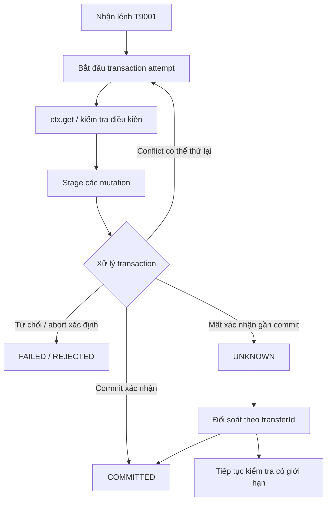
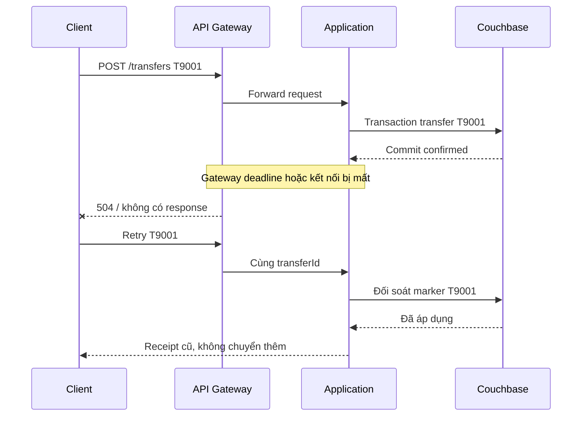
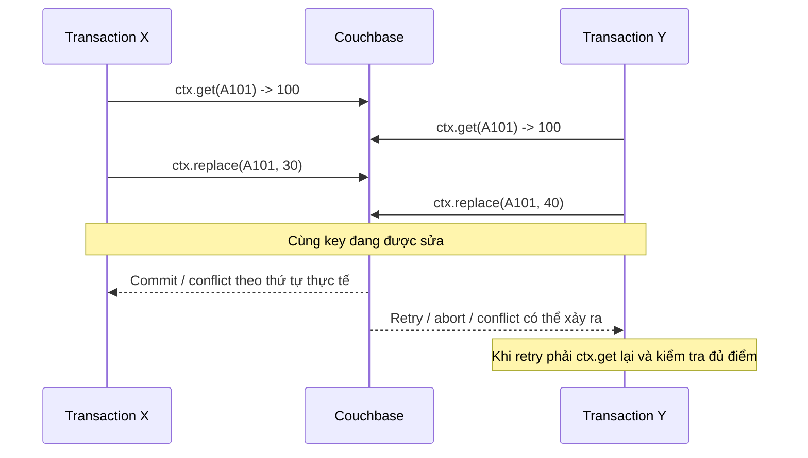

# Thời gian chờ, xung đột và kết quả commit chưa xác định

Trong chương **Giao dịch** của **SPRING_DATA_COUCHBASE**, khả năng cập nhật nhiều document theo một đơn vị commit là điều kiện cần, nhưng **chưa đủ để một dịch vụ vận hành an toàn**. Khi hệ thống chịu tải thực tế, ba nhóm tình huống thường bị nhầm lẫn:

- **Thời gian chờ (timeout/expiration):** một thao tác KV, một query, một transaction hoặc một request HTTP đã vượt giới hạn thời gian.
- **Xung đột (conflict):** nhiều request/transaction cùng thay đổi dữ liệu, có thể gặp CAS conflict, conflict transaction, retry attempt hoặc abort.
- **Kết quả commit chưa xác định (commit ambiguous):** phía ứng dụng không nhận được xác nhận cuối cùng nên **không thể kết luận** transaction đã commit hay rollback.

Ví dụ, HTTP trả `504 Gateway Timeout` không chứng minh Couchbase chưa ghi dữ liệu. Nếu request chuyển điểm đã commit nhưng phản hồi bị mất, client gửi lại mà không có **idempotency key** sẽ chuyển điểm thêm lần nữa. Ngược lại, khi có conflict, cứ lặp lại một entity mang CAS cũ hoặc bỏ qua giới hạn retry sẽ tạo thêm tải mà không giải quyết điều kiện nghiệp vụ.

Bài học này giải thích cách thiết kế giao dịch Couchbase **có timeout và retry được kiểm soát, phân loại outcome, đối soát giao dịch chưa rõ kết quả**, và xác nhận các bảo đảm bằng integration test. Nội dung liên hệ Spring Data Couchbase Repository, `CouchbaseTemplate`, Java SDK Transactions API, `@Transactional`, `CouchbaseTransactionalOperator`, bucket/scope/collection, SQL++, `@Version`/CAS, TTL, durability và observability.

**Điểm quan trọng nhất:** Đừng gộp tất cả exception thành “giao dịch đã rollback”. Một kết quả **không xác định** phải dẫn tới **đối soát**, không phải retry mù quáng.

## 1. Mục tiêu học tập

Sau bài này, bạn có thể:

1. Phân biệt **transaction expiration**, KV/query timeout, Spring transaction timeout, Reactor timeout và HTTP/gateway deadline.
2. Giải thích vì sao các deadline có thể xảy ra ở thời điểm khác nhau và không tạo cùng một kết luận về dữ liệu.
3. Nhận diện xung đột khi hai transaction cùng đọc/ghi document và vai trò của CAS, conflict detection, abort/retry.
4. Viết transaction callback theo cách **có thể được thử lại**: đọc lại trạng thái, kiểm tra lại invariant, không thực hiện side effect bên ngoài.
5. Phân biệt **retry nội bộ của SDK**, retry của service/Reactor và retry từ HTTP client/broker.
6. Nhận biết **commit ambiguous** và phân loại outcome ở tầng nghiệp vụ thành `COMMITTED`, `REJECTED`, `FAILED/ABORTED` hoặc `UNKNOWN` theo bằng chứng.
7. Dùng **transferId/idempotency key ổn định** cùng marker insert-only để giảm nguy cơ thực thi lại nghiệp vụ.
8. Thiết kế một **API tra cứu trạng thái** và quy trình đối soát khi client không nhận phản hồi.
9. Hiểu các giới hạn của `@Transactional(timeout = ...)` và khác biệt giữa Spring callback manager với cấu hình timeout trong SDK.
10. Xử lý Reactor `timeout`/`cancel()` mà không mặc định rollback.
11. Phân biệt **timeout, conflict và SQL++ scan consistency**; chọn index và đường query phù hợp.
12. Thiết kế kiểm thử **commit, forced abort, conflict concurrency, duplicate request và mất acknowledgement** trên Couchbase thử nghiệm.

## 2. Bài toán xuyên suốt: chuyển điểm giữa hai account

Giả sử hai tài khoản ở bucket `appdata`, scope `loyalty`, collection `accounts`:

```text
account::tenant-a::A101
  tenantId = tenant-a
  status = OPEN
  rewardPoints = 150

account::tenant-a::A102
  tenantId = tenant-a
  status = OPEN
  rewardPoints = 50
```

Client yêu cầu chuyển 40 điểm từ A101 sang A102, định danh nghiệp vụ là `T9001`.

Kết quả thành công:

```text
A101 = 110
A102 = 90
Tổng = 200
transfer::tenant-a::T9001 = APPLIED
```

Bất biến:

\[
P_\text{nguồn} \ge 0,\qquad
P_\text{nguồn}+P_\text{đích}=200.
\]

Ngoài atomicity của **một lần chuyển**, còn có quy tắc:

> Cùng `transferId = T9001` và cùng payload phải được áp dụng **không quá một lần**, dù callback SDK, HTTP client hoặc worker xử lý lại yêu cầu.

Điểm này đặc biệt quan trọng khi một transaction **đã commit nhưng kết quả trả về bị mất**.

### 2.1. Hai lỗi rất khác nhau

**Ghi một phần:** nguồn bị trừ 40 nhưng đích không được cộng. Nếu hai mutation nằm trong một Couchbase transaction context được hỗ trợ, atomicity xử lý vấn đề này.

**Ghi hai lần:** lần đầu đã trừ và cộng đủ, nhưng client không biết nên gửi lại cùng lệnh; một transaction thứ hai cũng commit thành công. Mỗi transaction riêng lẻ đều atomic, nhưng nghiệp vụ bị lặp.

**Giải pháp:** transaction cho tính nguyên tử **và** idempotency/đối soát cho khả năng retry.

## 3. Vòng đời giao dịch: biết đang ở giai đoạn nào

Mô hình khái niệm của một transaction Couchbase:



Các giai đoạn của SDK có thể gồm chuẩn bị metadata, staging, commit và **unstaging/cleanup**. Tên bước và thời điểm hiển thị dữ liệu cho reader thường và reader transaction-aware phụ thuộc phiên bản, nên không nên dùng sơ đồ này như bản mô tả chi tiết protocol.

Điều cần nhớ:

- **Đã stage mutation** chưa phải xác nhận commit.
- **Callback trả về bình thường** chưa chắc commit đã được SDK xác nhận ở thời điểm log trong callback.
- **SDK báo commit thành công** là bằng chứng mạnh về outcome theo contract của API.
- **Mất phản hồi** không đồng nghĩa SDK/Server đã abort.
- Cleanup hoặc hoàn tất unstaging có thể ảnh hưởng cách một reader ngoài transaction nhìn dữ liệu; cần theo hợp đồng API/version khi đối soát.

## 4. Bảng phân loại các loại timeout

Từ “timeout” xuất hiện ở nhiều tầng, với ý nghĩa khác nhau:

| Loại giới hạn | Nơi áp dụng | Khi vượt giới hạn | Có chứng minh rollback? |
| --- | --- | --- | --- |
| **Transaction expiration** | Couchbase Transactions SDK/Server | Transaction attempt không thể hoàn tất theo deadline, có thể phát lỗi và cleanup | **Không suy từ thời gian một mình**; phải phân loại outcome |
| **KV operation timeout** | `get`, `replace`, `insert`... | Một operation không trả kết quả đúng hạn | **Không**; tùy giai đoạn và trạng thái |
| **SQL++ query timeout** | Query Service/SDK query | Query không hoàn tất đúng hạn | **Không**; phải xem transaction scope và outcome |
| **Spring `@Transactional(timeout)`** | Spring transaction manager nếu hỗ trợ | Timeout do manager diễn giải | **Không mặc định** giống SDK expiration |
| **Reactor `timeout`** | Publisher/subscriber | Upstream bị hủy hoặc phát lỗi timeout | **Không**; có thể cancel khi commit đang diễn ra |
| **HTTP client timeout** | Caller | Caller ngừng đợi | **Không**; backend có thể tiếp tục |
| **Gateway `504`** | Reverse proxy / load balancer | Gateway không nhận response đúng hạn | **Không**; backend có thể đã commit |
| **Outbox/worker lease timeout** | Workflow xử lý ngoài Couchbase | Worker mất quyền claim hoặc retry delivery | Không liên quan trực tiếp commit của transfer |

**Một HTTP timeout là kết quả của giao tiếp HTTP, không phải chứng cứ về transaction outcome trong Couchbase.**

## 5. Transaction expiration của Java SDK

Couchbase Java SDK Transactions API cho phép cấu hình những giới hạn thời gian liên quan transaction (ví dụ expiration/timeout theo API phiên bản). Mục tiêu là tránh transaction kéo dài không kiểm soát.

Ví dụ về ý tưởng cấu hình:

```text
Business deadline:        8 s
Transaction expiration:   được chọn phù hợp workload
KV/query timeout:         được chọn theo dependency
HTTP gateway deadline:    phải tính cả network + commit
```

Các con số ở trên **chỉ minh họa các loại deadline**, không phải khuyến nghị cấu hình production. Không nên dùng một giá trị ngẫu nhiên cho mọi tầng.

### 5.1. Cấu hình timeout theo phiên bản, không tự đoán method

Các dòng Java SDK 3.x có API `TransactionsConfig`/transaction options để cấu hình transaction. Tên factory, overload, giá trị mặc định và quyền ưu tiên khi có cả global/per-transaction options cần kiểm tra **Javadoc của phiên bản đang sử dụng**.

Trước khi thay đổi timeout, ghi lại:

- Phiên bản Couchbase Server, Java SDK, Spring Data Couchbase và Spring Boot.
- Transaction expiration được cấu hình ở đâu, cho cluster hay từng transaction.
- Timeout KV/query nằm trong hoặc ngoài budget.
- SDK retry policy và cách deadline dừng các attempt.
- Độ trễ thực tế ở p50/p95/p99 và tail latency khi có conflict.
- Quy trình phân loại lỗi/cam kết kết quả khi deadline xảy ra.

### 5.2. Tăng expiration không luôn giải quyết lỗi

Nếu transaction bị conflict liên tục trên một **hot key**, kéo dài expiration có thể chỉ khiến nhiều request giữ tài nguyên lâu hơn. Hãy đo contention, giảm read/write set, rút ngắn callback và thay mô hình dữ liệu nếu cần.

### 5.3. Không dùng `Thread.sleep` trong callback production

```java
cluster.transactions().run(ctx -> {
    // Đọc document...
    Thread.sleep(5000); // Không nên trong production.
    // Ghi document...
});
```

Ngủ hoặc gọi HTTP dài trong callback kéo dài transaction, tăng conflict/expiration và có thể khiến callback bị retry. Với test, chỉ dùng delay có kiểm soát trong môi trường cô lập để quan sát, không triển khai vào code nghiệp vụ.

## 6. KV operation timeout: lệnh chưa trả kết quả không có nghĩa chưa chạy

Một thao tác như `ctx.replace` có thể phát lỗi timeout nếu client không nhận được phản hồi kịp thời. Ở mức network, có tình huống request đã đến server nhưng acknowledgment không đến client.

Điều quan trọng:

- Nếu SDK transaction đang hoạt động, **transaction manager/SDK** phải xử lý outcome theo contract của attempt.
- Không tự bắt một timeout trên operation rồi tiếp tục `ctx.replace` khác như thể mọi trạng thái vẫn hợp lệ.
- Không dùng `collection.upsert` bên ngoài context để “chữa lỗi” một `ctx.replace` timeout; thao tác mới có thể commit độc lập.
- Ghi nhận loại lỗi cụ thể, timeout nguồn nào, attempt và giai đoạn transaction.

### 6.1. Đọc lại có thể cần đúng context

Nếu một operation lỗi trong transaction attempt, không tùy tiện gọi `collection.get` rồi dựa vào giá trị đó để quyết định transaction đang tiếp diễn. Cần để SDK/manager xử lý attempt và chỉ đối soát **sau khi có phân loại outcome** bằng API phù hợp.

## 7. Query timeout và chỉ mục SQL++

Một transaction có thể dùng KV theo key hoặc query SQL++ theo thuộc tính.

Ví dụ query theo tenant:

```sql
SELECT META(a).id AS documentKey,
       a.rewardPoints,
       a.status
FROM `appdata`.`loyalty`.`accounts` AS a
WHERE a.tenantId = $tenantId
  AND a.status = $status;
```

Index phù hợp:

```sql
CREATE INDEX ix_accounts_tenant_status
ON `appdata`.`loyalty`.`accounts` (
    tenantId,
    status
);
```

Thiếu index hoặc kế hoạch truy vấn kém có thể làm query chậm, kéo dài transaction và đẩy nó tới expiration.

### 7.1. Transactional query khác query thông thường

- `cluster.query(...)`: query SDK bình thường; không tự thuộc transaction.
- `ctx.query(...)`: transaction-aware query trong các phiên bản hỗ trợ.
- Derived Repository `findBy...`, `@Query` và Template `findByQuery`: cần xác minh operation support/context ở phiên bản Spring Data.
- `REQUEST_PLUS` là scan consistency, **không phải transaction API** và không tự nâng isolation thành serializable.

Nếu chỉ biết document key, ưu tiên KV `ctx.get` thay vì query qua secondary index không cần thiết.

### 7.2. Không coi query timeout là “không có dữ liệu”

`TimeoutException` của query khác với query thành công trả **0 dòng**. Nếu catch timeout rồi xử lý như empty result, nghiệp vụ có thể tạo account/reservation trùng hoặc quyết định sai quota.

## 8. HTTP và gateway deadline: người dùng có thể không biết backend đã commit

Ví dụ:



**Không có mối quan hệ tất yếu** giữa “client nhận 504” và “transaction không commit”. Một timeout tại proxy có thể xảy ra **sau khi database đã xác nhận commit**.

### 8.1. Hợp đồng API nên cho phép kiểm tra lại

Thay vì chỉ có `POST /transfers` trả 200 hoặc 500, hệ thống có thể cung cấp:

```text
POST /transfers
  body: transferId + command
  outcome: COMMITTED / REJECTED / UNKNOWN

GET /transfers/{transferId}
  outcome: COMMITTED / REJECTED / IN_PROGRESS / UNKNOWN
```

Đây là **mẫu thiết kế ứng dụng**, không phải endpoint có sẵn của Couchbase. Client phải sử dụng lại **cùng transferId** sau khi mất phản hồi.

## 9. Xung đột (conflict) trong Couchbase transaction

Hai transaction có thể cùng đọc hoặc ghi **cùng document key**:

```text
A101 ban đầu = 100 điểm

Request X: chuyển 70 điểm
Request Y: chuyển 60 điểm
```

Nếu cả hai đọc 100 rồi cùng ghi mà không điều phối, nguồn có thể âm hoặc xảy ra lost update. Couchbase transactions sử dụng cơ chế conflict detection/transaction attempt handling; một attempt có thể bị từ chối, chờ, abort hoặc được retry theo khả năng SDK/Server.



Biểu đồ minh họa **một nhóm tình huống tranh chấp**, không khẳng định thứ tự event hoặc số lần retry cố định ở mọi phiên bản.

### 9.1. Conflict không có nghĩa Couchbase bị lỗi dữ liệu

Một conflict được phát hiện và retry/abort có thể là **tín hiệu cơ chế đồng thời đang bảo vệ invariant**. Vấn đề vận hành nằm ở tỷ lệ conflict cao, latency tăng, retry exhaustion hoặc ứng dụng xử lý lỗi không đúng.

### 9.2. Hot key và contention

Một key như `quota::tenant-a` hoặc `account::tenant-a::A101` có nhiều mutation cạnh tranh sẽ tạo **hot spot**. Cần đo tần suất ghi, kích thước transaction và số lần retry trước khi tăng timeout hoặc mở rộng worker.

## 10. CAS, @Version và transaction conflict không phải cùng một thứ

Spring Data Couchbase dùng `@Version` để mang CAS metadata cho optimistic locking ở những operation được hỗ trợ.

Entity:

```java
package com.example.loyalty;

import org.springframework.data.annotation.Id;
import org.springframework.data.annotation.Version;
import org.springframework.data.couchbase.core.mapping.Collection;
import org.springframework.data.couchbase.core.mapping.Document;
import org.springframework.data.couchbase.core.mapping.Field;
import org.springframework.data.couchbase.core.mapping.Scope;

@Document
@Scope("loyalty")
@Collection("accounts")
public class Account {

    @Id
    private String id;

    @Field
    private String tenantId;

    @Field
    private long rewardPoints;

    @Field
    private String status;

    @Version
    private Long version;

    public Account() {}

    public String getId() { return id; }
    public void setId(String id) { this.id = id; }

    public String getTenantId() { return tenantId; }
    public void setTenantId(String tenantId) {
        this.tenantId = tenantId;
    }

    public long getRewardPoints() { return rewardPoints; }
    public void setRewardPoints(long rewardPoints) {
        this.rewardPoints = rewardPoints;
    }

    public String getStatus() { return status; }
    public void setStatus(String status) {
        this.status = status;
    }

    public Long getVersion() { return version; }
    public void setVersion(Long version) {
        this.version = version;
    }
}
```

Ý nghĩa:

- CAS là **opaque token**, không phải số thứ tự nghiệp vụ tự tăng 1.
- `@Version` giúp phát hiện thao tác ghi dựa trên bản document cũ trong đường Spring Data mapping phù hợp.
- CAS trên **một key** không tạo atomicity của **hai key**.
- SDK transaction có cơ chế quản lý conflict/attempt riêng khi dùng `ctx.get`/`ctx.replace`.
- Một entity Spring Data đọc trước SDK transaction có thể trở thành stale sau khi SDK mutation commit.

### 10.1. Sai lầm: retry mãi với cùng object cũ

```java
Account stale = repository.findById(key).orElseThrow();

for (int i = 0; i < 3; i++) {
    try {
        repository.save(stale);
        break;
    } catch (OptimisticLockingFailureException ex) {
        // Sai: không đọc lại document mới, CAS vẫn stale.
    }
}
```

Nếu muốn retry một optimistic-lock conflict, hãy **tải lại trạng thái**, kiểm tra điều kiện nghiệp vụ trên bản mới và tính toán lại thay đổi. Không chuyển `@Version` thành một giá trị cộng thủ công.

## 11. Transaction attempt retry: vì sao thân giao dịch có thể chạy lại?

Trong Java SDK:

```java
cluster.transactions().run(ctx -> {
    // Mỗi attempt đọc lại, kiểm tra lại, ghi lại.
});
```

SDK có thể chạy lại lambda khi gặp loại conflict/lỗi mà chính sách retry cho phép. Mỗi lần chạy callback cần được xem là **attempt mới** về mặt nghiệp vụ bên trong, không phải đoạn code chỉ được chạy một lần.

### 11.1. Đừng mang dữ liệu đọc trước callback vào retry

Mẫu nguy hiểm:

```java
GetResult outside = accounts.get(sourceKey);
long cachedBalance =
        outside.contentAsObject().getLong("rewardPoints");

cluster.transactions().run(ctx -> {
    // Sai: vẫn tính từ cachedBalance dù SDK retry attempt.
    long newBalance = cachedBalance - amount;
    // ...
});
```

Đúng hơn:

```java
cluster.transactions().run(ctx -> {
    TransactionGetResult source = ctx.get(accounts, sourceKey);
    JsonObject body = source.contentAsObject();

    long current = body.getLong("rewardPoints");
    if (current < amount) {
        throw new IllegalStateException("Không đủ điểm");
    }

    ctx.replace(source,
            body.put("rewardPoints", current - amount));
});
```

Callback phải đọc và tính lại từ dữ liệu trong **attempt hiện tại**.

### 11.2. Không tạo side effect bên ngoài trong callback

Không nên:

```java
cluster.transactions().run(ctx -> {
    // Stage transaction mutation...
    emailService.sendReceipt(transferId);
    metrics.incrementCommitted();
});
```

Nếu callback retry, email/metric có thể lặp. Nếu callback abort, side effect đã xảy ra nhưng business data không commit. Ghi **outbox event** trong cùng transaction và gửi sau commit bằng dispatcher idempotent nếu cần delivery đáng tin cậy.

## 12. Ba tầng retry và nguy cơ lặp nghiệp vụ

| Tầng retry | Cơ chế | Có thể lặp thứ gì? | Chính sách phù hợp |
| --- | --- | --- | --- |
| **SDK attempt retry** | SDK `run(ctx -> ...)` quản lý | Thân callback trong cùng lần gọi API | Callback phải side-effect-safe, tính lại dữ liệu |
| **Application retry** | Service, resilience library, Spring retry | Toàn lời gọi transaction một lần nữa | Chỉ retry khi lỗi phù hợp và outcome đủ rõ |
| **Reactor resubscription** | `retry`/`retryWhen` | Publisher source, có thể tạo transaction mới | Dùng idempotency và lọc lỗi |
| **Client/gateway retry** | HTTP/worker/broker | Toàn command nghiệp vụ | Giữ cùng `transferId`, tra cứu outcome |
| **Outbox delivery retry** | Dispatcher/consumer | Gửi lại cùng event | Event ID ổn định, consumer dedupe |

Từng tầng có mục tiêu khác nhau. **Không cộng số lần retry của từng tầng rồi coi đó là số business transaction đã commit**.

### 12.1. Phân loại trước khi retry

- **Không đủ điểm/sai tenant:** business rejection, không retry.
- **Conflict transient:** có thể retry theo SDK policy, đọc lại dữ liệu.
- **Thiếu index hoặc quyền ATR:** sửa cấu hình, không retry nóng.
- **Transaction expired:** xem outcome theo SDK; không giả định mọi lỗi đều giống nhau.
- **Commit ambiguous:** **đối soát trước**, không khởi chạy command mới một cách mù quáng.
- **Duplicate cùng transferId:** tra cứu marker và so payload, không thực thi mutation thêm.

## 13. Commit ambiguous: tình huống cần xử lý riêng

**Commit ambiguous** là khi client/SDK **không thể xác định chắc chắn** kết quả commit tại thời điểm trả lỗi. Điều đó khác với một transaction được biết đã abort.

Một số phiên bản Java SDK có loại lỗi chuyên biệt cho kết quả commit ambiguous (ví dụ tên liên quan `TransactionCommitAmbiguousException`). **Tên lớp, package, nguồn exception bọc và cách phân loại phải đối chiếu Javadoc đúng phiên bản**, không tự bắt mọi `RuntimeException` rồi coi là commit ambiguous.

### 13.1. Vì sao commit có thể chưa rõ?

Xem timeline:

```text
T0  App nhận command T9001
T1  SDK bắt đầu transaction
T2  App stage thay đổi A101, A102 và marker T9001
T3  Transaction tiến tới giai đoạn commit
T4  Server có thể đã ghi nhận quyết định commit
T5  Kết nối bị mất trước khi App nhận acknowledgement
T6  App nhận lỗi / deadline
```

Tại T6, app không thể chỉ dựa vào lỗi network để kết luận “rollback”. Nếu commit đã được quyết định, request mới có thể áp dụng lại cùng transfer nếu thiếu marker/idempotency.

### 13.2. Không bắt exception rồi trả FAILED một cách máy móc

```java
try {
    performTransfer(command);
    return TransferStatus.COMMITTED;
} catch (RuntimeException ex) {
    return TransferStatus.FAILED; // Không an toàn cho mọi lỗi.
}
```

Phải phân loại **lỗi nghiệp vụ xác định**, **abort xác định**, **lỗi hạ tầng**, **outcome chưa rõ**. Trạng thái `UNKNOWN` là một trạng thái nghiệp vụ có ý nghĩa, không phải một lỗi xử lý giao diện cần giấu đi.

## 14. Bốn loại outcome ở tầng ứng dụng

| Outcome | Bằng chứng | Hành động nên thực hiện |
| --- | --- | --- |
| **COMMITTED** | SDK xác nhận hoặc đối soát xác định transfer đã áp dụng | Trả receipt cũ/hoàn tất |
| **REJECTED** | Điều kiện nghiệp vụ không đạt trước commit | Trả lỗi nghiệp vụ, không retry vô hạn |
| **ABORTED/FAILED xác định** | SDK/manager xác nhận outcome thất bại phù hợp | Có thể tạo attempt mới với cùng transferId theo policy |
| **UNKNOWN** | Không có xác nhận kết quả cuối | Tra cứu/đối soát, không suy rollback |

Đây là **trạng thái mô hình hóa bởi ứng dụng**; không nhất thiết trùng với một enum trả về từ SDK.

### 14.1. UNKNOWN không phải COMMITTED và cũng không phải FAILED

Nếu không đủ bằng chứng, hãy giữ `UNKNOWN`/`IN_PROGRESS` hoặc một trạng thái cần đối soát. Đừng trả “chuyển điểm thất bại, cứ bấm lại” khi lệnh trước có thể đã commit.

### 14.2. Deadline đối soát phải hữu hạn

Một workflow không nên giữ kết quả UNKNOWN vĩnh viễn mà không cảnh báo. Cần có lịch kiểm tra lại, ngưỡng cảnh báo, đường xử lý thủ công khi cần và cơ chế bảo đảm **không chuyển lặp** trong lúc chưa kết luận.

## 15. Thiết kế transferId ổn định

Command nên có mã nghiệp vụ gắn với **một ý định chuyển điểm**:

```java
public record TransferCommand(
        String transferId,
        String authorizedTenantId,
        String sourceKey,
        String targetKey,
        long amount) {
}
```

Ví dụ:

```json
{
  "transferId": "T9001",
  "authorizedTenantId": "tenant-a",
  "sourceKey": "account::tenant-a::A101",
  "targetKey": "account::tenant-a::A102",
  "amount": 40
}
```

Cần quy định:

- `transferId` giữ nguyên khi SDK retry callback.
- `transferId` giữ nguyên khi application/HTTP client retry một command.
- Cùng `transferId` + cùng payload → trả outcome cũ, **không mutation lại**.
- Cùng `transferId` + payload khác → từ chối **ID conflict**.
- `authorizedTenantId` lấy từ ngữ cảnh đã xác thực, không tin field client tự khai.
- Document key phải chuẩn hóa theo tenant, không chỉ dùng một ID ngắn có thể trùng giữa tenant.

### 15.1. Transfer marker trong Couchbase

Key `transfer::tenant-a::T9001` ở collection `loyalty.transfers`:

```json
{
  "transferId": "T9001",
  "tenantId": "tenant-a",
  "sourceKey": "account::tenant-a::A101",
  "targetKey": "account::tenant-a::A102",
  "amount": 40,
  "sourceBalanceAfter": 110,
  "targetBalanceAfter": 90,
  "status": "APPLIED"
}
```

Marker cần được ghi **trong cùng transaction** với hai account bằng **insert-only** hoặc cơ chế duy nhất tương đương. Nếu marker đã tồn tại, không ghi đè; phải so payload và outcome.

### 15.2. Vì sao precheck `existsById` không đủ?

```java
if (!transfers.exists(markerKey).exists()) {
    transfers.upsert(markerKey, marker);
}
```

Hai request có thể cùng thấy key chưa tồn tại. `upsert` còn có thể ghi đè. Đây là race **time-of-check-to-time-of-use (TOCTOU)**.

Dùng `ctx.insert(transfers, markerKey, body)` trong transaction để điều kiện “chưa tồn tại” được kiểm tra tại mutation.

## 16. Java SDK transaction: chuyển điểm và ghi marker cùng commit

Ví dụ dùng Java SDK 3.x ở dạng đồng bộ. Tên class và overload cần đối chiếu đúng dependency, nhưng mẫu `ctx` là trọng tâm.

```java
package com.example.loyalty;

import java.util.Objects;
import com.couchbase.client.java.Cluster;
import com.couchbase.client.java.Collection;
import com.couchbase.client.java.json.JsonObject;
import com.couchbase.client.java.transactions.TransactionGetResult;

public final class SdkTransferAdapter {

    private final Cluster cluster;
    private final Collection accounts;
    private final Collection transfers;

    public SdkTransferAdapter(
            Cluster cluster,
            Collection accounts,
            Collection transfers) {
        this.cluster = cluster;
        this.accounts = accounts;
        this.transfers = transfers;
    }

    public void applyNewTransfer(TransferCommand command) {
        validateFormat(command);

        final String transferKey = "transfer::"
                + command.authorizedTenantId()
                + "::" + command.transferId();

        cluster.transactions().run(ctx -> {
            TransactionGetResult source =
                    ctx.get(accounts, command.sourceKey());
            TransactionGetResult target =
                    ctx.get(accounts, command.targetKey());

            JsonObject from = source.contentAsObject();
            JsonObject to = target.contentAsObject();

            verifyTenantAndStatus(command, from, to);

            Long sourcePoints = from.getLong("rewardPoints");
            Long targetPoints = to.getLong("rewardPoints");

            if (sourcePoints == null || targetPoints == null
                    || sourcePoints < command.amount()
                    || sourcePoints < 0 || targetPoints < 0) {
                throw new IllegalStateException(
                        "Số điểm không hợp lệ");
            }

            long nextSource =
                    sourcePoints - command.amount();
            long nextTarget =
                    Math.addExact(targetPoints, command.amount());

            JsonObject marker = JsonObject.create()
                    .put("transferId", command.transferId())
                    .put("tenantId", command.authorizedTenantId())
                    .put("sourceKey", command.sourceKey())
                    .put("targetKey", command.targetKey())
                    .put("amount", command.amount())
                    .put("sourceBalanceAfter", nextSource)
                    .put("targetBalanceAfter", nextTarget)
                    .put("status", "APPLIED");

            // Insert-only marker và hai số dư cùng ctx.
            ctx.insert(transfers, transferKey, marker);
            ctx.replace(source,
                    from.put("rewardPoints", nextSource));
            ctx.replace(target,
                    to.put("rewardPoints", nextTarget));
        });
    }

    private static void validateFormat(
            TransferCommand command) {
        if (command == null
                || command.transferId() == null
                || command.transferId().isBlank()
                || command.authorizedTenantId() == null
                || command.authorizedTenantId().isBlank()
                || command.sourceKey() == null
                || command.targetKey() == null
                || Objects.equals(
                        command.sourceKey(), command.targetKey())
                || command.amount() <= 0) {
            throw new IllegalArgumentException(
                    "Yêu cầu chuyển điểm không hợp lệ");
        }
    }

    private static void verifyTenantAndStatus(
            TransferCommand command,
            JsonObject from,
            JsonObject to) {
        String tenant = command.authorizedTenantId();
        if (!tenant.equals(from.getString("tenantId"))
                || !tenant.equals(to.getString("tenantId"))
                || !"OPEN".equals(from.getString("status"))
                || !"OPEN".equals(to.getString("status"))) {
            throw new IllegalStateException(
                    "Account không thuộc tenant hợp lệ hoặc bị khóa");
        }
    }
}
```

**Các giả định và giới hạn:**

1. `accounts` trỏ đúng `appdata.loyalty.accounts`; `transfers` trỏ đúng `appdata.loyalty.transfers`.
2. Tenant phải được ủy quyền ở tầng entry point, không lấy tùy ý từ request không tin cậy.
3. Các mutation đều dùng `ctx`, không trộn `collection.upsert` độc lập.
4. Marker giữ cùng key và payload qua mọi attempt.
5. Callback chỉ làm tính toán/validation và mutation Couchbase, **không gửi email hoặc HTTP call**.
6. Ví dụ `applyNewTransfer` chỉ triển khai **đường ghi mới**. Đường ứng dụng hoàn chỉnh phải bắt duplicate/unknown, so payload và đối soát như mục 17–18.
7. SDK có thể retry callback; các giá trị nguồn/đích được đọc lại bên trong mỗi attempt.

**Không chỉ copy một method rồi tuyên bố toàn service idempotent**: còn cần đường duplicate handling và readback outcome theo transferId.

## 17. Xử lý duplicate marker đúng cách

Nếu `ctx.insert` gặp marker đã tồn tại, đừng tự coi đó là “thành công” hoặc “không thành công” ngay.

Quy trình phù hợp:

1. Phân loại kết quả SDK theo kiểu lỗi và transaction outcome thực tế.
2. Tìm marker bằng key ổn định trên đường đọc được hỗ trợ, với retry/đối soát có giới hạn khi outcome chưa rõ.
3. Nếu marker tồn tại và `tenant/source/target/amount` **trùng command**, trả receipt đã lưu.
4. Nếu marker tồn tại nhưng payload khác, trả **ID conflict**, không sửa số dư.
5. Nếu marker chưa thấy và outcome chưa rõ, **không lập tức kết luận rollback**.
6. Nếu outcome abort đã được xác định và policy cho phép, có thể thử lại **cùng transferId**.

### 17.1. Không đồng nhất “marker chưa nhìn thấy” với “giao dịch chưa commit”

Quá trình commit, visibility của staged/unstaged documents và read path phải được xem theo SDK/Server version. Ngay sau một network error, một lần `collection.get(markerKey)` thất bại vì không tìm thấy **chưa đủ bằng chứng** để kết luận transfer trước đó chưa từng được áp dụng.

Phải xét trạng thái SDK, các lần kiểm tra lại có kiểm soát và quy trình reconciliation phù hợp.

### 17.2. Duplicate cùng ID nhưng payload khác

```text
Request 1: T9001, A101 -> A102, 40
Request 2: T9001, A101 -> A103, 90
```

Không trả receipt của request 1 cho request 2 chỉ vì transferId giống nhau. So khớp payload canonical và kiểm tra authorization.

## 18. Pseudocode đối soát outcome trong ứng dụng

Đây là **thuật toán nghiệp vụ**, không phải một hàm có sẵn của Spring Data:

```text
execute(command):
    xác minh identity/tenant/transferId

    marker = lookupByTransferId(command.transferId)
    if marker đã được xác nhận APPLIED:
        if payload trùng:
            return COMMITTED(marker.receipt)
        else:
            return REJECTED(ID_CONFLICT)

    try:
        run Couchbase transaction:
            insert-only marker
            đọc/kiểm tra/replace source và target
        return COMMITTED(receipt đã xác nhận)
    catch business rejection:
        return REJECTED
    catch SDK failure:
        if outcome chắc chắn abort:
            áp dụng retry policy nếu phù hợp
        else:
            return UNKNOWN và kích hoạt reconciliation

reconcile(transferId):
    đọc marker theo đường nhất quán phù hợp
    nếu APPLIED và payload khớp:
        return COMMITTED
    nếu outcome chưa thể xác định:
        tiếp tục kiểm tra với budget, không chuyển thêm
    nếu đã xác định abort/no-effect:
        quyết định thử lại cùng ID hoặc trả lỗi theo policy
```

### 18.1. Vì sao cần trạng thái UNKNOWN ở API?

Với API chỉ có `success`/`failure`, một timeout gần commit thường bị ép sai thành `failure`, khiến client retry như command mới. Thêm `UNKNOWN`/`IN_PROGRESS` giúp hệ thống thừa nhận **thiếu thông tin**, đồng thời giảm rủi ro mutation trùng.

### 18.2. Không nên trả HTTP 200 khi chưa biết commit

Nếu outcome chưa rõ, không công bố chuyển điểm đã thành công. Có thể trả mã HTTP/thông điệp đại diện cho yêu cầu đang được xác minh, cùng transferId để client tra cứu; cách ánh xạ chính xác phụ thuộc hợp đồng API ứng dụng.

## 19. @Transactional trong Spring Data Couchbase và timeout

Spring có annotation:

```java
import org.springframework.transaction.annotation.Transactional;

@Transactional(
    transactionManager = "couchbaseTransactionManager",
    timeout = 5
)
public void transfer(TransferCommand command) {
    // Các Spring Data operations được hỗ trợ.
}
```

**Cần xác minh trước khi dựa vào `timeout = 5`.** Trong các dòng Spring Data Couchbase hỗ trợ callback-based transaction integration, class manager có thể là `CouchbaseCallbackTransactionManager` và bean thường tên `couchbaseTransactionManager`. Không phải mọi thuộc tính Spring transaction đều được chuyển thành cấu hình SDK với semantics y hệt JPA.

Phải xác định:

- Bean manager Couchbase có tồn tại và được chọn đúng không?
- `@EnableTransactionManagement` hoặc auto-configuration đã kích hoạt interceptor không?
- Method được gọi **qua Spring proxy** hay gọi nội bộ `this.method()`?
- `timeout` có được manager áp dụng và map sang SDK expiration hay không?
- `rollbackFor`/`noRollbackFor` có được hỗ trợ như mong muốn không?
- `propagation`/`isolation`/`readOnly` có bị bỏ qua hoặc giới hạn theo manager không?
- Repository/Template operations đang dùng có tham gia đúng context không?

Không khẳng định “Spring timeout đã cấu hình” chỉ từ việc annotation **biên dịch được**.

### 19.1. Nếu ứng dụng có JPA và Couchbase

`@Transactional` không có qualifier có thể chọn sai manager khi có nhiều candidate. Và dù chọn manager Couchbase đúng, một JPA mutation **không tự tham gia cùng commit**.

### 19.2. Self-invocation làm annotation mất hiệu lực

```java
@Service
class TransferService {
    public void handle(TransferCommand cmd) {
        this.transfer(cmd); // Bỏ qua proxy trong Spring AOP mặc định.
    }

    @Transactional(
        transactionManager = "couchbaseTransactionManager")
    public void transfer(TransferCommand cmd) {
        // Không được tự kết luận interceptor chạy.
    }
}
```

Không có transaction thực sự thì timeout, rollback rule hay isolation trên annotation **không mang ý nghĩa bảo vệ mà bạn mong đợi**.

## 20. Reactive: timeout và cancellation của Publisher

Spring Data Couchbase có `ReactiveCouchbaseRepository`, `ReactiveCouchbaseTemplate` và, ở các dòng API hỗ trợ, `CouchbaseTransactionalOperator`.

Mẫu transaction scope:

```java
import org.springframework.data.couchbase.core.ReactiveCouchbaseTemplate;
import org.springframework.data.couchbase.transaction.CouchbaseTransactionalOperator;
import reactor.core.publisher.Mono;

public Mono<Account> suspendAccount(
        CouchbaseTransactionalOperator operator,
        ReactiveCouchbaseTemplate template,
        String accountKey) {

    return operator.execute(status ->
            template.findById(Account.class)
                    .one(accountKey)
                    .switchIfEmpty(Mono.error(
                            new IllegalArgumentException(
                                    "Account không tồn tại")))
                    .flatMap(account -> {
                        account.setStatus("SUSPENDED");
                        return template.replaceById(Account.class)
                                .one(account);
                    }))
            .single();
}
```

Ví dụ thể hiện ý tưởng operator; chữ ký `execute`, cách inject bean và tập operation hỗ trợ transaction phải đối chiếu đúng Spring Data version.

### 20.1. `Mono.timeout` có thể cancel upstream

```java
return transferService.transfer(command)
        .timeout(Duration.ofSeconds(3));
```

Nếu deadline của Reactor vượt, upstream có thể bị cancel. **Cancel là tín hiệu phía subscriber**, không mặc nhiên là xác nhận transaction đã rollback từ server.

Ở sát thời điểm commit, một reactive flow có thể đã commit nhưng client nhận timeout. Cần cùng chiến lược `transferId`/`UNKNOWN` như synchronous.

### 20.2. Đừng tự subscribe một mutation con

```java
return operator.execute(status -> {
    template.replaceById(Account.class)
            .one(source)
            .subscribe(); // Tách khỏi publisher chính.

    return template.replaceById(Account.class)
            .one(target);
});
```

Publisher nguồn có thể chạy ngoài lifecycle/context mà operator theo dõi. Nối các thao tác bằng một Publisher duy nhất:

```java
return operator.execute(status ->
        template.replaceById(Account.class)
                .one(source)
                .then(Mono.defer(() ->
                        template.replaceById(Account.class)
                                .one(target))));
```

### 20.3. `retryWhen` không phải chính sách mặc định cho transfer

```java
return transferService.transfer(command)
        .retryWhen(
                Retry.backoff(2, Duration.ofMillis(100)));
```

Đây chỉ là ví dụ cú pháp; `retryWhen` có thể **resubscribe toàn bộ Publisher**, tạo giao dịch mới. Nếu trước đó đã commit nhưng mất tín hiệu cuối, transfer có thể được áp dụng lần nữa nếu thiếu marker/idempotency.

Chỉ retry các lỗi đã được phân loại và bảo vệ bằng transferId ổn định.

## 21. Idempotency, outbox và side effect sau commit

Một transaction có thể commit cùng nhau:

```text
accounts/A101: giảm 40 điểm
accounts/A102: tăng 40 điểm
transfers/T9001: marker APPLIED
outbox/T9001: event PENDING
```

Nếu ứng dụng cần gửi thông báo, nên **ghi outbox record trong transaction** thay vì gửi email/Kafka trực tiếp trong callback.

```java
cluster.transactions().run(ctx -> {
    // ctx.get, validate, ctx.replace source & target...
    ctx.insert(transfers, transferKey, marker);
    ctx.insert(outbox, eventKey, pendingEvent);
});

// Không đặt email/Kafka send trong callback retry.
```

**Cần hiểu:** outbox không tự cung cấp exactly-once delivery. Dispatcher có thể crash sau khi publish nhưng trước khi đánh dấu `DELIVERED`. Khi retry, consumer cần dedupe theo `eventId`.

### 21.1. Phân biệt ba outcome

- **Transaction COMMITTED:** business data + marker + outbox cùng commit.
- **Outbox PENDING:** event chờ dispatch; không có nghĩa transfer chưa commit.
- **Delivery UNKNOWN:** broker/email provider có thể đã nhận nhưng acknowledgment bị mất; không đồng nhất với Couchbase commit ambiguous.

### 21.2. Outbox key và event ID phải ổn định

Dùng `outbox::tenant-a::transfer::T9001` và eventId xác định theo transferId. Không tạo ID ngẫu nhiên trong callback có thể retry.

## 22. CAS conflict, transaction conflict và idempotency là ba cơ chế khác nhau

| Cơ chế | Phạm vi | Dùng để làm gì? | Không giải quyết |
| --- | --- | --- | --- |
| `@Version`/CAS | Một document | Phát hiện stale update | Multi-document atomicity; lệnh nghiệp vụ trùng |
| Transaction conflict detection | Các thao tác trong attempt | Phối hợp tranh chấp, abort/retry theo contract | External side effects; một command được gửi lại sau commit |
| `transferId`/marker insert-only | Một ý định nghiệp vụ | Ngăn áp dụng trùng command | Tự đồng bộ mọi external service |
| Transactional outbox + consumer dedupe | Luồng event ra ngoài | Không mất ý định phát event khi commit; xử lý redelivery | Exactly-once tuyệt đối xuyên mọi provider |
| Retry policy | Luồng xử lý lỗi | Thử lại trường hợp hợp lệ | Không thay consistency/permission |

Các cơ chế bổ sung nhau. Không nên chọn một trong số đó rồi bỏ những phần còn lại khi nghiệp vụ có yêu cầu tương ứng.

## 23. Mức cô lập và xung đột theo predicate

Một ví dụ khó hơn: tenant chỉ được có tối đa 100 reservation ACTIVE. Hai transaction cùng query `COUNT(*) = 99` rồi insert **hai key khác nhau** có thể vượt quota nếu mô hình và isolation không bảo vệ predicate.

Đối với Couchbase transaction với isolation được tài liệu mô tả theo **read committed**, không nên mặc định serializable predicate locking.

Một cách thiết kế rõ hơn:

```text
quota::tenant-a
  limit = 100
  occupied = 99

Trong transaction:
  ctx.get(quota)
  nếu occupied >= 100 -> từ chối
  ctx.replace(quota, occupied + 1)
  ctx.insert(reservationKey, reservation)
```

Hai request cùng tenant phải cạnh tranh trên **quota guard document**, tạo điểm conflict chung. Callback có thể retry; khi retry phải đọc lại guard và kiểm tra quota.

### 23.1. Guard có thể là hot key

Một quota guard tạo contention nếu tất cả request tenant cùng ghi vào nó. Cần đo throughput/conflict, cân nhắc phân vùng hoặc mô hình khác, không mặc định tăng timeout là đủ.

### 23.2. TTL của reservation không tự giảm quota

Nếu reservation expire theo TTL, guard `occupied` không tự giảm. Cần workflow expiration và reconciliation, có thể dùng transaction cho các mutation liên quan.

## 24. TTL và thời gian giữ transfer marker

Một vấn đề ít được chú ý: marker idempotency có TTL ngắn hơn cửa sổ retry.

```text
10:00 - T9001 đã commit; marker có TTL 5 phút.
10:07 - Client gửi lại T9001 vì mạng lỗi.
10:07 - Marker đã hết hạn.
10:07 - Hệ thống có thể áp dụng T9001 lần hai.
```

Không chọn TTL cho marker chỉ dựa vào tốc độ SDK transaction. Chính sách retention phải cân nhắc:

- Thời gian HTTP client/gateway có thể retry.
- Thời hạn message broker redelivery.
- Cửa sổ kết quả commit ambiguous cần đối soát.
- Audit/reconciliation và yêu cầu nghiệp vụ.
- Chi phí dữ liệu và chính sách lưu trữ.

**TTL document**, **transaction expiration**, **lease timeout** và **HTTP deadline** là bốn cơ chế khác nhau.

### 24.1. TTL của tài liệu đang tham gia transaction

Một document đang hết hạn hoặc bị xóa đồng thời có thể làm transaction conflict/fail. Các option expiry cho mutation trong transaction cũng có giới hạn API theo phiên bản; không giả định `ctx.replace` có mọi tùy chọn giống `collection.replace` thông thường.

## 25. Durability, ATR và cleanup

Couchbase distributed transactions sử dụng metadata như **Active Transaction Record (ATR)**. SDK/Server phối hợp trạng thái transaction và xử lý cleanup, đặc biệt khi client crash hoặc mạng bị gián đoạn.

Điểm vận hành:

- Quyền RBAC phải phù hợp với dữ liệu nghiệp vụ và metadata transaction.
- Durability level ảnh hưởng khả năng chịu lỗi/chi phí xác nhận commit, **không thay thế atomicity**.
- Không tự xóa ATR/metadata như một cách “sửa transaction treo”.
- Transaction expiration không tự cho phép ứng dụng kết luận outcome một cách đơn giản khi mất acknowledgement gần commit.
- Khi transaction đã commit nhưng còn quá trình hoàn tất/cleanup, reader ngoài transaction có thể có quy tắc visibility riêng cần xem theo SDK/server version.
- Cần đo retry, abort, timeout, commit ambiguous và lỗi cleanup.

### 25.1. Một transaction thành công nhưng response chậm

Độ trễ không chỉ gồm hai `ctx.replace`. Còn có network, metadata, commit/unstaging, durability và những lần retry attempt. Khi tính latency budget, không chỉ đo thời gian chạy business callback.

## 26. Thiết kế latency budget từ ngoài vào trong

Không có một bộ số thời gian chuẩn cho mọi cụm. Hãy phân tích:

```text
HTTP request deadline
  |- authentication/authorization
  |- request validation
  |- queueing / thread scheduling
  |- SDK transaction attempts + KV/query
  |- commit/acknowledgment
  |- response serialization/network
```

Nếu HTTP gateway hết hạn **trước** khi app có cơ hội nhận commit acknowledgment, tỷ lệ `UNKNOWN` theo góc nhìn client có thể tăng ngay cả khi Couchbase vẫn commit được.

Nhưng nếu đặt mọi deadline quá lớn:

- Request treo lâu và tốn tài nguyên.
- Transaction có nhiều cơ hội conflict hơn.
- Người dùng chờ quá lâu.
- Retry storm gây quá tải.

### 26.1. Sử dụng số liệu thay vì đặt timeout theo cảm giác

Đo:

- `p50/p95/p99` của một lần transfer **từ lúc bắt đầu tới outcome cuối**.
- Số attempt trên mỗi transfer.
- Tỷ lệ conflict/abort.
- Query/KV latency và tail latency.
- Mức độ nóng của account/quota keys.
- Tỷ lệ HTTP deadline trước commit acknowledgment.
- Thời gian reconciliation các `UNKNOWN`.

Dựa trên số liệu để chọn budget, giới hạn retry và cảnh báo. Mỗi lần điều chỉnh timeout phải kiểm tra lại **tỷ lệ duplicate và unknown**, không chỉ latency.

## 27. Ma trận quyết định sau khi gặp lỗi

| Quan sát | Có thể khẳng định gì? | Bước tiếp theo |
| --- | --- | --- |
| `run(...)` trả bình thường theo contract | SDK đã xác nhận transaction thành công | Trả COMMITTED, lưu receipt/marker |
| Ném lỗi số dư không đủ trước mutation | Business rule thất bại | REJECTED, không retry |
| CAS conflict từ ghi entity stale | Bản entity cũ | Đọc lại và tính lại, nếu nghiệp vụ cho retry |
| SDK retry conflict attempt | Một attempt gặp conflict | Để SDK quản lý trong giới hạn; không side effect callback |
| Lỗi thiếu index/permission | Hạ tầng/config sai | Sửa index/RBAC; không retry nóng |
| Query timeout | Query chưa trả kết quả đúng hạn | Phân loại transaction outcome; xem index/timeout |
| HTTP 504 | Gateway không nhận response | Kiểm tra transferId, không suy rollback |
| Reactor `timeout` | Publisher bị timeout/cancel | Đối soát nếu outcome chưa rõ |
| Commit ambiguous exception | Chưa có xác nhận commit | `UNKNOWN`, reconcile |
| Marker APPLIED và payload khớp, được xác nhận | Command đã áp dụng | Trả receipt cũ |
| Marker tồn tại nhưng payload khác | ID conflict | Từ chối |
| Marker không thấy ngay sau network error | Chưa đủ thông tin | Kiểm tra lại có giới hạn, xem SDK outcome |
| Outbox record PENDING | Event chờ dispatch | Không chạy lại transfer; xử lý outbox |

**Tuyệt đối tránh một nhánh `catch (Exception) { retry(); }` áp dụng cho mọi trường hợp.**

## 28. Integration test 1: commit thành công

Dữ liệu fixture:

```text
A101 = 150
A102 = 50
Marker T9001 chưa tồn tại
```

Ví dụ JUnit 5, giả định adapter và SDK collections được cấu hình:

```java
@Test
void transferCommitsBalancesAndMarker() {
    TransferCommand command = new TransferCommand(
            "T9001",
            "tenant-a",
            "account::tenant-a::A101",
            "account::tenant-a::A102",
            40);

    adapter.applyNewTransfer(command);

    long source = accounts.get(command.sourceKey())
            .contentAsObject()
            .getLong("rewardPoints");
    long target = accounts.get(command.targetKey())
            .contentAsObject()
            .getLong("rewardPoints");

    JsonObject marker = transfers.get(
            "transfer::tenant-a::T9001")
            .contentAsObject();

    assertEquals(110L, source);
    assertEquals(90L, target);
    assertEquals("APPLIED", marker.getString("status"));
    assertEquals("T9001", marker.getString("transferId"));
}
```

Test này kiểm tra **happy path**, không chứng minh timeout/cancel hay duplicate handling. Cần reset fixture giữa các test.

## 29. Integration test 2: forced abort sau mutation đầu

Đây là kiểm thử **atomicity** cơ bản. Tạo lỗi xác định **trước giai đoạn commit**:

```java
public void subtractThenAbortForTest(
        Cluster cluster,
        Collection accounts,
        String sourceKey) {

    cluster.transactions().run(ctx -> {
        TransactionGetResult source =
                ctx.get(accounts, sourceKey);
        JsonObject body = source.contentAsObject();

        long before = body.getLong("rewardPoints");
        ctx.replace(source,
                body.put("rewardPoints", before - 40));

        throw new IllegalStateException(
                "FORCED_ABORT_TEST_ONLY");
    });
}
```

Test:

```java
@Test
void abortKeepsBothBalancesUnchanged() {
    assertThrows(RuntimeException.class,
            () -> subtractThenAbortForTest(
                    cluster,
                    accounts,
                    "account::tenant-a::A101"));

    long source = accounts.get(
            "account::tenant-a::A101")
            .contentAsObject()
            .getLong("rewardPoints");

    long target = accounts.get(
            "account::tenant-a::A102")
            .contentAsObject()
            .getLong("rewardPoints");

    assertEquals(150L, source);
    assertEquals(50L, target);
}
```

**Không dùng network failure gần commit để kiểm thử rollback** vì nó có thể tạo kết quả `UNKNOWN`. Forced exception trước commit cho phép kiểm tra đường abort có chủ ý.

### 29.1. Vì sao chỉ `assertThrows` chưa đủ?

Một method **không có transaction** cũng có thể ghi source rồi ném exception. Chỉ khi **đọc lại dữ liệu** và xác minh source không bị commit một mình mới kiểm tra được atomicity của đường ghi.

## 30. Integration test 3: hai transfer cạnh tranh cùng nguồn

Giả sử nguồn A101 có 100 điểm; request X chuyển 70, request Y chuyển 60 sang hai tài khoản khác.

Thiết kế test:

1. Chuẩn bị fixture cô lập: A101=100, hai đích ban đầu 0.
2. Gửi hai lệnh có **transferId khác nhau** gần đồng thời.
3. Cho SDK quản lý transaction conflict/retry theo policy.
4. Chờ **cả hai request kết thúc**, không chỉ đợi lệnh đầu.
5. Đọc A101 và hai đích sau khi outcome được xác định.
6. Assert **A101 không âm** và tổng điểm toàn bộ account liên quan không đổi.
7. Ghi nhận request nào `COMMITTED`, request nào `REJECTED`/failed và số attempt nếu có.
8. Không hứa trước thứ tự thắng vì scheduling/network không cố định.

### 30.1. Không dùng barrier cố định trong callback retry mà không kiểm soát

Nếu test bắt hai attempt cùng chờ một barrier, một callback bị retry có thể quay lại barrier khi bên kia đã kết thúc, gây deadlock. Hãy điều phối lịch chạy ở tầng test có timeout/cleanup rõ ràng; không đặt cơ chế chờ vô hạn trong production transaction body.

## 31. Integration test 4: duplicate request và idempotency

Sau khi `T9001` đã commit:

```text
A101 = 110
A102 = 90
Marker T9001 = APPLIED
```

Gửi lại cùng payload `T9001`. Đường service hoàn chỉnh phải:

- Phát hiện marker tương ứng.
- Xác minh tenant/source/target/amount giống payload đã ghi.
- Trả receipt cũ thay vì gọi lại mutation.
- Đọc lại A101/A102 và xác nhận **vẫn 110/90**.
- Không tạo thêm outbox event có event ID khác cho cùng transferId.

Tiếp theo gửi lại cùng ID nhưng amount khác: service phải **từ chối ID conflict**.

**Quan trọng:** method `applyNewTransfer` ở mục 16 chỉ là lõi tạo mới; muốn test idempotency, phải triển khai thêm **đường tra cứu/đối soát marker**, không sửa nó bằng cách catch tất cả exception rồi trả success.

### 31.1. Concurrent duplicate

Hai request cùng transferId có thể đồng thời không thấy marker. Insert-only trong transaction là điểm tranh chấp quan trọng; request không commit cần **đối soát**, không tự sinh transferId khác để bypass uniqueness.

## 32. Test 5: mô phỏng mất phản hồi sau commit mà không phá cluster

Một cách kiểm thử deterministic ở tầng ứng dụng:

```text
1. Gọi adapter thực thi transaction T9001 tới khi đã commit.
2. Trong lớp mô phỏng network/API, cố ý không trả response thành công cho client.
3. Client nhận timeout hoặc connection loss mô phỏng.
4. Client gửi lại đúng T9001.
5. Đường API idempotent tra cứu marker và trả receipt cũ.
6. Assert account vẫn 110/90, chỉ một marker và một outbox event.
```

Cách này kiểm tra **response-loss after confirmed commit**, không tái hiện toàn bộ trường hợp SDK commit ambiguous ở tầng network. Muốn kiểm thử lỗi gần commit thật, cần khả năng fault injection **chỉ trong cluster test** và đối chiếu SDK outcome/cleanup.

### 32.1. Tách hai cấp test

- **Application-level response loss:** dễ kiểm soát, chứng minh client retry không áp dụng hai lần.
- **SDK-level commit ambiguity:** phức tạp hơn, cần môi trường integration/fault injection và xử lý trạng thái không chắc chắn đúng contract.

Không cố tạo lỗi mạng/kill node trên production chỉ để thử.

## 33. Test 6: reactive timeout và cancellation

Với Spring Data Couchbase reactive, dùng `StepVerifier` để subscribe/đợi terminal signal. Thử:

1. Transaction hoàn tất bình thường → verify complete + đọc lại dữ liệu.
2. `Mono.error` sau mutation đầu → verify error + đọc lại xác minh abort.
3. `timeout` bên ngoài operator → quan sát cancellation; phân loại outcome bằng transferId.
4. `retryWhen` bên ngoài một pipeline không idempotent → chứng minh nguy cơ duplicate trong mô hình thử nghiệm.
5. Thêm transfer marker và kiểm tra cùng request ID không tạo mutation lần nữa.

**Không kết luận rollback chỉ từ `expectError`**. Một Publisher không có transaction có thể phát lỗi sau khi đã ghi document thứ nhất.

## 34. Bảng chẩn đoán sự cố

| Triệu chứng | Nguyên nhân có thể | Cần kiểm tra |
| --- | --- | --- |
| Rất nhiều transaction expired | Deadline quá ngắn, transaction dài, contention, query chậm | p99, read/write set, index, retry count |
| Timeout tăng khi traffic tăng | Hot key, cluster saturation, retry storm | CAS/conflict, Data Service latency, CPU/network |
| `@Transactional(timeout)` không có tác dụng | Callback manager không map thuộc tính đó | Javadoc/version, cấu hình SDK thật |
| Có annotation nhưng ghi một phần | Method không qua proxy/manager sai/operation ngoài context | Forced abort, bean wiring |
| CAS conflict lặp lại | Entity stale, retry không đọc lại | `@Version` và thuật toán recompute |
| Transaction conflict dù app không lỗi business | Nhiều writers cùng key | Concurrency/hot key metrics |
| SQL++ query timeout | Thiếu index/Query Service quá tải | `EXPLAIN`, index, query options |
| HTTP 504 nhưng dữ liệu đã đổi | Commit xong nhưng response mất | Marker/idempotency + API status |
| Client retry chuyển điểm hai lần | Không có transferId ổn định | Unique marker, duplicate path |
| Marker không thấy ngay sau lỗi commit | Outcome/visibility chưa xác định | SDK outcome, read path, reconciliation |
| Reactive timeout xảy ra trước response | Cancellation hoặc commit chậm | Transaction state, transferId |
| `retryWhen` làm trùng mutation | Resubscribe command sau commit ambiguous | Filter lỗi, idempotency |
| Email gửi hai lần | Side effect trong callback/retry | Outbox, consumer dedupe |
| Outbox event đã gửi nhưng PENDING | Crash trước mark delivered | Event ID và consumer dedupe |
| RBAC transaction lỗi dù KV CRUD tốt | Thiếu quyền metadata ATR | Quyền keyspace và cleanup |
| Marker TTL hết hạn rồi retry | Retention quá ngắn | Chính sách idempotency theo retry window |
| Quota vượt giới hạn | Predicate read/write skew | Guard document + concurrency test |
| SDK client và Spring template khác collection | Sai bucket/scope/collection | Namespace/mapping và DI |

## 35. Checklist triển khai an toàn

### 35.1. Trước khi mở transaction

- [ ] Có **transferId/requestId ổn định** cho một ý định nghiệp vụ.
- [ ] Đã xác thực tenant và giới hạn keyspace theo cấu hình tin cậy.
- [ ] Đã xác định những document bắt buộc cùng commit.
- [ ] Có chính sách rõ với duplicate cùng payload và ID conflict.
- [ ] Có đường **GET/truy vấn trạng thái** khi response mất.
- [ ] Có budget timeout và retry theo p95/p99 thực tế.

### 35.2. Trong transaction

- [ ] Các mutation dùng **transaction-aware SDK `ctx`** hoặc Spring Data operations có support/context đã kiểm chứng.
- [ ] Mỗi attempt đọc lại trạng thái, kiểm tra invariant và tính lại giá trị.
- [ ] Không có email/payment/Kafka/HTTP side effect trong callback.
- [ ] Marker insert-only ở cùng transaction với số dư.
- [ ] Outbox event (nếu cần) cùng commit.
- [ ] Không có query SDK thông thường hoặc upsert KV thoát context.
- [ ] Transaction ngắn, không có chờ đợi không giới hạn.
- [ ] Không bắt rồi nuốt exception làm callback giả thành công.

### 35.3. Khi kết thúc hoặc gặp lỗi

- [ ] Chỉ trả COMMITTED khi có xác nhận hợp lệ.
- [ ] Phân biệt business rejection, conflict, expired, configuration error và commit ambiguous.
- [ ] Outcome UNKNOWN có quy trình reconciliation và cảnh báo.
- [ ] Retry chỉ khi lỗi phù hợp và có idempotency bảo vệ.
- [ ] Đo attempt, conflict, abort, ambiguous, completion latency.
- [ ] Có integration tests forced abort, concurrency, duplicate và mất response.
- [ ] Không tự xóa metadata/ATR hoặc can thiệp transaction trên production.

## 36. Bài thực hành

Thực hành chỉ trên cluster Couchbase có thể reset với hai account A101=150, A102=50 và marker `T9001` chưa tồn tại.

**Bài 1 — Timeout taxonomy.** Vẽ sơ đồ HTTP gateway → application → Couchbase SDK → KV/Query/transaction. Ghi loại deadline và tác động của từng tầng.

**Bài 2 — Transaction body.** Viết `cluster.transactions().run(ctx -> ...)` chuyển 40 điểm. Assert 110/90 sau khi SDK báo hoàn tất.

**Bài 3 — Forced abort.** Throw sau `ctx.replace` nguồn, đọc lại cả hai account và kiểm tra 150/50.

**Bài 4 — CAS conflict.** Hai luồng cùng đọc một entity có `@Version`; cập nhật một luồng trước, quan sát optimistic locking ở luồng còn lại.

**Bài 5 — Retry đúng.** Khi conflict, đọc lại nguồn và tính lại; không retry `repository.save(stale)` với object cũ.

**Bài 6 — SDK retry attempt.** Tạo contention có kiểm soát trên key thử nghiệm, quan sát attempt count và điều kiện nghiệp vụ được đánh giá lại.

**Bài 7 — Marker T9001.** Thêm `ctx.insert` marker cùng hai mutation; giải thích vì sao insert-only quan trọng hơn `exists` rồi `upsert`.

**Bài 8 — Duplicate.** Gửi lại T9001 sau commit; trả receipt cũ, không thay đổi số dư.

**Bài 9 — Payload conflict.** Gửi T9001 với amount hoặc target khác; từ chối mà không ghi.

**Bài 10 — Mất phản hồi.** Sau khi transaction đã commit, giả lập client timeout; retry cùng ID và kiểm tra không chuyển lần hai.

**Bài 11 — Commit ambiguous design.** Viết state machine COMMITTED/REJECTED/UNKNOWN; xây đường reconciliation, không đơn giản map mọi exception sang FAILED.

**Bài 12 — Spring timeout.** Thử `@Transactional(timeout = ...)` và so với timeout SDK ở đúng version, ghi lại behavior thực tế.

**Bài 13 — Reactive cancellation.** Dùng `CouchbaseTransactionalOperator` với `timeout` phía Reactor; quan sát cancellation và đối soát bằng marker.

**Bài 14 — Reactive retry.** Thêm `retryWhen` ở tầng ngoài; phân tích nguy cơ resubscription và điều kiện để retry an toàn.

**Bài 15 — SQL++ timeout.** Tạo index tenant/status, chạy query có và không có index trong môi trường thử nghiệm, đo độ trễ.

**Bài 16 — Outbox.** Ghi event cùng transaction và cho dispatcher xử lý với eventId ổn định; giả lập crash sau publish.

**Bài 17 — TTL.** Đánh giá retention của transfer marker so với cửa sổ HTTP/broker retry, chứng minh marker hết hạn quá sớm gây duplicate.

**Bài 18 — Hot key.** Cho nhiều request cập nhật cùng quota guard; đo conflict, tail latency, attempts và hiệu ứng thay đổi transaction size.

**Bài 19 — Observability.** Tạo bảng metric gồm business commits, attempts, conflicts, aborts, UNKNOWN, p95/p99 và reconciliation age.

**Bài 20 — Incident response.** Mô phỏng sự cố HTTP 504 nhưng điểm đã chuyển; viết quy trình kiểm tra T9001 và câu trả lời an toàn cho người dùng.

## 37. Câu hỏi tự kiểm tra

1. Vì sao HTTP timeout không chứng minh transaction rollback?
2. Transaction expiration khác KV timeout như thế nào?
3. Query timeout khác câu query thành công trả 0 dòng ở điểm nào?
4. Spring `@Transactional(timeout)` có luôn được Couchbase callback manager map sang SDK expiration không?
5. Vì sao tăng timeout có thể làm conflict/latency tệ hơn?
6. Một transaction stage mutation đã có nghĩa commit chưa?
7. Commit ambiguous là gì, khác abort xác định ra sao?
8. Vì sao client nhận 504 khi database đã commit là điều có thể xảy ra?
9. Khi nào nên trả `UNKNOWN` thay vì `FAILED`?
10. TransferId giúp giải quyết vấn đề nào mà transaction atomicity không tự giải quyết?
11. Vì sao phải dùng cùng transferId khi HTTP client retry?
12. `ctx.insert` marker khác `collection.upsert` hoặc `exists + save` ra sao?
13. Cùng transferId nhưng payload khác phải được xử lý thế nào?
14. Vì sao marker không thấy ngay sau mất acknowledgment chưa đủ để kết luận rollback?
15. Một SDK transaction attempt có thể bị chạy lại khi nào?
16. Khi callback retry, nguồn dữ liệu nào phải được đọc lại?
17. Vì sao không gửi email trong transaction callback?
18. CAS/`@Version` khác transaction conflict và idempotency như thế nào?
19. Vì sao retry entity có CAS cũ không giải quyết optimistic locking?
20. `Mono.timeout`/`cancel()` có được coi là xác nhận rollback không?
21. `retryWhen` có thể làm thay đổi gì trong giao dịch reactive?
22. Vì sao `Mono.when` không tự tạo atomicity?
23. SQL++ `REQUEST_PLUS` có phải transaction isolation không?
24. Transactional outbox giải quyết phần nào, và vì sao consumer vẫn phải dedupe?
25. Đọc marker theo KV sau timeout cần lưu ý gì về transaction visibility/cleanup?
26. TTL marker quá ngắn dẫn tới hậu quả nào?
27. Durability level có thay thế transaction scope không?
28. ATR có vai trò gì và vì sao không tự xóa nó?
29. Vì sao quota cần guard document khi predicate COUNT dễ bị write skew?
30. Test forced abort và test response-loss chứng minh hai điều gì khác nhau?
31. Khi chạy concurrency test, vì sao không nên đo trước khi mọi transaction kết thúc?
32. Metric attempt khác metric business commit ở đâu?
33. Có nên retry mọi transaction expired/timeout không?
34. Khi nào phải sửa index/RBAC thay vì retry?
35. Những yếu tố nào cần ghi trước khi công bố một policy timeout cho production?
36. Điều gì khiến một incident commit ambiguous cần đối soát thủ công?

## 38. Ghi nhớ

**Timeout, conflict và commit ambiguous là ba hiện tượng khác nhau.** Transaction expiration hoặc KV/query timeout nói về deadline; conflict nói về các thao tác cạnh tranh; commit ambiguous nói về **thiếu bằng chứng cuối cùng để xác định transaction đã commit hay chưa**. Không thể suy từ một HTTP 504, một `Mono.timeout` hoặc một exception chung rằng tất cả mutation đã rollback.

**Retry phải có phân loại và có giới hạn.** SDK có thể thử lại transaction callback; application, Reactor và client có thể chạy lại cả command. Trong từng attempt, phải đọc lại trạng thái, kiểm tra lại bất biến, không dùng entity/CAS cũ và không đặt side effect bên ngoài transaction context.

**Idempotency là điều kiện bắt buộc khi một command có thể bị gửi lại.** Đặt `transferId` ổn định, ghi marker insert-only cùng mutation nghiệp vụ, so payload trước khi trả receipt cũ và có quy trình reconciliation cho `UNKNOWN`. Nếu cần thông báo sau commit, sử dụng transactional outbox và consumer dedupe phù hợp.

Cuối cùng, hãy xác minh trên **đúng Couchbase Server/SDK/Spring Data version, bucket/scope/collection, index, RBAC/ATR và timeout config**. Integration test commit, forced abort, concurrency, duplicate và response-loss là bằng chứng quan trọng hơn mọi annotation hay giả định về retry. Một thiết kế đúng không chỉ bảo vệ dữ liệu khi mọi thứ thuận lợi, mà còn giữ được bất biến khi **mạng chậm, request đụng độ hoặc phản hồi commit không đến được caller**.
