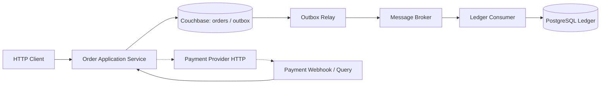
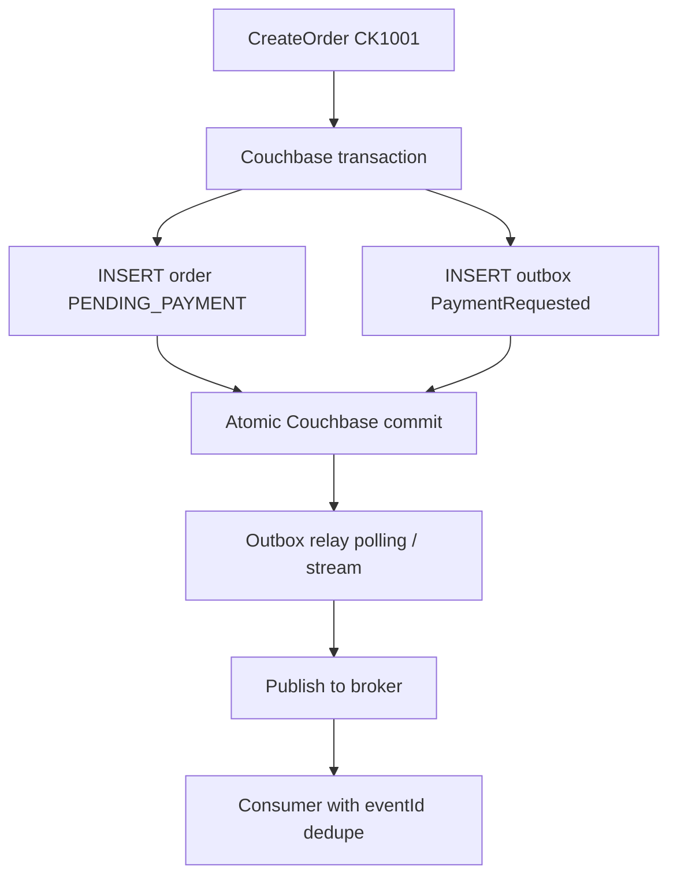
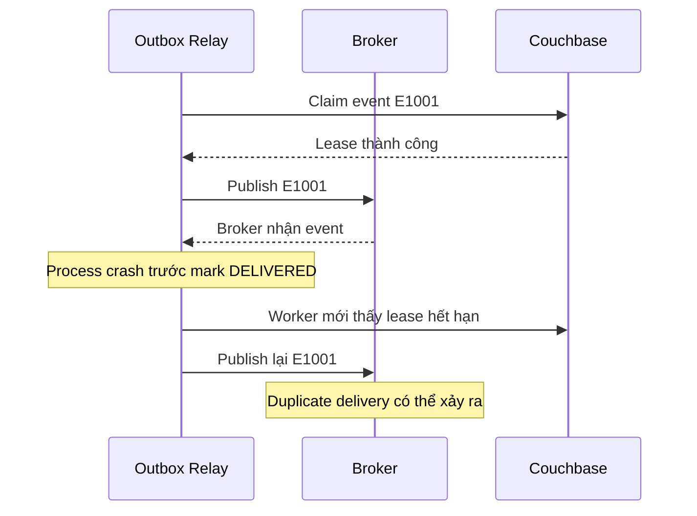
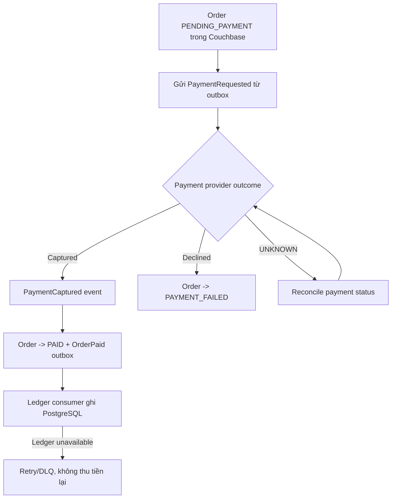

# Giao dịch Couchbase với HTTP, hàng đợi hoặc cơ sở dữ liệu khác

Trong chương **Giao dịch** của module **SPRING_DATA_COUCHBASE**, chúng ta có thể dùng Spring Data Repository, `CouchbaseTemplate` hoặc Java SDK Transactions API để điều phối **nhiều document Couchbase** trong một giao dịch. Tuy nhiên, một ứng dụng thực tế hiếm khi chỉ nói chuyện với Couchbase: nó còn gửi request HTTP đến dịch vụ thanh toán, publish message tới Kafka/RabbitMQ, ghi dữ liệu vào PostgreSQL hoặc tiếp nhận webhook.

Vấn đề là **ranh giới commit không tự kéo dài qua những hệ thống này**. Dù một service có `@Transactional(transactionManager = "couchbaseTransactionManager")`, Couchbase không thể tự rollback email đã gửi, tiền đã thu bởi cổng thanh toán, message đã được broker nhận hoặc bản ghi PostgreSQL đã commit độc lập.

Một thiết kế tích hợp đáng tin cậy phải trả lời chính xác:

1. **Điều gì được Couchbase commit nguyên tử?**
2. **Điều gì xảy ra nếu ứng dụng crash giữa commit Couchbase và lời gọi sang hệ thống khác?**
3. **Nếu kết quả HTTP hoặc message acknowledgment bị mất, có an toàn khi gọi lại không?**
4. **Hệ thống đối soát, phát lại, xử lý trùng và bù trừ bằng cách nào?**

Bài học phân biệt **local transaction**, **dual write**, **transactional outbox**, **inbox/idempotent consumer**, **saga** và **eventual consistency**, đặt chúng trong bối cảnh Spring Data Couchbase với bucket/scope/collection, `@Version`/CAS, SQL++, TTL, và API reactive. Mục tiêu không phải hứa “exactly once” bằng một annotation, mà là xác định rõ từng bảo đảm và xây được quy trình phục hồi khi lỗi.

## 1. Mục tiêu học tập

Sau bài học, bạn có thể:

- Chỉ ra **phạm vi ACID thực tế** của Couchbase transaction so với HTTP, message broker và datastore khác.
- Giải thích tại sao **dual write** (ghi Couchbase rồi publish/gọi API) không atomic và có những cửa sổ lỗi nào.
- Mô hình hóa **transactional outbox**: business document và sự kiện chờ phát được ghi **cùng transaction Couchbase**.
- Thiết kế **outbox relay** có claim/lease, retry, dead-letter, recovery và bảo vệ concurrency bằng CAS.
- Thiết kế **consumer idempotent** và **inbox** khi broker phát lại cùng event, đặc biệt lúc consumer ghi Couchbase hoặc PostgreSQL.
- Phân biệt **at-least-once delivery**, **at-most-once handling**, **effectively-once business effect** và giới hạn của “exactly once”.
- Dùng **saga** với trạng thái, timeout, bước bù trừ và đối soát cho workflow HTTP không thể rollback.
- Thiết kế `requestId`, `orderId`, `eventId` và payment idempotency key **ổn định qua retry**.
- Xử lý **commit ambiguous**, HTTP timeout và broker acknowledgment loss mà không tạo lệnh thanh toán/đơn hàng trùng.
- Phân biệt `@Transactional`, SDK `ctx`, `CouchbaseTransactionalOperator` và transaction riêng của database/broker.
- Xây ma trận integration test có crash/fault injection tại các điểm giao tiếp và xác minh bất biến nghiệp vụ.

## 2. Tình huống xuyên suốt: tạo đơn, thu tiền và ghi sổ

Một ứng dụng thương mại cần thực hiện:

1. Tạo đơn hàng trong Couchbase.
2. Gọi **Payment API** qua HTTP để thu tiền.
3. Phát `OrderPaid` cho hệ thống khác qua hàng đợi.
4. Ghi bút toán vào PostgreSQL Ledger Service.

Giả định dữ liệu Couchbase nằm ở:

```text
Bucket: appdata
Scope: commerce

Collections:
  orders       # Trạng thái đơn hàng
  outbox       # Sự kiện chờ phát
  inbox        # Event đã xử lý trong service tiêu thụ
  requests     # Marker/idempotency nếu không dùng orderId làm khóa
```

Ví dụ command:

```json
{
  "checkoutId": "CK1001",
  "tenantId": "tenant-a",
  "customerId": "C301",
  "amountMinor": 129900,
  "currency": "VND"
}
```

Quy tắc nghiệp vụ:

- Một `checkoutId` đại diện cho **một ý định đặt hàng**, không phải một lần HTTP request.
- `amountMinor` là số tiền theo đơn vị nhỏ nhất do ứng dụng quy định; **không dùng `double` để tính tiền**.
- Chỉ công bố `PAID` khi có bằng chứng từ payment provider rằng thanh toán được xác nhận theo hợp đồng.
- Event `OrderPaid` không được xuất hiện như sự kiện đã có hiệu lực nếu Couchbase không ghi nhận trạng thái `PAID` tương ứng.
- Nếu HTTP, broker hoặc consumer retry, **không tạo thêm đơn, thu tiền hoặc bút toán** cho cùng ý định nghiệp vụ.
- Không coi “trả HTTP 202” đồng nghĩa “đã thanh toán thành công”.

**Sơ đồ:**



Mỗi cạnh mạng giữa các thành phần là nơi phát sinh timeout, crash, duplicate hoặc reorder. **Không có một transaction manager Couchbase nào tự điều phối tất cả các cạnh đó.**

## 3. Ranh giới transaction: cái gì thực sự cùng commit?

| Thao tác | Có thể ở trong một Couchbase transaction? | Điều kiện |
| --- | --- | --- |
| Đọc/thay `orders/CK1001` | **Có** | Operation được SDK/Spring Data transaction integration hỗ trợ |
| Insert outbox event `PaymentRequested` | **Có** | Cùng transaction context, đúng collection |
| Insert inbox marker trong cùng cluster | **Có** | Cùng context, insert-only |
| Ghi collection khác trong Couchbase | **Có thể** | Kiểm tra khả năng SDK/server và quyền trên keyspace |
| Gọi Payment HTTP `POST /charges` | **Không** | Provider có transaction riêng |
| Publish Kafka/RabbitMQ message | **Không** | Broker có commit/ack riêng |
| Ghi một row trong PostgreSQL | **Không** | PostgreSQL có local transaction riêng |
| Gửi email/SMS | **Không** | Không rollback theo Couchbase |
| Ghi Redis cache | **Không** | Operation độc lập trừ khi có workflow khác |
| Gọi external search API | **Không** | Tác động và visibility nằm ngoài Couchbase |

**Cùng method Java không có nghĩa cùng transaction.** **Cùng lambda `run(ctx -> ...)` cũng không đủ** nếu gọi SDK operation thông thường ngoài `ctx` hoặc gọi dịch vụ HTTP bên trong lambda.

### 3.1. Một local transaction vẫn rất có giá trị

Ví dụ, trong một transaction Couchbase có thể:

```text
INSERT order::tenant-a::CK1001 (status=PENDING_PAYMENT)
INSERT outbox::tenant-a::PaymentRequested::CK1001
COMMIT
```

Sau commit, cả **đơn hàng** và **ý định gọi thanh toán** đều được ghi lại. Nếu app crash ngay sau đó, relay có thể tiếp tục xử lý outbox. Đây là bảo đảm hữu ích **bên trong Couchbase** dù chưa thể cam kết phía Payment Provider.

### 3.2. Phân biệt tên “distributed transaction”

Couchbase distributed transactions điều phối nhiều document của Couchbase trong phạm vi được hỗ trợ. Điều đó **không có nghĩa** Couchbase tự triển khai **XA/two-phase commit** xuyên PostgreSQL, Kafka, HTTP provider và Couchbase.

Nếu workflow cần phối hợp nhiều hệ thống không hỗ trợ cùng một giao thức commit, phải thiết kế theo **state machine, idempotency, retry và compensation**.

## 4. Vì sao dual write luôn có cửa sổ lỗi?

Một cách viết tưởng đơn giản:

```java
orderRepository.save(order);
kafkaTemplate.send("orders", event);
```

Nếu hai thao tác **độc lập**:

- Couchbase thành công, process crash trước khi publish → **thiếu event**.
- Publish thành công, nhưng Couchbase không commit trạng thái đơn → **event không có sự thật tương ứng**.
- Broker nhận event nhưng ack mất → app publish lại → **duplicate event**.
- Couchbase và broker đều thành công nhưng HTTP response mất → client gửi lại → **duplicate command**.

Đổi thứ tự cũng không giải quyết:

```java
kafkaTemplate.send("orders", event);
orderRepository.save(order);
```

Nó chỉ đổi loại cửa sổ lỗi: consumer có thể thấy event trước khi order được ghi, và order có thể thất bại sau khi event đã đi.

### 4.1. Ma trận lỗi cho hai hệ thống

| Điểm lỗi | Couchbase | Broker | Hậu quả nếu không có cơ chế phục hồi |
| --- | --- | --- | --- |
| Trước cả hai thao tác | Chưa ghi | Chưa phát | Có thể retry command |
| Sau Couchbase, trước publish | Đã ghi | Chưa phát | **Mất sự kiện** |
| Sau publish, trước Couchbase | Chưa ghi | Đã phát | **Sự kiện ma** |
| Sau publish, trước broker ack | Có thể đã ghi | Broker có thể đã nhận | **Nguy cơ publish trùng** |
| Sau cả hai, trước HTTP response | Đã ghi | Đã nhận | **Client có thể gửi lại** |

**Không thể chứng minh atomicity hai hệ thống bằng cách gọi chúng lần lượt rồi bắt exception.**

### 4.2. `@Transactional` không giải quyết dual write

```java
@Transactional(transactionManager = "couchbaseTransactionManager")
public void createOrder() {
    repository.save(order);
    kafkaTemplate.send("orders", event);
}
```

Khi chạy thành công, đoạn này **không biến Kafka thành tài nguyên của Couchbase transaction**. Nếu Couchbase abort sau khi Kafka đã nhận message, broker không tự rollback.

Tương tự, `@Transactional` của JPA chỉ quản lý phạm vi transaction mà JPA manager hỗ trợ; không tự gộp Couchbase + PostgreSQL.

## 5. Mô hình đúng hơn: transactional outbox

**Transactional outbox** ghi **business state và event-intent** trong cùng local transaction. Một tiến trình riêng phát event sau khi thấy outbox record đã commit.



Điểm khác biệt:

- **Business order + outbox intent:** atomic trong Couchbase.
- **Outbox → broker:** thông thường **at-least-once** khi relay retry, không atomic với Couchbase.
- **Broker → consumer:** có thể nhận lại, nên consumer phải **idempotent**.
- **Consumer → PostgreSQL:** cần transaction **tại PostgreSQL** cho ledger và marker đã xử lý.

Outbox không khiến Kafka/Payment/PostgreSQL trở thành một phần transaction Couchbase. Nó biến **rủi ro mất ý định phát sự kiện** thành một record bền để xử lý lại.

## 6. Document keys và dữ liệu tối thiểu

Dùng key xác định theo tenant và command:

```text
orders:
  order::tenant-a::CK1001

outbox:
  outbox::tenant-a::PaymentRequested::CK1001

inbox:
  inbox::tenant-a::PaymentResult::PAY9001
```

Order document:

```json
{
  "orderId": "CK1001",
  "tenantId": "tenant-a",
  "customerId": "C301",
  "amountMinor": 129900,
  "currency": "VND",
  "status": "PENDING_PAYMENT",
  "paymentId": null,
  "versionOfEvent": 1
}
```

Outbox event:

```json
{
  "eventId": "PaymentRequested::tenant-a::CK1001",
  "aggregateId": "CK1001",
  "aggregateType": "Order",
  "eventType": "PaymentRequested",
  "tenantId": "tenant-a",
  "amountMinor": 129900,
  "currency": "VND",
  "deliveryStatus": "PENDING",
  "attemptCount": 0
}
```

**Khóa quan trọng:**

- `orderId`/`checkoutId` ổn định theo yêu cầu nghiệp vụ.
- `eventId` ổn định theo **một sự kiện logic**; không cấp UUID mới mỗi lần relay publish lại.
- `payment idempotency key` được truyền tới provider theo contract của provider; không thay đổi mỗi retry.
- `tenantId` phải đến từ ngữ cảnh xác thực/ủy quyền, không tin chuỗi do client mạo danh.
- Key uniqueness của Couchbase có phạm vi **collection**, không toàn cluster.
- Nếu cùng `checkoutId` nhưng payload khác, phải **từ chối**, không âm thầm trả kết quả của payload cũ.

### 6.1. Tại sao không dùng UUID ngẫu nhiên trong transaction retry?

Một transaction callback có thể được SDK thử lại. Nếu tạo `eventId` mới trong callback, lần thử sau có thể thay đổi danh tính message. Hãy cấp các ID theo command ổn định **trước khi bắt đầu transaction** hoặc dẫn xuất theo quy tắc xác định từ command.

## 7. Ví dụ Java SDK: commit order và outbox cùng nhau

Khi dùng SDK trực tiếp, mọi mutation được bảo vệ phải đi qua transaction context `ctx`.

```java
package com.example.commerce;

import java.util.Objects;
import com.couchbase.client.java.Cluster;
import com.couchbase.client.java.Collection;
import com.couchbase.client.java.json.JsonObject;

public final class CreateOrderTransaction {

    private final Cluster cluster;
    private final Collection orders;
    private final Collection outbox;

    public CreateOrderTransaction(
            Cluster cluster,
            Collection orders,
            Collection outbox) {
        this.cluster = cluster;
        this.orders = orders;
        this.outbox = outbox;
    }

    public void create(
            String authorizedTenant,
            String checkoutId,
            String customerId,
            long amountMinor,
            String currency) {

        if (authorizedTenant == null
                || authorizedTenant.isBlank()
                || checkoutId == null
                || checkoutId.isBlank()
                || customerId == null
                || amountMinor <= 0
                || !Objects.equals(currency, "VND")) {
            throw new IllegalArgumentException(
                    "Thông tin checkout không hợp lệ");
        }

        String orderKey = "order::"
                + authorizedTenant + "::" + checkoutId;
        String eventKey = "outbox::"
                + authorizedTenant
                + "::PaymentRequested::" + checkoutId;

        JsonObject order = JsonObject.create()
                .put("orderId", checkoutId)
                .put("tenantId", authorizedTenant)
                .put("customerId", customerId)
                .put("amountMinor", amountMinor)
                .put("currency", currency)
                .put("status", "PENDING_PAYMENT");

        JsonObject event = JsonObject.create()
                .put("eventId", "PaymentRequested::"
                        + authorizedTenant + "::" + checkoutId)
                .put("aggregateId", checkoutId)
                .put("eventType", "PaymentRequested")
                .put("tenantId", authorizedTenant)
                .put("amountMinor", amountMinor)
                .put("currency", currency)
                .put("deliveryStatus", "PENDING");

        cluster.transactions().run(ctx -> {
            ctx.insert(orders, orderKey, order);
            ctx.insert(outbox, eventKey, event);
        });
    }
}
```

Đây là **lõi tạo mới**, chưa phải toàn bộ API idempotent. Nếu lần gọi trước đã commit nhưng phản hồi mất, insert-only sẽ gặp key tồn tại; tầng application cần **tra cứu order/so payload và trả outcome cũ**, thay vì tạo ID mới hoặc lặp vô hạn.

### 7.1. Vì sao dùng insert-only?

`ctx.insert` từ chối key đã có trong collection. Hai request cùng `checkoutId` không được tùy tiện cùng ghi một order độc lập. `upsert` có thể ghi đè trạng thái đã xử lý và không phù hợp để bảo vệ một command duy nhất.

### 7.2. Đặt đúng collection

```java
var scope = cluster.bucket("appdata").scope("commerce");

Collection orders = scope.collection("orders");
Collection outbox = scope.collection("outbox");
```

SDK Collection không tự lấy `@Collection` từ Spring Data entity. Nếu repository dùng `commerce.orders` còn SDK mở `defaultCollection()`, chúng có thể ghi hai document khác nhau dù cùng string key.

### 7.3. Không gọi Payment API trong callback

```java
cluster.transactions().run(ctx -> {
    ctx.insert(orders, orderKey, order);
    paymentClient.charge(...); // Sai ranh giới.
    ctx.insert(outbox, eventKey, event);
});
```

Callback có thể chạy lại; provider không rollback khi Couchbase abort. Ngoài ra HTTP làm transaction dài, tăng conflict và timeout.

## 8. Dùng Spring Data Couchbase Repository/Template thay SDK

Trong Spring Data, entity có thể ánh xạ:

```java
import org.springframework.data.annotation.Id;
import org.springframework.data.annotation.Version;
import org.springframework.data.couchbase.core.mapping.Collection;
import org.springframework.data.couchbase.core.mapping.Document;
import org.springframework.data.couchbase.core.mapping.Scope;

@Document
@Scope("commerce")
@Collection("orders")
public class OrderDocument {

    @Id
    private String id;

    private String tenantId;
    private String checkoutId;
    private long amountMinor;
    private String currency;
    private String status;

    @Version
    private Long version;

    public OrderDocument() {}
    // Constructor, getter, setter theo convention ứng dụng.
}
```

Repository:

```java
import org.springframework.data.couchbase.repository.CouchbaseRepository;

public interface OrderRepository
        extends CouchbaseRepository<OrderDocument, String> {
}
```

Service mô tả ranh giới:

```java
@Service
public class OrderApplicationService {

    private final OrderRepository orders;
    private final OutboxRepository outbox;

    public OrderApplicationService(
            OrderRepository orders,
            OutboxRepository outbox) {
        this.orders = orders;
        this.outbox = outbox;
    }

    @Transactional(transactionManager = "couchbaseTransactionManager")
    public void acceptOrder(CreateOrderCommand command) {
        orders.save(buildOrder(command));
        outbox.save(buildOutboxEvent(command));
    }
}
```

**Đây là ví dụ cấu trúc**, `OutboxRepository`, `CreateOrderCommand` và helper chưa được định nghĩa. Chỉ được tuyên bố hai `save` cùng commit khi:

1. Spring Data Couchbase version hỗ trợ các repository operations đó trong transaction.
2. `couchbaseTransactionManager` đúng manager; bean repository/outbox thuộc cùng hạ tầng transaction.
3. Public method được gọi **qua Spring proxy**, không bằng `this.acceptOrder(...)` trong cùng target.
4. Entity mapping, `@Version`, bucket/scope/collection và RBAC/ATR đúng.
5. Tính **insert-only** của order/outbox đã được bảo vệ đúng. `save` không thay thế insert-only khi cần uniqueness.
6. Integration test cố tình lỗi sau mutation đầu xác nhận không có commit một phần.

**Không chọn Repository hay Template chỉ vì nghĩ chúng tự tạo distributed transaction**; chúng là các tầng truy cập dữ liệu, còn transaction support tùy API/context/version.

## 9. Phân biệt atomicity với khả năng phát event

Một transaction ghi order và outbox có thể:

- **Commit:** cả order và outbox record tồn tại.
- **Abort:** cả hai thay đổi không được commit.
- **Commit ambiguous:** app chưa biết kết quả; phải đối soát theo `checkoutId`.
- **Outbox vẫn PENDING:** event chưa được publish hoặc chưa được xác nhận, **không có nghĩa order chưa commit**.

Nếu relay không hoạt động, order vẫn nằm trong Couchbase với outbox chờ. Đây là một trạng thái **có thể phục hồi**, khác với dual write có thể mất hoàn toàn ý định publish.

### 9.1. Không hứa event được gửi ngay lập tức

Outbox relay có độ trễ polling/stream, có thể chịu backoff khi broker lỗi. Consumer có thể thấy đơn hàng **sau** khi API đã trả accepted. Đó là **eventual consistency** giữa các dịch vụ.

Nếu yêu cầu API cần đồng bộ tới trạng thái cuối cùng, phải làm rõ **latency, timeout và đường UNKNOWN**, không bỏ qua giới hạn mạng chỉ để trả 200.

## 10. Outbox relay: từ PENDING tới broker

Relay thường gồm:

```text
1. Query một batch outbox PENDING đến hạn.
2. Claim event bằng CAS/lease để nhiều worker ít tranh chấp.
3. Publish event với eventId ổn định.
4. Đợi broker acknowledgment phù hợp.
5. Mark event DELIVERED (hoặc ACKNOWLEDGED).
6. Nếu lỗi: retry có backoff / DLQ / cảnh báo.
```

Outbox relay **không chạy bên trong transaction tạo order**. Nó có thể chạy ở process/worker khác và được restart bất cứ lúc nào.

### 10.1. Query batch với SQL++

Ví dụ keyspace `appdata.commerce.outbox`:

```sql
SELECT META(e).id AS documentKey,
       e.eventId,
       e.eventType,
       e.deliveryStatus,
       e.nextAttemptAt
FROM `appdata`.`commerce`.`outbox` AS e
WHERE e.deliveryStatus = "PENDING"
ORDER BY e.nextAttemptAt
LIMIT 100;
```

Index:

```sql
CREATE INDEX ix_outbox_status_due
ON `appdata`.`commerce`.`outbox` (
    deliveryStatus,
    nextAttemptAt
);
```

Đảm bảo `nextAttemptAt` được khởi tạo và cập nhật theo policy; nếu dùng missing/null, phải điều chỉnh predicate/index đúng hành vi dữ liệu.

**Query trả danh sách PENDING không đồng nghĩa claim độc quyền.** Hai worker có thể nhận cùng record, nhất là với index cập nhật bất đồng bộ. Cần cơ chế tranh chấp theo key tại thời điểm claim.

### 10.2. CAS claim, lease và fencing

Một relay có thể đọc document và thay `PENDING` thành `LEASED` bằng replace có **CAS** tương ứng:

```text
Outbox event:
  deliveryStatus: LEASED
  claimOwner: worker-7
  leaseUntil: 2030-01-01T00:05:00Z
  claimToken: 42
  attemptCount: 3
```

- CAS giúp phát hiện thay đổi đồng thời trên **chính outbox document**.
- Lease hết hạn cho phép worker khác nhận lại khi worker cũ chết.
- `claimToken`/fencing token là **trường nghiệp vụ** để giảm trường hợp worker cũ ghi đè trạng thái mới; cần kiểm tra token/CAS khi mark delivered.
- Claim không bảo đảm event sẽ **chỉ publish một lần**, vì worker có thể crash sau publish nhưng trước mark.
- Clock/lease duration và backpressure cần giám sát; không mặc định thời gian một worker luôn chính xác hoặc worker cũ dừng ngay khi lease hết hạn.

### 10.3. Không ghi mã nguồn “nghe có vẻ atomic” nhưng không có CAS

```java
if ("PENDING".equals(event.getString("deliveryStatus"))) {
    broker.publish(event);
    outbox.upsert(eventKey, delivered); // Race với worker khác.
}
```

Đây là mẫu không an toàn: hai worker cùng đọc PENDING và đều publish. Dùng conditional mutation/CAS hoặc thiết kế claim có kiểm chứng; sau đó vẫn có **consumer dedupe** để xử lý crash/ack loss.

## 11. Bài toán cửa sổ giữa publish và mark DELIVERED



Khi relay publish xong rồi crash trước cập nhật trạng thái Couchbase, event có thể được gửi lần nữa. Đây là bản chất của **at-least-once relay** trong thiết kế phổ biến.

**Không thể giải quyết chỉ bằng “thêm một transaction Couchbase quanh publish”.** Broker không tham gia cùng Couchbase commit, nên vẫn có một cửa sổ không đồng bộ.

### 11.1. Broker acknowledgment bị mất

Ngay cả khi relay không crash:

- Broker đã nhận.
- Mạng mất gói ack.
- Relay tưởng publish thất bại và gửi lại.

Cần eventId ổn định và idempotent consumer.

### 11.2. Tại sao “exactly once” phải nói rõ phạm vi?

Một số broker có cơ chế transactions/exactly-once processing **trong phạm vi broker/streams được hỗ trợ**. Điều đó không tự biến lần ghi Couchbase hoặc PostgreSQL bên ngoài thành **một atomic commit chung**.

Khi tài liệu kiến trúc dùng “exactly once”, phải ghi rõ: exactly once **ở đâu**, dựa trên key gì, với failure window nào và test nào chứng minh.

## 12. Consumer idempotent: một event có thể đến nhiều lần

Giả sử Ledger Consumer nhận event:

```json
{
  "eventId": "OrderPaid::tenant-a::CK1001",
  "eventType": "OrderPaid",
  "tenantId": "tenant-a",
  "orderId": "CK1001",
  "paymentId": "PAY9001",
  "amountMinor": 129900,
  "currency": "VND"
}
```

Broker có thể gửi lại cùng event do consumer restart, offset chưa commit, broker redelivery hoặc ack loss.

**Không được** viết:

```java
void onMessage(OrderPaid event) {
    ledger.insertDebitAndCredit(event);
    ack();
}
```

nếu `ledger.insertDebitAndCredit` không có bảo đảm chống duplicate. Lần redelivery có thể ghi thêm một bút toán.

### 12.1. Idempotent consumer contract

Một consumer nên:

1. Xác minh schema/version, nguồn message, tenant/authorization và dữ liệu tối thiểu.
2. Dùng **eventId ổn định** làm inbox/deduplication key.
3. Trong **local transaction của datastore đích**, ghi marker inbox và business mutation cần cùng commit.
4. Nếu eventId đã xử lý, so nội dung/payload hash và **không áp dụng business mutation lần nữa**.
5. Chỉ xác nhận/ack message **sau khi local transaction outcome được xác định thành công hoặc duplicate đã được xử lý an toàn**.
6. Nếu result chưa rõ, tra cứu local inbox/state; không ack mù quáng hoặc lặp mutation không kiểm soát.

**Inbox phải nằm cùng ranh giới atomic với business mutation của consumer**, nếu mục tiêu là xử lý event một lần về mặt hiệu ứng tại datastore đó.

## 13. Inbox + business mutation trong Couchbase

Giả sử Payment Result Consumer cập nhật `orders` trên Couchbase. Nó nhận event `PaymentCaptured` và cần:

- Thay `orders/CK1001` từ `PENDING_PAYMENT` sang `PAID`.
- Insert inbox marker xác nhận đã xử lý event `PAY9001`.
- Insert outbox event `OrderPaid` để Ledger Service xử lý.

Một transaction SDK có thể làm cả ba:

```java
import com.couchbase.client.java.Cluster;
import com.couchbase.client.java.Collection;
import com.couchbase.client.java.json.JsonObject;
import com.couchbase.client.java.transactions.TransactionGetResult;

public void applyPaymentCaptured(
        Cluster cluster,
        Collection orders,
        Collection inbox,
        Collection outbox,
        String tenantId,
        String orderId,
        String paymentId,
        long amountMinor) {

    String orderKey = "order::"
            + tenantId + "::" + orderId;

    String inboxKey = "inbox::"
            + tenantId + "::PaymentCaptured::" + paymentId;

    String paidEventKey = "outbox::"
            + tenantId + "::OrderPaid::" + orderId;

    cluster.transactions().run(ctx -> {
        TransactionGetResult current =
                ctx.get(orders, orderKey);
        JsonObject body = current.contentAsObject();

        if (!tenantId.equals(body.getString("tenantId"))
                || !body.getLong("amountMinor")
                        .equals(amountMinor)) {
            throw new IllegalStateException(
                    "Sai tenant hoặc số tiền");
        }

        if (!"PENDING_PAYMENT".equals(
                body.getString("status"))) {
            throw new IllegalStateException(
                    "Trạng thái đơn không cho phép cập nhật");
        }

        JsonObject inboxMarker = JsonObject.create()
                .put("eventId", "PaymentCaptured::"
                        + tenantId + "::" + paymentId)
                .put("orderId", orderId)
                .put("status", "APPLIED");

        JsonObject paidEvent = JsonObject.create()
                .put("eventId", "OrderPaid::"
                        + tenantId + "::" + orderId)
                .put("eventType", "OrderPaid")
                .put("orderId", orderId)
                .put("paymentId", paymentId)
                .put("tenantId", tenantId)
                .put("amountMinor", amountMinor)
                .put("deliveryStatus", "PENDING");

        ctx.insert(inbox, inboxKey, inboxMarker);
        ctx.replace(current,
                body.put("status", "PAID")
                    .put("paymentId", paymentId));
        ctx.insert(outbox, paidEventKey, paidEvent);
    });
}
```

**Mẫu này chỉ mô tả đường áp dụng event mới.** Khi nhận duplicate, insert-only inbox thất bại; tầng xử lý cần **đối soát inbox/order, so payload và trả đã xử lý** nếu cùng event hợp lệ. Không nuốt exception trong callback rồi trả ACK giả.

### 13.1. Không cập nhật đơn đã PAID bằng event cũ

Nếu `PaymentCaptured` tới sau khi order đã `REFUNDED` hoặc bị xử lý theo workflow khác, chỉ thấy eventId chưa tồn tại **không đủ** để chuyển trạng thái về PAID. Phải kiểm tra **state machine**, paymentId, amount và thứ tự nghiệp vụ.

### 13.2. Trạng thái ngoài dự kiến là lỗi hay duplicate?

- `PAID` và cùng `paymentId`: có thể là duplicate hợp lệ, cần xác minh marker/payload.
- `PAID` nhưng paymentId khác: có thể là **conflict nghiêm trọng**, cần điều tra.
- `CANCELLED` với provider báo captured: có thể cần **refund/compensation**, không được âm thầm bỏ qua.
- Không có order: có thể event tới sai tenant hoặc trước khi local entity hiện hữu; phân loại **retryable dependency** với budget, không tạo order giả.

## 14. Inbox trong PostgreSQL: local transaction riêng

Ledger Service lưu sổ ở PostgreSQL, **không thể tham gia Couchbase transaction của Order Service**. Nó dùng transaction PostgreSQL để atomically:

1. Đánh dấu eventId đã xử lý.
2. Ghi các bút toán ledger tương ứng.
3. Commit local transaction.

Pseudocode:

```sql
BEGIN;

INSERT INTO processed_events(event_id, payload_hash)
VALUES (:event_id, :payload_hash)
ON CONFLICT (event_id) DO NOTHING;

-- Chỉ khi INSERT thực sự tạo một hàng mới:
INSERT INTO ledger_entries(
    entry_id, order_id, account_id,
    amount_minor, currency, direction
)
VALUES (...);

-- Nếu event_id đã tồn tại, so payload_hash rồi
-- bỏ qua các bút toán đã áp dụng.
COMMIT;
```

**Quan trọng:** Không thực hiện bút toán khi `INSERT processed_events` không chèn được record mới. Trường hợp duplicate phải so payload hash/nguồn message; nếu cùng eventId nhưng nội dung khác thì báo conflict.

Ví dụ trên dùng SQL giản lược để minh họa **ranh giới atomic tại PostgreSQL**. Trong triển khai thực, dùng `RETURNING`, transaction isolation/unique constraint và xử lý concurrency thích hợp theo PostgreSQL version.

### 14.1. Khi nào ACK broker?

Chỉ ACK sau khi:

- Transaction PostgreSQL đã commit và outcome được xác định; hoặc
- EventId duplicate đã được xác minh và không cần ghi lại.

Nếu commit PostgreSQL xong mà process crash trước ACK, broker có thể redeliver. Inbox/unique constraint cho phép consumer nhận lại mà không ghi sổ hai lần.

### 14.2. Không giữ một Couchbase transaction mở để đợi PostgreSQL

Một transaction Couchbase dài không biến PostgreSQL thành cùng atomic unit. Nó chỉ tăng thời gian giữ read/write set, conflict, timeout và có thể khiến callback retry trong lúc tài nguyên bên ngoài đã commit.

## 15. HTTP Payment Provider: giới hạn không thể rollback

Với HTTP:

```java
paymentClient.capture(
        orderId, amountMinor, idempotencyKey);
```

Provider có thể:

- Nhận và xử lý thành công, trả `200`/`201`.
- Trả lỗi nghiệp vụ xác định, ví dụ payment bị từ chối.
- Trả `500` nhưng đã thực hiện một phần việc, tùy API contract.
- Xử lý thành công nhưng response mất, client nhận timeout.
- Trả `202 Accepted` vì xử lý bất đồng bộ.
- Gửi webhook thành công, webhook thất lạc hoặc gửi trùng.

**HTTP status một mình không phải cơ chế rollback xuyên hệ thống.** API có thể có idempotency key, payment intent ID và endpoint truy vấn trạng thái; cần dựa vào tài liệu provider cụ thể.

### 15.1. Idempotency key cho payment

Một ý định thanh toán nên có **payment operation ID** ổn định, ví dụ:

```text
paymentKey = payment::tenant-a::CK1001::capture-v1
```

Nếu request HTTP timeout, chỉ được retry bằng **cùng key** khi provider xác nhận semantics an toàn trong cửa sổ retention. Không tự sinh key mới vì điều đó có thể tạo lần thu tiền mới.

### 15.2. UNKNOWN là trạng thái hợp lệ

Nếu không biết charge đã được xử lý chưa, nên chuyển workflow sang `PAYMENT_UNKNOWN` hoặc `NEEDS_RECONCILIATION` và truy vấn provider theo payment intent/key. Không cập nhật order thành `FAILED` hoặc gọi charge lần nữa mù quáng.

### 15.3. Không làm HTTP trong transaction callback Couchbase

SDK callback có thể retry; provider không rollback khi Couchbase abort. Đưa HTTP call vào callback còn khiến transaction giữ tài nguyên lâu và dễ xung đột.

## 16. Saga: workflow trải qua nhiều commit cục bộ

Khi không thể commit Couchbase, payment provider, broker và PostgreSQL bằng một transaction toàn cục, dùng **saga**: chuỗi bước nghiệp vụ có trạng thái, mỗi bước có **local transaction** và có cơ chế **compensation** khi bước sau thất bại.

Ví dụ:



Tùy nghiệp vụ, có thể cần các bước reserve stock, authorize payment, capture payment, phát invoice, shipping. Mỗi bước là một transaction cục bộ hoặc external operation có outcome riêng.

### 16.1. Compensation không phải rollback ACID

Nếu đã charge thành công rồi bước sau thất bại, một **refund** có thể được yêu cầu. Refund:

- Là **một thao tác mới**, không xóa lịch sử charge ban đầu.
- Có thể thất bại hoặc trả kết quả UNKNOWN.
- Cần idempotency key và reconciliation riêng.
- Có thể không làm người dùng “trở về chính xác trạng thái trước đó” ngay lập tức.

Vì vậy không gọi saga là “transaction ACID xuyên hệ thống”. Nó cung cấp **quy trình hoàn thành/bù trừ có kiểm soát**.

### 16.2. Orchestration và choreography

| Kiểu saga | Cách điều phối | Ưu điểm | Rủi ro |
| --- | --- | --- | --- |
| **Orchestration** | Một coordinator lưu state, phát command | Dễ quan sát state machine/timeout | Coordinator là thành phần quan trọng cần HA/idempotency |
| **Choreography** | Các service phản ứng với events | Service bớt phụ thuộc trực tiếp coordinator | Luồng phức tạp khi nhiều bước, khó lần theo event vòng |
| **Kết hợp** | Coordinator cho bước quan trọng, events cho thông báo/phụ trợ | Cân bằng trách nhiệm | Phải quy định rõ owner của trạng thái |

Không chọn chỉ theo phong cách code; chọn theo số bước, tính đảo ngược, yêu cầu audit và khả năng vận hành.

## 17. Thiết kế state machine cho Order

Ví dụ:

```text
RECEIVED
  -> PENDING_PAYMENT
      -> PAYMENT_UNKNOWN
          -> PENDING_PAYMENT (chỉ nếu reconciled cho phép)
          -> PAID
          -> PAYMENT_FAILED
      -> PAID
      -> PAYMENT_FAILED
  -> CANCEL_PENDING
      -> CANCELLED
      -> REFUND_PENDING
          -> REFUNDED
          -> REFUND_UNKNOWN
```

Không nhất thiết mọi ứng dụng dùng đúng các trạng thái này. Điều quan trọng là **mỗi chuyển trạng thái phải có guard và evidence**.

| Từ trạng thái | Event hợp lệ | Sang trạng thái | Điều kiện |
| --- | --- | --- | --- |
| `PENDING_PAYMENT` | Payment captured | `PAID` | PaymentId/amount/currency khớp |
| `PENDING_PAYMENT` | Payment declined xác định | `PAYMENT_FAILED` | Có bằng chứng provider |
| `PENDING_PAYMENT` | Provider timeout | `PAYMENT_UNKNOWN` | Chưa có outcome cuối |
| `PAYMENT_UNKNOWN` | Reconcile captured | `PAID` | Đối soát provider |
| `PAID` | Refund authorized | `REFUND_PENDING` | Chính sách hoàn tiền cho phép |
| `REFUND_PENDING` | Refund confirmed | `REFUNDED` | RefundId/amount phù hợp |
| Bất kỳ | Event stale/không hợp lệ | Không đổi + phân loại | Không đảo trạng thái tùy tiện |

### 17.1. CAS và state guard

Trong Spring Data Couchbase, `@Version Long` mang CAS metadata, có thể phát hiện một entity stale khi cập nhật. Nhưng **CAS chỉ là điều kiện ghi trên một document**, còn quyết định “`PENDING_PAYMENT` mới được thành `PAID`” phải được kiểm tra **trong transaction attempt** và đánh giá lại khi retry.

Nếu hai workflow cạnh tranh sửa cùng order, xử lý conflict bằng cách đọc lại và xác minh state machine, **không retry blind overwrite**.

### 17.2. Cần event version hoặc sequence?

Event có thể có `aggregateVersion`/`sequence` để consumer phát hiện event **cũ, trùng hoặc đi trước**. Không suy rằng toàn broker bảo đảm thứ tự toàn cục; thứ tự thường phụ thuộc partition/key và cấu hình. Nếu nghiệp vụ cần thứ tự theo orderId, dùng routing key thích hợp **và** state/version guard ở consumer.

## 18. Outbox + saga: ghép các bước đúng ranh giới

Một workflow có thể được tổ chức:

```text
Request Create Order
    |
    v
Couchbase local transaction:
    INSERT order PENDING_PAYMENT
    INSERT outbox PaymentRequested
    |
    v
Outbox relay -> Broker/Worker
    |
    v
Payment HTTP (idempotency key)
    |
    +-- captured --> PaymentResult event
    |                 |
    |                 v
    |          Couchbase local transaction:
    |              INSERT inbox PaymentResult
    |              UPDATE order PAID
    |              INSERT outbox OrderPaid
    |                 |
    |                 v
    |          Outbox relay -> Ledger Consumer
    |                 |
    |                 v
    |          PostgreSQL local transaction:
    |              INSERT processed_events
    |              INSERT ledger entries
    |
    +-- unknown --> Reconciliation worker
    |
    +-- declined -> Order PAYMENT_FAILED
```

Mỗi mũi tên giữa hệ thống có thể được retry, duplicate hoặc delay. **Đặt ID ổn định và kiểm soát outcome tại mỗi bước**, thay vì giả định “toàn bộ request một lần”.

## 19. Retry của transaction callback và tác dụng phụ bên ngoài

Couchbase Java SDK có thể retry attempt:

```java
cluster.transactions().run(ctx -> {
    // Các thao tác ctx.get/ctx.insert/ctx.replace...
});
```

Trong từng attempt, chỉ nên:

- Đọc lại document cần bảo vệ qua `ctx`.
- Tính toán thuần dựa trên input của command và dữ liệu vừa đọc.
- Kiểm tra tenant, amount, state và business invariant.
- Stage các mutation bằng transaction-aware operations.
- Tạo event/marker với **ID ổn định**.

Không nên:

```java
cluster.transactions().run(ctx -> {
    ctx.replace(...);
    paymentClient.capture(...); // Có thể thu tiền lặp.
    kafkaTemplate.send(...);     // Có thể publish lặp.
    jdbcTemplate.update(...);    // Không rollback theo Couchbase.
});
```

**Không tạo side effect ngoại vi trong một callback có thể được SDK chạy lại.** Callback hoàn tất chưa phải post-commit hook.

### 19.1. Không trộn SDK `collection.upsert` bên trong callback

`ctx.insert`/`ctx.replace`/`ctx.remove` là API transaction-aware. `collection.upsert` thông thường, dù gọi trong lambda, **không tự tham gia transaction**. Điều này cũng áp dụng với `cluster.query` thường so với transactional `ctx.query` ở phiên bản hỗ trợ.

## 20. Reactive integration không kéo dài transaction qua mạng

Với WebFlux/Reactive Spring Data, một service có thể dùng `CouchbaseTransactionalOperator` để bọc những Publisher Couchbase được hỗ trợ:

```java
import org.springframework.data.couchbase.transaction.CouchbaseTransactionalOperator;
import org.springframework.data.couchbase.core.ReactiveCouchbaseTemplate;
import reactor.core.publisher.Mono;

public Mono<OrderDocument> acceptOrder(
        CouchbaseTransactionalOperator operator,
        ReactiveCouchbaseTemplate template,
        OrderDocument order) {

    return operator.execute(status ->
            template.insertById(OrderDocument.class)
                    .one(order))
            .single();
}
```

**Đây là ví dụ phạm vi**, không có nghĩa event outbox đã được ghi; muốn atomic order+outbox cần **thêm insert outbox cùng callback** và xác minh cả hai operation hỗ trợ transaction ở phiên bản ứng dụng.

### 20.1. `Mono.when` không tự tạo distributed transaction

```java
Mono<Void> workflow = Mono.when(
        reactiveOrderRepository.save(order).then(),
        httpPaymentClient.capture(payment).then(),
        reactiveKafkaSender.send(event).then());
```

Đoạn này chỉ phối hợp ba Publisher. Nó **không tạo atomic commit** giữa Couchbase, Payment API và broker. Một nhánh có thể thành công, nhánh khác thất bại.

### 20.2. Không tự `subscribe()` bên trong transaction operator

Nếu tự subscribe một Publisher mutation khác bên trong `operator.execute(...)`, nhánh đó có thể chạy **ngoài lifecycle/context** do operator quản lý. Hãy nối các Couchbase mutations được hỗ trợ vào **một Publisher**, nhưng giữ HTTP/broker side effects **bên ngoài scope**, thông qua outbox.

### 20.3. Reactor timeout/cancellation

`timeout(Duration.ofSeconds(3))` có thể cancel upstream khi quá hạn. **Không mặc định cancel là rollback xác định**; transaction có thể đang commit hoặc đã commit mà caller mất tín hiệu cuối. Dùng orderId/checkoutId ổn định và API trạng thái để đối soát.

### 20.4. `retryWhen` không được áp dụng bừa bãi

Reactive `retryWhen` có thể resubscribe toàn workflow. Nếu một phiên trước đã commit nhưng response mất, resubscribe có thể tạo command thứ hai nếu không có idempotency. Chỉ retry lỗi phù hợp và bảo vệ bằng ID ổn định cùng marker insert-only.

## 21. Cùng một event được xử lý ở hai datastore: ai là chủ sở hữu?

Khi Couchbase Order Service và PostgreSQL Ledger Service giữ dữ liệu khác nhau, phải xác định **source of truth**:

| Câu hỏi | Ví dụ quyết định rõ |
| --- | --- |
| Ai quyết định đơn đã thanh toán? | Payment Provider outcome + Order Service state machine |
| Ai quyết định ledger entry đã tồn tại? | Ledger Service trong PostgreSQL |
| Event dùng để làm gì? | Chuyển thông tin đã xác nhận, không thay DB transaction của publisher |
| Khi ledger chậm thì order ra sao? | `PAID` nhưng `LEDGER_PENDING`/trạng thái vận hành riêng |
| Nếu ledger lỗi dài ngày? | Retry/DLQ/escalation, không thu tiền lần nữa |
| Nếu consumer nhận event cũ? | Inbox/sequence/state guard |
| Nếu hai nguồn mâu thuẫn? | Reconciliation, audit trail và quy trình xử lý |

**Eventual consistency phải có chủ đích**. Không nên để UI mặc định “mọi dịch vụ đã đồng bộ” ngay khi một local transaction kết thúc.

### 21.1. Read model và CQRS

Một read model từ events có thể chậm hơn write model. Người dùng vừa đặt hàng có thể cần xem `PENDING_PAYMENT` ngay trong Order Service, trong khi báo cáo Ledger Service chưa cập nhật. Nếu hiển thị trạng thái trên nhiều nguồn, ghi rõ **trạng thái gốc** và **trạng thái đồng bộ**, không đánh đồng chúng.

## 22. Sự kiện không đồng nghĩa mệnh lệnh

**Command**: yêu cầu hệ thống làm một việc, có thể bị từ chối.

```json
{
  "commandId": "PaymentRequested::tenant-a::CK1001",
  "type": "CapturePayment",
  "orderId": "CK1001",
  "amountMinor": 129900
}
```

**Event**: thông báo một điều đã xảy ra và được xác nhận ở hệ thống phát:

```json
{
  "eventId": "OrderPaid::tenant-a::CK1001",
  "type": "OrderPaid",
  "orderId": "CK1001",
  "paymentId": "PAY9001"
}
```

Nếu order chỉ mới ở `PENDING_PAYMENT`, không nên phát event tên `OrderPaid` như thể provider đã captured.

### 22.1. Quan hệ correlation/causation

Để lần theo một saga:

- `correlationId`: một checkout/saga xuyên các service.
- `causationId`: command/event nào gây ra message hiện tại.
- `eventId`: định danh của một event logic.
- `attemptId`: một lần thử delivery/xử lý, **khác eventId**.
- `paymentId`: định danh provider, dùng cho đối soát.

Không cấp `eventId` mới khi chỉ publish lại cùng event.

## 23. Sự cố thứ tự event và bản ghi cũ

Giả sử consumer nhận:

```text
E1: OrderPaid    (version 3)
E2: OrderRefunded (version 4)
E3: OrderPaid    (version 3)  # redelivery muộn
```

Nếu xử lý E3 như một event mới, hệ thống có thể đưa order đã refunded trở lại trạng thái paid.

Cần:

- Inbox dedupe theo eventId.
- State transition guard (không quay lại `PAID` từ `REFUNDED` bằng event cũ).
- Aggregate version/sequence khi phù hợp.
- Partition/routing key theo aggregate để giảm reorder, nhưng không chỉ dựa vào đó.
- Chính sách xử lý gap, missing event hoặc poisoned message.

**Idempotency chỉ ngăn xử lý lại cùng event**. Nó không tự giải quyết **hai event khác nhau nhưng thứ tự nghiệp vụ không hợp lệ**.

## 24. Compensation và sự kiện bù trừ phải idempotent

Nếu payment đã captured nhưng order không thể hoàn tất theo chính sách, saga có thể yêu cầu refund:

```text
refundId = refund::tenant-a::CK1001::v1
```

Ghi nhận local state `REFUND_PENDING` và outbox `RefundRequested`; worker gọi provider với **refund idempotency key** ổn định.

Không gọi refund trong Couchbase transaction callback như một “rollback hook”. Provider có thể trả timeout; refund cũng có outcome `UNKNOWN` và cần reconciliation.

### 24.1. Compensation phải có điều kiện

Không refund tự động nếu:

- Charge chưa từng thành công.
- Đã refund cùng paymentId/amount trước đó.
- Có tranh chấp đang được nhân viên xử lý.
- Provider yêu cầu một quy trình manual review.

Mỗi bước bù trừ có **guard và idempotency** như một business command độc lập.

## 25. Lỗi và outcome: đừng gộp thành một catch

Một workflow cần phân biệt:

| Loại kết quả | Nghĩa | Hành động |
| --- | --- | --- |
| Couchbase commit confirmed | Local business state + outbox đã commit | Phát result phù hợp, relay xử lý sau |
| Couchbase abort xác định | Local mutation không hoàn tất | Retry có kiểm soát nếu lỗi phù hợp |
| Couchbase commit ambiguous | Chưa rõ local commit | Đối soát order/outbox theo checkoutId |
| Payment declined | Provider xác nhận không thu tiền | Cập nhật `PAYMENT_FAILED` có bằng chứng |
| Payment timeout/unknown | Provider có thể đã thu | Query provider bằng ID, không charge key mới |
| Broker ack lost | Có thể đã nhận event | Publish lại cùng eventId, consumer dedupe |
| Consumer DB committed, ack lost | Local effect có thể đã xong | Redelivery được inbox xử lý |
| Consumer poison message | Schema/payload không thể xử lý | DLQ, phân loại và xử lý thủ công |
| Event out-of-order | Thiếu điều kiện/version trước đó | Hold/retry hoặc reconcile |
| Saga compensation unknown | Chưa rõ refund đã xong | Đối soát refundId/provider |

**Không bao giờ** dùng một nhánh `catch (Exception) { retryEverything(); }` cho tất cả các kết quả này.

## 26. Failure matrix cho hệ thống nhiều bước

| Vị trí crash/lỗi | Trạng thái có thể còn lại | Cách phục hồi |
| --- | --- | --- |
| Trước Couchbase order transaction | Chưa có order/outbox | Client retry cùng checkoutId |
| Sau order commit, trước response | Order/outbox đã có | Tra cứu theo checkoutId, không tạo mới |
| Sau order commit, relay chưa chạy | Outbox PENDING | Relay polling/stream tiếp tục |
| Relay publish xong, trước mark | Event có thể đã đến, outbox chưa delivered | Publish lại, consumer inbox dedupe |
| Broker ack mất | Event có thể đã được nhận | Retry cùng eventId |
| Payment HTTP timeout | Payment chưa rõ kết quả | Provider reconciliation, cùng idempotency key |
| Webhook gửi trùng | Cùng payment event tới hai lần | Inbox insert-only + state guard |
| Webhook đến muộn | State khác trạng thái mong đợi | Chống stale/out-of-order, reconcile |
| Order PAID commit, Ledger chưa cập nhật | Event OrderPaid PENDING/in-flight | Outbox relay tiếp tục |
| Ledger commit, trước broker ACK | PostgreSQL có entries + inbox | Redelivery no-op |
| Refund request timeout | Không rõ hoàn tiền đã thực hiện | Query provider/refundId |
| Message không thể parse | Consumer không thể áp dụng | Quarantine/DLQ + alert |

Đây là lý do cần thiết kế để **restart được**, thay vì dựa vào việc mọi process luôn sống từ đầu đến cuối.

## 27. TTL và retention: nguy cơ quên idempotency quá sớm

Giả sử outbox đã delivered, nhưng `processed_events` hoặc Couchbase inbox marker hết hạn trước cửa sổ redelivery:

```text
Ngày 1:  Event E1001 đã xử lý.
Ngày 2:  Inbox marker bị xóa theo TTL.
Ngày 4:  Broker replay E1001.
Ngày 4:  Consumer có thể ghi ledger lần nữa.
```

Retention phải cân nhắc:

- Thời gian retry của client/broker/provider.
- Thời gian giữ message, replay và DLQ.
- Saga/reconciliation window.
- Audit/compliance policy.
- Thời gian có thể xử lý compensation.
- Chi phí lưu marker và cách archive.

**Document TTL không phải transaction expiration.** Marker tự expire không tạo một thao tác undo các tác dụng phụ ở hệ thống khác. Với event có thể replay dài ngày, **unique constraint lâu dài hoặc retention tương xứng** có thể quan trọng hơn TTL ngắn.

### 27.1. Không dùng TTL thay cho saga timeout

Saga timeout là **tín hiệu kiểm tra lại trạng thái workflow**. Nó không nên đơn giản xóa order/marker trước khi xác minh payment hoặc ledger outcome.

## 28. Observability: nhìn thấy các ranh giới, không chỉ log một method

Nên giám sát:

| Metric/tracing | Ý nghĩa |
| --- | --- |
| `orders_accepted_total` | Số command được local commit/accepted xác nhận |
| `orders_payment_pending` | Order chưa có payment outcome |
| `payment_unknown_total` | Cần đối soát provider |
| `outbox_pending` | Backlog event chưa phát |
| `outbox_oldest_age` | Event chờ lâu bất thường |
| `outbox_delivery_attempts_total` | Số lần relay publish thử |
| `outbox_delivery_failures_total` | Broker/provider lỗi |
| `inbox_duplicates_total` | Redelivery đã dedupe |
| `inbox_payload_conflicts_total` | Cùng eventId khác payload |
| `ledger_postings_total` | Bút toán được commit ở PostgreSQL |
| `saga_compensations_pending` | Bước bù trừ chưa xong |
| `couchbase_transaction_conflicts_total` | Contention/hot keys |
| `couchbase_transaction_unknown_total` | Local commit chưa rõ |
| `reconciliation_age` | Thời gian outcome UNKNOWN chưa xác nhận |
| `dlq_messages_total` | Event cần xử lý ngoài luồng |

### 28.1. Correlation tracing

Gắn `checkoutId`/`correlationId` qua HTTP, outbox, broker và consumer. Không log access token, thông tin thẻ, mật khẩu hoặc toàn document có dữ liệu nhạy cảm. Tách **transaction attempts** khỏi **business committed orders**, vì SDK callback có thể retry.

### 28.2. Dashboard phải phân biệt nguồn sự thật

Một hàng đợi rỗng không chứng minh Ledger Service đã xử lý đủ event. Một order `PAID` không chứng minh email đã gửi. Cần các trạng thái và metric theo **từng ranh giới**.

## 29. Bảo mật trong tích hợp liên dịch vụ

- **HTTP/webhook authentication:** xác minh chữ ký hoặc cơ chế xác thực provider, chống replay theo policy.
- **Tenant isolation:** đối chiếu tenant của order và event; không chỉ tin payload message.
- **Least privilege:** Couchbase service có quyền trên đúng bucket/scope/collection và transaction metadata; Ledger consumer có quyền PostgreSQL tối thiểu.
- **Secrets:** lưu credentials, broker auth và payment API key trong secret manager; không ghi vào code/log.
- **Message validation:** schema version, giới hạn kích thước, các trường bắt buộc, xử lý poison messages.
- **Idempotency key scope:** tên key phải gắn tenant + operation, tránh xung đột xuyên tenant.
- **Audit:** lưu lịch sử payment/refund, event delivery và quyết định reconciliation.

Transaction atomicity không tự thực thi authorization hoặc lọc dữ liệu xuyên tenant.

## 30. Kiểm thử 1: order + outbox cùng commit hoặc cùng abort

Fixture test có collection `orders`/`outbox` trống ở key `CK1001`.

**Happy path:**

```java
@Test
void createOrderAlsoCreatesOutboxEvent() {
    transaction.create(
            "tenant-a", "CK1001", "C301",
            129900L, "VND");

    JsonObject order = orders.get(
            "order::tenant-a::CK1001")
            .contentAsObject();

    JsonObject event = outbox.get(
            "outbox::tenant-a::PaymentRequested::CK1001")
            .contentAsObject();

    assertEquals(
            "PENDING_PAYMENT", order.getString("status"));
    assertEquals(
            "PENDING", event.getString("deliveryStatus"));
}
```

**Forced abort:** trong một đường test-only, gọi `ctx.insert(orders, ...)` rồi cố tình throw trước insert outbox:

```java
cluster.transactions().run(ctx -> {
    ctx.insert(orders, orderKey, order);
    throw new IllegalStateException(
            "FORCED_ABORT_TEST_ONLY");
});
```

Sau khi SDK xác nhận abort, cả `orderKey` và `outboxKey` **không được xuất hiện như commit thành công**. Test phải đọc dữ liệu thật, không chỉ assert có exception.

**Không tiêm lỗi vào production** hoặc xóa ATR để ép rollback.

## 31. Kiểm thử 2: crash giữa broker publish và mark delivered

Kiểm thử relay theo cách có thể lặp:

1. Chuẩn bị outbox event `E1001=PENDING`.
2. Relay claim và publish event tới broker test.
3. Consumer nhận và ghi một marker inbox.
4. Cố ý dừng relay **trước khi mark DELIVERED**.
5. Restart relay, lease hết hạn → publish lại `E1001`.
6. Consumer nhận duplicate.
7. Đọc database đích: **chỉ một hiệu ứng nghiệp vụ**; inbox/eventId vẫn cùng giá trị.

Test này chứng minh xử lý trùng ở consumer; nó **không chứng minh broker chỉ phát một message**.

## 32. Kiểm thử 3: Ledger PostgreSQL commit trước broker ACK

Trong môi trường thử nghiệm:

1. Consumer nhận `OrderPaid(E1001)`.
2. Bắt đầu transaction PostgreSQL.
3. Insert `processed_events(E1001)` và các ledger entries.
4. Commit PostgreSQL.
5. Giả lập crash **trước ACK message**.
6. Broker redeliver `E1001`.
7. Consumer thấy duplicate marker, so payload, không ghi ledger lần hai.
8. Kiểm tra debit/credit vẫn cân bằng và chỉ có một bộ bút toán.

Không chỉ assert broker offset đã tăng; phải kiểm tra **sổ cái cuối cùng**.

### 32.1. Tại sao đây không phải Couchbase transaction?

Couchbase đã kết thúc nhiệm vụ của nó khi order/outbox được commit. Ledger Service dùng **giao dịch PostgreSQL riêng**. Chúng được liên kết bởi eventId, retry và reconciliation, không bởi một XA commit chung.

## 33. Kiểm thử 4: HTTP response loss sau payment captured

Một test deterministic:

```text
1. Gửi capture với paymentKey ổn định.
2. Provider mock/fixture ghi nhận captured.
3. Cố ý không trả response thành công cho app.
4. App nhận timeout -> PAYMENT_UNKNOWN.
5. Worker query provider bằng paymentKey/paymentId.
6. Nhận xác nhận captured.
7. Ghi PaymentCaptured/OrderPaid theo state machine.
8. Không gọi capture lần thứ hai với paymentKey mới.
```

Test này mô phỏng **mất phản hồi sau effect**. Nó khác test “provider trả declined xác định”; hai lỗi cần workflow riêng.

Khi provider hỗ trợ retry idempotent với cùng key, cần kiểm tra **retention và semantics** từ tài liệu provider; không tự suy tất cả Payment API có cùng contract.

## 34. Kiểm thử 5: cùng checkoutId, cùng eventId và xử lý song song

Chạy hai request `CreateOrder(CK1001)` cùng lúc:

- Cả hai có thể thử insert order/outbox.
- **Chỉ một local create** được commit theo quy tắc insert-only.
- Request còn lại phải đối soát ID và payload.
- Nếu payload trùng, trả outcome trước đó thay vì tạo đơn thứ hai.
- Nếu payload khác, trả conflict.

Đồng thời thử hai relay workers claim cùng outbox event. CAS/lease giúp hạn chế gửi cạnh tranh; **consumer inbox vẫn là chốt chặn cuối** vì crash/redelivery có thể gây duplicate.

## 35. Kiểm thử 6: saga failure và compensation

Tạo các trường hợp:

| Kịch bản | Trạng thái mong muốn |
| --- | --- |
| Payment declined | Order `PAYMENT_FAILED`, không phát `OrderPaid` |
| Payment captured, Ledger tạm ngừng | Order `PAID`, event chờ retry; không thu tiền lại |
| Payment captured, xử lý order thất bại | `PAYMENT_UNKNOWN`/reconcile rồi tiếp tục hoặc bù trừ theo policy |
| Refund requested, provider timeout | `REFUND_UNKNOWN`; tra cứu refundId |
| Event refunded đến trước paid | Hold/reconcile, không nhảy state trái phép |
| Consumer crash sau DB commit | Redelivery được inbox dedupe |
| Outbox marker TTL quá ngắn | Test nhận diện replay có thể ghi lặp |
| Kafka broker unavailable lâu | Backoff/DLQ/alert, không khóa Couchbase transaction |

Một saga test phải kiểm tra **trạng thái cuối và lịch sử hành động**, không chỉ một HTTP response code.

## 36. Bảng quyết định kiến trúc

| Nhu cầu | Lựa chọn thường phù hợp | Giới hạn |
| --- | --- | --- |
| Ghi hai account Couchbase cùng commit | Couchbase multi-document transaction | Không bảo vệ API bên ngoài |
| Order + intent phát event cùng commit | Couchbase transactional outbox | Event delivery vẫn có thể trùng |
| Broker redeliver event | Inbox + local transaction + unique ID | Cần retention và xử lý payload conflict |
| Couchbase event → PostgreSQL ledger | Outbox + broker + PG inbox/ledger transaction | Eventual consistency giữa hai DB |
| HTTP payment có timeout | Provider idempotency + query/reconciliation | Outcome có thể UNKNOWN |
| Workflow nhiều service có bước bù trừ | Saga + state machine + outbox | Compensation không phải rollback nguyên tử |
| Chỉ gửi email sau commit, chấp nhận có thể mất | Post-commit action đơn giản | Crash sau commit có thể mất email |
| Email/event phải gửi lại được | Outbox + dispatcher + dedupe | Không bảo đảm recipient thấy đúng một lần |
| Transaction spanning Couchbase + JPA | Thiết kế bất đồng bộ hoặc giải pháp chuyên dụng có contract rõ | Không tự có XA nhờ `@Transactional` |
| Read model cập nhật trễ | Eventual consistency + status API | Không thể hứa cập nhật tức thì |

## 37. Checklist trước production

### 37.1. Ranh giới

- [ ] Đã liệt kê **từng hệ thống** tham gia use case và local transaction của nó.
- [ ] Không đặt HTTP/broker/PostgreSQL write trực tiếp trong Couchbase callback có thể retry.
- [ ] Couchbase order và outbox được ghi bằng operation **transaction-aware**.
- [ ] Có test forced abort sau mutation đầu.
- [ ] Có chính sách cho commit ambiguous/timeout theo **từng hệ thống**.

### 37.2. Event và retry

- [ ] `checkoutId`, `eventId`, `paymentKey` ổn định qua retry.
- [ ] Có marker insert-only/unique constraint tại thời điểm mutation.
- [ ] Duplicate cùng ID được **so payload**, không chỉ trả success bừa bãi.
- [ ] Outbox relay có claim/lease/CAS, backoff, DLQ và giám sát backlog.
- [ ] Consumer ghi inbox và business mutation trong **cùng local transaction**.
- [ ] Consumer dedupe được event redeliver sau commit nhưng trước ACK.
- [ ] State/version guard xử lý event đến muộn hoặc sai thứ tự.
- [ ] Marker retention đủ lâu so với replay/đối soát.

### 37.3. HTTP và saga

- [ ] Payment provider có idempotency/reconciliation contract đã được xác minh.
- [ ] Không tự retry charge bằng key mới sau timeout.
- [ ] Có trạng thái `UNKNOWN`, không coi timeout là thất bại chắc chắn.
- [ ] Có quy trình compensation cho những bước có thể bù trừ.
- [ ] Có xử lý thủ công/escalation khi compensation cũng không rõ outcome.
- [ ] Có correlation tracing và audit trail xuyên các service.

### 37.4. Vận hành

- [ ] Hệ thống đo outbox backlog, oldest age, duplicate, DLQ và reconcile age.
- [ ] Có kế hoạch restart worker và reprocess DLQ không gây mutation trùng.
- [ ] Có load test hot-key/conflict, concurrency và backpressure.
- [ ] SQL++ index phù hợp, KV cho lookup theo ID, quyền RBAC/ATR đúng.
- [ ] Secrets, signature verification, tenant isolation và PII logging đã được kiểm tra.

## 38. Bài thực hành

Tạo môi trường test với Couchbase `appdata.commerce`, một broker thử nghiệm và PostgreSQL Ledger Service.

**Bài 1 — Vẽ ranh giới.** Liệt kê commit của Couchbase, payment provider, broker và PostgreSQL; đánh dấu edge mạng nào có thể mất ack.

**Bài 2 — Dual write.** Viết mẫu order `save` rồi `publish` và chỉ ra ít nhất bốn cửa sổ lỗi.

**Bài 3 — Outbox atomicity.** Dùng SDK `ctx.insert` cho order và outbox, test happy path cùng forced abort.

**Bài 4 — Duplicate command.** Gửi hai request cùng checkoutId, so payload, không tạo order/outbox mới nếu đã áp dụng.

**Bài 5 — Relay polling.** Tạo chỉ mục `deliveryStatus`/`nextAttemptAt`, query batch event PENDING.

**Bài 6 — Claim CAS.** Hai relay workers cố claim cùng event. Ghi nhận một worker thắng mutation có điều kiện; worker thua có thể retry event khác.

**Bài 7 — Crash after publish.** Publish broker rồi crash trước mark DELIVERED, restart và xác minh consumer dedupe.

**Bài 8 — Couchbase inbox.** Nhận PaymentCaptured, atomically insert inbox, cập nhật order và ghi OrderPaid outbox.

**Bài 9 — PostgreSQL inbox.** Trong một PG transaction, insert processed event và ledger entries; mô phỏng redelivery sau commit trước ACK.

**Bài 10 — HTTP timeout.** Provider mock captured nhưng mất response, order chuyển PAYMENT_UNKNOWN rồi reconcile.

**Bài 11 — Saga.** Vẽ trạng thái PENDING_PAYMENT, PAID, PAYMENT_FAILED, REFUND_PENDING, REFUNDED, UNKNOWN và guard cho từng transition.

**Bài 12 — Compensation.** Mô phỏng captured nhưng không thể hoàn tất đơn, tạo RefundRequested idempotent.

**Bài 13 — Event ordering.** Gửi OrderRefunded trước OrderPaid, rồi gửi lại OrderPaid; consumer không được khôi phục trạng thái đã refund.

**Bài 14 — TTL.** Chọn retention cho inbox/processed_events theo broker replay và audit; cho thấy TTL quá ngắn có nguy cơ xử lý trùng.

**Bài 15 — Monitoring.** Vẽ dashboard từ outbox oldest age, backlog, delivered, duplicates, saga UNKNOWN, compensation pending.

**Bài 16 — Reactive.** So sánh `CouchbaseTransactionalOperator` với `Mono.when(repository.save, httpCall, brokerSend)` để chỉ rõ vì sao phối hợp Publisher không đồng nghĩa atomicity.

**Bài 17 — Security.** Xác minh tenant của event, quyền DB và chữ ký webhook; thử gửi event giả hoặc reuse checkoutId khác payload trong test.

**Bài 18 — Incident drill.** Giả lập broker ngừng hai giờ rồi hoạt động lại; bảo đảm relay tiếp tục phát và ledger không tạo bút toán trùng.

Chỉ làm các bài gây crash/fault injection trên môi trường thử nghiệm có thể tạo lại. Không phá metadata transaction, ngắt broker production hoặc gọi payment thật để diễn tập.

## 39. Câu hỏi tự kiểm tra

1. Vì sao `@Transactional(transactionManager="couchbaseTransactionManager")` không rollback một HTTP payment đã hoàn tất?
2. Dual write là gì? Đổi thứ tự Couchbase write và Kafka publish có giải quyết atomicity không?
3. Transactional outbox ghi những dữ liệu nào trong cùng Couchbase transaction?
4. Outbox relay có thể publish một event hai lần trong trường hợp nào?
5. Vì sao claim CAS/lease không thay thế consumer dedupe?
6. `eventId` khác `attemptId` như thế nào?
7. Tại sao không sinh eventId mới khi publish lại?
8. Hệ thống có thể đạt hiệu ứng business không trùng khi broker gửi lại message bằng cách nào?
9. Inbox marker phải nằm ở đâu nếu business mutation được ghi vào PostgreSQL?
10. Vì sao insert marker ở Couchbase nhưng ghi ledger ở PostgreSQL **không** tạo một atomic unit?
11. Nếu PostgreSQL commit rồi ACK broker mất, consumer nên làm gì khi event đến lại?
12. Vì sao `ON CONFLICT DO NOTHING` chỉ có ích khi ledger insert phụ thuộc vào việc marker thật sự được thêm?
13. Sự khác nhau giữa at-least-once delivery và exactly-once business effect là gì?
14. Tại sao “Kafka exactly-once” không tự bảo đảm Couchbase + PostgreSQL exactly-once?
15. Khi Payment API timeout, có thể coi payment đã thất bại không?
16. Payment idempotency key cần ổn định trong những lần retry nào?
17. Webhook PaymentCaptured đến trùng hoặc đến muộn thì state machine phải kiểm tra gì?
18. Saga compensation khác rollback ACID ở đâu?
19. Refund timeout có thể được phân loại thế nào?
20. Điều gì xảy ra nếu event OrderPaid đến sau OrderRefunded?
21. CAS/`@Version` giúp gì cho state transition của order?
22. `Mono.when` có thể commit Couchbase và HTTP payment cùng nhau không?
23. SDK transaction callback retry ảnh hưởng side effects như email ở đâu?
24. Vì sao `collection.upsert` gọi bên trong `ctx` callback không mặc nhiên transactional?
25. SQL++ `REQUEST_PLUS` giải quyết điều gì và không giải quyết điều gì?
26. Nếu outbox có event PENDING quá lâu, operator cần kiểm tra những nguyên nhân nào?
27. TTL inbox marker ngắn hơn thời gian replay có hậu quả gì?
28. Vì sao cần phân biệt Order PAID với Ledger UPDATED?
29. Một DLQ event được reprocess cần giữ những ID nào?
30. Đâu là source of truth của payment, order và ledger?
31. Vì sao Couchbase distributed transaction không đồng nghĩa XA với JPA?
32. Khi nào nên trả HTTP 202 thay vì tuyên bố đơn đã hoàn tất?
33. Vì sao cùng checkoutId nhưng payload khác phải từ chối?
34. Những test nào chứng minh outbox không mất event-intent nhưng vẫn cho phép duplicate delivery?
35. Hệ thống cần làm gì nếu compensation refund cũng trả UNKNOWN?
36. Audit/trace cần ghi những ID nào mà không làm lộ bí mật hoặc dữ liệu nhạy cảm?

## 40. Ghi nhớ

**Giao dịch Couchbase có ranh giới.** Nó có thể commit nguyên tử các document Couchbase được hỗ trợ trong cùng context, nhưng **không tự commit hoặc rollback HTTP, Kafka/RabbitMQ, PostgreSQL, email hay payment provider**. Không dùng `@Transactional`, `Mono.when` hoặc một lambda SDK để hứa tính nguyên tử xuyên những hệ thống đó.

**Transactional outbox** giải quyết bài toán cùng commit **business data + ý định phát event** trong Couchbase. Outbox relay cần retry và có thể gửi lặp; vì vậy **consumer inbox, unique ID và local transaction của datastore đích** bảo vệ hiệu ứng nghiệp vụ khỏi duplicate. Kafka/broker transaction có phạm vi riêng, không tự gộp được hai database.

Với **HTTP payment và các workflow nhiều bước**, hãy dùng **idempotency key, state machine, saga, compensation và reconciliation**. Timeout hoặc mất acknowledgment có thể tạo `UNKNOWN`, không chứng minh một hành động đã rollback. Event đến trùng, trễ hoặc sai thứ tự đòi hỏi guard theo ID, payload và trạng thái.

Cuối cùng, chỉ công bố một bảo đảm sau khi đã **kiểm thử trên đúng Couchbase Server/SDK/Spring Data version và môi trường tích hợp**: forced abort, crash sau publish, duplicate redelivery, PostgreSQL commit trước ACK, HTTP response loss, compensation failure và replay. Một thiết kế đáng tin cậy không đòi mọi hệ thống luôn sẵn sàng; nó **giữ được bất biến và có đường phục hồi khi bất kỳ bước nào bị gián đoạn**.
