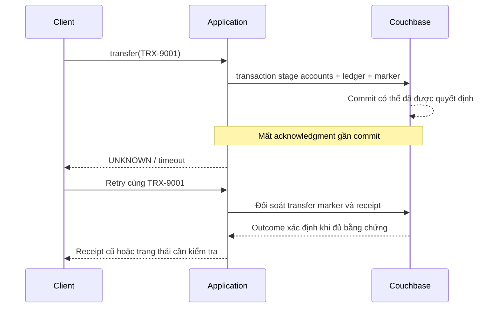
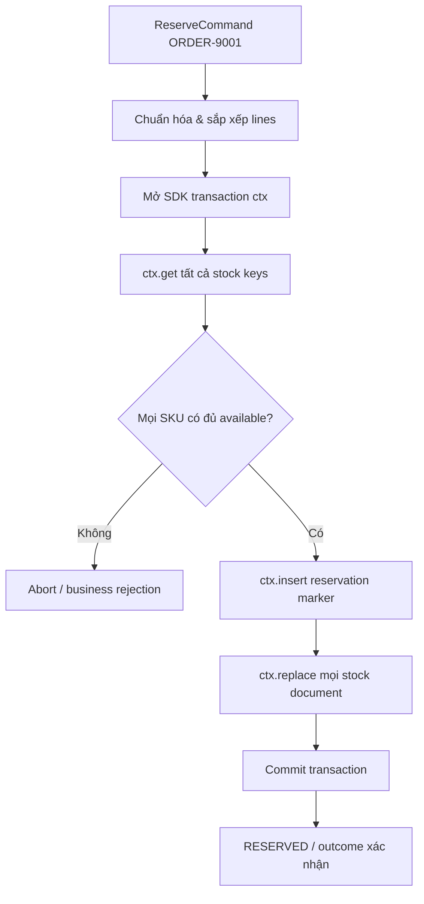
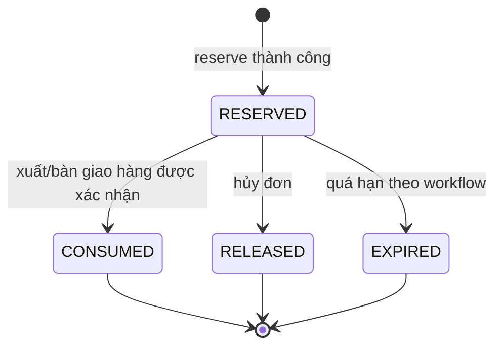

# Thiết kế và kiểm thử chuyển tiền hoặc giữ tồn kho nhiều tài liệu

Trong module **SPRING_DATA_COUCHBASE**, Spring Data cung cấp `CouchbaseRepository`, `CouchbaseTemplate`, truy vấn SQL++ và API reactive để truy cập document. Ở chương **Giao dịch**, một tình huống quan trọng nhất là **nhiều document phải thay đổi cùng nhau mới giữ được bất biến nghiệp vụ**. Hai ví dụ điển hình là **chuyển tiền nội bộ giữa hai ví** và **giữ tồn kho của một đơn hàng gồm nhiều SKU**.

Với chuyển tiền, không thể công bố hoàn tất nếu ví nguồn đã bị trừ nhưng ví đích chưa được cộng. Với giữ tồn kho, không thể xác nhận một đơn gồm hai SKU khi chỉ giữ được SKU thứ nhất; đồng thời không được bán vượt số lượng khả dụng nếu hai khách đặt hàng gần như cùng lúc.

Bài này hướng dẫn cách **thiết kế mô hình document, định nghĩa bất biến, chọn transaction boundary, bảo vệ command trùng, kiểm soát xung đột, triển khai Spring Data/SDK và viết kiểm thử có khả năng phát hiện commit một phần**. Nội dung nằm trong phạm vi Couchbase và các tích hợp Spring Data được hỗ trợ; thanh toán qua ngân hàng, hàng đợi hoặc database khác cần quy trình saga/outbox riêng, **không tự thuộc giao dịch Couchbase**.

> **Định nghĩa thiết kế quan trọng:** Không đo chất lượng giao dịch bằng việc có `@Transactional` hoặc một lời gọi `saveAll`. Hãy đo bằng **bất biến cuối cùng**, **tập thao tác thực sự tham gia cùng context**, và **kết quả integration test khi xảy ra lỗi, retry hoặc tranh chấp**.

## 1. Mục tiêu học tập

Sau bài học, bạn có thể:

1. Viết bất biến có thể kiểm chứng cho **chuyển tiền** và **giữ tồn kho nhiều document**.
2. Chọn **document key, bucket/scope/collection** và ranh giới giao dịch theo nghiệp vụ.
3. Phân biệt **atomicity nhiều document**, CAS/`@Version` trên một document và kiểm soát xử lý trùng bằng idempotency key.
4. Chọn biểu diễn tiền bằng **minor units dạng số nguyên** và tránh sai số `double`.
5. Giữ cân bằng **debit–credit** trong ví dụ chuyển tiền nội bộ, gắn transfer marker với các bút toán cùng commit.
6. Thiết kế tồn kho với `onHand`, `reserved`, `available` và trạng thái reservation để tránh oversell.
7. Viết giao dịch SDK với `cluster.transactions().run(ctx -> ...)` và `ctx.get`/`ctx.insert`/`ctx.replace`.
8. Hiểu điều kiện để `@Transactional`, Repository và Template tham gia transaction Couchbase; không suy từ annotation một cách máy móc.
9. Nhận biết **write skew, hot key, CAS conflict, retry attempt và commit ambiguous**.
10. Thiết kế **state machine** để xác nhận, hủy, giải phóng hoặc hết hạn reservation **chỉ một lần**.
11. Viết unit test hàm tính toán, integration test forced abort và test cạnh tranh/duplicate/timeout.
12. Lập tiêu chí chấp nhận trước production, gồm observability, permission, timeout, chỉ mục SQL++ và đối soát.

## 2. Hai use case, một bài học về bất biến

| Khía cạnh | Chuyển tiền giữa hai ví | Giữ tồn kho cho một đơn |
| --- | --- | --- |
| Tập document tối thiểu | Ví nguồn, ví đích | Một stock document cho mỗi SKU |
| Document bổ trợ | Transfer marker, hai ledger entries, outbox | Reservation marker, reservation lines, outbox |
| Bất biến chính | Tổng tiền được bảo toàn, không âm theo chính sách | `reserved <= onHand`, không giữ trùng command |
| Conflict | Nhiều transfer cùng nguồn/đích | Nhiều đơn cùng SKU |
| Retry | Không chuyển cùng transferId hai lần | Không giữ cùng orderId hai lần |
| Hủy/bù trừ | Đảo chuyển tiền là **một nghiệp vụ mới** nếu đã commit | Release reservation một lần, cập nhật stock |
| Timeout outcome | Có thể không rõ tiền đã chuyển chưa | Có thể không rõ hàng đã được giữ chưa |
| Kiểm thử bắt buộc | Atomic debit–credit + ledger + duplicate | Atomic nhiều SKU + oversell + release đúng một lần |

Couchbase transaction giải quyết **atomic commit cho các mutation Couchbase tham gia đúng context**. Nó **không tự hiểu** công thức cân bằng tiền hoặc số lượng khả dụng. Các công thức phải được lập trình thành điều kiện đọc/kiểm tra/ghi, và được kiểm chứng khi cạnh tranh.

## 3. Bài toán A: chuyển tiền nội bộ giữa hai ví

Giả sử các document ở:

```text
Bucket: appdata
Scope: wallet
Collection: accounts

account::tenant-a::W001
  tenantId = tenant-a
  currency = VND
  balanceMinor = 150000
  status = OPEN

account::tenant-a::W002
  tenantId = tenant-a
  currency = VND
  balanceMinor = 50000
  status = OPEN
```

Ví W001 chuyển **40.000 đơn vị nhỏ nhất** sang W002.

Sau khi một transaction **được xác nhận commit**:

```text
W001 = 110000
W002 =  90000
Tổng = 200000
```

Ví dụ giả định cả hai ví có **cùng đơn vị tiền tệ**, không có phí và không có nghiệp vụ ngoại bảng. Trong sản phẩm thật, nếu có phí, tài khoản trung gian, dự trữ hoặc quy đổi ngoại tệ, **bất biến phải bao gồm những tài khoản/bút toán đó** thay vì đơn giản hóa “hai số dư cộng bằng hằng số”.

### 3.1. Bất biến viết thành điều kiện

Với số tiền chuyển \(m\):

\[
m > 0
\]

\[
B_{\text{nguồn}} \ge m
\]

\[
B'_{\text{nguồn}} = B_{\text{nguồn}} - m
\]

\[
B'_{\text{đích}} = B_{\text{đích}} + m
\]

\[
B'_{\text{nguồn}}+B'_{\text{đích}}
= B_{\text{nguồn}}+B_{\text{đích}}
\]

Các điều kiện khác:

- Ví nguồn và đích phải **khác key**, tồn tại, cùng currency và thuộc tenant đã được ủy quyền.
- Cả hai ví phải ở trạng thái cho phép chuyển tiền.
- `balanceMinor` phải là số nguyên được kiểm tra tràn.
- Mỗi ý định chuyển được nhận diện bằng **`transferId` ổn định**.
- Không được phát thông báo “đã chuyển” hoặc ghi số liệu “đã commit” trước khi outcome được xác nhận.

### 3.2. Vì sao lưu tiền bằng số nguyên?

Không dùng `double` cho tiền:

```java
double a = 0.1;
double b = 0.2;
System.out.println(a + b == 0.3); // false trong biểu diễn nhị phân.
```

Ở ví dụ này, sử dụng `long balanceMinor` và `long amountMinor`. Nếu cần thập phân cho tỷ giá/phí, dùng `BigDecimal` với **scale, rounding mode và policy được quy định** rồi chuyển về minor units ở ranh giới thích hợp.

Lựa chọn kiểu dữ liệu không tự bảo vệ tiền khỏi duplicate; nó chỉ tránh một loại sai số số học.

## 4. Bài toán B: giữ nhiều SKU cho một đơn hàng

Giả sử một kho có hai stock documents ở `appdata.inventory.stock`:

```text
stock::tenant-a::WH1::SKU-A
  onHand = 12
  reserved = 2
  available = 10

stock::tenant-a::WH1::SKU-B
  onHand = 8
  reserved = 1
  available = 7
```

Đơn `ORDER-9001` yêu cầu:

```text
SKU-A: 3 sản phẩm
SKU-B: 5 sản phẩm
```

Nếu giữ thành công:

```text
SKU-A: onHand=12, reserved=5, available=7
SKU-B: onHand= 8, reserved=6, available=2
reservation::tenant-a::ORDER-9001 = RESERVED
```

Bất biến mỗi SKU:

\[
0 \le reserved \le onHand
\]

\[
available = onHand - reserved
\]

Bất biến đơn hàng: **hoặc mọi SKU cần thiết được giữ cùng với marker reservation, hoặc không SKU nào được công bố đã giữ**.

### 4.1. Vì sao giữ từng SKU độc lập là sai?

```java
reserve("SKU-A", 3);  // Thành công.
reserve("SKU-B", 5);  // Lỗi vì hết hàng/timeout.
```

Nếu `reserve` là mutation độc lập, SKU-A có thể bị giữ dù đơn không thể hoàn thành. Một transaction nhiều document cần bao gồm **tất cả stock keys và marker** của cùng command.

### 4.2. Một kho khác là một tài nguyên khác

`SKU-A` ở `WH1` khác `SKU-A` ở `WH2`. Key nên chứa tenant, warehouse và SKU; không chỉ chứa SKU nếu hệ thống có nhiều kho.

## 5. Mô hình document: thiết kế để invariant có điểm xung đột rõ

**Ví tiền:**

```text
appdata.wallet.accounts
  account::tenant-a::W001
  account::tenant-a::W002

appdata.wallet.transfers
  transfer::tenant-a::TRX-9001

appdata.wallet.ledger
  ledger::tenant-a::TRX-9001::debit
  ledger::tenant-a::TRX-9001::credit

appdata.wallet.outbox
  outbox::tenant-a::TransferPosted::TRX-9001
```

**Giữ hàng:**

```text
appdata.inventory.stock
  stock::tenant-a::WH1::SKU-A
  stock::tenant-a::WH1::SKU-B

appdata.inventory.reservations
  reservation::tenant-a::ORDER-9001

appdata.inventory.outbox
  outbox::tenant-a::InventoryReserved::ORDER-9001
```

Điểm quan trọng của mô hình:

- **Document key** là duy nhất **trong mỗi collection**, không trên toàn cluster.
- Những request cập nhật cùng ví hoặc cùng SKU phải chạm tới **cùng stock/account key**.
- Marker dùng key ổn định theo `transferId` hoặc `orderId` để tạo điều kiện insert-only.
- Không trông chờ `SELECT COUNT(*)` trên hàng nghìn document rồi tạo key mới để bảo vệ quota nếu không có cơ chế conflict phù hợp.
- Các document phát sinh như ledger/outbox phải có **ID xác định** để callback retry không sinh một danh tính nghiệp vụ mới.

### 5.1. Cân bằng giữa transaction rộng và mô hình nhỏ

Giữ 3 SKU trong một transaction thường dễ lý giải hơn 3.000 SKU trong một callback. Transaction có nhiều key làm tăng round-trips, contention, timeout và chi phí cleanup. Nếu nghiệp vụ cho phép, cần giới hạn số dòng/đơn hoặc thiết kế fulfillment theo từng phần có trạng thái rõ.

**Không tách transaction chỉ để tránh timeout** nếu việc tách sẽ làm thay đổi bảo đảm “giữ tất cả hoặc không giữ gì” mà API đang hứa.

## 6. Transaction context: điều kiện để nhiều key cùng commit

Trong Couchbase Java SDK 3.x, ví dụ transaction đồng bộ:

```java
cluster.transactions().run(ctx -> {
    // Những thao tác hỗ trợ thông qua ctx được điều phối.
});
```

Các thao tác cơ bản:

| API | Ý nghĩa |
| --- | --- |
| `ctx.get(collection, key)` | Đọc document trong transaction attempt |
| `ctx.insert(collection, key, body)` | Insert-only: tạo key chưa tồn tại |
| `ctx.replace(transactionGetResult, body)` | Thay document đã đọc qua context |
| `ctx.remove(transactionGetResult)` | Xóa document đã đọc qua context |
| `ctx.query(...)` | Truy vấn transactional SQL++ khi SDK/Server version hỗ trợ |

Ngược lại, `collection.upsert(...)` và `cluster.query(...)` thông thường **không tự tham gia context**, kể cả đặt trong cùng lambda.

### 6.1. Những yếu tố ngoài code

- Couchbase Server và Java SDK có phiên bản hỗ trợ distributed transactions.
- Scope/collection, user RBAC và transaction metadata/ATR được cấu hình đúng.
- Query/Index Services có mặt khi dùng transactional SQL++.
- Durability, timeout/expiration và read/write set phù hợp workload.
- Với Spring Data, Repository/Template và manager phải sử dụng đúng integration và tập operation được hỗ trợ.
- Tài liệu code sử dụng phong cách SDK 3.x; tên type/overload/exception phải đối chiếu dependency cụ thể trước khi biên dịch.

**Một integration test forced abort là bằng chứng mạnh hơn việc chỉ nhìn thấy callback hoặc annotation đã chạy.**

## 7. Model Java cho lệnh chuyển tiền

Định nghĩa command và receipt tách khỏi entity Couchbase:

```java
package com.example.wallet;

public record TransferCommand(
        String transferId,
        String authorizedTenantId,
        String sourceKey,
        String targetKey,
        String currency,
        long amountMinor) {
}

public record TransferReceipt(
        String transferId,
        long sourceBalanceAfter,
        long targetBalanceAfter,
        long amountMinor,
        String currency) {
}
```

**`authorizedTenantId` phải đến từ hệ thống xác thực**, không chỉ sao chép trường tenant do client khai. Nếu cấp quyền ví theo user, còn cần kiểm tra user được thao tác trên source và/hoặc target theo policy.

### 7.1. Kiểm tra command trước khi mở transaction

```java
private static void validateCommand(TransferCommand cmd) {
    if (cmd == null
            || cmd.transferId() == null
            || cmd.transferId().isBlank()
            || cmd.authorizedTenantId() == null
            || cmd.authorizedTenantId().isBlank()
            || cmd.sourceKey() == null
            || cmd.targetKey() == null
            || cmd.sourceKey().equals(cmd.targetKey())
            || !"VND".equals(cmd.currency())
            || cmd.amountMinor() <= 0) {
        throw new IllegalArgumentException(
                "Yêu cầu chuyển tiền không hợp lệ");
    }
}
```

Kiểm tra định dạng bên ngoài transaction giúp từ chối yêu cầu sai sớm. Nhưng **số dư, trạng thái ví và currency thực tế của document** phải được xác minh **bên trong transaction attempt**, vì chúng có thể thay đổi đồng thời.

### 7.2. Tách calculation thành hàm thuần

```java
public record Balances(long source, long target) {}

public static Balances move(
        long source,
        long target,
        long amount) {

    if (source < 0 || target < 0
            || amount <= 0 || source < amount) {
        throw new IllegalStateException(
                "Số dư không hợp lệ hoặc không đủ");
    }

    long nextSource = Math.subtractExact(source, amount);
    long nextTarget = Math.addExact(target, amount);

    return new Balances(nextSource, nextTarget);
}
```

Hàm `move` không gọi Couchbase/HTTP, không thay biến ngoài; có thể được unit test độc lập. `Math.addExact` giúp phát hiện tràn `long` ở ví đích thay vì âm thầm overflow.

## 8. Cài đặt SDK: chuyển tiền và ledger trong cùng transaction

Ví dụ sau là **một đường tạo transfer mới**, không phải implementation đầy đủ của duplicate-handling API. Nó ghi cùng transaction:

- Trừ ví nguồn.
- Cộng ví đích.
- Tạo transfer marker insert-only.
- Ghi hai bút toán ledger cân bằng.

```java
package com.example.wallet;

import java.util.Objects;

import com.couchbase.client.java.Cluster;
import com.couchbase.client.java.Collection;
import com.couchbase.client.java.json.JsonObject;
import com.couchbase.client.java.transactions.TransactionGetResult;

public final class WalletTransferAdapter {

    private final Cluster cluster;
    private final Collection accounts;
    private final Collection transfers;
    private final Collection ledger;

    public WalletTransferAdapter(
            Cluster cluster,
            Collection accounts,
            Collection transfers,
            Collection ledger) {
        this.cluster = cluster;
        this.accounts = accounts;
        this.transfers = transfers;
        this.ledger = ledger;
    }

    public void applyNewTransfer(TransferCommand cmd) {
        validateCommand(cmd);

        String markerKey = "transfer::"
                + cmd.authorizedTenantId()
                + "::" + cmd.transferId();

        String debitKey = "ledger::"
                + cmd.authorizedTenantId()
                + "::" + cmd.transferId() + "::debit";

        String creditKey = "ledger::"
                + cmd.authorizedTenantId()
                + "::" + cmd.transferId() + "::credit";

        cluster.transactions().run(ctx -> {
            TransactionGetResult fromResult =
                    ctx.get(accounts, cmd.sourceKey());
            TransactionGetResult toResult =
                    ctx.get(accounts, cmd.targetKey());

            JsonObject from = fromResult.contentAsObject();
            JsonObject to = toResult.contentAsObject();

            String tenant = cmd.authorizedTenantId();
            if (!Objects.equals(tenant, from.getString("tenantId"))
                    || !Objects.equals(tenant, to.getString("tenantId"))) {
                throw new IllegalStateException(
                        "Ví nằm ngoài tenant được ủy quyền");
            }

            if (!"OPEN".equals(from.getString("status"))
                    || !"OPEN".equals(to.getString("status"))
                    || !cmd.currency().equals(
                            from.getString("currency"))
                    || !cmd.currency().equals(
                            to.getString("currency"))) {
                throw new IllegalStateException(
                        "Ví bị khóa hoặc khác currency");
            }

            Long sourceAmount = from.getLong("balanceMinor");
            Long targetAmount = to.getLong("balanceMinor");
            if (sourceAmount == null || targetAmount == null) {
                throw new IllegalStateException(
                        "Ví không có số dư hợp lệ");
            }

            Balances next = move(
                    sourceAmount, targetAmount, cmd.amountMinor());

            JsonObject marker = JsonObject.create()
                    .put("transferId", cmd.transferId())
                    .put("tenantId", tenant)
                    .put("sourceKey", cmd.sourceKey())
                    .put("targetKey", cmd.targetKey())
                    .put("currency", cmd.currency())
                    .put("amountMinor", cmd.amountMinor())
                    .put("sourceBalanceAfter", next.source())
                    .put("targetBalanceAfter", next.target())
                    .put("status", "POSTED");

            JsonObject debit = JsonObject.create()
                    .put("transferId", cmd.transferId())
                    .put("accountKey", cmd.sourceKey())
                    .put("currency", cmd.currency())
                    .put("deltaMinor", -cmd.amountMinor())
                    .put("direction", "DEBIT");

            JsonObject credit = JsonObject.create()
                    .put("transferId", cmd.transferId())
                    .put("accountKey", cmd.targetKey())
                    .put("currency", cmd.currency())
                    .put("deltaMinor", cmd.amountMinor())
                    .put("direction", "CREDIT");

            ctx.insert(transfers, markerKey, marker);
            ctx.replace(fromResult,
                    from.put("balanceMinor", next.source()));
            ctx.replace(toResult,
                    to.put("balanceMinor", next.target()));
            ctx.insert(ledger, debitKey, debit);
            ctx.insert(ledger, creditKey, credit);
        });
    }

    private static void validateCommand(TransferCommand cmd) {
        if (cmd == null || cmd.transferId() == null
                || cmd.transferId().isBlank()
                || cmd.authorizedTenantId() == null
                || cmd.authorizedTenantId().isBlank()
                || cmd.sourceKey() == null
                || cmd.targetKey() == null
                || cmd.sourceKey().equals(cmd.targetKey())
                || !"VND".equals(cmd.currency())
                || cmd.amountMinor() <= 0) {
            throw new IllegalArgumentException("Command không hợp lệ");
        }
    }

    private static Balances move(long source, long target, long amount) {
        if (source < 0 || target < 0
                || amount <= 0 || source < amount) {
            throw new IllegalStateException("Không đủ tiền");
        }
        return new Balances(
                Math.subtractExact(source, amount),
                Math.addExact(target, amount));
    }

    private record Balances(long source, long target) {}
}
```

### 8.1. Điều kiện để ví dụ đúng

- `accounts`, `transfers` và `ledger` là **SDK Collection** trỏ đúng các keyspace trong Couchbase.
- Cả năm mutation dùng **`ctx` cùng transaction attempt**, không dùng SDK `collection.upsert` độc lập.
- `ctx.insert` buộc transfer marker/ledger keys chưa tồn tại khi tạo mới.
- Callback **đọc lại số dư trong từng attempt**, không dùng số dư cache bên ngoài.
- Hai ví và ledger cùng currency; ví dụ không xử lý phí, overdraft, giao dịch ngoại tệ hoặc tài khoản trung gian.
- Hệ thống còn phải bổ sung **authorization, giới hạn giao dịch, audit, idempotency reconciliation**, kiểm thử và giám sát theo yêu cầu sản phẩm.
- Lệnh `applyNewTransfer` chưa biết trả receipt cũ khi transferId đã xử lý; **không catch duplicate rồi cho chạy lại với ID mới**.

### 8.2. Một lỗi ở bước cuối phải ảnh hưởng cả nhóm

Nếu `ctx.insert(ledger, creditKey, ...)` thất bại, ta **không** muốn commit hai account và chỉ debit ledger. Đây là lý do cả bốn loại document (account, marker, ledger) được stage trong cùng transaction context.

**Kiểm thử phải cố tình gây lỗi sau những mutation đầu** và đọc lại toàn bộ document sau khi abort được xác định.

## 9. Chứng minh double-entry: số dư và ledger là hai invariant

Với một transfer không có phí:

\[
\Delta_{\text{source}}=-m,\quad
\Delta_{\text{target}}=+m,\quad
\sum \Delta=0.
\]

Hai ledger documents trong ví dụ:

```json
{
  "transferId": "TRX-9001",
  "accountKey": "account::tenant-a::W001",
  "direction": "DEBIT",
  "deltaMinor": -40000
}
```

và:

```json
{
  "transferId": "TRX-9001",
  "accountKey": "account::tenant-a::W002",
  "direction": "CREDIT",
  "deltaMinor": 40000
}
```

Để kiểm chứng:

- **Bảo toàn balance của hai ví**: tổng trước/sau không đổi nếu cả hai thuộc cùng currency và không có phí.
- **Cân bằng bút toán**: tổng `deltaMinor` của transfer bằng 0.
- **Đúng ví**: debit gắn sourceKey, credit gắn targetKey.
- **Không trùng transferId**: chỉ một tập bút toán có hiệu lực cho một command.
- **Đúng trạng thái**: không công bố `POSTED` khi giao dịch chưa commit.

### 9.1. Ledger hay balance là nguồn sự thật?

Trong một hệ thống tài chính thực tế, phải quyết định:

- Ledger immutable là **source of truth**, balance là projection/cache được duy trì với chính sách chặt; hoặc
- Balance và ledger cùng một mô hình có reconciliation và audit rõ ràng.

Ví dụ ở đây nhằm **minh họa ranh giới transaction**, không thay thiết kế kế toán, thanh toán được quản lý hoặc kiểm soát tài chính thực tế. Không giả định chỉ hai ledger rows đã đủ cho mọi loại nghiệp vụ tiền.

## 10. Idempotency: một transferId không được chuyển tiền hai lần

Transaction bảo vệ **một lần thực thi**, nhưng không tự ngăn client gửi cùng command lần nữa sau HTTP timeout.

Mẫu sử dụng key:

```text
transfer::tenant-a::TRX-9001
```

Khi `ctx.insert` marker trong transaction được áp dụng, một request thứ hai dùng cùng key sẽ **không được tự insert mới**. Điều này là cơ sở cho xử lý trùng.

| Trường hợp | Hành vi ứng dụng |
| --- | --- |
| TransferId chưa có, request hợp lệ | Thực hiện transaction mới |
| TransferId tồn tại, payload **trùng** và outcome đã xác nhận | Trả receipt cũ, không mutation |
| TransferId tồn tại, payload **khác** | Báo ID conflict |
| TransferId chưa thấy ngay sau lỗi commit ambiguous | **Chưa đủ kết luận**; đối soát có giới hạn |
| Transaction trước đã abort xác định | Có thể retry cùng transferId theo policy |
| TransferId mới nhưng cùng số tiền, hai ví | Ý định mới; cần kiểm soát cấp ID ở biên |

### 10.1. Đừng làm precheck rồi upsert

```java
if (!transfers.exists(markerKey).exists()) {
    transfers.upsert(markerKey, marker);
}
```

Hai request có thể cùng nhìn thấy “chưa tồn tại” rồi đều thực hiện mutation. `upsert` còn có thể ghi đè marker trước đó. Dùng **insert-only ở thời điểm mutation**, cùng transaction với số dư/ledger.

### 10.2. Không trả duplicate success chỉ vì key có mặt

```text
TRX-9001: W001 -> W002, 40000 VND
TRX-9001: W001 -> W003, 80000 VND
```

Hai command có cùng ID nhưng khác nội dung. Phải so tenant, source, target, currency, amount và phiên bản luật nghiệp vụ; nếu khác, **từ chối**. Không cho phép một tenant truy vấn receipt của tenant khác chỉ vì biết transferId.

### 10.3. Retention của marker là một phần hợp đồng

Nếu marker có TTL ngắn hơn cửa sổ HTTP/broker retry, request cũ có thể được áp dụng lại sau khi marker biến mất. Chọn retention theo cửa sổ retry, đối soát, audit và nghiệp vụ; **không tự gắn TTL vài phút** cho transfer marker quan trọng.

## 11. Commit ambiguous: transaction có thể đã commit dù caller timeout

Timeline:



**HTTP 504, `Mono.timeout` hoặc exception mạng không tự chứng minh rollback.** Nếu commit đã xảy ra nhưng response mất, retry command với transferId mới có thể tạo một transfer thứ hai hợp lệ ở tầng Couchbase nhưng sai ý định nghiệp vụ.

### 11.1. Hợp đồng API gợi ý

```text
POST /wallet/transfers
  body: transferId + source + target + amount
  -> COMMITTED(receipt) | REJECTED(reason) | UNKNOWN(transferId)

GET /wallet/transfers/{transferId}
  -> COMMITTED(receipt) | REJECTED | UNKNOWN / IN_PROGRESS
```

Đây là **API ứng dụng đề xuất**, không phải endpoint Couchbase có sẵn.

### 11.2. Không suy marker vắng mặt ngay lập tức là abort

Sau lỗi giai đoạn commit, transaction có thể còn đang hoàn tất hoặc cleanup. Một lần lookup marker chưa thấy không đủ để khẳng định transfer chưa từng được áp dụng; xử lý theo **outcome SDK/version, read path và quy trình reconciliation**.

## 12. Cạnh tranh: hai transfer cùng nguồn

Giả sử W001 có 100.000 đơn vị, cùng lúc:

- Transfer A muốn chuyển 70.000.
- Transfer B muốn chuyển 60.000.

Nếu cả hai cùng đọc 100.000 và ghi độc lập, có nguy cơ lost update hoặc nguồn âm. Với **transaction-aware operations trên cùng account key**, cơ chế conflict/attempt handling sẽ điều phối theo contract SDK. Một attempt có thể retry/abort; ở attempt mới, **phải đọc lại số dư và kiểm tra lại đủ tiền**.

```text
Lịch chạy minh họa:

A: đọc W001 = 100000
B: đọc W001 = 100000
A: stage W001 = 30000
B: stage W001 = 40000
→ Tranh chấp trên cùng document
→ SDK phát hiện conflict/retry/abort tùy version và lịch thực tế
→ Request còn lại đọc lại số dư, có thể bị REJECTED
```

**Kỳ vọng nghiệp vụ:** không có transfer nào được công bố commit nếu điều kiện đủ tiền bị vi phạm. Tổng tiền các ví/ledger liên quan vẫn được bảo toàn sau những transaction thực sự commit.

### 12.1. Callback phải side-effect-safe

Không gửi email, gọi ngân hàng, tăng metric “committed” hay tạo random transferId bên trong callback có thể retry. Chỉ những read/write được Couchbase transaction hỗ trợ mới chịu commit/abort theo context.

### 12.2. Không retry entity stale

Nếu Spring Data `@Version` báo CAS conflict, retry cùng object chứa CAS cũ không giúp gì. Cần **đọc lại, kiểm tra lại, tính lại** với thông tin mới; retry phải có giới hạn.

## 13. Bài toán tồn kho: chọn cách biểu diễn số lượng

Hai cách biểu diễn phổ biến:

### 13.1. Lưu `onHand` và `reserved`

```json
{
  "tenantId": "tenant-a",
  "warehouseId": "WH1",
  "sku": "SKU-A",
  "onHand": 12,
  "reserved": 2
}
```

`available` được tính là `onHand - reserved`. Đây là lựa chọn đơn giản cho ví dụ, tránh lưu ba trường có thể bị cập nhật lệch.

### 13.2. Lưu `available` trực tiếp

Một số hệ thống lưu cả `available` để đọc nhanh. Khi đó invariant phải quy định cách cập nhật **đồng bộ** giữa `onHand`, `reserved` và `available`. Nếu một mutation chỉ tăng reserved mà quên giảm available, dữ liệu tự mâu thuẫn.

**Trong bài học:** dùng `onHand` và `reserved`, tính available bằng số nguyên sau khi đọc.

### 13.3. On-hand và in-transit không phải cùng trạng thái

Hàng đang vận chuyển, hỏng, trả lại hoặc thuộc kho khác có thể không được bán. Nếu mô hình thực tế có các số lượng `damaged`, `allocated`, `inTransit`, invariant khả dụng phải bao gồm chúng. Không dùng công thức đơn giản của bài học để áp dụng trực tiếp cho mọi hệ thống ERP.

## 14. Lệnh giữ hàng: normalize các dòng trước transaction

Một order có thể chứa SKU trùng ở hai dòng:

```json
{
  "orderId": "ORDER-9001",
  "lines": [
    {"stockKey": "stock::tenant-a::WH1::SKU-A", "quantity": 2},
    {"stockKey": "stock::tenant-a::WH1::SKU-A", "quantity": 1},
    {"stockKey": "stock::tenant-a::WH1::SKU-B", "quantity": 5}
  ]
}
```

Trước transaction, nên:

1. Xác thực tenant/orderId và giới hạn số dòng.
2. Kiểm tra `quantity > 0`, quantity trong kiểu `long`.
3. **Gộp các dòng trùng stockKey**: SKU-A cần 3, không giữ hai lần tùy vòng lặp.
4. Dùng `Math.addExact` khi cộng số lượng để phát hiện overflow.
5. Sắp xếp key theo thứ tự ổn định để code/test dễ so sánh; **không tuyên bố việc sắp xếp tự loại hết conflict**.
6. Giữ một **canonical payload/line list** để so duplicate request.
7. Từ chối order có số key quá lớn để tránh transaction quá rộng.

### 14.1. Ví dụ cấu trúc command

```java
package com.example.inventory;

import java.util.List;

public record ReserveLine(
        String stockKey,
        long quantity) {
}

public record ReserveCommand(
        String orderId,
        String authorizedTenantId,
        List<ReserveLine> lines) {
}

public record ReservedStock(
        String stockKey,
        long reservedAfter) {
}
```

Trong triển khai thực tế, không để client tự chọn `stockKey` thuộc tenant khác. Service cần phân giải key từ tenant/warehouse/SKU đã ủy quyền, rồi đối chiếu document thực tế trong transaction.

## 15. Hàm thuần để tính khả dụng và kiểm tra oversell

```java
public record StockAfter(
        long onHand,
        long reserved) {

    public long available() {
        return Math.subtractExact(onHand, reserved);
    }
}

public static StockAfter reserve(
        long onHand,
        long reserved,
        long quantity) {

    if (onHand < 0 || reserved < 0
            || reserved > onHand || quantity <= 0) {
        throw new IllegalStateException(
                "Số lượng tồn kho không hợp lệ");
    }

    long available = onHand - reserved;
    if (available < quantity) {
        throw new IllegalStateException(
                "INSUFFICIENT_AVAILABLE_STOCK");
    }

    long nextReserved = Math.addExact(
            reserved, quantity);
    return new StockAfter(onHand, nextReserved);
}
```

Test biên quan trọng:

| Trạng thái | Quantity yêu cầu | Kỳ vọng |
| --- | --- | --- |
| `onHand=12, reserved=2` | 3 | `reserved=5, available=7` |
| `onHand=8, reserved=1` | 7 | `reserved=8, available=0` |
| `onHand=8, reserved=1` | 8 | Từ chối |
| `onHand=8, reserved=9` | 1 | Từ chối do dữ liệu bất hợp lệ |
| `quantity=0` | 0 | Từ chối |
| `quantity=-1` | -1 | Từ chối |
| Các giá trị gần `Long.MAX_VALUE` | Lớn | Kiểm tra overflow và domain limits |

Hàm tính toán có thể unit test không cần Couchbase. Nhưng unit test **không chứng minh** hai SKU được commit cùng nhau; cần integration test transaction thật.

## 16. SDK transaction giữ nhiều SKU: hai pha trong cùng attempt

Một chiến lược dễ đọc:

**Pha logic 1 — read/validate:** đọc **tất cả stock documents**, tính lượng cần và bảo đảm từng SKU đủ hàng.

**Pha logic 2 — stage mutations:** insert marker và replace tất cả stock documents trong **cùng transaction attempt**.

Đây là **hai pha trong code business của một transaction**, không phải XA two-phase commit. SDK vẫn quản lý commit/abort.



### 16.1. Vì sao đọc hết trước khi ghi?

Với ví dụ 2 SKU, nếu SKU-B thiếu, có thể từ chối trước khi stage SKU-A. Ngay cả khi đã stage SKU-A trước và sau đó ném exception, SDK transaction đúng vẫn phải abort cả nhóm; nhưng mô hình **read–validate all–stage all** dễ giải thích và kiểm thử hơn.

### 16.2. Không dùng `findAll` rồi sửa ngoài transaction

Nếu `findAll`/query đọc các stock documents **ngoài transaction context**, trạng thái có thể thay đổi trước lúc ghi. Khi đã biết SKU keys, dùng **KV `ctx.get` cho từng key trong attempt** và để conflict detection xử lý contention.

## 17. Mã SDK minh họa: giữ toàn bộ giỏ hàng

Đoạn sau giả định command đã được **normalize** thành các `ReserveLine` có key khác nhau và quantity hợp lệ. Các helper đối chiếu tenant/key và tạo marker được thực hiện tường minh bên trong method.

```java
package com.example.inventory;

import java.util.ArrayList;
import java.util.HashSet;
import java.util.List;
import java.util.Set;

import com.couchbase.client.java.Cluster;
import com.couchbase.client.java.Collection;
import com.couchbase.client.java.json.JsonArray;
import com.couchbase.client.java.json.JsonObject;
import com.couchbase.client.java.transactions.TransactionGetResult;

public final class InventoryReservationAdapter {

    private final Cluster cluster;
    private final Collection stock;
    private final Collection reservations;

    public InventoryReservationAdapter(
            Cluster cluster,
            Collection stock,
            Collection reservations) {
        this.cluster = cluster;
        this.stock = stock;
        this.reservations = reservations;
    }

    private record PendingUpdate(
            TransactionGetResult current,
            JsonObject body,
            long nextReserved) {
    }

    public void reserveNewOrder(ReserveCommand command) {
        validateNormalizedCommand(command);

        String markerKey = "reservation::"
                + command.authorizedTenantId()
                + "::" + command.orderId();

        cluster.transactions().run(ctx -> {
            List<PendingUpdate> updates =
                    new ArrayList<>();
            JsonArray markerLines = JsonArray.create();

            // Bước 1: đọc + xác minh toàn bộ SKU.
            for (ReserveLine line : command.lines()) {
                TransactionGetResult current =
                        ctx.get(stock, line.stockKey());
                JsonObject body = current.contentAsObject();

                if (!command.authorizedTenantId()
                        .equals(body.getString("tenantId"))) {
                    throw new IllegalStateException(
                            "Stock nằm ngoài tenant được phép");
                }

                Long onHand = body.getLong("onHand");
                Long reserved = body.getLong("reserved");
                if (onHand == null || reserved == null) {
                    throw new IllegalStateException(
                            "Thiếu dữ liệu tồn kho");
                }

                StockAfter next = reserve(
                        onHand, reserved, line.quantity());

                updates.add(new PendingUpdate(
                        current, body, next.reserved()));

                markerLines.add(JsonObject.create()
                        .put("stockKey", line.stockKey())
                        .put("quantity", line.quantity()));
            }

            // Bước 2: ghi marker insert-only + tất cả stock.
            JsonObject marker = JsonObject.create()
                    .put("orderId", command.orderId())
                    .put("tenantId", command.authorizedTenantId())
                    .put("status", "RESERVED")
                    .put("lines", markerLines);

            ctx.insert(reservations, markerKey, marker);

            for (PendingUpdate update : updates) {
                ctx.replace(update.current(),
                        update.body().put(
                                "reserved", update.nextReserved()));
            }
        });
    }

    private static void validateNormalizedCommand(
            ReserveCommand command) {
        if (command == null || command.orderId() == null
                || command.orderId().isBlank()
                || command.authorizedTenantId() == null
                || command.authorizedTenantId().isBlank()
                || command.lines() == null
                || command.lines().isEmpty()
                || command.lines().size() > 50) {
            throw new IllegalArgumentException(
                    "Reservation command không hợp lệ");
        }

        Set<String> seenKeys = new HashSet<>();
        for (ReserveLine line : command.lines()) {
            if (line == null
                    || line.stockKey() == null
                    || line.stockKey().isBlank()
                    || line.quantity() <= 0
                    || !seenKeys.add(line.stockKey())) {
                throw new IllegalArgumentException(
                        "Stock key trùng hoặc quantity không hợp lệ");
            }
        }
    }

    private static StockAfter reserve(
            long onHand, long reserved, long quantity) {
        if (onHand < 0 || reserved < 0
                || reserved > onHand || quantity <= 0
                || onHand - reserved < quantity) {
            throw new IllegalStateException(
                    "INSUFFICIENT_AVAILABLE_STOCK");
        }
        return new StockAfter(
                onHand,
                Math.addExact(reserved, quantity));
    }

    private record StockAfter(long onHand, long reserved) {}
}
```

**Phạm vi ví dụ:** Adapter chỉ có đường **tạo một reservation mới**; cần bổ sung chuẩn hóa đầy đủ bên ngoài, kiểm tra keyspace/warehouse/authorization, handling duplicate, expiry, release/confirm và outbox như các mục tiếp theo.

### 17.1. Vì sao `List<PendingUpdate>` nằm trong callback?

Danh sách chỉ tồn tại trong **một attempt**. Nếu SDK retry, callback xây danh sách mới từ `ctx.get` mới. Không lưu list/result này ở field singleton hoặc cache để attempt sau tái sử dụng thông tin cũ.

### 17.2. Vì sao nhiều SKU cùng bị conflict?

Một transaction sửa SKU-A và SKU-B; một transaction khác cũng sửa SKU-A. Conflict trên SKU-A có thể khiến cả transaction đầu/chạy lại/abort theo SDK. Điều đó là cần thiết để tránh xác nhận đơn đa SKU với số lượng không phù hợp.

### 17.3. Không dùng `saveAll` như bằng chứng atomicity

Repository `saveAll` có thể tiện để thực hiện nhiều save, nhưng **không tự chứng minh** chúng là một đơn vị ACID. Phải xét transaction context/operation support theo Spring Data version hoặc dùng SDK `ctx` như ví dụ.

## 18. Cải tiến: canonical payload và giới hạn theo kho

Nếu cùng `orderId` được gửi lại với các dòng khác thứ tự:

```text
[SKU-A: 3, SKU-B: 5]
[SKU-B: 5, SKU-A: 3]
```

Chúng có thể là **cùng ý định**. Vì thế khi so duplicate, canonicalize:

1. Chuyển key về định dạng thống nhất.
2. Gộp dòng trùng một cách an toàn.
3. Sắp xếp theo `stockKey`.
4. Mã hóa quantity với kiểu nguyên và encoding xác định.
5. Đối chiếu tenant/orderId và dữ liệu hợp đồng.
6. Tính `payloadHash` nếu cần, nhưng hash không thay authorization.

Ví dụ thiết kế marker:

```json
{
  "orderId": "ORDER-9001",
  "tenantId": "tenant-a",
  "status": "RESERVED",
  "lines": [
    {"stockKey": "stock::tenant-a::WH1::SKU-A", "quantity": 3},
    {"stockKey": "stock::tenant-a::WH1::SKU-B", "quantity": 5}
  ],
  "payloadVersion": 1,
  "reservationExpiresAt": "2030-01-01T10:15:00Z"
}
```

`reservationExpiresAt` là **thời hạn nghiệp vụ được ghi rõ**, không mặc nhiên đồng nghĩa Couchbase TTL của document.

## 19. Vì sao một marker reservation là bắt buộc?

Nếu chỉ tăng `reserved` trên stock documents mà không có reservation record:

- Không biết số lượng đó thuộc đơn nào.
- Không thể xác định request duplicate đã được xử lý hay chưa.
- Khó giải phóng đúng lượng của từng SKU khi đơn bị hủy.
- Không có source of truth để đối soát reserved aggregate.
- Không quản lý được expiry/confirm/fulfill.

Marker `reservation::tenant-a::ORDER-9001` là **bằng chứng nghiệp vụ** của một lần giữ hàng. Nó phải được tạo **cùng commit với stock mutations**.

### 19.1. Retry cùng orderId

Nếu request trước đã commit nhưng response mất, lần gọi sau cùng `orderId` không được **tăng `reserved` lần nữa**. Transaction insert-only marker tạo điểm chặn. Tầng service phải tra cứu record, so payload và trả trạng thái cũ nếu hợp lệ.

### 19.2. Marker trùng nhưng khác giỏ hàng

`ORDER-9001` ban đầu giữ SKU-A:3, SKU-B:5. Request dùng cùng ID nhưng SKU-A:10 phải bị từ chối. Không được đối chiếu chỉ bằng `orderId` rồi trả “đã giữ hàng” cho payload sai.

## 20. Reservation state machine: RESERVED, RELEASED và CONSUMED

Giữ hàng không kết thúc ở bước tạo marker. Các trạng thái có thể gồm:



**Không cho phép** cùng reservation chuyển từ `RELEASED` sang `CONSUMED` bằng một message cũ, hoặc giải phóng `reserved` hai lần.

### 20.1. Hủy reservation phải là một transaction riêng

Nếu reservation được giữ thành công và sau đó người dùng hủy, **không rollback transaction giữ hàng đã commit**. Thay vào đó, chạy một **transaction mới**:

1. `ctx.get` reservation marker.
2. Kiểm tra trạng thái còn `RESERVED`, đúng tenant và order.
3. Đọc các stock documents trong marker.
4. Với từng SKU, bảo đảm `reserved >= quantity`.
5. Giảm `reserved` theo quantity.
6. `ctx.replace` reservation status thành `RELEASED`.
7. `ctx.replace` tất cả stock documents.
8. Commit.

Nếu nhận yêu cầu hủy lần thứ hai, kiểm tra marker đã `RELEASED` và **trả idempotent result**, không giảm reserved thêm một lần.

### 20.2. Confirm/consume cũng cần guard

Khi thực sự xuất hàng, tùy mô hình:

\[
onHand' = onHand - quantity,\quad
reserved' = reserved - quantity.
\]

Lúc đó `available = onHand - reserved` có thể không đổi trong bước consume, vì hàng đã được giữ trước đó. Cần xác minh tồn kho thực tế, trạng thái xuất kho và order trước khi chuyển `RESERVED -> CONSUMED`.

### 20.3. Concurrent cancel vs consume

Nếu worker xuất hàng và request hủy cùng đọc `RESERVED`:

- Cả hai phải tranh chấp **cùng reservation marker**.
- Sau một transaction commit, attempt còn lại phải đọc lại status hoặc nhận conflict/abort.
- Không được vừa giảm `onHand` vì consume vừa giảm `reserved` hai lần vì cancel.
- Nếu trạng thái vật lý đã xuất kho, hoàn hàng là **một nghiệp vụ khác**, không đơn giản reset marker.

## 21. TTL của reservation không tự giải phóng stock

Một lỗi kiến trúc nguy hiểm:

```text
RESERVED SKU-A: reserved tăng từ 2 lên 5.
Gắn Couchbase TTL=15 phút cho reservation marker.
15 phút sau marker tự hết hạn.
Stock SKU-A vẫn reserved=5.
```

**TTL document không tự chạy transaction giảm `reserved` ở document khác.** Nếu marker biến mất trước khi stock được giải phóng, còn mất dữ liệu cần thiết để biết phải hoàn lại những SKU nào.

### 21.1. Thiết kế expiration an toàn

- Ghi `reservationExpiresAt` như trường nghiệp vụ.
- Worker tìm reservation `RESERVED` đã quá hạn bằng index phù hợp hoặc workflow sự kiện.
- Worker chạy **release transaction** theo status guard, có idempotency.
- Chỉ archive/xóa marker theo retention policy sau khi outcome đã xác định và có audit.
- Có reconciliation job tính lại reserved theo các reservation active nếu hệ thống có nhu cầu/cơ sở dữ liệu đủ.
- Không coi việc “không tìm thấy marker” sau timeout là tín hiệu đủ để tăng hàng khả dụng bằng thao tác độc lập.

### 21.2. Clock/time budget

Thời hạn đặt hàng và deadline kỹ thuật khác nhau:

| Mốc thời gian | Dùng cho |
| --- | --- |
| `reservationExpiresAt` | Business deadline để quyết định release |
| Couchbase document TTL | Retention/expiration dữ liệu |
| Transaction expiration | Giới hạn transaction attempt |
| HTTP timeout | Thời gian client chờ |
| Outbox/worker lease | Quyền xử lý tạm thời của worker |

Không dùng một giá trị cấu hình để thay thế tất cả.

## 22. Hạn mức không dựa riêng vào COUNT hoặc query

Giả sử tenant chỉ được có tối đa 100 reservation active, có 99 và hai request cùng chạy. Nếu cả hai:

```text
SELECT COUNT(*) WHERE status = "RESERVED" -> 99
INSERT reservation::A
INSERT reservation::B
```

mà ghi hai key độc lập, cần xem xét **predicate isolation/write skew**. Đừng chỉ đặt `Isolation.SERIALIZABLE` trên `@Transactional` rồi giả định Couchbase hỗ trợ predicate locking theo nghĩa JDBC.

Một thiết kế dễ chứng minh hơn là `quota::tenant-a`:

```json
{
  "tenantId": "tenant-a",
  "limit": 100,
  "occupied": 99
}
```

Trong cùng transaction:

```text
ctx.get(quota::tenant-a)
kiểm tra occupied < limit
ctx.replace(quota::tenant-a, occupied + 1)
ctx.insert(reservation::..., marker)
ctx.replace(stock keys..., nextReserved)
```

Cùng tenant tranh chấp **một guard key**, thay vì hai request chỉ ghi marker khác nhau.

### 22.1. Guard có thể thành hot key

Một quota guard đọc/ghi bởi nhiều request là điểm contention; cần đo throughput/abort/retry và xem liệu invariant cần partition phù hợp hay thiết kế khác. Không có giải pháp “khóa quota toàn tenant” miễn phí về hiệu năng.

## 23. Spring Data Couchbase: vai trò của Repository và Template

Entity:

```java
import org.springframework.data.annotation.Id;
import org.springframework.data.annotation.Version;
import org.springframework.data.couchbase.core.mapping.Collection;
import org.springframework.data.couchbase.core.mapping.Document;
import org.springframework.data.couchbase.core.mapping.Field;
import org.springframework.data.couchbase.core.mapping.Scope;

@Document
@Scope("inventory")
@Collection("stock")
public class StockDocument {

    @Id
    private String id;

    @Field
    private String tenantId;

    @Field
    private String warehouseId;

    @Field
    private String sku;

    @Field
    private long onHand;

    @Field
    private long reserved;

    @Version
    private Long version;

    public StockDocument() {}
    // Constructor/getters/setters được bổ sung theo domain model.
}
```

Repository:

```java
import org.springframework.data.couchbase.repository.CouchbaseRepository;

public interface StockRepository
        extends CouchbaseRepository<StockDocument, String> {
}
```

Một service có thể đặt:

```java
@Service
public class InventoryApplicationService {

    private final StockRepository stockRepository;

    public InventoryApplicationService(
            StockRepository stockRepository) {
        this.stockRepository = stockRepository;
    }

    @Transactional(transactionManager = "couchbaseTransactionManager")
    public void reserve(ReserveCommand command) {
        // Đọc tất cả keys, validate, cập nhật reserved,
        // tạo reservation marker qua operation có support.
    }
}
```

Nhưng **annotation không đủ để khẳng định atomicity**. Cần xác minh theo đúng Spring Data version:

1. `CouchbaseCallbackTransactionManager` hoặc manager thực tế đã được cấu hình đúng bean.
2. Method được gọi **qua Spring proxy**, không gọi `this.reserve(...)` trong cùng target.
3. Repository/Template operation được sử dụng có **transaction support** và đúng context.
4. Các entity dùng `@Version Long` nếu transaction integration yêu cầu.
5. Transaction manager không bị chọn nhầm JPA manager trong ứng dụng multi-store.
6. Việc tạo marker phải **insert-only**, không mặc định `save` là unique reservation.
7. Integration test forced-abort chứng minh các operation cùng commit/abort.

### 23.1. Khi nào chọn Template?

`CouchbaseTemplate` có ích nếu cần kiểm soát thao tác theo key, điều kiện, mapping hoặc query linh hoạt hơn Repository. Nhưng một lệnh Template được gọi bên trong annotated service **vẫn cần operation/context support thật**, tương tự Repository.

### 23.2. Không đồng nhất query path và KV path

`findById` thường đi KV theo key. Derived query/`@Query`/`findByQuery` thường dùng SQL++ với Query/Index Service. Một query dùng để kiểm tra invariant trước khi ghi phải nằm trong transaction-aware context theo version, nếu không sẽ có race.

## 24. `@Version` và CAS: phát hiện stale write, không tạo multi-document commit

Trong Spring Data Couchbase:

```java
@Version
private Long version;
```

thường mang **CAS metadata**. CAS là token phiên bản document, không phải số bút toán hay counter nghiệp vụ.

| Tình huống | CAS giúp gì? | Còn cần gì? |
| --- | --- | --- |
| Hai request ghi cùng stock document | Phát hiện update dựa trên bản cũ | Tính lại available, xử lý conflict/retry |
| Chuyển tiền giữa hai ví | Phát hiện stale update từng ví | Transaction trên cả hai ví + ledger |
| Hủy reservation hai lần | Phát hiện một số ghi concurrent | Status guard + idempotency |
| Event đến lại sau commit | Không biết cùng command đã xử lý | Transfer/reservation marker |
| Đơn nhiều SKU | CAS của từng SKU | Transaction bảo vệ toàn bộ SKU |
| TTL xóa marker | Không tự bù số lượng | Expiration workflow/reconciliation |

**Không cộng `version + 1` để cập nhật CAS.** Khi optimistic locking fail, phải đọc lại dữ liệu và tính toán lại theo nghiệp vụ.

## 25. Transaction isolation và write skew cần được kiểm chứng

Couchbase distributed transactions thường được mô tả với **read-committed isolation**. Đừng tự coi `@Transactional(isolation = Isolation.SERIALIZABLE)` là bảo đảm đã được server áp dụng, và đừng trông chờ mọi predicate COUNT sẽ được khóa như database quan hệ.

Những hiện tượng cần phân tích:

- **Dirty read:** thấy mutation chưa commit của transaction khác.
- **Non-repeatable read:** đọc lại cùng key trong một attempt có thể bị ảnh hưởng bởi commit/conflict.
- **Phantom/write skew:** hai request đọc cùng predicate nhưng ghi key khác nhau khiến invariant theo tập bị phá.
- **Lost update:** ghi đè thay đổi của writer khác nếu thiếu CAS/transaction-aware conflict.
- **Read-your-own-writes:** operation trong transaction thấy mutation cùng attempt theo contract.

Với tiền và stock, hãy cố gắng biểu đạt điều kiện cạnh tranh qua **document keys cụ thể được đọc/ghi trong context**, để có thể kiểm chứng conflict rõ ràng.

### 25.1. Không giả định mọi xung đột đều retry được

Một attempt có thể được SDK tự retry, nhưng business rejection (không đủ tiền/hết hàng) phải **được đánh giá lại** và có thể trở thành kết quả cuối. Hãy phân loại lỗi theo SDK API/version; không retry mọi exception vô hạn.

## 26. Reactive transaction: cùng bất biến, vòng đời Publisher khác

Ứng dụng WebFlux có thể dùng `ReactiveCouchbaseRepository`, `ReactiveCouchbaseTemplate` và, ở các dòng API hỗ trợ, `CouchbaseTransactionalOperator`:

```java
import org.springframework.data.couchbase.core.ReactiveCouchbaseTemplate;
import org.springframework.data.couchbase.transaction.CouchbaseTransactionalOperator;
import reactor.core.publisher.Mono;

public Mono<StockDocument> markStock(
        CouchbaseTransactionalOperator operator,
        ReactiveCouchbaseTemplate template,
        String key) {

    return operator.execute(status ->
            template.findById(StockDocument.class)
                    .one(key)
                    .switchIfEmpty(Mono.error(
                            new IllegalArgumentException(
                                    "Stock document không tồn tại")))
                    .flatMap(stock -> {
                        // Chỉ minh họa scope transaction.
                        return template.replaceById(StockDocument.class)
                                .one(stock);
                    }))
            .single();
}
```

Ví dụ trên cho thấy cú pháp operator trong những version có `execute(callback)` trả `Flux<T>`; chưa triển khai logic reserve nhiều SKU. Chữ ký API và tập operation được transaction hỗ trợ cần đối chiếu version thực tế.

### 26.1. Pipeline nhiều document cần được trả nguyên vẹn

Mẫu đúng về tổ chức:

```java
return operator.execute(status ->
        findSourceWithinScope()
                .flatMap(source ->
                        findTargetWithinScope()
                                .flatMap(target ->
                                        validateAndReplaceBoth(source, target))));
```

Đây là **pseudocode về cấu trúc**, các helper phải thực sự dùng transaction-aware reactive operations cùng context.

Không viết:

```java
return operator.execute(status -> {
    reactiveTemplate.replaceById(StockDocument.class)
            .one(stockA)
            .subscribe(); // Tách nhánh!

    return reactiveTemplate.replaceById(StockDocument.class)
            .one(stockB);
});
```

Lời gọi `subscribe()` tách rời có thể hoàn tất ngoài lifecycle/context mà operator theo dõi, làm mất bảo đảm các mutation cùng commit.

### 26.2. `Mono.when` không tự tạo transaction

`Mono.when(saveStockA, saveStockB)` chỉ phối hợp Publisher; nó không tạo transaction scope nếu chưa được đặt trong manager/operator hỗ trợ. Ngay cả trong scope, concurrency trên cùng attempt cần được SDK/version cho phép; với ví dụ business nhỏ, nối tuần tự thường dễ kiểm chứng hơn.

### 26.3. Cancellation và retry

- Reactor `timeout` có thể cancel subscription nhưng **không xác nhận rollback đã xảy ra**.
- `retryWhen` có thể resubscribe toàn transaction pipeline và chạy lại command.
- Cần `orderId`/`transferId` ổn định, marker insert-only và đối soát outcome.
- Đừng block event loop bằng Repository đồng bộ hoặc `block()` trong callback reactive.

## 27. Side effects: không gửi tiền ra ngân hàng trong transaction Couchbase

Chuyển tiền **nội bộ giữa các ví Couchbase** có thể được mô hình hóa như các document cùng transaction. Nhưng nếu bước tiếp theo gọi HTTP ngân hàng, payment gateway hoặc ghi PostgreSQL:

```java
cluster.transactions().run(ctx -> {
    // ctx.replace account source/target...
    bankApi.transfer(...);  // KHÔNG cùng commit Couchbase.
});
```

Đây là sai lầm nghiêm trọng: callback có thể retry và **ngân hàng không rollback theo Couchbase**.

Một workflow liên dịch vụ cần:

- Local Couchbase transaction ghi business state và **outbox event**.
- Worker gọi dịch vụ ngoài với **idempotency key** được provider hỗ trợ.
- State machine phân biệt `PENDING`, `COMMITTED`, `UNKNOWN`, `FAILED`.
- Reconciliation sau HTTP timeout, không gọi lại với key mới bừa bãi.
- Saga/compensation khi có những bước đã hoàn tất ở hệ thống khác.

Tương tự, publish Kafka hay gửi email **trong transaction callback** có thể phát event sai/lặp. Transactional outbox + consumer dedupe giúp xử lý việc gửi sau commit, nhưng không tự bảo đảm exactly-once toàn cầu.

## 28. Chọn transaction boundary cho đơn có nhiều kho

Nếu một đơn yêu cầu SKU-A ở WH1 và SKU-B ở WH2, cần hỏi:

1. Hai stock documents thuộc cùng Couchbase deployment/phạm vi transaction mà SDK hỗ trợ không?
2. Có cần bảo đảm **all-or-nothing** xuyên hai kho không?
3. Người dùng chấp nhận **partial fulfillment** hay không?
4. Nếu vận chuyển từ kho khác là dịch vụ riêng, có phải workflow **saga** thay vì một local transaction không?
5. Nhiều kho/SKU có làm transaction quá rộng hoặc contention quá cao không?

**Không tách rời transaction để tăng throughput** nếu hợp đồng API vẫn ghi “đơn đã giữ đủ hàng” mà một SKU thực tế chưa được giữ.

### 28.1. Partial fulfillment là lựa chọn nghiệp vụ riêng

Nếu cho phép giữ từng phần:

```text
ORDER-9001
  SKU-A: RESERVED 3
  SKU-B: BACKORDER 5
status = PARTIALLY_RESERVED
```

thì phải có **state machine và phản hồi rõ ràng**, không mô tả nó là transaction thất bại/tự rollback toàn bộ. Đây là một contract khác với all-or-nothing reservation.

## 29. SQL++ và index: test hiệu năng không được lấn át invariant

Tìm reservation hết hạn hoặc hiển thị stock theo tenant thường cần SQL++.

Ví dụ:

```sql
SELECT META(r).id AS documentKey,
       r.tenantId,
       r.orderId,
       r.reservationExpiresAt
FROM `appdata`.`inventory`.`reservations` AS r
WHERE r.status = "RESERVED"
  AND r.reservationExpiresAt <= $now;
```

Index:

```sql
CREATE INDEX ix_reservation_status_expiry
ON `appdata`.`inventory`.`reservations` (
    status,
    reservationExpiresAt
);
```

Lưu ý:

- Query Service và Index Service cần hoạt động; có index phù hợp.
- `REQUEST_PLUS` liên quan scan consistency, **không khởi tạo transaction**.
- Worker quét danh sách reservation hết hạn có thể gặp dữ liệu thay đổi đồng thời.
- Mỗi reservation được worker xử lý phải **đọc lại bằng key trong transaction**, kiểm tra status và expiry trước khi release stock.
- Nếu hai workers cùng thấy một reservation, **status guard + conflict handling** tránh release hai lần.
- Không dùng `SELECT COUNT(*)` rồi mutate document ngoài context để bảo vệ stock/quota.

### 29.1. Lookup theo key không cần secondary index

Với `orderId`/`transferId` đã biết, KV lookup thường là lựa chọn trực tiếp. Đừng chuyển mọi kiểm tra marker thành query SQL++ rồi đưa thêm index-lag vào đường quyết định.

## 30. Timeout, transaction expiration và durability

Mỗi deadline có ý nghĩa khác nhau:

| Deadline/cấu hình | Ý nghĩa |
| --- | --- |
| Transaction expiration | Giới hạn vòng đời transaction SDK |
| KV timeout | Giới hạn một operation |
| SQL++ query timeout | Giới hạn query |
| Spring `@Transactional(timeout)` | Yêu cầu tới manager; không tự suy mapping sang SDK |
| Reactor `timeout` | Deadline của Publisher/subscriber |
| HTTP gateway timeout | Caller hết chờ, backend có thể vẫn commit |
| Reservation expiry | Hạn nghiệp vụ giữ hàng |
| Marker retention TTL | Khoảng thời gian chống duplicate/replay |

**Timeout không chứng minh rollback.** Đặc biệt gần giai đoạn commit có thể có **commit ambiguous**. Dùng ID ổn định và đường GET/reconciliation để xác định outcome.

Durability mô tả mức xác nhận lưu trữ/khả năng chịu lỗi theo topology, **không biến hai lệnh KV độc lập thành transaction**.

### 30.1. Transaction metadata và ATR

Couchbase distributed transactions dùng metadata như **Active Transaction Record (ATR)** và cơ chế cleanup. Cần RBAC trên dữ liệu nghiệp vụ và metadata đúng theo cấu hình, đồng thời không xóa ATR thủ công để “sửa transaction treo”.

### 30.2. Tối ưu bắt đầu từ mô hình

Nếu transaction giữ 50 SKU thường xuyên expired/conflict:

- Đo hot keys, số document/read-write set và latency từng operation.
- Xem lại cách phân bổ stock theo kho hoặc SKU, quota guard.
- Giới hạn số dòng và số attempt.
- Cân nhắc partial fulfillment/saga nếu contract cho phép.
- Kiểm tra network/index và resource cluster.
- **Không đơn giản tăng mọi timeout** mà bỏ qua contention.

## 31. Chiến lược kiểm thử: ba tầng chứng cứ

Đừng chỉ mock Repository rồi kết luận transaction đã hoạt động.

| Tầng | Thứ kiểm tra | Không chứng minh được |
| --- | --- | --- |
| **Unit tests** | Công thức tiền/tồn kho, validation, canonical payload, state transitions | Couchbase commit/abort |
| **Couchbase integration tests** | SDK/Spring transaction participation, rollback, conflict, duplicate, visibility | Broker/payment behavior ngoài DB |
| **End-to-end/failure injection** | HTTP response loss, outbox relay, timeout, inventory expiry worker, recovery | Không thay được test các bất biến nội tại ở tầng dưới |

Một test tốt phải có **trạng thái trước, thao tác gây lỗi, trạng thái sau và invariant**. Exception hoặc log một mình không đủ.

### 31.1. Test phải cô lập dữ liệu

- Mỗi test tạo key hoặc tenant namespace riêng.
- Reset fixture có kiểm soát; không dùng document production.
- Đợi transaction outcome xác định trước readback.
- Chờ **tất cả concurrent tasks** hoàn tất trước khi kiểm tra bất biến cuối.
- Phân biệt test abort chủ ý với test commit ambiguous do network fault.

## 32. Unit test tiền: chính xác số học và dữ liệu biên

Ví dụ JUnit 5 cho hàm `move`:

```java
import static org.junit.jupiter.api.Assertions.*;

import org.junit.jupiter.api.Test;

class TransferMathTest {

    @Test
    void movingFortyThousandConservesTotal() {
        Balances next = move(150000L, 50000L, 40000L);

        assertEquals(110000L, next.source());
        assertEquals(90000L, next.target());
        assertEquals(200000L,
                Math.addExact(next.source(), next.target()));
    }

    @Test
    void insufficientBalanceIsRejected() {
        assertThrows(IllegalStateException.class,
                () -> move(100L, 20L, 101L));
    }

    @Test
    void nonPositiveAmountIsRejected() {
        assertThrows(IllegalStateException.class,
                () -> move(100L, 20L, 0L));
    }

    @Test
    void overflowInTargetIsDetected() {
        assertThrows(ArithmeticException.class,
                () -> move(100L, Long.MAX_VALUE, 1L));
    }
}
```

Ví dụ giả định `Balances` và `move` được import từ lớp domain ở mục 7. Có thể thêm property-based tests với mọi số dư không âm trong miền cho phép để kiểm chứng công thức:

\[
B'_A+B'_B=B_A+B_B
\]

Trong phép cộng tổng kiểm thử cũng dùng `Math.addExact` để phát hiện overflow.

### 32.1. Không dùng tính tổng toàn bucket làm invariant ngây thơ

Nếu cluster có nhiều giao dịch khác chạy song song, query tổng toàn bucket có thể thay đổi giữa những lần đọc. Một test nên đọc những document thuộc **fixture cô lập** sau khi các request trong test hoàn tất, hoặc dùng snapshot/transaction-aware đọc phù hợp để tránh ngộ nhận.

## 33. Unit test tồn kho: số lượng khả dụng

```java
import static org.junit.jupiter.api.Assertions.*;

import org.junit.jupiter.api.Test;

class StockMathTest {

    @Test
    void reserveReducesAvailable() {
        StockAfter next = reserve(12L, 2L, 3L);

        assertEquals(12L, next.onHand());
        assertEquals(5L, next.reserved());
        assertEquals(7L, next.available());
    }

    @Test
    void exactlyAvailableCanBeReserved() {
        StockAfter next = reserve(8L, 1L, 7L);

        assertEquals(8L, next.reserved());
        assertEquals(0L, next.available());
    }

    @Test
    void insufficientStockIsRejected() {
        assertThrows(IllegalStateException.class,
                () -> reserve(8L, 1L, 8L));
    }

    @Test
    void invalidReservedValueIsRejected() {
        assertThrows(IllegalStateException.class,
                () -> reserve(8L, 9L, 1L));
    }
}
```

Hàm trong ví dụ giả định là `reserve` của mục 15. Đừng chỉ kiểm tra “không ném exception”; phải assert đúng **onHand, reserved và available**.

## 34. Integration test chuyển tiền: happy path

Chuẩn bị Couchbase test:

```text
wallet.accounts:
  W001 balanceMinor = 150000
  W002 balanceMinor = 50000

wallet.transfers:
  TRX-9001 chưa tồn tại

wallet.ledger:
  debit/credit TRX-9001 chưa tồn tại
```

Ví dụ:

```java
@Test
void transferCommitsTwoBalancesAndLedger() {
    TransferCommand cmd = new TransferCommand(
            "TRX-9001", "tenant-a",
            "account::tenant-a::W001",
            "account::tenant-a::W002",
            "VND", 40000L);

    adapter.applyNewTransfer(cmd);

    long source = accounts.get(cmd.sourceKey())
            .contentAsObject().getLong("balanceMinor");
    long target = accounts.get(cmd.targetKey())
            .contentAsObject().getLong("balanceMinor");

    JsonObject debit = ledger.get(
            "ledger::tenant-a::TRX-9001::debit")
            .contentAsObject();
    JsonObject credit = ledger.get(
            "ledger::tenant-a::TRX-9001::credit")
            .contentAsObject();
    JsonObject marker = transfers.get(
            "transfer::tenant-a::TRX-9001")
            .contentAsObject();

    assertEquals(110000L, source);
    assertEquals(90000L, target);
    assertEquals(0L, Math.addExact(
            debit.getLong("deltaMinor"),
            credit.getLong("deltaMinor")));
    assertEquals("POSTED", marker.getString("status"));
}
```

Ví dụ giả định JUnit 5, SDK và fixture đã được cấu hình. **Kết quả chính là dữ liệu Couchbase đọc lại sau commit**, không phải chỉ một giá trị trả từ callback.

## 35. Integration test chuyển tiền: forced abort sau mutation đầu

Một test quan trọng là ném lỗi trước commit **sau khi stage mutation nguồn**, để đảm bảo nó không commit một mình.

```java
public void debitThenAbortForTest(
        Cluster cluster,
        Collection accounts,
        String sourceKey) {

    cluster.transactions().run(ctx -> {
        TransactionGetResult from = ctx.get(
                accounts, sourceKey);
        JsonObject body = from.contentAsObject();

        long current = body.getLong("balanceMinor");
        ctx.replace(from,
                body.put("balanceMinor", current - 40000L));

        throw new IllegalStateException(
                "FORCED_ABORT_TEST_ONLY");
    });
}
```

Test:

```java
@Test
void abortDoesNotPublishDebitAlone() {
    assertThrows(RuntimeException.class,
            () -> debitThenAbortForTest(
                    cluster,
                    accounts,
                    "account::tenant-a::W001"));

    long source = accounts.get(
            "account::tenant-a::W001")
            .contentAsObject().getLong("balanceMinor");

    long target = accounts.get(
            "account::tenant-a::W002")
            .contentAsObject().getLong("balanceMinor");

    assertEquals(150000L, source);
    assertEquals(50000L, target);
    // Ledger/transfer marker từ attempt abort
    // cũng không được xuất hiện như đã commit.
}
```

**Đừng chỉ assert `assertThrows`.** Một method không có transaction cũng có thể trừ nguồn rồi ném lỗi; chỉ việc đọc lại dữ liệu và kiểm tra nguồn vẫn 150.000 mới chứng minh đường ghi đang kiểm thử đã abort đúng.

### 35.1. Phân biệt abort chủ ý với commit ambiguous

Lỗi được ném **trong callback trước commit** nhằm test abort xác định. Mất network/ack ở giai đoạn commit có thể khiến outcome `UNKNOWN`; không dùng một timeout như vậy làm bằng chứng rollback.

## 36. Integration test tồn kho: giữ hai SKU hoặc không giữ gì

Fixture:

```text
SKU-A: onHand=12, reserved=2
SKU-B: onHand=8, reserved=1
ORDER-9001: marker chưa tồn tại
```

**Happy path:** giữ A:3, B:5; sau commit:

```text
SKU-A: reserved=5, available=7
SKU-B: reserved=6, available=2
ORDER-9001: RESERVED
```

**Failure path:** đổi fixture B thành `onHand=4, reserved=1`, available chỉ 3. Yêu cầu giữ B:5 phải bị từ chối:

```text
SKU-A: reserved vẫn =2
SKU-B: reserved vẫn =1
ORDER-9001: marker không được commit
```

Dù code đã đọc/kiểm tra A trước khi phát hiện B thiếu, **không** được giữ A độc lập.

### 36.1. Test lỗi sau khi đã stage một stock

Tạo một đường test-only:

```java
cluster.transactions().run(ctx -> {
    TransactionGetResult a = ctx.get(stock, keyA);
    JsonObject body = a.contentAsObject();

    ctx.replace(a,
            body.put("reserved",
                    body.getLong("reserved") + 3L));

    throw new IllegalStateException(
            "FORCED_ABORT_AFTER_FIRST_STOCK");
});
```

Sau lỗi, đọc lại stock A, stock B và marker; tất cả phải phản ánh **trạng thái trước attempt**. Đây là test bắt lỗi operation thoát transaction context.

## 37. Test cạnh tranh tồn kho: không được oversell

Giả sử `SKU-A`:

```text
onHand = 10
reserved = 0
available = 10
```

Hai đơn cùng tranh:

```text
ORDER-X: reserve 7
ORDER-Y: reserve 6
```

Nếu cả hai cùng thành công, `reserved=13 > onHand=10`, vi phạm invariant. Test concurrency:

1. Tạo fixture riêng.
2. Khởi động hai request gần đồng thời bằng executor hoặc test harness.
3. Để SDK conflict/attempt handling thực hiện theo policy; không giả định request nào thắng.
4. Chờ **cả hai kết thúc**.
5. Đọc stock và marker của X/Y.
6. Assert `0 <= reserved <= onHand`.
7. Assert tổng quantity của các marker **RESERVED/CONSUMED có hiệu lực theo mô hình** khớp số reserved trong fixture thích hợp.
8. Assert không có hai marker `RESERVED` được công bố nếu tổng yêu cầu vượt available.
9. Phân loại outcome từng request: `COMMITTED`, `REJECTED` hoặc lỗi/UNKNOWN cần đối soát.
10. Ghi lại attempt count, conflict và latency để chẩn đoán contention.

**Không bắt hai callback retry cùng chờ một barrier vô hạn**; nếu một callback được SDK thử lại sau khi bên kia đã kết thúc, barrier có thể deadlock test. Dùng timeout và cleanup rõ ràng trong harness.

## 38. Test duplicate và idempotency cho cả hai use case

Test theo bảng:

| Kịch bản | Chuyển tiền | Giữ tồn kho |
| --- | --- | --- |
| Gửi lần đầu | Source/target/ledger/marker cùng commit | Các stock/marker cùng commit |
| Gửi lại cùng ID + payload | Trả receipt, **không trừ lần hai** | Trả reservation, **không tăng reserved** |
| Cùng ID nhưng payload khác | ID conflict | ID conflict |
| Hai request đồng thời cùng ID | Chỉ một ý định có hiệu lực | Chỉ một reservation có hiệu lực |
| HTTP timeout sau commit | Đối soát theo transferId | Đối soát theo orderId |
| SDK retry callback | Đọc lại số dư, không external side effect | Đọc lại stock, không external side effect |
| Marker TTL quá ngắn | Có nguy cơ trừ tiền lặp | Có nguy cơ giữ hàng lặp |
| Receipt chưa rõ | `UNKNOWN`, tra cứu trạng thái | `UNKNOWN`, tra cứu trạng thái |

### 38.1. Không “đổi ID để retry cho qua”

Nếu insert marker báo duplicate hoặc transaction outcome chưa rõ, không tự sinh `transferId`/`orderId` mới để thử lại. Đó là một **ý định nghiệp vụ khác**, có thể làm debit/hold thêm lần nữa.

### 38.2. Test response loss deterministic

Sau khi transaction **đã commit thành công**, cố ý làm lớp HTTP **không trả response**. Client retry đúng ID; service phải đọc marker/receipt và trả kết quả cũ, không đụng lại số dư/reserved.

Test này kiểm tra idempotency ở **tầng ứng dụng**, không giả vờ tái tạo đầy đủ tất cả trường hợp SDK commit ambiguous.

## 39. Test hủy, release và expiry: đừng giảm reserved hai lần

Với một reservation đã `RESERVED`:

1. Call release lần thứ nhất → giảm từng SKU đúng quantity, marker chuyển `RELEASED`.
2. Call release lần thứ hai → marker đã `RELEASED`; không thay số lượng.
3. Concurrent release vs consume → **chỉ một chuyển trạng thái hợp lệ** được commit.
4. Expiry worker chạy trùng → idempotent, không double-release.
5. Reservation đã `CONSUMED` → release thông thường phải từ chối hoặc chuyển qua quy trình hoàn/trả hàng theo policy.
6. Tái phát `InventoryReserved` message sau release → không hồi sinh marker.
7. Marker còn `RESERVED` nhưng stock đã mất → báo bất nhất để đối soát; không âm thầm tạo stock mới.

### 39.1. Invariant đối soát reserved

Với mô hình `reserved` là tổng lượng đang giữ, có thể kiểm tra theo fixture cô lập:

\[
reserved(\text{SKU})
= \sum_{\text{reservations còn hiệu lực}}
quantity(\text{SKU})
\]

Trong hệ thống thực, phải xử lý những trạng thái trung gian, sự kiện đến trễ, archive, đa kho và transactions đang chạy. Không dùng một SQL++ count/index query bất đồng bộ rồi coi nó là snapshot toàn hệ thống mà không định nghĩa consistency.

## 40. Ma trận lỗi cần kiểm chứng trước production

| Vị trí lỗi | Kỳ vọng |
| --- | --- |
| Không tìm thấy ví nguồn | Không mutation ví đích/ledger |
| Ví đích bị khóa | Không trừ nguồn |
| Khác currency | Từ chối, không chuyển |
| Phép cộng số dư đích overflow | Abort toàn transfer |
| `ctx.insert` marker bị duplicate | Không chuyển lại; so payload |
| Lỗi sau ghi debit trước credit | Không có ledger/balance commit một phần |
| Hai transfer tranh cùng nguồn | Không làm nguồn âm, không lost update |
| Thiếu stock SKU-B | Không giữ SKU-A một mình |
| Hai đơn tranh SKU-A | Không oversell |
| Duplicate orderId | Không tăng reserved lần hai |
| Release lần hai | Không giảm reserved lần hai |
| Consume và cancel đồng thời | Không vừa consume vừa release |
| TTL reservation hết hạn | Expiry worker release bằng transaction, không nhờ xóa marker |
| Mất HTTP response sau commit | Đối soát theo ID, không mutation lại |
| SDK commit ambiguous | Trả UNKNOWN khi thiếu bằng chứng |
| Query SQL++ thiếu index | Lỗi rõ ràng, không coi query timeout là empty data |
| Sai scope/collection | Test phát hiện không cùng keyspace |
| Thiếu quyền transaction metadata | Fail có chẩn đoán, không trả NOT_FOUND giả |
| Side effect email trước commit | Test phát hiện nguy cơ thông báo sai/lặp |
| Reactive child `subscribe()` | Test phát hiện operation thoát lifecycle transaction |

**Nhóm test phải bao trùm cả xác suất thành công và các ranh giới lỗi.** Một happy-path test không chứng minh bất biến khi hệ thống cạnh tranh.

## 41. Observability và vận hành

Metric gợi ý:

| Metric | Ý nghĩa |
| --- | --- |
| `transfers_committed_total` | Lệnh chuyển tiền đã xác nhận, đếm theo business ID |
| `transfer_duplicates_total` | Request trùng cùng payload |
| `transfer_id_conflicts_total` | Một ID bị dùng cho payload khác |
| `transfer_unknown_total` | Commit chưa rõ, cần đối soát |
| `reservation_committed_total` | Số order reservations xác nhận |
| `reservation_rejected_insufficient_total` | Từ chối vì thiếu hàng |
| `inventory_release_duplicates_total` | Release trùng được bỏ qua an toàn |
| `inventory_oversell_invariant_violations` | Cảnh báo rất nghiêm trọng khi reserved > onHand |
| `transaction_attempts_total` | Số lần SDK callback/attempt, khác business commit |
| `transaction_conflicts_total` | Contention ở ví/stock/guard key |
| `transaction_aborts_total` | Abort có outcome xác định |
| `transaction_expired_total` | Transaction vượt expiration |
| `transaction_commit_ambiguous_total` | Outcome chưa rõ |
| `transaction_latency_p95_p99` | Thời gian tới kết quả được xác nhận |
| `reservation_expiry_backlog` | Số reservation quá hạn chưa release |
| `reconciliation_age` | Thời gian marker/receipt UNKNOWN chưa kết luận |

Không ghi thông tin nhạy cảm như số thẻ, access token, full document body hoặc dữ liệu khách hàng quá mức cần thiết vào log. Tracing nên dùng `transferId`, `orderId`, tenant đã được bảo vệ và request correlation ID.

### 41.1. Đếm attempt khác đếm commit

Nếu callback chạy lại ba lần rồi commit một lần, không được tăng `transfers_committed_total` ba lần. Tương tự, một worker expiry chạy lại không được ghi nhận ba reservation đã giải phóng.

## 42. Checklist thiết kế và kiểm thử trước khi đưa vào sản phẩm

### 42.1. Nghiệp vụ

- [ ] Viết invariant thành biểu thức rõ ràng: tổng tiền/cân bằng ledger, `reserved <= onHand`.
- [ ] Chọn nguồn sự thật cho balance, ledger, stock và reservation.
- [ ] Giới hạn amount/quantity, tránh overflow và khác currency/tenant.
- [ ] Chốt chính sách phí, overdraft, partial fulfillment và expiry.
- [ ] Đặt trạng thái cho transfer/reservation, định nghĩa các chuyển trạng thái hợp lệ.
- [ ] Có ID ổn định, duplicate/payload-conflict handling và API status/reconciliation.

### 42.2. Transaction

- [ ] Tất cả document cần all-or-nothing nằm trong cùng transaction-aware context.
- [ ] Không trộn SDK `collection.upsert`/`cluster.query` ngoài context.
- [ ] SDK/Server/Spring Data/Boot versions có transaction support thực tế.
- [ ] Spring proxy/manager đúng, Repository/Template operations đã được kiểm thử.
- [ ] Bucket/scope/collection và quyền RBAC/ATR đúng.
- [ ] Callback có thể retry, không tạo side effect ngoài Couchbase.
- [ ] Transaction ngắn, giới hạn số keys và các deadline được hiểu rõ.
- [ ] CAS/`@Version` không được sử dụng thay cho multi-document atomicity.

### 42.3. Kiểm thử

- [ ] Unit test amount/quantity và phép cộng có kiểm soát tràn.
- [ ] Happy path chuyển tiền và giữ hai SKU.
- [ ] Forced abort sau mutation đầu, đọc lại tất cả document.
- [ ] Concurrency: hai transfer chung nguồn, hai order chung SKU.
- [ ] Duplicate tuần tự và đồng thời, cùng ID/payload khác.
- [ ] Release/consume/expiry: chống double-release.
- [ ] Response-loss sau commit, workflow UNKNOWN/idempotency.
- [ ] Wrong collection, thiếu index, thiếu quyền metadata (trên môi trường test).
- [ ] Test reactive subscription/cancellation nếu dùng WebFlux.
- [ ] Có giám sát conflict, abort, retry, timeout và reconciliation backlog.

## 43. Bài thực hành

Chuẩn bị hai bộ fixture riêng: `appdata.wallet` với hai ví 150.000/50.000 và `appdata.inventory` với SKU-A `12/2`, SKU-B `8/1`.

**Bài 1 — Bất biến.** Viết công thức bảo toàn số dư và `available = onHand - reserved`. Nêu điều gì thay đổi khi có phí chuyển tiền hoặc backorder.

**Bài 2 — Model tiền.** Viết `TransferCommand` với `amountMinor long`, kiểm tra khác currency, amount âm và số dư đích overflow.

**Bài 3 — SDK chuyển tiền.** Dùng `ctx.get`/`ctx.replace` cùng marker/ledger `ctx.insert`. Chứng minh commit cho cả năm document.

**Bài 4 — Forced abort tiền.** Ném exception sau debit stage; đọc lại source, target, marker và ledger.

**Bài 5 — Concurrent transfers.** Hai lệnh tổng amount lớn hơn balance nguồn; kiểm tra không nguồn âm và không lost update.

**Bài 6 — Duplicate transfer.** Gửi lại cùng transferId sau commit; trả receipt cũ, không đổi số dư.

**Bài 7 — Payload conflict.** Cùng transferId nhưng target/amount khác; từ chối.

**Bài 8 — Stock math.** Unit test `onHand=12, reserved=2, quantity=3`; kiểm tra available mới bằng 7.

**Bài 9 — Normalize lines.** Gộp SKU-A:2 và SKU-A:1 thành SKU-A:3 trước transaction; dùng `Math.addExact`.

**Bài 10 — Reserve hai SKU.** Một transaction stage SKU-A, SKU-B và marker; xác minh reserved=5/6.

**Bài 11 — SKU thiếu hàng.** SKU-B chỉ available=3, đơn yêu cầu 5; không giữ SKU-A riêng.

**Bài 12 — Concurrent reserve.** Hai đơn 7 và 6 cùng tranh SKU có available=10; không được reserved=13.

**Bài 13 — Release.** Transaction status `RESERVED -> RELEASED` và giảm reserved tất cả lines, chạy lại lần hai không thay số lượng.

**Bài 14 — Consume vs cancel.** Hai worker tranh cùng marker, chỉ một chuyển trạng thái thành công.

**Bài 15 — TTL.** Giả lập reservation quá hạn; worker chạy release idempotent, marker không tự xóa trước khi release.

**Bài 16 — Spring manager.** Tạo `@Transactional` service với Repository/Template; xác minh đúng bean, proxy và forced abort trên Couchbase thật.

**Bài 17 — Reactive.** Dùng `CouchbaseTransactionalOperator`, nối Publisher qua `flatMap`/`then`; không tự subscribe nhánh mutation.

**Bài 18 — SQL++.** Tạo index `status + reservationExpiresAt`, cho expiry worker query rồi đọc lại key trong transaction.

**Bài 19 — Commit ambiguous.** Giả lập mất phản hồi sau commit; retry cùng ID và không trừ/giữ thêm lần nữa.

**Bài 20 — Design review.** Đánh giá một đơn 500 SKU, nhiều kho và payment HTTP; quyết định transaction boundary, partial fulfillment hoặc saga theo hợp đồng thực tế.

**Bài 21 — Monitoring.** Xây bảng đo business commits, attempts, conflicts, duplicate, UNKNOWN và expiry backlog.

Không tạo contention lớn, tiêm lỗi network, xóa ATR hoặc thử thanh toán thật trên production. Các bài fail-injection chỉ chạy trong môi trường test có thể reset.

## 44. Câu hỏi tự kiểm tra

1. Vì sao hai lệnh `save` liên tiếp không đủ để chuyển tiền an toàn?
2. Tại sao số tiền nên dùng minor units thay vì `double`?
3. `Math.addExact` bảo vệ tình huống nào?
4. Với chuyển tiền cùng currency không phí, điều kiện bảo toàn tổng số dư là gì?
5. Vì sao nên ghi hai ledger entries và transfer marker cùng transaction với hai ví?
6. Ledger và balance nên có mối quan hệ source-of-truth/reconciliation thế nào?
7. `ctx.get`/`ctx.replace` khác `collection.get`/`upsert` về transaction scope?
8. Vì sao `ctx.insert` marker tốt hơn `exists` rồi `upsert`?
9. Cùng transferId nhưng payload khác cần xử lý ra sao?
10. HTTP timeout có chứng minh transfer chưa commit không?
11. Vì sao marker vắng mặt ngay sau commit ambiguous chưa đủ để kết luận abort?
12. Callback SDK retry cần đọc lại những gì?
13. Vì sao không gửi email/charge qua HTTP trong callback?
14. CAS/`@Version` có thể thay thế transaction nhiều document không?
15. Vì sao retry object mang CAS stale là sai?
16. Trong tồn kho, `onHand`, `reserved` và `available` liên hệ thế nào?
17. Vì sao đơn nhiều SKU cần một marker reservation?
18. Hai dòng cùng SKU trong một order cần normalize ra sao?
19. Nếu SKU thứ hai thiếu, SKU thứ nhất có được giữ lại theo contract all-or-nothing không?
20. Hai đơn tranh một SKU có available=10, yêu cầu 7 và 6 cần kiểm thử invariant nào?
21. Vì sao cancel và consume phải tranh cùng reservation marker?
22. Release cùng reservation hai lần có hậu quả gì nếu thiếu status guard?
23. TTL xóa marker có tự giảm reserved ở stock document không?
24. Worker expiry đọc danh sách theo SQL++ phải làm gì trước khi giảm reserved?
25. Vì sao `REQUEST_PLUS` không tự tạo transaction?
26. `@Transactional` trên method tự gọi bằng `this.method()` có chắc được proxy intercept không?
27. `CouchbaseTransactionalOperator` bảo vệ những Publisher nào?
28. `subscribe()` nhánh con trong transaction operator có nguy cơ gì?
29. `Mono.when` có tự tạo atomic commit cho hai stock mutations không?
30. Transaction read committed có bảo đảm serializable predicate locking không?
31. Khi nào cần quota guard document?
32. Hot key làm tăng các metric nào?
33. Vì sao test `assertThrows` chưa chứng minh rollback?
34. Test forced abort và test duplicate command chứng minh hai thuộc tính nào khác nhau?
35. Test lost HTTP response after commit cần assert những document nào?
36. Tại sao chờ toàn bộ concurrent tasks hoàn tất trước khi kiểm tra invariant?
37. Khi nào nên chấp nhận partial fulfillment thay vì mở transaction quá rộng?
38. Những hệ thống nào **không** tự rollback theo Couchbase transaction?
39. Durability level có thay thế atomicity không?
40. Một chứng nhận thiết kế production cần những bằng chứng nào ngoài code annotation?

## 45. Ghi nhớ

**Thiết kế giao dịch bắt đầu từ bất biến, không phải annotation.** Với chuyển tiền nội bộ, số dư và các bút toán debit–credit phải cùng tuân thủ quy tắc bảo toàn và chống xử lý trùng. Với giữ tồn kho nhiều SKU, mọi stock document cùng reservation marker phải được cập nhật **all-or-nothing**, và `reserved` không được vượt `onHand`.

**Couchbase transaction chỉ bảo vệ những operation được hỗ trợ trong cùng transaction context.** SDK `ctx.get`/`ctx.insert`/`ctx.replace` là ranh giới tường minh; Spring Data `@Transactional`, Repository, Template hoặc reactive operator cần đúng manager, proxy, version và operation support. CAS/`@Version` giúp phát hiện stale write ở một document, **không thay thế multi-document atomicity**.

**Retry, cancellation và commit ambiguous đòi idempotency.** Giữ nguyên transferId/orderId, dùng marker insert-only, so payload, đối soát kết quả UNKNOWN, và không thực hiện email/payment/broker side effect trong callback có thể retry. Với stock reservation đã commit, release/consume/expiry là **những transaction mới có status guard**, không phải sự tự động hoàn tác do TTL.

Cuối cùng, chỉ có **integration test trên Couchbase thật**, gồm happy path, forced abort, concurrent conflict, duplicate request, release nhiều lần và mất phản hồi sau commit, mới chứng minh các bất biến được bảo vệ như mong đợi. Một thiết kế đáng tin cậy phải phục hồi đúng cả khi **một key bị tranh chấp, một bước thất bại hoặc caller không biết commit đã xảy ra chưa**.
