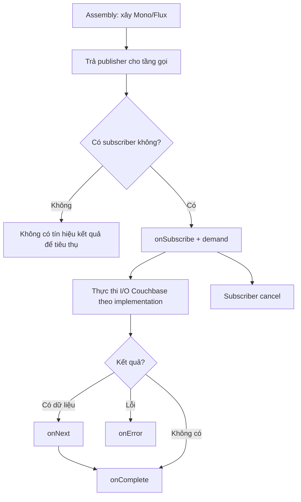

# Mono, Flux và vòng đời đăng ký thực hiện thao tác

Trong **SPRING_DATA_COUCHBASE**, chuyển từ repository đồng bộ sang API reactive không chỉ là thay kiểu trả về `Customer` bằng `Mono<Customer>` hoặc `List<Customer>` bằng `Flux<Customer>`. Điều cốt lõi là thay đổi cách một thao tác được **mô tả, đăng ký thực hiện, phát kết quả, xử lý lỗi và kết thúc**. Với Project Reactor, việc tạo publisher chưa đồng nghĩa dữ liệu đã được đọc hoặc ghi; ai đăng ký (*subscribe*), khi nào đăng ký, có bao nhiêu lần đăng ký và khi nào hủy có thể ảnh hưởng trực tiếp đến thao tác Couchbase.

Bài thuộc chương **Truy cập phản ứng**, tập trung vào **`Mono`, `Flux` và vòng đời đăng ký thực hiện thao tác**. Các ví dụ sử dụng `ReactiveCouchbaseRepository` và nhắc đến `ReactiveCouchbaseTemplate` khi cần truy vấn linh hoạt. Kiến thức này là nền tảng cho việc xây dựng tầng truy cập Couchbase bằng document mapping, repository và SQL++ trên bucket/scope/collection; đồng thời giúp tránh các hiểu nhầm về index, TTL, CAS, giao dịch và consistency khi hệ thống chạy bất đồng bộ.

> **Nguyên tắc quan trọng:** Với một publisher reactive thông thường, **việc trả về publisher là cách bàn giao công việc; subscription mới là cách yêu cầu công việc diễn ra**. Tuy vậy, không được suy ra từ nguyên tắc này rằng mọi publisher đều cold, mọi thao tác có thể hủy hoàn toàn ở server, hoặc mỗi subscription chỉ tạo đúng một mutation trong mọi tình huống.

## 1. Mục tiêu học tập

Sau bài này, bạn có thể:

1. Phân biệt `Mono<T>`, `Flux<T>` và các tín hiệu `onSubscribe`, `request`, `onNext`, `onComplete`, `onError`, `cancel`.
2. Giải thích sự khác nhau giữa **assembly** (xây pipeline) và **subscription** (đăng ký tiêu thụ).
3. Mô tả vòng đời đọc, lưu và xóa document bằng reactive repository; biết khi nào kết quả chưa được xác nhận.
4. Sử dụng `map`, `flatMap`, `switchIfEmpty`, `then` và `doFinally` đúng mục đích.
5. Tránh gọi `subscribe()` hoặc `block()` tùy tiện trong service và WebFlux controller.
6. Hiểu cold publisher, hot publisher, `Mono.defer`, `cache` và tác động của **đăng ký nhiều lần** đối với thao tác ghi.
7. Phân biệt backpressure tại Reactor với `LIMIT`/`ORDER BY` và khả năng stream của Couchbase Query Service.
8. Xử lý lỗi, timeout, retry và cancellation mà không làm mất dấu một mutation có thể đã thực thi.
9. Kiểm tra subscription, kết quả rỗng, lỗi và tín hiệu huỷ bằng `StepVerifier`.
10. Phân biệt vấn đề vòng đời reactive với index lag, TTL, CAS, transaction và lỗi mapping của Spring Data Couchbase.

## 2. Reactive Streams: hợp đồng giữa publisher và subscriber

Một publisher là nguồn phát tín hiệu, subscriber là bên đăng ký nhận tín hiệu và điều khiển nhu cầu. Project Reactor triển khai các khái niệm Reactive Streams bằng `Mono` và `Flux`.

| Thành phần | Vai trò | Điều cần nhớ |
| --- | --- | --- |
| `Publisher<T>` | Nguồn biểu diễn luồng dữ liệu/tín hiệu | Không nhất thiết có dữ liệu ngay khi biến Java được tạo. |
| `Subscriber<T>` | Tiêu thụ tín hiệu | Có quyền yêu cầu số phần tử và hủy subscription. |
| `Subscription` | Kết nối giữa publisher và subscriber | Cung cấp `request(n)` và `cancel()`. |
| `Mono<T>` | Phát tối đa một phần tử | Có thể rỗng hoặc lỗi. |
| `Flux<T>` | Phát từ không đến nhiều phần tử | Có thể dài, hữu hạn hoặc vô hạn tùy nguồn. |

Các tín hiệu cơ bản:

```text
Publisher                           Subscriber
    |                                    |
    |<-------------- subscribe ----------|
    |------------- onSubscribe --------->|
    |<------------- request(n) -----------|
    |------------- onNext(item) -------->|   0..N
    |------------- onComplete ---------->|   thành công
    |                 hoặc               |
    |------------- onError(error) ------>|   thất bại
    |<-------------- cancel --------------|   hủy tiêu thụ
```

`onComplete` và `onError` là hai kiểu kết thúc **loại trừ nhau** của một subscription bình thường. `cancel` là hành động của bên tiêu thụ nhằm dừng yêu cầu tín hiệu tiếp theo; nó **không** phải lời cam kết rằng một lệnh Couchbase đã gửi đi sẽ bị hoàn tác.

### 2.1. `Mono` và `Flux` không cho phép phát giá trị `null`

```java
Mono<Customer> oneCustomer = Mono.just(customer);
Mono<Customer> noCustomer = Mono.empty();
Mono<Customer> failure = Mono.error(
    new IllegalStateException("Example failure")
);

Flux<Customer> manyCustomers = Flux.just(c1, c2, c3);
Flux<Customer> none = Flux.empty();
```

Các biến `customer`, `c1`, `c2`, `c3` giả định đã có đối tượng Java **không null**. `Mono.just(null)` không phải cách biểu diễn không có dữ liệu; dùng `Mono.empty()` hoặc `Mono.justOrEmpty(value)` khi giá trị có thể null.

Điều này khác với JSON:

```json
{
  "status": "ACTIVE",
  "phone": null
}
```

Document tồn tại và có field `phone` là JSON `null`; một publisher trả về entity tương ứng vẫn có thể phát **một** `Customer`. Chỉ khi **không có entity kết quả** thì `findById` thường hoàn tất rỗng.

### 2.2. Những kiểu kết thúc cần phân biệt

| Tình huống | Tín hiệu ví dụ | Ý nghĩa |
| --- | --- | --- |
| Đọc được document | `onNext(customer)` rồi `onComplete` | Đọc thành công và có kết quả. |
| Không có ID phù hợp | `onComplete` không phát item | Thao tác không có kết quả, không nhất thiết là lỗi. |
| Query thất bại | `onError(exception)` | Lỗi cần được chuyển lên hoặc xử lý theo chính sách. |
| Client bỏ yêu cầu | `cancel` | Subscriber không còn muốn nhận tiếp; mutation phía server có thể vẫn tiếp tục. |
| Kết quả nhiều dòng | Nhiều `onNext` rồi `onComplete` | `Flux` hữu hạn, có thể đòi hỏi giới hạn ở query. |

## 3. Assembly, subscription và execution là ba mốc khác nhau

Ví dụ:

```java
Mono<Customer> lookup = repository.findById(customerId);

Mono<String> code = lookup
    .map(Customer::getCustomerCode);
```

Dòng đầu lấy một publisher từ repository; dòng sau xây pipeline biến đổi. Với các thao tác reactive repository điển hình, công việc I/O được thực hiện khi publisher được subscribe. Tuy nhiên, **việc đánh giá tham số, validate input hoặc dựng query object** vẫn có thể xảy ra lúc gọi method, tùy implementation. Vì vậy nói “không có bất kỳ code nào chạy trước subscribe” là quá rộng.

Một cách chia pha:



**Mốc nghiệp vụ:** `Mono<Customer> saveResult = repository.save(customer);` **chưa phải chứng cứ đã lưu**. Chỉ sau khi publisher được subscribe và hoàn tất thành công mới có cơ sở để báo thao tác thành công theo hợp đồng SDK/repository.

### 3.1. Ví dụ với nguồn Reactor thuần để thấy thời điểm thực thi

```java
import java.util.concurrent.atomic.AtomicInteger;
import reactor.core.publisher.Mono;

AtomicInteger counter = new AtomicInteger();

Mono<Integer> pipeline = Mono.fromSupplier(
    counter::incrementAndGet
);

// Assembly:
System.out.println(counter.get()); // 0

// Khi pipeline được subscribe:
Integer first = pipeline.block();   // Trong demo/test, kết quả 1.
Integer second = pipeline.block();  // Subscription khác, kết quả 2.
```

Đoạn trên minh họa **cold publisher Reactor thuần**, không gọi Couchbase. `block()` chỉ được dùng trong ví dụ chạy một lần hoặc test; trong request WebFlux không nên dùng như vậy. Hai lần `block()` tạo hai subscription riêng đối với nguồn này.

## 4. Mô hình dữ liệu và repository được dùng trong bài

Giả sử CRM lưu khách hàng tại bucket `app`, scope `crm`, collection `customers`:

```json
{
  "tenant_id": "tenant-a",
  "customer_code": "C001",
  "status": "ACTIVE",
  "city": "HANOI",
  "loyalty_points": 50
}
```

Couchbase quản lý document ID riêng, ví dụ `customer::tenant-a::C001`. Một entity tham khảo:

```java
package example.crm;

import org.springframework.data.annotation.Id;
import org.springframework.data.annotation.Version;
import org.springframework.data.couchbase.core.mapping.Collection;
import org.springframework.data.couchbase.core.mapping.Document;
import org.springframework.data.couchbase.core.mapping.Field;
import org.springframework.data.couchbase.core.mapping.Scope;

@Document
@Scope("crm")
@Collection("customers")
public class Customer {

    @Id
    private String id;

    @Field("tenant_id")
    private String tenantId;

    @Field("customer_code")
    private String customerCode;

    @Field
    private String status;

    @Field
    private String city;

    @Field("loyalty_points")
    private Integer loyaltyPoints;

    @Version
    private Long version;

    protected Customer() {}

    public String getId() { return id; }

    public String getTenantId() { return tenantId; }

    public String getCustomerCode() { return customerCode; }

    // Constructor nghiệp vụ và getters/setters khác lược bỏ.
}
```

`@Id` ánh xạ khóa document; `@Field` ánh xạ property Java sang tên JSON. `@Version` được dùng cho optimistic locking/CAS theo khả năng Spring Data Couchbase phiên bản ứng dụng, **không** tự biểu diễn số phiên bản nghiệp vụ hoặc field JSON thông thường.

Repository reactive:

```java
package example.crm;

import org.springframework.data.couchbase.repository.ReactiveCouchbaseRepository;
import reactor.core.publisher.Flux;

public interface CustomerRepository
        extends ReactiveCouchbaseRepository<Customer, String> {

    Flux<Customer> findByTenantIdAndStatus(
        String tenantId,
        String status
    );
}
```

Chữ ký `findByTenantIdAndStatus` dùng tên **property Java**. Khi truy vấn theo field, Spring Data Couchbase thường dùng SQL++ với index. Các keyword/query type nâng cao và API phải được xác minh trên đúng phiên bản ứng dụng.

## 5. Vòng đời của một thao tác đọc theo ID

Giả sử service cần lấy một customer theo ID và trả thông báo rõ nếu không có:

```java
import java.util.NoSuchElementException;
import reactor.core.publisher.Mono;

public Mono<Customer> getRequiredCustomer(String id) {
    return repository.findById(id)
        .switchIfEmpty(Mono.error(
            new NoSuchElementException("Customer does not exist")
        ));
}
```

Ý nghĩa:

1. Service **trả** `Mono<Customer>`, không tự subscribe.
2. Tầng gọi subscribe vào publisher.
3. Repository thực hiện truy cập theo document ID theo cơ chế SDK phù hợp.
4. Nếu document tồn tại, subscriber nhận một `Customer` rồi hoàn tất.
5. Nếu không tồn tại, `switchIfEmpty` kích hoạt publisher lỗi.
6. Nếu Couchbase trả lỗi I/O, lỗi được truyền qua `onError`; `switchIfEmpty` **không** biến lỗi này thành “không có customer”.

`switchIfEmpty` là một operator xử lý **nguồn rỗng**, khác với `onErrorResume` dùng cho **nguồn lỗi**.

### 5.1. Phân biệt lỗi và không tìm thấy

Một service đọc document không nên viết:

```java
// Anti-pattern: lỗi kết nối hoặc quyền truy cập bị che thành "không có".
return repository.findById(id)
    .onErrorResume(error -> Mono.empty());
```

Cách này có thể khiến API trả HTTP 404 dù Couchbase đang gặp sự cố. Hãy phân loại lỗi theo khả năng phục hồi; không dùng “rỗng” làm fallback chung cho mọi lỗi.

### 5.2. Đọc theo ID và truy vấn theo field khác nhau

`findById(id)` thường đi qua **key-value** theo khóa document. `findByTenantIdAndStatus(...)` thường chuyển thành truy vấn **SQL++** trên các field:

```sql
-- SQL++ minh họa logic, không phải câu nguyên văn framework sinh.
SELECT c.*
FROM `app`.`crm`.`customers` AS c
WHERE c.`tenant_id` = $tenantId
  AND c.`status` = $status;
```

Query Service có thể cần secondary index, và chỉ mục có thể chưa phản ánh một lần ghi mới. `Mono`/`Flux` không tự làm hai đường đọc này có cùng mức nhất quán.

## 6. Vòng đời của một truy vấn `Flux`

Một method:

```java
Flux<Customer> findByTenantIdAndStatus(
    String tenantId,
    String status
);
```

có thể phát 0, 1 hoặc nhiều customer. Vì `Flux` là một luồng, subscriber có thể nhận từng item theo lịch phát và mức demand; không nên giả định tất cả document được tải xong ngay khi tạo biến `Flux`.

Ví dụ biến đổi từng customer thành mã:

```java
Flux<String> codes = repository
    .findByTenantIdAndStatus("tenant-a", "ACTIVE")
    .map(Customer::getCustomerCode);
```

`map` xử lý **mỗi `onNext`**, không tự tạo truy vấn mới cho từng item. Nếu nguồn không phát item nào, hàm trong `map` không được gọi.

### 6.1. Không có `ORDER BY` thì không được cam kết thứ tự

Một `Flux` của kết quả SQL++ không tự phát theo thứ tự ID, thời điểm ghi hoặc theo index nếu statement không có `ORDER BY`. Nếu UI cần danh sách khách hàng theo mã tăng dần, phải sắp xếp ở phía query thông qua API được phiên bản hỗ trợ và index phù hợp.

```text
WHERE tenant_id = ?
  AND status = ?
ORDER BY customer_code ASC
LIMIT 20
```

Việc gọi `sort(...)` trên Reactor có thể phải thu thập nhiều phần tử trước khi phát, không phải thay thế tương đương cho `ORDER BY` được thực thi trong Couchbase với index.

### 6.2. Luồng hữu hạn nhưng tập kết quả vẫn có thể quá lớn

`Flux<Customer>` biểu diễn nhiều document; nó **không** tự đặt giới hạn an toàn. Nếu truy vấn khớp hàng trăm nghìn document, phải thiết kế phân trang hoặc giới hạn ở backend để tránh áp lực network, bộ nhớ và thời gian truy vấn.

## 7. Dùng các hook để quan sát vòng đời publisher

Reactor có các operator giúp quan sát subscription, item, kết thúc và huỷ:

```java
import reactor.core.publisher.Flux;
import reactor.core.publisher.SignalType;

Flux<Customer> observed = repository
    .findByTenantIdAndStatus("tenant-a", "ACTIVE")
    .doOnSubscribe(sub -> logger.debug("subscribed"))
    .doOnRequest(n -> logger.debug("requested {}", n))
    .doOnNext(c -> logger.debug("received customer"))
    .doOnComplete(() -> logger.debug("completed"))
    .doOnError(error -> logger.warn("query failed", error))
    .doFinally(signal -> logger.debug("final signal {}", signal));
```

`logger` là một logger do ứng dụng cung cấp; đoạn code minh họa vị trí đặt hook, không phải Java file độc lập. Không log nội dung customer đầy đủ hoặc tham số nhạy cảm theo mặc định.

| Hook | Khi nào chạy? | Điều không nên suy diễn |
| --- | --- | --- |
| `doOnSubscribe` | Có subscription vào đoạn pipeline này | Database đã hoàn tất thao tác. |
| `doOnRequest` | Downstream gửi demand | Server chỉ quét đúng số item được request. |
| `doOnNext` | Có item được phát | Pipeline đã hoàn tất thành công. |
| `doOnComplete` | `Flux` hoàn tất bình thường | Có ít nhất một item được trả về. |
| `doOnError` | Có lỗi tại đoạn pipeline tương ứng | Lỗi đã được xử lý hoặc tự retry. |
| `doFinally` | Pipeline kết thúc theo complete/error/cancel | Mutation phía Couchbase đã commit/rollback. |

### 7.1. `doOnSuccess` của `Mono` có thể nhận `null`

Với `Mono`, `doOnSuccess` được gọi khi hoàn tất **thành công**, kể cả thành công rỗng. Khi rỗng, consumer nhận `null` như một thông báo **không có giá trị phát**, chứ không phải một `onNext(null)`.

```java
Mono<Customer> lookedUp = repository.findById(id)
    .doOnSuccess(customer -> {
        if (customer == null) {
            logger.debug("lookup completed empty");
        } else {
            logger.debug("lookup completed with customer");
        }
    });
```

Nếu chỉ muốn quan sát entity thực sự được phát, dùng `doOnNext`. Nếu muốn quan sát mọi kết thúc, dùng `doFinally`, đồng thời xét loại tín hiệu của nó.

### 7.2. `doOnNext` và `doOnError` không nên chứa side effect nghiệp vụ trọng yếu

Các hook dạng `doOn...` phù hợp cho quan sát, metrics và logging có kiểm soát. Không dùng chúng như nguồn chân lý duy nhất cho giao dịch thanh toán, audit bắt buộc hoặc thao tác ghi khác mà phải có bảo đảm chính xác.

Vì publisher có thể được subscribe lại, retry hoặc hủy, side effect trong `doOnNext` có thể được kích hoạt nhiều lần hoặc không đủ lần so với điều kiện nghiệp vụ. Khi cần ghi dữ liệu, hãy dùng một operation được compose bằng `flatMap`/`then` với idempotency và kiểm tra kết quả.

## 8. Cold publisher, hot publisher và `defer`

### 8.1. Cold publisher: công việc thường bắt đầu theo từng subscription

Với nguồn Reactor thuần:

```java
import java.util.concurrent.atomic.AtomicInteger;
import reactor.core.publisher.Mono;

AtomicInteger count = new AtomicInteger();

Mono<Integer> cold = Mono.fromSupplier(count::incrementAndGet);
```

Mỗi subscription vào `cold` gọi supplier một lần (trừ khi bị thay đổi bởi operator cache/share hoặc những cơ chế khác). Với một publisher repository đọc/ghi thông thường, nhiều subscription **có thể** dẫn đến nhiều lần thực hiện operation tương ứng. Cần kiểm chứng semantics cụ thể của API và chuỗi operator.

### 8.2. `Mono.just` đánh giá tham số ngay khi tạo

So sánh:

```java
Mono<Integer> eager = Mono.just(counter.incrementAndGet());

Mono<Integer> lazy = Mono.fromSupplier(counter::incrementAndGet);
```

Ở `eager`, `counter.incrementAndGet()` được **gọi ngay** khi xây publisher. Ở `lazy`, supplier chạy khi subscribe. Điều này khác với câu “mọi code đặt trong một dòng tạo Mono đều chỉ chạy lúc subscribe”.

Một cách rõ ràng để trì hoãn **việc tạo publisher từ một lời gọi khác** là `Mono.defer`:

```java
Mono<Customer> deferred = Mono.defer(
    () -> repository.findById(id)
);
```

`defer` gọi supplier cho từng subscription, tạo một publisher mới mỗi lần. Hữu ích nếu cần xác định thời điểm đánh giá tham số, đọc context hoặc dựng query tại subscription; không phải lúc nào cũng cần bọc mọi lời gọi repository bằng `defer`.

### 8.3. Hot publisher và `cache`

Một hot publisher có thể phát dữ liệu không phụ thuộc từng subscriber và subscriber mới có thể không nhìn thấy tín hiệu cũ. Các operator như `cache` có thể khiến subscription sau **dùng lại** kết quả đã phát từ một publisher nguồn thay vì chạy lại toàn bộ nguồn:

```java
Mono<Customer> cached = repository.findById(id).cache();
```

`cache()` có thể giữ cả giá trị rỗng hoặc tín hiệu lỗi theo semantics của operator. Không dùng nó như cache phân tán hoặc cơ chế đảm bảo ghi chính xác một lần. Đặc biệt không dùng `cache()` để “sửa” quy trình ghi có thể bị lặp do retry hoặc nhiều request: một kết quả cache cũ có thể không phản ánh document đã thay đổi, TTL hoặc CAS mới.

## 9. Đăng ký nhiều lần và nguy cơ lặp thao tác ghi

Xét publisher lưu document:

```java
Mono<Customer> saveOperation = repository.save(customer);
```

Nếu cùng publisher được subscribe hai lần:

```java
saveOperation.subscribe();
saveOperation.subscribe();
```

thì với nguồn cold thông thường, hai subscription **có thể khởi động hai lần ghi**. Tác động cụ thể phụ thuộc repository implementation, kiểu insert/upsert, CAS, cùng một đối tượng mutable và trạng thái tài liệu tại thời điểm thực thi. Không xem hai subscription là một thao tác ghi duy nhất.

Đặc biệt nguy hiểm với:

- Thao tác insert-only hoặc tạo ID mới mỗi lần.
- Tăng điểm/tăng số dư theo read-modify-write.
- Gửi notification hoặc audit trong pipeline.
- Kích hoạt job sau khi controller đã return publisher.
- Thêm `retry` mà không có idempotency.

### 9.1. Một anti-pattern phổ biến trong service

```java
// Không nên làm trong service WebFlux.
public Mono<Customer> create(Customer customer) {
    Mono<Customer> operation = repository.save(customer);
    operation.subscribe();     // Subscription thứ nhất.
    return operation;          // Controller có thể subscribe lần thứ hai.
}
```

Vấn đề là service vừa tự subscribe, vừa bàn giao publisher cho tầng gọi. Có thể ghi trùng, race hoặc hai outcome khác nhau.

Cách đúng:

```java
public Mono<Customer> create(Customer customer) {
    return repository.save(customer);
}
```

Tầng điều phối HTTP hoặc job được quản lý sẽ quyết định subscription và theo dõi kết quả. Nếu nghiệp vụ cần ghi đúng một lần trước khi trả response, hãy compose các bước trong **một pipeline** và xác nhận theo tín hiệu hoàn tất.

### 9.2. Tác vụ nền cũng cần chủ sở hữu vòng đời

Không có nghĩa `subscribe()` bị cấm trong mọi ứng dụng. Một thành phần chủ động vận hành job có thể subscribe với:

- Chủ sở hữu rõ ràng (scheduler/job service).
- Quản lý `Disposable`, dừng theo lifecycle.
- Callback lỗi và metrics.
- Giới hạn retry, concurrency và thời gian.
- Khả năng kiểm tra mutation outcome.

Nhưng trong service được WebFlux gọi, kiểu “fire-and-forget bằng `subscribe()` rồi trả ngay” thường làm mất khả năng báo lỗi và gắn thao tác vào request gốc.

## 10. Khi nào subscriber thực sự đến từ WebFlux?

Một controller WebFlux có thể **return publisher**:

```java
package example.crm;

import org.springframework.http.ResponseEntity;
import org.springframework.web.bind.annotation.GetMapping;
import org.springframework.web.bind.annotation.PathVariable;
import org.springframework.web.bind.annotation.RequestMapping;
import org.springframework.web.bind.annotation.RestController;
import reactor.core.publisher.Mono;

@RestController
@RequestMapping("/customers")
public class CustomerController {

    private final CustomerRepository repository;

    public CustomerController(CustomerRepository repository) {
        this.repository = repository;
    }

    @GetMapping("/{id}")
    public Mono<ResponseEntity<Customer>> findById(
            @PathVariable String id) {

        return repository.findById(id)
            .map(ResponseEntity::ok)
            .defaultIfEmpty(ResponseEntity.notFound().build());
    }
}
```

Ở đây WebFlux chịu trách nhiệm subscribe publisher trong quá trình xử lý response; controller không cần gọi `block()` hoặc `subscribe()`. Nếu document không tồn tại, nguồn `Mono` rỗng và `defaultIfEmpty` cung cấp response 404.

**Lưu ý bảo mật:** Endpoint minh họa chưa xử lý phân quyền theo tenant. Trong ứng dụng thực tế cần lấy tenant từ context xác thực, đối chiếu document đã đọc và tránh trả entity chứa field nội bộ không cần thiết.

### 10.1. Client ngắt kết nối và cancellation

Khi client hủy request hoặc đóng kết nối, downstream có thể cancel subscription. Nhưng:

- Lệnh đọc Query Service có thể đã gửi và tiêu thụ tài nguyên.
- Lệnh ghi có thể đã hoàn tất ở Couchbase trước lúc subscriber ngắt.
- Việc cancel **không mặc định rollback** mutation hoặc transaction.
- HTTP response không đến được client **không chứng minh thao tác chưa xảy ra**.

Với thao tác ghi quan trọng, phải thiết kế idempotency key, trạng thái công việc hoặc cơ chế xác nhận và retry theo nghiệp vụ. Không dựa duy nhất vào việc nhận được tín hiệu complete phía HTTP client để suy luận mutation.

## 11. Kết hợp nhiều thao tác: `map`, `flatMap`, `then`

### 11.1. `map` dành cho phép biến đổi đồng bộ

```java
Mono<String> code = repository.findById(id)
    .map(Customer::getCustomerCode);
```

`map` chỉ chạy khi nguồn phát item. Nếu nguồn rỗng, pipeline `code` cũng rỗng.

### 11.2. `flatMap` khi bước tiếp theo trả publisher

```java
Mono<Customer> saved = repository.findById(id)
    .switchIfEmpty(Mono.error(
        new java.util.NoSuchElementException("Not found")
    ))
    .flatMap(customer -> repository.save(customer));
```

Đây là ví dụ về **kiểu dữ liệu**; nếu cần thay đổi document, phải cập nhật property có chủ đích và xem CAS trước khi `save`. `flatMap` làm subscriber nhận kết quả từ publisher của `save`, thay vì nhận một `Mono<Mono<Customer>>`.

### 11.3. `then` chờ hoàn tất, nhưng không giữ giá trị

```java
Mono<Void> deleted = repository.deleteById(id).then();
```

`then()` chuyển kết quả thành publisher chỉ quan tâm việc hoàn tất; nếu thao tác xóa phát lỗi, lỗi vẫn lan truyền. Không dùng `then()` để khẳng định đã xóa một document vốn không tồn tại nếu hợp đồng của `deleteById` không bảo đảm cách xử lý đó.

Một chuỗi hai bước:

```java
Mono<Customer> savedThenRead = repository.save(customer)
    .flatMap(saved -> repository.findById(saved.getId()));
```

tạo thứ tự **save hoàn tất rồi mới đọc theo ID** trong pipeline. Nó **không** tự tạo một transaction hay đảm bảo truy vấn SQL++ theo field nhìn thấy ghi đó nếu index chưa cập nhật.

### 11.4. Bẫy `zip` với publisher rỗng

`Mono.zip(a, b)` cần item từ mỗi nguồn để tạo tuple. Nếu một nguồn kết thúc rỗng, kết quả zip có thể rỗng; với một số tình huống, không phải mọi nguồn bên trong đều được subscribe hoặc hoàn tất như người viết mong đợi.

Do đó không dùng `zip` như cách bắt buộc **hai mutation không có payload** phải chạy hết. Với yêu cầu “chờ cả hai kết thúc”, phải chọn toán tử dành cho completion và kiểm tra thứ tự/concurrency, nhưng nếu cần tính nguyên tử nhiều document thì Reactor operator vẫn **không** thay thế Couchbase transaction.

## 12. Backpressure và `request(n)`

Reactive Streams cho phép subscriber gửi tín hiệu demand bằng `request(n)`. Một subscriber chỉ muốn một item có thể yêu cầu một item trước, rồi yêu cầu tiếp khi sẵn sàng. Điều này có ích với pipeline dài và nguồn có khả năng phản ứng với nhu cầu.

Ví dụ `StepVerifier` cho nguồn Reactor thuần:

```java
import reactor.core.publisher.Flux;
import reactor.test.StepVerifier;

StepVerifier.create(Flux.just(1, 2, 3), 0)
    .thenRequest(1)
    .expectNext(1)
    .thenRequest(2)
    .expectNext(2, 3)
    .verifyComplete();
```

Test bắt đầu với demand bằng 0, sau đó yêu cầu 1 và 2 phần tử. Đây là **test ngữ nghĩa Reactive Streams**, không phải bằng chứng Couchbase chỉ đọc một hoặc hai document từ index tương ứng.

### 12.1. Backpressure không đồng nghĩa `LIMIT` ở SQL++

```java
Flux<Customer> preview = repository
    .findByTenantIdAndStatus("tenant-a", "ACTIVE")
    .take(10);
```

`take(10)` giới hạn tối đa 10 item truyền xuống subscriber và có thể cancel upstream. Nhưng Query Service có thể đã lập kế hoạch hoặc bắt đầu thực thi một truy vấn lớn; backpressure trên Reactor **không tự viết thêm `LIMIT 10`** vào SQL++.

Nếu bài toán là “lấy 10 document mới nhất”, cần:

```text
WHERE tenant_id = ?
  AND status = "ACTIVE"
ORDER BY created_at DESC, customer_code ASC
LIMIT 10
```

và một index phù hợp; sau đó mới dùng `Flux` để tiêu thụ kết quả. Khả năng biểu đạt `Top10`/`Pageable` từ repository reactive phải được xác minh ở phiên bản Spring Data Couchbase đang dùng.

### 12.2. Các operator có thể tích lũy bộ nhớ

```java
Mono<java.util.List<Customer>> all = repository
    .findByTenantIdAndStatus("tenant-a", "ACTIVE")
    .collectList();
```

`collectList()` phải tích lũy mọi item trước khi phát một danh sách. Với query lớn, nó có thể gây áp lực bộ nhớ tương tự việc tải `List` không giới hạn trong code đồng bộ. Các operator `buffer`, `sort`, `groupBy` cũng cần xem xét tính chất lưu đệm và mức song song.

Không dùng khẩu hiệu “Flux luôn streaming, nên memory gần như bằng 0” nếu pipeline vẫn chứa thao tác tích lũy lớn.

## 13. Concurrency và thứ tự kết quả

Với một luồng ID:

```java
Flux<String> ids = Flux.just("c01", "c02", "c03");

Flux<Customer> customers = ids.flatMap(
    repository::findById,
    4
);
```

Tham số `4` giới hạn số publisher bên trong mà `flatMap` có thể đồng thời xử lý theo API Reactor. Kết quả **có thể không giữ thứ tự** đầu vào vì request `c03` có thể hoàn tất trước `c01`.

Khi yêu cầu giữ thứ tự:

```java
Flux<Customer> sequential = ids.concatMap(repository::findById);
```

`concatMap` thực thi các inner publisher theo thứ tự nối tuần tự; `flatMapSequential` có thể chủ động subscribe nhiều inner nhưng giữ thứ tự phát theo nguồn. Đổi lại, việc giữ thứ tự có thể tăng thời gian chờ hoặc buffering. Chọn theo mục tiêu nghiệp vụ và năng lực Couchbase.

### 13.1. Đừng bật concurrency lớn không giới hạn

Với một job xử lý hàng nghìn document, `flatMap(repo::save)` không có điều khiển concurrency có thể tạo tải lớn, xung đột CAS hoặc chiếm tài nguyên mạng. Đặt giới hạn có cơ sở, kiểm soát retry và quan sát latency/index; reactive không làm cluster tự tăng năng lực vô hạn.

### 13.2. Thứ tự xử lý trong một pipeline không tạo nguyên tử nhiều document

`concatMap` giúp các bước trong pipeline được xử lý tuần tự. Nó không làm một nhóm ghi thành transaction; nếu bước thứ ba lỗi, hai bước trước có thể đã commit thành công. Nếu nghiệp vụ cần all-or-nothing, phải dùng transaction API được Couchbase SDK/Spring Data hỗ trợ theo đúng phiên bản.

## 14. Error, timeout và retry ảnh hưởng vòng đời thế nào?

### 14.1. Phân biệt không có dữ liệu với lỗi query

```java
Mono<Customer> result = repository.findById(id)
    .switchIfEmpty(Mono.error(
        new java.util.NoSuchElementException("Not found")
    ));
```

`switchIfEmpty` chỉ chạy khi nguồn **hoàn tất rỗng**. Khi lỗi timeout, quyền, index, CAS hoặc mạng, tín hiệu là `onError` và phải được xử lý theo phân loại phù hợp.

Anti-pattern:

```java
// Không làm khi lỗi database cần được báo lên.
Flux<Customer> data = repository
    .findByTenantIdAndStatus(tenantId, "ACTIVE")
    .onErrorResume(error -> Flux.empty());
```

Nó biến sự cố cơ sở dữ liệu thành câu trả lời “không có dữ liệu”.

### 14.2. `timeout` không chắc chặn mutation đã gửi đi

```java
import java.time.Duration;

Mono<Customer> attempted = repository.save(customer)
    .timeout(Duration.ofSeconds(3));
```

Nếu pipeline không nhận tín hiệu trong thời hạn, `timeout` phát lỗi timeout tới downstream và có thể hủy subscription upstream. Nhưng **lệnh ghi có thể đã được Couchbase xử lý**, dù phản hồi tới client bị trễ hoặc thất lạc. Không dùng một lỗi timeout làm bằng chứng chắc chắn document chưa được ghi.

### 14.3. Retry thường là subscription mới

```java
Mono<Customer> retried = repository.findById(id)
    .retry(2);
```

Khi lỗi phù hợp với operator, retry sẽ resubscribe upstream. Với nguồn cold, điều đó có thể khởi động lại công việc I/O. Ví dụ trên là minh họa cú pháp, **không phải chính sách retry production**: nó chưa phân loại lỗi, chưa có backoff và có thể thử lại cả những lỗi không tạm thời.

Với mutation, retry mù quáng có nguy cơ:

- Gửi một ghi lần thứ hai khi ghi lần đầu đã thành công nhưng response timeout.
- Gây xung đột CAS hoặc đè dữ liệu mới.
- Tạo hai thông báo/event liên quan nếu các bước side effect lặp.
- Khiến audit đếm sai số lần ghi.

Chỉ retry những lỗi thực sự tạm thời, theo SDK/operation được xác minh và **đã có chiến lược idempotency**. Đọc lại trạng thái cuối khi cần, thay vì tự động bắn lại object cũ vô hạn.

### 14.4. `onErrorResume` không phải cơ chế phục hồi mọi lỗi

Có thể dùng `onErrorResume` để chuyển một loại lỗi đã biết sang một phản hồi hợp lệ, nhưng phải phân biệt rõ và để những lỗi bất ngờ tiếp tục được báo. Không đặt `onErrorResume(e -> Mono.empty())` ở cuối mọi pipeline chỉ nhằm “giữ hệ thống không báo lỗi”.

## 15. Cancellation: huỷ subscriber không đồng nghĩa rollback

Khi subscriber gọi `cancel()`, upstream có thể ngừng phát item hoặc hủy một yêu cầu đang chờ. Nhưng Couchbase có thể đã nhận lệnh hoặc thậm chí commit mutation.

Xét tình huống:

```text
T0: WebFlux đã subscribe vào repository.save(customer)
T1: SDK gửi mutation tới Couchbase
T2: Client đóng kết nối / downstream cancel
T3: Server có thể đã ghi thành công
T4: Client không nhận response
```

Kết luận đúng là: **client không biết chắc trạng thái cuối**, không phải “ghi thất bại” hay “ghi chắc chắn thành công”.

### 15.1. Phân biệt cancel với lỗi

`doFinally` có thể quan sát tín hiệu cuối cùng dạng `CANCEL`, `ON_ERROR` hoặc `ON_COMPLETE` ở đoạn pipeline tương ứng. Nhưng `CANCEL` chỉ phản ánh vòng đời publisher tại vị trí quan sát; nó không đo trực tiếp outcome ở Couchbase.

Với thao tác có tác động quan trọng, dùng cơ chế idempotency, document ID xác định, CAS/transaction khi cần và API kiểm tra trạng thái cuối. Hệ thống không thể xây bảo đảm exactly-once chỉ bằng một operator Reactor.

### 15.2. Tài nguyên phải được quản lý theo lifecycle

Các pipeline dài, luồng nhiều item và nguồn bên ngoài có thể giữ tài nguyên. Với các nguồn cần quản lý tài nguyên riêng, Reactor có các mẫu như `usingWhen`; tuy nhiên không tự bọc mọi thao tác Spring Data repository trong quản lý connection thủ công nếu SDK đã chịu trách nhiệm điều phối tài nguyên.

Tầng job/scheduler chủ động subscribe cần quản lý `Disposable` và dừng hợp lý khi ứng dụng shutdown. Với WebFlux, framework thường quản lý subscription của HTTP response.

## 16. Reactor Context và thông tin theo request

Trong reactive, một pipeline có thể đi qua nhiều thread hoặc scheduler, nên **`ThreadLocal` đơn thuần** không phải cách đáng tin cậy để mang thông tin tenant, trace ID hoặc security context từ đầu đến cuối.

Reactor cung cấp **`Context`** gắn với subscription, cho phép đọc giá trị mà không truyền qua mọi đối số hàm. Ví dụ Reactor thuần:

```java
import reactor.core.publisher.Mono;
import reactor.util.context.Context;

Mono<String> tenantName = Mono.deferContextual(view ->
    Mono.just(view.get("tenantId"))
);

Mono<String> result = tenantName
    .contextWrite(Context.of("tenantId", "tenant-a"));
```

Khi `result` được subscribe, `deferContextual` đọc giá trị của key `tenantId` trong Context. Đây không phải hướng dẫn đặt **quyền truy cập** tùy ý từ input người dùng vào Context. Tenant phải được xác thực/ủy quyền ở tầng bảo mật, và mọi query cần ràng buộc tenant theo chính sách server-side.

### 16.1. Context không phải transaction tự động

Có thể dùng Context cho correlation ID và thông tin phân quyền có kiểm soát. Nhưng nó không tự thêm điều kiện tenant vào mọi query, không tự quản lý Cassandra/Couchbase session, và không biến hai publisher thành một transaction. Khi dùng reactive security/transaction integration, phải dựa vào cơ chế chính thức của framework và phiên bản hỗ trợ.

## 17. `subscribeOn`, `publishOn` và vấn đề blocking

Reactor có các operator lập lịch:

- `subscribeOn` ảnh hưởng ngữ cảnh subscription/upstream theo cấu trúc pipeline.
- `publishOn` chuyển ngữ cảnh xử lý downstream sau vị trí đó.
- Scheduler không quyết định query Couchbase có index hay không hoặc mutation có CAS hay không.

**Không nên bọc một reactive repository đang non-blocking vào `boundedElastic()` chỉ với mục tiêu “làm nó reactive hơn”.** SDK và Spring Data đã có cơ chế xử lý I/O riêng; đổi scheduler không tự cải thiện tốc độ query.

Nếu phải tích hợp một thư viện **blocking** chưa có API reactive, có thể cô lập công việc blocking theo mẫu:

```java
import reactor.core.publisher.Mono;
import reactor.core.scheduler.Schedulers;

Mono<String> legacy = Mono.fromCallable(
        () -> legacyBlockingClient.readValue()
    )
    .subscribeOn(Schedulers.boundedElastic());
```

`legacyBlockingClient` là đối tượng minh họa; ví dụ cho thấy cách di chuyển một lời gọi blocking ra scheduler được thiết kế cho blocking. Vẫn phải đặt giới hạn tải và cân nhắc chuyển sang API không blocking thực sự nếu có.

### 17.1. Vì sao `block()` là bẫy trong WebFlux?

`block()` đợi kết quả bằng cách chặn thread gọi. Nếu dùng trên event-loop xử lý request, nó có thể phá khả năng phục vụ nhiều kết nối đồng thời, gây lỗi thread hoặc deadlock tùy cách dùng.

Trong test đồng bộ có kiểm soát, `block()` có thể hữu ích. Trong controller/service reactive nên **trả publisher**, để framework subscribe và chuyển response.

## 18. Đọc sau ghi: phân biệt lifecycle với consistency

Một pipeline:

```java
Mono<Customer> roundTrip = repository.save(customer)
    .flatMap(saved -> repository.findById(saved.getId()));
```

đảm bảo thứ tự tín hiệu **save thành công trước khi gọi findById** trong đường đi không lỗi của pipeline. Nhưng điều đó không có nghĩa mọi truy vấn field đều nhìn thấy document ngay.

Ví dụ:

```text
save(customer)                          -> KV mutation thành công
findById(saved.id)                      -> KV đọc theo document ID
findByTenantIdAndStatus(...)            -> SQL++ qua Query Service/index
```

Query SQL++ có thể chưa thấy document mới vì index chưa cập nhật tại scan consistency thông thường. Khi cần đọc ngay theo field, đánh giá query scan consistency như mức tương đương `REQUEST_PLUS` nếu SDK/Spring Data phiên bản sử dụng hỗ trợ, hoặc thiết kế đọc theo ID.

**Đừng nhầm:** “Publisher chưa được subscribe” và “SQL++ index chưa cập nhật” đều có thể khiến bạn không thấy kết quả, nhưng nguyên nhân và cách xử lý khác hẳn nhau.

### 18.1. Index cho query reactive

Giả sử entity có discriminator `_class` và truy vấn lọc tenant/status, index minh họa:

```sql
CREATE INDEX ix_customer_type_tenant_status
ON `app`.`crm`.`customers`(
    `_class`,
    `tenant_id`,
    `status`
);
```

Index này chỉ là điểm xuất phát. Thực tế query creator có thể sinh discriminator/alias/projection khác hoặc cấu hình bỏ discriminator; cần lấy SQL++ thật và dùng `EXPLAIN`:

```sql
EXPLAIN
SELECT c.*
FROM `app`.`crm`.`customers` AS c
WHERE c.`tenant_id` = "tenant-a"
  AND c.`status` = "ACTIVE";
```

Không có index tốt, một pipeline non-blocking vẫn có thể phải đợi Query Service scan rất nhiều document.

## 19. TTL, CAS và transaction trong vòng đời reactive

### 19.1. TTL: hoàn tất rỗng không nhất thiết do lỗi đăng ký

Một document hết hạn theo TTL có thể không còn tìm thấy ở lần subscribe sau. Hai subscription vào cùng `findById` ở hai thời điểm có thể quan sát hai kết quả khác nhau nếu document hết hạn giữa chừng.

Ngược lại, nếu publisher bị `cache()` và giữ kết quả cũ, subscriber có thể nhận entity đã cache dù document hiện không còn tồn tại. Vì vậy cần phân biệt cache ở tầng Reactor với trạng thái thật của Couchbase.

### 19.2. CAS: optimistic locking không tự biến mất khi dùng `Mono`

Hai pipeline có thể cùng đọc document ở version/CAS cũ. Khi ghi, cơ chế optimistic locking (ví dụ `@Version` trên entity, theo phiên bản hỗ trợ) có thể từ chối một thao tác do xung đột.

```text
Request A: read customer with CAS V1
Request B: read customer with CAS V1
Request A: save -> success, CAS changes
Request B: save with stale CAS -> conflict
```

Operator `flatMap` chỉ định thứ tự trong **một** pipeline; nó không khóa document giữa các request. Khi xử lý CAS conflict, cần quy tắc nghiệp vụ về đọc lại/tính lại và retry giới hạn; không gửi lại object cũ vô hạn.

### 19.3. Transaction: nhiều publisher không có nghĩa một giao dịch

`Mono.when(saveA, saveB)` hoặc `saveA.then(saveB)` chỉ phối hợp signals. Không có cam kết all-or-nothing nếu một thao tác hoàn tất còn thao tác kia thất bại.

Nếu nghiệp vụ cần thay đổi nguyên tử trên nhiều document, dùng API transaction phù hợp với Couchbase SDK và Spring Data Couchbase phiên bản hiện tại. Phải kiểm tra cách gắn transaction context trong reactive pipeline, giới hạn thao tác hỗ trợ và xử lý lỗi/rollback thực tế. Không chỉ thêm `@Transactional` rồi giả định mọi đường SDK/reactive đều tham gia cùng một transaction.

## 20. Kiểm thử vòng đời bằng `StepVerifier`

`reactor-test` cung cấp `StepVerifier` để kiểm tra publisher phát tín hiệu đúng. Điểm khác so với một unit test Java thông thường là bạn kiểm tra **sự kiện phát và kết thúc**, không chỉ giá trị trả về ngay lập tức.

### 20.1. Test `Mono` có item, rỗng và lỗi

```java
import org.junit.jupiter.api.Test;
import reactor.core.publisher.Mono;
import reactor.test.StepVerifier;

class MonoSignalTest {

    @Test
    void emitsOneThenCompletes() {
        StepVerifier.create(Mono.just("C001"))
            .expectNext("C001")
            .verifyComplete();
    }

    @Test
    void completesEmpty() {
        StepVerifier.create(Mono.<String>empty())
            .verifyComplete();
    }

    @Test
    void signalsFailure() {
        StepVerifier.create(Mono.<String>error(
                new IllegalStateException("example")
            ))
            .expectError(IllegalStateException.class)
            .verify();
    }
}
```

Các test này không cần Couchbase; chúng chứng minh semantics Reactor cơ bản.

### 20.2. Test sự trì hoãn và số lần subscription

```java
import static org.assertj.core.api.Assertions.assertThat;

import java.util.concurrent.atomic.AtomicInteger;
import org.junit.jupiter.api.Test;
import reactor.core.publisher.Mono;
import reactor.test.StepVerifier;

class SubscriptionLifecycleTest {

    @Test
    void coldSupplierRunsForEachSubscription() {
        AtomicInteger calls = new AtomicInteger();

        Mono<Integer> source = Mono.fromSupplier(
            calls::incrementAndGet
        );

        assertThat(calls).hasValue(0);

        StepVerifier.create(source)
            .expectNext(1)
            .verifyComplete();

        StepVerifier.create(source)
            .expectNext(2)
            .verifyComplete();

        assertThat(calls).hasValue(2);
    }
}
```

Kiểm thử này cho thấy **assembly không chạy supplier**, nhưng hai lần subscribe làm supplier chạy hai lần. Đừng sao chép nguyên kỳ vọng đó cho mọi publisher hot/cached hoặc mọi implementation Couchbase; nếu bài toán cần biết chính xác số mutation, hãy test tích hợp trên phiên bản repository thật.

### 20.3. Test cancellation

```java
import reactor.core.publisher.Flux;
import reactor.test.StepVerifier;

StepVerifier.create(Flux.<String>never())
    .thenCancel()
    .verify();
```

`Flux.never()` không phát item và không tự hoàn tất. Test chủ động cancel rồi verify điều khiển tín hiệu; nó **không** mô phỏng việc Couchbase rollback một mutation.

### 20.4. Integration test với reactive Couchbase

Giả sử một test collection đã có document `customer::tenant-a::C001`:

```java
import static org.assertj.core.api.Assertions.assertThat;

import org.junit.jupiter.api.Test;
import org.springframework.beans.factory.annotation.Autowired;
import org.springframework.boot.test.context.SpringBootTest;
import reactor.test.StepVerifier;

@SpringBootTest
class CustomerRepositoryIT {

    @Autowired
    CustomerRepository repository;

    @Test
    void findByIdEmitsCorrectCustomer() {
        StepVerifier.create(
                repository.findById("customer::tenant-a::C001")
            )
            .assertNext(customer -> {
                assertThat(customer.getId())
                    .isEqualTo("customer::tenant-a::C001");
                assertThat(customer.getTenantId())
                    .isEqualTo("tenant-a");
            })
            .verifyComplete();
    }

    @Test
    void missingIdCompletesEmpty() {
        StepVerifier.create(
                repository.findById("customer::tenant-a::MISSING")
            )
            .verifyComplete();
    }
}
```

Đây là **khung test**, chỉ chạy được khi ứng dụng đã có dependency test, Couchbase test cluster, mapping và fixture đúng. Dùng bucket/scope/collection riêng cho test; không tạo hay xóa dữ liệu khách hàng thật.

### 20.5. Kiểm thử query theo field phải xét index lag

Nếu test seed document qua key-value rồi gọi ngay `findByTenantIdAndStatus(...)`, query SQL++ có thể chưa thấy mutation. Hãy cấu hình scan consistency hoặc cơ chế chờ có điều kiện/timeout được version hỗ trợ; không dùng `Thread.sleep(1000)` cố định rồi suy luận mọi thất bại là do Reactor.

## 21. Bảng lỗi vận hành và cách chẩn đoán

| Triệu chứng | Nguyên nhân cần kiểm tra | Hướng xử lý |
| --- | --- | --- |
| Gọi `save` nhưng document không xuất hiện | Publisher chưa được subscribe/tiêu thụ; hoặc query index chưa thấy ghi | Kiểm tra owner subscription, mutation outcome, KV read, scan consistency. |
| Một document bị ghi hai lần | Hai subscription, retry, side effect lặp | Trả publisher một lần, quản lý job, idempotency và CAS. |
| `findById` trả rỗng | ID không tồn tại, TTL hết hạn, sai namespace | Phân biệt empty với onError; kiểm tra ID/TTL/collection. |
| HTTP 404 khi database lỗi | `onErrorResume(... -> Mono.empty())` | Không nuốt lỗi hệ thống; phân loại lỗi. |
| Query theo field rỗng nhưng KV có dữ liệu | Index lag, discriminator, mapping, namespace | Xem SQL++ thật, index, consistency. |
| Flux tiêu thụ 10 item nhưng query vẫn chậm | `take(10)` không đồng nghĩa SQL++ `LIMIT 10` | Giới hạn ở server, thêm sort/index. |
| Dữ liệu bị phát sai thứ tự | `flatMap` chạy đồng thời hoặc SQL++ không có `ORDER BY` | `concatMap` khi cần thứ tự xử lý; sort tại Query Service. |
| Job treo hoặc RAM tăng | `collectList`/`buffer` lớn, upstream chậm, block event loop | Giới hạn dữ liệu, quan sát demand/concurrency, loại blocking. |
| Timeout nhưng document đã được tạo | Lệnh ghi hoàn tất sau/hơn mức chờ của subscriber | Kiểm tra trạng thái/idempotency trước retry. |
| Client cancel nhưng dữ liệu đã đổi | Cancel không rollback mutation | Thiết kế state machine/transaction/idempotency theo nghiệp vụ. |
| `Mono.zip` không chạy như mong đợi | Một nguồn rỗng hoặc phối hợp publisher sai | Chọn operator đúng cho giá trị vs completion. |
| CAS conflict khi save | Hai request đọc cùng phiên bản document | Chính sách xử lý optimistic locking, re-read có kiểm soát. |
| Test đôi khi fail | Index lag, fixture dùng chung, TTL, nhiều subscription | Cô lập fixture, chờ theo điều kiện, đo signals và query options. |

## 22. Bài tập thực hành

### Bài A — Assembly hay execution?

```java
Mono<Customer> saved = repository.save(customer);
return saved;
```

Câu hỏi: Khi return, có thể khẳng định document đã được ghi xong không?

**Đáp án:** Không. Với flow reactive thông thường, thao tác cần được subscribe và hoàn tất thành công; return chỉ bàn giao publisher. Phải dựa vào tín hiệu hoàn tất/outcome, không suy luận từ việc object `Mono` đã được tạo.

### Bài B — Hai subscription

Một service gọi `saveOperation.subscribe()` rồi cũng return `saveOperation` cho controller. Có rủi ro gì?

**Đáp án:** Có thể có hai subscription và hai lần thực hiện thao tác nếu nguồn cold. Lỗi, cancellation và lifecycle trở nên khó theo dõi; cần trả publisher mà không tự subscribe trong service.

### Bài C — Empty hay lỗi?

Một `Mono<Customer>` hoàn tất mà không phát item. Có thể kết luận Couchbase đang mất kết nối không?

**Đáp án:** Không. Empty là một kiểu hoàn tất thành công không có giá trị; lỗi kết nối phải được quan sát ở `onError`. Nếu ứng dụng chuyển tất cả lỗi thành empty thì chính code đã làm mất sự khác biệt đó.

### Bài D — Cancellation

Client đóng kết nối khi request ghi customer đang chạy. Có thể xem document chắc chắn chưa được tạo không?

**Đáp án:** Không. Mutation có thể đã gửi đến/hoàn tất ở server. Cần idempotency key, CAS hoặc API kiểm tra trạng thái cuối theo nghiệp vụ; cancel không đồng nghĩa rollback.

### Bài E — `Flux.take(20)`

Query trả nhiều khách hàng và downstream dùng `take(20)`. Nó có thay cho `LIMIT 20` trong SQL++ không?

**Đáp án:** Không. `take` giới hạn tín hiệu phát tới subscriber; muốn giảm tải Query Service phải xác minh query-side limit và index.

### Bài F — Nối thao tác

`Mono<Customer>` được `map(customer -> repository.save(customer))`, tạo ra kiểu dữ liệu gì?

**Đáp án:** Một `Mono<Mono<Customer>>` vì hàm callback trả thêm publisher. Dùng `flatMap` nếu mục tiêu là đưa tín hiệu save vào cùng pipeline.

### Bài G — Reactive Context

Có thể lấy tenant từ query parameter rồi đặt vào `Context` và coi như đã xác thực tenant không?

**Đáp án:** Không. Context là cơ chế lan truyền dữ liệu theo subscription, không phải xác thực hay phân quyền. Tenant phải đến từ nguồn được server xác thực và mọi query cần kiểm soát tenant.

### Bài H — Ghi rồi tìm

`save` complete, `findById` thấy document nhưng `findByTenantIdAndStatus` chưa thấy. Lỗi nằm ở Reactor không?

**Đáp án:** Chưa đủ bằng chứng. Hai đường KV và SQL++ dùng cơ chế index/consistency khác nhau. Kiểm tra JSON, discriminator, namespace và query scan consistency.

### Bảng kiểm trước khi đưa pipeline reactive vào sản xuất

| Câu hỏi | Điều cần xác minh |
| --- | --- |
| Ai sở hữu subscription? | Controller WebFlux/job service có lifecycle rõ; service không fire-and-forget. |
| Có thao tác nào chạy trước subscribe? | Phân biệt assembly với Java code eager hoặc `Mono.just`. |
| Có thể subscribe lại/retry không? | Mutation có idempotency/CAS và xử lý kết quả phù hợp. |
| Empty khác error chưa? | Không nuốt timeout, index hoặc quyền thành kết quả rỗng. |
| Có `block()` trong request reactive không? | Tránh chặn event loop; cô lập API blocking cần thiết. |
| Có tách `map` và `flatMap` đúng kiểu không? | Không tạo publisher lồng hoặc bỏ quên inner publisher. |
| `doOn...` chỉ dùng để quan sát chứ không làm giao dịch? | Side effect nghiệp vụ được compose có outcome rõ ràng. |
| Có biết cancellation ảnh hưởng thế nào? | Không giả định rollback mutation do client disconnect. |
| `take`/backpressure có bị nhầm với SQL++ `LIMIT` không? | Kiểm tra query-side limit, sort, index và `EXPLAIN`. |
| Flux có bị `collectList`/`buffer` không giới hạn không? | Đảm bảo giới hạn dữ liệu và bộ nhớ. |
| `flatMap` có concurrency phù hợp? | Kiểm soát tải và thứ tự kết quả khi cần. |
| Tenant/context có được xác thực? | Không dựa vào context do client tự khai báo. |
| Query theo field có index và consistency đúng? | Phân biệt query lag với publisher chưa subscribe. |
| CAS/TTL/transaction đã được test? | Đảm bảo xung đột, hết hạn và nhiều thao tác được xử lý đúng. |
| Test đã kiểm tra signals chưa? | `StepVerifier`, test empty/error/cancel, integration test Couchbase. |

## 23. Ghi nhớ

**`Mono` biểu diễn tối đa một kết quả, `Flux` biểu diễn nhiều kết quả; cả hai truyền tín hiệu theo vòng đời subscription.** Đối với truy cập Couchbase reactive thông thường, xây một pipeline không đồng nghĩa truy vấn đã hoàn tất. Chủ sở hữu subscription phải rõ ràng, service nên **return publisher**, còn WebFlux hoặc job được quản lý sẽ tiêu thụ và theo dõi outcome.

Các bẫy quan trọng gồm **đăng ký lặp làm mutation có thể chạy lại**, **nuốt lỗi thành empty**, **chặn luồng bằng `block()`**, **xem `take(n)` là `LIMIT n`**, **cho rằng cancel rollback ghi**, và **nhầm thứ tự trong pipeline với transaction hoặc index consistency**. Thiết kế đúng phải kết hợp Reactor signals với semantics thực của Couchbase KV/SQL++, document mapping, scope/collection, index, TTL, CAS và giao dịch. Mục tiêu là truy cập dữ liệu **đúng, có thể xác nhận kết quả, chịu tải tốt và dễ chẩn đoán**, chứ không chỉ dùng kiểu trả về reactive.
