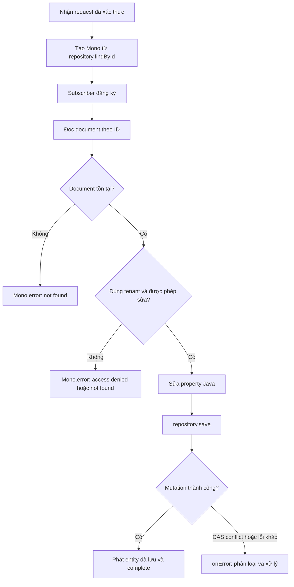

# Tạo, đọc, sửa và xóa bằng chuỗi phản ứng

Trong **SPRING_DATA_COUCHBASE**, các thao tác tạo (*create*), đọc (*read*), cập nhật (*update*) và xóa (*delete*) có thể được biểu diễn bằng **chuỗi phản ứng** (*reactive pipeline*) của Project Reactor. Thay vì chờ kết quả tại từng dòng như trong ứng dụng blocking, service kết hợp các publisher `Mono` và `Flux` để diễn đạt thứ tự công việc, điều kiện rẽ nhánh, cách xử lý kết quả rỗng và lỗi.

Bài thuộc chương **Truy cập phản ứng**, đi từ một ví dụ CRUD trọn vẹn với `ReactiveCouchbaseRepository` đến những thao tác cần kiểm soát sâu hơn bằng `ReactiveCouchbaseTemplate` hoặc Couchbase SDK. Kiến thức không tách rời bối cảnh của module: document mapping, bucket/scope/collection, SQL++, chỉ mục, TTL, CAS, giao dịch và quyết định dùng reactive để tăng khả năng phục vụ nhiều thao tác I/O mà không chặn luồng xử lý.

Một lưu ý quan trọng: **reactive không có nghĩa thao tác tự an toàn hoặc tự nguyên tử**. Gọi `save` sau `findById` chưa bảo đảm không bị ghi đè do cạnh tranh; gọi `delete` sau khi kiểm tra quyền chưa chắc ngăn document bị thay đổi giữa hai bước; và một publisher chưa được subscribe không chứng minh lệnh ghi đã thực thi.

## 1. Mục tiêu học tập

Sau bài này, bạn có thể:

1. Xây dựng một repository reactive và model document cho các thao tác CRUD.
2. Trả `Mono<Customer>`, `Mono<Void>` hoặc `Flux<Customer>` thay vì chặn luồng bằng `block()`.
3. Phân biệt **tạo mới có điều kiện** với **save/upsert**, tránh ghi đè document đã tồn tại.
4. Xử lý khi document không tồn tại bằng `switchIfEmpty`, không nhầm với lỗi I/O.
5. Viết chuỗi **đọc → kiểm tra quyền → sửa → lưu** và nhận diện điểm có thể xảy ra lost update.
6. Dùng `@Version`/CAS và chính sách retry có kiểm soát cho cập nhật đồng thời.
7. Thiết kế thao tác xóa có kiểm tra tenant, trạng thái và yêu cầu audit, không đánh đồng `Mono<Void>` hoàn tất với mọi bảo đảm nghiệp vụ.
8. Phân biệt thao tác theo ID bằng key-value với truy vấn theo field bằng SQL++ và index.
9. Hiểu vì sao `flatMap`, `then`, `Mono.when` và các toán tử Reactor không tự tạo giao dịch.
10. Viết test `StepVerifier` cho create/read/update/delete, trường hợp rỗng, lỗi và CAS conflict.

## 2. Chuỗi phản ứng là gì trong CRUD?

Một quy trình cập nhật tên khách hàng có thể mô tả như sau:



Chuỗi này nhấn mạnh ba lớp trách nhiệm:

- **Nghiệp vụ:** ai được tạo/sửa/xóa, điều kiện trạng thái nào hợp lệ.
- **Reactor:** khi nào bước tiếp theo được chạy, publisher nào phát kết quả, cách truyền lỗi.
- **Couchbase:** document ID, mutation, CAS, expiration, index, tính nhất quán và transaction.

Trong reactive CRUD, service thường **trả publisher về cho tầng gọi**. Một controller WebFlux hoặc job được quản lý sẽ subscribe và chờ tín hiệu hoàn tất/lỗi; service không tự `subscribe()` kiểu “fire-and-forget”.

## 3. Chuẩn bị một entity và repository xuyên suốt

Giả sử ứng dụng dùng bucket `app`, scope `crm` và collection `customers`. Một document mẫu:

```json
{
  "tenant_id": "tenant-a",
  "customer_code": "C001",
  "display_name": "Lan Anh",
  "status": "ACTIVE",
  "city": "HANOI",
  "loyalty_points": 80
}
```

Document ID là `customer::tenant-a::C001`, nằm trong metadata key-value của Couchbase; không bắt buộc có field `id` trong JSON.

Entity dùng cho ví dụ:

```java
package example.crm;

import org.springframework.data.annotation.Id;
import org.springframework.data.annotation.Version;
import org.springframework.data.couchbase.core.mapping.Collection;
import org.springframework.data.couchbase.core.mapping.Document;
import org.springframework.data.couchbase.core.mapping.Field;
import org.springframework.data.couchbase.core.mapping.Scope;

@Document
@Scope("crm")
@Collection("customers")
public class Customer {

    @Id
    private String id;

    @Field("tenant_id")
    private String tenantId;

    @Field("customer_code")
    private String customerCode;

    @Field("display_name")
    private String displayName;

    @Field
    private String status;

    @Field
    private String city;

    @Field("loyalty_points")
    private Integer loyaltyPoints;

    @Version
    private Long version;

    protected Customer() {
        // Dành cho Spring Data mapper.
    }

    public Customer(
            String id,
            String tenantId,
            String customerCode,
            String displayName,
            String status) {
        this.id = id;
        this.tenantId = tenantId;
        this.customerCode = customerCode;
        this.displayName = displayName;
        this.status = status;
    }

    public String getId() {
        return id;
    }

    public String getTenantId() {
        return tenantId;
    }

    public String getDisplayName() {
        return displayName;
    }

    public void setDisplayName(String displayName) {
        this.displayName = displayName;
    }

    public String getStatus() {
        return status;
    }

    public void setStatus(String status) {
        this.status = status;
    }

    public Long getVersion() {
        return version;
    }

    // Các accessors khác có thể bổ sung theo ứng dụng.
}
```

`@Field` ánh xạ property Java sang field JSON, `@Id` biểu diễn khóa document và `@Version` tham gia optimistic locking/CAS theo cơ chế Spring Data Couchbase của **phiên bản thực tế**. Không xem `version` là số phiên bản nghiệp vụ luôn được lưu như một field JSON; cần kiểm tra mapping và cách cập nhật CAS trên môi trường sử dụng.

Repository:

```java
package example.crm;

import org.springframework.data.couchbase.repository.ReactiveCouchbaseRepository;
import reactor.core.publisher.Flux;

public interface ReactiveCustomerRepository
        extends ReactiveCouchbaseRepository<Customer, String> {

    Flux<Customer> findByTenantIdAndStatus(
        String tenantId,
        String status
    );
}
```

Các thao tác kế thừa thường được dùng gồm `findById`, `existsById`, `save`, `deleteById`, `delete(entity)` và `count`. Tên derived query nâng cao hoặc các kiểu trả về đặc thù cần kiểm chứng với Spring Data Couchbase/Spring Data Commons đúng phiên bản.

## 4. Chuẩn bị quy ước ID, tenant và trạng thái

CRUD an toàn bắt đầu từ thiết kế dữ liệu, không bắt đầu từ `flatMap`.

Giả sử quy ước ID là:

```text
customer::<tenant-id>::<customer-code>
```

Ví dụ:

```text
customer::tenant-a::C001
```

Quy ước này giúp xác định khóa document ổn định và có thể hỗ trợ một số ràng buộc tạo mới. Nhưng **không được tin chuỗi tenant do client tự gửi là đã được xác thực**. Tầng service phải lấy tenant từ security context do server kiểm soát, validate mã khách hàng và phân quyền trước thao tác.

Các trạng thái ví dụ:

| Status | Đọc | Sửa tên | Xóa cứng |
| --- | --- | --- | --- |
| `ACTIVE` | Có thể, theo quyền tenant | Có thể, theo quy tắc | Thường không xóa trực tiếp |
| `ARCHIVED` | Có thể | Có thể bị hạn chế | Cần chính sách retention |
| `DELETED` (soft delete) | Thường ẩn khỏi UI | Thường cấm | Có thể dọn sau retention |

Đây là **chính sách minh họa**, không phải quy định mặc định của Couchbase. Cần thống nhất giữa endpoint, repository/template, các job và cơ chế expiration.

## 5. Tạo mới: phân biệt `save` và insert-only

Ví dụ service tạo document:

```java
import reactor.core.publisher.Mono;

public Mono<Customer> createExample(
        String authenticatedTenant,
        String customerCode,
        String displayName) {

    String id = "customer::"
        + authenticatedTenant + "::" + customerCode;

    Customer customer = new Customer(
        id,
        authenticatedTenant,
        customerCode,
        displayName,
        "ACTIVE"
    );

    return repository.save(customer);
}
```

Đoạn này **minh họa cách tạo publisher từ một entity mới**. Nó không phải hợp đồng đủ an toàn cho “chỉ tạo nếu chưa tồn tại”. Ngữ nghĩa `save` (insert, replace, upsert hoặc cách quyết định bằng ID/version) cần được xem trong Spring Data Couchbase phiên bản thực tế; nếu có ID trùng, không được mặc định `save` luôn từ chối ghi đè.

### 5.1. Khi nghiệp vụ yêu cầu create-only

Với email hoặc customer code phải duy nhất, mục tiêu là **insert-if-absent theo khóa có tính quyết định**:

```text
Tạo id = customer::<tenant>::<code>
INSERT chỉ khi id chưa có
Nếu id đã có -> trả lỗi xung đột, không sửa document hiện tại
```

Có thể dùng API insert-only được phiên bản `ReactiveCouchbaseTemplate`/Couchbase SDK hỗ trợ. Một mẫu fluent API tham khảo:

```java
// Ví dụ dạng API thường gặp; xác minh signature theo phiên bản.
Mono<Customer> created = template
    .insertById(Customer.class)
    .one(customer);
```

`template` là một `ReactiveCouchbaseTemplate` đã inject; đây **không phải một file Java độc lập**. Cần kiểm tra chính xác kiểu trả về, tên method và hành vi CAS/expiration ở release đang dùng.

Nếu muốn bảo đảm uniqueness của **email** mà document ID không dựa trên email, cần một chiến lược khóa/reservation khác hoặc giao dịch/ràng buộc ở đường ghi. `existsByEmail(...)` rồi `save(...)` không phải giao dịch nguyên tử: hai request có thể cùng thấy `false` rồi cùng ghi.

### 5.2. Subscription và nguy cơ tạo hai lần

```java
Mono<Customer> creation = repository.save(customer);
```

Việc tạo `creation` thường **chưa chứng minh** document đã ghi xong. Nếu một nguồn cold được subscribe nhiều lần, thao tác có thể được khởi động nhiều lần:

```java
// Anti-pattern: không làm trong service.
creation.subscribe();
return creation; // WebFlux có thể subscribe thêm lần nữa.
```

Với create-only, lần thứ hai có thể gây xung đột ID; với cơ chế upsert, có thể gây mutation lặp. Tầng service nên **return một publisher** và để owner hợp lệ quản lý subscription; dùng idempotency key nếu endpoint có thể được client retry.

### 5.3. Dùng `Mono.defer` khi cần trì hoãn khởi tạo input

```java
Mono<Customer> deferredCreation = Mono.defer(() -> {
    Customer newCustomer = createNewCustomerFromCommand(command);
    return repository.save(newCustomer);
});
```

`createNewCustomerFromCommand` là helper **minh họa** phải được ứng dụng triển khai. `Mono.defer` làm supplier chạy theo subscription, hữu ích khi cần tạo entity tại thời điểm đăng ký. Nhưng nếu helper sinh ID ngẫu nhiên, **mỗi retry/resubscription có thể sinh một ID khác**. Do đó defer không thay idempotency; với API create, nên chọn ID hoặc idempotency token theo chính sách nghiệp vụ trước khi quyết định retry.

## 6. Đọc theo ID: `Mono<Customer>` và kết quả rỗng

Lời gọi:

```java
Mono<Customer> result =
    repository.findById("customer::tenant-a::C001");
```

thường diễn đạt 0 hoặc 1 document. Nếu ID không tồn tại, publisher thông thường kết thúc rỗng; không có `onNext(null)`, vì Reactive Streams không cho phép giá trị null được phát.

Một service yêu cầu bắt buộc có customer:

```java
import java.util.NoSuchElementException;
import reactor.core.publisher.Mono;

public Mono<Customer> getRequired(String id) {
    return repository.findById(id)
        .switchIfEmpty(Mono.error(
            new NoSuchElementException("Customer not found")
        ));
}
```

`switchIfEmpty` xử lý kết quả **hoàn tất rỗng**. Nếu Couchbase bị timeout, không đủ quyền, mapping lỗi hoặc document không thể đọc, publisher báo `onError` và `switchIfEmpty` không tự biến lỗi đó thành not-found.

### 6.1. Kiểm tra tenant mà không lộ sự tồn tại của document

Trong ứng dụng đa tenant, tốt hơn nên có một helper chỉ trả document sau khi xác minh quyền:

```java
import java.util.NoSuchElementException;
import reactor.core.publisher.Mono;

private Mono<Customer> readForTenant(
        String authenticatedTenant,
        String documentId) {

    return repository.findById(documentId)
        .filter(customer ->
            authenticatedTenant.equals(customer.getTenantId())
        )
        .switchIfEmpty(Mono.error(
            new NoSuchElementException("Customer not found")
        ));
}
```

Đoạn mã dùng kết quả not-found chung cho cả ID không tồn tại và ID không thuộc tenant, giúp tránh tiết lộ sự tồn tại qua thông báo lỗi. Tùy chính sách bảo mật, ứng dụng có thể sử dụng 403 thay vì 404 nhưng phải nhất quán, không đưa dữ liệu tenant khác cho bên gọi.

`readForTenant` kiểm tra quyền **tại thời điểm đọc**; một thao tác ghi tiếp theo vẫn cần xử lý CAS hoặc điều kiện mutation nếu dữ liệu có thể thay đổi đồng thời.

### 6.2. Vì sao `findById` và query theo field có thể khác kết quả?

`findById` thường đọc qua **key-value API** bằng khóa document. `findByTenantIdAndStatus(...)` thường được thực hiện bằng SQL++ trên các field JSON và phụ thuộc secondary index.

```text
findById(documentId)               -> key-value lookup
findByTenantIdAndStatus(...)       -> SQL++ / Query Service / index
```

Ngay sau save, lookup theo ID có thể nhìn thấy document trong khi query qua index chưa thấy tại mức scan consistency không đợi mutation mới nhất. Đây là vấn đề consistency, không phải `Mono` làm mất item.

## 7. Đọc nhiều document: `Flux<Customer>` và giới hạn query

Ví dụ:

```java
Flux<Customer> activeCustomers =
    repository.findByTenantIdAndStatus(
        "tenant-a",
        "ACTIVE"
    );
```

Publisher có thể phát 0, 1 hoặc nhiều entity. Không có cam kết thứ tự nếu SQL++ không có `ORDER BY`. Đừng mặc định kết quả được phát theo ID hoặc thứ tự insert.

### 7.1. Tránh tải vô hạn rồi `collectList`

```java
// Anti-pattern nếu tenant có rất nhiều document.
Mono<java.util.List<Customer>> allActive =
    repository.findByTenantIdAndStatus("tenant-a", "ACTIVE")
        .collectList();
```

`collectList` gom mọi phần tử của `Flux` thành một `List` trong bộ nhớ. Với hàng trăm nghìn document, điều đó có thể làm tăng thời gian chờ, bộ nhớ và áp lực lên Query Service.

Hãy xác định giới hạn/phân trang ở phía Couchbase. Với phương thức mang `TopN` hoặc tham số `Pageable`, cần xác minh phiên bản Spring Data Couchbase thực sự đẩy `LIMIT`/`OFFSET` xuống server.

### 7.2. `take(10)` không tự sinh SQL++ `LIMIT 10`

```java
Flux<Customer> preview = repository
    .findByTenantIdAndStatus("tenant-a", "ACTIVE")
    .take(10);
```

`take(10)` giới hạn **số item đi xuống subscriber**, không chứng minh Query Service chỉ quét hoặc trả đúng mười dòng. Nếu yêu cầu “mười khách hàng mới nhất”, phải có `ORDER BY` và `LIMIT 10` tại truy vấn thực thi, cùng index phù hợp.

### 7.3. SQL++ minh họa với sort và limit

```sql
SELECT c.*
FROM `app`.`crm`.`customers` AS c
WHERE c.`tenant_id` = $tenantId
  AND c.`status` = "ACTIVE"
ORDER BY c.`customer_code` ASC
LIMIT 20;
```

Đây là SQL++ biểu đạt **ý định**, không phải lời cam kết repository tự sinh nguyên văn. Spring Data có thể thêm metadata ID/CAS, discriminator và cấu trúc projection khác. Khi sử dụng `ReactiveCouchbaseTemplate` hoặc `@Query`, cần đúng cú pháp binding và mapping của phiên bản đang chạy.

## 8. Cập nhật: đọc → sửa → lưu bằng `flatMap`

Ví dụ service sửa tên:

```java
public Mono<Customer> renameForTenant(
        String authenticatedTenant,
        String documentId,
        String newName) {

    if (newName == null || newName.isBlank()) {
        return Mono.error(
            new IllegalArgumentException("displayName is required")
        );
    }

    return readForTenant(authenticatedTenant, documentId)
        .flatMap(customer -> {
            customer.setDisplayName(newName);
            return repository.save(customer);
        });
}
```

`flatMap` cần thiết vì hàm callback trả một publisher `Mono<Customer>` khác. Nó tổ chức bước save chạy sau khi có entity đã đọc. Việc đọc rỗng hay lỗi được lan truyền theo pipeline, không cần gọi `subscribe()` trong service.

### 8.1. Vì sao không dùng `map`?

```java
// Không đúng ý định: tạo publisher lồng publisher.
Mono<Mono<Customer>> nested = repository.findById(id)
    .map(customer -> repository.save(customer));
```

`map` biến một `Customer` thành `Mono<Customer>` nên kết quả bên ngoài là `Mono<Mono<Customer>>`. Inner publisher không nhất thiết được subscribe, do đó không thể xem lời gọi này tương đương update.

`flatMap` làm kết quả và tín hiệu của operation bên trong trở thành một phần của pipeline:

```java
Mono<Customer> updated = repository.findById(id)
    .flatMap(repository::save);
```

Đoạn rút gọn này chỉ minh họa tổ hợp kiểu; nó **không có mutation nghiệp vụ cụ thể** và không kiểm tra tenant. Trong ứng dụng thực, cần thay đổi đúng field và áp dụng kiểm tra quyền như ví dụ `renameForTenant`.

### 8.2. Tránh ghi đè field bằng DTO không đầy đủ

Nếu client gửi:

```json
{
  "displayName": "Lan Mới"
}
```

không nên biến thẳng JSON này thành một `Customer` thiếu `status`, `tenantId`, `loyaltyPoints` rồi `save` như thể đó là bản cập nhật một field. Tùy đường mutation, cách làm này có thể ghi mất các trường không có trong request.

Quy trình đọc entity hiện tại, chỉ sửa property được phép và save có CAS giúp hạn chế nguy cơ mất dữ liệu. Nếu dùng **sub-document mutation** hoặc update query riêng, cần xác minh điều kiện, đường field và semantics của API SDK tương ứng.

## 9. CAS và optimistic locking khi hai request cập nhật đồng thời

Hai request có thể cùng đọc một document:

```text
Request A: read Customer với CAS V1
Request B: read Customer với CAS V1
Request A: set displayName = "Lan A"; save -> thành công
Request B: set displayName = "Lan B"; save -> xung đột nếu CAS được áp dụng
```

Với `@Version` được cấu hình đúng, Spring Data Couchbase có thể sử dụng CAS/optimistic locking để phát hiện một bản ghi đã thay đổi kể từ lúc đọc. Cần kiểm chứng loại exception và cơ chế tương ứng trên phiên bản thực tế.

**Chỉ có `flatMap` không ngăn race condition.** Nó đảm bảo thứ tự trong từng subscription, không khóa document với các request bên ngoài.

### 9.1. Tại sao đọc lại và thử lại cần quyết định nghiệp vụ?

Giả sử một request **đặt tên cố định** thành `Lan Anh`. Nếu CAS conflict, có thể chấp nhận đọc lại phiên bản mới rồi áp dụng lại **cùng phép đặt tên**, nếu chính sách cho phép.

Ngược lại, nếu request **cộng 100 điểm** và ghi đã thành công nhưng phản hồi bị timeout, retry không kiểm soát có thể cộng điểm lần thứ hai. Với thao tác cộng dồn, thanh toán hoặc phát sự kiện, phải có idempotency key, version/sequence hoặc một cơ chế atomic increment phù hợp.

### 9.2. Ví dụ retry có điều kiện cho một thao tác idempotent

```java
import org.springframework.dao.OptimisticLockingFailureException;
import reactor.core.publisher.Mono;
import reactor.util.retry.Retry;

// Ví dụ chỉ cho thao tác "đặt một tên cố định".
// Cần giới hạn và phân loại retry theo nghiệp vụ.
public Mono<Customer> renameWithLimitedRetry(
        String tenantId,
        String documentId,
        String newName) {

    return Mono.defer(() ->
        renameForTenant(tenantId, documentId, newName)
    ).retryWhen(
        Retry.max(2)
            .filter(error ->
                error instanceof OptimisticLockingFailureException
            )
    );
}
```

`Mono.defer` giúp quá trình đọc/sửa/save được tạo lại khi resubscribe. Nhưng đây không phải lựa chọn bắt buộc cho mọi trường hợp: nếu quyền, trạng thái document hoặc tên khách hàng vừa thay đổi, nghiệp vụ có thể cần trả xung đột thay vì âm thầm ghi đè ý định mới của người khác. Không thêm retry vô hạn vào mọi thao tác write.

## 10. Xóa document: từ `deleteById` đến xóa có kiểm tra

Đường ngắn nhất khi đã có ID và đã hoàn tất kiểm tra quyền:

```java
Mono<Void> completion = repository.deleteById(documentId);
```

`Mono<Void>` biểu diễn sự hoàn tất hoặc lỗi, không phát payload entity. Tuy nhiên, **một completion không nhất thiết cho biết document trước đó chắc chắn tồn tại**, cũng không cho biết lý do, số mutation hay kết quả audit. Hành vi khi ID không tồn tại cần kiểm tra theo repository/SDK version.

Trong một endpoint đa tenant, gọi thẳng `deleteById(id)` từ ID client gửi là nguy hiểm nếu chưa xác thực quyền.

### 10.1. Đọc → xác thực → xóa entity

```java
public Mono<Void> deleteArchivedForTenant(
        String authenticatedTenant,
        String documentId) {

    return readForTenant(authenticatedTenant, documentId)
        .flatMap(customer -> {
            if (!"ARCHIVED".equals(customer.getStatus())) {
                return Mono.error(new IllegalStateException(
                    "Only archived customers may be deleted"
                ));
            }

            return repository.delete(customer);
        });
}
```

Ví dụ thể hiện predicate nghiệp vụ **tenant đúng + status ARCHIVED**. Nhưng có thể xảy ra một request khác thay đổi document từ `ARCHIVED` sang `ACTIVE` giữa bước đọc và bước xóa. Đối với hành động xóa có rủi ro, phải xác minh `repository.delete(entity)` có kiểm tra CAS theo `@Version` trong phiên bản đang dùng hay không; nếu không đủ, dùng Couchbase SDK KV remove có CAS/điều kiện rõ hoặc transaction thích hợp.

**Không đồng nhất** đoạn code này với một lệnh SQL++ `DELETE ... WHERE tenant_id = ... AND status = ...`. Hai cách xóa có khác biệt về đường truy cập, optimistic locking, callback và tính nhất quán.

### 10.2. Xóa mềm khi cần khôi phục

Với nhiều bài toán, an toàn hơn là đổi trạng thái:

```java
public Mono<Customer> softDeleteForTenant(
        String authenticatedTenant,
        String documentId) {

    return readForTenant(authenticatedTenant, documentId)
        .flatMap(customer -> {
            if ("DELETED".equals(customer.getStatus())) {
                return Mono.just(customer);
            }

            customer.setStatus("DELETED");
            return repository.save(customer);
        });
}
```

Soft delete yêu cầu mọi query nghiệp vụ loại document đã xóa khi phù hợp, cần audit và quy tắc retention để dọn về sau. Ví dụ đơn giản này chưa lưu `deletedAt`/người thao tác hoặc kiểm tra đầy đủ trạng thái, vì vậy phải mở rộng theo chính sách thật.

### 10.3. Xóa theo điều kiện khác xóa theo ID

Các method dạng `deleteByStatus` hoặc `deleteByTenantIdAndStatus` có thể là keyword trong hệ sinh thái Spring Data, nhưng **khả năng hỗ trợ derived delete và ngữ nghĩa thao tác trong Spring Data Couchbase phải xác minh theo phiên bản**. Với xóa nhiều document, có thể dùng query/DML tường minh hoặc lô ID + KV operations được kiểm soát. Không chạy một derived delete chưa được xác nhận trên collection production để “thử keyword”.

## 11. `ReactiveCouchbaseTemplate` khi cần thao tác linh hoạt hơn

Repository phù hợp với CRUD và điều kiện thường xuyên sử dụng. `ReactiveCouchbaseTemplate` giúp truy cập theo phong cách fluent và kết hợp query/mutation linh hoạt hơn.

Ví dụ **ý định** đọc theo ID:

```java
// Dạng API tham khảo; đối chiếu release trước khi dùng.
Mono<Customer> found =
    template.findById(Customer.class).one(documentId);
```

Ví dụ **ý định insert-only**:

```java
// Dạng API tham khảo; kiểm tra signature và options của phiên bản.
Mono<Customer> inserted =
    template.insertById(Customer.class).one(newCustomer);
```

Ví dụ **ý định tìm theo criteria**:

```java
// Minh họa cấu trúc fluent query; tên import/method có thể
// khác theo bản Spring Data Couchbase đang dùng.
Query query = Query.query(
    Criteria.where("status").is("ACTIVE")
);

Flux<Customer> rows = template
    .findByQuery(Customer.class)
    .matching(query)
    .all();
```

Trong đoạn cuối, `Query` và `Criteria` đại diện cho các kiểu query của module Spring Data Couchbase tương ứng; cần dùng **đúng package và API của release**. Không copy một query builder từ Spring Data JPA hoặc MongoDB sang Couchbase chỉ vì cùng tên `Query`.

Lựa chọn template khi cần tạo/xóa theo ID với chính sách cụ thể, filter động, query options hoặc mapping chi tiết; nhưng **template không tự bảo đảm quyền tenant, CAS hay transaction**. Các bảo đảm phải được thiết kế và kiểm thử riêng.

## 12. Phối hợp nhiều thao tác: `then`, `zip`, `when`

### 12.1. `then`: chờ công việc hoàn tất

```java
Mono<Void> deleteThenAudit = repository.deleteById(id)
    .then(auditService.recordDeletion(id));
```

`auditService.recordDeletion(id)` là một `Mono<Void>` do ứng dụng tự xây dựng. `then` bảo đảm publisher phía sau được subscribe sau khi publisher trước hoàn tất bình thường. Nếu delete phát lỗi, audit phía sau thường không được chạy trong pipeline này.

Tuy nhiên **delete và audit không tự tạo transaction**: nếu delete thành công rồi audit lỗi, dữ liệu đã bị xóa. Đối với audit bắt buộc, cần thiết kế transaction/outbox hoặc cơ chế ghi bền vững tương ứng.

### 12.2. `zip` chỉ phù hợp khi cần giá trị từ mỗi nguồn

Khi muốn kết hợp kết quả từ hai lần đọc, dùng `Mono.zip` để nhận một cặp giá trị. Kiểu `Tuple2` thuộc package `reactor.util.function`, không phải `java.util`:

```java
Mono<reactor.util.function.Tuple2<Customer, Customer>> pair =
    Mono.zip(
        repository.findById(firstId),
        repository.findById(secondId)
    );
```

`zip` cần một item từ cả hai publisher. Nếu một nguồn hoàn tất rỗng, kết quả có thể rỗng; không dùng `zip` để đảm bảo hai lệnh `Mono<Void>` đã chạy đủ.

### 12.3. `when` phối hợp sự hoàn tất, không tạo tính nguyên tử

```java
Mono<Void> bothCompleted = Mono.when(
    repository.save(customerA),
    repository.save(customerB)
);
```

`Mono.when` quan tâm tín hiệu hoàn tất của các publisher, không trả về hai entity và không tạo transaction. Nếu một mutation thành công còn mutation khác thất bại, không có bảo đảm rollback mutation đã hoàn tất.

Khi cần mutation theo thứ tự:

```java
Mono<Customer> savedB = repository.save(customerA)
    .then(repository.save(customerB));
```

Đây vẫn là **hai thao tác** riêng, không phải một transaction nhiều document. Nếu cần atomicity, phải sử dụng transaction API Couchbase được SDK/Spring Data phiên bản ứng dụng hỗ trợ.

## 13. Không giữ side effect quan trọng trong `doOn...`

Các operator như `doOnNext`, `doOnError`, `doOnSubscribe` và `doFinally` phù hợp để quan sát vòng đời:

```java
Mono<Customer> tracked = repository.save(customer)
    .doOnSubscribe(s -> logger.debug("subscribed to save"))
    .doOnNext(saved -> logger.debug("save result received"))
    .doOnError(error -> logger.warn("save failed", error))
    .doFinally(signal -> logger.debug("terminal: {}", signal));
```

`logger` là logger do ứng dụng cung cấp; cần tránh log thông tin nhạy cảm.

Không dùng `doOnNext` như bước bắt buộc để ghi một event hoặc cập nhật trạng thái ở database khác rồi giả định transaction đã bảo đảm. Vì subscription có thể bị hủy, retry hoặc phát nhiều lần, side effect không được quản lý như một operation có kết quả sẽ khó xác nhận.

Nếu cần tạo audit trong cùng luồng, dùng `flatMap`/`then` để **compose** publisher audit, đồng thời giải quyết vấn đề tính nhất quán giữa hai nguồn dữ liệu.

## 14. Backpressure, concurrency và batch CRUD

Khi xử lý hàng nghìn ID, có thể dùng một `Flux` đầu vào rồi `flatMap` đến thao tác repository:

```java
Flux<String> ids = Flux.fromIterable(customerIds);

Flux<Customer> customers = ids.flatMap(
    repository::findById,
    8
);
```

Trong đó `8` là giới hạn số inner publisher cùng hoạt động ở API Reactor. Kết quả `flatMap` có thể **khác thứ tự** ID đầu vào. Nếu cần giữ thứ tự, dùng `concatMap` hoặc `flatMapSequential` và đánh giá trade-off về thời gian/buffering.

### 14.1. Batch mutation có nguy cơ lỗi một phần

Ví dụ:

```java
Flux<Customer> saved = Flux.fromIterable(customersToSave)
    .flatMap(repository::save, 8);
```

Nhiều mutation có thể đang chạy đồng thời. Nếu một publisher lỗi và pipeline ngừng, **một số mutation khác có thể đã hoàn tất**, một số đang chạy hoặc bị huỷ. Không báo “không document nào được lưu” chỉ vì cả `Flux` kết thúc bằng lỗi.

Một batch job cần:

- Giới hạn concurrency theo tài nguyên Couchbase.
- Chỉ định chính sách xử lý lỗi từng item, checkpoint và retry.
- Ghi outcome theo document ID.
- Đảm bảo idempotency khi job có thể chạy lại.
- Không mặc định tất cả mutation đồng thời đều nằm trong một transaction.

### 14.2. `collectList` không biến batch thành atomic operation

```java
Mono<java.util.List<Customer>> allSaved =
    saved.collectList();
```

`collectList` chỉ gom các item phát tới subscriber. Nó không tạo rollback hoặc tính nguyên tử cho các mutation phía trước. Với batch rất lớn, nó còn có thể gây tăng RAM.

### 14.3. `concatMap` giữ thứ tự nhưng vẫn cần xử lý lỗi

```java
Flux<Customer> serialSave = Flux.fromIterable(customersToSave)
    .concatMap(repository::save);
```

Các inner publisher được xử lý theo thứ tự, nhưng nếu mục tiêu là “mọi document hoặc không document nào được lưu”, `concatMap` **chưa đủ**. Khi thao tác thứ ba lỗi, hai thao tác đầu có thể đã commit.

## 15. Error, timeout và retry đối với CRUD

### 15.1. Phân loại empty và error

| Kết quả | Ví dụ | Cách xử lý |
| --- | --- | --- |
| `Mono.empty()` | `findById` không thấy ID | Có thể chuyển sang not-found theo hợp đồng API. |
| `onError` timeout/query/index | I/O hoặc Query Service gặp lỗi | Báo sự cố hoặc retry có kiểm soát. |
| `onError` CAS conflict | Entity đã bị thay đổi | Trả 409 hoặc đọc lại theo chính sách. |
| `onError` duplicate ID | Insert-only nhưng ID đã tồn tại | Trả 409; không dùng upsert để che xung đột. |
| `onComplete` của delete | Operation hoàn tất theo hợp đồng | Nếu cần, xác minh trạng thái/audit, không tự suy ra mọi tiền điều kiện. |

Không viết:

```java
// Anti-pattern: biến lỗi Couchbase thành kết quả rỗng.
return repository.findById(id)
    .onErrorResume(error -> Mono.empty());
```

Nó khiến timeout hoặc lỗi phân quyền bị trình bày như “không tìm thấy”.

### 15.2. Timeout ở client không chứng minh ghi chưa xảy ra

```java
import java.time.Duration;

Mono<Customer> timed = repository.save(customer)
    .timeout(Duration.ofSeconds(3));
```

Nếu `timeout` báo lỗi, mutation có thể đã được gửi và commit ở server nhưng response đến trễ. Trước khi retry create/update không idempotent, cần kiểm tra ID, CAS hoặc trạng thái công việc tương ứng.

### 15.3. Retry tạo subscription mới

`retry` và `retryWhen` thường resubscribe upstream khi có lỗi phù hợp. Với nguồn cold, điều này có thể lặp thao tác I/O. Mỗi loại mutation cần chính sách riêng:

- Read-only idempotent: có thể retry lỗi tạm thời với backoff và giới hạn.
- Set field thành giá trị cố định: cần xem CAS và ý nghĩa ghi đè dữ liệu mới.
- Increment số điểm: tránh gửi lại cùng mutation khi chưa biết trạng thái.
- Create-only: giữ ID/idempotency key ổn định và phân biệt duplicate với lỗi tạm thời.
- Delete: xác định rõ “đã không tồn tại” có được xem là thành công hay không.

Đừng gắn `retry()` vô hạn vào tất cả publisher.

## 16. Consistency: save xong rồi query không nhất thiết thấy ngay

Giả sử pipeline:

```java
Mono<Customer> savedThenRead = repository.save(customer)
    .flatMap(saved -> repository.findById(saved.getId()));
```

Nếu save complete thành công, bước đọc theo ID được gọi sau đó. Đây là một cách làm rõ **thứ tự** trong pipeline.

Nhưng khi đổi bước sau sang query theo field:

```java
Flux<Customer> visibleByStatus = repository.save(customer)
    .flatMapMany(saved ->
        repository.findByTenantIdAndStatus(
            saved.getTenantId(),
            saved.getStatus()
        )
    );
```

truy vấn SQL++ có thể **chưa thấy** mutation mới ở scan consistency mặc định vì secondary index cập nhật bất đồng bộ.

`flatMapMany` giải quyết việc nối `Mono` sang `Flux`, **không** buộc index cập nhật ngay. Khi nghiệp vụ cần read-your-own-write qua SQL++, đánh giá query scan consistency phù hợp, ví dụ mức tương đương `REQUEST_PLUS` khi API phiên bản hỗ trợ, hoặc dùng đường KV theo ID.

### 16.1. Index và `EXPLAIN` cho truy vấn reactive

Giả sử SQL++ logic:

```sql
SELECT c.*
FROM `app`.`crm`.`customers` AS c
WHERE c.`tenant_id` = "tenant-a"
  AND c.`status` = "ACTIVE";
```

Một index tham khảo:

```sql
CREATE INDEX ix_customers_tenant_status
ON `app`.`crm`.`customers` (
    `tenant_id`,
    `status`
);
```

Nếu Spring Data Couchbase sinh thêm discriminator như `_class`, cần cân nhắc trong thiết kế index dựa trên query thực tế. Chạy `EXPLAIN` để kiểm tra index scan, fetch, filter và mức tải; reactive không làm một query thiếu index trở thành rẻ.

### 16.2. Không nhầm TTL và index lag

- **Index lag:** KV đã ghi nhưng query qua field chưa thấy.
- **TTL:** Document hết hạn và không còn được trả về.
- **Sai mapping:** Repository truy vấn nhầm field JSON/collection/discriminator.
- **Không subscribe:** Operation chưa được tiêu thụ đúng vòng đời reactive.

Bốn tình huống có thể cùng biểu hiện “không có kết quả”, nhưng giải pháp khác nhau.

## 17. TTL, CAS và cập nhật expiration

TTL xác định thời điểm document hết hạn theo Couchbase. Khi tạo, sửa hoặc upsert bằng repository/template/SDK, phải kiểm tra **chính sách expiration của operation cụ thể**:

- Tạo mới có TTL riêng hay dùng bucket/collection default?
- Cập nhật có giữ nguyên expiration không?
- Khi soft delete, có đổi TTL để hard delete sau thời gian lưu trữ không?
- Document cần retention hold có bị TTL làm hết hạn trái chính sách không?
- Nếu một bước đọc thấy document nhưng khi bước update chạy document đã hết hạn, xử lý thế nào?

Đừng giả định `save` luôn giữ nguyên TTL hoặc luôn đặt lại TTL giống nhau trên mọi phiên bản. Đây là chính sách cần integration test với thao tác thực sự dùng.

CAS bảo vệ **một document** trước sửa/xóa đồng thời khi operation dùng điều kiện version thích hợp. CAS không tự tạo transaction xuyên nhiều document, và TTL không tự tôn trọng một field `retention_hold` nếu ứng dụng không cấu hình như vậy.

## 18. Giao dịch và tính nhất quán khi có nhiều document

Một nghiệp vụ có thể yêu cầu:

> Chuyển customer A sang ARCHIVED và tăng tổng số khách hàng đã lưu trữ ở document thống kê B.

Nếu thực hiện:

```java
Mono<Void> operation = repository.save(customerA)
    .then(statsRepository.save(statsB))
    .then();
```

thì thứ tự được xác định nhưng **không có bảo đảm all-or-nothing**. A có thể đã lưu trong khi B lỗi.

Muốn nguyên tử trên nhiều document, phải dùng transaction API mà Couchbase SDK và Spring Data Couchbase **đúng phiên bản** hỗ trợ, kiểm tra các thao tác tham gia, timeout, transaction context và giới hạn retry. Không mặc định `@Transactional` của Spring bất kỳ sẽ bao bọc mọi publisher và SDK call theo cách giống JPA.

Với workflow không thể đặt trong một transaction duy nhất, có thể cần outbox, state machine hoặc quy trình bù (*compensation*) được thiết kế có idempotency và audit. Reactor chỉ là công cụ phối hợp thao tác, không thay giao thức nhất quán của backend.

## 19. WebFlux controller: trả publisher, không tự chạy

Một controller tối giản:

```java
import org.springframework.http.ResponseEntity;
import org.springframework.web.bind.annotation.GetMapping;
import org.springframework.web.bind.annotation.PathVariable;
import org.springframework.web.bind.annotation.RequestMapping;
import org.springframework.web.bind.annotation.RestController;
import reactor.core.publisher.Mono;

@RestController
@RequestMapping("/customers")
public class CustomerController {

    private final ReactiveCustomerRepository repository;

    public CustomerController(ReactiveCustomerRepository repository) {
        this.repository = repository;
    }

    @GetMapping("/{id}")
    public Mono<ResponseEntity<Customer>> getById(
            @PathVariable String id) {

        return repository.findById(id)
            .map(ResponseEntity::ok)
            .defaultIfEmpty(ResponseEntity.notFound().build());
    }
}
```

Đây chỉ là ví dụ cho **hình dạng API reactive**. Trước khi đưa vào production cần dùng tầng service có kiểm tra tenant/quyền, DTO trả về, phân loại lỗi và điều kiện không làm lộ document ID của người khác. WebFlux sẽ quản lý subscription khi trả response, nên không cần `subscribe()` hay `block()` trong controller.

### 19.1. HTTP client cancel không rollback mutation

Nếu client ngắt kết nối khi một POST/PUT/DELETE đang thực hiện, subscription có thể bị hủy. Nhưng mutation đã gửi tới Couchbase **có thể vẫn hoàn tất**. Vì vậy không dùng HTTP timeout/cancel làm bằng chứng chắc chắn thao tác chưa xảy ra. Với endpoint ghi quan trọng, thiết kế idempotency key và API kiểm tra trạng thái.

## 20. Kiểm thử `StepVerifier` cho CRUD

`StepVerifier` giúp xác minh publisher phát entity, kết thúc rỗng hay báo lỗi. Có hai tầng cần tách:

1. **Unit test pipeline:** mô phỏng repository để kiểm tra thứ tự, rẽ nhánh và propagation.
2. **Integration test Couchbase:** dùng bucket/scope/collection chỉ dành cho test để xác minh JSON mapping, CAS, TTL, SQL++/index và mutation outcome.

### 20.1. Test thuần Reactor cho kết quả rỗng và lỗi

```java
import org.junit.jupiter.api.Test;
import reactor.core.publisher.Mono;
import reactor.test.StepVerifier;

class ReactiveCrudSignalsTest {

    @Test
    void emptyMonoCompletesWithoutItem() {
        StepVerifier.create(Mono.<String>empty())
            .verifyComplete();
    }

    @Test
    void errorMonoPropagatesFailure() {
        StepVerifier.create(Mono.<String>error(
                new IllegalStateException("simulated error")
            ))
            .expectError(IllegalStateException.class)
            .verify();
    }
}
```

### 20.2. Kiểm tra đọc một document thật

Giả sử đã có fixture `customer::tenant-a::C001` và test context được cấu hình:

```java
import static org.assertj.core.api.Assertions.assertThat;

import org.junit.jupiter.api.Test;
import org.springframework.beans.factory.annotation.Autowired;
import org.springframework.boot.test.context.SpringBootTest;
import reactor.test.StepVerifier;

@SpringBootTest
class ReactiveCustomerRepositoryIT {

    @Autowired
    ReactiveCustomerRepository repository;

    @Test
    void findExistingCustomer() {
        StepVerifier.create(
                repository.findById("customer::tenant-a::C001")
            )
            .assertNext(customer -> {
                assertThat(customer.getId())
                    .isEqualTo("customer::tenant-a::C001");
                assertThat(customer.getTenantId())
                    .isEqualTo("tenant-a");
            })
            .verifyComplete();
    }

    @Test
    void missingCustomerCompletesEmpty() {
        StepVerifier.create(
                repository.findById("customer::tenant-a::MISSING")
            )
            .verifyComplete();
    }
}
```

Bài test này là **khung**, không tự chạy nếu chưa có fixture, index/cluster, credentials và test configuration. Không dùng collection production.

### 20.3. Test create-only và trùng ID

Với insert-only API đã xác nhận, test cần:

1. Insert document ID mới và xác nhận publisher phát thành công.
2. Insert lại cùng ID và xác nhận lỗi duplicate/conflict theo SDK/Spring Data thực tế.
3. Đọc theo ID để xác nhận document không bị ghi đè.
4. Cleanup fixture ở test collection và kiểm tra kết quả xóa.

Không chỉ assert một lần `save` thành công rồi gọi đó là “create-only”.

### 20.4. Test update/CAS

Tạo hai bản đọc của cùng document ở cùng version, thực hiện save của bản A rồi thử save bản B. Nếu optimistic locking được bật, kỳ vọng xung đột có thể được kiểm chứng. Không dùng chung một instance Java mutable cho A và B; nên đọc thành hai entity độc lập hoặc tạo fixture phù hợp.

### 20.5. Test delete và race

Một test xóa có quyền phải xác minh:

- Đúng tenant/trạng thái được phép xóa.
- Sai tenant không thực hiện mutation.
- Trạng thái chưa cho phép xóa dẫn tới lỗi nghiệp vụ.
- Document không tồn tại có hợp đồng phản hồi rõ ràng.
- Khi có CAS conflict, ứng dụng không âm thầm xóa document vừa được sửa.
- Đọc lại trạng thái qua KV sau mutation, và query theo field với consistency phù hợp.

## 21. Bảng đối chiếu các chuỗi CRUD thường gặp

| Ý định | Pipeline đơn giản | Rủi ro cần kiểm tra |
| --- | --- | --- |
| Đọc theo ID | `findById(id)` | Empty vs error; tenant/TTL. |
| Đọc bắt buộc | `findById(id).switchIfEmpty(Mono.error(...))` | Không che timeout thành not-found. |
| Tạo document | `save(newCustomer)` | Save có thể không phải insert-only. |
| Tạo chỉ nếu ID mới | Template/SDK insert-only | Xung đột ID, idempotency. |
| Cập nhật một field | `findById(id).flatMap(c -> save(updatedC))` | CAS, mất field do DTO không đầy đủ. |
| Xóa theo ID | `deleteById(id)` | Quyền tenant và không biết document đã tồn tại hay chưa. |
| Xóa có điều kiện | `readForTenant(...).flatMap(repo::delete)` | Race giữa read/delete; CAS/retention. |
| Đọc sau ghi | `save(c).flatMap(saved -> findById(saved.id))` | Không tạo transaction; query qua index có lag. |
| Ghi nhiều document | `Flux.fromIterable(...).flatMap(repo::save, n)` | Lỗi một phần, concurrency, retry. |
| Chờ hai mutation | `Mono.when(saveA, saveB)` | Không có atomicity/rollback. |
| Chỉ cần completion | `operation.then()` | Payload bị bỏ, vẫn cần xem lỗi/outcome. |

## 22. Bài tập thực hành

### Bài A — Tạo mới

Một endpoint POST tạo khách hàng với ID do server sinh từ tenant và customer code. Vì sao `existsById` rồi `save` không đủ để ngăn trùng?

**Đáp án:** Hai request có thể cùng thấy ID chưa tồn tại trước khi ghi. Cần insert-only có tính nguyên tử ở key-value hoặc cơ chế uniqueness/idempotency được thiết kế ở đường ghi.

### Bài B — Sửa tên

Phương thức `renameForTenant` đọc document, kiểm tra tenant, thay tên rồi save. Tại sao phải có CAS/`@Version` khi có nhiều request?

**Đáp án:** Hai request có thể đọc cùng document cũ rồi ghi đè nhau. CAS giúp phát hiện thay đổi đồng thời, nhưng chính sách xử lý xung đột còn tùy nghiệp vụ.

### Bài C — `map` hay `flatMap`?

```java
Mono<Mono<Customer>> wrong = repository.findById(id)
    .map(repository::save);
```

Vì sao code trên không phải pipeline update đúng ý định?

**Đáp án:** `map` tạo publisher lồng nhau. Nếu muốn subscribe vào publisher do `save` trả về như phần tiếp theo của luồng, dùng `flatMap`.

### Bài D — Xóa có quyền

Một endpoint DELETE nhận ID của tenant-b nhưng request thuộc tenant-a. Chỉ gọi `repository.deleteById(id)` có an toàn không?

**Đáp án:** Không. Phải kiểm tra quyền tenant và cân nhắc race/CAS trước mutation. Không tin ID client cung cấp hoặc chỉ parse tenant trong chuỗi ID mà bỏ qua quyền.

### Bài E — Read-after-write

Sau khi `save` complete, `findById` đọc thấy document nhưng `findByTenantIdAndStatus` trả rỗng. Có thể kết luận reactive pipeline bị lỗi không?

**Đáp án:** Không. Query theo field dùng SQL++/index có thể chưa thấy ghi mới ở mức scan consistency thông thường. Kiểm tra namespace, mapping, discriminator và consistency.

### Bài F — Batch

`Flux.fromIterable(customers).flatMap(repository::save, 8)` báo lỗi sau khi phát năm customer thành công. Có thể giả định không document nào được lưu không?

**Đáp án:** Không. Một số mutation đã commit. Batch cần outcome từng document, idempotency, xử lý lỗi một phần và transaction nếu thật sự cần all-or-nothing trong phạm vi được hỗ trợ.

### Bài G — Timeout

Một lệnh create trả timeout phía client. Lặp ngay create với ID mới có thể gây gì?

**Đáp án:** Nếu lệnh trước đã commit nhưng response bị mất, create với ID mới có thể tạo bản ghi trùng nghiệp vụ. Cần ID/idempotency token ổn định và xác minh trạng thái cuối trước khi retry.

### Bài H — Xóa mềm và TTL

Khách hàng ARCHIVED có chính sách lưu 90 ngày, nhưng có `retention_hold = true`. Có thể chỉ dựa vào TTL 90 ngày không?

**Đáp án:** Không. TTL không tự đọc cờ hold của JSON. Luồng ghi/retention phải cấu hình expiration và bảo vệ document đúng chính sách, có test các trường hợp ngoại lệ.

### Checklist trước khi triển khai CRUD reactive

| Câu hỏi | Điều cần xác minh |
| --- | --- |
| Service có return publisher không? | Không gọi `subscribe()` để fire-and-forget. |
| Có `block()` trong luồng WebFlux không? | Tránh chặn event loop. |
| Tạo mới có cần insert-only không? | Không nhầm `save`/upsert với uniqueness. |
| Tenant lấy từ context tin cậy chưa? | Không truy cập/sửa/xóa chéo tenant. |
| Khi không có document thì trả gì? | Empty/not-found khác lỗi database. |
| Cập nhật có đọc entity đầy đủ và chỉ sửa field được phép? | Tránh mất field do DTO thiếu. |
| CAS/`@Version` có được kiểm tra thực tế? | Xử lý conflict trước khi ghi đè. |
| Xóa có predicate/retention đúng không? | Không xóa nhầm trạng thái hoặc hold. |
| Có index cho query theo field không? | SQL++/`EXPLAIN` và consistency. |
| Publisher có thể được subscribe/retry nhiều lần không? | Idempotency và duplicate mutations. |
| Có giới hạn query và batch concurrency? | Tránh tải lớn qua `Flux`. |
| Có phân biệt các lỗi một phần không? | Không báo cả batch rollback khi một item lỗi. |
| TTL và expiration đã được kiểm thử theo operation? | Không vô tình làm document hết hạn hoặc sống quá lâu. |
| Nhiều mutation có cần transaction không? | Reactor operators không tạo all-or-nothing. |
| Có `StepVerifier` và integration test trên collection riêng? | Xác minh signals, mapping, CAS, TTL và dữ liệu thật. |

## 23. Ghi nhớ

**Tạo, đọc, sửa và xóa bằng chuỗi phản ứng** nghĩa là diễn đạt thao tác Couchbase dưới dạng các publisher có vòng đời rõ ràng và kết hợp chúng bằng `flatMap`, `then`, `switchIfEmpty` hay toán tử phù hợp. `ReactiveCouchbaseRepository` đơn giản hóa CRUD; `ReactiveCouchbaseTemplate` hoặc SDK giúp kiểm soát sâu hơn với insert-only, truy vấn động và mutation có điều kiện, nhưng phải đối chiếu phiên bản API thực tế.

Một thiết kế CRUD reactive có thể vận hành an toàn khi **đúng quyền tenant**, **phân biệt empty với error**, **không chặn hoặc subscribe tùy tiện**, **không nhầm save với insert-only**, **phát hiện CAS conflict**, **giới hạn query/batch**, **không tin timeout/cancel là rollback**, và **kiểm chứng index, TTL, consistency, transaction** trên Couchbase thật. Reactor điều khiển thứ tự và tín hiệu; các bảo đảm lưu trữ vẫn cần được thiết kế và xác minh tại backend.
