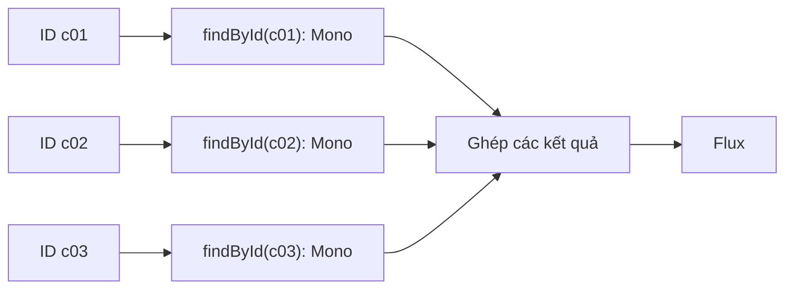

# Phối hợp nhiều thao tác bằng flatMap hoặc concatMap

Trong **SPRING_DATA_COUCHBASE**, một thao tác đọc hoặc ghi đơn lẻ thường được biểu diễn bằng `Mono<Customer>`; truy vấn nhiều document trả `Flux<Customer>`. Ở lớp service, nghiệp vụ hiếm khi chỉ có một thao tác: có thể cần **đọc khách hàng → kiểm tra tenant → sửa điểm → lưu**, hoặc **đọc một danh sách ID → gọi Couchbase cho từng ID → tổng hợp kết quả**, hay **xử lý từng sự kiện theo đúng thứ tự**. Đây là lúc các toán tử Reactor như **`flatMap`**, **`concatMap`** và **`flatMapSequential`** trở nên quan trọng.

Ba toán tử đều có thể biến từng phần tử đầu vào thành một publisher khác, nhưng chúng **khác nhau về mức đồng thời, thứ tự phát kết quả và đặc tính sử dụng tài nguyên**. Nếu dùng `flatMap` cho một chuỗi sự kiện phải xử lý tuần tự, kết quả có thể đến sai thứ tự và các mutation trên cùng document có thể xung đột CAS. Ngược lại, nếu dùng `concatMap` cho hàng nghìn thao tác đọc độc lập, ứng dụng có thể bỏ lỡ khả năng phục vụ nhiều yêu cầu I/O đồng thời một cách có kiểm soát.

Bài thuộc chương **Truy cập phản ứng**, trong module **SPRING_DATA_COUCHBASE**: xây dựng tầng truy cập Couchbase bằng Spring Data với document mapping, repository, `CouchbaseTemplate`/`ReactiveCouchbaseTemplate` và SQL++. Các ví dụ gắn với bucket/scope/collection, chỉ mục, TTL, CAS, giao dịch và API reactive để phân biệt rõ **thứ tự trong pipeline Reactor** với **tính đúng đắn và bảo đảm nhất quán của Couchbase**.

> **Quy tắc trọng tâm:** Dùng `Mono.flatMap` để nối một bước bất đồng bộ sau một bước có kết quả; dùng `Flux.flatMap` cho nhiều thao tác **độc lập** có thể chạy đồng thời; dùng `Flux.concatMap` khi từng thao tác phải được thực hiện **theo thứ tự, không chồng lấn**. Khi muốn đồng thời nhưng phát kết quả đúng thứ tự đầu vào, cân nhắc `flatMapSequential`. Không toán tử nào tự tạo transaction nhiều document.

## 1. Mục tiêu học tập

Sau bài này, bạn có thể:

1. Phân biệt `map`, `Mono.flatMap`, `Mono.flatMapMany`, `Flux.flatMap`, `Flux.concatMap` và `Flux.flatMapSequential`.
2. Nhận biết sự khác nhau giữa **thứ tự subscription**, **thứ tự hoàn tất I/O** và **thứ tự phát `onNext`**.
3. Dùng `flatMap` để phối hợp **đọc → kiểm tra điều kiện → lưu** trong `ReactiveCouchbaseRepository`.
4. Dùng tham số concurrency của `Flux.flatMap` để giới hạn số thao tác Couchbase đang diễn ra đồng thời.
5. Chọn `concatMap` khi phải xử lý tuần tự sự kiện liên quan đến cùng một document hoặc thứ tự nghiệp vụ.
6. Hiểu trade-off của `flatMapSequential`: inner publisher có thể hoạt động đồng thời nhưng kết quả cần được giữ/buffer để phát đúng thứ tự.
7. Xử lý document không tồn tại, lỗi kết nối, CAS conflict, timeout và lỗi từng phần tử mà không biến lỗi thành “không có dữ liệu”.
8. Không nhầm backpressure và `take(n)` trên Reactor với `LIMIT` ở SQL++ hoặc khả năng kiểm soát chi phí query.
9. Nhận diện trường hợp cần idempotency, optimistic locking/CAS hoặc giao dịch thay vì chỉ đổi toán tử.
10. Viết `StepVerifier` và integration test kiểm chứng thứ tự, mức đồng thời, kết quả mutation, index consistency và dữ liệu thực tế.

## 2. Mô hình trực giác: một đầu vào, một publisher bên trong

Giả sử có ba document ID:

```text
c01 → c02 → c03
```

Với mỗi ID, lời gọi `repository.findById(id)` trả về một `Mono<Customer>`. Như vậy mapper không trả ngay `Customer`, mà trả **một công việc reactive** để lấy customer.

```java
Flux<String> ids = Flux.just("c01", "c02", "c03");

Flux<Customer> customers = ids.flatMap(repository::findById);
```

Nếu I/O cho `c03` hoàn tất trước `c01`, `flatMap` có thể phát `c03` trước. Điều này hoàn toàn hợp lệ: **`flatMap` ưu tiên phát dữ liệu sẵn sàng, không hứa giữ thứ tự đầu vào**.



Cách “ghép” ở bước cuối mới là điểm khác nhau giữa ba toán tử:

| Toán tử | Inner publishers | Thứ tự kết quả | Phù hợp |
| --- | --- | --- | --- |
| `Flux.flatMap` | Có thể subscribe/chạy đồng thời | Có thể **khác thứ tự** đầu vào | Đọc độc lập, fan-out I/O, throughput. |
| `Flux.concatMap` | Xử lý inner tuần tự, đợi inner trước hoàn tất mới chuyển tiếp | Giữ thứ tự theo nguồn | Chuỗi sự kiện có ràng buộc thứ tự. |
| `Flux.flatMapSequential` | Có thể subscribe nhiều inner đồng thời | **Phát kết quả theo thứ tự đầu vào** | Nhiều I/O độc lập nhưng API cần output có thứ tự. |
| `Mono.flatMap` | Chỉ có tối đa một giá trị từ Mono nguồn; nối sang một Mono khác | Không có bài toán reorder nhiều phần tử nguồn | Đọc → validate → save. |

**Lưu ý:** Với `Flux` mà mỗi inner có thể phát **nhiều** item, thứ tự cũng liên quan đến từng luồng con. `concatMap` phát hết một inner trước khi sang inner kế tiếp; `flatMap` có thể trộn xen kẽ item của các inner; `flatMapSequential` giữ thứ tự theo vị trí inner nhưng có thể buffer dữ liệu của inner hoàn tất sớm.

## 3. Mô hình dữ liệu Couchbase dùng xuyên suốt

Giả sử ứng dụng CRM dùng bucket `app`, scope `crm`, collection `customers`. Một document:

```json
{
  "tenant_id": "tenant-a",
  "customer_code": "C001",
  "status": "ACTIVE",
  "loyalty_points": 120,
  "display_name": "Lan Anh"
}
```

Couchbase còn có **document ID** riêng, ví dụ `customer::tenant-a::C001`. Entity:

```java
package example.crm;

import org.springframework.data.annotation.Id;
import org.springframework.data.annotation.Version;
import org.springframework.data.couchbase.core.mapping.Collection;
import org.springframework.data.couchbase.core.mapping.Document;
import org.springframework.data.couchbase.core.mapping.Field;
import org.springframework.data.couchbase.core.mapping.Scope;

@Document
@Scope("crm")
@Collection("customers")
public class Customer {

    @Id
    private String id;

    @Field("tenant_id")
    private String tenantId;

    @Field("customer_code")
    private String customerCode;

    @Field
    private String status;

    @Field("loyalty_points")
    private Integer loyaltyPoints;

    @Field("display_name")
    private String displayName;

    @Version
    private Long version;

    protected Customer() {
    }

    public String getId() { return id; }
    public String getTenantId() { return tenantId; }
    public String getStatus() { return status; }
    public Integer getLoyaltyPoints() { return loyaltyPoints; }

    public void setLoyaltyPoints(Integer points) {
        this.loyaltyPoints = points;
    }

    public void setStatus(String status) {
        this.status = status;
    }

    // Constructor nghiệp vụ và accessors khác được lược bỏ.
}
```

`@Field` dùng tên JSON đã mapping, còn method repository dùng **property Java** như `tenantId` và `loyaltyPoints`. `@Id` là khóa document; `@Version` liên quan đến optimistic locking/CAS theo cơ chế Spring Data Couchbase của phiên bản đang chạy, không tự đồng nghĩa một field JSON tên `version`.

Repository:

```java
package example.crm;

import org.springframework.data.couchbase.repository.ReactiveCouchbaseRepository;
import reactor.core.publisher.Flux;

public interface CustomerRepository
        extends ReactiveCouchbaseRepository<Customer, String> {

    Flux<Customer> findByTenantIdAndStatus(
        String tenantId,
        String status
    );
}
```

Ví dụ trong bài giả định đã cấu hình kết nối, credentials, bucket/scope/collection và converters. Phần lớn thao tác `findById`/`save`/`delete` với ID sử dụng đường key-value; truy vấn theo field như `findByTenantIdAndStatus` thường được diễn đạt bằng SQL++ qua Query Service và secondary index.

## 4. Trước hết: `map` không phải `flatMap`

`map` dùng để biến đổi **giá trị đồng bộ**:

```java
Mono<String> idMono = repository.findById(id)
    .map(Customer::getId);
```

Hàm `Customer::getId` trả ngay `String`, nên kết quả là `Mono<String>`.

Nhưng nếu mapper **trả thêm publisher**:

```java
Mono<Mono<Customer>> nested = repository.findById(id)
    .map(repository::save);
```

thì `map` không tự subscribe publisher bên trong. Kết quả là `Mono<Mono<Customer>>`; biến ngoài có thể hoàn tất khi nó **phát ra đối tượng publisher bên trong**, trong khi save chưa được tiêu thụ.

Đúng ý định nối thao tác bất đồng bộ:

```java
Mono<Customer> saved = repository.findById(id)
    .flatMap(repository::save);
```

Đoạn này chỉ minh họa khác biệt kiểu; **nó chưa sửa field nào và chưa có kiểm tra quyền**. Không nên dùng nó như code update hoàn chỉnh.

| Hàm mapper trả về | Operator nên xem xét | Kiểu kết quả |
| --- | --- | --- |
| `Customer → String` | `map` | `Mono<String>` |
| `Customer → Mono<Customer>` | `Mono.flatMap` | `Mono<Customer>` |
| `Customer → Flux<Order>` | `Mono.flatMapMany` | `Flux<Order>` |
| `String ID → Mono<Customer>` trên nguồn `Flux<String>` | `Flux.flatMap`/`concatMap` | `Flux<Customer>` |
| `Customer → Mono<Void>` | `flatMap` kết hợp `then` nếu chỉ cần completion | Tùy hợp đồng kết quả |

**Câu hỏi trước khi chọn:** “Hàm gọi tiếp theo trả giá trị Java ngay hay trả một `Publisher`?”. Nếu trả publisher, cần một operator có chức năng kết hợp publisher, không chỉ `map`.

## 5. `Mono.flatMap`: đọc → kiểm tra → ghi

Giả sử nhân viên chỉ được tăng điểm của customer **thuộc tenant đã xác thực**, còn customer có status khác `ACTIVE` không được cập nhật.

```java
import java.util.NoSuchElementException;
import org.springframework.stereotype.Service;
import reactor.core.publisher.Mono;

@Service
public class CustomerPointService {

    private final CustomerRepository repository;

    public CustomerPointService(CustomerRepository repository) {
        this.repository = repository;
    }

    public Mono<Customer> setPoints(
            String authenticatedTenant,
            String customerId,
            int newPoints) {

        if (newPoints < 0) {
            return Mono.error(
                new IllegalArgumentException("Points must not be negative")
            );
        }

        return repository.findById(customerId)
            .filter(c -> authenticatedTenant.equals(c.getTenantId()))
            .switchIfEmpty(Mono.error(
                new NoSuchElementException("Customer not found")
            ))
            .flatMap(customer -> {
                if (!"ACTIVE".equals(customer.getStatus())) {
                    return Mono.error(new IllegalStateException(
                        "Customer is not ACTIVE"
                    ));
                }

                customer.setLoyaltyPoints(newPoints);
                return repository.save(customer);
            });
    }
}
```

Đây là quy trình **đặt điểm thành một giá trị tuyệt đối** (*set*), không phải “cộng điểm”. Việc chọn set giúp bàn về retry dễ hơn; cộng điểm là nghiệp vụ có rủi ro lặp mutation khi timeout.

Pipeline hoạt động theo thứ tự:

1. `findById` trả `Mono<Customer>` cho ID.
2. `filter` giữ entity khi tenant khớp context được server xác thực.
3. `switchIfEmpty` biến không tồn tại hoặc không thuộc tenant thành lỗi nghiệp vụ theo chính sách 404 chung.
4. `flatMap` chỉ được gọi khi có một `Customer`.
5. Sau khi kiểm tra status, `save` trả `Mono<Customer>` được compose vào luồng.
6. Subscriber nhận customer đã lưu nếu thao tác hoàn tất, hoặc nhận `onError` nếu một bước lỗi.

### 5.1. Vì sao `flatMap` không tạo transaction?

Giả sử một request khác sửa document giữa `findById` và `save`. Chuỗi trên **không tự khóa** document. Với `@Version`/CAS được cấu hình và dùng đúng, Spring Data Couchbase có thể phát hiện conflict thay vì ghi đè thay đổi mới; ứng dụng phải xử lý lỗi tương ứng.

`flatMap` đảm bảo **thứ tự các bước trong một subscription**, không đảm bảo tính nguyên tử xuyên nhiều request hay nhiều document.

### 5.2. Không dùng `doOnNext` để thay cho bước ghi

```java
// Không đúng: mutation quan trọng bị tách khỏi pipeline.
Mono<Customer> wrong = repository.findById(id)
    .doOnNext(c -> repository.save(c).subscribe());
```

Cách này tạo một subscription phụ không được tầng gọi quản lý, dễ mất lỗi, chạy lặp khi upstream được subscribe lại và khó quản lý transaction context. Bước ghi phải nằm trong `flatMap` và được trả về như một phần của luồng.

### 5.3. Cập nhật có điều kiện theo CAS cần test thật

`@Version` là một tín hiệu thiết kế optimistic locking nhưng **loại exception, mapping CAS, cách save xử lý entity mới/cũ và version** phụ thuộc release Spring Data Couchbase. Khi triển khai, phải kiểm tra bằng integration test: hai entity được đọc từ cùng version, save bản thứ nhất thành công, save bản thứ hai nhận conflict thay vì âm thầm ghi đè.

## 6. `Mono.flatMapMany`: một bước đọc dẫn tới nhiều kết quả

`Mono.flatMap` nhận một mapper trả `Mono<R>`. Nếu bước sau tạo `Flux<R>`, dùng `flatMapMany`.

Ví dụ cần đọc một document khách hàng trước, rồi truy vấn danh sách khách hàng cùng tenant và status:

```java
public Flux<Customer> findPeers(String sourceId) {
    return repository.findById(sourceId)
        .flatMapMany(customer ->
            repository.findByTenantIdAndStatus(
                customer.getTenantId(),
                customer.getStatus()
            )
        );
}
```

Đây chỉ là minh họa thao tác một-đến-nhiều; endpoint thực tế phải xác minh quyền truy cập `sourceId` trước khi sử dụng tenant của document để truy vấn. Nếu ID không tồn tại, `flatMapMany` tạo một `Flux` hoàn tất rỗng, trừ khi tầng trước chuyển empty thành lỗi.

Cách này không tạo một transaction giữa đọc ID và truy vấn SQL++; những document phù hợp có thể thay đổi trong khoảng thời gian giữa hai operation.

## 7. `Flux.flatMap`: fan-out các thao tác I/O độc lập

Khi danh sách ID có nhiều phần tử, `flatMap` có thể đăng ký các publisher bên trong đồng thời, giúp che bớt thời gian chờ I/O của những lời gọi độc lập.

```java
import reactor.core.publisher.Flux;

Flux<String> ids = Flux.just(
    "customer::tenant-a::C001",
    "customer::tenant-a::C002",
    "customer::tenant-a::C003"
);

Flux<Customer> customers = ids.flatMap(
    repository::findById,
    4
);
```

Tham số `4` giới hạn số inner publisher được `flatMap` xử lý đồng thời theo API Reactor. Nó **không** có nghĩa có đúng bốn TCP connections, bốn Query Service nodes hoặc bốn threads. Couchbase SDK vẫn tự quản lý tài nguyên I/O.

### 7.1. Thứ tự kết quả có thể thay đổi

Giả sử các thao tác hoàn tất như sau:

| ID | Thời điểm kết quả sẵn sàng tương đối |
| --- | --- |
| `c01` | Sau 300 ms |
| `c02` | Sau 100 ms |
| `c03` | Sau 200 ms |

Với `flatMap` và concurrency đủ lớn, kết quả có thể là:

```text
c02 → c03 → c01
```

Dù đầu vào là `c01 → c02 → c03`, phát theo thứ tự I/O hoàn tất là hành vi hợp lệ. Không nên giả định `Flux.flatMap` giữ nguyên thứ tự chỉ vì dữ liệu nguồn có thứ tự.

### 7.2. Khi nào `flatMap` là lựa chọn tốt?

- Đọc nhiều document **độc lập** theo ID, không quan trọng thứ tự trả về.
- Gọi một số thao tác truy vấn, enrichment hoặc service I/O độc lập.
- Batch công việc mà **mỗi item có idempotency/điều kiện cạnh tranh được xử lý riêng**.
- Mục tiêu throughput đòi hỏi số request đang chờ cùng lúc có giới hạn đo được.

`flatMap` không phù hợp nếu nghiệp vụ đòi hỏi “xử lý sự kiện đầu trước, rồi mới xử lý sự kiện sau” trên cùng aggregate, hoặc kết quả trả về phải đúng thứ tự nhưng client không có cách khôi phục thứ tự.

### 7.3. Concurrency cần giới hạn và đo

```java
Flux<Customer> selected = Flux.fromIterable(customerIds)
    .flatMap(repository::findById, 8);
```

`8` chỉ là ví dụ. Chọn giá trị dựa trên:

- Số phần tử đầu vào và mức fan-out của mỗi phần tử.
- KV/query latency và timeout trong Couchbase SDK.
- Throughput, giới hạn rate và tải của cluster.
- Memory/buffering của pipeline, kích thước document và downstream.
- Tỉ lệ lỗi tạm thời, CAS conflict, số retry và yêu cầu SLA.

Không mặc định “concurrency càng lớn càng nhanh”. Với nhiều request đồng thời, quá tải Couchbase có thể làm tổng thời gian hoàn tất và số timeout **tăng**.

## 8. `Flux.concatMap`: thực thi tuần tự theo thứ tự nguồn

Với cùng danh sách ID:

```java
Flux<Customer> sequential = Flux.fromIterable(customerIds)
    .concatMap(repository::findById);
```

`concatMap` đợi publisher bên trong trước hoàn tất rồi mới chuyển sang publisher kế tiếp; kết quả được phát theo thứ tự đầu vào (đối với các inner phát dữ liệu). Nếu một ID không tồn tại và `findById` trả empty, ID đó **không phát customer**, nhưng thứ tự những customer còn lại vẫn được giữ.

### 8.1. Minh họa vòng đời

```text
Nguồn: c01 → c02 → c03

concatMap:
  subscribe findById(c01)
  chờ kết quả và hoàn tất c01
  subscribe findById(c02)
  chờ kết quả và hoàn tất c02
  subscribe findById(c03)
  chờ kết quả và hoàn tất c03

Output: c01 → c02 → c03 (nếu cả ba tồn tại)
```

Điểm quan trọng là **thứ tự thao tác**, không chỉ thứ tự output. Điều này khác với `flatMapSequential`, vốn có thể khởi động nhiều thao tác cùng lúc rồi giữ kết quả theo thứ tự để phát.

### 8.2. Tình huống: xử lý event theo sequence của một customer

Giả sử các lệnh gửi tới cùng khách hàng:

```text
1. Set status = ACTIVE
2. Set status = ARCHIVED
3. Set status = DELETED
```

Nếu tất cả cùng chạy bằng `flatMap`, từng request đọc/sửa/lưu có thể chồng lấn; thứ tự mutation thực tế không được bảo đảm và có thể xảy ra CAS conflict. Một cách diễn đạt thứ tự trong **một pipeline** là:

```java
record StatusCommand(String customerId, String status) {
}

Flux<StatusCommand> commands = Flux.just(
    new StatusCommand(id, "ACTIVE"),
    new StatusCommand(id, "ARCHIVED"),
    new StatusCommand(id, "DELETED")
);

Flux<Customer> saved = commands.concatMap(command ->
    repository.findById(command.customerId())
        .switchIfEmpty(Mono.error(
            new IllegalStateException("Customer not found")
        ))
        .flatMap(customer -> {
            customer.setStatus(command.status());
            return repository.save(customer);
        })
);
```

Đoạn này minh họa *serialization* trong **một subscription**. Nó chưa đủ an toàn cho production vì còn phải kiểm tra tenant, các trạng thái chuyển hợp lệ, quyền xóa và optimistic locking. Quan trọng hơn, **hai pipeline khác nhau** cùng thao tác customer này vẫn có thể chạy đồng thời; `concatMap` trong pipeline A không khóa các pipeline B/C hoặc các node ứng dụng khác.

### 8.3. Khi `concatMap` có thể làm hệ thống chậm?

Nếu mỗi ID cần 100 ms để đọc, việc đọc tuần tự hàng nghìn ID có thể có latency cao. Khi tác vụ độc lập, mức độ tuần tự không mang lại giá trị nghiệp vụ và có thể là lựa chọn kém.

**Chọn tuần tự vì yêu cầu đúng đắn/ordering**, không chỉ để tránh phải suy nghĩ về concurrency. Nếu có thể chạy song song an toàn, hãy so sánh `flatMap` giới hạn concurrency với `concatMap` bằng benchmark đại diện.

## 9. `Flux.flatMapSequential`: đồng thời nhưng phát theo thứ tự

`flatMapSequential` dung hòa hai mục tiêu:

1. Cho phép nhiều publisher bên trong được subscribe/chạy đồng thời theo giới hạn.
2. Phát các kết quả theo thứ tự của **các phần tử nguồn**.

Ví dụ:

```java
Flux<Customer> ordered = Flux.fromIterable(customerIds)
    .flatMapSequential(repository::findById, 8);
```

Nếu kết quả `c03` sẵn sàng trước `c01`, operator có thể giữ `c03` trong buffer để chờ đến lượt. Điều này giúp output ổn định nhưng có thể tăng **memory và head-of-line blocking** nếu publisher đầu tiên rất chậm hoặc không hoàn tất.

### 9.1. Đừng xem `flatMapSequential` là công cụ serialize mutation

Hai mutation có thể được thực hiện đồng thời rồi chỉ **phát kết quả** theo thứ tự input. Ví dụ:

```java
Flux<Customer> results = Flux.fromIterable(commands)
    .flatMapSequential(this::applyCommand, 8);
```

`applyCommand` trong đoạn trên là helper minh họa; nó có thể gọi Couchbase và **các command vẫn được khởi động đồng thời**. Nếu command 1 và command 2 cùng sửa một document, việc kết quả được phát 1 trước 2 **không** có nghĩa command 1 đã ghi hoàn tất trước command 2.

Muốn đảm bảo thứ tự thực thi trong một pipeline, xem `concatMap`; muốn tính nguyên tử hoặc ngăn xung đột xuyên request, cần thêm CAS/transaction/điều phối theo key.

### 9.2. Bảng chọn nhanh

| Yêu cầu | Toán tử nên xem xét |
| --- | --- |
| Có một customer, cần thao tác bất đồng bộ tiếp theo | `Mono.flatMap` |
| Một customer dẫn tới nhiều kết quả | `Mono.flatMapMany` |
| Nhiều ID độc lập, thứ tự output không quan trọng | `Flux.flatMap(mapper, concurrency)` |
| Nhiều sự kiện cần chạy lần lượt trong một luồng | `Flux.concatMap(mapper)` |
| Nhiều I/O độc lập chạy đồng thời, output cần giữ thứ tự nguồn | `Flux.flatMapSequential(mapper, maxConcurrency)` |
| Chỉ biến đổi field Java, không gọi I/O | `map` |

## 10. Một ví dụ trọn vẹn: lấy khách hàng theo danh sách ID

Giả sử một endpoint nhận danh sách ID của khách hàng và **phải trả kết quả theo thứ tự ID do client yêu cầu**. Đầu tiên giới hạn số ID, kiểm tra tenant rồi chọn toán tử phù hợp.

Một helper đọc có kiểm tra tenant:

```java
private Mono<Customer> readForTenant(
        String authenticatedTenant,
        String customerId) {

    return repository.findById(customerId)
        .filter(c -> authenticatedTenant.equals(c.getTenantId()));
}
```

Helper trả empty nếu không tồn tại hoặc không thuộc tenant. Với yêu cầu che giấu sự tồn tại document của tenant khác, đây có thể là lựa chọn phù hợp; nếu API cần trả lỗi cho từng ID, hãy xử lý empty ở lớp ngoài theo một hợp đồng được thống nhất.

### 10.1. Nếu không cần giữ thứ tự

```java
public Flux<Customer> fetchUnordered(
        String authenticatedTenant,
        java.util.List<String> ids) {

    return Flux.fromIterable(ids)
        .flatMap(
            id -> readForTenant(authenticatedTenant, id),
            8
        );
}
```

### 10.2. Nếu cần giữ output nhưng muốn I/O đồng thời

```java
public Flux<Customer> fetchOrdered(
        String authenticatedTenant,
        java.util.List<String> ids) {

    return Flux.fromIterable(ids)
        .flatMapSequential(
            id -> readForTenant(authenticatedTenant, id),
            8
        );
}
```

Output giữ thứ tự **các document tìm thấy**. Những ID không tồn tại hoặc không có quyền sẽ không tạo item; vì vậy nếu API cần **mỗi ID một vị trí và trạng thái**, phải trả một kiểu kết quả như `Found`/`NotFound`/`Forbidden` đã định nghĩa, không chỉ `Flux<Customer>`.

**Quan trọng:** Các đoạn ví dụ chưa giới hạn số phần tử `ids` và chưa giới hạn độ dài ID. Ở production, validate đầu vào và đặt max IDs, timeout, rate limit theo quyền; tránh để client yêu cầu đọc hàng chục nghìn ID qua một endpoint vốn được thiết kế cho danh sách ngắn.

### 10.3. Nếu cần thứ tự cả việc gửi request

```java
public Flux<Customer> fetchSerial(
        String authenticatedTenant,
        java.util.List<String> ids) {

    return Flux.fromIterable(ids)
        .concatMap(
            id -> readForTenant(authenticatedTenant, id)
        );
}
```

Phương án này thường có throughput thấp hơn khi các ID độc lập, nhưng hữu ích nếu có hạn mức API chặt hoặc luồng truy cập phải diễn ra tuần tự.

## 11. Xử lý “không tìm thấy” và kết quả từng ID

`findById` thường trả `Mono.empty()` khi document không tồn tại. Nếu dùng `flatMap`/`concatMap` rồi chỉ đếm output, bạn có thể mất dấu ID nào không tìm được.

Một hợp đồng đơn giản cho truy vấn theo ID:

```java
public record LookupOutcome(
    String requestedId,
    boolean found,
    Customer customer
) {
}
```

Nếu `customer` không có giá trị cho trạng thái not found, bản ghi này có thể chứa Java `null` trong field, nhưng **không phát null trực tiếp qua Reactor**. Publisher phát một `LookupOutcome` hợp lệ.

```java
private Mono<LookupOutcome> lookupOne(
        String authenticatedTenant,
        String id) {

    return readForTenant(authenticatedTenant, id)
        .map(c -> new LookupOutcome(id, true, c))
        .switchIfEmpty(Mono.just(
            new LookupOutcome(id, false, null)
        ));
}
```

Khi dùng:

```java
Flux<LookupOutcome> results = Flux.fromIterable(ids)
    .flatMapSequential(
        id -> lookupOne(authenticatedTenant, id),
        8
    );
```

sẽ có một outcome cho mỗi ID **nếu không xảy ra lỗi**. Trường `found=false` cũng có thể dùng để không tiết lộ liệu document tồn tại dưới tenant khác. Không nên gộp lỗi database thành trạng thái not found: **`onError` phải được xử lý riêng**.

## 12. Xử lý lỗi: một inner bị lỗi ảnh hưởng các inner khác ra sao?

`Flux.flatMap`/`concatMap` mặc định truyền lỗi upstream/inner xuống downstream. Nếu một inner publisher lỗi, pipeline có thể kết thúc bằng `onError` và hủy những inner còn hoạt động. Nhưng **cancellation không rollback thao tác Couchbase đã được gửi**.

Ví dụ khi đọc hàng loạt:

```java
Flux<Customer> customers = Flux.fromIterable(ids)
    .flatMap(repository::findById, 8);
```

Nếu `findById` cho một ID lỗi vì mất kết nối, các item phát trước đó vẫn có thể đã được gửi; khi downstream nhận lỗi thì đó không phải bằng chứng các request khác chưa chạy.

### 12.1. Không dùng `onErrorResume(e -> Mono.empty())` cho mọi lỗi

```java
// Anti-pattern: lỗi Couchbase biến thành ID không tìm thấy.
Flux<Customer> wrong = Flux.fromIterable(ids)
    .flatMap(id ->
        repository.findById(id)
            .onErrorResume(error -> Mono.empty()),
        8
    );
```

Cách này khiến API báo ít document hơn mà không phân biệt lỗi query, quyền, timeout hoặc index. Với báo cáo nghiệp vụ quan trọng, đó là kết quả sai.

### 12.2. Nếu nghiệp vụ cho phép báo lỗi theo từng ID

Có thể biểu diễn mỗi kết quả bằng một record chứa trạng thái thành công/thất bại, nhưng phải **ghi lỗi và không xem thất bại như thành công**. Một mẫu:

```java
public record ReadResult(
    String requestedId,
    Customer customer,
    Throwable failure
) {
    public boolean successful() {
        return failure == null && customer != null;
    }
}
```

```java
Flux<ReadResult> outcomes = Flux.fromIterable(ids)
    .flatMap(id ->
        repository.findById(id)
            .map(c -> new ReadResult(id, c, null))
            .switchIfEmpty(Mono.just(
                new ReadResult(id, null, null)
            ))
            .onErrorResume(error ->
                Mono.just(new ReadResult(id, null, error))
            ),
        8
    );
```

Đây là cách **chuyển `onError` của từng inner thành dữ liệu outcome**, không phải che lỗi thành tập rỗng. Ứng dụng phải quyết định response: trả các lỗi từng ID, tạo báo cáo batch, hay đánh dấu toàn batch failed. Không trả nguyên `Throwable` cho client vì stack trace có thể chứa thông tin nội bộ; ở tầng API nên ánh xạ sang mã lỗi đã duyệt và correlation ID.

Lưu ý biểu diễn `ReadResult(id, null, null)` là “không tìm thấy”; nếu cần phân biệt not-found với unauthorized, dùng một enum/trạng thái rõ ràng theo chính sách bảo mật.

### 12.3. `flatMapDelayError`/`concatMapDelayError` là lựa chọn có điều kiện

Reactor có các biến thể trì hoãn phát lỗi cho phép các inner khác hoàn tất trong một số tình huống. Chúng **không** tạo rollback hay bảo đảm một thao tác lỗi sẽ tự retry; cần kiểm tra chữ ký, bộ nhớ và kết quả trên Reactor version đang dùng.

Khi có mutation, việc trì hoãn lỗi còn nghĩa là **nhiều mutation khác có thể tiếp tục thành công sau lỗi đầu tiên**. Chỉ chọn nếu nghiệp vụ chấp nhận partial success và có cơ chế audit, checkpoint, retry/idempotency.

## 13. Batch ghi: tại sao operator không đủ cho an toàn dữ liệu?

Giả sử cần lưu nhiều customer độc lập:

```java
Flux<Customer> saved = Flux.fromIterable(customersToSave)
    .flatMap(repository::save, 8);
```

Với `flatMap`, nhiều mutation có thể được gửi đồng thời. Nếu một ghi lỗi, **không** kết luận “toàn batch thất bại và không document nào thay đổi”. Một số mutation có thể đã thành công trước lỗi, một số có thể đang chờ hoặc vừa được Couchbase xử lý.

Đổi thành:

```java
Flux<Customer> serialSaved = Flux.fromIterable(customersToSave)
    .concatMap(repository::save);
```

sẽ giới hạn việc thực thi theo thứ tự trong **pipeline này**, nhưng vẫn **không có all-or-nothing**. Khi ghi thứ ba lỗi, hai ghi đầu có thể đã commit.

### 13.1. Khi nào ưu tiên `concatMap` cho mutation?

- Cập nhật **cùng một document** theo sự kiện có thứ tự, trong một pipeline duy nhất.
- Đẩy tuần tự các message có quan hệ nhân quả sang một hệ thống khác.
- Giới hạn số mutation đồng thời ở mức một để giảm xung đột hoặc tuân thủ một ràng buộc vận hành cụ thể.
- Thực hiện một job “mỗi bước tiếp theo chỉ chạy khi bước trước hoàn tất thành công”.

Tuy vậy, ứng dụng nhiều instance vẫn có thể cùng xử lý một document; muốn bảo đảm thứ tự **toàn hệ thống** cần partitioning/serialization theo key ở tầng message/job hoặc cơ chế giao dịch/CAS thích hợp.

### 13.2. Nếu cần transaction nhiều document

`flatMap`, `concatMap`, `flatMapSequential`, `Mono.when` hay `then` đều **không tự mở transaction**. Nếu yêu cầu là “ghi customer A và audit B cùng thành công hoặc cùng rollback”, phải dùng transaction API được **Couchbase SDK/Spring Data Couchbase phiên bản thực tế** hỗ trợ và đảm bảo các operation thật sự tham gia transaction đó.

Khi audit nằm ở dịch vụ ngoài Couchbase, có thể cần outbox/saga/compensation với idempotency thay vì giả định một transaction bao trùm mọi hệ thống.

## 14. Chính sách retry khác nhau giữa read và write

Retry thường **resubscribe upstream**. Với cold publisher, điều này có thể khiến thao tác I/O được gọi lại. Ví dụ:

```java
Mono<Customer> retriedRead = repository.findById(id)
    .retry(2);
```

Đây chỉ là ví dụ syntax; một chính sách production nên phân loại lỗi tạm thời, có backoff và giới hạn phù hợp.

Với mutation:

```java
Mono<Customer> possiblyRepeatedWrite = repository.save(customer)
    .retry(2);
```

có thể rủi ro nếu lần ghi đầu thành công nhưng phản hồi bị timeout, hoặc lần ghi sau dựa trên entity CAS cũ. Với lệnh cộng điểm, retry còn có thể cộng lặp nếu không có idempotency.

### 14.1. Set giá trị cố định khác increment

| Thao tác | Khi retry cần chú ý |
| --- | --- |
| Đọc `findById` | Thường có thể lặp an toàn về dữ liệu, nhưng phải giới hạn lỗi/tải. |
| Set `status = ARCHIVED` | Có thể idempotent về giá trị, nhưng CAS và trạng thái mới của document vẫn quan trọng. |
| Tăng điểm `+100` | Có thể tạo tác động kép nếu retry sau timeout. |
| Insert-only theo ID cố định | Có thể gặp duplicate khi lần đầu thực sự thành công; cần kiểm tra trạng thái cuối. |
| Delete theo ID | Cần quy định “đã không tồn tại” có là thành công không, và tránh xóa document ID tái sử dụng. |
| Gửi event ra ngoài | Có nguy cơ gửi trùng, cần event ID/outbox và xử lý nhận lặp. |

**Chọn operator không thay đổi bản chất idempotency của operation.**

## 15. `then`, `zip` và `when`: không phải mọi phối hợp đều dùng flatMap

### 15.1. `then` khi chỉ cần bước trước hoàn tất

```java
Mono<Void> deleteThenAudit = repository.deleteById(id)
    .then(auditService.recordDeletion(id));
```

`auditService` là dịch vụ minh họa trả `Mono<Void>`. `then` đợi publisher trước **hoàn tất bình thường** rồi mới subscribe bước audit. Nếu delete lỗi, audit không được thực hiện theo đường này.

Tuy nhiên, delete có thể đã thành công và audit lại lỗi; pipeline không có transaction hai nguồn. Cần thiết kế audit/idempotency/outbox phù hợp.

### 15.2. `zip` cần item từ mỗi nguồn

```java
Mono<reactor.util.function.Tuple2<Customer, Customer>> pair =
    Mono.zip(
        repository.findById(firstId),
        repository.findById(secondId)
    );
```

Nếu một `Mono<Customer>` hoàn tất rỗng, `Mono.zip` có thể hoàn tất rỗng mà không phát cặp. Không dùng `zip` của các publisher `Mono<Void>` như cách đảm bảo chúng đều phát giá trị; `Mono<Void>` không có payload.

### 15.3. `when` chờ các publisher hoàn tất

```java
Mono<Void> both = Mono.when(
    repository.save(first),
    repository.save(second)
);
```

`Mono.when` phối hợp completion, không phát các entity đã lưu; nó có thể subscribe hai nguồn và **không tạo transaction**. Nếu cần thứ tự, dùng `then`/`concatMap` theo bài toán. Nếu cần nguyên tử, dùng transaction thực sự.

### 15.4. `delayUntil` giữ kết quả bước trước

Một mẫu khác cho “lưu xong rồi ghi audit, vẫn trả customer”:

```java
Mono<Customer> savedAndAudited = repository.save(customer)
    .delayUntil(saved ->
        auditService.recordSaved(saved.getId())
    );
```

`delayUntil` chờ publisher từ helper hoàn tất trước khi phát giá trị customer xuống downstream. Đây là **phối hợp completion**; nếu audit lỗi, pipeline lỗi nhưng mutation lưu có thể đã hoàn tất. `auditService.recordSaved` phải là phương thức của ứng dụng và có chính sách lỗi/idempotency rõ ràng.

## 16. Backpressure, prefetch và head-of-line blocking

Reactor truyền tín hiệu `request(n)` giữa các publisher/subscriber; tuy nhiên **backpressure không đồng nghĩa Couchbase chỉ đọc đúng n document**.

### 16.1. `flatMap` có thể buffer

`Flux.flatMap` có cơ chế quản lý các inner publishers, demand và buffering. Tham số concurrency giới hạn số inner hoạt động, không phải giới hạn tổng kích thước dữ liệu được đọc từ Query Service hoặc toàn bộ memory usage.

Nếu mỗi inner phát nhiều item, cần xem thêm buffering/prefetch tương ứng với phiên bản Reactor và tình huống cụ thể. Đừng chỉ tăng concurrency lên 512 vì muốn tốc độ cao: nhiều inner đồng thời với document lớn có thể tiêu tốn tài nguyên đáng kể.

### 16.2. `flatMapSequential` có thể phải đợi inner đầu

Giả sử inner 1 mất 10 giây, còn inner 2–100 hoàn tất sớm. `flatMapSequential` không thể phát dữ liệu các inner sau vượt qua inner 1 nếu cần giữ thứ tự nguồn. Kết quả sẵn sàng sớm có thể bị giữ lại, tạo **head-of-line blocking** và buffer.

Nếu output không cần thứ tự, `flatMap` có thể phù hợp hơn; nếu cần thứ tự do nghiệp vụ, cần cân nhắc giới hạn concurrency và số item.

### 16.3. `concatMap` giảm chồng lấn nhưng không giải quyết query đắt

`concatMap` chỉ điều khiển **khi nào inner được subscribe**, không tự tối ưu SQL++. Một truy vấn thiếu index hoặc scan quá rộng vẫn có thể chậm. Khi inner đầu timeout, các item sau phải chờ hoặc pipeline lỗi, theo semantics operator.

### 16.4. `take(10)` không thay `LIMIT 10`

```java
Flux<Customer> preview = repository
    .findByTenantIdAndStatus("tenant-a", "ACTIVE")
    .take(10);
```

`take(10)` giới hạn số item phát cho downstream và có thể cancel upstream, nhưng không chứng minh Query Service đã có `LIMIT 10` hay index chỉ scan 10 document.

Với “10 khách hàng nhiều điểm nhất”, cần một truy vấn phía server:

```sql
SELECT c.*
FROM `app`.`crm`.`customers` AS c
WHERE c.`tenant_id` = $tenantId
  AND c.`status` = "ACTIVE"
ORDER BY c.`loyalty_points` DESC,
         c.`customer_code` ASC
LIMIT 10;
```

Đây là SQL++ **minh họa logic**, không phải projection Spring Data Couchbase sinh nguyên văn; mapper có thể cần metadata ID/CAS/discriminator. Hãy xác minh `@Query`/template/derived `Top` hỗ trợ limit theo phiên bản và dùng `EXPLAIN` đánh giá index.

## 17. SQL++/index: chọn toán tử Reactor không thay đổi đường truy cập

Có hai kiểu truy cập khác nhau:

```text
repository.findById(id)               -> key-value (document ID)
repository.findByTenantIdAndStatus()  -> SQL++ trên field JSON
```

Lời gọi `findById` thường không cần secondary index cho điều kiện ID. Truy vấn theo tenant/status thường cần index và có query scan consistency của Query Service.

Index tham khảo:

```sql
CREATE INDEX ix_customers_tenant_status_code
ON `app`.`crm`.`customers`(
    `tenant_id`,
    `status`,
    `customer_code`
);
```

Index này chỉ là ví dụ. Trong ứng dụng thật, Spring Data có thể thêm type discriminator hoặc dùng projection khác, vì vậy phải đánh giá index theo SQL++ đã quan sát được.

### 17.1. Dùng `EXPLAIN` khi fan-out là query SQL++

```sql
EXPLAIN
SELECT c.*
FROM `app`.`crm`.`customers` AS c
WHERE c.`tenant_id` = "tenant-a"
  AND c.`status` = "ACTIVE"
ORDER BY c.`customer_code` ASC
LIMIT 20;
```

Kiểm tra index scan, fetch, sort, limit, dữ liệu null/missing và độ trễ. Nếu một `Flux.flatMap` tạo hàng trăm truy vấn SQL++ từ một danh sách input, tổng tải có thể cao hơn rất nhiều so với **một query set-based** có index phù hợp. Không tự động fan-out N câu truy vấn khi backend có thể xử lý một câu `IN`, `JOIN` hoặc truy vấn tổng hợp đúng nghiệp vụ.

### 17.2. Ràng buộc tenant phải có ở mọi luồng

Nếu danh sách ID do client đưa vào, cần xác thực quyền trước khi trả thông tin. `flatMap` không tự thêm tenant vào KV lookup; một ID có thể trỏ sang document của tenant khác. Tương tự, query SQL++ trên collection dùng chung phải có điều kiện tenant từ context tin cậy và kiểm tra các nhánh `OR`.

Không xem “dùng concatMap để chạy tuần tự” là một biện pháp phân quyền.

## 18. Consistency, TTL và CAS khi phối hợp nhiều bước

### 18.1. Save hoàn tất không buộc SQL++ index thấy ngay

Ví dụ:

```java
Flux<Customer> visible = repository.save(customer)
    .flatMapMany(saved ->
        repository.findByTenantIdAndStatus(
            saved.getTenantId(),
            "ACTIVE"
        )
    );
```

Publisher bảo đảm **bước query được nối sau khi save có kết quả**, nhưng Query Service có thể chưa thấy mutation mới nếu secondary index đang cập nhật ở mức scan consistency thường. Nếu cần read-your-own-write qua SQL++, đánh giá scan consistency phù hợp như mức tương đương `REQUEST_PLUS` khi SDK/Spring Data version hỗ trợ hoặc dùng KV read theo ID.

`flatMapMany` điều khiển **thứ tự reactive**, không tự cấu hình độ mới của index.

### 18.2. TTL làm hai subscription có kết quả khác nhau

Document có TTL có thể hết hạn giữa lần đọc thứ nhất và thứ hai. Một `concatMap` đọc ID sau vài giây có thể gặp document đã biến mất dù lần đầu còn tồn tại. Khi update/save, cần kiểm tra expiration có được giữ/đặt lại thế nào trong API phiên bản thật, đặc biệt với retention hold.

### 18.3. CAS bảo vệ từng document, không tạo serializable job

`@Version`/CAS hỗ trợ phát hiện xung đột cập nhật trên **một document** khi đường mutation dùng đúng điều kiện version. `concatMap` có thể giảm chồng lấn giữa các thao tác **trong cùng pipeline**, nhưng không khóa document trước:

- Request khác trên cùng ứng dụng.
- Worker khác hoặc instance khác.
- Job định kỳ cập nhật hoặc xóa.
- TTL expiration.

Nếu cần xử lý sự kiện theo đúng sequence xuyên nhiều worker, phải thiết kế partition theo key, điều phối consumer, optimistic locking và/hoặc transaction, chứ không chỉ đổi toán tử.

### 18.4. Giao dịch nhiều document là cơ chế riêng

Các pipeline `flatMap`, `concatMap` và `then` là mô hình phối hợp publisher, không phải transaction manager. Với all-or-nothing nhiều document, sử dụng transaction API Couchbase SDK/Spring Data Couchbase mà **phiên bản ứng dụng thực sự hỗ trợ**, gồm context, retry, timeout và giới hạn thao tác. Không tự kết luận `@Transactional` thông thường sẽ bao trùm mọi đường reactive và SDK call.

## 19. Cancellation và timeout: hệ quả với thao tác đang chạy

Khi một inner publisher lỗi, downstream cancel hoặc timeout, upstream có thể bị huỷ. **Huỷ subscription không phải rollback thao tác Couchbase**:

```text
T0: flatMap subscribe repository.save(c01)
T1: SDK gửi mutation tới Couchbase
T2: downstream timeout/cancel
T3: Couchbase có thể đã ghi thành công
T4: client không nhận được kết quả
```

Với batch dùng `flatMap`, một lỗi có thể kéo theo cancel các inner khác, nhưng không có bảo đảm những mutation trước đó chưa commit.

Đừng giải quyết bằng `retry()` vô hạn; thay vào đó:

1. Ghi nhận request/job ID, document ID và loại operation.
2. Thiết kế idempotency cho operation có thể được gửi lại.
3. Phân loại lỗi tạm thời, CAS conflict và lỗi nghiệp vụ.
4. Dùng retry có giới hạn và backoff khi an toàn.
5. Sau timeout không rõ outcome, đọc trạng thái cuối qua API phù hợp trước khi hành động tiếp.
6. Giới hạn concurrency và lưu checkpoint của batch.

## 20. WebFlux: để framework sở hữu subscription

Một controller có thể trả publisher trực tiếp:

```java
import org.springframework.web.bind.annotation.GetMapping;
import org.springframework.web.bind.annotation.PathVariable;
import org.springframework.web.bind.annotation.RequestMapping;
import org.springframework.web.bind.annotation.RestController;
import reactor.core.publisher.Flux;

@RestController
@RequestMapping("/customers")
public class CustomerController {

    private final CustomerRepository repository;

    public CustomerController(CustomerRepository repository) {
        this.repository = repository;
    }

    @GetMapping("/tenant/{tenant}/active")
    public Flux<Customer> active(@PathVariable String tenant) {
        return repository.findByTenantIdAndStatus(tenant, "ACTIVE");
    }
}
```

**Cảnh báo:** Đây là ví dụ hình dạng controller reactive, **không phải controller production an toàn**. Không lấy tenant từ path do client chọn làm căn cứ phân quyền. Trong ứng dụng thật, lấy tenant từ authentication/security context server-side, dùng DTO không lộ metadata và giới hạn query/sort/page size.

Controller WebFlux thường **trả** publisher để framework subscribe. Không dùng:

```java
// Anti-pattern trong service/controller.
Flux<Customer> customers = repository.findByTenantIdAndStatus(
    tenantId, "ACTIVE"
);
customers.subscribe(); // Subscription phụ, không có owner rõ.
return customers;       // Framework có thể subscribe lần nữa.
```

Nhiều subscription có thể làm cùng query chạy lặp, làm sai tracing và tăng tải Couchbase. Với mutation, hậu quả có thể nghiêm trọng hơn do ghi lặp.

## 21. `StepVerifier`: kiểm chứng thứ tự một cách có kiểm soát

Project Reactor cung cấp `reactor-test` với `StepVerifier`. Để chứng minh khác biệt giữa `flatMap` và `concatMap`, có thể dùng **nguồn Reactor thuần** thay vì một database chịu ảnh hưởng latency không xác định.

### 21.1. Test `flatMap` có thể phát theo thứ tự hoàn tất

Dùng virtual time để tránh phụ thuộc thời gian thực:

```java
import java.time.Duration;
import org.junit.jupiter.api.Test;
import reactor.core.publisher.Flux;
import reactor.core.publisher.Mono;
import reactor.test.StepVerifier;

class MergeOrderingTest {

    private Mono<Integer> delayed(int value) {
        long millis = (4L - value) * 100L;

        return Mono.delay(Duration.ofMillis(millis))
            .map(tick -> value);
    }

    @Test
    void flatMapMayEmitByCompletionOrder() {
        StepVerifier.withVirtualTime(() ->
                Flux.just(1, 2, 3)
                    .flatMap(this::delayed, 3)
            )
            .thenAwait(Duration.ofSeconds(1))
            .expectNext(3, 2, 1)
            .verifyComplete();
    }

    @Test
    void concatMapPreservesSourceOrder() {
        StepVerifier.withVirtualTime(() ->
                Flux.just(1, 2, 3)
                    .concatMap(this::delayed)
            )
            .thenAwait(Duration.ofSeconds(1))
            .expectNext(1, 2, 3)
            .verifyComplete();
    }

    @Test
    void flatMapSequentialPreservesEmissionOrder() {
        StepVerifier.withVirtualTime(() ->
                Flux.just(1, 2, 3)
                    .flatMapSequential(this::delayed, 3)
            )
            .thenAwait(Duration.ofSeconds(1))
            .expectNext(1, 2, 3)
            .verifyComplete();
    }
}
```

Các khoảng trễ được chọn khác nhau để minh họa thứ tự trong **môi trường test giả lập**. Đây là bài test Reactor, không có Couchbase Server. `StepVerifier.withVirtualTime` yêu cầu xây publisher bên trong supplier như ví dụ để timer dùng virtual scheduler.

### 21.2. Kiểm tra không mất lỗi

```java
import reactor.core.publisher.Flux;
import reactor.core.publisher.Mono;
import reactor.test.StepVerifier;

StepVerifier.create(
        Flux.just("c01", "c02")
            .concatMap(id ->
                "c02".equals(id)
                    ? Mono.<String>error(
                        new IllegalStateException("simulated failure")
                      )
                    : Mono.just(id)
            )
    )
    .expectNext("c01")
    .expectError(IllegalStateException.class)
    .verify();
```

Test chứng minh sau `c01`, inner cho `c02` phát lỗi nên pipeline kết thúc bằng error. Nó không chứng minh một KV mutation trước lỗi có thể rollback.

### 21.3. Đừng test thứ tự `flatMap` dựa trên network latency thật

Một test kiểu “lần nào `c02` cũng trả trước `c01` trên cluster local” sẽ không ổn định vì latency thay đổi. Với `flatMap`, test điều kiện nghiệp vụ bằng **tập ID**, không assert thứ tự khi không có hợp đồng ordering.

Đối với `concatMap`/`flatMapSequential`, dùng virtual time/TestPublisher để test thứ tự Reactor; còn integration test Couchbase cần kiểm tra dữ liệu, CAS, mapper và consistency.

## 22. Integration test với Couchbase thật

Một bài test end-to-end nên dùng bucket/scope/collection **dành riêng cho test**, có fixture ID cố định, index được tạo và mapping/discriminator tương ứng. Không dùng collection production để thử mutation hay failure.

### 22.1. Test đọc qua nhiều ID

Giả sử có ba document:

| ID | Tenant | Status | Điểm |
| --- | --- | --- | ---: |
| `customer::tenant-a::C001` | tenant-a | ACTIVE | 10 |
| `customer::tenant-a::C002` | tenant-a | ACTIVE | 20 |
| `customer::tenant-b::C003` | tenant-b | ACTIVE | 30 |

Ví dụ integration test theo phương thức `fetchOrdered` ở mục 10.2:

```java
import static org.assertj.core.api.Assertions.assertThat;

import java.util.List;
import org.junit.jupiter.api.Test;
import reactor.test.StepVerifier;

@Test
void orderedFetchSkipsOtherTenant() {
    List<String> ids = List.of(
        "customer::tenant-a::C002",
        "customer::tenant-b::C003",
        "customer::tenant-a::C001"
    );

    StepVerifier.create(
            service.fetchOrdered("tenant-a", ids)
                .map(Customer::getId)
                .collectList()
        )
        .assertNext(result -> assertThat(result).containsExactly(
            "customer::tenant-a::C002",
            "customer::tenant-a::C001"
        ))
        .verifyComplete();
}
```

Đoạn này giả định `service` đã inject và fixtures đã được seed; nó là **khung test**, không phải file test độc lập có thể chạy ngay. Việc không trả ID tenant-b phải đến từ **logic phân quyền thật**, không chỉ nhờ trùng hợp dữ liệu.

### 22.2. Test optimistic locking

Để kiểm tra CAS:

1. Seed một document và đọc thành **hai instance entity độc lập**.
2. Sửa và save instance A, chờ publisher hoàn tất.
3. Sửa rồi save instance B với CAS cũ.
4. Xác nhận hành vi xung đột phiên bản theo SDK/Spring Data Couchbase thực tế.
5. Đọc lại bằng ID để đảm bảo kết quả cuối đúng, không âm thầm lost update.

Không dùng cùng một object Java mutable cho A và B vì có thể vô tình cập nhật version trên cùng instance và làm test sai mục đích.

### 22.3. Test thứ tự mutation trong một pipeline

Nếu cần chứng minh `concatMap` xử lý command theo thứ tự, dùng fixture có trạng thái chuyển hợp lệ và đọc kết quả cuối. Nhưng test này **không chứng minh thứ tự toàn hệ thống** khi có hai worker cùng xử lý document. Phải kiểm thử tải cạnh tranh/điều phối riêng cho yêu cầu đó.

### 22.4. Test SQL++ và query index consistency

Khi dùng `findByTenantIdAndStatus`, fixture seed qua KV có thể chưa hiện trong secondary index. Nếu test yêu cầu nhìn thấy mutation vừa ghi, dùng query scan consistency hoặc cơ chế đợi có điều kiện/timeout phù hợp phiên bản, tránh `Thread.sleep(1000)` tùy tiện rồi quy mọi thất bại cho Reactor.

Cùng lúc cần kiểm tra SQL++ thực tế, index sử dụng, `EXPLAIN` và type discriminator trong mapping. Một câu query không có index có thể lỗi hoặc chậm dù pipeline chỉ có một `flatMap`.

## 23. Những sai lầm thường gặp khi phối hợp publisher

| Sai lầm | Hệ quả | Hướng sửa |
| --- | --- | --- |
| `map(repository::save)` | Tạo publisher lồng, inner có thể không được subscribe. | Dùng `flatMap`. |
| `flatMap` cho command phải chạy tuần tự | Các mutation có thể chồng lấn hoặc phát sai thứ tự. | Dùng `concatMap` trong luồng, thêm CAS/điều phối khi cần. |
| `flatMapSequential` để “serialize ghi” | Chỉ giữ thứ tự output; inner có thể chạy đồng thời. | `concatMap` nếu yêu cầu execution order. |
| `concatMap` cho 100.000 KV read độc lập | Throughput có thể quá thấp. | `flatMap` giới hạn concurrency khi ordering không quan trọng. |
| `flatMap` không giới hạn concurrency cho batch lớn | Gây quá tải SDK/cluster và buffering. | Đặt max concurrency và đo. |
| Xem `concatMap` là transaction | Lỗi item sau không rollback item trước. | Dùng transaction/outbox/compensation khi cần. |
| Dùng `onErrorResume(... -> Mono.empty())` mọi nơi | Che timeout/permission/CAS thành missing. | Phân loại lỗi, giữ outcome rõ. |
| Dùng `retry()` mù quáng cho mutation | Nguy cơ ghi/cộng điểm/gửi event lặp. | Idempotency, CAS và retry có điều kiện. |
| Dùng `take(10)` thay `LIMIT 10` | Query Service vẫn có thể scan nhiều. | Query-side limit + index. |
| Dùng `collectList` trên Flux lớn | Tốn RAM và chờ toàn bộ kết quả. | Phân trang/giới hạn trên server. |
| Đổi scheduler để “tăng tốc Couchbase” | Không tự tối ưu SQL++ hay index. | Đo I/O và planner; tránh chặn event loop. |
| Tự `subscribe()` trong service WebFlux | Chạy lặp, lỗi mất dấu, lifecycle mơ hồ. | Return publisher. |
| Tin `flatMap` luôn thấy ghi mới qua SQL++ | Index lag vẫn có thể xảy ra. | Query consistency hoặc KV read theo ID. |
| Bỏ kiểm tra tenant khi fan-out ID | Có thể đọc dữ liệu chéo tenant. | Lấy tenant từ context xác thực, kiểm tra trước khi trả. |

## 24. Bài tập vận dụng

### Bài A — `map` hay `flatMap`?

Cho:

```java
Mono<Customer> customer = repository.findById(id);
```

Cần lưu khách hàng sau khi điều chỉnh status. Nếu callback trả `repository.save(customer)`, dùng `map` hay `flatMap`?

**Đáp án:** `flatMap`, vì `save` trả `Mono<Customer>`. Dùng `map` sẽ tạo `Mono<Mono<Customer>>` và chưa tự kết hợp inner publisher vào luồng.

### Bài B — Giữ thứ tự đầu ra nhưng vẫn cần concurrency

UI gửi danh sách 20 ID và yêu cầu trả kết quả **theo thứ tự ID**, nhưng các lời gọi đọc độc lập. Chọn `flatMap`, `concatMap` hay `flatMapSequential`?

**Gợi ý:** `flatMapSequential` với concurrency giới hạn, vì nó cho phép các thao tác I/O độc lập hoạt động đồng thời nhưng phát kết quả theo thứ tự nguồn. Phải quyết định cách xử lý ID không tồn tại để không làm mất vị trí của chúng.

### Bài C — Thứ tự mutation thực sự

Một document nhận ba lệnh status theo sequence; yêu cầu **lệnh sau chỉ chạy khi lệnh trước hoàn tất**. `flatMapSequential` có đủ không?

**Đáp án:** Không, vì inner có thể chạy đồng thời. `concatMap` phù hợp để serialize trong **một pipeline**, nhưng vẫn cần CAS/điều phối xuyên worker nếu có nhiều nguồn cùng sửa document.

### Bài D — Lỗi một phần của batch

Một batch 100 save dùng `flatMap(repo::save, 8)` báo lỗi sau khi một số item đã phát thành công. Có thể khẳng định tất cả mutation bị rollback không?

**Đáp án:** Không. Một số mutation có thể đã commit. Phải ghi outcome từng ID, kiểm tra trạng thái, dùng idempotency và transaction nếu nghiệp vụ thực sự cần all-or-nothing theo phạm vi API hỗ trợ.

### Bài E — Lỗi và not found

`findById(id)` không phát item còn `findById(otherId)` báo timeout. Có nên biến cả hai thành `Mono.empty()` không?

**Đáp án:** Không. Not found và lỗi hệ thống là hai trạng thái khác nhau; nuốt timeout sẽ khiến nghiệp vụ báo sai dữ liệu thiếu.

### Bài F — Backpressure và SQL++

Một `Flux` query 50.000 customer được nối `take(10)`. `flatMap` có làm Couchbase chỉ quét 10 document không?

**Đáp án:** Không. `flatMap` và `take` điều khiển pipeline Reactor; chỉ thiết kế SQL++ `LIMIT`, `ORDER BY`, filter và index phù hợp mới có thể giảm tải phía server theo mục tiêu.

### Bài G — Dữ liệu vừa ghi

`save` hoàn tất rồi `flatMapMany` sang `findByTenantIdAndStatus`, nhưng query chưa thấy document. Đây chắc chắn là lỗi ordering operator?

**Đáp án:** Không. Query Service có thể chưa nhìn thấy mutation do secondary index cập nhật trễ ở scan consistency đang dùng. Kiểm tra namespace, discriminator, index và query consistency.

### Bài H — Phân quyền

Một endpoint nhận ID bất kỳ từ client và dùng `Flux.fromIterable(ids).flatMap(repository::findById, 20)`. Vì sao code này chưa an toàn?

**Đáp án:** Nó chưa kiểm tra ID có thuộc tenant được xác thực không, cũng chưa giới hạn số ID/độ dài, quyền hay tải. Phải xác thực context và validate từng document trước khi trả kết quả.

### Bài I — Timeout trong mutation

Một `repository.save(customer).timeout(...)` báo timeout. Có được retry bằng cách tạo ID mới cho customer cùng nghiệp vụ ngay không?

**Đáp án:** Không. Ghi trước có thể đã thành công nhưng response bị mất. Dùng ID/idempotency key ổn định và kiểm tra trạng thái cuối trước khi tạo tác động mới.

### Bảng kiểm trước khi đưa pipeline vào vận hành

| Câu hỏi | Bằng chứng cần có |
| --- | --- |
| Mapper trả giá trị hay publisher? | `map` cho giá trị, `flatMap` cho publisher. |
| Mỗi input có thể sinh nhiều kết quả? | `flatMapMany`/`Flux` với hợp đồng rõ. |
| Có cần giữ thứ tự thực thi hay chỉ thứ tự output? | `concatMap` khác `flatMapSequential`. |
| Các thao tác I/O có độc lập thật không? | Không song song hóa mutation phụ thuộc nhau. |
| Concurrency đã được giới hạn và đo chưa? | Test/metrics theo tải Couchbase. |
| ID không tồn tại được biểu diễn như thế nào? | Empty riêng với lỗi hệ thống. |
| Có bắt buộc một outcome cho mỗi ID không? | Dùng record trạng thái, không chỉ lọc mất item. |
| Error của một inner có thể để batch tiếp tục không? | Quy định partial success và audit. |
| Retry có thể gây side effect lặp không? | Idempotency, CAS và timeout policy. |
| Có thao tác trên cùng document từ nhiều worker không? | Điều phối theo key/CAS, không chỉ `concatMap`. |
| Có cần atomicity nhiều document không? | Transaction/outbox, không dùng Reactor operator thay thế. |
| Có kiểm tra tenant từ authentication không? | Không lộ document qua KV fan-out. |
| SQL++ đã có filter, sort, limit và index chưa? | `EXPLAIN`/metrics; `take(n)` chưa đủ. |
| Query thấy dữ liệu vừa ghi đúng yêu cầu chưa? | Scan consistency và test read-after-write. |
| TTL và expiration ảnh hưởng kết quả không? | Kiểm tra trước/sau expiration. |
| Service có return publisher thay vì tự subscribe không? | Lifecycle WebFlux/job rõ ràng. |
| Đã test thứ tự với `StepVerifier` chưa? | Virtual-time/unit test và integration test. |
| Đã kiểm tra hủy/timeout/partial failure chưa? | Không mặc định cancel rollback mutation. |

## 25. Ghi nhớ

**`Mono.flatMap`** phù hợp để nối một thao tác bất đồng bộ sau một kết quả; **`Mono.flatMapMany`** mở rộng từ một kết quả sang một luồng nhiều kết quả. Với `Flux`, **`flatMap`** cho phép các inner publisher chạy đồng thời và kết quả có thể đan xen; **`concatMap`** thực thi inner lần lượt để giữ thứ tự; **`flatMapSequential`** cho phép concurrency nhưng phát kết quả theo thứ tự nguồn, đổi lại có thể phải buffer.

Trong Spring Data Couchbase, chọn operator phải đi cùng câu hỏi nghiệp vụ: thao tác độc lập hay phụ thuộc, cần thứ tự **thực thi** hay chỉ thứ tự **hiển thị**, có chấp nhận partial failure không, và có cần CAS/transaction/idempotency không. Reactive không tự sửa query thiếu index, không biến `take(n)` thành SQL++ `LIMIT`, không bảo đảm read-after-write qua secondary index, cũng không làm cancellation rollback mutation. Một pipeline tốt cần **phân quyền tenant rõ ràng, giới hạn concurrency, xử lý empty/error đúng, kiểm tra outcome, đo SQL++/index và kiểm thử trên phiên bản Couchbase thực tế**.
