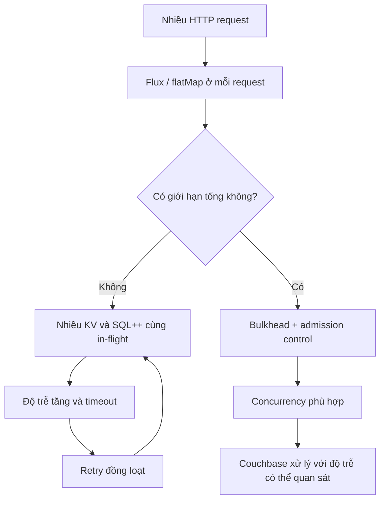

# Giới hạn số thao tác đồng thời để bảo vệ cluster

Trong **SPRING_DATA_COUCHBASE**, API reactive giúp ứng dụng tạo và phối hợp nhiều thao tác I/O không chặn thread theo cách sử dụng `Mono` và `Flux`. Tuy nhiên, **không chặn thread không đồng nghĩa hệ thống có thể gửi vô hạn yêu cầu tới Couchbase**. Nếu một request gọi `flatMap(repository::findById)` trên 20.000 ID, hoặc hàng trăm HTTP request đồng thời tạo truy vấn SQL++ nặng, cluster vẫn phải sử dụng CPU, bộ nhớ, network, Query Service, Index Service và tài nguyên xử lý key-value (KV) để phục vụ chúng.

Bài thuộc chương **Truy cập phản ứng**, tập trung vào kỹ năng **giới hạn số thao tác đồng thời để bảo vệ cluster**. Ta sẽ phân biệt giới hạn *in-flight concurrency* với *throughput/rate limit*, backpressure và hàng đợi; sử dụng `flatMap(..., concurrency)`, `concatMap` và một **bulkhead** không blocking; điều chỉnh retry, timeout, phân quyền tenant và quan sát tải. Từ đó kết nối các quyết định ở tầng Reactor với thực tế vận hành Couchbase: bucket/scope/collection, document mapping, repository, `ReactiveCouchbaseTemplate`, truy vấn SQL++, index, TTL, CAS, giao dịch và độ nhất quán dữ liệu.

> **Nguyên tắc:** Reactive tiết kiệm thread khi chờ I/O, **không tự tăng năng lực của Couchbase Server**. Bảo vệ cluster cần giới hạn có chủ đích ở **nhiều phạm vi**, kiểm soát retry, ngăn hàng đợi phình to, ưu tiên truy vấn có index và quan sát kết quả khi tải thực tế thay đổi.

## 1. Mục tiêu học tập

Sau bài này, bạn có thể:

1. Giải thích vì sao `Flux.flatMap` không giới hạn hoặc giới hạn sai phạm vi có thể tạo quá nhiều thao tác đồng thời.
2. Phân biệt **concurrency**, **rate/throughput**, **backpressure**, **buffer/queue**, **timeout** và **connection pool**.
3. Dùng `flatMap(mapper, maxConcurrency)` để giới hạn các publisher bên trong một luồng xử lý.
4. Biết khi nào `concatMap` phù hợp và vì sao nó không phải giải pháp mặc định cho mọi yêu cầu đọc.
5. Nhận diện giới hạn **theo một Flux**, **theo một HTTP request**, **theo một ứng dụng/pod**, **theo một tenant** và **theo cả cụm**.
6. Thiết kế bulkhead với cơ chế **thử nhận permit không chặn** và trả lỗi có chủ đích khi hết năng lực.
7. Phối hợp concurrency limit, bounded queue, rate limit, deadline và retry budget để tránh *retry storm*.
8. Phân biệt giới hạn KV lookup với giới hạn SQL++ query; biết sử dụng index và `EXPLAIN`.
9. Đánh giá tác động của CAS conflict, TTL, scan consistency và giao dịch đến lựa chọn mức đồng thời.
10. Kiểm chứng cấu hình với `StepVerifier`, metrics p95/p99, số thao tác in-flight, lỗi và benchmark trên môi trường đại diện.

## 2. Vì sao cluster có thể quá tải dù ứng dụng không blocking?

Giả sử một endpoint nhận danh sách 2.000 document ID rồi thực hiện:

```java
Flux<Customer> customers = Flux.fromIterable(customerIds)
    .flatMap(repository::findById);
```

`findById` trả `Mono<Customer>`, nên `flatMap` có thể subscribe nhiều inner publisher theo cơ chế và **giới hạn mặc định của Reactor phiên bản đang dùng**. Mặc định này không được xem là chính sách năng lực cho một cluster cụ thể. Với nhiều request HTTP đồng thời, số thao tác đi tới Couchbase có thể tăng rất nhanh.

Hậu quả có thể bao gồm:

- **KV Service:** thêm thao tác đọc/ghi, sử dụng network và tài nguyên xử lý lệnh, phát sinh timeout.
- **Query Service:** nhận nhiều SQL++ cùng lúc, phải lập kế hoạch/truy xuất dữ liệu/sort/aggregate.
- **Index Service:** nhiều index scan cùng lúc, tăng áp lực trên tài nguyên và độ trễ.
- **Ứng dụng:** tạo thêm publisher đang chờ, response buffer, object mapping và hàng đợi retry.
- **Nghiệp vụ:** nhiều cập nhật cùng document gây CAS conflict; retry sai có thể tạo vòng lặp tranh chấp.
- **Người dùng:** p95/p99 latency tăng, thời gian chờ dài, kết quả bị timeout dù CPU của app chưa cao.

`Mono` và `Flux` giải quyết **mô hình tiêu thụ I/O**, không bảo đảm server có đủ năng lực phục vụ số operation mà app phát ra.

### 2.1. Sơ đồ quá tải thường gặp



Sơ đồ thể hiện một **vòng phản hồi xấu**: khi cluster chậm, nhiều thao tác ở trạng thái đang chờ hơn; nếu client retry ngay và không giới hạn, tải mới tiếp tục đẩy cluster vào tình trạng nặng hơn.

## 3. Năm khái niệm dễ bị nhầm lẫn

| Khái niệm | Câu hỏi nó trả lời | Nó **không** tự làm |
| --- | --- | --- |
| **Concurrency / in-flight** | Có tối đa bao nhiêu thao tác đang diễn ra/đang chờ kết quả cùng lúc? | Không bảo đảm số thao tác mỗi giây cố định. |
| **Rate limit** | Cho phép tối đa bao nhiêu thao tác đi vào trong một khoảng thời gian? | Không đảm bảo in-flight thấp khi mỗi thao tác trở nên rất chậm. |
| **Backpressure** | Downstream yêu cầu bao nhiêu phần tử từ upstream qua `request(n)`? | Không tự tạo SQL++ `LIMIT` hay giới hạn toàn cluster. |
| **Queue / buffer** | Bao nhiêu thao tác được chờ khi chưa có slot để chạy? | Không làm cluster có thêm năng lực; queue lớn tăng latency/RAM. |
| **Timeout / deadline** | Một thao tác được phép chờ tối đa bao lâu? | Không chắc hủy hoàn toàn lệnh Couchbase đã gửi hoặc rollback mutation. |

**Ví dụ:** Nếu một operation mất 50 ms, 10 slot in-flight có thể xử lý nhiều operation trong một giây khi không có nghẽn khác. Khi latency tăng lên 1 giây, cùng 10 slot đó phục vụ ít operation mỗi giây hơn. Vì vậy cùng một concurrency cap **không tạo ra QPS bất biến**.

### 3.1. Concurrency không đồng nghĩa số thread

Một `Mono` có thể chờ I/O mà không chiếm một thread blocking riêng. Do đó `flatMap(..., 16)` có nghĩa cho phép tối đa một số inner publisher đang hoạt động theo logic Reactor, **không** có nghĩa tạo 16 threads hoặc 16 connections.

Tương tự, scheduler, connection pool và các thông số nội bộ của Couchbase SDK không được xem là cùng một thứ với Reactor concurrency. Đẩy lời gọi reactive vốn không blocking sang `boundedElastic()` không tự giảm tải Query Service.

### 3.2. Backpressure không phải rate limiter

`Flux.limitRate(n)` ảnh hưởng cách yêu cầu phần tử từ upstream; `Flux.take(n)` giới hạn số item truyền xuống downstream. Chúng **không** cung cấp bảo đảm “tối đa n Couchbase operations mỗi giây trên toàn ứng dụng”.

Muốn giới hạn số operation theo thời gian cần chính sách rate limiting thực sự ở tầng thích hợp; muốn giới hạn thao tác đang diễn ra cần in-flight limiter/bulkhead.

## 4. Xác định đúng phạm vi của giới hạn

Cùng một số `8` có thể mang ý nghĩa khác nhau nếu đặt ở những phạm vi khác nhau.

| Phạm vi | Ví dụ | Điều cần cẩn thận |
| --- | --- | --- |
| **Một Flux / batch** | `flatMap(repo::findById, 8)` | Mỗi batch/request có tối đa khoảng 8 inner theo operator; nhiều batch cộng dồn. |
| **Một HTTP request** | Tối đa 8 lookup fan-out/request | 200 request có thể tạo tới 1.600 lookup nếu không có giới hạn chung. |
| **Một app instance/pod** | Bulkhead 32 subscriptions KV | Nhiều pod nhân thêm năng lực phát tải. |
| **Một tenant** | Tenant A được ngân sách riêng | Tenant lớn không chiếm hết slot của tenant nhỏ. |
| **Một workload/loại API** | 32 KV reads, 8 SQL++ heavy queries | Tránh một query nặng chiếm toàn bộ ngân sách thao tác nhẹ. |
| **Nhiều instance/toàn hệ thống** | Rate/admission phân tán | In-process semaphore một mình không áp đặt cap toàn cluster ứng dụng. |

**Không nên viết tài liệu vận hành rằng `flatMap(..., 8)` giới hạn toàn bộ ứng dụng ở tám Couchbase operations.** Nó chỉ giới hạn số publisher con đang được xử lý trong phạm vi operator đó.

### 4.1. Ví dụ nhân tải giữa các request

Một endpoint cho phép tối đa 12 lần đọc đồng thời trong mỗi request:

```java
Flux<Customer> results = Flux.fromIterable(ids)
    .flatMap(repository::findById, 12);
```

Nếu có 100 request cùng chạy, ngân sách lý thuyết có thể lên đến khoảng **1.200 inner lookups đang hoạt động** trước khi tính các tác vụ khác. Con số chỉ minh họa phép nhân giới hạn cục bộ, không phải throughput thực đo và không đảm bảo server đồng thời nhận đủ số đó.

Vì vậy cần kết hợp **giới hạn cục bộ theo batch** với **giới hạn chung theo instance** và chính sách tổng tải khi scale ứng dụng.

## 5. Bối cảnh Spring Data Couchbase của bài

Giả sử CRM lưu khách hàng trong bucket `app`, scope `crm` và collection `customers`:

```json
{
  "tenant_id": "tenant-a",
  "customer_code": "C001",
  "display_name": "Lan Anh",
  "status": "ACTIVE",
  "loyalty_points": 120
}
```

Document ID ví dụ `customer::tenant-a::C001` được lưu trong metadata key-value. Entity:

```java
package example.crm;

import org.springframework.data.annotation.Id;
import org.springframework.data.annotation.Version;
import org.springframework.data.couchbase.core.mapping.Collection;
import org.springframework.data.couchbase.core.mapping.Document;
import org.springframework.data.couchbase.core.mapping.Field;
import org.springframework.data.couchbase.core.mapping.Scope;

@Document
@Scope("crm")
@Collection("customers")
public class Customer {

    @Id
    private String id;

    @Field("tenant_id")
    private String tenantId;

    @Field("customer_code")
    private String customerCode;

    @Field("display_name")
    private String displayName;

    @Field
    private String status;

    @Field("loyalty_points")
    private Integer loyaltyPoints;

    @Version
    private Long version;

    protected Customer() { }

    public String getId() { return id; }
    public String getTenantId() { return tenantId; }
    public String getStatus() { return status; }
    public Integer getLoyaltyPoints() { return loyaltyPoints; }

    public void setLoyaltyPoints(Integer value) {
        this.loyaltyPoints = value;
    }

    // Constructor nghiệp vụ và accessors khác lược bỏ.
}
```

`@Field` ánh xạ property Java sang tên JSON, ví dụ `loyaltyPoints` → `loyalty_points`. `@Version` tham gia optimistic locking/CAS tùy API và Spring Data Couchbase release. Không tự mặc định version này là một field JSON thông thường.

Repository:

```java
package example.crm;

import org.springframework.data.couchbase.repository.ReactiveCouchbaseRepository;
import reactor.core.publisher.Flux;

public interface CustomerRepository
        extends ReactiveCouchbaseRepository<Customer, String> {

    Flux<Customer> findByTenantIdAndStatus(
        String tenantId,
        String status
    );
}
```

### 5.1. KV và SQL++ là hai nhóm tải khác nhau

`findById(id)` thường thực hiện **key-value lookup** theo document ID. `findByTenantIdAndStatus` thường được Spring Data Couchbase diễn dịch thành **SQL++** trên field JSON qua Query Service và secondary index.

```text
findById(id)                       -> KV Service
findByTenantIdAndStatus(...)       -> SQL++ / Query Service / Index Service
```

Điều này quan trọng khi xây concurrency budget: **một SQL++ query scan lớn có thể đắt hơn rất nhiều một KV get theo ID**. Không áp dụng cùng cap hoặc coi mọi operation có chi phí ngang nhau mà không đo thực tế.

## 6. Giới hạn đầu tiên: `Flux.flatMap(..., concurrency)`

Ví dụ lấy customer theo ID:

```java
import reactor.core.publisher.Flux;

public Flux<Customer> loadCustomers(
        java.util.List<String> customerIds) {

    return Flux.fromIterable(customerIds)
        .flatMap(repository::findById, 8);
}
```

`8` là **giới hạn số inner publisher được xử lý đồng thời trong Flux này**. Nó hữu ích để tránh subscribe ngay toàn bộ thao tác từ một batch dài.

Nhưng cần hiểu:

- Nó không giới hạn toàn bộ ứng dụng; mỗi request có thể tạo một Flux khác.
- Nó không điều khiển số TCP connections hoặc node Couchbase được sử dụng.
- Nếu publisher bên trong có retry, nhiều attempt có thể phát sinh theo chính sách retry.
- Nếu downstream bị hủy, lệnh đã gửi tới Couchbase có thể vẫn hoàn tất.
- Với `flatMap`, thứ tự phát có thể khác thứ tự input, vì I/O hoàn tất không đồng thời.

### 6.1. Dùng concurrency phù hợp với loại tác vụ

```java
Flux<Customer> byId = Flux.fromIterable(ids)
    .flatMap(repository::findById, 8);
```

Có thể phù hợp để thử tải KV. Nhưng nếu mỗi inner là một SQL++ query nặng:

```java
Flux<Customer> heavy = Flux.fromIterable(statusFilters)
    .flatMap(filter ->
        repository.findByTenantIdAndStatus(
            authenticatedTenant,
            filter
        ),
        3
    );
```

ngay cả concurrency `3` vẫn có thể tốn kém nếu mỗi query không chọn lọc, phải scan/sort hàng triệu document. Đây là lúc thiết kế index hoặc **gộp thành một SQL++ query theo tập điều kiện** có thể quan trọng hơn tăng/giảm con số concurrency.

### 6.2. Đừng chỉ dựa vào giá trị mặc định

`flatMap(mapper)` có cấu hình concurrency/prefetch mặc định theo thư viện Reactor; mặc định có thể thay đổi theo phiên bản và không phản ánh tải được phép trên cluster. Khi đây là đường fan-out có thể lớn, **khai báo giới hạn rõ** và đo lại khi thay đổi workload.

## 7. `concatMap` và `flatMapSequential`: giới hạn theo mục đích

`concatMap` thực hiện inner publisher lần lượt:

```java
Flux<Customer> serial = Flux.fromIterable(customerIds)
    .concatMap(repository::findById);
```

Đây là cách giữ thứ tự thao tác trong **một subscription**. Nó đặc biệt hữu ích khi có chuỗi sự kiện phụ thuộc nhau trên một document, nhưng không phải cấu hình lý tưởng cho mọi batch đọc độc lập.

`flatMapSequential` có thể subscribe nhiều inner cùng lúc mà vẫn phát output theo thứ tự input:

```java
Flux<Customer> ordered = Flux.fromIterable(customerIds)
    .flatMapSequential(repository::findById, 8);
```

Nó **không serialize các lệnh ghi**. Hai mutation có thể đã chạy song song và chỉ được phát kết quả theo thứ tự; vì vậy không dùng nó như thay thế cho `concatMap` khi một lệnh bắt buộc phải hoàn tất trước lệnh kế tiếp.

| Yêu cầu | Lựa chọn |
| --- | --- |
| KV lookup độc lập, không cần giữ thứ tự | `flatMap(..., maxConcurrency)` |
| Sự kiện phải xử lý lần lượt trong một pipeline | `concatMap` |
| KV lookup độc lập, output giữ thứ tự | `flatMapSequential(..., maxConcurrency)` |
| Toàn app/pod phải giữ một cap chung | Bulkhead/admission control ngoài `flatMap` |
| Cần cap toàn hệ thống nhiều pod | Điều phối phân tán hoặc hạn mức vận hành ở tầng thích hợp |

### 7.1. Thứ tự không phải tính nguyên tử

Nếu các lệnh save nối bằng `concatMap`, thao tác trước có thể commit rồi thao tác sau thất bại. `concatMap` không cung cấp rollback, transaction hay serialization giữa các instance ứng dụng khác nhau.

Đối với ghi cùng document, kết hợp CAS/`@Version` và chính sách xử lý xung đột. Với nhiều document cần all-or-nothing, dùng transaction API Couchbase phù hợp SDK/Spring Data release đang chạy.

## 8. Giới hạn per-request chưa đủ: cần bulkhead chung

Một **bulkhead** giới hạn số việc có thể diễn ra đồng thời trong một vùng tài nguyên. Nếu app có 300 HTTP request, mỗi request dùng `flatMap(..., 8)`, tổng số I/O có thể vẫn quá lớn. Bulkhead đặt ở tầng gọi chung giúp chia sẻ một ngân sách giữa nhiều request.

Hai chính sách thường gặp:

1. **Fail fast:** nếu hết slot, từ chối ngay, không chặn event-loop và không tích lũy queue.
2. **Bounded waiting:** cho phép chờ tối đa một số phần tử/thời gian; hết queue hoặc deadline thì từ chối.

**Không** dùng `Semaphore.acquire()` blocking trực tiếp trong callback reactive trên event loop. Nếu bắt buộc chờ slot, cần một cơ chế **asynchronous admission** được thiết kế có giới hạn và hỗ trợ cancellation; không tạo hàng nghìn `Mono.delay` polling permit vô hạn.

## 9. Ví dụ bulkhead không chặn bằng `tryAcquire`

Một mẫu Java có thể dùng trong một instance ứng dụng để minh họa **fail-fast cap**:

```java
package example.crm;

import java.util.concurrent.RejectedExecutionException;
import java.util.concurrent.Semaphore;
import java.util.function.Supplier;
import reactor.core.publisher.Mono;

public final class ReactiveInFlightBulkhead {

    private final Semaphore permits;

    public ReactiveInFlightBulkhead(int maxInFlight) {
        if (maxInFlight < 1) {
            throw new IllegalArgumentException(
                "maxInFlight must be positive"
            );
        }
        this.permits = new Semaphore(maxInFlight);
    }

    public <T> Mono<T> protect(Supplier<Mono<T>> action) {
        return Mono.defer(() -> {
            if (!permits.tryAcquire()) {
                return Mono.error(new RejectedExecutionException(
                    "Couchbase operation budget exhausted"
                ));
            }

            return Mono.defer(action)
                .doFinally(signal -> permits.release());
        });
    }
}
```

Điểm thiết kế:

- `tryAcquire()` **không chờ blocking**; khi hết slot sẽ trả false ngay.
- Bao cả việc lấy permit trong `Mono.defer` để thao tác chỉ xảy ra khi có subscription.
- `Mono.defer(action)` để publisher do callback tạo được tham gia chuỗi signal; lỗi đồng bộ khi tạo publisher được chuyển thành tín hiệu lỗi theo semantics Reactor.
- `doFinally` giải phóng permit khi publisher complete, error hoặc bị cancel.
- Nếu một publisher được subscribe lại, nó phải tranh permit lại, không sử dụng “slot đã nhận trước”.
- Đây là **cap của subscription trong một JVM instance**, không phải hạn mức phân tán cho cả hệ thống.

### 9.1. Áp dụng trong service

Giả sử bulkhead được cấu hình là **singleton bean** và inject vào mọi service dùng cùng ngân sách:

```java
import reactor.core.publisher.Mono;

public Mono<Customer> getById(String customerId) {
    return bulkhead.protect(
        () -> repository.findById(customerId)
    );
}
```

Nếu dùng `new ReactiveInFlightBulkhead(32)` ở **mỗi request**, mỗi request có 32 permit riêng, nên hoàn toàn không đạt giới hạn chung. Đối tượng bulkhead phải được chia sẻ ở đúng phạm vi.

### 9.2. Kết hợp per-batch và per-instance

```java
public Flux<Customer> loadBounded(
        java.util.List<String> ids) {

    return Flux.fromIterable(ids)
        .flatMap(
            id -> bulkhead.protect(
                () -> repository.findById(id)
            ),
            8
        );
}
```

Ở đây có hai lớp:

- `8` giới hạn số inner publisher do **batch này** thực hiện đồng thời.
- Bulkhead giới hạn số publisher được **cả instance** chấp nhận, miễn mọi đường truy cập liên quan đều đi qua cùng bulkhead.

Nếu permit cạn, một inner báo `RejectedExecutionException`; `flatMap` thông thường sẽ truyền lỗi và có thể hủy các inner khác. API phải quyết định có trả toàn bộ lỗi, trả outcome từng ID hoặc từ chối request trước khi bắt đầu batch để tránh partial result không mong muốn.

### 9.3. Hạn chế của ví dụ semaphore

Cần phân biệt hai loại in-flight:

- **Publisher in-flight**: đã được bulkhead chấp nhận và chưa hoàn tất/hủy theo quan sát của ứng dụng.
- **Operation thực sự còn chạy phía Couchbase**: SDK/Server có thể vẫn xử lý sau khi subscriber cancel hoặc timeout.

`doFinally(CANCEL)` giải phóng permit ở phía app, **không chứng minh lệnh server đã dừng ngay**. Do đó bulkhead này là **hàng rào ứng dụng theo subscription**, không phải bằng chứng chính xác tuyệt đối về số tác vụ server đang thực hiện trong mọi tình huống hủy.

Cũng cần xử lý trường hợp tiến trình crash, scale nhiều pod, phân quyền tenant, phân biệt KV/SQL++, metrics và policy HTTP. Đây là ví dụ kỹ thuật nhỏ, **chưa phải hệ thống điều tiết tải production hoàn chỉnh**.

## 10. Một truy vấn `Flux` dài chiếm slot trong bao lâu?

Ví dụ bulkhead ở mục 9 dùng `Mono<T>`, phù hợp với một KV lookup/ghi hoặc query trả một giá trị. Nhưng SQL++ trả nhiều row có thể được biểu diễn bằng `Flux<Customer>`.

Nếu muốn giới hạn số **query subscriptions** đang tồn tại, có thể mở rộng mẫu:

```java
import java.util.concurrent.RejectedExecutionException;
import java.util.function.Supplier;
import reactor.core.publisher.Flux;

public <T> Flux<T> protectFlux(Supplier<Flux<T>> action) {
    return Flux.defer(() -> {
        if (!permits.tryAcquire()) {
            return Flux.error(new RejectedExecutionException(
                "Couchbase query budget exhausted"
            ));
        }

        return Flux.defer(action)
            .doFinally(signal -> permits.release());
    });
}
```

Đoạn này là **phương thức bổ sung đặt bên trong cùng class `ReactiveInFlightBulkhead` của mục 9** (để dùng field `permits`), không phải standalone class. Một permit được giữ trong suốt vòng đời `Flux`: tới khi complete, error hoặc cancel.

Hệ quả:

- Nếu downstream tiêu thụ chậm, query subscription có thể giữ slot lâu.
- Nếu `Flux` dài và không giới hạn số row, chỉ một số query cũng có thể chiếm nhiều tài nguyên.
- Timeout/cancel phía client có thể giải phóng permit nhưng không cam kết Query Service ngừng ngay.
- Nên kết hợp **query-side `LIMIT`/`ORDER BY`**, index, deadline và bounded response size.

Ví dụ sử dụng:

```java
Flux<Customer> active = queryBulkhead.protectFlux(() ->
    repository.findByTenantIdAndStatus(
        authenticatedTenant, "ACTIVE"
    )
);
```

Một query trả 50.000 row không “nhẹ” chỉ vì nó chiếm một permit; khi có workload đa dạng, cần tách ngân sách hoặc dùng cơ chế tính trọng số theo chi phí.

## 11. Không gom KV và SQL++ nặng vào một ngân sách duy nhất một cách mù quáng

KV lookup theo document ID và SQL++ với `WHERE`/`ORDER BY`/aggregate có đường tài nguyên khác nhau. Một cách chia ngân sách để **bắt đầu đo**:

| Nhóm workload | Ví dụ | Kiểu giới hạn |
| --- | --- | --- |
| KV lookup ngắn | `findById(id)` | Nhiều slot hơn, nhưng vẫn có cap. |
| KV mutation | `save(customer)`, `deleteById(id)` | Cap riêng; tính xung đột CAS và retry. |
| SQL++ query chọn lọc | `findByTenantIdAndStatus` với index tốt | Cap vừa phải; theo dõi latency/rows. |
| SQL++ nặng | Report aggregate/sort lớn | Cap thấp hơn, deadline và ưu tiên riêng. |
| Batch/background | Đồng bộ dữ liệu/hủy hàng loạt | Budget và thời điểm chạy riêng với API tương tác. |

Các mức này là **phân loại cần đo** chứ không phải con số mặc định của Couchbase. Ngân sách phù hợp tùy kích thước cluster, số node mỗi service, index, loại document, Query Service concurrency, SLA và traffic.

### 11.1. Tại sao cần giảm fan-out SQL++?

Một anti-pattern:

```java
Flux<Customer> all = Flux.fromIterable(statuses)
    .flatMap(status ->
        repository.findByTenantIdAndStatus(tenantId, status),
        10
    );
```

Nếu có 30 status và mỗi query thực hiện scan riêng, cluster có thể chịu nhiều công việc lặp lại. Trong trường hợp phù hợp, **một query set-based** với `status IN $statuses` có thể giảm overhead và tận dụng index tốt hơn.

```sql
-- SQL++ minh họa ý định, không phải projection Spring Data sinh nguyên văn.
SELECT c.*
FROM `app`.`crm`.`customers` AS c
WHERE c.`tenant_id` = $tenantId
  AND c.`status` IN $statuses
LIMIT $maxResults;
```

Cần kiểm tra câu query thực tế, binding danh sách, metadata mapping và index. Một query gộp không phải lúc nào cũng nhanh hơn, nhưng tránh fan-out là phương án nên đánh giá trước khi nâng concurrency.

## 12. Budget theo instance, số pod và toàn hệ thống

Giả sử có **6 application instances**, mỗi instance áp dụng bulkhead **32 query subscriptions**. Tổng số publisher được **những bulkhead cục bộ đó** cho phép có thể tới khoảng:

```text
6 instances × 32 slots/instance = 192 active subscriptions
```

Con số này **không** phải số Query Service operations thực tế, và không có nghĩa cluster Couchbase có thể chịu 192 truy vấn nặng. Khi autoscaling từ 6 lên 12 instances, khả năng gửi yêu cầu đồng thời từ ứng dụng có thể tăng gấp đôi nếu giữ nguyên cap mỗi instance.

### 12.1. Chọn cơ chế theo phạm vi

- **Một instance:** semaphore/bulkhead library có chia sẻ trong DI container.
- **Nhiều instances:** giới hạn request ở gateway/service mesh, hạn mức phân tán, hàng đợi job hoặc điều phối workload phù hợp.
- **Một tenant:** quota/token bucket/concurrency partition theo tenant để một khách hàng không độc chiếm tài nguyên.
- **Batch:** worker pool có số consumer/partition giới hạn, tiến độ có checkpoint.

Không cố áp một con số toàn hệ thống bằng cách sửa `flatMap` ở một controller rồi cho rằng mọi job khác sẽ tuân thủ.

### 12.2. Thận trọng với semaphore chia theo tenant

Nếu tạo một `Semaphore` riêng cho **mỗi tenant ID** rồi giữ vĩnh viễn trong `Map`, số lượng tenant tăng có thể làm tăng bộ nhớ không giới hạn. Các cơ chế quota per-tenant cần TTL/eviction hoặc thư viện có quản lý lifecycle, quota tenant không tin cậy từ client và một cap **toàn instance** bổ sung.

## 13. Ước lượng ngân sách từ throughput và latency

Một cách tư duy ban đầu là quan hệ gần đúng:

\[
\text{In-flight} \approx \text{throughput (ops/s)} \times \text{latency (s)}
\]

Đây là một dạng áp dụng **Little's Law** trong trạng thái ổn định, với các giả thiết rõ ràng. Nó giúp kiểm tra một mục tiêu có thực tế không, **không phải công thức tự động suy ra mức concurrency tối ưu**.

Ví dụ giả định:

- Workload mục tiêu: **1.200 KV lookups/giây**.
- Thời gian trung bình mỗi lookup: **0,08 giây**.
- Số thao tác in-flight trung bình theo phép ước lượng: khoảng **96**.

Nếu sáu app instances chia tải tương đối đều, điểm bắt đầu để thử nghiệm là ngân sách khoảng **16 in-flight lookups/instance**. Nhưng:

1. Phân bố latency có đuôi dài; p95/p99 có thể khác xa trung bình.
2. Traffic không đều giữa các instances và giữa các tenant.
3. Một query SQL++ nặng không tương đương một KV lookup.
4. Overhead mapping, retries và timeout làm thay đổi tải.
5. Khi hệ thống đến gần giới hạn năng lực, latency có thể tăng phi tuyến.

**Hãy dùng con số trên để xây bài thử tải, không dùng như cấu hình production đã được chứng minh.**

### 13.1. Tiêu chí điều chỉnh

Tăng cap chỉ khi cụm vẫn có headroom và việc tăng thực sự cải thiện **throughput đạt SLA**. Nếu tăng cap làm p99 và timeout tăng nhanh hơn throughput, cần giảm cap hoặc tối ưu query/index trước.

Đo ở nhiều điểm tải, tối thiểu gồm: ổn định, gần giới hạn và quá tải có chủ đích trong môi trường thử nghiệm.

## 14. Rate limit và concurrency limit phải phối hợp

Một concurrency cap giúp không có quá nhiều công việc **đang hoạt động**. Nhưng nếu các operation cực nhanh, app vẫn có thể phát số request/giây rất cao; nếu operation trở nên rất chậm, một rate limit đơn lẻ vẫn cho phép in-flight tích tụ.

Vì vậy một thiết kế bảo vệ toàn diện thường dùng:

```text
Request
  -> authentication + tenant quota
  -> rate limit / admission policy
  -> bounded queue hoặc fail-fast
  -> per-request fan-out cap
  -> per-instance bulkhead
  -> SDK / Couchbase cluster
```

Không phải mọi ứng dụng đều cần triển khai tất cả tầng. Chọn theo loại workload, số instances và rủi ro quá tải.

### 14.1. `delayElements` không phải limiter toàn ứng dụng

`Flux.delayElements(Duration.ofMillis(...))` chỉ điều chỉnh thời gian phát của **một pipeline** trong phạm vi đó. Nếu có hàng trăm request, mỗi request tự delay nhưng vẫn gửi request riêng, không có bảo đảm tổng QPS toàn instance hay toàn cluster.

Tương tự, `limitRate(n)` chỉ điều chỉnh cách downstream yêu cầu dữ liệu; nó không tương đương token bucket điều phối giữa các HTTP request.

### 14.2. Khi nào nên từ chối sớm?

Nếu hết slot và không có lợi ích khi chờ quá lâu, fail-fast giúp tránh queue phình to. Ở HTTP layer, có thể ánh xạ:

- **429 Too Many Requests** khi người dùng/tenant vượt hạn mức chính sách.
- **503 Service Unavailable** hoặc một mã overload được định nghĩa khi ứng dụng tạm thời hết khả năng phục vụ.
- Có thể kèm hướng dẫn retry phù hợp nếu chính sách cho phép, tránh khiến tất cả client retry ngay cùng lúc.

`RejectedExecutionException` trong ví dụ bulkhead chỉ là tín hiệu Java. **Spring WebFlux không tự đảm bảo** biến nó thành mã HTTP mong muốn; cần ánh xạ lỗi tại tầng API.

## 15. Hàng đợi phải có giới hạn và deadline

Một thiết kế queue không giới hạn thường dời vấn đề từ cluster sang RAM ứng dụng:

```text
Incoming requests > processing capacity
    -> queue grows
    -> wait time grows
    -> requests timeout before được xử lý
    -> memory grows
    -> retries tạo thêm arrivals
```

Cần xác định:

| Tham số | Ví dụ câu hỏi |
| --- | --- |
| `maxInFlight` | Cho phép bao nhiêu thao tác bắt đầu cùng lúc? |
| `maxQueueSize` | Có bao nhiêu công việc được phép chờ? |
| `maxWait` | Chờ slot tối đa bao lâu trước khi từ chối? |
| `requestDeadline` | Tổng thời gian còn lại của HTTP request/job là bao nhiêu? |
| `retryBudget` | Tổng số lần thử thêm có được phép trong khoảng này? |
| `priority`/`tenantQuota` | Request tương tác và batch chia tài nguyên thế nào? |

Đối với ứng dụng reactive, ưu tiên hàng đợi bất đồng bộ có **kích thước hữu hạn**, cancellation support và metrics. Không đặt `Semaphore.acquire()` vào event loop; không dùng `Thread.sleep` để chờ permit.

### 15.1. Backpressure phải kéo được về nguồn

Nếu nguồn là một message broker, cần cấu hình số message prefetch và số consumer/worker sao cho tín hiệu chậm có thể giảm tốc đọc từ broker. Nếu nguồn là request HTTP đang ập đến, backpressure của một `Flux` **không tự giảm tốc** số client tạo request; cần admission/rate limit ở tầng nhận.

## 16. Retry storm: có limit mà vẫn có thể tự gây quá tải

Một pipeline đọc:

```java
Mono<Customer> read = repository.findById(id)
    .retry(3);
```

có thể tạo thêm các attempts khi gặp lỗi. Nếu hàng nghìn request đều retry ngay trong lúc cluster chậm, tổng tải có thể tăng gấp nhiều lần.

### 16.1. Retry có giới hạn và backoff

Ví dụ minh họa cấu trúc:

```java
import java.time.Duration;
import reactor.core.publisher.Mono;
import reactor.util.retry.Retry;

Mono<Customer> readWithRetry = repository.findById(id)
    .retryWhen(
        Retry.backoff(2, Duration.ofMillis(100))
            .filter(this::isTransientReadFailure)
    );
```

`isTransientReadFailure` là helper **do ứng dụng triển khai** để phân loại lỗi dựa trên SDK/repository version; đoạn này không phải chính sách production hoàn chỉnh. Backoff, jitter, deadline và tổng số attempts cần thiết kế theo SLO, tránh retry các lỗi quyền, validation hoặc syntax/index không có khả năng phục hồi bằng cách thử lại y hệt.

### 16.2. Đặt retry trước hay sau bulkhead?

Có hai lựa chọn với ý nghĩa khác nhau:

**A. Giữ một permit qua cả chuỗi retry/backoff:**

```java
Mono<Customer> guardedWithRetry =
    bulkhead.protect(() ->
        repository.findById(id)
            .retryWhen(readRetrySpec)
    );
```

Ưu: một request chiếm một slot trong toàn bộ tiến trình, tránh nhiều request retry cùng lúc vượt admission. Nhược: slot có thể bị giữ **cả khi đang backoff**, khiến throughput giảm và nhiều request mới bị từ chối.

**B. Mỗi attempt nhận lại permit:**

```java
Mono<Customer> retryOutside =
    bulkhead.protect(() -> repository.findById(id))
        .retryWhen(readRetrySpec);
```

Ưu: giữa các attempt, permit có thể được nhả, không chiếm slot suốt backoff. Nhược: retry lại tham gia admission và có thể gặp từ chối; nếu retry policy xem từ chối như lỗi tạm thời, cần ngăn vòng retry quá tải.

**Không có thứ tự operator duy nhất tốt cho mọi hệ thống.** Quyết định phải gắn với deadline, fairness, quota, retry budget và metrics; `readRetrySpec` là cấu hình được tạo bởi ứng dụng, không phải global mặc định.

### 16.3. Mutation phải có idempotency

Với `save`, tăng điểm, gửi audit hoặc xóa document, một timeout có thể xảy ra sau khi lệnh **đã commit phía Couchbase** nhưng response bị mất. Retry mù quáng có thể tạo tác động lặp.

Đặc biệt:
- Set một field về giá trị cố định có tính lặp khác tăng điểm `+100`.
- Insert-only cần khóa xác định hoặc idempotency token.
- CAS conflict cần chính sách đọc lại/giải quyết xung đột, không gửi object stale vô hạn.
- Transaction có cơ chế retry riêng theo API; không đặt thêm retry chung một cách máy móc bên ngoài.

## 17. Giới hạn concurrency khi ghi: tránh xung đột CAS

Giả sử một batch cập nhật **cùng một customer** theo các sự kiện khác nhau:

```java
Flux<Customer> updates = Flux.fromIterable(commands)
    .flatMap(command ->
        repository.findById(command.customerId())
            .flatMap(customer -> {
                customer.setLoyaltyPoints(command.newPoints());
                return repository.save(customer);
            }),
        8
    );
```

`commands` và `command.newPoints()` là dữ liệu/record minh họa. Nếu nhiều command cùng trỏ tới một ID, tám mutation có thể đọc phiên bản cũ rồi tranh nhau ghi; CAS conflicts và lost update sẽ tăng. Không dùng concurrency cao cho những cập nhật có quan hệ nhân quả.

### 17.1. Serialize trong một pipeline

```java
Flux<Customer> serial = Flux.fromIterable(commands)
    .concatMap(command ->
        repository.findById(command.customerId())
            .flatMap(customer -> {
                customer.setLoyaltyPoints(command.newPoints());
                return repository.save(customer);
            })
    );
```

`concatMap` chờ mutation trước hoàn tất rồi mới chạy mutation tiếp trong **subscription này**. Nhưng instance khác vẫn có thể sửa cùng ID. Nếu cần thứ tự toàn hệ thống, phải phân vùng sự kiện theo key, dùng CAS/transaction hoặc cơ chế coordination tương ứng.

### 17.2. Bulkhead không thay CAS

Bulkhead giảm tổng tải, **không** đảm bảo hai request không sửa cùng document ở những instance khác nhau. Ngược lại, CAS bảo vệ tính nhất quán của một document trong đường ghi đúng điều kiện, **không** bảo vệ cluster khỏi fan-out quá lớn. Hai cơ chế bổ sung cho nhau.

## 18. Query Service và secondary index: tối ưu trước khi tăng slot

Một truy vấn reactive:

```java
Flux<Customer> active = repository.findByTenantIdAndStatus(
    authenticatedTenant,
    "ACTIVE"
);
```

có thể tạo SQL++ gần ý định sau:

```sql
-- Minh họa logic; framework có thể thêm metadata/discriminator.
SELECT c.*
FROM `app`.`crm`.`customers` AS c
WHERE c.`tenant_id` = $tenantId
  AND c.`status` = "ACTIVE";
```

Nếu query phải scan toàn collection, giảm concurrency có thể hạn chế thiệt hại tức thời nhưng không sửa nguyên nhân gốc. Cần index theo query thực tế.

### 18.1. Index minh họa

```sql
CREATE INDEX ix_customer_tenant_status
ON `app`.`crm`.`customers`(
    `tenant_id`,
    `status`
);
```

Index này chỉ là ví dụ. Spring Data Couchbase có thể thêm type discriminator hoặc projection khác; chiến lược index phải dựa trên SQL++ và dữ liệu thực tế. Kiểm tra bằng:

```sql
EXPLAIN
SELECT c.*
FROM `app`.`crm`.`customers` AS c
WHERE c.`tenant_id` = "tenant-a"
  AND c.`status` = "ACTIVE";
```

Xem index scan, fetch, filter, sort, số row ước tính và số row thực trả ở tải đại diện. Đừng giả định index được dùng chỉ vì nó tồn tại.

### 18.2. Giới hạn row ở server

```java
Flux<Customer> ten = repository
    .findByTenantIdAndStatus(tenantId, "ACTIVE")
    .take(10);
```

`take(10)` **không tự thêm `LIMIT 10` vào SQL++**. Nếu UI yêu cầu “10 customer mới nhất”, cần `ORDER BY`, `LIMIT` và index tương ứng ở phía Query Service; khả năng `TopN`/`Pageable` trong reactive repository phải được xác minh theo Spring Data Couchbase version.

### 18.3. Tách ngân sách của query nặng

Một báo cáo aggregate có thể quét nhiều dữ liệu và chiếm tài nguyên lâu hơn KV lookup. Nếu gộp mọi tác vụ vào cùng bulkhead, một vài report có thể làm endpoint tra cứu ID bị từ chối. Cân nhắc **bulkhead riêng**, queue batch ở thời điểm ít tải và circuit breaker/admission policy phù hợp.

## 19. Read-after-write và scan consistency cũng tiêu thụ ngân sách

Ví dụ:

```java
Flux<Customer> afterSave = repository.save(customer)
    .flatMapMany(saved ->
        repository.findByTenantIdAndStatus(
            saved.getTenantId(),
            "ACTIVE"
        )
    );
```

`flatMapMany` đảm bảo bước query được nối sau khi save phát kết quả; nó **không tự bắt secondary index chờ cập nhật**. Query SQL++ có thể chưa thấy mutation mới với scan consistency thông thường.

Khi nghiệp vụ bắt buộc read-your-own-write qua query, cần cân nhắc query scan consistency mức tương đương `REQUEST_PLUS` nếu SDK/Spring Data phiên bản hỗ trợ, hoặc cách đợi dựa trên mutation state. Mức consistency mạnh hơn có thể làm query **đợi lâu hơn**, từ đó tăng thời gian giữ slot bulkhead; phải phản ánh trong budget và benchmark.

Không giảm consistency tùy tiện chỉ để tăng throughput nếu nghiệp vụ có yêu cầu đúng đắn nghiêm ngặt. Ngược lại, không bật consistency mạnh cho mọi query mà chưa có phân loại workload.

## 20. TTL, cancellation và thời gian giữ permit

### 20.1. TTL khiến kết quả thay đổi giữa các lần đọc

Một document hết hạn có thể không còn tồn tại khi request tới lượt chạy trong queue. Nếu queue chờ quá lâu, một thao tác hợp lệ lúc nhận request có thể không còn hợp lệ lúc thực thi. Do đó:

- Thiết kế deadline/max wait.
- Xác minh lại trạng thái tại thời điểm mutation.
- Phân biệt document không tồn tại (hoặc hết TTL) với timeout.
- Tránh cache kết quả `Mono` quá lâu nếu trạng thái dữ liệu thay đổi.

### 20.2. Cancel không có nghĩa lệnh server đã kết thúc

Nếu client đóng kết nối, Reactor có thể gọi cancel; `doFinally(CANCEL)` giải phóng permit trong bulkhead minh họa. Nhưng mutation/SQL++ có thể đã gửi tới server và vẫn đang xử lý. Do đó metric “số permit đang giữ” chỉ phản ánh phía app, không phải số task server đang chạy trong mọi tình huống.

Cần quan sát đồng thời:

- Thời gian subscription và thời gian SDK operation.
- Số request bị cancel/timeout.
- Metric/query status của Couchbase nếu có.
- Tỉ lệ mutation outcome không xác định sau cancel.
- Ảnh hưởng của retry lên in-flight và tài nguyên thực tế.

### 20.3. Không dùng timeout để đảm bảo rollback

`timeout(Duration)` giới hạn thời gian chờ tín hiệu ở Reactor. Nó không thay thế transaction, CAS, idempotency hay một cơ chế hủy server có xác nhận. Với thao tác ghi quan trọng, cần cơ chế kiểm tra trạng thái cuối trước khi retry.

## 21. Phân quyền và công bằng tài nguyên giữa tenant

Giới hạn đồng thời là một phần của **bảo vệ dịch vụ**, nhưng không thay thế phân quyền dữ liệu.

Một API nhận danh sách ID rồi thực hiện:

```java
Flux<Customer> results = Flux.fromIterable(requestedIds)
    .flatMap(repository::findById, 8);
```

vẫn chưa an toàn nếu ID do client chọn có thể thuộc tenant khác. Cần lấy tenant từ context xác thực và kiểm tra quyền ở mỗi kết quả, hoặc dùng truy vấn có ràng buộc tenant chính xác.

Khi thiết kế quota per-tenant:

- Tenant được xác định từ **identity đã xác thực**, không chỉ từ một query param.
- Dùng giới hạn tổng để tất cả tenants không cộng dồn vượt khả năng instance.
- Có thể dành ngân sách cho các endpoint/tenant quan trọng theo chính sách.
- Tránh một tenant tạo queue lớn làm tăng latency cho tenant khác.
- Theo dõi rejections/latency theo tenant ở dạng an toàn, không log dữ liệu nhạy cảm.

Một quota không đồng nghĩa quyền đọc hoặc sửa; cả hai lớp phải tồn tại độc lập.

## 22. Observability: đo những chỉ số nào?

Không nên chọn cap chỉ theo một benchmark đơn giản hoặc theo số core CPU của app. Một bảng đo đáng dùng:

| Nhóm | Chỉ số cần thu thập | Mục tiêu |
| --- | --- | --- |
| **Application admission** | accepted/rejected, số permits đang giữ, thời gian chờ queue | Biết có đang chạm cap và từ chối sớm không. |
| **Reactive pipeline** | subscriptions, cancellations, retry attempts, active inner publishers | Phân biệt nhu cầu mới và retry. |
| **Latency** | p50/p95/p99 KV, SQL++ và end-to-end | Không để tail latency tăng mất kiểm soát. |
| **Error** | timeout, 429/503, CAS conflict, index/query failure | Tách overload với lỗi nghiệp vụ. |
| **Database load** | Query Service latency/CPU/queue, Index Service scan, KV operation metrics | Xem cluster có còn headroom không. |
| **Cardinality** | rows per query, bytes returned, batch size | Phát hiện query/batch quá rộng. |
| **Tenant/workload** | quota hits, tỉ lệ từ chối, throughput theo loại | Kiểm tra fairness và ưu tiên. |
| **Mutation safety** | unknown outcomes sau timeout, duplicate/retry conflict | Bảo vệ dữ liệu khi quá tải. |

Tên metric thực tế phụ thuộc Spring Boot/Micrometer, Couchbase SDK, Server và công cụ quan sát được triển khai. Bảng trên mô tả **câu hỏi cần đo**, không khẳng định SDK luôn cung cấp sẵn một metric cụ thể.

### 22.1. Log nên ghi gì?

Ghi correlation ID, loại workload (KV/SQL++), kết quả admission, timeout, số ID của batch, thời gian và mã lỗi đã phân loại. Tránh log email, token, customer JSON, SQL++ bind values nhạy cảm hoặc stack trace có dữ liệu nội bộ ở môi trường chia sẻ.

## 23. Kịch bản kiểm thử năng lực từng bước

Nên kiểm chứng trên môi trường Couchbase đại diện, tránh tạo tải đến cluster production chỉ để thử số concurrency mới.

1. **Chuẩn bị fixture ổn định:** đủ nhiều document, kích thước gần thực tế, đúng scope/collection và index.
2. **Đo baseline:** một request/operation, xác định latency KV và SQL++ riêng.
3. **Đặt cap thấp:** ví dụ 4 inner mỗi batch và một bulkhead instance chia sẻ.
4. **Tăng dần tải:** đồng thời tăng số HTTP requests/batch; không tăng mọi tham số cùng lúc.
5. **Quan sát điểm bắt đầu bão hòa:** p99, timeout, queue, rejections, CPU/query/index.
6. **Thử overload chủ động:** kiểm tra API từ chối hợp lý thay vì giữ queue vô hạn.
7. **Thử retry storm:** giả lập lỗi tạm thời có giới hạn, xem retry có phá cap hay deadline không.
8. **Thử cancel:** ngắt HTTP request và quan sát operation outcome ở Couchbase.
9. **Thử mutation conflict:** nhiều event cùng document, xem CAS conflict khi tăng concurrency.
10. **Thử read-after-write:** đánh giá consistency option và thời gian giữ slot.
11. **Thử scale-out:** tăng instances, kiểm tra tổng tải và quota toàn hệ thống.
12. **Chốt cấu hình theo chứng cứ:** ghi version, workload, p95/p99, số rejections và điều kiện sử dụng.

**Một cấu hình đạt p99 tốt ở 100 document nhỏ không thể tự xem là đạt ở báo cáo SQL++ quét hàng triệu document.** Test cần đại diện phân bố dữ liệu, index và input thực.

## 24. Test Reactor chứng minh giới hạn subscribe

Dùng `reactor-test` có thể kiểm tra **số inner publisher được subscribe trước khi có kết quả hoàn tất**, không cần dựa vào độ trễ mạng thật.

### 24.1. Test với các nguồn chưa hoàn tất

```java
import static org.assertj.core.api.Assertions.assertThat;

import java.util.List;
import java.util.concurrent.atomic.AtomicInteger;
import java.util.stream.IntStream;
import org.junit.jupiter.api.Test;
import reactor.core.publisher.Flux;
import reactor.core.publisher.Mono;
import reactor.core.publisher.Sinks;
import reactor.test.StepVerifier;

class FlatMapConcurrencyTest {

    @Test
    void neverStartsMoreThanTwoPendingInnersInitially() {
        AtomicInteger subscribed = new AtomicInteger();

        List<Sinks.One<Integer>> gates = IntStream.range(0, 6)
            .mapToObj(i -> Sinks.<Integer>one())
            .toList();

        Flux<Integer> flow = Flux.range(0, 6)
            .flatMap(i ->
                Mono.defer(() -> {
                    subscribed.incrementAndGet();
                    return gates.get(i).asMono();
                }),
                2
            );

        StepVerifier.create(flow)
            .then(() -> assertThat(subscribed.get())
                .isEqualTo(2))
            .then(() -> gates.get(0).tryEmitValue(0))
            .expectNext(0)
            .then(() -> assertThat(subscribed.get())
                .isEqualTo(3))
            .thenCancel()
            .verify();
    }
}
```

Ý nghĩa:

- Sáu `Sinks.One` mô phỏng sáu operation chưa trả kết quả.
- Vì concurrency là 2, trước khi bất kỳ inner nào hoàn tất, chỉ hai inner đầu được subscribe.
- Khi inner 0 hoàn tất, operator có thể subscribe inner tiếp theo.
- Test được huỷ có chủ đích; đây là **unit test Reactor**, không khẳng định KV/SQL++ đã hủy ở server.

Nếu test chạy với phiên bản Java chưa có `Stream.toList()`, dùng `collect(Collectors.toList())` thích hợp. Cần dependency `reactor-test`/JUnit/AssertJ cho dự án thực tế.

### 24.2. Test bulkhead từ chối khi hết slot

Để kiểm chứng cơ chế fail-fast, cần giữ một subscription đầu **chưa hoàn tất** trong khi tạo subscription thứ hai. Nếu chỉ nối `first.flatMap(...second...)`, bước hai bắt đầu **sau khi bước một hoàn tất**, nên đó không phải test tranh slot.

```java
import java.util.concurrent.RejectedExecutionException;
import org.junit.jupiter.api.Test;
import reactor.core.Disposable;
import reactor.core.publisher.Mono;
import reactor.core.publisher.Sinks;
import reactor.test.StepVerifier;

class ReactiveBulkheadTest {

    @Test
    void rejectsSecondSubscriberAndReleasesAfterCancel() {
        ReactiveInFlightBulkhead bulkhead =
            new ReactiveInFlightBulkhead(1);

        Sinks.One<String> pending = Sinks.one();

        // Subscription thứ nhất giữ permit vì chưa phát tín hiệu cuối.
        Disposable first = bulkhead.protect(pending::asMono)
            .subscribe(value -> { }, error -> { });

        try {
            StepVerifier.create(
                    bulkhead.protect(() -> Mono.just("second"))
                )
                .expectError(RejectedExecutionException.class)
                .verify();
        } finally {
            // Hủy subscription đầu và nhả permit theo doFinally.
            first.dispose();
        }

        StepVerifier.create(
                bulkhead.protect(() -> Mono.just("accepted"))
            )
            .expectNext("accepted")
            .verifyComplete();
    }
}
```

Test xác nhận **cap theo subscription trong JVM**: yêu cầu thứ hai bị từ chối khi slot đã bị giữ; sau cancellation, yêu cầu mới được chấp nhận. Nó **không** chứng minh một thao tác Couchbase đã gửi tới server ngừng ngay khi hủy, nên integration/load test vẫn cần đo mức tải thực tế.

### 24.3. Test cần bao phủ cancellation và recovery

Cần thêm assertions: sau khi publisher hoàn tất/lỗi/hủy, permit được giải phóng và một yêu cầu mới có thể được chấp nhận. Với hoạt động thật, test integration phải xem thêm liệu tác vụ server có tiếp tục sau client cancel hay không, để không nhầm chỉ số permit của app với mức tải Server.

## 25. Integration test với Couchbase

Một test trên Couchbase thật cần cluster và collection chỉ dùng cho test, có fixture/document ID cố định, index và consistency phù hợp:

```java
import static org.assertj.core.api.Assertions.assertThat;

import java.util.List;
import org.junit.jupiter.api.Test;
import reactor.test.StepVerifier;

// Khung ví dụ: repository/service, fixture và test context do dự án cung cấp.
@Test
void readsOnlyKnownIdsWithinTenant() {
    List<String> ids = List.of(
        "customer::tenant-a::C001",
        "customer::tenant-b::C002",
        "customer::tenant-a::C003"
    );

    StepVerifier.create(
            service.loadAuthorizedCustomers("tenant-a", ids)
                .map(Customer::getId)
                .collectList()
        )
        .assertNext(result ->
            assertThat(result).containsExactlyInAnyOrder(
                "customer::tenant-a::C001",
                "customer::tenant-a::C003"
            )
        )
        .verifyComplete();
}
```

`service.loadAuthorizedCustomers` là phương thức nghiệp vụ minh họa cần được implement có **kiểm tra quyền tenant**, cap và input validation; test này không phải Java file độc lập. Không chạy trên production.

### 25.1. Tập test tối thiểu

| Kiểm thử | Điều cần chứng minh |
| --- | --- |
| Fan-out 100 ID | Số inner subscription không vượt cap cục bộ đã đặt. |
| 20 HTTP requests đồng thời | Bulkhead instance có số accepted/rejected đúng policy. |
| Scale 2→6 instances | Tổng tải không vượt khả năng cluster chỉ nhờ cap cục bộ. |
| SQL++ nặng | Có index, query-side LIMIT, deadline và bulkhead riêng. |
| KV lookup | Đúng ID và tenant, không lộ thông tin khách hàng khác. |
| Batch save có một lỗi | Ghi nhận mutation thành công/thất bại từng ID; không giả rollback. |
| CAS conflict | Đọc hai bản cùng version, save thứ hai bị xử lý theo policy. |
| Timeout/cancel | Không giả định server đã ngừng hoặc mutation rollback. |
| Query sau save | Scan consistency đáp ứng yêu cầu read-your-own-write. |
| Document TTL | Phân biệt hết hạn với overload/rejection. |
| Retry storm | Có retry budget, backoff và giới hạn tổng tải. |
| Quota tenant | Tenant có tải lớn không làm tenant khác mất mọi slot. |

## 26. Quy trình xử lý khi cluster đã có dấu hiệu quá tải

Khi độ trễ và timeout tăng, nên ưu tiên xác minh nguyên nhân trước khi tăng số connection hoặc concurrency:

1. **Kiểm tra nguồn tải:** requests/giây, batch size, số subscription, retry attempts và các job nền.
2. **Xác định operation đắt:** KV, SQL++, FTS hay mutation xung đột; phân loại rõ.
3. **Đo saturation:** Query Service, Index Service, KV, network, memory, p95/p99 và queue.
4. **Xác minh query/index:** lấy SQL++ thật, `EXPLAIN`, sort, predicate, LIMIT, discriminator.
5. **Giảm fan-out:** gộp query theo tập khi hợp lý, giới hạn batch và bảo vệ endpoint.
6. **Áp dụng bulkhead/admission:** cap theo loại workload và instance; từ chối sớm khi hết năng lực.
7. **Chặn retry storm:** giới hạn số lần, dùng backoff/jitter, giữ deadline; mutation cần idempotency.
8. **Kiểm soát background jobs:** đặt giờ chạy hoặc quota riêng để không cạnh tranh với traffic chính.
9. **Theo dõi sau thay đổi:** nếu throughput không cải thiện nhưng latency tăng, xem lại cap/index.
10. **Chỉ scale cluster hoặc app khi có bằng chứng:** thêm app replicas không mặc nhiên giảm tải Couchbase; đôi khi còn tăng tổng số requests.

Các bước trên có thể cần phối hợp đội vận hành; ở bài học này, mục tiêu là hiểu **vì sao giảm concurrency đúng tầng** thường tốt hơn tăng song song thiếu kiểm soát.

## 27. Những sai lầm thường gặp

| Sai lầm | Vì sao nguy hiểm? | Hướng sửa |
| --- | --- | --- |
| `flatMap(repo::findById)` trên tập không giới hạn | Có thể tạo fan-out lớn hoặc dựa vào default không phù hợp. | Đặt concurrency rõ và giới hạn input. |
| “`flatMap(..., 8)` bảo vệ toàn cluster.” | Cap chỉ thuộc một operator/Flux. | Thêm bulkhead per-instance và policy toàn hệ thống. |
| Tạo bulkhead mới cho mỗi request | Mỗi request có permits riêng, không chia ngân sách. | Dùng singleton/shared dependency đúng phạm vi. |
| Dùng `Semaphore.acquire()` trong WebFlux | Blocking event loop. | `tryAcquire` fail-fast hoặc async bounded admission. |
| Queue không giới hạn | Tích tụ RAM, timeout và retry. | Bounded queue + maxWait + rejection. |
| Chỉ dùng rate limit | Operation chậm vẫn làm in-flight tăng. | Kết hợp cap concurrency. |
| Chỉ dùng concurrency limit | Operation nhanh vẫn có QPS rất cao. | Kết hợp rate limit khi cần. |
| `limitRate` được xem là QPS limiter | Nó điều chỉnh demand upstream của pipeline. | Rate limiting riêng có phạm vi chính xác. |
| `flatMapSequential` để serialize ghi | Inner vẫn có thể chạy song song. | `concatMap` + CAS nếu cần thứ tự trong luồng. |
| Tăng concurrency khi query thiếu index | Query Service càng dễ quá tải. | `EXPLAIN` và tối ưu SQL++ trước. |
| Dùng `take(10)` thay `LIMIT 10` | Server vẫn có thể scan nhiều document. | Limit/order ở query. |
| Retry không phân loại | Retry storm và duplicate mutation. | Error taxonomy, budget, idempotency. |
| Tin cancel làm dừng mutation | Server có thể đã commit. | Kiểm tra outcome/idempotency/CAS. |
| Không phân chia KV và báo cáo SQL++ | Query nặng chiếm slot của lookup nhẹ. | Budget theo workload, ưu tiên phù hợp. |
| Dựa vào số pod cố định | Autoscaling làm tăng tổng giới hạn phát tải. | Đo tổng hệ thống và re-evaluate cap. |
| Không kiểm tra tenant khi fan-out ID | Có thể lộ dữ liệu chéo tenant. | Authentication + authorization trên từng kết quả. |
| Chạy benchmark trực tiếp trên production | Tạo sự cố thực tế. | Môi trường test đại diện, rollout có giám sát. |

## 28. Bài tập vận dụng

### Bài A — Một request hay toàn ứng dụng?

Một controller trả `Flux.fromIterable(ids).flatMap(repository::findById, 8)`. Có 100 request đồng thời. Có được kết luận cả app chỉ gửi tối đa 8 KV lookups cùng lúc không?

**Đáp án:** Không. Mỗi Flux có cap cục bộ 8; tổng số operation có thể tăng theo số request. Cần một bulkhead/shared budget ở phạm vi instance và policy phù hợp khi có nhiều instances.

### Bài B — Giới hạn concurrency và rate

Một limiter cho phép 20 in-flight operations, nhưng mỗi operation mất 5 ms nên hệ thống có thể gửi rất nhiều requests/giây. Tại sao cap 20 chưa đủ để bảo vệ một backend có ngưỡng QPS?

**Đáp án:** Concurrency cap giới hạn số công việc *đang hoạt động*, không trực tiếp giới hạn số operation *bắt đầu trong mỗi giây*. Cần rate limit phù hợp nếu bottleneck là request rate.

### Bài C — SQL++ nặng

Một endpoint gọi mười `findByTenantIdAndStatus` song song, mỗi query mất nhiều giây vì thiếu index. Có nên tăng concurrency từ 10 lên 100 để tăng throughput?

**Đáp án:** Không nên mặc định. Trước hết lấy SQL++, dùng `EXPLAIN` và tối ưu index/filter, cân nhắc gộp thành một query set-based, giới hạn kích thước trả về và tách bulkhead SQL++.

### Bài D — Mutation cùng ID

Có 20 lệnh cập nhật một customer và dùng `flatMap(repo::save, 20)`. Điều gì có thể xảy ra?

**Đáp án:** Các lệnh có thể chồng lấn, dùng CAS cũ, gây conflict hoặc thay đổi thứ tự. `concatMap` giúp serialize trong một pipeline; vẫn cần CAS/điều phối xuyên worker và hợp đồng nghiệp vụ rõ.

### Bài E — Retry storm

Cluster gặp timeout, mọi publisher đều `retry(3)` ngay lập tức. Vì sao concurrency cap cục bộ chưa đủ?

**Đáp án:** Retry có thể làm tăng arrivals, kéo dài thời gian giữ slot, tạo thêm rejection và áp lực cluster. Cần phân loại lỗi, backoff/jitter, retry budget, deadline và idempotency, cùng admission control.

### Bài F — Hàng đợi

Một bulkhead có 10 permits nhưng cho phép 50.000 jobs xếp hàng không deadline. Tác hại?

**Đáp án:** Hàng đợi có thể tiêu tốn RAM, tăng latency, chứa yêu cầu đã hết hạn và đẩy tải muộn về cluster. Dùng bounded queue/maxWait hoặc fail-fast.

### Bài G — Huỷ request

Một publisher save bị cancel và `doFinally` giải phóng semaphore permit. Có thể kết luận Couchbase đã dừng save không?

**Đáp án:** Không. Hủy subscriber không bảo đảm server rollback/dừng mutation; cần kiểm tra trạng thái cuối và thiết kế idempotency khi retry.

### Bài H — Scale nhiều pod

Sáu pod, mỗi pod bulkhead 32 query subscriptions. Autoscale lên 12 pod nhưng giữ nguyên 32. Hệ quả?

**Đáp án:** Ngân sách admission cục bộ cộng dồn có thể tăng từ tối đa 192 lên 384 subscriptions. Cluster Couchbase không tự mở rộng tương ứng; cần điều chỉnh cap và theo dõi tổng tải.

### Bài I — Tại sao `take(10)` không phải biện pháp bảo vệ Query Service hoàn chỉnh?

**Đáp án:** `take` giới hạn downstream item, không tự thêm SQL++ `LIMIT`/`ORDER BY` và không bảo đảm planner chỉ scan 10 document. Cần giới hạn server-side và index phù hợp.

### Bài J — Công bằng tenant

Tenant A gửi hàng nghìn request, tenant B có vài request quan trọng. Một bulkhead toàn instance có đủ bảo đảm tenant B luôn có slot không?

**Đáp án:** Không. Bulkhead chung giới hạn tổng nhưng không tự bảo đảm fairness/priority. Cân nhắc tenant quota hoặc phân bổ ngân sách, cùng một global cap bổ sung.

### Checklist trước khi đưa giới hạn concurrency vào production

| Câu hỏi | Bằng chứng cần có |
| --- | --- |
| Đã phân loại KV/query/mutation/batch chưa? | Budget riêng khi chi phí khác nhau. |
| Có cap per-Flux/per-request rõ ràng không? | `flatMap(..., concurrency)` và input bound. |
| Có cap chia sẻ trong app instance không? | Bulkhead singleton/library đúng phạm vi. |
| Có nhiều pods/instances không? | Tổng ngân sách và phân tán/admission policy. |
| Có quota theo tenant/ưu tiên không? | Bảo vệ tenant nhỏ trước noisy neighbor. |
| Có rate limit khi cần không? | Không nhầm với `limitRate`/`delayElements`. |
| Queue có giới hạn size và maxWait không? | Không tích lũy RAM/yêu cầu hết hạn. |
| Khi hết slot sẽ phản hồi gì? | Policy reject/429/503 và client retry guidance. |
| Có retry budget và backoff/jitter không? | Không tạo retry storm. |
| Mutation có idempotency/CAS/transaction khi cần không? | Không nhân đôi ghi khi timeout. |
| Có biết cancel không bảo đảm server dừng không? | Metrics/outcome và chính sách xác nhận trạng thái. |
| SQL++ có index, sort, limit thích hợp chưa? | `EXPLAIN` và query plan thực tế. |
| Consistency ảnh hưởng thời gian giữ slot không? | Đo read-after-write và request deadline. |
| TTL và data lifecycle có tác động không? | Test expiration trong queue/batch. |
| Đã đo latency p95/p99 và rejections chưa? | SLO trước/sau thay đổi. |
| Có test concurrency với StepVerifier không? | Unit test limits và cancellation. |
| Có test trên cluster đại diện không? | Load test có kiểm soát, không thử bừa trên production. |
| Có ghi version cấu hình và rollback plan không? | Dependency/SDK/Server/traffic cùng kết quả đo. |

## 29. Ghi nhớ

**Giới hạn concurrency để bảo vệ cluster** là kiểm soát số thao tác đang diễn ra, không chỉ làm cho code reactive trông gọn hơn. `Flux.flatMap(mapper, maxConcurrency)` giới hạn fan-out trong một pipeline, `concatMap` phù hợp với công việc cần thứ tự thực thi, còn bulkhead chia sẻ giúp áp ngân sách **theo instance**. Khi có nhiều request, tenant và application instances, phải đánh giá thêm rate limit, bounded queue, admission control và ngân sách tổng.

Trong Spring Data Couchbase, **một operation không luôn có chi phí như nhau**: `findById` thường là KV, truy vấn derived/`@Query` theo field thường dùng SQL++ và secondary index, còn mutation có thể gặp CAS conflict. Cần tối ưu query/index, đặt `LIMIT` tại server, kiểm tra scan consistency/TTL, giới hạn retry và bảo đảm idempotency trước khi tăng mức đồng thời. Cuối cùng, chỉ chọn con số limit dựa trên **load test và metrics thực tế**: throughput đạt SLO, p95/p99, timeout, số rejection, tài nguyên cluster và hành vi khi quá tải.
