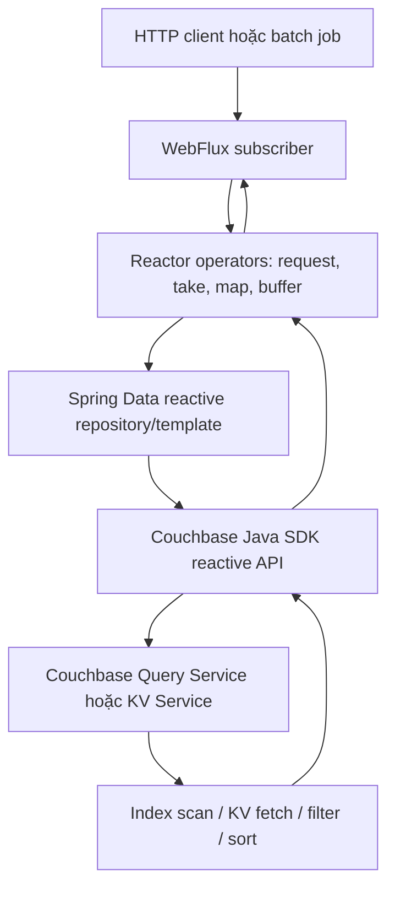

# Áp lực ngược và giới hạn tại ranh giới SDK hoặc truy vấn

Trong **SPRING_DATA_COUCHBASE**, `Mono` và `Flux` của Project Reactor cho phép ứng dụng xử lý kết quả Couchbase theo mô hình reactive. Khi một truy vấn trả nhiều dòng, downstream có thể gửi tín hiệu **áp lực ngược** (*backpressure*) bằng cách yêu cầu số phần tử muốn nhận qua `request(n)`. Nhưng sự thật quan trọng về vận hành là: **một tín hiệu yêu cầu 10 phần tử ở Reactor không tự biến thành một câu SQL++ `LIMIT 10`, không buộc Couchbase Server chỉ quét 10 document và không bảo đảm SDK chỉ dùng đủ bộ nhớ cho đúng 10 dòng**.

Bài thuộc chương **Truy cập phản ứng**, đi sâu vào ranh giới giữa **pipeline Reactor**, **Spring Data Couchbase**, **Couchbase Java SDK**, **Query Service**, **Index Service** và **key-value (KV) API**. Tại mỗi ranh giới, ta cần hỏi: đơn vị nào được điều tiết, dữ liệu đã được đọc/đệm tới đâu, một lần cancel/timeout có thật sự dừng công việc server hay không, và đặt giới hạn ở tầng nào mới giải quyết vấn đề.

Chủ đề nằm trong phạm vi module **SPRING_DATA_COUCHBASE**: xây dựng tầng truy cập Couchbase bằng document mapping, repository, `CouchbaseTemplate`/`ReactiveCouchbaseTemplate` và SQL++, với thiết kế bucket/scope/collection, chỉ mục, TTL, CAS, giao dịch cùng API reactive để cân bằng hiệu năng, tính nhất quán và khả năng vận hành.

> **Nguyên tắc cốt lõi:** Backpressure là **hợp đồng điều tiết tín hiệu giữa các publisher và subscriber**. Bảo vệ cluster cần thêm **giới hạn ở truy vấn phía server**, **giới hạn số thao tác in-flight**, **ngân sách bộ nhớ/hàng đợi**, **timeout/admission** và **đo đạc tại SDK/Server**. Không suy luận bảo đảm của một tầng từ một operator đặt ở tầng khác.

## 1. Mục tiêu học tập

Sau bài này, bạn có thể:

1. Giải thích tín hiệu `request(n)` và mối quan hệ giữa subscriber, operator Reactor và nguồn kết quả Couchbase.
2. Phân biệt **backpressure**, **concurrency limit**, **rate limit**, **query-side `LIMIT`**, **batch/fetch**, **buffer** và **cancellation**.
3. Mô tả những gì có thể đã xảy ra ở SDK và Query Service trước khi một subscriber nhận hàng đầu tiên.
4. Tránh kết luận `Flux.take(n)`, `limitRate(n)` hay `onBackpressureBuffer(n)` tự làm SQL++ quét ít document hơn.
5. Đặt `WHERE`, `ORDER BY`, `LIMIT`, projection và index phù hợp ở phía SQL++.
6. Phân trang có thứ tự ổn định, cân nhắc offset so với keyset/cursor khi dữ liệu lớn.
7. Giới hạn fan-out KV hoặc nhiều SQL++ queries bằng `flatMap(..., concurrency)` và một budget chia sẻ.
8. Chọn cách xử lý nguồn nhanh và downstream chậm: chờ, từ chối, buffer hữu hạn, drop (chỉ khi được phép) hoặc giảm số dòng ở nguồn.
9. Thiết kế timeout/cancel/retry mà không giả định công việc Couchbase đã rollback.
10. Kiểm thử tín hiệu Reactor bằng `StepVerifier` và đo riêng số dòng/quét/index/độ trễ tại Query Service hoặc SDK.

## 2. Điểm quan trọng nhất: có nhiều ranh giới

Một request liệt kê khách hàng có thể đi qua:



Ở mỗi đoạn cần xác định **hợp đồng thực tế**:

| Ranh giới | Điều thường được kiểm soát | Điều không được tự suy ra |
| --- | --- | --- |
| Subscriber → Reactor | Demand, cancellation, số item được downstream yêu cầu | Server chỉ xử lý đúng số item đó. |
| Operator → Spring Data | Subscription, điều phối publisher, biến đổi entity | Mọi operator đều được chuyển thành SQL++. |
| Spring Data → SDK | Statement, query options, KV operations, mapping | Một `Flux` = một request network cho từng `onNext`. |
| SDK → Query Service | Query request, tham số, timeout/consistency | Query Service chỉ bắt đầu làm việc khi Java gọi `request(1)`. |
| Query Service → Index Service | Index scan, fetch, sort, execution plan | `LIMIT 10` luôn khiến scan đúng 10 index entries. |
| SDK → ứng dụng | Decode/emit/buffer theo SDK và network | Hàng đệm bằng 0 hoặc cố định bằng downstream demand. |

**Không có bảo đảm 1:1 mặc định** giữa một tín hiệu `request(1)` và một document được đọc từ disk/index của Couchbase. Mức buffering/prefetch/transport và semantics query phụ thuộc phiên bản SDK, loại API và pipeline.

## 3. Reactive Streams `request(n)` thực sự nói gì?

Reactive Streams cho phép subscriber điều tiết số phần tử mà nó muốn nhận. Trong Project Reactor:

- `onSubscribe` cung cấp một đối tượng `Subscription`.
- `request(n)` thể hiện nhu cầu nhận thêm phần tử; `n` phải dương.
- `onNext` phát phần tử theo hợp đồng demand.
- `onComplete` thông báo hoàn tất bình thường.
- `onError` thông báo lỗi.
- `cancel` báo downstream không muốn tiếp tục subscription.

Ví dụ Reactor thuần:

```java
import reactor.core.publisher.Flux;
import reactor.test.StepVerifier;

StepVerifier.create(Flux.just("C001", "C002", "C003"), 0)
    .thenRequest(1)
    .expectNext("C001")
    .thenRequest(2)
    .expectNext("C002", "C003")
    .verifyComplete();
```

`StepVerifier.create(..., 0)` bắt đầu không yêu cầu phần tử nào, sau đó mới yêu cầu 1 rồi 2. Bài test này chứng minh một hợp đồng của **publisher Reactor đang kiểm thử**, không có Couchbase tham gia.

### 3.1. Demand là tín hiệu điều khiển, không phải ranh giới transaction

`request(1)` **không** nói “cho phép một giao dịch”, “đọc một document rồi commit”, hay “mở một connection”. Nó cũng không giữ snapshot dữ liệu. Trong query lớn, server có thể đã tính toán một phần đáng kể trước khi SDK phát một hàng xuống Java.

### 3.2. `Mono` cũng có lifecycle

`Mono<Customer>` phát tối đa một item, nhưng vẫn có subscription, empty, error và cancellation. Ví dụ:

```java
Mono<Customer> customer = repository.findById(documentId);
```

Việc tạo biến chưa chứng minh document đã được đọc; đối với reactive repository thông thường, phải có subscription để operation được tiêu thụ. Tuy nhiên, code Java tạo object/validate tham số có thể chạy ngay lúc assembly, tùy implementation.

### 3.3. Nhiều phép biến đổi làm thay đổi lượng demand

Một số operator cần đọc **nhiều item hơn số item downstream cần**:

- `filter` có thể phải đọc 100 item để giữ lại 10 item phù hợp.
- `distinct` cần theo dõi các khóa đã thấy, có thể tiêu tốn bộ nhớ.
- `sort` cần gom dữ liệu trước khi sắp xếp trong bộ nhớ.
- `collectList` gom toàn bộ item trước khi phát một danh sách.
- `flatMap` có thể quản lý nhiều inner publishers và prefetch.

Vì vậy **demand downstream không đồng nghĩa số record upstream được xử lý** ngay cả khi chưa xét đến SDK hay Query Service.

## 4. Backpressure khác concurrency, rate và query limit

| Cơ chế | Tác dụng chính | Ví dụ | Phạm vi |
| --- | --- | --- | --- |
| Backpressure | Điều tiết số item downstream yêu cầu | `request(n)`, `limitRate(n)` | Giữa các publisher/operator. |
| Concurrency limit | Giới hạn số operation đang hoạt động | `flatMap(mapper, 8)` | Thường một pipeline. |
| Rate limit | Giới hạn số operation theo thời gian | Token bucket tại gateway/job | Theo chính sách cấu hình. |
| Query-side `LIMIT` | Giới hạn số **row trả về** của một SQL++ query | `LIMIT 20` | Query Service. |
| Query-side filter | Giảm tập candidate theo predicate | `WHERE tenant_id = ...` | Query Service/index. |
| Projection | Giảm số field/bytes trả về | Chọn mã/tên thay vì toàn document | Query/SDK mapping. |
| Bounded queue | Giới hạn lượng công việc chờ | Hàng đợi 100 phần tử | App/job. |
| Timeout/deadline | Giới hạn thời gian chờ | Timeout 5 giây | Tầng áp dụng option. |

Một API chỉ giới hạn `take(20)` có thể vẫn dùng nhiều CPU và index scan ở Couchbase. Ngược lại, một SQL++ có `LIMIT 20` vẫn có thể thực hiện scan/sort nhiều candidate trước khi tìm được 20 row đầu tiên nếu không có index phù hợp.

### 4.1. Một lỗi tư duy thường gặp

```java
Flux<Customer> ten = repository.findByTenantIdAndStatus(
    "tenant-a", "ACTIVE"
).take(10);
```

Kết luận đúng: **downstream của `take(10)` nhận tối đa 10 customer**.

Những kết luận **chưa được chứng minh**:

- SQL++ có `LIMIT 10`.
- Query Service chỉ scan 10 document.
- SDK không buffer thêm row.
- Chỉ có 10 document JSON được decode qua mọi tầng.
- Query bên server bị hủy ngay khi downstream nhận item thứ 10.
- Ứng dụng chỉ sử dụng bộ nhớ tương đương 10 document.

Để xác minh, cần quan sát statement thực thi, SDK/Server metrics và kế hoạch query, không chỉ nhìn code Reactor.

## 5. Entity và repository ví dụ

Giả sử CRM lưu document trong bucket `app`, scope `crm`, collection `customers`:

```json
{
  "tenant_id": "tenant-a",
  "customer_code": "C001",
  "display_name": "Lan Anh",
  "status": "ACTIVE",
  "loyalty_points": 120,
  "created_at_epoch": 1795584000
}
```

Document ID `customer::tenant-a::C001` là metadata của Couchbase, không buộc nằm trong JSON field `id`.

```java
package example.crm;

import org.springframework.data.annotation.Id;
import org.springframework.data.annotation.Version;
import org.springframework.data.couchbase.core.mapping.Collection;
import org.springframework.data.couchbase.core.mapping.Document;
import org.springframework.data.couchbase.core.mapping.Field;
import org.springframework.data.couchbase.core.mapping.Scope;

@Document
@Scope("crm")
@Collection("customers")
public class Customer {

    @Id
    private String id;

    @Field("tenant_id")
    private String tenantId;

    @Field("customer_code")
    private String customerCode;

    @Field("display_name")
    private String displayName;

    @Field
    private String status;

    @Field("loyalty_points")
    private Integer loyaltyPoints;

    @Field("created_at_epoch")
    private Long createdAtEpoch;

    @Version
    private Long version;

    protected Customer() {}

    public String getId() { return id; }
    public String getTenantId() { return tenantId; }
    public String getCustomerCode() { return customerCode; }

    public void setLoyaltyPoints(Integer points) {
        this.loyaltyPoints = points;
    }

    // Constructor nghiệp vụ và các accessors khác lược bỏ.
}
```

`@Id` là khóa document; `@Field` chuyển tên property Java sang field JSON. `@Version` được Spring Data Couchbase dùng cho optimistic locking/CAS khi release và đường thao tác hỗ trợ; không nên mặc định nó là trường JSON bình thường.

Repository:

```java
package example.crm;

import org.springframework.data.couchbase.repository.ReactiveCouchbaseRepository;
import reactor.core.publisher.Flux;

public interface ReactiveCustomerRepository
        extends ReactiveCouchbaseRepository<Customer, String> {

    Flux<Customer> findByTenantIdAndStatus(
        String tenantId,
        String status
    );
}
```

Các ví dụ giả định đã cấu hình bucket `app`, scope `crm`, collection `customers`, credentials, mapping và secondary index phù hợp. Cần xác minh hỗ trợ keyword/query options theo **Spring Data Couchbase, Spring Data Commons, Couchbase Java SDK và Server** đang sử dụng.

## 6. KV lookup và SQL++ stream có hình dạng khác nhau

`findById(documentId)` thường dùng **KV lookup** theo khóa document; một operation trả tối đa một entity. `findByTenantIdAndStatus` thường dùng **SQL++ Query Service** và secondary index để tìm nhiều document.

```text
findById(documentId)
  -> một KV operation theo ID -> Mono<Customer>

findByTenantIdAndStatus(tenantId, status)
  -> SQL++ / index / query result -> Flux<Customer>
```

### 6.1. Một `Mono` không có nghĩa không thể quá tải

Một API nhận 5.000 ID rồi `flatMap(repo::findById)` có thể tạo nhiều operation KV đang hoạt động. Mỗi operation chỉ trả tối đa một item, nhưng **tổng số operation in-flight** vẫn có thể rất lớn.

Giới hạn theo batch:

```java
Flux<Customer> customers = Flux.fromIterable(customerIds)
    .flatMap(repository::findById, 8);
```

`8` điều khiển số inner publisher đang hoạt động trong **pipeline này**. Nó không bảo đảm toàn app, toàn pod hoặc toàn cluster chỉ có tám KV operations; cần shared bulkhead/admission nếu có nhiều request đồng thời.

### 6.2. Một `Flux` có thể đại diện một truy vấn server lớn

```java
Flux<Customer> active = repository.findByTenantIdAndStatus(
    "tenant-a", "ACTIVE"
);
```

Đây có thể chỉ là **một SQL++ statement**, nhưng statement đó vẫn có thể scan/fetch/sort hàng triệu document. Không dựa vào số publisher Java để suy ra query nhẹ.

## 7. Điều xảy ra ở SDK/Query Service không nhất thiết khớp từng `request(n)`

Couchbase Java SDK có các API reactive trả publisher hoặc kết quả có thể được xử lý bằng publisher. Tùy API và phiên bản:

1. Một query request được gửi đến Query Service.
2. Query Service lập kế hoạch và dùng index/fetch/filter/sort.
3. Dòng kết quả được truyền qua transport/SDK.
4. SDK decode/phát row hoặc tạo object trung gian.
5. Spring Data mapper có thể ánh xạ row thành entity/projection.
6. Reactor operators phía ứng dụng biến đổi/buffer item.
7. Subscriber cuối nhận dữ liệu theo demand và xử lý response.

**Chi tiết chính xác** của streaming, row prefetch, buffering, pagination và cancellation là vấn đề cần xác minh trên **đúng SDK/framework version**. Không khẳng định mỗi `request(1)` tạo một network request riêng hoặc mỗi row chỉ xuất hiện sau một lần subscriber request.

### 7.1. Có thể có “công việc đã làm trước khi phát row đầu”

SQL++ query có `ORDER BY` nhưng index không hỗ trợ thứ tự có thể phải sort nhiều candidate trước khi có row đầu. Aggregate có thể cần xử lý tập dữ liệu lớn. Join, group, DISTINCT hoặc projection phức tạp cũng có thể tiêu thụ nhiều tài nguyên trước `onNext` đầu tiên.

Ví dụ:

```sql
SELECT c.customer_code, c.loyalty_points
FROM `app`.`crm`.`customers` AS c
WHERE c.tenant_id = "tenant-a"
ORDER BY c.loyalty_points DESC
LIMIT 10;
```

`LIMIT 10` giới hạn số row trả về, **không tự đảm bảo query chỉ đọc 10 document**. Nếu index thiếu các key liên quan và cần sort, server có thể xử lý nhiều candidate trước khi biết top 10.

### 7.2. Truy vấn có thể đã tiêu tốn tài nguyên dù client không đọc hết

Nếu subscriber gọi `take(10)` rồi hủy khi nhận đủ 10 item, Query Service/SDK có thể đã xử lý thêm. Cancel thường được truyền để ngừng việc không cần thiết khi khả thi, nhưng **không được dùng như bảo đảm tuyệt đối** rằng mọi công việc backend đã chấm dứt tức thì.

Chính vì vậy, tối ưu ở Query Service/Index Service phải được làm **trước** khi dựa vào demand ở Reactor.

## 8. Đặt giới hạn ở SQL++ trước khi đặt `take(n)`

Giả sử UI yêu cầu 20 khách hàng ACTIVE của tenant đã xác thực, sắp theo mã.

SQL++ minh họa:

```sql
SELECT c.customer_code AS customerCode,
       c.display_name AS displayName,
       c.status AS status
FROM `app`.`crm`.`customers` AS c
WHERE c.tenant_id = $tenantId
  AND c.status = "ACTIVE"
ORDER BY c.customer_code ASC
LIMIT $pageSize;
```

Đây là **truy vấn minh họa ý định**, không phải statement Spring Data Couchbase sinh nguyên văn. Khi ánh xạ entity `Customer`, framework có thể cần metadata ID/CAS/type discriminator và projection riêng. DTO chỉ đọc có thể sử dụng projection ít field hơn, nhưng phải kiểm chứng DTO mapping trong version sử dụng.

Một truy vấn giới hạn tốt có:

1. **Điều kiện tenant** từ authentication context phía server, không lấy quyền từ client tự khai báo.
2. **Predicate chọn lọc** dựa trên field đã chuẩn hóa.
3. **Thứ tự ổn định** với khóa sort và tie-breaker nếu cần.
4. **`LIMIT` hợp lý** được validate (ví dụ 1–100 cho API màn hình).
5. **Index phù hợp** để giảm số candidate scan/fetch/sort.
6. **Projection đủ dùng** và tránh trả field không cần thiết.
7. **Timeout/consistency** tương ứng với SLA.
8. **Kiểm thử SQL++ thực thi** sau Spring Data mapping và query options.

### 8.1. Đừng chỉ dùng reactive `take(20)`

```java
Flux<Customer> preview = repository
    .findByTenantIdAndStatus(authenticatedTenant, "ACTIVE")
    .take(20);
```

Câu trên vẫn có giá trị nếu muốn **hạn chế phần tử phát tới downstream**, nhưng **không thay thế** query-side `LIMIT`. Nếu query thật không có `LIMIT`, cần sửa method/`@Query`/template chứ không chỉ thêm `take` ở cuối.

### 8.2. Giới hạn kích thước input là tầng khác

Một endpoint lọc theo 10.000 mã khách hàng vẫn có thể tạo statement `WHERE customer_code IN $codes LIMIT 20`. Mặc dù output giới hạn 20, việc parse/bind/scan theo mảng input lớn có thể tốn tài nguyên. Ngoài giới hạn output, cần giới hạn **số phần tử input**, độ dài chuỗi, kích thước HTTP request và thời gian thực thi.

## 9. Index quyết định chi phí trước khi SDK có thể stream

Với điều kiện tenant/status, sort customer code:

```sql
CREATE INDEX ix_customers_tenant_status_code
ON `app`.`crm`.`customers`(
    `tenant_id`,
    `status`,
    `customer_code`
);
```

Đây là **index minh họa**, không phải khuyến nghị áp dụng máy móc. Spring Data Couchbase có thể thêm discriminator như `_class` hoặc projection metadata; query thật có thể có đường keyspace, alias và predicate khác. Cần dùng:

```sql
EXPLAIN
SELECT c.customer_code, c.display_name
FROM `app`.`crm`.`customers` AS c
WHERE c.tenant_id = "tenant-a"
  AND c.status = "ACTIVE"
ORDER BY c.customer_code ASC
LIMIT 20;
```

Quan sát:

| Dấu hiệu trong plan | Câu hỏi vận hành |
| --- | --- |
| Index được chọn | Có đúng collection và predicate không? |
| Index scan | Có quét vùng chọn lọc hay quét quá rộng? |
| Fetch | Có phải tải document chỉ để lấy field ngoài index? |
| Sort | Có cần sắp xếp tập lớn trước khi trả top 20 không? |
| Limit/offset | Limit được áp dụng ở bước nào? |
| Filter | Có predicate nào chỉ áp dụng sau khi scan không? |
| Cardinality/metrics | Số candidate và row thực tế có phù hợp dữ liệu không? |

Một query có output 20 row nhưng phải sort nhiều triệu row vẫn có thể chiếm CPU/bộ nhớ server lâu. `Flux` ở Java không làm bước sort đó non-blocking đối với tài nguyên của Couchbase Server.

## 10. Phân trang: đừng biến `OFFSET` lớn thành vấn đề downstream

Với SQL++:

```sql
SELECT c.customer_code, c.display_name
FROM `app`.`crm`.`customers` AS c
WHERE c.tenant_id = $tenantId
ORDER BY c.customer_code ASC
LIMIT 20 OFFSET 100000;
```

Câu query chỉ trả tối đa 20 row, nhưng server có thể cần bỏ qua một vùng dữ liệu rất lớn để tới trang sâu, tùy kế hoạch index/sort. Backpressure không khắc phục chi phí `OFFSET`.

### 10.1. Keyset pagination với khóa sắp xếp có tính duy nhất

Giả sử `customer_code` luôn **có giá trị và duy nhất trong tenant**, một ví dụ cursor đơn giản:

```sql
SELECT c.customer_code, c.display_name
FROM `app`.`crm`.`customers` AS c
WHERE c.tenant_id = $tenantId
  AND c.status = "ACTIVE"
  AND c.customer_code > $afterCustomerCode
ORDER BY c.customer_code ASC
LIMIT $pageSize;
```

Với trang đầu, cần một câu query không có điều kiện cursor hoặc một quy ước rõ ràng cho tham số `afterCustomerCode`; không truyền `NULL` rồi giả định dấu `>` sẽ tự bỏ điều kiện.

Ưu điểm: truy vấn có thể tiếp tục từ một khóa thay vì bỏ qua rất nhiều row. Nhưng vẫn phải kiểm tra index và độ đúng khi dữ liệu có thể thay đổi giữa các trang.

### 10.2. Khi khóa sort không duy nhất

Nếu nhiều document có cùng `customer_code` hoặc sort theo thời gian có thể trùng, phải có **tie-breaker ổn định** như document ID, đồng thời truy vấn cursor phải dùng điều kiện theo cặp khóa:

```text
( sortKey > lastSortKey )
OR ( sortKey = lastSortKey AND documentId > lastDocumentId )
```

Query/index thực thi cho document ID và biểu thức `META().id` phải được kiểm chứng theo version, collection và plan. Không dùng keyset một khóa không duy nhất vì có thể mất document ở ranh giới trang.

### 10.3. Cursor không tự tạo snapshot

Nếu giữa hai request có insert/update/delete hoặc TTL hết hạn, tập dữ liệu có thể thay đổi. Keyset giảm một số vấn đề offset và thường có đường index tốt hơn, nhưng không tự bảo đảm một snapshot bất biến nhiều request.

## 11. Projection và số byte trả về là giới hạn quan trọng

Hai câu query cùng trả 20 dòng có thể có chi phí mạng khác nhau rất lớn:

```sql
-- Projection rộng; không nên dùng cho UI chỉ cần hai field.
SELECT c.*
FROM `app`.`crm`.`customers` AS c
WHERE c.tenant_id = $tenantId
LIMIT 20;
```

```sql
-- Projection hẹp, dành cho DTO đọc.
SELECT c.customer_code AS customerCode,
       c.display_name AS displayName
FROM `app`.`crm`.`customers` AS c
WHERE c.tenant_id = $tenantId
LIMIT 20;
```

Khi document có array lớn, thông tin lịch sử hoặc nested objects, projection hẹp có thể giảm bytes transport và chi phí mapping. Nhưng **không tự khẳng định query hẹp sẽ trở thành covering index**; điều đó phụ thuộc index và `EXPLAIN`.

**Lưu ý Spring Data Couchbase:** Entity mapping có thể cần document ID/CAS/type metadata từ projection. Nếu chỉ cần DTO/projection đọc, dùng API và mapper được version hỗ trợ, không save một partial entity như thể đó là document đầy đủ.

## 12. Các operator backpressure thường bị hiểu sai

### 12.1. `limitRate(n)` điều chỉnh demand upstream

```java
Flux<Customer> controlledDemand = repository
    .findByTenantIdAndStatus(tenantId, "ACTIVE")
    .limitRate(32);
```

`limitRate` điều chỉnh cách operator yêu cầu item từ upstream trong pipeline Reactor. Nó **không**:

- Giới hạn SQL++ mỗi giây trên toàn app.
- Giới hạn số HTTP requests đang chạy.
- Thêm `LIMIT 32` vào SQL++.
- Bảo đảm SDK không prefetch/buffer nhiều hơn 32 row.
- Bảo đảm Query Service chỉ scan 32 document.

Nó có thể giúp việc điều tiết demand trong pipeline cụ thể, nhưng phải đo tác dụng thực tế với SDK và kiểu truy vấn đang dùng.

### 12.2. `take(n)` giới hạn item downstream, không phải server scan

```java
Flux<Customer> firstTenSeen = source.take(10);
```

`take(10)` có thể cancel upstream sau khi nhận đủ item; song upstream có thể đã làm thêm công việc. Nó cũng không tự xác định “top 10 theo điểm” nếu nguồn thiếu `ORDER BY`.

### 12.3. `onBackpressureBuffer` là bộ đệm, không phải bộ tối ưu hóa query

```java
Flux<Customer> boundedBuffer = source
    .onBackpressureBuffer(128);
```

Đây là mẫu buffer có giới hạn số phần tử ở operator, thường phát lỗi overflow theo API/semantics của phiên bản khi buffer đầy. Tuy nhiên:

- Nó có thể **yêu cầu nhiều item upstream hơn downstream** để lấp buffer.
- Nó **không** tự giới hạn query-side rows.
- Một document lớn làm 128 items có thể chiếm nhiều RAM.
- Bounded buffer ở một pipeline không phải cap bộ nhớ toàn instance.
- Chỉ có ý nghĩa khi chính sách chấp nhận buffering; với một query quá rộng, nên giảm dữ liệu ở nguồn.

Không dùng `onBackpressureBuffer()` không giới hạn trên luồng dữ liệu lớn rồi coi đó là “xử lý áp lực ngược”.

### 12.4. Drop/latest chỉ khi nghiệp vụ cho phép mất dữ liệu

```java
Flux<MetricEvent> sampled = hotMetricEvents
    .onBackpressureDrop();
```

`MetricEvent` và `hotMetricEvents` là nguồn minh họa. Đối với telemetry hoặc cập nhật trạng thái UI có thể bỏ mẫu cũ, drop/latest đôi lúc được chấp nhận.

Nhưng **không dùng drop/latest** để xử lý:

- Customer mutations phải được ghi đủ.
- Thanh toán, inventory, audit hay event thay đổi trạng thái.
- Các bản ghi xuất báo cáo cần đầy đủ.
- Danh sách ID yêu cầu kiểm tra đúng từng phần tử.

Với các luồng không được mất dữ liệu, phải **điều tiết nguồn, dùng hàng đợi bền vững/giới hạn hoặc từ chối request**, thay vì bỏ phần tử âm thầm.

## 13. Downstream chậm và buffering ở nhiều nơi

Giả sử một endpoint trả `Flux<Customer>` để WebFlux serializes JSON từng phần. Downstream có thể bị chậm vì:

1. Client đọc network chậm.
2. Serialize/mapping document sang DTO tốn CPU.
3. Bộ lọc/biến đổi trong Reactor thực hiện tác vụ blocking.
4. Ứng dụng có `buffer`/`collectList` giữ nhiều phần tử.
5. SDK và HTTP response có những bộ đệm riêng.

Kể cả Reactor tuân thủ demand, tổng RAM có thể bao gồm **nhiều tầng đệm**. Vì vậy khi điều tra tăng bộ nhớ, phải đo:

- Số row/query và kích thước trung bình/lớn nhất của row.
- Số query đồng thời.
- Kích thước batch và response.
- Buffering ở các operator.
- SDK/HTTP buffers theo version và cấu hình.
- Thời gian chờ downstream.
- Có gọi `collectList` ở bất kỳ đoạn nào không.

### 13.1. `collectList` đánh đổi streaming lấy một danh sách trong RAM

```java
Mono<java.util.List<Customer>> all = repository
    .findByTenantIdAndStatus(tenantId, "ACTIVE")
    .collectList();
```

`collectList` thu tất cả item trước khi phát `Mono<List<Customer>>`. Nếu query không có giới hạn và tenant có hàng trăm nghìn document, đây có thể là nguồn gây quá tải bộ nhớ.

Khi endpoint chỉ cần 20 kết quả, hãy đặt `LIMIT 20` ở query rồi mới cân nhắc có thực sự cần trả `List` hay không.

## 14. Query result không nhất thiết là streaming vô hạn “miễn phí”

Một số thao tác SQL++ có thể tạo kết quả lớn hoặc cần xử lý trước khi phát:

| Loại query | Rủi ro |
| --- | --- |
| `WHERE` equality với index | Thường có thể chọn lọc tốt nếu index và dữ liệu phù hợp. |
| `ORDER BY` không có index phù hợp | Có thể sort nhiều candidate trước khi có row đầu. |
| `GROUP BY`/aggregate | Có thể phải tính toán nhiều dữ liệu trước kết quả. |
| `DISTINCT` | Có thể yêu cầu trạng thái/bộ nhớ để loại trùng. |
| `JOIN`/`UNNEST` | Có thể tạo tập kết quả trung gian lớn. |
| `LIKE "%fragment%"` | Khó dùng thứ tự B-tree để khoanh vùng khi wildcard đầu; cần đánh giá FTS tùy yêu cầu. |
| `OFFSET` lớn | Có thể xử lý/bỏ qua rất nhiều row. |
| Projection toàn document | Tăng bytes transport/mapping nếu document rộng. |

**Backpressure downstream không thay đổi thuật toán server đã chọn trong query plan**. Vì vậy cần kiểm chứng index, cardinality, sort và timeout ở Query Service trước khi tối ưu operator Reactor.

## 15. Dùng SDK query options đúng ranh giới

Tại ranh giới SDK/Query Service có thể cần cấu hình:

- Timeout theo loại operation và deadline end-to-end.
- Scan consistency khi cần read-your-own-write.
- Kích thước giới hạn do query text/parameter biểu đạt.
- Named/positional parameters cho SQL++.
- Query context/bucket/scope/collection đúng.
- Query metrics/tracing/client context ID khi phiên bản hỗ trợ.
- Tính chất read-only cho query chỉ đọc, khi API có option phù hợp.

Ví dụ SQL++ với named parameters (mẫu ý định):

```sql
SELECT c.customer_code, c.display_name
FROM `app`.`crm`.`customers` AS c
WHERE c.tenant_id = $tenantId
  AND c.status = $status
ORDER BY c.customer_code
LIMIT $pageSize;
```

Khi dùng `@Query`/`ReactiveCouchbaseTemplate` hoặc Couchbase Java SDK reactive query API, cú pháp binding và cách truyền options **phải theo tài liệu đúng release**. Không suy luận một option dùng ở SDK trực tiếp sẽ tự được repository truyền xuống chỉ vì tên giống nhau.

### 15.1. Phân biệt timeout của Reactor và timeout của SDK/Server

```java
Flux<Customer> response = repository
    .findByTenantIdAndStatus(tenantId, "ACTIVE")
    .timeout(java.time.Duration.ofSeconds(5));
```

`timeout` của Reactor giới hạn khoảng chờ tín hiệu theo semantics operator. Nó **không** là bảo đảm rằng SDK/Query Service đã nhận cùng một query timeout hoặc server ngừng xử lý tại cùng thời điểm.

Để có một deadline nhất quán, thiết kế ngân sách thời gian từ request tới query options (nếu API hỗ trợ), đồng thời đo operation khi cancellation xảy ra. Không đặt timeout quá ngắn để rồi tạo retry storm.

### 15.2. Query metrics/trace là bằng chứng khác với `doOnRequest`

Hook `doOnRequest` đo demand trong pipeline; Query Service metrics/`EXPLAIN` phản ánh công việc truy vấn. Hai nhóm quan sát trả lời **những câu hỏi khác nhau** và nên được đối chiếu, không thay thế lẫn nhau.

### 15.3. Khi dùng SDK reactive trực tiếp

Nếu cần chức năng đặc thù ngoài `ReactiveCouchbaseRepository` và `ReactiveCouchbaseTemplate`, có thể xem xét SDK reactive APIs theo version. Nhưng không nên trộn lẫn một nguồn SDK blocking với API reactive bằng cách gọi blocking trong `map`/`flatMap` trên event loop. Đảm bảo error mapping, resource lifecycle, query context, bind parameters và metadata nhất quán với Spring Data mapping.

## 16. Khi nào chọn một query SQL++ thay vì fan-out KV?

Giả sử có 1.000 customer IDs. Có hai hướng:

**Hướng A — Nhiều KV lookups:**

```java
Flux<Customer> rows = Flux.fromIterable(customerIds)
    .flatMap(repository::findById, 12);
```

**Hướng B — Một SQL++ truy vấn theo tập ID/field:** dùng `IN`, `USE KEYS` hoặc biểu thức tương ứng khi được SDK/Server hỗ trợ, với binding đúng. Mẫu ý định:

```sql
SELECT c.customer_code, c.display_name
FROM `app`.`crm`.`customers` AS c
USE KEYS $documentIds;
```

Chú ý: SQL++ `USE KEYS`, projection và cách mapping ID/metadata cần được kiểm chứng theo Couchbase Server/SDK version. Không giả định rằng mọi repository derived query đều hỗ trợ `USE KEYS` tương đương.

| Tiêu chí | Fan-out KV | Query theo tập |
| --- | --- | --- |
| Input là document ID chính xác | Thường tự nhiên | Có thể dùng `USE KEYS` khi phù hợp. |
| Tập ID nhỏ, cần xử lý lỗi từng ID | Dễ biểu diễn per-ID outcome | Cần đối chiếu input với rows, phân biệt missing. |
| Cần filter/sort/aggregate ở server | Khó, có thể tải nhiều rồi lọc tại Java | SQL++ thường biểu đạt trực tiếp hơn. |
| Input rất lớn | Cần batch/cap và quản lý kết quả | Cần giới hạn số keys/parameter size và query cost. |
| Phân quyền tenant | Phải kiểm tra từng document | Query phải có predicate/authorization đúng. |
| Thứ tự đầu vào | `flatMapSequential`/`concatMap` nếu cần | `USE KEYS` không tự cam kết trả đúng thứ tự input. |
| Quan sát chi phí | KV latency, in-flight, retries | Query plan/metrics, rows, bytes, index. |

Không có lựa chọn luôn thắng. Chọn theo số ID, độ chọn lọc, yêu cầu ordering, cost/latency, quyền truy cập và kết quả đo.

## 17. Concurrency là giới hạn độc lập với backpressure

Một request có thể tạo nhiều publisher con:

```java
Flux<Customer> rows = Flux.fromIterable(ids)
    .flatMap(repository::findById, 8);
```

Tham số `8` giúp giới hạn số inner publisher của pipeline này. Nhưng 100 request đồng thời có thể tạo nhiều lần số đó. Để bảo vệ cluster, cân nhắc một **bulkhead chia sẻ theo instance** cho KV, một ngân sách khác cho SQL++ queries nặng và quota theo tenant/endpoint.

### 17.1. Cap theo nhiều phạm vi

| Phạm vi | Ví dụ | Hạn chế |
| --- | --- | --- |
| Một `flatMap` | Max 8 inner publishers | Không giới hạn request khác. |
| Một HTTP request | Max 50 IDs | Không giới hạn số HTTP requests đồng thời. |
| Một app instance | Shared bulkhead 32 query subscriptions | Scale pod nhân tổng ngân sách. |
| Một tenant | Quota theo authenticated tenant | Cần cap toàn instance bổ sung. |
| Nhiều app instances | Gateway/queue/distributed admission | Cần phối hợp hạ tầng và policy. |

Giới hạn operation in-flight và giới hạn item được phát là hai mục tiêu khác nhau. Một query `Flux` trả nhiều row có thể giữ một permit trong suốt thời gian subscribe, trong khi Query Service vẫn phải đọc khối lượng lớn.

### 17.2. `concatMap` không phải giải pháp chung cho tải lớn

`concatMap` xử lý lần lượt các inner publisher, nên giảm chồng lấn trong một pipeline. Nhưng nếu 10.000 KV reads độc lập đều phải đợi nhau, throughput có thể quá thấp. Dùng concurrency thấp nhưng lớn hơn một khi an toàn và có bằng chứng. Ngược lại, các mutation trên **cùng document** theo thứ tự nghiệp vụ có thể cần `concatMap` cùng CAS/điều phối theo key.

## 18. Admission, queue và overflow: biết lúc nào phải từ chối

Nếu upstream tạo request nhanh hơn khả năng phục vụ của SDK/Server, có ba hướng cơ bản:

1. **Giảm tải ở nguồn:** query limit, phân trang, giảm fan-out, rate limit client.
2. **Chờ có giới hạn:** bounded queue, deadline, cancellation rõ và fairness.
3. **Từ chối sớm:** trả lỗi overload/quota có chủ đích để giữ hệ thống ổn định.

Không tạo một buffer vô hạn chỉ để “tránh mất request”. Buffer vô hạn không làm server xử lý nhanh hơn, mà có thể tăng memory và latency đến mức request đã hết hạn khi tới lượt chạy.

### 18.1. Khi nào dùng drop?

Drop chỉ thích hợp với dữ liệu cho phép bỏ mẫu, ví dụ cập nhật nhiệt độ UI hoặc telemetry sampling. Với lệnh ghi customer, audit, thanh toán, inventory, hay xuất dữ liệu phải đầy đủ, phải dùng cơ chế đảm bảo/queue bền vững và xử lý backpressure bằng chính sách nghiệp vụ, **không bỏ item**.

### 18.2. Một lỗi overflow phải được phản hồi có ý nghĩa

Nếu buffer hữu hạn tràn, tầng API cần phân loại lỗi chứ không biến thành “không tìm thấy khách hàng”. Với HTTP, quota vượt quá có thể phù hợp `429 Too Many Requests`; overload tạm thời có thể là `503 Service Unavailable`, tùy hợp đồng.

Không có ánh xạ HTTP tự động chỉ vì Reactor phát `IllegalStateException` hoặc overflow exception: ứng dụng phải định nghĩa error handling cụ thể.

## 19. Cancellation: hạn chế chi phí nhưng không phải lời cam kết dừng server

Khi `take(n)` đủ item, hoặc client disconnect, subscriber có thể gửi `cancel`. Điều đó có thể giúp ngừng upstream và giải phóng tài nguyên theo implementation, nhưng phải phân biệt:

- **Cancel ở Reactor:** downstream không muốn nhận thêm.
- **Ngừng SDK emission:** SDK có thể ngừng truyền item tới subscriber.
- **Hủy query ở Query Service:** phụ thuộc cơ chế/capability/version và thời điểm query chạy.
- **Mutation commit/rollback:** không được suy ra từ signal cancel.

Ví dụ:

```java
Flux<Customer> ten = repository
    .findByTenantIdAndStatus(tenantId, "ACTIVE")
    .take(10)
    .doFinally(signal ->
        logger.debug("terminal signal: {}", signal)
    );
```

`logger` là logger do ứng dụng cung cấp. `doFinally` tại vị trí này quan sát tín hiệu kết thúc của **đoạn pipeline tương ứng**; cần nhớ operator `take` có thể complete downstream trong khi cancel upstream, nên không coi một log `ON_COMPLETE` là bằng chứng SQL++ đã chạy đến hết toàn bộ tập dữ liệu.

### 19.1. Ghi/xóa sau cancel vẫn có thể xảy ra

Với `repository.save(customer)`, client timeout/cancel có thể đến sau khi request mutation đã gửi. Nếu response bị mất, trạng thái cuối có thể không chắc chắn. Không retry bằng cách tạo ID mới hoặc cộng điểm lần nữa khi chưa có idempotency/đối chiếu trạng thái cuối.

## 20. Scan consistency có thể làm query giữ tài nguyên lâu hơn

Sau một lần ghi KV:

```text
repository.save(customer)          -> mutation thành công
repository.findById(saved.id)      -> KV lookup
repository.findByTenantIdAndStatus -> SQL++ query/index
```

Query SQL++ qua secondary index có thể chưa thấy document mới ở consistency thông thường. Nếu nghiệp vụ cần read-your-own-write, có thể dùng query scan consistency tương đương `REQUEST_PLUS` hoặc mutation-state options khi API/SDK version hỗ trợ.

Điều đó có thể làm truy vấn **đợi index cập nhật**, gia tăng latency và thời gian giữ slot concurrency/bulkhead. Không đánh đổi consistency chỉ để nhanh hơn khi nghiệp vụ yêu cầu kết quả mới nhất; thay vào đó phân loại use case, đo và dự trù ngân sách phù hợp.

### 20.1. `flatMap` sau `save` không làm index cập nhật ngay

```java
Flux<Customer> afterSave = repository.save(customer)
    .flatMapMany(saved ->
        repository.findByTenantIdAndStatus(
            saved.getTenantId(), "ACTIVE"
        )
    );
```

`flatMapMany` nối thứ tự publisher; nó **không** thay đổi query scan consistency. Backpressure cũng không sửa được index lag.

## 21. TTL, CAS và transaction: các ranh giới đúng đắn khác

### 21.1. TTL khiến kết quả khác nhau theo thời điểm

Document có TTL có thể hết hạn khi request đang chờ queue hoặc trong lúc phân trang. Điều này không phải lỗi `Flux`. Khi pipeline nhận `Mono.empty()` sau một lần đọc theo ID, cần phân biệt document không tồn tại/hết hạn với timeout hoặc lỗi quyền.

Nếu dùng cache publisher hoặc buffer kết quả lâu, dữ liệu đã phát có thể là snapshot cũ so với Couchbase. TTL của document không tự làm một `Mono.cache()` hết hạn cùng lúc.

### 21.2. CAS conflict tăng khi fan-out mutation trên cùng khóa

```java
Flux<Customer> changed = Flux.fromIterable(commands)
    .flatMap(command ->
        repository.findById(command.customerId())
            .flatMap(c -> {
                c.setLoyaltyPoints(command.newPoints());
                return repository.save(c);
            }),
        8
    );
```

`commands` là danh sách command minh họa, cần entity có setter và chính sách tenant/validation thực tế. Nếu nhiều command cùng ID, `flatMap` có thể làm các request đọc cùng CAS rồi tranh ghi. `@Version`/CAS giúp phát hiện xung đột khi operation hỗ trợ, nhưng phải thiết kế retry/sequence/idempotency.

### 21.3. Transaction không hình thành từ demand hoặc ordering

`Mono.when(saveA, saveB)` hay `concatMap` không tạo all-or-nothing. Nếu cần ghi nhiều document nguyên tử, dùng transaction API Couchbase phù hợp version và context reactive; kiểm tra các đường thao tác tham gia, timeout và retry đúng quy trình transaction.

Không xem `request(1)`, `concatMap` hay `onBackpressureBuffer` là thay thế cho CAS/transaction.

## 22. Tránh chặn ở đoạn mapping/serialization

Một pipeline reactive có thể trở nên blocking nếu mapper tự gọi một SDK blocking hoặc thực hiện công việc chặn trong operator:

```java
// Anti-pattern trong pipeline WebFlux:
Flux<Customer> bad = ids.map(id ->
    blockingCustomerClient.findById(id)
);
```

Trong ví dụ, `blockingCustomerClient` là API blocking minh họa. Việc gọi blocking trong `map` có thể làm tắc scheduler/event loop của Reactor.

Khi bắt buộc tích hợp API blocking, cô lập lời gọi trên scheduler thích hợp với giới hạn:

```java
import reactor.core.publisher.Mono;
import reactor.core.scheduler.Schedulers;

Mono<Customer> legacy = Mono.fromCallable(
        () -> blockingCustomerClient.findById(documentId)
    )
    .subscribeOn(Schedulers.boundedElastic());
```

Đây là cách cô lập một nguồn blocking, **không phải cách làm SDK/query nhanh hơn**. Với Spring Data Couchbase reactive đã hỗ trợ I/O không blocking, không cần bọc mọi `findById` trong `boundedElastic`.

### 22.1. CPU mapping nặng cũng tạo áp lực

Nếu biến đổi mỗi entity thành PDF lớn hoặc encode hình ảnh trong event loop, downstream có thể chậm. Khi cần công việc CPU đáng kể, thiết kế xử lý riêng và giới hạn song song/bộ nhớ thay vì mặc định mọi `map` đều không đáng kể. Điều đó độc lập với index tuning ở Couchbase.

## 23. Quan sát đúng cả Reactor, SDK và Server

Chỉ số quan sát nên được chia thành nhiều nhóm:

| Tầng | Chỉ số cần có | Diễn giải |
| --- | --- | --- |
| Reactor | subscriptions, requests, onNext, cancel, buffer overflow | Hiểu tín hiệu và áp lực ở pipeline. |
| HTTP | active requests, response bytes, client disconnect, p95/p99 | Xem downstream có chậm và nhiều client đang chờ không. |
| Ứng dụng | in-flight KV/query, queue size, memory, retries/rejections | Giới hạn tài nguyên và admission. |
| SDK | operation latency, timeout, request IDs, tracing khi có | Phân biệt chờ SDK với thao tác ở server. |
| Query Service | query latency, result rows/bytes, query errors, execution plan/metrics | Hiểu chi phí query thực tế. |
| Index Service | index scan và tải liên quan | Nhận diện quét rộng, index không phù hợp. |
| KV Service | get/mutation latency, timeout, CAS conflict | Phân biệt fan-out KV với SQL++ query. |

Tên metric, trường tracing hoặc khả năng lấy per-query metrics phụ thuộc SDK/Server/monitoring của ứng dụng. Bảng trên mô tả **bằng chứng cần tìm**, không khẳng định tất cả đều là số đo sẵn có trong mọi release.

### 23.1. Những câu hỏi khi thấy p99 tăng

1. Có nhiều subscribers/requests hơn bình thường không?
2. Có `collectList`, `buffer` hoặc `sort` trong memory không?
3. Có truy vấn mới thiếu index hoặc `LIMIT` không?
4. Query Service có đang phải sort/group nhiều candidate không?
5. SDK có timeout/retry tăng khiến số operation thực tế nhiều hơn không?
6. Downstream/client đọc chậm làm response buffer tích tụ không?
7. Scan consistency có thay đổi và làm query chờ index không?
8. Có fan-out ID hoặc batch lớn từ tenant/job nào không?
9. Có thao tác blocking trong event loop không?
10. Có hủy/timeout nhưng server vẫn đang xử lý không?

Cần kiểm tra theo chuỗi nhân quả, không chỉ tăng `flatMap` concurrency hoặc buffer size khi hệ thống bắt đầu chậm.

### 23.2. An toàn dữ liệu khi logging

Không log toàn bộ customer JSON, token, email, bind values nhạy cảm hoặc dữ liệu chéo tenant để debug backpressure. Dùng correlation ID, query template đã redact, loại operation, elapsed time, số row/bytes và mã lỗi đã phân loại.

## 24. Kiểm thử backpressure trong Reactor bằng `StepVerifier`

### 24.1. Kiểm tra request theo từng đợt

```java
import org.junit.jupiter.api.Test;
import reactor.core.publisher.Flux;
import reactor.test.StepVerifier;

class DemandContractTest {

    @Test
    void subscriberControlsDemand() {
        Flux<String> codes = Flux.just(
            "C001", "C002", "C003"
        );

        StepVerifier.create(codes, 0)
            .thenRequest(1)
            .expectNext("C001")
            .thenRequest(2)
            .expectNext("C002", "C003")
            .verifyComplete();
    }
}
```

Bài test không gọi Couchbase. Nó xác nhận subscriber có thể điều tiết tín hiệu của nguồn Reactor thuần. **Không** dùng kết quả PASS để tuyên bố Couchbase chỉ fetch từng row đúng lúc `thenRequest` được gọi.

### 24.2. Kiểm tra cancellation

```java
import java.util.concurrent.atomic.AtomicBoolean;
import reactor.core.publisher.Flux;
import reactor.test.StepVerifier;

AtomicBoolean cancelled = new AtomicBoolean();

Flux<Long> never = Flux.<Long>never()
    .doOnCancel(() -> cancelled.set(true));

StepVerifier.create(never)
    .thenCancel()
    .verify();

org.assertj.core.api.Assertions.assertThat(cancelled.get())
    .isTrue();
```

Ở đây `cancelled` phản ánh callback trên publisher Reactor thuần, **không** đo việc hủy query ở Couchbase Server.

### 24.3. Kiểm tra buffer hữu hạn khi downstream chưa yêu cầu

Ví dụ Reactor thuần:

```java
import reactor.core.publisher.Flux;
import reactor.test.StepVerifier;

Flux<Integer> source = Flux.range(1, 100);

StepVerifier.create(
        source.onBackpressureBuffer(2),
        0 // Downstream chưa yêu cầu item.
    )
    .expectError()
    .verify();
```

Ví dụ cho thấy một nguồn tuân thủ demand có thể gặp overflow ở operator buffer vì operator đó yêu cầu dữ liệu upstream trước khi downstream tiêu thụ đủ. Loại exception/chi tiết overflow cần kiểm tra theo Reactor version; ở đây chỉ assert có error, không suy ra behavior của SDK Couchbase.

**Lưu ý:** Nếu phiên bản Reactor hoặc tối ưu hóa fusion có cách điều phối khác trong một trường hợp cụ thể, nên kiểm tra bằng `TestPublisher`/`Sinks` có kiểm soát. Mục tiêu là hiểu **buffer giới hạn có thể tràn**, không phải thiết lập một thông số tối ưu cho query production.

### 24.4. Kiểm tra `flatMap` concurrency

Một test cho phép hai inner chưa hoàn tất trước khi downstream nhận kết quả:

```java
import static org.assertj.core.api.Assertions.assertThat;

import java.util.concurrent.atomic.AtomicInteger;
import org.junit.jupiter.api.Test;
import reactor.core.publisher.Flux;
import reactor.core.publisher.Mono;
import reactor.core.publisher.Sinks;
import reactor.test.StepVerifier;

class InFlightTest {

    @Test
    void capsInnerSubscriptions() {
        AtomicInteger subscriptions = new AtomicInteger();

        java.util.List<Sinks.One<Integer>> gates =
            java.util.stream.IntStream.range(0, 5)
                .mapToObj(i -> Sinks.<Integer>one())
                .toList();

        Flux<Integer> flow = Flux.range(0, 5)
            .flatMap(i -> Mono.defer(() -> {
                subscriptions.incrementAndGet();
                return gates.get(i).asMono();
            }), 2);

        StepVerifier.create(flow)
            .then(() -> assertThat(subscriptions.get())
                .isEqualTo(2))
            .thenCancel()
            .verify();
    }
}
```

Test này xác minh **giới hạn subscriber inner trong pipeline**. Khi dùng SDK thật, còn cần đo operation latency/retry, số app instances và Query Service load.

## 25. Integration test phải kiểm tra query-side limit, không chỉ `take`

Giả sử một repository có truy vấn được thiết kế để trả tối đa 20 customer ACTIVE của tenant đã xác thực, đúng thứ tự mã. Có thể viết test:

```java
import static org.assertj.core.api.Assertions.assertThat;

import org.junit.jupiter.api.Test;
import reactor.test.StepVerifier;

// Khung minh họa: searchService và fixtures phải được dự án cung cấp.
@Test
void searchPageReturnsAtMostTwentyCustomers() {
    StepVerifier.create(
            searchService.searchFirstPage("tenant-a", 20)
                .map(Customer::getCustomerCode)
                .collectList()
        )
        .assertNext(codes -> {
            assertThat(codes).hasSizeLessThanOrEqualTo(20);
            assertThat(codes).isSorted();
        })
        .verifyComplete();
}
```

**Quan trọng:** Test này chỉ chứng minh publisher trả tối đa 20 code và thứ tự ở bộ fixture; nó **chưa chứng minh** SQL++ thật có `LIMIT 20`, server dùng index hoặc scan ít candidate. Cần kết hợp:

1. Xem SQL++ đã thực sự gửi tới Couchbase, cùng bind values được redact.
2. Kiểm tra `LIMIT`/`ORDER BY` đã được đẩy xuống query.
3. Chạy `EXPLAIN` trên statement tương đương.
4. Đo metrics rows/bytes/scans và p95/p99 ở dữ liệu đại diện.
5. Thử với hơn 20 document đủ điều kiện để tránh PASS giả do fixture quá nhỏ.

### 25.1. Test “không trả dữ liệu tenant khác”

Khi query phân trang hoặc dùng fan-out KV, phải seed nhiều tenant và assert **tập ID** hoặc customer code thực tế. Backpressure/`take` không làm một query thiếu điều kiện tenant trở nên an toàn.

### 25.2. Test với document lớn và downstream chậm

Để kiểm tra RAM, latency và cancellation, cần fixture có document/array kích thước gần thực tế và một consumer chậm có kiểm soát. Đo bộ nhớ/GC, bytes/network, số subscription và server metrics; đừng chỉ dùng `Flux.range(1,100)` rồi kết luận hệ thống sẽ xử lý tốt 100.000 JSON documents thực.

## 26. Tình huống thực hành A: danh sách 20 customer cho WebFlux

**Yêu cầu:** Endpoint trả tối đa 20 customer ACTIVE của tenant đã xác thực, sort theo mã, không tải hàng chục nghìn document về Java.

**Thiết kế đề xuất:**

1. Tenant lấy từ security context; validate `pageSize` trong giới hạn cho phép.
2. Repository/`@Query`/template sử dụng SQL++ có `WHERE tenant_id/status`, `ORDER BY` và `LIMIT`.
3. Chọn projection DTO chỉ có field UI cần; nếu dùng entity, giữ metadata mapping phù hợp.
4. Có secondary index hỗ trợ điều kiện và sort.
5. Dùng reactive `Flux` để phát các item; không bắt buộc `collectList` nếu UI cho phép streaming.
6. Đặt SDK/query timeout, budget in-flight và error handling phù hợp.
7. Dùng `StepVerifier` kiểm tra kết quả và `EXPLAIN`/metrics kiểm tra chi phí server.
8. Kiểm tra client chậm hoặc cancel, không mặc định `doFinally(ON_COMPLETE)` là bằng chứng query server xử lý ít candidate.

**Không nên:** dùng `findAll().filter(...).take(20)` để lọc tenant tại Java. Query/filter phải được server thực thi, vừa tránh tải lớn vừa tránh vô tình xử lý dữ liệu tenant khác ở tầng ứng dụng.

## 27. Tình huống thực hành B: xuất dữ liệu hàng trăm nghìn document

Một job cần xuất dữ liệu nhiều customer khác với API phân trang nhỏ.

**Đừng** xây một `Flux` không giới hạn rồi gọi `collectList`, sau đó chuyển cả danh sách thành CSV trong RAM. Hãy cân nhắc:

- Phân trang/keyset/cursor theo một thứ tự ổn định.
- Ghi từng batch vào output có quản lý tài nguyên và backpressure.
- Giới hạn tổng số query in-flight và số row/batch.
- Ghi checkpoint để resume sau lỗi, có nguyên tắc idempotency.
- Xác định semantics dữ liệu thay đổi/TTL giữa các trang.
- Điều tiết tải batch để không chiếm tài nguyên của API người dùng.
- Dùng query-side projection để giảm bytes.
- Nếu yêu cầu snapshot nhất quán trong thời gian dài, cần chiến lược dữ liệu phù hợp; keyset và Reactor một mình không tạo snapshot.

### 27.1. Không mặc định “một Flux duy nhất = streaming end-to-end”

Một SDK có thể cung cấp row publisher, nhưng hệ thống vẫn có thể có buffering ở HTTP/file writer và Query Service. Muốn khẳng định memory bounded end-to-end, phải **đo** với dữ liệu lớn, consumer chậm và runtime version thật.

### 27.2. Backpressure không thay chính sách retention

Nếu document hết TTL trong lúc job chạy, dữ liệu có thể biến mất giữa các trang. Nếu cần trích xuất lịch sử theo mốc thời gian cố định, phải thiết kế lưu snapshot/export hoặc một cơ chế phù hợp với chính sách retention; không lấy `Flux` làm bảo đảm tồn tại dữ liệu.

## 28. Bảng chẩn đoán triệu chứng

| Triệu chứng | Nhầm lẫn có thể gặp | Hướng kiểm tra |
| --- | --- | --- |
| `take(10)` mà query vẫn chậm | Nghĩ limit downstream giới hạn scan | Đọc SQL++, `EXPLAIN`, query-side LIMIT/sort/index. |
| Dùng `limitRate(16)` mà QPS vẫn cao | Nghĩ demand là rate limit | Admission/rate limit theo instance/tenant. |
| `onBackpressureBuffer` gây OOM | Nghĩ buffer chữa quá tải | Giới hạn queue, giảm dữ liệu nguồn, không buffer vô hạn. |
| Flux phát chậm dù không blocking | Server scan/sort nặng hoặc consumer chậm | Query/SDK metrics, HTTP bytes, mapping CPU. |
| SDK metrics thấy nhiều row hơn client nhận | Có prefetch/buffer hoặc cancel đến sau công việc | Kiểm tra version/behavior, trace, limit tại server. |
| Query có `LIMIT` mà vẫn tốn CPU | Index không hỗ trợ filter/order hoặc aggregate | `EXPLAIN` và cardinality/scans. |
| `collectList` tăng RAM | Gom toàn bộ Flux trong memory | Query limit, paging/streaming hợp đồng rõ. |
| Retry sau timeout làm tải tăng | Retry storm | Backoff/jitter, retry budget, deadline, idempotency. |
| `findById` thấy mà SQL++ không thấy ngay | Nghĩ Reactive Streams làm mất item | Kiểm tra index lag/scan consistency/discriminator. |
| Cancel request nhưng mutation vẫn có hiệu lực | Nghĩ cancel rollback server | Trạng thái cuối, CAS/idempotency/transaction. |
| Backpressure tốt nhưng pod vẫn quá tải | Nhiều request/query subscriptions đồng thời | Shared bulkhead, rate/quota và đo bytes. |
| Query trả sai số lượng vì TTL | Nghĩ `request(n)` làm rơi document | Kiểm tra expiration, dữ liệu thay đổi và snapshot assumptions. |
| Một tenant chiếm hết tài nguyên | Không có admission theo tenant | Quota, shared cap, auth từ server. |

## 29. Bài tập vận dụng

**Bài A — Demand và SQL++:** Subscriber yêu cầu lần đầu `request(5)`, query có 100.000 document hợp lệ. Có được kết luận Couchbase chỉ scan 5 document?

**Đáp án:** Không. `request(5)` điều tiết publisher/downstream; server có thể đã scan/fetch/sort nhiều candidate hoặc SDK đã buffer. Muốn giới hạn server cần `WHERE`/`LIMIT`/index và kiểm chứng bằng metrics.

**Bài B — `take(20)`:** UI dùng `findByTenantIdAndStatus(...).take(20)`. Vì sao vẫn nên định nghĩa `ORDER BY` và `LIMIT` tại Query Service?

**Đáp án:** `take` không xác định thứ tự nghiệp vụ và không bảo đảm giới hạn chi phí scan/transport ở server. Query phải tự ràng buộc tập kết quả và thứ tự.

**Bài C — `limitRate`:** Thêm `limitRate(10)` có làm app chỉ gửi tối đa 10 Couchbase queries mỗi giây không?

**Đáp án:** Không. Nó điều chỉnh demand giữa các operator, không phải QPS limiter toàn app.

**Bài D — Buffer:** Một stream customer mutation quan trọng không theo kịp downstream. Có nên `onBackpressureDrop()` để tránh RAM tăng?

**Đáp án:** Không, vì sẽ làm mất mutation không được phép mất. Cần điều tiết nguồn, bounded queue bền vững, admission hoặc xử lý batch có checkpoint.

**Bài E — Index:** Câu SQL++ có `ORDER BY loyalty_points DESC LIMIT 10` nhưng thiếu index phù hợp. Vì sao vẫn có thể chậm?

**Đáp án:** Server có thể phải đọc/sắp xếp nhiều candidate trước khi biết top 10. `LIMIT` chỉ khống chế row trả về, không đảm bảo scan đúng 10 document.

**Bài F — Projection:** Vì sao trả 20 document rộng có thể tốn RAM/network hơn 200 DTO chỉ có mã và tên?

**Đáp án:** Số row không phản ánh kích thước dữ liệu. Cần đo bytes và projection/mapping.

**Bài G — OFFSET:** Trang thứ 5.000 với `LIMIT 20 OFFSET 100000` có chắc được tối ưu nhờ output chỉ 20 row?

**Đáp án:** Không. Server có thể cần bỏ qua/scan nhiều row; cân nhắc keyset/cursor khi có thứ tự/index phù hợp.

**Bài H — Fan-out KV:** 50 HTTP requests cùng gọi `flatMap(repo::findById, 8)`. Có phải toàn instance chỉ tối đa 8 KV operations?

**Đáp án:** Không. Cap thuộc từng pipeline; cần ngân sách chia sẻ theo instance và chính sách tổng tải.

**Bài I — Cancel:** Client ngắt kết nối sau khi SDK gửi một mutation. Có thể retry ngay bằng ID mới vì chắc chắn mutation chưa commit?

**Đáp án:** Không. Cancellation không bảo đảm rollback; phải kiểm tra outcome và idempotency.

**Bài J — Read-after-write:** `save` hoàn tất nhưng query SQL++ theo status chưa thấy document. Có phải do downstream demand bằng 0?

**Đáp án:** Chưa đủ cơ sở. Kiểm tra subscription, SQL++/index/discriminator và scan consistency. Một query đã chạy có thể chưa thấy mutation do index lag.

**Bài K — Scalar/aggregate:** Một SQL++ `COUNT(1)` chỉ trả một row. Điều đó có nghĩa ít công việc server?

**Đáp án:** Không. Aggregate có thể phải đếm một tập lớn dù chỉ phát một kết quả; cần index/plan/metrics.

**Bài L — Tenant:** Có thể dùng `Flux.filter(c -> tenantId.equals(c.getTenantId()))` sau `findAll()` để bảo vệ tenant thay vì thêm `WHERE tenant_id = ...`?

**Đáp án:** Không nên. Query trước tiên có thể đọc dữ liệu tenant khác, quá rộng và lãng phí tài nguyên. Cần predicate tenant từ context xác thực tại nguồn/query, cùng kiểm thử phân quyền.

### Checklist trước khi đưa truy vấn reactive vào vận hành

| Câu hỏi | Bằng chứng cần có |
| --- | --- |
| Có hiểu `request(n)` điều tiết gì? | Unit test Reactor, không nhầm sang Server scan. |
| SQL++ có `WHERE`/`ORDER BY`/`LIMIT`? | Statement thực thi và bind params. |
| Index hỗ trợ filter/sort/projection chưa? | `EXPLAIN`, scans/metrics trên dữ liệu thật. |
| Query có thể sort/aggregate trước row đầu không? | Plan, latency, tỉ lệ row trả/candidate scan. |
| Có giới hạn input, batch size, output rows và bytes? | Validation và API contract. |
| Dùng `take`/`limitRate` đúng mục đích? | Không dùng thay SQL++ LIMIT/QPS cap. |
| Có `collectList`/`buffer` không giới hạn? | Review memory bounds. |
| Có dùng drop/latest trên dữ liệu không được mất? | Chỉ dùng khi business cho phép. |
| Fan-out KV/query có cap? | `flatMap(..., concurrency)` và shared bulkhead. |
| Có quota, deadline, bounded queue khi quá tải? | Admission metrics và error response. |
| Timeout ở Reactor có đồng bộ với SDK timeout? | Cấu hình và trace đúng release. |
| Cancel có được hiểu là best effort? | Không giả rollback mutation/query. |
| Retry có budget/idempotency? | Error taxonomy, backoff và outcome check. |
| Có đo network bytes, p95/p99, retries, scans? | Application + SDK + Server metrics. |
| Có test với client chậm và document lớn? | Benchmark bộ nhớ và streaming thực tế. |
| Namespace/mapping/ID/CAS đúng? | Query result entity/projection test. |
| Có xét scan consistency/TTL? | Read-after-write và expiration tests. |
| Có transaction khi cần atomicity? | API transaction thực, không suy từ Reactor. |
| Có phân quyền tenant tại nguồn query? | Auth context + cross-tenant fixtures. |
| Có ghi version SDK/Server và plan? | Dễ so sánh sau nâng cấp. |

## 30. Ghi nhớ

**Áp lực ngược trong Reactor** là hợp đồng điều tiết phần tử giữa publisher và subscriber. Nó quan trọng khi downstream chậm, nhưng **không phải cơ chế tự động tối ưu SQL++ hoặc giới hạn công việc bên trong Couchbase Query Service**. `request(n)`, `limitRate`, `take`, `onBackpressureBuffer` hay cancellation phải được hiểu đúng phạm vi; SDK có thể buffering và Server có thể scan/sort/aggregate trước khi phát một row, tùy API, phiên bản và kế hoạch thực thi.

Trong **Spring Data Couchbase**, hãy đặt giới hạn đúng ranh giới: **`WHERE`, `ORDER BY`, `LIMIT`, projection và index ở query**; **concurrency cap và admission ở ứng dụng**; **deadline và query options ở SDK/Server khi hỗ trợ**; **bounded buffering và backpressure ở Reactor**. Kết hợp với tính nhất quán của secondary index, TTL, CAS, transaction và idempotency khi có thao tác ghi. Chỉ khi đo **kết quả downstream cùng chi phí SDK/Query Service/Index Service** trên dữ liệu đại diện, ta mới có cơ sở kết luận một pipeline reactive thực sự tiết kiệm tài nguyên và bảo vệ cluster.
