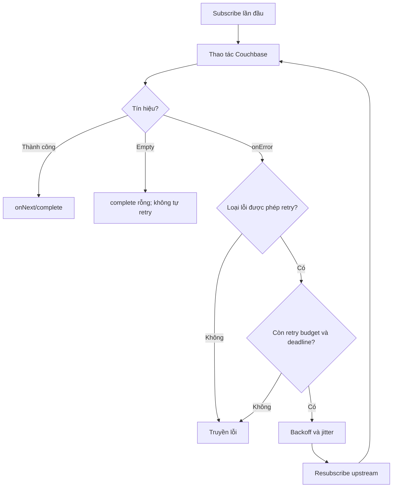

# Phục hồi lỗi, thử lại và thời gian chờ trong chuỗi

Trong **SPRING_DATA_COUCHBASE**, các thao tác với `ReactiveCouchbaseRepository` và `ReactiveCouchbaseTemplate` trả về publisher như `Mono<Customer>` hoặc `Flux<Customer>`. Kết quả có thể là một entity, nhiều entity, hoàn tất rỗng hoặc **tín hiệu lỗi**. Khi Couchbase tạm thời chậm, index chưa theo kịp mutation, đường truyền gặp trục trặc hay một document bị cập nhật đồng thời, hệ thống cần quyết định **có phục hồi được không**, **có nên thử lại không**, **thử lại bao nhiêu lần**, **được chờ bao lâu** và **làm sao không tạo tác động ghi trùng**.

Bài thuộc chương **Truy cập phản ứng**, tập trung vào ba nhóm kỹ thuật: **xử lý `onError`**, **retry có điều kiện với backoff và ngân sách**, và **timeout/deadline ở nhiều tầng**. Các ví dụ dùng document mapping, repository, SQL++ và khi phù hợp có nhắc đến `ReactiveCouchbaseTemplate`/Couchbase Java SDK. Ta đồng thời xem xét bucket/scope/collection, index, scan consistency, TTL, CAS, giao dịch và giới hạn concurrency để tránh biến một lần sự cố ngắn thành một đợt quá tải toàn cluster.

> **Nguyên tắc:** Không phải mọi lỗi đều nên được retry; một timeout sau mutation **không chứng minh mutation chưa commit**; và `onErrorResume(... -> Mono.empty())` có thể biến lỗi cơ sở dữ liệu thành câu trả lời sai “không có dữ liệu”. Cần phân loại lỗi, giới hạn tổng thời gian và biết trạng thái cuối của dữ liệu trước khi quyết định phục hồi.

## 1. Mục tiêu học tập

Sau bài này, bạn có thể:

1. Phân biệt `Mono.empty()`, `Flux.empty()`, `onError`, `onComplete`, `cancel` và lỗi được ánh xạ thành kết quả nghiệp vụ.
2. Dùng `doOnError`, `onErrorMap`, `onErrorResume`, `onErrorReturn` và `switchIfEmpty` đúng mục đích.
3. Xây chính sách `retryWhen` với **số lần thử thêm hữu hạn**, **backoff**, **jitter** và **lọc loại lỗi**.
4. Hiểu retry thường **resubscribe upstream**, vì vậy có thể gọi lại repository/SDK và lặp side effect.
5. Phân biệt timeout của **`Mono`**, timeout giữa các tín hiệu của **`Flux`**, deadline của HTTP/job và timeout phía SDK/Query Service.
6. Không suy ra từ timeout/cancel rằng lệnh `save`, `delete` hoặc giao dịch chắc chắn đã rollback.
7. Kết hợp idempotency key, ID ổn định, CAS/`@Version` và trạng thái công việc để xử lý mutation outcome không rõ.
8. Không retry các lỗi validation, phân quyền, sai SQL++, thiếu index hoặc lỗi logic chỉ vì chúng là exception.
9. Phân biệt độ trễ cập nhật secondary index với lỗi truy vấn cần retry; cân nhắc scan consistency đúng yêu cầu.
10. Kiểm thử retry/timeout/error signals bằng `StepVerifier` và virtual time; kiểm tra thêm behavior thật trên một collection test Couchbase.

## 2. Ba kết cục của một thao tác reactive

Một publisher bình thường có các dạng kết thúc:

| Kết cục | Tín hiệu | Ví dụ Couchbase |
| --- | --- | --- |
| Có kết quả | `onNext(customer)` rồi `onComplete` | `findById` đọc được document. |
| Thành công nhưng rỗng | `onComplete` mà không `onNext` | `findById` không có document với ID đó. |
| Lỗi | `onError(exception)` | Timeout, lỗi quyền, lỗi câu SQL++ hoặc CAS conflict. |
| Bị hủy | `cancel` từ downstream, không phải terminal event phát cho downstream | Client ngắt kết nối hoặc `take` hủy nguồn. |

Đặc biệt, **không có kết quả không tự đồng nghĩa lỗi**.

```java
Mono<Customer> found = repository.findById(documentId);

Mono<Customer> required = found.switchIfEmpty(
    Mono.error(new CustomerNotFoundException(documentId))
);
```

`CustomerNotFoundException` trong ví dụ là exception nghiệp vụ **do dự án tự định nghĩa**, không phải class mặc định của Spring Data Couchbase. `switchIfEmpty` được kích hoạt khi nguồn hoàn tất rỗng, không chạy nếu nguồn báo `onError`.

### 2.1. JSON null không phải `Mono.empty()`

Một document vẫn tồn tại nếu field `city` là JSON `null` hoặc field đó bị thiếu. Khi query trả entity, `Mono<Customer>` vẫn có thể phát entity. Reactive Streams không cho phép `onNext(null)`, nhưng **property của một entity** có thể là Java `null` sau mapping.

Trong SQL++, `NULL` và `MISSING` là hai trạng thái riêng; với một số câu query, thiếu field có thể làm predicate không được thỏa. Không dùng fallback reactive để “sửa” một điều kiện SQL++ sai.

### 2.2. `onError` là tín hiệu kết thúc, không phải một item

Ví dụ Reactor thuần:

```java
Mono<String> failure = Mono.error(
    new IllegalStateException("query failed")
);
```

Khi có subscription, publisher phát lỗi và kết thúc; nó không phát một chuỗi `"query failed"` như dữ liệu. Operator ở phía sau có thể **chuyển đổi hoặc phục hồi** lỗi, nhưng nếu không xử lý thì lỗi đi tới subscriber/WebFlux.

## 3. Bối cảnh Couchbase dùng xuyên suốt

Giả sử hệ thống CRM lưu khách hàng tại bucket `app`, scope `crm`, collection `customers`. Document ví dụ:

```json
{
  "tenant_id": "tenant-a",
  "customer_code": "C001",
  "display_name": "Lan Anh",
  "status": "ACTIVE",
  "loyalty_points": 100
}
```

Document ID là `customer::tenant-a::C001`, thuộc metadata key-value chứ không nhất thiết là JSON `id`.

```java
package example.crm;

import org.springframework.data.annotation.Id;
import org.springframework.data.annotation.Version;
import org.springframework.data.couchbase.core.mapping.Collection;
import org.springframework.data.couchbase.core.mapping.Document;
import org.springframework.data.couchbase.core.mapping.Field;
import org.springframework.data.couchbase.core.mapping.Scope;

@Document
@Scope("crm")
@Collection("customers")
public class Customer {

    @Id
    private String id;

    @Field("tenant_id")
    private String tenantId;

    @Field("customer_code")
    private String customerCode;

    @Field("display_name")
    private String displayName;

    @Field
    private String status;

    @Field("loyalty_points")
    private Integer loyaltyPoints;

    @Version
    private Long version;

    protected Customer() {}

    public String getId() { return id; }
    public String getTenantId() { return tenantId; }
    public String getStatus() { return status; }
    public Integer getLoyaltyPoints() { return loyaltyPoints; }

    public void setStatus(String status) {
        this.status = status;
    }

    public void setLoyaltyPoints(Integer points) {
        this.loyaltyPoints = points;
    }

    // Constructor nghiệp vụ và các getters/setters khác được lược bỏ.
}
```

Repository:

```java
package example.crm;

import org.springframework.data.couchbase.repository.ReactiveCouchbaseRepository;
import reactor.core.publisher.Flux;

public interface CustomerRepository
        extends ReactiveCouchbaseRepository<Customer, String> {

    Flux<Customer> findByTenantIdAndStatus(
        String tenantId,
        String status
    );
}
```

**Giả định:** ứng dụng đã có Spring Data Couchbase reactive, Project Reactor, kết nối SDK, quyền, mapping và namespace đúng. Loại exception cụ thể, API query options và hành vi retry bên dưới phải được kiểm tra theo **Spring Data Couchbase/Commons, Couchbase Java SDK và Couchbase Server release** đang sử dụng. Bài không mặc định tên exception hay khả năng transaction là giống nhau trên mọi phiên bản.

## 4. Cần phân loại lỗi trước khi chọn operator

Không nên có một chính sách chung “gặp exception nào cũng retry ba lần”.

| Nhóm sự cố | Ví dụ | Chính sách nên xem xét |
| --- | --- | --- |
| **Không tìm thấy** | `findById` hoàn tất rỗng | Not-found/404 theo nghiệp vụ, không retry mặc định. |
| **Validation** | `customerCode` sai, page size vượt cap | Báo 400, sửa input; retry vô nghĩa. |
| **Phân quyền** | Không được đọc tenant khác | 403/404 theo chính sách; không retry. |
| **Sai câu truy vấn** | SQL++ syntax, tham số binding sai | Sửa code/config, không retry cùng statement. |
| **Thiếu/sai index** | Query Service không có đường truy cập phù hợp | Sửa index/statement; retry liên tục gây tải. |
| **Mất kết nối/nghẽn tạm thời** | Lỗi transport có thể phục hồi | Chỉ retry có giới hạn nếu operation an toàn. |
| **Timeout đọc** | KV get/query chưa trả kết quả đúng hạn | Xem deadline, loại thao tác, tải; retry có điều kiện. |
| **Timeout ghi** | SDK không nhận được outcome trong thời gian chờ | **Trạng thái cuối có thể không rõ**; xác minh trước khi retry. |
| **CAS conflict** | Entity bị sửa sau khi đọc | Xử lý xung đột nghiệp vụ; có thể đọc lại nếu hợp lệ. |
| **Dữ liệu đã hết TTL** | Lần đọc sau không thấy document | Xem expiration và nghiệp vụ, không gọi lỗi transient mặc định. |
| **Index chưa cập nhật** | KV đọc thấy nhưng SQL++ chưa thấy | Chọn scan consistency/đường KV, không retry rỗng mù quáng. |
| **Transaction lỗi** | Abort/conflict/timeout trong multi-document transaction | Dùng cơ chế retry của transaction API đúng version, không thêm retry tùy tiện. |

Danh sách này là **khung phân tích**, không phải bảng ánh xạ một-một với các exception Java bất biến. Một lỗi từ Couchbase SDK có thể được Spring Data chuyển đổi thành một exception khác; cần xem **type, cause, context và operation** thật.

### 4.1. Đừng retry “mọi `RuntimeException`”

Nếu classifier là:

```java
// Anti-pattern: cả lỗi lập trình/permission cũng bị retry.
.filter(error -> error instanceof RuntimeException)
```

thì lỗi mapping, syntax, validate và business rule có thể bị gọi lại không cần thiết. Chỉ cho retry khi **có bằng chứng** loại lỗi đó tạm thời **và** operation có thể lặp an toàn.

### 4.2. Trạng thái rỗng không nên được biến thành lỗi để retry vô hạn

```java
Mono<Customer> required = repository.findById(id)
    .switchIfEmpty(Mono.error(
        new CustomerNotFoundException(id)
    ));
```

Việc chuyển empty thành lỗi nghiệp vụ phù hợp cho API yêu cầu document tồn tại. Nhưng nếu phía sau gọi `retryWhen` với filter quá rộng, ứng dụng có thể liên tục đọc lại một ID không tồn tại. Classifier phải loại **not-found** ra khỏi nhóm retry.

## 5. `doOnError`: quan sát lỗi, không phục hồi

`doOnError` là operator dùng để ghi log/metrics/tracing khi có lỗi:

```java
Mono<Customer> observed = repository.findById(id)
    .doOnError(error ->
        logger.warn("Couchbase read failed; operation=findById", error)
    );
```

`logger` là logger do ứng dụng cung cấp. Sau `doOnError`, lỗi **vẫn được truyền xuống downstream** nếu không có operator xử lý khác.

| Mong muốn | Operator phù hợp |
| --- | --- |
| Ghi metric khi lỗi | `doOnError` |
| Đổi một exception thành exception nghiệp vụ khác | `onErrorMap` |
| Khi lỗi, chuyển sang một publisher dự phòng | `onErrorResume` |
| Khi lỗi, dùng giá trị mặc định | `onErrorReturn`, nếu thật sự chấp nhận |
| Khi không có item, dùng fallback | `switchIfEmpty` |
| Khi lỗi tạm thời, subscribe lại | `retryWhen` |
| Giới hạn thời gian chờ tín hiệu | `timeout` |

Không đặt side effect nghiệp vụ quan trọng trong `doOnError` rồi giả định nó chạy “đúng một lần”. Retry/multiple subscriptions có thể làm hook được gọi nhiều lần; nếu log/audit cần tính chính xác cao phải có thiết kế riêng.

### 5.1. Tránh log dữ liệu nhạy cảm

Thông tin hữu ích trong log là loại operation, collection/use case, correlation ID, elapsed time và nhóm lỗi. Không log toàn bộ customer JSON, password/token, email, SQL++ bind values nhạy cảm hoặc dữ liệu tenant khác theo mặc định.

## 6. `onErrorMap`: chuyển lỗi thành hợp đồng ứng dụng

Một tầng service có thể muốn ẩn chi tiết exception SDK khỏi API:

```java
Mono<Customer> loaded = repository.findById(id)
    .onErrorMap(
        error -> isExpectedInfrastructureError(error),
        error -> new CustomerReadUnavailableException(
            "Customer storage temporarily unavailable", error
        )
    );
```

`isExpectedInfrastructureError` là classifier **ứng dụng tự triển khai**; `CustomerReadUnavailableException` cũng là exception nghiệp vụ minh họa. Hai thành phần này không phải API mặc định của Spring Data.

`onErrorMap` **không retry và không trả kết quả thay thế**. Nó chỉ đổi tín hiệu lỗi, thường giữ nguyên cause để chẩn đoán.

### 6.1. Cẩn thận với thứ tự chuyển đổi lỗi

Nếu mã hóa mọi exception thành `CustomerReadUnavailableException` **trước** khi phân loại retry, bạn có thể làm mất thông tin quan trọng về nguyên nhân gốc. Chọn vị trí `onErrorMap` và `retryWhen` có chủ đích:

```java
Mono<Customer> result = repository.findById(id)
    .retryWhen(readRetrySpec)
    .onErrorMap(
        this::shouldMapReadError,
        error -> new CustomerReadUnavailableException(
            "Read failed after retry policy", error
        )
    );
```

`readRetrySpec` và các helper trong ví dụ phải được định nghĩa bởi ứng dụng. Sau khi retry hết lượt, Reactor có thể phát **wrapper retry-exhausted** chứa cause, tùy `Retry` implementation. Khi mapping/tracing, xem cả cause chain thay vì chỉ so sánh một class duy nhất.

## 7. `onErrorResume`: chuyển sang phương án dự phòng

`onErrorResume` chỉ kích hoạt khi upstream **phát lỗi** và cho phép chọn một publisher khác:

```java
Mono<Customer> customer = repository.findById(id)
    .onErrorResume(error -> {
        if (isTransientReadFailure(error)) {
            return cacheService.getCustomer(id);
        }
        return Mono.error(error);
    });
```

`cacheService.getCustomer` là API do dự án xây dựng, không phải phần của Spring Data Couchbase. Fallback kiểu cache chỉ đúng nếu nghiệp vụ **chấp nhận dữ liệu có thể cũ** và kiểm tra cùng tenant/quyền. Với số dư, quyền truy cập, quyết định giá hoặc thao tác cần dữ liệu mới nhất, fallback stale có thể không phù hợp.

### 7.1. Anti-pattern: biến database outage thành “không có dữ liệu”

```java
// Sai nếu lỗi Couchbase phải được báo lên.
Flux<Customer> wrong = repository
    .findByTenantIdAndStatus(tenantId, "ACTIVE")
    .onErrorResume(error -> Flux.empty());
```

UI có thể hiển thị “không có customer” dù thực chất Query Service timeout. Cách làm này phá observability và có thể dẫn đến quyết định sai.

### 7.2. Fallback cũng có thể lỗi

`onErrorResume` không đảm bảo fallback thành công; nếu publisher dự phòng báo lỗi, lỗi đó đi xuống downstream theo bình thường. Nên đặt **ngân sách deadline và fallback** phù hợp, tránh gọi vòng nhiều dịch vụ rồi tạo bão truy vấn khi Couchbase đã quá tải.

### 7.3. Fallback phải được gắn nhãn

Nếu API cho phép trả dữ liệu cache, nên có metadata kiểu `stale`, `source`, `asOf` trong response khi nghiệp vụ cần, thay vì âm thầm coi dữ liệu cũ là kết quả nhất quán mới nhất. Cần xác minh TTL của cache không thay thế TTL của document Couchbase.

## 8. `onErrorReturn`, `onErrorComplete` và `onErrorContinue`

`onErrorReturn` có thể trả một giá trị mặc định:

```java
Mono<Boolean> serviceHealthy = healthProbe
    .onErrorReturn(false);
```

`healthProbe` là publisher minh họa. Trả `false` khi health probe thất bại có thể hợp lý nếu hợp đồng là “đang sẵn sàng hay không”. Nhưng không dùng `onErrorReturn(new Customer(...))` để giả một document thật nếu nghiệp vụ cần dữ liệu đúng.

`onErrorComplete` biến error thành completion:

```java
// Chỉ thích hợp nếu bỏ qua lỗi là yêu cầu đã được phê duyệt.
Mono<Void> ignored = nonCriticalTelemetryWrite
    .onErrorComplete();
```

`nonCriticalTelemetryWrite` là nguồn minh họa. Nó có thể hợp lý với telemetry **không bắt buộc** và đã ghi nhận lỗi, nhưng rất nguy hiểm nếu áp dụng cho `save`, `delete`, audit hay lệnh thanh toán.

### 8.1. Vì sao nên thận trọng với `onErrorContinue`?

`onErrorContinue` có semantics phụ thuộc vào operator upstream có hỗ trợ chế độ tiếp tục hay không và lỗi phát sinh ở đâu. Nó có thể làm mất dấu phần tử/lỗi theo cách khó review trong pipeline nhiều bước. Với batch muốn **kết quả từng item**, thường rõ ràng hơn nếu xử lý `onErrorResume` **bên trong từng inner publisher**, rồi biến thành outcome record.

Ví dụ chọn cách thu kết quả có trạng thái thay vì nuốt lỗi:

```java
public record ReadOutcome(
    String requestedId,
    Customer customer,
    String errorCode
) {
    public boolean found() {
        return customer != null;
    }
}
```

```java
Flux<ReadOutcome> outcomes = Flux.fromIterable(ids)
    .flatMap(id ->
        repository.findById(id)
            .map(c -> new ReadOutcome(id, c, null))
            .switchIfEmpty(Mono.just(
                new ReadOutcome(id, null, "NOT_FOUND")
            ))
            .onErrorResume(error ->
                Mono.just(new ReadOutcome(
                    id, null, classifyForClient(error)
                ))
            ),
        8
    );
```

`classifyForClient` là helper của ứng dụng **chỉ trả mã lỗi đã duyệt**, không xuất exception/stack trace hoặc thông tin nhạy cảm cho client. Cơ chế này thể hiện partial failure rõ ràng; nó không tạo transaction hoặc làm thao tác lỗi tự thành công.

## 9. Retry nghĩa là gì trong một chuỗi reactive?

Với publisher cold thông thường, retry **subscribe lại upstream** sau lỗi được phép.

```java
Mono<Customer> retried = repository.findById(id)
    .retry(2);
```

Cú pháp này minh họa retry tối đa **hai lần thêm** sau lần đầu, theo operator Reactor tương ứng. Nó chưa có lọc lỗi, backoff hay deadline, vì vậy **không phải chính sách production nên dùng nguyên dạng**.

Sơ đồ:



**Điểm quan trọng:** Retry hoạt động theo tín hiệu **`onError`**, không retry completion rỗng trừ khi code cố tình chuyển empty thành error. Không được làm điều đó mù quáng với truy vấn SQL++ còn đang chờ index cập nhật.

### 9.1. Resubscribe có thể kích hoạt lại I/O thật

Một `Mono<Customer>` của repository thường đại diện cho một thao tác I/O khi được subscribe. Retry tạo subscription mới, nên có thể gọi lại SDK. Với phép đọc theo ID, kết quả có thể khác vì document bị sửa, xóa hoặc hết TTL giữa các lần thử.

Với mutation, retry có thể lặp ghi hoặc lặp các bước phụ bên trong pipeline. Không có bảo đảm “hai subscription nhưng đúng một mutation”.

## 10. `retryWhen` với backoff, jitter và filter

Đây là mẫu diễn đạt cấu hình retry có điều kiện:

```java
import java.time.Duration;
import reactor.core.publisher.Mono;
import reactor.util.retry.Retry;

Retry readRetrySpec = Retry.backoff(
        2,                       // Tối đa 2 lần thử thêm.
        Duration.ofMillis(200)   // Backoff cơ sở.
    )
    .maxBackoff(Duration.ofSeconds(2))
    .jitter(0.5)
    .filter(this::isTransientReadFailure);

Mono<Customer> customer = repository.findById(id)
    .retryWhen(readRetrySpec);
```

`isTransientReadFailure` là helper cần triển khai bằng **phân loại lỗi đúng SDK/Spring Data phiên bản và thao tác đọc**. Ví dụ này minh họa cấu trúc Reactor; không có nghĩa mọi lỗi socket đều nên retry hoặc mọi operation Couchbase tự động idempotent.

### 10.1. Phân biệt tổng số attempts và số retries

`Retry.backoff(2, ...)` cho tối đa **2 retries** sau lần đầu, tức tối đa **3 attempts** nếu cả hai lần trước lỗi và policy không dừng sớm. Quan sát metrics phải ghi cả attempts, retries và số operation cuối cùng thành công/thất bại.

### 10.2. Vì sao cần backoff và jitter?

Nếu hàng nghìn request timeout cùng lúc rồi retry ngay, Query/KV Service có thể nhận một đợt tải mới đúng lúc đang bão hòa. Backoff giãn các attempts; jitter làm giảm hiện tượng nhiều client retry đồng bộ.

Nhưng backoff **không tạo thêm tài nguyên cho cluster**; nếu số request mới vẫn vượt năng lực, cần admission, rate limit, bulkhead và tối ưu index/query. Đồng thời tổng thời gian chờ vẫn phải nằm trong deadline của request.

### 10.3. Khi hết retry budget có thể có wrapper error

Ở Reactor, một số `Retry` strategy khi cạn lần thử có thể phát lỗi dạng **retry-exhausted** kèm nguyên nhân gốc. Không viết test/mapping giả định chắc chắn sẽ nhận nguyên văn exception đầu tiên. Kiểm tra cause, cấu hình `onRetryExhaustedThrow` nếu cần bảo toàn một hợp đồng lỗi, và tương thích với Reactor version.

### 10.4. Retry có thể có hiệu ứng ở vị trí đặt operator

Xem xét:

```java
Mono<Customer> tracked = repository.findById(id)
    .doOnError(error -> metrics.recordReadAttemptFailure())
    .retryWhen(readRetrySpec)
    .doOnError(error -> metrics.recordFinalReadFailure());
```

`metrics` là đối tượng minh họa cần ứng dụng cung cấp. `doOnError` **trước** `retryWhen` quan sát từng attempt lỗi; `doOnError` **sau** retry quan sát lỗi cuối nếu policy không phục hồi. Đây là cách tách **attempt-level** khỏi **request-level** metrics. Không coi bộ đếm attempt là số HTTP requests độc lập.

## 11. Retry có điều kiện theo operation, không chỉ theo exception

Một classifier đúng phải xét cả **tác vụ**:

| Operation | Khả năng retry | Rủi ro |
| --- | --- | --- |
| `findById(id)` | Có thể xem xét nếu lỗi tạm thời | Kết quả thay đổi vì TTL/update; nhiều attempts gây tải. |
| SQL++ SELECT đọc | Có thể nếu idempotent và không vượt deadline | Query scan đắt có thể lặp toàn bộ, gây quá tải. |
| `existsById(id)` | Có thể nếu lỗi tạm thời | Kết quả rỗng/false không phải tín hiệu lỗi. |
| Insert-only với ID cố định | Chỉ theo chiến lược idempotency và xác nhận outcome | Lần đầu commit nhưng phản hồi mất → lần sau duplicate. |
| Upsert/`save` | Cần hiểu CAS/khả năng ghi lặp | Có thể overwrite hoặc mutate hai lần. |
| Increment số điểm | Không retry mù quáng | Có thể cộng hai lần khi outcome đầu không rõ. |
| Delete theo ID | Cần chính sách về ID tái sử dụng/not-found/CAS | Xóa lần nữa có semantics khác; document có thể được tạo lại. |
| Multi-document transaction | Dùng transaction retry protocol/version tương thích | Callback có thể chạy lại; side effect ngoài transaction bị lặp. |

Một thao tác **set giá trị cố định** có thể idempotent theo giá trị cuối, nhưng nếu đồng thời có người đổi document, retry vẫn có thể ghi đè ý định mới. Idempotency về dữ liệu không thay thế optimistic locking hoặc business authorization.

## 12. Timeout: giới hạn thời gian chờ nhưng không tự hủy công việc ở server

Trong Reactor, `timeout` có thể phát lỗi nếu upstream không tạo tín hiệu trong khoảng được cấu hình:

```java
import java.time.Duration;

Mono<Customer> limited = repository.findById(id)
    .timeout(Duration.ofSeconds(3));
```

Với một `Mono` đọc theo ID, đây là timeout khi không nhận kết quả/tín hiệu kết thúc đúng hạn theo semantics operator. Nếu timeout, downstream nhận lỗi phù hợp, thường liên quan `TimeoutException`.

**Không được suy ra:** Couchbase Server chắc chắn không đọc document, không ghi mutation, hoặc đã giải phóng ngay mọi tài nguyên. Timeout ở Reactor ảnh hưởng subscription tại điểm đặt operator; SDK/Query Service có timeout/cancellation riêng.

### 12.1. `Flux.timeout(Duration)` không phải deadline tổng thời gian toàn truy vấn

Ví dụ:

```java
Flux<Customer> stream = repository
    .findByTenantIdAndStatus(tenantId, "ACTIVE")
    .timeout(Duration.ofSeconds(2));
```

Với `Flux`, overload cơ bản của `timeout(Duration)` thường giới hạn **khoảng chờ tới item đầu và khoảng cách giữa các item tiếp theo**. Nếu query phát một row mỗi giây trong nhiều phút, nó có thể **không timeout** dù tổng request đã kéo dài hơn hai giây.

Phân biệt ba mục tiêu:

| Loại giới hạn | Câu hỏi |
| --- | --- |
| First-item timeout | Mất bao lâu để nhận dòng đầu? |
| Idle/gap timeout | Có chờ quá lâu giữa hai tín hiệu kết quả không? |
| Total deadline | Toàn bộ request/job còn bao nhiêu thời gian để hoàn tất? |

Đối với API streaming, cần **deadline end-to-end** ở HTTP/job và timeout phía Query Service/SDK đúng phiên bản, không dựa duy nhất vào gap timeout của `Flux`.

### 12.2. `timeout` có thể nhận fallback publisher

```java
Mono<Customer> result = repository.findById(id)
    .timeout(
        Duration.ofSeconds(2),
        cacheService.getCustomer(id)
    );
```

Ví dụ thể hiện một publisher dự phòng khi không có tín hiệu đúng hạn. Nhưng fallback có thể **dữ liệu cũ**, cần kiểm tra tenant và chính sách nghiệp vụ. Timeout nguồn **không chứng minh** operation đã bị ngừng ở server; fallback không phải cơ chế giao dịch hoặc thay thế consistency.

## 13. Deadline end-to-end khác timeout từng đoạn

Một HTTP request có thể trải qua:

```text
Authentication
  -> validation
  -> chờ permit bulkhead
  -> Couchbase KV get
  -> SQL++ query
  -> DTO mapping
  -> HTTP serialization
```

Nếu **mỗi bước có timeout 5 giây**, tổng request có thể vượt xa SLA 5 giây. Thiết kế đúng là một **deadline tổng** (ví dụ từ lúc nhận request) và các ngân sách con dựa trên thời gian còn lại.

### 13.1. Ngân sách minh họa

Giả sử SLA toàn request là 2 giây. Một cách phân bổ ban đầu:

| Bước | Ngân sách tối đa minh họa |
| --- | ---: |
| Authentication/validation | 100 ms |
| Admission/bulkhead wait | 150 ms |
| KV/Query I/O gồm retries | 1.300 ms |
| Mapping/response | 200 ms |
| Dự phòng/jitter | 250 ms |

Đây là **bài tập phân bổ deadline**, không phải ngưỡng mặc định Spring Data hay Couchbase. Latency cần được đo trên workload thực tế, và tổng các khoảng phải còn margin.

### 13.2. Deadline nên có hiệu lực với retry

Một policy backoff 200 ms rồi 400 ms nhưng mỗi attempt có thể mất 1,5 giây sẽ dễ vượt HTTP deadline 2 giây. Retry budget phải xét **thời gian còn lại**, không chỉ số lần thử.

Một mẫu tổ chức:

```java
Mono<Customer> readWithBoundedRetry = Mono.defer(
        () -> repository.findById(id)
    )
    .retryWhen(readRetrySpec)
    .timeout(Duration.ofSeconds(2));
```

Đặt `timeout` **ngoài** retry thường cho phép tổng pipeline bị timeout trong thời hạn đó theo semantics của `Mono`. Nhưng timeout/cancel vẫn là giới hạn chờ tại Reactor, không thay SDK/server cancellation. Nếu bên trong có bước blocking/side effect, còn phải xử lý chúng theo cách riêng.

### 13.3. Thứ tự `timeout` và `retryWhen` làm đổi ngữ nghĩa

**Timeout cho từng attempt:**

```java
Mono<Customer> perAttemptTimeout = repository.findById(id)
    .timeout(Duration.ofSeconds(1))
    .retryWhen(readRetrySpec);
```

Mỗi lần subscribe lại upstream, giới hạn chờ của `timeout` có thể được áp dụng lại; **tổng** thời gian gồm attempts + backoff có thể vượt một giây.

**Timeout cho toàn chuỗi attempts:**

```java
Mono<Customer> totalTimeout = repository.findById(id)
    .retryWhen(readRetrySpec)
    .timeout(Duration.ofSeconds(2));
```

Đây là cách tổ chức tổng thời gian chờ của **publisher tại vị trí đó**, nhưng không thay deadline của HTTP/job và SDK. Với batch/`Flux`, cần đặc biệt cẩn trọng vì timeout dạng gap khác timeout tổng thời gian.

## 14. Timeout ở SDK và Query Service

Ngoài operator Reactor, Couchbase Java SDK và Query Service có cấu hình timeout tùy operation/SDK version. Với SQL++ có thể có query timeout/options được truyền xuống server; với KV có operation timeout và retry/cancellation semantics riêng.

Khi sử dụng Spring Data repository hoặc `ReactiveCouchbaseTemplate`:

- Kiểm tra phương thức nào cho phép truyền timeout/query options theo **release đang chạy**.
- Không giả định một tùy chọn SDK đặt trực tiếp sẽ tự áp dụng cho mọi repository query.
- Với `@Query`, xác minh binding, query context, projection và metadata trước khi chỉnh timeout.
- Lấy dấu vết request để đối chiếu **Reactor timeout**, **SDK timeout** và **server-side query timeout**.
- Tránh đặt SDK timeout dài hơn đáng kể deadline của caller mà không có lý do; công việc server có thể tiếp tục sau khi client đã ngừng chờ.

Một timeout ở Query Service có thể không giống lỗi mất kết nối của KV. Phân loại lỗi phải xem đúng API, không dựa vào một chuỗi message tiếng Anh bất biến.

## 15. Một mutation timeout có thể đã commit

Đây là tình huống quan trọng nhất với `save` hoặc `delete`.

```text
T0: Client gọi POST tạo customer
T1: Reactor subscribe repository.save(customer)
T2: SDK gửi mutation tới Couchbase
T3: Couchbase ghi document thành công
T4: Response bị trễ/mất
T5: Reactor timeout; caller thấy lỗi
```

Từ góc nhìn caller, kết quả **không rõ**; không thể kết luận “chưa ghi”.

### 15.1. Vì sao retry tạo ID mới nguy hiểm?

Nếu mỗi lần retry sinh một document ID khác, lần đầu có thể đã commit. Lần thứ hai sẽ tạo bản sao nghiệp vụ thay vì phục hồi một request thất bại.

Nên dùng **ID xác định** hoặc **idempotency key** ổn định theo request nghiệp vụ, cộng với quy tắc kiểm tra trạng thái trước khi lặp.

### 15.2. Insert-only khác upsert

Nếu mục tiêu “chỉ tạo document khi ID chưa tồn tại”, một **insert-only** theo ID đã xác định là lựa chọn tự nhiên ở key-value. API insert-only của `ReactiveCouchbaseTemplate` hoặc SDK phải được kiểm tra theo version:

```java
// API fluent minh họa, cần đối chiếu chữ ký theo Spring Data version.
Mono<Customer> inserted = template
    .insertById(Customer.class)
    .one(customer);
```

Nếu attempt thứ hai gặp duplicate ID, có thể là một lần tạo đã thành công trước đó hoặc là document vốn có sẵn từ trước; cần xác minh **nội dung/idempotency token** và quyền tenant, không mặc định duplicate nghĩa là thành công hợp lệ.

### 15.3. Upsert không tự bảo đảm exactly-once

`repository.save(customer)` hoặc một operation upsert có semantics phụ thuộc entity ID/version và API. Việc cùng một document ID được ghi hai lần không nhất thiết tạo hai document, nhưng vẫn có thể cập nhật CAS/TTL, kích hoạt event/audit hoặc làm overwrite thay đổi đồng thời. Vì vậy **số document cuối bằng một** không phải bằng chứng side effect chỉ xảy ra một lần.

## 16. CAS/`@Version` và retry khi có cạnh tranh

Giả sử hai request cùng đọc version/CAS V1:

```text
A: read V1, set status = ARCHIVED
B: read V1, set status = SUSPENDED
A: save -> success, CAS thay đổi
B: save với V1 -> conflict (nếu CAS được áp dụng)
```

Khi entity dùng `@Version` và đường save của Spring Data Couchbase hỗ trợ optimistic locking đúng cách, CAS conflict cho biết dữ liệu đã đổi trong lúc xử lý. Đây **không đơn thuần là lỗi mạng tạm thời**.

### 16.1. Khi nào có thể thử lại CAS conflict?

Một nghiệp vụ **đặt trạng thái tuyệt đối** có thể được thiết kế để đọc lại và tính lại nếu quy tắc cho phép. Ví dụ:

```java
import org.springframework.dao.OptimisticLockingFailureException;
import reactor.core.publisher.Mono;
import reactor.util.retry.Retry;

public Mono<Customer> archiveWithRetry(String tenantId, String id) {
    return Mono.defer(() ->
        repository.findById(id)
            .filter(c -> tenantId.equals(c.getTenantId()))
            .switchIfEmpty(Mono.error(
                new CustomerNotFoundException(id)
            ))
            .flatMap(c -> {
                if (!"ACTIVE".equals(c.getStatus())) {
                    return Mono.error(new IllegalStateException(
                        "Invalid state transition"
                    ));
                }
                c.setStatus("ARCHIVED");
                return repository.save(c);
            })
    ).retryWhen(
        Retry.max(1)
            .filter(error ->
                error instanceof OptimisticLockingFailureException
            )
    );
}
```

Ví dụ minh họa **re-read và xác minh lại trạng thái mỗi lần attempt**, không retry một object cũ đã sửa trong bộ nhớ. Loại exception CAS cần được kiểm chứng theo Spring Data/SDK version; không mặc định mọi conflict đều ánh xạ chính xác vào `OptimisticLockingFailureException`.

**Cẩn trọng:** Không dùng một CAS retry để ghi đè ý định người khác nếu nghiệp vụ yêu cầu báo 409 cho người dùng. Và không retry mutation có side effect ngoài DB không idempotent trong callback.

### 16.2. Increment điểm khác đặt điểm

`customer.setLoyaltyPoints(customer.getLoyaltyPoints() + 100)` có thể được tính lại sau CAS conflict nếu **toàn bộ nghiệp vụ cộng điểm là idempotent theo request ID**. Nếu lần ghi đầu đã commit nhưng response timeout, việc đọc lại và cộng thêm 100 có thể cộng **lần thứ hai**.

Do đó cần tách:
- **Xung đột CAS đã xác nhận:** một attempt không ghi được vì version cũ.
- **Timeout/outcome không rõ:** mutation có thể đã ghi rồi.
- **Idempotency:** request cộng điểm được nhận diện để không áp dụng hai lần.

Ba tình huống đòi hỏi chính sách khác nhau.

## 17. Xóa document và retry

```java
Mono<Void> removal = repository.deleteById(documentId);
```

`Mono<Void>` hoàn tất có nghĩa thao tác được báo hoàn tất theo hợp đồng repository/SDK; **không nhất thiết cho biết document trước đó có tồn tại hoặc được phép xóa theo trạng thái nghiệp vụ**.

Trong CRM đa tenant, không xóa theo ID từ client mà thiếu phân quyền. Nếu cần chỉ xóa customer ARCHIVED và không có retention hold, phải kiểm tra điều kiện tenant/status/hold và dùng CAS/transaction hoặc điều kiện mutation phù hợp để tránh race giữa đọc và xóa.

### 17.1. Retry xóa phải xét việc tái sử dụng ID

Nếu document bị xóa thành công nhưng caller timeout, retry `deleteById(id)` có thể gặp not-found. Có thể định nghĩa “đã không tồn tại” là trạng thái đích thành công, **nếu** hệ thống bảo đảm ID không bị tái sử dụng để tạo document mới ngay giữa hai attempts.

Nếu ID có thể tái sử dụng, retry xóa không có CAS hoặc idempotency có nguy cơ xóa nhầm document mới. Một thiết kế phù hợp cần xác định lifecycle và điều kiện quyền ở thời điểm mutation.

### 17.2. SQL++ DELETE không giống KV remove

Một câu SQL++ `DELETE ... WHERE ...` có semantics khác operation `repository.delete(entity)` ở đường KV về index consistency, CAS/callback, query metrics và transaction. Không tự đặt `@Query` DML vào repository rồi xem nó tương đương thao tác xóa có điều kiện nếu chưa kiểm chứng khả năng hỗ trợ và effect của version.

## 18. Lỗi query và index: đừng retry một câu SQL++ sai

`findByTenantIdAndStatus(...)` thường thực hiện SQL++ theo field JSON, trong khi `findById(id)` thường là KV. Chúng sử dụng đường backend khác nhau.

```sql
-- SQL++ minh họa ý định.
SELECT c.*
FROM `app`.`crm`.`customers` AS c
WHERE c.`tenant_id` = $tenantId
  AND c.`status` = $status;
```

Nếu lỗi do **SQL++ syntax, keyspace, binding, missing index hoặc quyền**, retry cùng statement không sửa được nguyên nhân. Cần chẩn đoán:

1. Namespace bucket/scope/collection đang được truy cập.
2. Field JSON theo `@Field`, discriminator và projection do Spring Data tạo.
3. Binding parameters và kiểu dữ liệu.
4. Index phù hợp với `WHERE` và `ORDER BY`.
5. Kế hoạch `EXPLAIN` và tài nguyên Query Service.

Index tham khảo:

```sql
CREATE INDEX ix_customers_tenant_status
ON `app`.`crm`.`customers`(
    `tenant_id`,
    `status`
);
```

Đây chỉ là ví dụ định hướng; index thật phải dựa trên query đã chạy và dữ liệu đại diện, đặc biệt nếu Spring Data thêm discriminator khác hoặc query có sort/limit.

### 18.1. `EXPLAIN` giúp phân biệt lỗi hiệu năng với lỗi mạng

```sql
EXPLAIN
SELECT c.*
FROM `app`.`crm`.`customers` AS c
WHERE c.`tenant_id` = "tenant-a"
  AND c.`status` = "ACTIVE";
```

Query timeout có thể vì server đang bị quá tải **hoặc** vì query scan/sort rất đắt. Retry query đắt nhiều lần có thể làm cluster chậm hơn; cần index/limit/admission, không chỉ tăng attempts.

## 19. Read-after-write: index lag không phải lúc nào là lỗi

Sau khi `save` thành công:

```java
Mono<Customer> byId = repository.save(customer)
    .flatMap(saved -> repository.findById(saved.getId()));
```

Đường đọc ID thường là KV. Nhưng:

```java
Flux<Customer> byStatus = repository.save(customer)
    .flatMapMany(saved ->
        repository.findByTenantIdAndStatus(
            saved.getTenantId(),
            saved.getStatus()
        )
    );
```

Truy vấn SQL++ có thể chưa thấy mutation tại mức scan consistency mặc định vì secondary index cập nhật bất đồng bộ.

**Không nên:**

```java
// Anti-pattern: cứ query rỗng là báo lỗi để retry hàng chục lần.
Flux<Customer> wrong = repository
    .findByTenantIdAndStatus(tenantId, "ACTIVE")
    .switchIfEmpty(Flux.error(
        new IllegalStateException("Index not ready")
    ))
    .retry(20);
```

Ngoài việc tăng tải, empty có thể là kết quả **đúng** của câu query.

### 19.1. Nếu cần read-your-own-write

Đánh giá query scan consistency tương đương `REQUEST_PLUS` hoặc mutation-state options khi Spring Data/SDK version hỗ trợ. Lựa chọn có thể làm query chờ index, tăng latency; phải cân đối deadline và throughput.

Nếu đã biết ID của document vừa ghi, KV read theo ID có thể phù hợp hơn query field trong nhiều use case. Không dùng retry empty như cách thay thế bắt buộc cho consistency option.

## 20. Bulkhead, concurrency và retry storm

Một batch đọc:

```java
Flux<Customer> customers = Flux.fromIterable(ids)
    .flatMap(repository::findById, 8);
```

`8` giới hạn số publisher con đang được xử lý đồng thời **trong pipeline này**, không giới hạn toàn instance. Với 100 HTTP requests cùng fan-out, số KV operations vẫn có thể lớn.

Nếu mỗi inner có ba attempts, tổng công việc I/O có thể tăng đáng kể khi cluster đang chậm. Thiết kế cần:

- Concurrency limit theo batch.
- **Shared bulkhead** theo instance và loại workload (KV/query/mutation).
- Hạn mức hoặc admission theo tenant nếu cần.
- Rate limit và bounded queue để tránh giữ vô hạn request đang chờ.
- Retry budget theo **số attempts toàn hệ thống và deadline**.
- Backoff/jitter để giảm retry đồng bộ.
- Metrics theo attempts, successful operations và rejections.

**Không xem backpressure `request(n)` là rate limiter toàn cluster.** Nó chỉ điều tiết tín hiệu trong pipeline Reactor; Couchbase vẫn phải xử lý các operation đã được gửi.

### 20.1. Vị trí retry so với bulkhead ảnh hưởng phép đếm slot

Nếu bulkhead bảo vệ **toàn chuỗi retry**, permit có thể bị giữ trong lúc backoff. Nếu bulkhead bảo vệ **mỗi attempt**, permit được nhả giữa retries nhưng retry phải xin admission lần nữa. Hai chính sách khác nhau về fairness và tải, cần đánh giá trên SLO.

### 20.2. Retry quá sớm có thể làm outage dài hơn

Vòng lặp xấu:

```text
Cluster chậm
  -> timeout tăng
  -> retry ngay
  -> nhiều query/transactions hơn
  -> queue và CPU tăng
  -> timeout lại tăng
```

Trong quá tải, **từ chối sớm** có thể tốt hơn để request chờ rồi timeout hàng loạt. HTTP có thể trả 429 cho quota tenant hoặc 503 cho overload theo hợp đồng; cần thiết kế client retry guidance và tránh “mọi client retry đúng sau một giây”.

## 21. Cancellation khác error và success

Một request WebFlux có thể bị client cancel khi Couchbase operation còn đang chạy. Trong Reactor, `doFinally` cho phép quan sát tín hiệu kết thúc ở vị trí operator đó:

```java
Mono<Customer> tracked = repository.save(customer)
    .doFinally(signal -> metrics.recordTerminalSignal(signal));
```

`metrics` là helper ứng dụng. `doFinally` có thể quan sát `ON_COMPLETE`, `ON_ERROR` hoặc `CANCEL` tùy vị trí pipeline và behavior operator.

Không dùng `CANCEL` làm bằng chứng server chưa ghi; không dùng `ON_COMPLETE` tại downstream `take` để chứng minh SQL++ đã quét hết tập dữ liệu; và không coi HTTP client không nhận response là chứng cứ mutation rollback.

### 21.1. `timeout` thường dẫn đến cancellation upstream

Khi `timeout` phát lỗi cho downstream, upstream có thể bị hủy theo hợp đồng Reactor. Nhưng command đã gửi tới SDK/Server có thể vẫn đang được xử lý. Nếu đây là mutation, trạng thái cuối cần được xác minh như mục 15.

### 21.2. Retry trên cancellation?

Retry operators xử lý `onError` theo chiến lược, không có nghĩa mọi `cancel` tự thành lỗi retry. Không cố tạo retry cho client đã ngắt kết nối nếu không có một job owner riêng chịu trách nhiệm hoàn tất thao tác, ghi audit và xác nhận outcome.

## 22. Giao dịch và retry: ranh giới không được nhập nhằng

Một pipeline:

```java
Mono<Void> workflow = repository.save(customerA)
    .then(repository.save(customerB))
    .then();
```

không tạo transaction nhiều document. Nếu A đã ghi nhưng B lỗi, thao tác A vẫn có thể tồn tại.

Nếu nghiệp vụ yêu cầu all-or-nothing, phải dùng **transaction API Couchbase SDK và Spring Data tương thích đúng phiên bản**; xác minh operation tham gia cùng transaction context, retry protocol, giới hạn và cancellation.

### 22.1. Không bọc transaction tùy tiện bằng `retryWhen`

Một số transaction APIs có cơ chế retry riêng cho conflict/tạm thời. Nếu đặt thêm retry bên ngoài mà không hiểu hợp đồng, transaction callback có thể chạy lại nhiều lần, và side effect ngoài transaction (gửi email, gọi HTTP thanh toán, ghi event không có idempotency) có thể bị thực hiện lặp.

Đặt các side effect không thể rollback ngoài callback hoặc thiết kế outbox/saga/idempotency theo nghiệp vụ. Retry Reactor không tự biến một quy trình phân tán thành giao dịch nguyên tử.

## 23. TTL, hết hạn và quyết định fallback

Document có TTL có thể hết hạn giữa hai lần subscription. Nếu `findById` trả empty, không được mặc định là “Query Service đang timeout”. Nếu cache fallback còn giữ phiên bản cũ, cần cân nhắc liệu trả một customer đã hết TTL có vi phạm quy tắc retention hoặc quyền truy cập hay không.

Một vài câu hỏi:

- Document hết TTL là **không tồn tại** hay được phép tạo mới?
- Một phép update đang chờ có được thực hiện nếu document vừa hết hạn không?
- `save` sau khi document hết hạn có vô tình tạo lại document không?
- Fallback cache có TTL phù hợp với chính sách dữ liệu và quyền tenant không?
- Có retention hold không được phép bỏ qua không?

Không dùng retry empty để “giữ sống” một document lẽ ra phải hết hạn. TTL, CAS và mutation expiration cần được test theo đúng API/version.

## 24. WebFlux: ánh xạ lỗi thành HTTP response phù hợp

Controller WebFlux có thể trả publisher mà không `block()`:

```java
import org.springframework.http.ResponseEntity;
import org.springframework.web.bind.annotation.GetMapping;
import org.springframework.web.bind.annotation.PathVariable;
import org.springframework.web.bind.annotation.RequestMapping;
import org.springframework.web.bind.annotation.RestController;
import reactor.core.publisher.Mono;

@RestController
@RequestMapping("/customers")
public class CustomerController {

    private final CustomerService service;

    public CustomerController(CustomerService service) {
        this.service = service;
    }

    @GetMapping("/{id}")
    public Mono<ResponseEntity<Customer>> get(
            @PathVariable String id) {

        return service.findForAuthenticatedTenant(id)
            .map(ResponseEntity::ok)
            .defaultIfEmpty(ResponseEntity.notFound().build());
    }
}
```

`CustomerService` và phương thức `findForAuthenticatedTenant` là thành phần **cần ứng dụng triển khai** với xác thực/ủy quyền tenant và xử lý lifecycle. Ví dụ chỉ cho hình dạng API, không phải endpoint production đầy đủ.

### 24.1. Gợi ý phân loại response

| Tình huống | Response thường xem xét |
| --- | --- |
| Input không hợp lệ | 400 Bad Request. |
| Không có document theo quyền caller | 404 Not Found theo chính sách. |
| Caller không được phép | 403 hoặc 404 theo chính sách chống lộ tồn tại. |
| Xung đột CAS/transition | 409 Conflict. |
| Quá quota/rate limit | 429 Too Many Requests. |
| Tạm thời không phục vụ/overload | 503 Service Unavailable. |
| Deadline request vượt | 504 hoặc mã gateway timeout phù hợp kiến trúc. |
| Lỗi SQL++ do bug/config | Lỗi hệ thống có cảnh báo và correlation ID, không trả raw query cho client. |

Ánh xạ cần định nghĩa qua exception handler/controller advice hoặc tầng service theo kiến trúc. **Không có bảo đảm** Spring tự chuyển mọi exception sang những mã HTTP trên nếu ứng dụng chưa cấu hình.

### 24.2. Tránh lộ dữ liệu qua lỗi

Không trả raw exception message chứa SQL++, keyspace, tham số khách hàng hay stack trace. Error response nên có mã ổn định, correlation ID và hướng dẫn retry chỉ khi thực sự thích hợp. Tenant phải đến từ context đã xác thực, không từ path/query param tự khai báo.

## 25. Quan sát và chẩn đoán lỗi

Để biết một lần timeout là do client hay backend, nên thu thập tín hiệu theo tầng:

| Tầng | Chỉ số/nhật ký cần có |
| --- | --- |
| HTTP/WebFlux | Request ID, deadline, status, cancel, p95/p99. |
| Service Reactor | Subscription, attempts, retries, delay, `onError`/`onComplete`/`cancel`. |
| Admission/bulkhead | In-flight, queue, rejected/accepted, time waiting. |
| Spring Data | Tên method/use case, namespace, mapping error. |
| Couchbase SDK | Operation type KV/query, timeout, request context/trace theo version. |
| Query Service | Statement mẫu đã redact, duration, index/plan/rows khi có. |
| Index Service | Chọn index, scan range và tải. |
| Mutation | CAS conflict, unknown outcome, idempotency token/result. |

Phân biệt:

- **Attempt latency**: thời gian của một lần gọi I/O.
- **End-to-end latency**: gồm admission, backoff, retries, mapping và response.
- **Retry count**: số lần gọi thêm, không phải số request độc lập.
- **Final success**: kết quả cuối của request hoặc job.
- **Unknown write outcome**: không thể kết luận bằng lỗi timeout đơn thuần.

### 25.1. Log vừa đủ để điều tra

Nên log code/operation type, correlation ID, tenant ID dưới dạng kiểm soát, trạng thái timeout/retry và tổng số attempts. Không log mật khẩu, token, toàn bộ customer document, số điện thoại/email hoặc query parameters nhạy cảm.

### 25.2. Khi `onErrorResume` làm metric biến mất

Nếu fallback chuyển lỗi thành success, cần metric **fallback_used** để nhìn thấy backend đang trục trặc; chỉ đo số HTTP 200 sẽ che giấu sự cố. Khi dữ liệu stale được phép trả, phản hồi cũng nên chỉ rõ độ mới nếu nghiệp vụ cần.

## 26. Kiểm thử retry bằng `StepVerifier` và virtual time

### 26.1. Thử lại một phép đọc tạm thời lỗi hai lần

Dùng nguồn Reactor thuần để kiểm tra **số subscription** và backoff, không cần Couchbase thật:

```java
import static org.assertj.core.api.Assertions.assertThat;

import java.time.Duration;
import java.util.concurrent.atomic.AtomicInteger;
import org.junit.jupiter.api.Test;
import reactor.core.publisher.Mono;
import reactor.test.StepVerifier;
import reactor.util.retry.Retry;

class RetryPolicyTest {

    static class SimulatedTransientFailure
            extends RuntimeException {}

    @Test
    void retriesTwiceThenSucceeds() {
        AtomicInteger attempts = new AtomicInteger();

        StepVerifier.withVirtualTime(() ->
                Mono.defer(() -> {
                    int attempt = attempts.incrementAndGet();
                    if (attempt < 3) {
                        return Mono.<String>error(
                            new SimulatedTransientFailure()
                        );
                    }
                    return Mono.just("C001");
                }).retryWhen(
                    Retry.backoff(2, Duration.ofSeconds(1))
                        .jitter(0d)
                        .filter(e ->
                            e instanceof SimulatedTransientFailure
                        )
                )
            )
            .thenAwait(Duration.ofSeconds(5))
            .expectNext("C001")
            .verifyComplete();

        assertThat(attempts).hasValue(3);
    }
}
```

Bài test kiểm tra hai retries rồi thành công ở attempt thứ ba. `withVirtualTime` làm các khoảng backoff dùng virtual scheduler thay vì chờ thời gian thực. Vì publisher được tạo **bên trong supplier** nên scheduler virtual được thiết lập đúng lúc.

### 26.2. Lỗi không transient không được retry

```java
import static org.assertj.core.api.Assertions.assertThat;

import java.time.Duration;
import java.util.concurrent.atomic.AtomicInteger;
import org.junit.jupiter.api.Test;
import reactor.core.publisher.Mono;
import reactor.test.StepVerifier;
import reactor.util.retry.Retry;

@Test
void doesNotRetryValidationFailure() {
    AtomicInteger attempts = new AtomicInteger();

    Mono<String> source = Mono.defer(() -> {
        attempts.incrementAndGet();
        return Mono.error(
            new IllegalArgumentException("invalid input")
        );
    });

    StepVerifier.create(
            source.retryWhen(
                Retry.backoff(2, Duration.ofMillis(100))
                    .filter(error ->
                        error instanceof SimulatedTransientFailure
                    )
            )
        )
        .expectError(IllegalArgumentException.class)
        .verify();

    assertThat(attempts).hasValue(1);
}
```

Test thứ hai là một **phương thức minh họa thuộc cùng test class `RetryPolicyTest` ở mục 26.1**, để có thể dùng class `SimulatedTransientFailure`; không phải file Java độc lập với tất cả import.

### 26.3. Kiểm tra timeout của `Mono` bằng virtual time

```java
import java.time.Duration;
import java.util.concurrent.TimeoutException;
import reactor.core.publisher.Mono;
import reactor.test.StepVerifier;

StepVerifier.withVirtualTime(() ->
        Mono.delay(Duration.ofSeconds(30))
            .timeout(Duration.ofSeconds(2))
    )
    .thenAwait(Duration.ofSeconds(3))
    .expectError(TimeoutException.class)
    .verify();
```

Test chỉ chứng minh hành vi Reactor. Không suy luận từ PASS rằng Query Service của Couchbase đã dừng một câu SQL++ sau hai giây.

## 27. Kiểm thử riêng cho `Flux` timeout

Với `Flux`, điều quan trọng là **phát item đều đặn vẫn có thể tránh gap timeout dù tổng luồng dài**.

```java
import java.time.Duration;
import reactor.core.publisher.Flux;
import reactor.test.StepVerifier;

StepVerifier.withVirtualTime(() ->
        Flux.interval(Duration.ofMillis(500))
            .take(4)
            .timeout(Duration.ofSeconds(1))
    )
    .thenAwait(Duration.ofSeconds(3))
    .expectNext(0L, 1L, 2L, 3L)
    .verifyComplete();
```

Bài test dùng publisher thuần phát mỗi nửa giây, nên không có gap vượt một giây; tổng luồng vẫn kéo dài khoảng hai giây. Vì thế `Flux.timeout(Duration)` không phải công cụ duy nhất để áp một deadline tổng.

### 27.1. Test fallback phải kiểm tra trạng thái “stale”

Với cache fallback, cần test:
- Chỉ kích hoạt khi lỗi thuộc nhóm cho phép.
- Không chạy khi nguồn hoàn tất rỗng bình thường.
- Không trả dữ liệu của tenant khác.
- Gắn nhãn stale/as-of đúng hợp đồng.
- Dùng deadline cho cả fallback.
- Nếu fallback lỗi, vẫn báo lỗi cho caller, không giả một entity.

### 27.2. Test retry exhaustion cần kiểm tra wrapper/cause

Khi retry hết lượt, Reactor có thể phát exception bọc nguyên nhân gốc. Dùng assertions theo thông điệp hợp đồng hoặc cause chain đã kiểm chứng ở version, không viết test chỉ so type của exception lần đầu rồi xem đó là chân lý cố định.

## 28. Integration test Couchbase: không chỉ kiểm thử Reactor

Các test ở mục 26–27 là **unit tests về tín hiệu Reactor**. Chúng không thay thế integration test trên Couchbase cluster/test collection riêng.

### 28.1. Bộ test nên có

| Tình huống | Bằng chứng cần xác minh |
| --- | --- |
| `findById` có document | Một entity đúng ID/tenant rồi complete. |
| `findById` không tồn tại | Empty, không tự retry. |
| Query trả tập rỗng đúng | Empty completion, không tạo lỗi giả. |
| SQL++ sai syntax/binding | Error, retry policy không lặp vô ích. |
| Thiếu index | Lỗi đúng và cảnh báo cấu hình, không retry storm. |
| Lỗi KV/query tạm thời được mô phỏng có kiểm soát | Retry hữu hạn và timeout tổng. |
| Insert-only với ID trùng | Xác định lỗi duplicate và dữ liệu không bị ghi đè. |
| Timeout sau mutation | Quy trình xác nhận outcome/idempotency; không giả rollback. |
| CAS conflict | Hai bản đọc cùng version, save bản sau bị xử lý đúng. |
| Xóa có điều kiện | Không xóa tenant khác/trạng thái chưa hợp lệ. |
| Query ngay sau save | Scan consistency đáp ứng yêu cầu nghiệp vụ. |
| TTL expiration | Không nhầm hết hạn với lỗi kết nối. |
| Transaction nhiều document | Retry/rollback theo API hỗ trợ; side effect ngoài transaction an toàn. |
| Batch partial failure | Biết item nào thành công/thất bại; không giả toàn batch rollback. |

Dùng namespace/fixture **dành riêng cho test**, có timeout và teardown rõ; không thực hiện insert/delete trên production để thử hành vi retry.

### 28.2. StepVerifier tích hợp với repository

```java
import static org.assertj.core.api.Assertions.assertThat;

import org.junit.jupiter.api.Test;
import org.springframework.beans.factory.annotation.Autowired;
import org.springframework.boot.test.context.SpringBootTest;
import reactor.test.StepVerifier;

@SpringBootTest
class ReactiveCustomerRepositoryIT {

    @Autowired
    CustomerRepository repository;

    @Test
    void readsSeededCustomer() {
        StepVerifier.create(
                repository.findById("customer::tenant-a::C001")
            )
            .assertNext(customer -> {
                assertThat(customer.getId())
                    .isEqualTo("customer::tenant-a::C001");
                assertThat(customer.getTenantId())
                    .isEqualTo("tenant-a");
            })
            .verifyComplete();
    }
}
```

Đây là **khung integration test**, không thể chạy nếu chưa có test cluster, credentials, fixture, dependency và mapping tương ứng. Nó chứng minh readback khi dữ liệu đã được seed, không chứng minh retry policy hoặc timeout tự an toàn. Cần bổ sung các trường hợp lỗi/thời gian/cạnh tranh riêng.

## 29. Những anti-pattern thường gặp

| Anti-pattern | Hệ quả | Hướng sửa |
| --- | --- | --- |
| `onErrorResume(e -> Mono.empty())` mọi nơi | Biến lỗi database thành not-found. | Phân biệt empty và error. |
| `retry()` cho mọi exception | Lặp lỗi syntax/permission/validation. | Filter theo loại lỗi và operation. |
| Retry liên tục, không backoff | Retry storm khi cluster chậm. | Budget, backoff/jitter, admission. |
| Retry mutation sau timeout với ID mới | Dữ liệu nghiệp vụ có thể bị tạo trùng. | ID/idempotency token ổn định. |
| Xem CAS conflict là lỗi mạng | Ghi đè hoặc retry stale object. | Kiểm tra transition, re-read khi được phép. |
| Dùng `Flux.timeout(2s)` làm deadline tổng | Luồng phát đều có thể kéo dài vô hạn. | Deadline end-to-end riêng. |
| Bọc mọi bước trong timeout 5s | Tổng request có thể vượt SLA nhiều lần. | Ngân sách tổng và per-attempt. |
| Chỉ tăng timeout khi SQL++ chậm | Query thiếu index có thể càng tốn tài nguyên. | `EXPLAIN`, index, limit, projection. |
| Retry query rỗng để đợi index | Tải tăng, rỗng có thể là kết quả đúng. | Query consistency/KV lookup. |
| Bật `REQUEST_PLUS` cho mọi truy vấn | Tăng latency/tài nguyên khi không cần. | Chọn theo yêu cầu read-after-write. |
| `onErrorComplete` cho audit/mutation | Mất dấu dữ liệu chưa ghi. | Propagate lỗi và lưu outcome. |
| Side effect ngoài transaction nằm trong callback retry | Gửi event/email/thanh toán lặp. | Outbox/idempotency và transaction API chuẩn. |
| `onErrorContinue` tùy tiện | Khó xác định phần tử/lỗi bị bỏ qua. | Per-item outcome rõ. |
| Dùng cancel làm bằng chứng rollback | Mutation đã gửi có thể vẫn commit. | Xác minh trạng thái cuối. |
| Tự `subscribe()` trong service WebFlux | Mất lỗi, chạy lặp, lifecycle khó kiểm soát. | Return publisher. |
| Không kiểm soát tenant trong fallback cache | Có thể lộ dữ liệu chéo tenant. | Security context và cache key/authorization. |
| Log raw exception + query params nhạy cảm | Rò rỉ dữ liệu. | Redaction, correlation ID. |

## 30. Bài tập vận dụng

### Bài A — Empty hay error?

`repository.findById(id)` hoàn tất mà không phát customer. Có nên `retryWhen` ba lần để bảo đảm đọc được?

**Đáp án:** Không mặc định. Empty có thể là kết quả đúng (không có document/hết TTL); retry dành cho lỗi tạm thời đã được phân loại. Nếu nghiệp vụ yêu cầu document tồn tại, chuyển empty thành not-found theo hợp đồng.

### Bài B — Tác dụng của `doOnError`

`doOnError(logger::warn)` có phục hồi hoặc retry operation không?

**Đáp án:** Không. Nó quan sát lỗi, sau đó lỗi tiếp tục lan truyền. Cần `retryWhen`, `onErrorResume` hoặc mapping theo chính sách riêng.

### Bài C — Hai lần retry nghĩa là mấy attempts?

`Retry.backoff(2, Duration.ofMillis(100))` cho bao nhiêu lần gọi tối đa nếu cả hai retry đều được thực hiện?

**Đáp án:** Lần gọi đầu và tối đa hai lần thêm, tổng tối đa ba attempts.

### Bài D — `Flux.timeout`

Một `Flux` phát một customer mỗi 500 ms trong 60 giây, rồi complete. `timeout(Duration.ofSeconds(1))` có tự chặn luồng sau đúng một giây không?

**Đáp án:** Không; overload này chủ yếu giám sát khoảng chờ item đầu và các khoảng giữa tín hiệu. Nếu không có gap quá ngưỡng, tổng thời gian có thể dài hơn một giây. Cần deadline tổng riêng.

### Bài E — Timeout create

Một POST tạo customer trả timeout nhưng SDK có thể đã ghi thành công. Có nên retry với document ID ngẫu nhiên khác?

**Đáp án:** Không. Có thể tạo trùng nghiệp vụ. Dùng ID/idempotency token ổn định, kiểm tra outcome và phân biệt duplicate hợp lệ hay không.

### Bài F — CAS conflict

Hai request đọc cùng version, request B gặp CAS conflict. Có nên retry mã save cũ vô hạn?

**Đáp án:** Không. Có thể đọc lại và đánh giá transition nếu nghiệp vụ cho phép, với giới hạn. Nếu người dùng cần biết dữ liệu đã thay đổi, trả 409 thay vì tự ghi đè.

### Bài G — Index lag

Save đã complete nhưng query SQL++ theo status chưa thấy customer. Có nên chuyển `Flux.empty()` thành error rồi retry 20 lần?

**Đáp án:** Không mặc định. Index có thể chưa theo kịp hoặc thật sự không có kết quả. Dùng scan consistency phù hợp với read-your-own-write hoặc KV lookup theo ID, kiểm tra query/index.

### Bài H — Retry storm

1.000 request cùng timeout, mỗi request lập tức retry ba lần. Điều gì có thể xảy ra?

**Đáp án:** Lượng I/O tăng mạnh đúng lúc cluster chậm, kéo dài outage. Cần backoff/jitter, budget, limiter/admission, giảm fan-out, deadline và tối ưu query.

### Bài I — Lỗi syntax

Một `@Query` SQL++ sai tên collection, nên nhận lỗi khi thực thi. Có nên retry vì “mọi lỗi DB đều transient”?

**Đáp án:** Không. Sửa statement/namespace; retry cùng câu query chỉ tăng tải. Cần classification dựa trên lỗi và version SDK.

### Bài J — Fallback cache

Khi Couchbase tạm thời lỗi, API trả cache 30 phút trước. Tình huống nào có thể không chấp nhận?

**Đáp án:** Khi cần dữ liệu mới nhất để phân quyền, thanh toán, trạng thái retention hoặc quyết định nghiệp vụ quan trọng. Nếu chấp nhận, phải gắn nhãn stale và bảo đảm cache key/authorization theo tenant.

### Bài K — Deadline tổng

Ba bước tuần tự, mỗi bước timeout 5 giây. Request có SLA 5 giây; cách cấu hình đó đủ không?

**Đáp án:** Không. Tổng có thể vượt 15 giây chưa kể retry/backoff. Cần một deadline end-to-end và ngân sách con.

### Bài L — Transaction

Bọc `save(A).then(save(B))` bằng `retryWhen` có bảo đảm A và B cùng rollback khi B lỗi không?

**Đáp án:** Không. Đây là hai mutation riêng nếu chưa dùng transaction. Retry có thể khiến A bị gọi lại, tạo side effect. Phải dùng transaction API phù hợp và thiết kế idempotency.

### Checklist trước khi triển khai phục hồi lỗi reactive

| Câu hỏi | Bằng chứng cần có |
| --- | --- |
| Empty và error được phân biệt chưa? | `StepVerifier` cho 0/1/error. |
| Exception đã được phân loại theo operation? | Read vs write, validation vs transient vs CAS. |
| Retry chỉ cho lỗi thực sự có thể phục hồi? | Classifier theo SDK/version và test. |
| Có backoff/jitter, số attempts hữu hạn? | Retry policy và metrics. |
| Có deadline tổng ngoài per-attempt timeout? | End-to-end SLA và trace. |
| `Flux.timeout` có bị hiểu nhầm deadline tổng? | Kiểm tra gap timeout vs total duration. |
| SDK/Query timeout được đặt đúng tầng? | Query options và runtime version. |
| Mutation timeout có thể đã commit? | Unknown outcome state, idempotency, xác minh. |
| Insert-only có ID cố định? | Duplicate handling và record đối chiếu. |
| CAS retry có re-read và kiểm tra transition? | Test hai version cạnh tranh. |
| Có nguy cơ side effect khi retry transaction callback? | Outbox/idempotency hoặc transaction protocol đúng. |
| Query có index/`EXPLAIN` và limit? | Không retry một query quá đắt. |
| Query read-after-write cần consistency nào? | Kiểm tra index lag, `REQUEST_PLUS` khi phù hợp. |
| TTL có thể tạo not-found hợp lệ? | Test expiration/recreate. |
| Có limit concurrency và queue? | Bulkhead, rate/admission, metrics. |
| Cancel/timeout không bị xem là rollback? | Tài liệu API và kiểm chứng outcome. |
| Fallback có thể trả dữ liệu stale? | Chính sách nhất quán, nhãn as-of, tenant authorization. |
| Logs/metrics có phân biệt attempts/final errors? | Correlation ID và redaction. |
| Có virtual-time tests? | Backoff, timeout, no-retry-on-validation. |
| Có integration tests đúng phiên bản Couchbase? | CAS, index, TTL, KV/SQL++, transaction. |

## 31. Ghi nhớ

**Phục hồi lỗi trong Spring Data Couchbase reactive** bắt đầu từ việc phân biệt kết quả rỗng, lỗi hệ thống, xung đột cạnh tranh và dữ liệu chưa kịp xuất hiện qua SQL++ index. `doOnError` để quan sát, `onErrorMap` để ánh xạ, `onErrorResume` cho fallback có điều kiện, `retryWhen` cho lỗi tạm thời có khả năng thử lại an toàn, và `timeout` để giới hạn thời gian chờ **ở đúng ranh giới**. Với `Flux`, timeout giữa các tín hiệu không tự giới hạn tổng thời gian request.

Một chính sách đáng tin cậy cần **lọc lỗi theo operation**, **giới hạn attempts/backoff/jitter/deadline**, **không retry mutation outcome không rõ một cách mù quáng**, **sử dụng ID/idempotency/CAS/transaction khi thích hợp**, và **không che outage thành danh sách rỗng**. Hãy đo đồng thời latency/retry/cancellation ở Reactor, SDK, Query Service/Index Service và kết quả dữ liệu ở Couchbase; chỉ khi các tầng cùng cho bằng chứng, ta mới có thể kết luận pipeline phục hồi đúng và không làm cluster quá tải.
