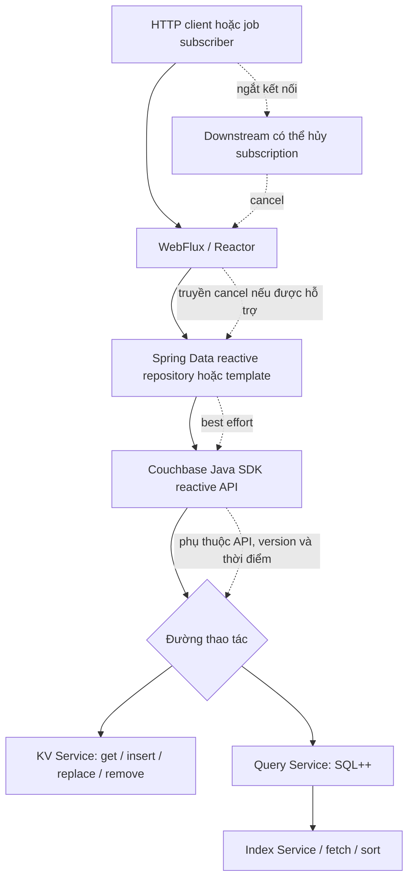

# Hủy đăng ký và khả năng hủy tác vụ đang thực hiện

Trong **SPRING_DATA_COUCHBASE**, một truy vấn hoặc thao tác ghi phản ứng thường được biểu diễn bởi `Mono` hoặc `Flux`. Khi HTTP client đóng kết nối, một luồng chỉ cần ba kết quả đầu tiên, hoặc ứng dụng hết thời gian chờ, **subscriber có thể hủy đăng ký** (*cancel subscription*). Tín hiệu này rất hữu ích: upstream có cơ hội ngừng phát dữ liệu và dọn tài nguyên không còn cần thiết. Tuy nhiên, **hủy subscription không đồng nghĩa hủy chắc chắn tác vụ Couchbase đã được gửi**, càng không phải một lệnh rollback mutation.

Bài thuộc chương **Truy cập phản ứng** của module **SPRING_DATA_COUCHBASE**. Theo phạm vi module, ta xây dựng tầng truy cập document bằng Spring Data, repository, `CouchbaseTemplate`/`ReactiveCouchbaseTemplate` và SQL++; đồng thời cần hiểu bucket/scope/collection, secondary index, TTL, CAS, giao dịch và lựa chọn API reactive để cân bằng hiệu năng, tính nhất quán và khả năng vận hành. Chủ đề này tập trung vào **đường đi của tín hiệu hủy**, **tác động thực tế tại ranh giới SDK/Server** và **cách xác minh hậu quả của thao tác đã bắt đầu**.

> **Nguyên tắc quan trọng nhất:** `cancel()` nói rằng *subscriber không còn muốn nhận dữ liệu từ subscription này*. Nó **không xác nhận** rằng Couchbase chưa thực hiện `save`/`delete`, không bảo đảm Query Service dừng ngay, không chứng minh rollback transaction và không thay thế idempotency/CAS.

## 1. Mục tiêu học tập

Sau bài này, bạn có thể:

1. Giải thích `Subscription.cancel()` trong Reactive Streams và phân biệt nó với `onComplete`, `onError` và `Mono.empty()`.
2. Nhận diện các nguồn tạo cancellation: HTTP disconnect, `take`, `next`, `timeout`, chuyển nhánh, lỗi trong `flatMap` và job shutdown.
3. Phân biệt **hủy upstream subscription**, **ngừng phát row trong SDK**, **ngừng query tại Query Service** và **hủy/rollback mutation**.
4. Dùng `doOnCancel`/`doFinally` để quan sát và dọn trạng thái ở đúng vị trí trong pipeline.
5. Không lấy `doFinally(CANCEL)` làm bằng chứng một lệnh ghi chưa commit.
6. Thiết kế timeout/short-circuit cho query, đồng thời đặt `WHERE`, `ORDER BY`, `LIMIT` và index đúng phía server.
7. Giới hạn fan-out và dọn permit khi cancel nhưng nhận diện độ lệch giữa **in-flight ở app** và **lệnh server còn chạy**.
8. Nhận diện rủi ro của retry/resubscription sau timeout đối với insert, update, delete, audit và transaction.
9. Sử dụng ID/idempotency key ổn định, CAS/`@Version` và cơ chế xác nhận trạng thái cuối.
10. Viết `StepVerifier` test cancellation, so sánh tín hiệu upstream/downstream và xây integration test Couchbase theo phiên bản thực tế.

## 2. Cancellation là một tín hiệu điều khiển, không phải kết quả dữ liệu

Một `Publisher` Reactive Streams có thể phát `onNext` rồi một terminal signal:

```text
onSubscribe(subscription)
  -> request(n)
  -> onNext(value) ...
  -> onComplete() HOẶC onError(error)
```

`cancel` hoạt động theo hướng khác:

```text
subscriber
  -> subscription.cancel()
  -> upstream được báo không còn cần dữ liệu
```

`cancel` **không phải** một `onNext` đặc biệt, cũng không phải `onComplete` hoặc `onError` mà publisher phát xuống downstream. Nó là thông báo của downstream tới upstream về việc ngừng quan tâm.

Ví dụ Reactor thuần:

```java
import java.util.concurrent.atomic.AtomicBoolean;
import reactor.core.publisher.Mono;
import reactor.test.StepVerifier;

AtomicBoolean cancelled = new AtomicBoolean();

Mono<String> source = Mono.<String>never()
    .doOnCancel(() -> cancelled.set(true));

StepVerifier.create(source)
    .thenCancel()
    .verify();

org.assertj.core.api.Assertions.assertThat(cancelled.get())
    .isTrue();
```

Trong ví dụ này không có Couchbase, không có SQL++ hay I/O thật. Test chỉ xác minh nguồn Reactor đã **nhận cancellation hook**.

### 2.1. Không nhầm với hoàn tất rỗng

| Tình huống | Diễn giải | Tín hiệu |
| --- | --- | --- |
| `Mono.just(customer)` | Có một kết quả và hoàn tất | `onNext` → `onComplete` |
| `Mono.empty()` | Hoàn tất bình thường nhưng không có item | `onComplete` |
| `Mono.error(error)` | Tác vụ báo lỗi | `onError` |
| `Mono.never()` rồi subscriber hủy | Subscriber không muốn chờ nữa | `cancel` gửi lên nguồn |
| `Flux.take(3)` đã nhận ba phần tử | Downstream hoàn tất theo mục tiêu cục bộ; upstream có thể bị hủy | Downstream `onComplete`, upstream `cancel` |

Nếu `findById(id)` trả rỗng, điều đó **không** có nghĩa “SDK đã hủy truy vấn”. Nếu một client cancel, cũng không được biến sự kiện đó thành một document “không tìm thấy”.

### 2.2. Cancellation có thể xảy ra đồng thời với kết quả

Giữa thao tác cancel và một `onNext`/`onComplete` đang trên đường truyền có thể có **race condition**. Không viết code nghiệp vụ phụ thuộc vào thứ tự thời gian tuyệt đối giữa “client đã ngắt” và “Couchbase đã ghi” khi không có giao thức xác nhận riêng.

## 3. Đường đi qua các tầng của một request Couchbase



Cần phân biệt **cơ hội ngừng công việc** ở mỗi tầng với **bảo đảm dữ liệu cuối**.

| Ranh giới | Điều có thể quan sát | Điều **không được tự suy ra** |
| --- | --- | --- |
| HTTP → WebFlux | Client disconnect hoặc request bị hủy | Tất cả side effect đã rollback. |
| Reactor → repository | Subscription có `CANCEL`, upstream được báo hủy | Query Server đã đóng tức thì. |
| Repository → SDK | SDK có thể ngừng chờ/phát kết quả | Một operation đã gửi chắc chắn bị thu hồi. |
| SDK → KV Service | Có thể ngừng công việc trước khi gửi hoặc hủy chờ | Mutation đã được gửi chắc chắn không commit. |
| SDK → Query Service | Có thể kết thúc luồng/cố gắng dừng query theo API | Index scan/aggregate/sort không còn tốn tài nguyên. |
| Transaction | Caller bỏ chờ/kết quả không rõ | Transaction chắc chắn abort/rollback. |

**Ranh giới SDK/Server phụ thuộc phiên bản** Couchbase Java SDK, Spring Data Couchbase và loại operation. Không áp một khẳng định chung “cancel luôn hủy SQL++ query” hoặc “cancel không bao giờ tiết kiệm gì”; cần xem tài liệu release và đo thực tế.

## 4. Bối cảnh entity và repository

Giả sử dùng bucket `app`, scope `crm`, collection `customers`. Một document:

```json
{
  "tenant_id": "tenant-a",
  "customer_code": "C001",
  "display_name": "Lan Anh",
  "status": "ACTIVE",
  "loyalty_points": 100
}
```

Document ID ví dụ `customer::tenant-a::C001` là khóa key-value riêng, không nhất thiết có JSON field `id`.

```java
package example.crm;

import org.springframework.data.annotation.Id;
import org.springframework.data.annotation.Version;
import org.springframework.data.couchbase.core.mapping.Collection;
import org.springframework.data.couchbase.core.mapping.Document;
import org.springframework.data.couchbase.core.mapping.Field;
import org.springframework.data.couchbase.core.mapping.Scope;

@Document
@Scope("crm")
@Collection("customers")
public class Customer {

    @Id
    private String id;

    @Field("tenant_id")
    private String tenantId;

    @Field("customer_code")
    private String customerCode;

    @Field("display_name")
    private String displayName;

    @Field
    private String status;

    @Field("loyalty_points")
    private Integer loyaltyPoints;

    @Version
    private Long version;

    protected Customer() {}

    public String getId() { return id; }
    public String getTenantId() { return tenantId; }
    public String getStatus() { return status; }
    public Integer getLoyaltyPoints() { return loyaltyPoints; }

    public void setStatus(String status) {
        this.status = status;
    }

    public void setLoyaltyPoints(Integer points) {
        this.loyaltyPoints = points;
    }

    // Constructor và getters/setters khác được lược bỏ.
}
```

`@Id` ánh xạ document ID, `@Field` ánh xạ property Java sang JSON field và `@Version` có thể tham gia optimistic locking/CAS trên các đường thao tác được Spring Data Couchbase phiên bản sử dụng hỗ trợ.

Repository:

```java
package example.crm;

import org.springframework.data.couchbase.repository.ReactiveCouchbaseRepository;
import reactor.core.publisher.Flux;

public interface ReactiveCustomerRepository
        extends ReactiveCouchbaseRepository<Customer, String> {

    Flux<Customer> findByTenantIdAndStatus(
        String tenantId,
        String status
    );
}
```

`findById(id)` thường dùng **KV lookup**; `findByTenantIdAndStatus` thường dùng **SQL++ qua Query Service/secondary index**. Một bên chủ yếu trả tối đa một document, một bên có thể trả hàng nghìn dòng. Khả năng tiết kiệm tài nguyên khi cancel vì thế không giống nhau.

## 5. Assembly, subscription, execution và cancellation

```java
Mono<Customer> read = repository.findById(documentId);
```

Việc tạo `read` thông thường chưa chứng minh đã đọc document. Một subscriber hợp lệ kích hoạt tiêu thụ:

```java
Mono<Customer> observed = repository.findById(documentId)
    .doOnSubscribe(sub ->
        logger.debug("subscribed to customer read")
    )
    .doOnCancel(() ->
        logger.debug("read subscription was cancelled")
    );
```

`logger` là logger do ứng dụng cung cấp. Các callback ở đây quan sát vòng đời reactive; **không** là phép đo trực tiếp số request server đã nhận.

### 5.1. Cancel trước khi SDK gửi lệnh khác cancel sau khi gửi

Có thể hình dung một số mốc:

```text
T0: Tạo Mono (assembly)
T1: Subscriber đăng ký
T2: SDK chuẩn bị operation
T3: Request được gửi tới Couchbase
T4: Couchbase xử lý
T5: Response trở về SDK
T6: Mapper phát onNext/onComplete
```

Nếu cancel ở **trước T3**, một implementation có thể ngăn việc gửi lệnh và tiết kiệm I/O. Nếu cancel ở **sau T3**, không thể giả định backend ngừng xử lý hay không commit. Ở thời điểm gần T5–T6 còn có race giữa kết quả và cancel.

Không có timestamp nào ở trên là ranh giới nguyên tử mà Reactor tự kiểm soát với Couchbase.

### 5.2. Hot/shared publisher có lifecycle khác nguồn cold

Publisher từ một thao tác repository thường được sử dụng như nguồn cold, nhưng sau khi áp dụng `cache()`, `share()` hoặc tự tạo hot source với `Sinks`, lifecycle upstream có thể khác. Một subscriber hủy **không nhất thiết hủy công việc dùng chung cho các subscriber khác**.

Ví dụ:

```java
Mono<Customer> shared = repository.findById(id)
    .cache();
```

Với `Mono.cache()`, nguồn có thể tiếp tục thực hiện khi đã có subscription đầu tiên, kể cả một downstream không còn quan tâm, tùy semantics overload/version. **Đừng dùng cache publisher để suy ra cancellation sẽ dừng operation**. Ngoài ra cần TTL cache riêng nếu dữ liệu có TTL/đổi quyền; không cache dữ liệu tenant khác sai khóa.

## 6. Nguồn cancellation thường gặp trong ứng dụng

| Nguồn | Ví dụ | Tác động cần phân tích |
| --- | --- | --- |
| Client disconnect | Browser đóng tab lúc query đang chạy | WebFlux có thể cancel response publisher. |
| `Flux.take(n)` | Chỉ cần 10 item từ query lớn | Upstream có thể được cancel sau khi đủ item. |
| `Flux.next()` | Chỉ nhận row đầu từ `Flux` | Các row còn lại không còn được subscriber cần. |
| `Mono.timeout(...)` | Đọc KV quá deadline | Upstream có thể bị cancel, downstream nhận lỗi timeout. |
| `Flux.timeout(...)` | Không thấy item tiếp theo trong khoảng chờ | Upstream có thể bị cancel sau timeout. |
| `takeUntil`/`takeWhile` | Dừng khi gặp sentinel/predicate | Có thể kết thúc sớm, ngừng quan tâm upstream. |
| Lỗi của inner trong `flatMap` | Một lookup thất bại | Các inner còn chạy có thể bị cancel. |
| `Mono.firstWithSignal` | Nhiều nguồn cạnh tranh, lấy tín hiệu đầu tiên | Các nguồn không thắng có thể bị cancel. |
| Job shutdown | Chủ job hủy `Disposable`/scope | Cần dọn tài nguyên và xử lý trạng thái công việc. |
| `StepVerifier.thenCancel()` | Test có chủ đích | Chỉ chứng minh cơ chế Reactor đang được test. |

Các hành vi cụ thể có thể khác theo operator và phiên bản Reactor; câu quan trọng là **ai sở hữu subscription**, **điểm nào bị hủy** và **operation ở backend đã tới giai đoạn nào**.

## 7. `take(n)` và hai góc nhìn kết thúc khác nhau

Ví dụ:

```java
Flux<Customer> ten = repository
    .findByTenantIdAndStatus(tenantId, "ACTIVE")
    .take(10);
```

Đối với **subscriber cuối**, `ten` có thể phát 10 customer rồi `onComplete` bình thường. Nhưng đối với **upstream repository/SDK**, operator `take` có thể **cancel** sau khi đã nhận đủ số item.

```text
Repository Flux  ->  take(10)  ->  HTTP subscriber
      CANCEL <---            ---> onComplete
```

Không mâu thuẫn: **điểm đặt quan sát** quyết định bạn nhìn thấy `CANCEL` hay `ON_COMPLETE`.

### 7.1. Đặt `doFinally` trước và sau `take`

```java
Flux<Customer> result = repository
    .findByTenantIdAndStatus(tenantId, "ACTIVE")
    .doFinally(signal ->
        metrics.recordRepositorySignal(signal)
    )
    .take(10)
    .doFinally(signal ->
        metrics.recordResponseSignal(signal)
    );
```

`metrics` là thành phần minh họa của ứng dụng. Trong tình huống query còn nhiều dữ liệu và downstream nhận đủ mười item:

- Hook **trước `take`** có thể thấy `SignalType.CANCEL` vì `take` ngừng nguồn.
- Hook **sau `take`** thường thấy `SignalType.ON_COMPLETE` vì downstream đạt mục tiêu.
- Không có hook nào chứng minh Query Service chỉ scan mười document.

Nếu nguồn hoàn tất tự nhiên khi chưa đủ mười item, hook upstream có thể thấy `ON_COMPLETE` thay vì cancel. Vì vậy kết luận cần gắn với fixture và điểm quan sát cụ thể.

### 7.2. `next()` cũng thường short-circuit

```java
Mono<Customer> firstObserved = repository
    .findByTenantIdAndStatus(tenantId, "ACTIVE")
    .next();
```

`next()` lấy item đầu của một `Flux`; nó không tự định nghĩa “khách hàng mới nhất” hay “điểm cao nhất”. Nếu query thiếu `ORDER BY` và `LIMIT 1` tại server, kết quả đầu là kết quả theo thứ tự phát của nguồn, không có bảo đảm nghiệp vụ.

## 8. `take(n)` không thay SQL++ `LIMIT n`

Một sai lầm vận hành:

```java
Flux<Customer> preview = repository.findByTenantIdAndStatus(
    "tenant-a", "ACTIVE"
).take(20);
```

Câu này chỉ giới hạn **số item đi xuống downstream**. Couchbase Server có thể đã:

- Scan nhiều index entries trước row đầu.
- Fetch nhiều documents để lọc/projection.
- Sort hàng nghìn candidate.
- Buffer dữ liệu qua transport/SDK.
- Thực hiện một phần lớn query trước khi thấy cancellation.

Để giảm chi phí phía Server, hãy đặt điều kiện và giới hạn vào SQL++:

```sql
-- SQL++ minh họa ý định; mapping entity cần metadata phù hợp.
SELECT c.customer_code, c.display_name
FROM `app`.`crm`.`customers` AS c
WHERE c.tenant_id = $tenantId
  AND c.status = "ACTIVE"
ORDER BY c.customer_code ASC
LIMIT 20;
```

`LIMIT 20` giới hạn row trả về nhưng **không bảo đảm chỉ scan 20 documents** nếu cần sort/filter nhiều candidate. Cần index và `EXPLAIN` theo statement thực thi.

### 8.1. Index tham khảo

```sql
CREATE INDEX ix_customers_tenant_status_code
ON `app`.`crm`.`customers` (
    `tenant_id`,
    `status`,
    `customer_code`
);
```

Index chỉ là ví dụ. Spring Data Couchbase có thể thêm type discriminator/metadata; index thật phải dựa trên SQL++ đã sinh, kích thước dữ liệu và query plan. Query tối ưu server-side tốt hơn việc phụ thuộc cancellation muộn để giảm chi phí.

## 9. `doOnCancel` và `doFinally`: quan sát khác nhau

`doOnCancel` được gọi khi subscription ở vị trí operator đó bị hủy:

```java
Mono<Customer> read = repository.findById(id)
    .doOnCancel(() -> logger.info("read was cancelled"));
```

`doFinally` quan sát cả **hoàn tất bình thường, lỗi hoặc cancel**:

```java
import reactor.core.publisher.SignalType;

Mono<Customer> tracked = repository.findById(id)
    .doFinally(signal -> {
        if (signal == SignalType.CANCEL) {
            metrics.incrementCancelledReads();
        } else if (signal == SignalType.ON_ERROR) {
            metrics.incrementFailedReads();
        } else if (signal == SignalType.ON_COMPLETE) {
            metrics.incrementCompletedReads();
        }
    });
```

`logger` và `metrics` là các đối tượng ứng dụng minh họa, không phải built-in của Couchbase.

### 9.1. Lỗi và hủy không được gộp chung

Nếu một `Mono` lỗi và subscriber nhận `onError`, đó là lỗi, không phải completion bình thường. Nếu downstream cancel, không nên ghi một HTTP 500 chỉ vì có `CANCEL`. Cần metrics riêng:

| Tín hiệu | Ý nghĩa từ góc nhìn operator | Metric hữu ích |
| --- | --- | --- |
| `ON_COMPLETE` | Publisher hoàn tất bình thường | completed |
| `ON_ERROR` | Publisher phát lỗi | failed, error_type |
| `CANCEL` | Downstream không còn cần nguồn | cancelled, cancel_reason nếu biết |

Tại tầng application, **không lấy số subscription bị cancel làm số query server bị hủy thành công**.

### 9.2. Vị trí operator ảnh hưởng kết quả quan sát

```java
Flux<Customer> output = source
    .doFinally(sig -> record("source", sig))
    .take(5)
    .doFinally(sig -> record("consumer", sig));
```

`source` và `record` là biến/helper minh họa. Nếu output hoàn tất đủ năm item và upstream còn dữ liệu, hai hook có thể nhận **loại tín hiệu khác nhau**. Nên ghi rõ “pipeline boundary” vào metric/log để tránh coi khác biệt đó là lỗi monitoring.

### 9.3. Không đặt mutation nghiệp vụ vào `doFinally`

`doFinally` phù hợp với cleanup/counter/metrics. Nó **không** phải nơi an toàn để gọi:

```java
// Anti-pattern: ghi audit quan trọng tách khỏi kết quả pipeline.
.doFinally(sig -> auditRepository.save(audit).subscribe())
```

Audit đó là một subscription phụ, lỗi không được trả về subscriber của workflow, có thể chạy lại vì resubscription và không nằm trong cùng transaction. Nếu audit bắt buộc, compose bằng `flatMap`/`then` hoặc transaction/outbox có idempotency.

## 10. Timeout: phía downstream nhận lỗi, phía upstream có thể bị hủy

Ví dụ:

```java
import java.time.Duration;

Mono<Customer> timed = repository.findById(id)
    .timeout(Duration.ofSeconds(2));
```

Nếu không có tín hiệu đúng hạn:

1. `timeout` có thể hủy upstream subscription.
2. `timeout` phát lỗi timeout tới downstream.
3. SDK có thể nhận cancellation và thực hiện cleanup phù hợp với API.
4. Nếu operation đã gửi, Couchbase Server **có thể vẫn đang xử lý**.

### 10.1. Quan sát cả hai phía

```java
Mono<Customer> traced = repository.findById(id)
    .doFinally(sig ->
        metrics.record("before-timeout", sig)
    )
    .timeout(Duration.ofSeconds(2))
    .doFinally(sig ->
        metrics.record("after-timeout", sig)
    );
```

Khi timeout được kích hoạt và chưa có response, hook upstream có thể thấy `CANCEL`, còn hook downstream thấy `ON_ERROR`. Điều đó là **ngữ nghĩa operator**, không chứng minh query đã được server dừng.

### 10.2. `Flux.timeout(Duration)` thường là gap timeout

```java
Flux<Customer> streaming = repository
    .findByTenantIdAndStatus(tenantId, "ACTIVE")
    .timeout(Duration.ofSeconds(3));
```

Với overload `timeout(Duration)` trên `Flux`, điều kiện thường liên quan khoảng chờ đến item đầu và giữa các item tiếp theo. Một stream liên tục phát dữ liệu trước mỗi ngưỡng **có thể kéo dài hơn ba giây**.

Nếu yêu cầu deadline tổng cho HTTP request/job, phải thiết kế deadline ngoài gap timeout, đồng thời cấu hình timeout SDK/Query Service khi API phiên bản hỗ trợ.

### 10.3. Timeout per-attempt khác deadline toàn pipeline

```java
Mono<Customer> perAttempt = repository.findById(id)
    .timeout(Duration.ofSeconds(1))
    .retryWhen(readRetrySpec);

Mono<Customer> totalPipeline = repository.findById(id)
    .retryWhen(readRetrySpec)
    .timeout(Duration.ofSeconds(3));
```

`readRetrySpec` là chính sách do ứng dụng định nghĩa. Đặt `timeout` bên trong retry giới hạn mỗi attempt; đặt sau retry giới hạn thời gian chờ của cả `Mono` tại vị trí đó. **Cả hai** vẫn không tự thay thế timeout/cleanup tại SDK và Server.

## 11. KV GET: tác vụ có thể hoàn tất sau khi caller bỏ chờ

Với:

```java
Mono<Customer> customer = repository.findById(documentId);
```

Nếu caller hủy khi SDK đã gửi KV get, cluster có thể vẫn trả response hoặc đã hoàn thành trước khi tín hiệu cancel đến. Với operation chỉ đọc, rủi ro dữ liệu ít hơn mutation, nhưng vẫn có chi phí network/CPU và metric mismatch.

**Không kết luận** “vì response không được gửi đến HTTP client nên SDK không thực hiện KV request”. Tương tự, nếu dùng `Mono.cache()` hoặc một job khác cùng chia sẻ publisher, cancel từ một caller có thể không ảnh hưởng upstream như kỳ vọng.

### 11.1. KV lookup thường không cần secondary index

`findById` đọc theo document key; query theo field `tenant_id`/`status` dùng SQL++/secondary index. Vì vậy việc hủy một `Mono` KV get và hủy một `Flux` query hàng nghìn row có tác động tài nguyên khác nhau.

### 11.2. Read-only retry vẫn phải có ngân sách

Đọc có thể thử lại một số lỗi tạm thời theo chính sách, nhưng nếu mỗi HTTP client cancel rồi một background task tự retry vô hạn, cluster vẫn phải phục vụ các request không còn giá trị. Retry chỉ nên tồn tại trong lifecycle có owner, deadline và admission rõ.

## 12. SQL++ Query Service: cancellation và buffering

Một `Flux<Customer>` từ derived query có thể chứa dữ liệu của một SQL++ statement:

```java
Flux<Customer> active = repository.findByTenantIdAndStatus(
    tenantId, "ACTIVE"
);
```

Query Service có thể thực hiện index scan, fetch, filter, sort hoặc aggregate; SDK có thể decode/buffer một số row. Tín hiệu `cancel` ở downstream **có thể giúp tiết kiệm công việc còn lại**, nhưng mức độ tiết kiệm phụ thuộc:

- Query đã chạy đến bước nào.
- SQL++ có thể streaming ngay hay phải sort/aggregate trước.
- Đường transport/SDK và khả năng propagate cancellation của phiên bản.
- Số row đã được buffer trước khi downstream ngừng.
- Lệnh hủy có thể tới server đúng lúc hay không.

Không khẳng định cứ thấy `doOnCancel` là Query Service sẽ ghi nhận một “query cancelled” tương ứng.

### 12.1. Một query trả ít row vẫn có thể tốn kém

```sql
SELECT c.status, COUNT(1) AS total
FROM `app`.`crm`.`customers` AS c
WHERE c.tenant_id = $tenantId
GROUP BY c.status;
```

Đoạn SQL++ có thể trả rất ít row sau khi tổng hợp một tập document lớn. Subscriber nhận hai row rồi hủy không thể hoàn tác chi phí aggregate đã xảy ra trước đó. Tối ưu index, predicate và workload trước khi xem cancellation là biện pháp bảo vệ cluster.

### 12.2. Phân biệt loại tài nguyên

| Tài nguyên | Cách giảm chi phí phù hợp hơn |
| --- | --- |
| Row trả về | SQL++ `LIMIT`, phân trang, projection. |
| Index scan | Predicate chọn lọc, index phù hợp, `EXPLAIN`. |
| Sort/aggregate | Index/order, query design, giới hạn tập dữ liệu. |
| Nhiều queries đồng thời | Admission/bulkhead và concurrency budget. |
| Buffer/response lớn | Row size, projection, bounded buffer. |
| Client không còn nhận dữ liệu | Cancel đúng lifecycle, server timeout khi hỗ trợ. |

Cancellation là một phần của hệ thống quản trị tài nguyên, **không phải thay thế** query optimization.

## 13. Backpressure không cam kết từng `request(1)` ngừng/tiếp tục Server

Reactor cho phép subscriber yêu cầu số item qua `request(n)`. Nhưng:

```java
StepVerifier.create(Flux.just("C001", "C002"), 0)
    .thenRequest(1)
    .expectNext("C001")
    .thenRequest(1)
    .expectNext("C002")
    .verifyComplete();
```

Bài test cho thấy demand ở **publisher Reactor thuần**; nó không chứng minh SDK làm một KV request cho mỗi `request(1)`, hoặc Query Service chỉ scan một row khi Java yêu cầu một item.

Couchbase SDK có thể đã gửi statement và một số kết quả có thể được buffer/decode. Để kết luận mức độ tiết kiệm, cần quan sát SQL++/SDK/Server metrics và version cụ thể.

### 13.1. Backpressure và cancel khác rate limit

`limitRate(n)` điều tiết demand trong một pipeline; `take(n)` giới hạn item downstream; `flatMap(..., concurrency)` giới hạn số inner publisher. Không operator nào tự tạo quota “tối đa n Couchbase queries/giây trên toàn cluster”.

Khi cần bảo vệ cluster trước nhiều HTTP requests, dùng giới hạn theo request/batch, bulkhead chia sẻ và rate/admission ở đúng phạm vi, không dùng cancel như một rate limiter.

## 14. Mutation: hủy request không có nghĩa hủy commit

Đây là điểm cần nhớ khi làm create/update/delete:

```text
T0: HTTP PUT đến server
T1: Service tạo publisher repository.save(customer)
T2: Subscriber/WebFlux kích hoạt operation
T3: SDK gửi mutation đến Couchbase
T4: Client ngắt kết nối / timeout -> cancel
T5: Couchbase có thể đã commit mutation
T6: Client không nhận được success response
```

Từ phía client, **outcome không rõ**. Việc ngừng nhận response không nói lên trạng thái cuối ở database.

### 14.1. Hai lịch sử đều có thể quan sát cùng một timeout

**Lịch sử A — chưa ghi:** Lệnh bị hủy trước khi được gửi hoặc server từ chối trước commit.

**Lịch sử B — đã ghi:** Server commit thành công nhưng response tới quá muộn hoặc bị mất, subscriber đã cancel.

Cả hai có thể dẫn đến cùng một biểu hiện “client timeout”. Vì vậy không lập trình:

```java
// Anti-pattern: không biết outcome nhưng coi như chưa ghi.
repository.save(customer)
    .timeout(Duration.ofSeconds(2))
    .onErrorResume(error -> createAgainWithAnotherId());
```

`createAgainWithAnotherId()` là helper minh họa nhưng cách xử lý này sai với nghiệp vụ cần uniqueness: có thể tạo **hai document** cho cùng một yêu cầu.

### 14.2. Cần mô hình kết quả cho mutation chưa xác nhận

Một trạng thái công việc nghiệp vụ có thể phân biệt:

| Trạng thái | Ý nghĩa |
| --- | --- |
| `NOT_STARTED` | Chưa có bằng chứng lệnh bắt đầu. |
| `IN_PROGRESS` | Có công việc đang chạy, chưa biết kết quả. |
| `SUCCEEDED` | Đã xác minh mutation đạt trạng thái đích. |
| `FAILED_FINAL` | Lỗi chắc chắn, không được tự thử lại. |
| `UNKNOWN_OUTCOME` | Caller mất xác nhận; phải đối chiếu backend. |

Đây là **mô hình thiết kế ứng dụng**, không phải enum mặc định của Spring Data Couchbase. Với operation quan trọng, lưu request ID/idempotency token và kết quả đã xác nhận để retry/reconcile an toàn.

## 15. Create-only, upsert và idempotency khi caller ngắt kết nối

Giả sử API POST tạo customer từ tenant đã xác thực và mã customer code.

ID xác định:

```text
customer::<authenticated-tenant>::<customer-code>
```

Giữ nguyên ID/idempotency key khi client gửi lại cùng yêu cầu. Nếu nghiệp vụ cần **chỉ tạo khi chưa tồn tại**, phải dùng insert-only API theo version, không mặc định `save` luôn có nghĩa “insert nếu ID mới, từ chối nếu trùng”.

Một mẫu phương thức template tham khảo:

```java
// Chỉ là dạng API ví dụ; xác minh signature theo release.
Mono<Customer> created = template
    .insertById(Customer.class)
    .one(customer);
```

Nếu thử lại gặp duplicate ID, cần phân biệt:

- Document do **chính request trước** đã tạo thành công nhưng response bị mất.
- Document đã tồn tại từ **request khác**.
- Có xung đột ID với dữ liệu không cùng nội dung/tenant.

Không tự chuyển mọi duplicate thành HTTP 200. Phải đối chiếu idempotency token, dữ liệu/phiên bản hoặc bản ghi kết quả đã lưu, đồng thời kiểm soát quyền tenant.

### 15.1. Upsert cùng ID chưa chắc exactly-once

`repository.save(customer)` có thể sử dụng insert/replace/upsert tùy ID/version và release. Dù hai lần ghi cùng ID cuối cùng chỉ còn một document, các side effect như event, CAS thay đổi, auditing và TTL có thể khác. **Exactly-once** không xuất hiện chỉ vì cùng document key.

## 16. Cập nhật và CAS sau cancellation

Một quy trình:

```java
Mono<Customer> rename = repository.findById(id)
    .flatMap(customer -> {
        customer.setStatus("ARCHIVED");
        return repository.save(customer);
    });
```

Nếu caller cancel sau khi save gửi đi, trạng thái cuối có thể không rõ. Với `@Version`/CAS đúng API, một cập nhật cạnh tranh có thể bị từ chối; nhưng **CAS conflict** và **không rõ outcome vì timeout** là hai vấn đề khác nhau.

### 16.1. CAS conflict có nghĩa gì?

Hai request đọc cùng CAS V1. Request A save và đổi CAS thành V2; B save với V1 bị conflict nếu optimistic locking được áp dụng. Đây là tín hiệu về cạnh tranh dữ liệu có thể được giải quyết bằng thông báo 409 hoặc đọc lại theo nghiệp vụ.

### 16.2. Timeout không chứng minh conflict

Nếu A save nhưng timeout, có thể A **đã thành công**. Retry bằng cách đọc lại rồi tiếp tục thay đổi có thể tạo tác động **lặp** nếu operation là cộng điểm hoặc chuyển trạng thái có side effect. Cần xác nhận idempotency theo request ID trước khi thử lại.

### 16.3. Không retry vô hạn một object mang CAS cũ

Nếu đã biết CAS conflict, gửi lại cùng entity stale qua `retryWhen` có thể tiếp tục conflict. Chỉ retry một pipeline **đọc lại → xác thực tenant/trạng thái → tính lại → lưu** khi nghiệp vụ cho phép và có giới hạn. Đừng dùng cancel để suy ra không còn cạnh tranh.

## 17. Xóa document: tại sao cancel đặc biệt nguy hiểm?

```java
Mono<Void> removed = repository.deleteById(documentId);
```

`Mono<Void>` không phát một entity. Nếu HTTP DELETE bị hủy trước khi nhận completion, có thể:

- Chưa có remove nào được gửi.
- Remove đã được gửi nhưng chưa biết kết quả.
- Remove đã commit và response bị mất.
- Document đã hết TTL trước thao tác.
- Có mutation khác với cùng ID/cùng CAS trong lúc đó.

Một chính sách có thể quy định “xóa lại khi document đã không tồn tại là thành công”, **chỉ** khi ID không được tái sử dụng theo cách khiến xóa nhầm document mới. Với xóa có điều kiện tenant/trạng thái/retention, cần CAS hoặc điều kiện mutation/giao dịch phù hợp.

### 17.1. Read → authorize → delete không nguyên tử chỉ nhờ `flatMap`

```java
Mono<Void> deletion = repository.findById(id)
    .filter(c -> authenticatedTenant.equals(c.getTenantId()))
    .switchIfEmpty(Mono.error(
        new CustomerNotFoundException(id)
    ))
    .flatMap(repository::delete);
```

`CustomerNotFoundException` là class minh họa do ứng dụng định nghĩa. Đoạn này cho thấy kiểm tra tenant, nhưng **không** chứng minh repository delete dùng CAS trong mọi release. Một request khác có thể sửa/xóa document giữa read và delete. Cần kiểm chứng đường mutation thực tế và CAS/transaction nếu có tiền điều kiện quan trọng.

## 18. Transaction: ngắt subscription không thay thế abort protocol

Một workflow lưu customer A và audit B:

```java
Mono<Void> workflow = repository.save(customerA)
    .then(auditRepository.save(auditB))
    .then();
```

`then` bảo đảm thứ tự subscription sau khi nguồn trước hoàn tất bình thường, nhưng không tạo transaction. Nếu client cancel sau khi lưu A, A **có thể đã commit**, còn B chưa ghi.

Nếu yêu cầu all-or-nothing nhiều document, phải dùng **transaction API Couchbase SDK/Spring Data Couchbase mà phiên bản thực sự hỗ trợ**, bảo đảm các operation tham gia cùng transaction context. Khi caller hủy:

- Không tự kết luận transaction đã abort thành công.
- Không tự kết luận callback ngoài transaction chưa chạy.
- Theo dõi transaction result/state theo API và quy trình recovery phù hợp.
- Tránh side effect không idempotent như gửi email/thanh toán trong callback có thể retry.

`@Transactional` thông thường hoặc `Mono.when` không được xem là bảo đảm nguyên tử cho mọi API Couchbase reactive/SDK mà không kiểm chứng.

## 19. Retry sau timeout/cancel: cần phân biệt tình huống

Retry của Reactor thường hoạt động khi upstream phát `onError`, **không** tự chạy chỉ vì downstream cancel. Nhưng `timeout` có thể tạo `onError(TimeoutException)` phía downstream, khiến `retryWhen` nếu đặt phía sau được kích hoạt.

```java
Mono<Customer> read = repository.findById(id)
    .timeout(Duration.ofSeconds(2))
    .retryWhen(readRetrySpec);
```

`readRetrySpec` do ứng dụng cấu hình, có thể lọc lỗi tạm thời và giới hạn số lần thử. Với **read-only** và deadline phù hợp, retry có thể chấp nhận. Với **mutation**, không thêm retry timeout tương tự mà chưa giải quyết unknown outcome.

### 19.1. `timeout` trong/ngoài retry khác nhau

```java
Mono<Customer> timeoutPerAttempt = repository.findById(id)
    .timeout(Duration.ofSeconds(1))
    .retryWhen(readRetrySpec);

Mono<Customer> timeoutTotal = repository.findById(id)
    .retryWhen(readRetrySpec)
    .timeout(Duration.ofSeconds(3));
```

Mẫu đầu có thể kéo dài tổng thời gian qua nhiều attempts/backoff; mẫu sau đặt thời hạn cho cả pipeline `Mono` tại vị trí đó. Cả hai là giới hạn chờ Reactor, không phải cam kết SDK/Server ngừng operation.

### 19.2. Cancellation không tự tạo re-subscription

Nếu HTTP client disconnect, không nên tự chạy một background `subscribe()` để “cứu” thao tác đang chờ nếu không có owner/job có trách nhiệm lưu kết quả, audit và retry bền vững. Ngược lại, nếu nghiệp vụ **bắt buộc hoàn tất sau khi request bị ngắt**, nên chuyển thành một **durable job** với ID, idempotency, checkpoint và API kiểm tra trạng thái; HTTP subscription không phải owner phù hợp.

## 20. `flatMap`, concurrency và hủy các inner publishers

Một batch:

```java
Flux<Customer> results = Flux.fromIterable(customerIds)
    .flatMap(repository::findById, 8);
```

`8` giới hạn số inner publishers đồng thời trong operator này. Nếu một inner lỗi và `flatMap` phát lỗi xuống downstream, những inner khác có thể nhận cancellation. Tuy nhiên, những KV requests đã gửi **có thể vẫn chạy**. Với batch mutation, một số ghi có thể đã commit.

### 20.1. Cancellation không tạo rollback cho batch

```java
Flux<Customer> saves = Flux.fromIterable(customersToSave)
    .flatMap(repository::save, 8);
```

Nếu HTTP client hủy giữa chừng, một số `save` có thể thành công, số khác chưa bắt đầu hoặc có outcome không rõ. Không thông báo “không document nào bị sửa” chỉ vì response Flux không complete.

### 20.2. Kết quả từng item nếu cho phép partial success

Một kiểu outcome ứng dụng:

```java
public record SaveOutcome(
    String documentId,
    boolean confirmed,
    String errorCode
) {
}
```

```java
Flux<SaveOutcome> outcomes = Flux.fromIterable(customersToSave)
    .flatMap(customer ->
        repository.save(customer)
            .map(saved ->
                new SaveOutcome(saved.getId(), true, null)
            )
            .onErrorResume(error ->
                Mono.just(new SaveOutcome(
                    customer.getId(),
                    false,
                    classifyForClient(error)
                ))
            ),
        8
    );
```

`classifyForClient` là helper minh họa chỉ trả mã lỗi đã được duyệt; không để lộ exception/stack trace. **Điểm cần sửa trong hệ thống thực:** outcome `confirmed=false` có thể là **UNKNOWN_OUTCOME**, không nhất thiết “chắc chắn chưa ghi”. Nếu caller cancel toàn batch, một số item có thể không phát outcome nào; để bảo đảm theo dõi bền vững, lưu checkpoint/job result bên ngoài HTTP pipeline.

### 20.3. `concatMap` không tạo all-or-nothing

`concatMap(repo::save)` xử lý trong pipeline theo thứ tự, nhưng các ghi trước vẫn có thể commit nếu bước sau bị hủy/lỗi. Chọn operator theo thứ tự nghiệp vụ; dùng transaction hoặc công việc bền vững nếu cần bảo đảm khác.

## 21. Cleanup trong Reactor: không làm rò rỉ tài nguyên

Cancellation có thể ngăn đường complete thông thường. Vì vậy nếu một pipeline **sở hữu** tài nguyên tạm thời, cần cleanup cho cả normal complete, error và cancel.

### 21.1. `doFinally` cho permit/counter

Một bulkhead **fail-fast** không blocking minh họa:

```java
import java.util.concurrent.RejectedExecutionException;
import java.util.concurrent.Semaphore;
import java.util.function.Supplier;
import reactor.core.publisher.Mono;

public final class ReactiveBulkhead {

    private final Semaphore permits;

    public ReactiveBulkhead(int maxInFlight) {
        if (maxInFlight < 1) {
            throw new IllegalArgumentException(
                "maxInFlight must be positive"
            );
        }
        this.permits = new Semaphore(maxInFlight);
    }

    public <T> Mono<T> protect(Supplier<Mono<T>> action) {
        return Mono.defer(() -> {
            if (!permits.tryAcquire()) {
                return Mono.error(new RejectedExecutionException(
                    "No Couchbase slot available"
                ));
            }

            return Mono.defer(action)
                .doFinally(signal -> permits.release());
        });
    }
}
```

Ưu điểm:

- `tryAcquire()` không block event loop.
- `Mono.defer` chỉ xin permit khi có subscription.
- `doFinally` trả permit khi complete, error **hoặc cancel**.
- Bộ bulkhead phải là instance **được chia sẻ** cho các request cần cùng budget.

**Giới hạn của phép đo:** permit được trả khi subscription bị cancel, **không chứng minh SDK/Server đã dừng ngay**. Vì vậy số permit đang giữ là số publisher được app coi đang hoạt động, không phải con số tuyệt đối về task Couchbase đang còn chạy sau mọi tình huống cancel.

### 21.2. Đừng giải phóng permit hai lần

Một anti-pattern là vừa `doOnCancel(release)` vừa `doFinally(release)` trên cùng permit:

```java
// Sai: CANCEL có thể chạy cả hai hook và release hai lần.
publisher
    .doOnCancel(() -> permits.release())
    .doFinally(signal -> permits.release());
```

`publisher` và `permits` là biến minh họa. Double release làm semaphore đếm sai, cho phép in-flight vượt cap dự kiến. Chọn **một** đường cleanup có vòng đời rõ ràng, hoặc sử dụng resource manager được kiểm chứng.

### 21.3. Tài nguyên chia sẻ không nên đóng mỗi request

Couchbase `Cluster`/SDK connection và Spring Data repository thường là các tài nguyên **dùng chung**, do application lifecycle quản lý. Không đưa `cluster.disconnect()`/close vào `doFinally` của mỗi HTTP request. Chỉ giải phóng resource **mà subscription đó sở hữu**.

## 22. `usingWhen` cho tài nguyên cần cleanup bất đồng bộ

Với tài nguyên tạm thời có `acquire` và `release` bất đồng bộ, Reactor có `usingWhen`. Mẫu mô tả:

```java
import reactor.core.publisher.Mono;

Mono<Customer> result = Mono.usingWhen(
    leaseService.acquire(),
    lease -> repository.findById(id),
    lease -> leaseService.release(lease),
    (lease, error) -> leaseService.release(lease),
    lease -> leaseService.release(lease)
);
```

`leaseService`/`lease` là **resource/lease minh họa do ứng dụng cung cấp**, không phải một API built-in của Couchbase. Các callback tương ứng cleanup khi hoàn tất, lỗi hoặc cancel; semantics bất đồng bộ và lỗi cleanup cần được kiểm tra theo Reactor version.

Dùng `usingWhen` khi subscription thực sự sở hữu một tài nguyên tạm thời và cleanup cần tham gia lifecycle reactive. Không dùng nó để “rollback” một mutation đã commit, hoặc giả định cleanup remote chắc chắn hoàn tất khi process bị kill giữa chừng.

### 22.1. Phân biệt cleanup local với rollback nghiệp vụ

- **Cleanup local:** trả semaphore permit, đóng file/temporary resource, release lease.
- **Bảo vệ dữ liệu:** CAS, transaction, idempotency, audit/outbox, reconcile unknown outcome.
- **Ngừng query server:** khả năng SDK/Query Service/version cụ thể, không suy từ cleanup local.

Một pipeline có cleanup tốt vẫn có thể để lại một document vừa được ghi trước lúc caller hủy.

## 23. Blocking I/O và cơ chế hủy không tức thì

Khi tích hợp API blocking trong Reactor:

```java
Mono<Customer> legacy = Mono.fromCallable(
        () -> blockingClient.findById(id)
    )
    .subscribeOn(reactor.core.scheduler.Schedulers.boundedElastic());
```

`blockingClient` là thư viện cũ minh họa; với SDK reactive thực sự không cần bọc mọi lệnh trong `boundedElastic`.

Nếu downstream cancel, việc cancel subscription **không bảo đảm** lời gọi blocking đã bắt đầu sẽ được interrupt hoặc dừng an toàn; còn phụ thuộc API blocking và thread/scheduler. Vì vậy blocking call cần timeout riêng, giới hạn concurrency và quản lý resource, không chỉ `Mono.timeout`.

### 23.1. Không chặn event loop để chờ hủy

`Thread.sleep`, `Semaphore.acquire()` và `block()` trong event loop có thể làm nhiều request khác bị trễ. Cần thiết kế admission/cleanup không blocking hoặc cô lập API blocking đúng scheduler và giới hạn tải.

## 24. WebFlux: ai sở hữu subscription?

Một controller WebFlux trả publisher:

```java
import org.springframework.http.ResponseEntity;
import org.springframework.web.bind.annotation.GetMapping;
import org.springframework.web.bind.annotation.PathVariable;
import org.springframework.web.bind.annotation.RequestMapping;
import org.springframework.web.bind.annotation.RestController;
import reactor.core.publisher.Mono;

@RestController
@RequestMapping("/customers")
public class CustomerController {

    private final CustomerService service;

    public CustomerController(CustomerService service) {
        this.service = service;
    }

    @GetMapping("/{id}")
    public Mono<ResponseEntity<Customer>> get(
            @PathVariable String id) {

        return service.findForAuthenticatedTenant(id)
            .map(ResponseEntity::ok)
            .defaultIfEmpty(ResponseEntity.notFound().build());
    }
}
```

`CustomerService.findForAuthenticatedTenant` là service do ứng dụng triển khai, lấy tenant từ security context tin cậy và kiểm tra quyền. Controller **không** nên tự `subscribe()`:

```java
// Anti-pattern: hai owners, mất khả năng quản lý cancellation.
Mono<Customer> pending = repository.findById(id);
pending.subscribe();
return pending;
```

Subscription thứ nhất không thuộc lifecycle HTTP, có thể tiếp tục sau khi client disconnect; subscription thứ hai do WebFlux quản lý. Với mutation, tác động ghi có thể xảy ra lặp.

### 24.1. HTTP disconnect không phải hợp đồng “server-side rollback”

Việc WebFlux nhận ra ngắt kết nối và propagate cancel có thể phụ thuộc cách response được encode/buffer, tầng proxy và thời điểm ngắt. Không thiết kế chính sách tài chính/kiểm kê dựa trên giả định cứ client đóng tab là transaction bị rollback.

### 24.2. Job cần tiếp tục sau disconnect phải có owner khác

Nếu yêu cầu là “đơn hàng vẫn phải xử lý, dù trình duyệt đóng”, cách phù hợp là nhận request, tạo **job ID**, lưu trạng thái bền vững, xử lý bởi worker có retry/idempotency và cho client kiểm tra trạng thái. Không chỉ gọi `subscribe()` trong controller như cơ chế “fire-and-forget”.

### 24.3. Streaming HTTP và response đã gửi một phần

Với `Flux<Customer>` trả JSON streaming/SSE, một số item có thể đã gửi trước khi client hủy. Không thể thay response đang mở thành lỗi HTTP 500 sau khi headers/body đã gửi một phần theo cách mọi client đều hiểu. Định nghĩa protocol/response metadata và observability cho partial delivery.

## 25. Phân quyền tenant khi query dừng sớm

Cancellation **không** bù cho một query sai điều kiện tenant.

Sai:

```java
// Anti-pattern: có thể đọc data chéo tenant rồi lọc ở Java.
Flux<Customer> preview = repository.findAll()
    .filter(c -> tenantId.equals(c.getTenantId()))
    .take(10);
```

Đúng về hướng kiến trúc: truy vấn tại nguồn bằng tenant đã xác thực, kèm index/limit server-side:

```sql
SELECT c.customer_code, c.display_name
FROM `app`.`crm`.`customers` AS c
WHERE c.tenant_id = $authenticatedTenant
  AND c.status = "ACTIVE"
ORDER BY c.customer_code
LIMIT 10;
```

Tầng ứng dụng phải bảo đảm `authenticatedTenant` lấy từ identity server kiểm soát, không tin query param của client. Với KV fan-out theo document IDs do client gửi, phải kiểm tra quyền từng document trước khi trả dữ liệu.

## 26. TTL và scan consistency làm kết quả khi cancel/retry thay đổi

### 26.1. TTL có thể hết hạn giữa các attempts

Một `findById` đầu tiên có thể tìm thấy customer; một retry/resubscription sau vài giây có thể trả empty vì document đã hết TTL. Đừng suy rằng cancel làm document bị xóa: expiration là chính sách lưu trữ riêng.

Nếu ứng dụng cache `Mono<Customer>`, cache có thể giữ giá trị lâu hơn TTL Couchbase; cần TTL cache và phân quyền phù hợp.

### 26.2. SQL++ query có thể chưa thấy mutation vừa ghi

```java
Flux<Customer> visible = repository.save(customer)
    .flatMapMany(saved ->
        repository.findByTenantIdAndStatus(
            saved.getTenantId(),
            "ACTIVE"
        )
    );
```

`flatMapMany` bảo đảm query được nối sau save thành công, nhưng index có thể cập nhật trễ ở scan consistency mặc định. Không biến `Flux.empty()` thành “cancel query rồi retry mãi” chỉ vì chưa thấy data.

Nếu nghiệp vụ cần read-your-own-write qua SQL++, đánh giá scan consistency tương đương `REQUEST_PLUS` hoặc mutation-state options khi release hỗ trợ, với cân nhắc latency và deadline. Hoặc dùng KV read theo ID nếu phù hợp.

### 26.3. Một số cancellation có thể do query bị timeout trước row đầu

Nếu Query Service phải sort/aggregate trước khi phát row, subscriber có thể chờ tới timeout và cancel. Đó không chứng minh dataset trống hoặc query đã bị server ngừng; cần xem `EXPLAIN`, index, thời gian và server metrics.

## 27. Observability: đừng đánh đồng “cancelled” với “aborted”

Nên thu thập bằng chứng ở nhiều tầng:

| Tầng | Metric/sự kiện | Câu hỏi |
| --- | --- | --- |
| HTTP | Client disconnect, status, response bytes | Client nhận được bao nhiêu dữ liệu? |
| Reactor | Subscription started, `doFinally` signal, retries | Upstream đã bị hủy ở đoạn nào? |
| Bulkhead | Permit acquire/release, in-flight, reject | App có dọn slot đúng không? |
| SDK | Operation type, latency, error/timeout, trace/context ID | Request đã được gửi và SDK thấy outcome gì? |
| Query Service | Query request ID, latency, rows, status/metrics nếu hỗ trợ | Query đã xử lý tới đâu? |
| Index Service | Index scan/fetch/plan | Chi phí query trước khi client ngắt lớn không? |
| KV Service | Mutation outcomes, CAS conflict, timeout | Ghi đã commit hay chưa xác nhận? |
| Business job | Idempotency key, state, reconciliation | Có thể xác minh trạng thái cuối không? |

Tên metrics và khả năng truy vấn từng trường phụ thuộc phiên bản SDK, Spring Boot/Micrometer và Couchbase Server. Không khẳng định mọi bản đều cung cấp một metric “server_cancelled” có thể ánh xạ 1:1 sang `doOnCancel`.

### 27.1. Correlation và quyền riêng tư

Dùng correlation ID/idempotency key (không chứa bí mật), loại operation, keyspace đã kiểm soát và thời điểm bắt đầu/kết thúc. Không log toàn bộ customer JSON, token, số điện thoại/email hoặc SQL++ parameters nhạy cảm.

### 27.2. Ba nhóm số liệu cần tách

- **Subscriber cancellations:** số subscription bị hủy.
- **Operation timeouts/errors:** theo SDK/Server, gồm outcome không rõ.
- **Confirmed business mutations:** số mutation được xác minh thành công.

Ba số liệu không nhất thiết bằng nhau. Một request có thể bị cancel nhưng mutation vẫn thành công; hoặc một query có thể hoàn tất sau khi client không còn nhận response.

## 28. Kiểm thử cancellation bằng `StepVerifier`

### 28.1. Kiểm tra `cancel` đến nguồn

```java
import static org.assertj.core.api.Assertions.assertThat;

import java.util.concurrent.atomic.AtomicBoolean;
import org.junit.jupiter.api.Test;
import reactor.core.publisher.Mono;
import reactor.test.StepVerifier;

class CancellationSignalsTest {

    @Test
    void cancellationReachesSource() {
        AtomicBoolean cancelled = new AtomicBoolean();

        Mono<String> source = Mono.<String>never()
            .doOnCancel(() -> cancelled.set(true));

        StepVerifier.create(source)
            .thenCancel()
            .verify();

        assertThat(cancelled.get()).isTrue();
    }
}
```

Test này **chỉ có Reactor**, không có Couchbase. Nó kiểm chứng hook của một source bất kết thúc nhận tín hiệu hủy.

### 28.2. `take` hoàn tất downstream nhưng cancel upstream

Một ví dụ yêu cầu nguồn còn nhiều item hơn số downstream cần:

```java
import static org.assertj.core.api.Assertions.assertThat;

import java.util.concurrent.atomic.AtomicReference;
import org.junit.jupiter.api.Test;
import reactor.core.publisher.Flux;
import reactor.core.publisher.SignalType;
import reactor.test.StepVerifier;

@Test
void takeCompletesDownstreamAndCancelsUpstream() {
    AtomicReference<SignalType> sourceSignal =
        new AtomicReference<>();
    AtomicReference<SignalType> consumerSignal =
        new AtomicReference<>();

    Flux<Integer> result = Flux.range(1, 100)
        .hide()
        .doFinally(sourceSignal::set)
        .take(3)
        .doFinally(consumerSignal::set);

    StepVerifier.create(result)
        .expectNext(1, 2, 3)
        .verifyComplete();

    assertThat(sourceSignal.get())
        .isEqualTo(SignalType.CANCEL);
    assertThat(consumerSignal.get())
        .isEqualTo(SignalType.ON_COMPLETE);
}
```

Đoạn test trên đặt **trong class JUnit phù hợp**, cùng imports của nó. `hide()` giảm các tối ưu fusion trong tình huống test, giúp ý nghĩa quan sát rõ. Đừng khẳng định hai signal luôn khác nhau với nguồn chỉ có hai item hoặc đã tự hoàn tất trước `take`.

### 28.3. Timeout gây lỗi downstream và có thể cancel upstream

```java
import static org.assertj.core.api.Assertions.assertThat;

import java.time.Duration;
import java.util.concurrent.TimeoutException;
import java.util.concurrent.atomic.AtomicBoolean;
import org.junit.jupiter.api.Test;
import reactor.core.publisher.Mono;
import reactor.test.StepVerifier;

@Test
void timeoutCancelsNeverEndingSource() {
    AtomicBoolean cancelled = new AtomicBoolean();

    StepVerifier.withVirtualTime(() ->
            Mono.<String>never()
                .doOnCancel(() -> cancelled.set(true))
                .timeout(Duration.ofSeconds(2))
        )
        .thenAwait(Duration.ofSeconds(3))
        .expectError(TimeoutException.class)
        .verify();

    assertThat(cancelled.get()).isTrue();
}
```

`withVirtualTime` làm việc chờ Reactor timer không phụ thuộc hai giây wall-clock, nhờ tạo publisher trong supplier sau khi virtual scheduler được thiết lập. Test chứng minh Reactor đã cancel nguồn giả lập, **không** chứng minh Query Service của Couchbase ngừng request.

## 29. Test cleanup permit sau cancel

Với `ReactiveBulkhead` ở mục 21, có thể dùng một `Mono.never()` giữ permit, rồi hủy để xem permit được trả:

```java
import java.util.concurrent.RejectedExecutionException;
import org.junit.jupiter.api.Test;
import reactor.core.Disposable;
import reactor.core.publisher.Mono;
import reactor.test.StepVerifier;

@Test
void cancelledSubscriptionReleasesBulkheadSlot() {
    ReactiveBulkhead bulkhead = new ReactiveBulkhead(1);

    Disposable first = bulkhead
        .protect(() -> Mono.<String>never())
        .subscribe(value -> { }, error -> { });

    try {
        StepVerifier.create(
                bulkhead.protect(() -> Mono.just("second"))
            )
            .expectError(RejectedExecutionException.class)
            .verify();
    } finally {
        first.dispose();
    }

    StepVerifier.create(
            bulkhead.protect(() -> Mono.just("accepted"))
        )
        .expectNext("accepted")
        .verifyComplete();
}
```

Test xác minh **permit ở JVM được giải phóng sau cancellation**. Nó không xác minh operation Couchbase phía Server đã hoàn tất, nên không dùng kết quả này để khẳng định giới hạn số công việc server còn chạy là chính xác tuyệt đối sau mọi timeout/cancel.

## 30. Integration test Couchbase: xác minh outcome, không giả lập rollback

Unit test `StepVerifier` ở trên không xác nhận behavior Couchbase thực tế. Cần test integration trên **bucket/scope/collection riêng**, có credentials, mapping, index, TTL, seed data và một cơ chế fault injection an toàn.

### 30.1. Một test đọc document

```java
import static org.assertj.core.api.Assertions.assertThat;

import org.junit.jupiter.api.Test;
import org.springframework.beans.factory.annotation.Autowired;
import org.springframework.boot.test.context.SpringBootTest;
import reactor.test.StepVerifier;

@SpringBootTest
class ReactiveCustomerRepositoryIT {

    @Autowired
    ReactiveCustomerRepository repository;

    @Test
    void readSeededCustomer() {
        StepVerifier.create(
                repository.findById("customer::tenant-a::C001")
            )
            .assertNext(c ->
                assertThat(c.getTenantId()).isEqualTo("tenant-a")
            )
            .verifyComplete();
    }
}
```

Đoạn này là **khung tích hợp** đòi hỏi fixture `C001` và test configuration; nó chỉ kiểm tra đọc có kết quả. Để chứng minh cancellation có thể dẫn đến outcome không rõ, cần bài test/fault injection riêng, **không nên giả định** hủy publisher sẽ rollback mutation rồi assert document không tồn tại.

### 30.2. Test cạnh tranh CAS

1. Seed document với version/CAS rõ.
2. Đọc hai entity **độc lập** cùng một phiên bản.
3. Save bản A, đợi completion.
4. Save bản B với CAS cũ, xác minh behavior conflict đúng release.
5. Đọc lại từ KV để kiểm tra trạng thái cuối.

Test này không trực tiếp kiểm chứng cancellation, nhưng là lớp bảo vệ quan trọng khi client retry sau một outcome không rõ.

### 30.3. Test cancel query có dữ liệu lớn

Dùng query được giới hạn và dữ liệu thử đại diện, quan sát:

- Client nhận bao nhiêu row trước cancel?
- Hook Reactor báo tín hiệu gì ở trước/sau `take`?
- SDK operation hoàn tất, cancel hay timeout theo metrics nào?
- Server có còn xử lý query, trong bao lâu?
- Index scan/rows/latency khác gì so với query-side `LIMIT`?
- Có resource leak hoặc backlog khi nhiều client cancel đồng thời không?

Không cố làm chậm hoặc giết production query chỉ để thử cancellation. Trên môi trường test, thực hiện có giám sát và giới hạn tải.

### 30.4. Test mutation sau disconnect

Mục tiêu không phải ép mọi mutation bị hủy. Mục tiêu là kiểm chứng quy trình **xác minh state cuối và idempotency** sau response bị mất:

1. Gửi operation với ID/idempotency key xác định.
2. Trong môi trường test, mô phỏng mất phản hồi hoặc client disconnect.
3. Tra trạng thái thực qua KV/operation record.
4. Gửi lại cùng request ID và xác minh không tạo side effect trùng.
5. Test cả trường hợp lần đầu chưa commit và lần đầu đã commit.

Tùy implementation, một disconnect không dễ xảy ra tại cùng thời điểm trong mọi lần thử; dùng fault injection điều khiển được thay vì dựa vào `Thread.sleep` ngẫu nhiên.

## 31. Checklist theo loại operation

| Operation | Khi cancel cần nhớ | Thiết kế an toàn |
| --- | --- | --- |
| KV `findById` | Response có thể bị bỏ; server có thể đã đọc | Deadline, auth tenant, metrics. |
| SQL++ SELECT | Scan/sort có thể đã làm nhiều việc | `LIMIT`, index, timeout SDK/Server khi hỗ trợ. |
| SQL++ aggregate | Dù trả ít row vẫn có thể scan nhiều | Tối ưu query, kiểm soát workload. |
| Insert-only | Commit có thể xảy ra trước khi caller timeout | ID/idempotency token ổn định, duplicate reconciliation. |
| `save`/upsert | Không chắc chưa ghi; version/CAS có thể đổi | Kiểm tra trạng thái, CAS và side effects. |
| Increment điểm | Retry sau cancel có thể cộng lặp | Atomic/conditional operation + idempotency. |
| Delete theo ID | Có thể đã xóa; ID có thể bị tái sử dụng | Quy tắc ID, CAS, trạng thái và auth. |
| Batch `flatMap` | Partial success/unknown outcome | Outcome từng item, checkpoint/job ID. |
| Transaction nhiều document | Caller cancel không xác nhận rollback | Transaction protocol và recovery đúng release. |
| HTTP streaming | Một phần body đã gửi | Protocol partial delivery/observability. |
| Background job | Owner phải quản lý cancellation/shutdown | Durable state, checkpoint và resume. |

## 32. Những hiểu nhầm thường gặp

| Nhầm lẫn | Vì sao sai? | Cách xử lý |
| --- | --- | --- |
| “`cancel()` luôn hủy query server tức thì.” | SDK/Server có thể đã xử lý nhiều bước, behavior theo API/version. | Đo SDK/Query metrics; dùng query-side limit/timeout. |
| “`take(10)` = `LIMIT 10`.” | Reactor chỉ giới hạn downstream items. | SQL++ limit/order + index. |
| “`doFinally(CANCEL)` = rollback.” | Signal chỉ của subscription. | Xác minh state cuối/idempotency. |
| “Client disconnect nên `save` chưa commit.” | Response có thể bị mất sau commit. | Request ID, reconcile, KV read. |
| “CANCEL là `onError`.” | Cancel là tín hiệu từ downstream lên upstream. | Metric/handler riêng. |
| “`Mono.empty()` là query bị cancel.” | Empty là normal completion không item. | Phân biệt not-found và cancel. |
| “Hook sau `take` phải thấy CANCEL.” | Downstream thường complete, upstream cancel. | Đặt hook hai phía và ghi boundary. |
| “Cancel một subscriber sẽ dừng shared publisher.” | Hot/cache source có lifecycle riêng. | Xem multicast/cache semantics. |
| “`doFinally` luôn đóng Couchbase Cluster.” | Cluster là tài nguyên dùng chung. | Cleanup chỉ resource per-subscription. |
| “Cancel permit là server hết tải.” | Lệnh server có thể còn chạy. | Đo in-flight ở cả app và Server. |
| “Retry sau timeout với ID mới để chắc ăn.” | Có thể tạo trùng document. | ID ổn định + idempotency. |
| “`concatMap` đảm bảo rollback batch.” | Nó chỉ serialize inner trong pipeline. | Transaction/partial outcome policy. |
| “Cancel giống transaction abort.” | Transaction protocol riêng. | API transaction và recovery. |
| “Index lag do Reactor làm rơi item.” | Query consistency khác KV. | Kiểm tra index/`REQUEST_PLUS` khi cần. |
| “Drop item để chống quá tải luôn an toàn.” | Mutation/audit có thể bị mất. | Bounded queue/admission, không drop dữ liệu bắt buộc. |
| “Mọi cancel là lỗi phía client.” | Timeout/short-circuit/other operator cũng cancel. | Ghi nguyên nhân và vị trí nếu có. |

## 33. Bài tập vận dụng

### Bài A — `take` và hai tín hiệu

Một `Flux` từ query phát 100 customer. Ứng dụng áp `take(5)` và subscriber nhận 5 customer rồi complete. Hook đặt **trước** `take` có thể nhận gì?

**Đáp án:** Nếu upstream còn dữ liệu, hook có thể nhận `SignalType.CANCEL` do `take` ngừng nguồn; hook phía sau thường nhận `ON_COMPLETE`. Không suy từ đó Query Service đã ngừng scan tức thì.

### Bài B — Hủy trước khi response

Client timeout 2 giây sau khi `repository.save(customer)` được subscribe. Có được kết luận customer chưa được ghi không?

**Đáp án:** Không. Server có thể đã commit nhưng response bị mất/chậm. Cần ID/idempotency key ổn định và cách xác minh trạng thái cuối.

### Bài C — Dừng truy vấn thật sự

Một endpoint dùng `findByTenantIdAndStatus(...).take(20)`; SQL++ vẫn xử lý chậm. Bước nên làm là gì?

**Đáp án:** Kiểm tra SQL++ thực thi, `WHERE`/`ORDER BY`/`LIMIT`, index/`EXPLAIN`, scan/sort cost và timeout Server; không chỉ thay operator Reactor.

### Bài D — Cancellation và lỗi

Tại sao không nên chuyển mọi `onError` thành `Mono.empty()` chỉ vì HTTP client có thể đã ngắt?

**Đáp án:** Error khác cancellation và empty. Nuốt lỗi khiến outage/timeout bị báo như not-found, che observability và có thể làm nghiệp vụ ra quyết định sai.

### Bài E — Giải phóng permit

Một bulkhead dùng cả `doOnCancel(permits.release)` và `doFinally(...release)`. Vấn đề?

**Đáp án:** Cancel có thể kích hoạt cả hai và giải phóng permit hai lần, khiến cap bị phá. Chọn một đường cleanup có vòng đời rõ.

### Bài F — Query aggregate

Query `COUNT(1)` trả một row. Hủy sau khi nhận row đó có chứng minh server chỉ scan một document?

**Đáp án:** Không. Aggregate có thể cần xử lý tập lớn trước khi phát một kết quả.

### Bài G — Batch ghi

Batch 100 `save` dùng `flatMap(..., 8)`. Client cancel khi một số item đã phát. Có được báo “0 document cập nhật” không?

**Đáp án:** Không. Một số mutation đã commit, một số chưa bắt đầu hoặc outcome không rõ. Cần lưu outcome từng ID hoặc chạy job bền vững có checkpoint.

### Bài H — CAS

Sau timeout ghi, retry với entity cũ mang CAS V1. Điều gì có thể xảy ra?

**Đáp án:** Nếu lần đầu đã ghi và CAS đổi, retry có thể conflict. Nếu attempt đầu chưa ghi, retry có thể thành công. Phải phân biệt unknown outcome với CAS conflict và không gửi lại vô hạn.

### Bài I — Giao dịch

Một transaction nhiều document đang chạy thì subscriber bị cancel. Có được kết luận transaction đã rollback đầy đủ?

**Đáp án:** Không. Phải dựa trên transaction API/protocol và trạng thái được xác minh. Cancellation không phải chứng cứ abort/rollback.

### Bài J — Shared publisher

Hai HTTP subscribers dùng cùng `Mono.cache()` cho một query. Subscriber A cancel. Có chắc upstream Couchbase query dừng?

**Đáp án:** Không. Publisher dùng chung/cache có lifecycle khác, có thể tiếp tục vì B hoặc chính cơ chế cache. Cần xem semantics cụ thể và freshness/tenant isolation.

### Bài K — Deadline

`Mono.timeout(2s)` gây lỗi và `doOnCancel` báo true. Câu nào đúng hơn: “upstream đã nhận cancel” hay “server đã rollback”?

**Đáp án:** Chỉ có thể khẳng định hook upstream nhận cancellation. Server rollback không được suy ra.

### Bài L — SQL++ sau save

`save` complete nhưng query theo `status` chưa trả document. Có thể do cancellation không?

**Đáp án:** Chưa đủ cơ sở. Kiểm tra query thực sự được subscribe, mapping, collection, type discriminator và scan consistency/secondary-index lag. Nếu không có cancel, đừng quy vấn đề cho hủy đăng ký.

### Bảng kiểm trước khi đưa vào vận hành

| Câu hỏi | Bằng chứng cần có |
| --- | --- |
| Đã phân biệt empty/error/cancel/complete? | Unit test signals và error mapping. |
| Ai là owner subscription? | WebFlux/job có lifecycle rõ, không fire-and-forget. |
| `doFinally` đặt trước hay sau short-circuit? | Test hai phía của `take`/`timeout`. |
| Có cleanup khi complete/error/cancel? | Permit/resource tests, không double release. |
| Resource có thuộc subscription không? | Không đóng SDK Cluster dùng chung per request. |
| Có shared/hot/cache publisher không? | Kiểm tra cancellation và freshness semantics. |
| Query có `WHERE`/`ORDER BY`/`LIMIT` tại server? | Statement thật và `EXPLAIN`. |
| Có index phù hợp với query đã tạo? | Plan, scan/fetch/sort/latency. |
| SDK/Query có timeout/cancel capability gì? | Tài liệu đúng version và metrics thực tế. |
| Cancel có thể đến sau khi gửi mutation? | Unknown outcome policy rõ ràng. |
| Tạo mới có ID/idempotency key ổn định? | Test duplicate/replay response. |
| Update/delete có CAS/điều kiện nghiệp vụ? | Conflict/authorization tests. |
| Retry timeout có gây mutation lặp không? | Per-operation policy, idempotency. |
| Batch cancel có partial success không? | Outcome từng document và checkpoint. |
| Transaction được quản lý bởi API thật chưa? | Transaction result/recovery, không dựa vào Reactor. |
| HTTP disconnect có được đo riêng không? | Response bytes, trace và operator metrics. |
| Có dữ liệu tenant khác được đọc/trả không? | Auth context và cross-tenant fixtures. |
| TTL/scan consistency có ảnh hưởng kết quả? | Expiration/read-after-write tests. |
| Có kiểm thử Reactor và Couchbase riêng? | `StepVerifier` + integration/fault tests. |
| Có ghi version và cấu hình deadline? | Spring Data/SDK/Server/Query options. |

## 34. Ghi nhớ

**Hủy đăng ký trong Reactive Streams** là thông báo của downstream rằng subscription không còn cần dữ liệu. Nó có thể giúp upstream ngừng phát kết quả và dọn tài nguyên, nhưng **khả năng dừng tác vụ đang thực hiện** còn phụ thuộc đường Reactor → Spring Data Couchbase → SDK → KV/Query Service, phiên bản và thời điểm yêu cầu đã được gửi. `take`/`next` có thể làm downstream complete trong khi upstream nhận cancel; `timeout` có thể làm downstream nhận error trong khi upstream nhận cancel.

Với thao tác đọc lớn, **giảm tải ngay tại SQL++** bằng predicate, `ORDER BY`, `LIMIT`, projection và index, rồi dùng cancellation như một lớp tối ưu bổ sung. Với thao tác ghi, **không coi cancel/timeout là rollback**: cần ID/idempotency key, CAS/transaction theo đúng API, xác nhận outcome và quy trình xử lý sự cố khi response bị mất. Thiết kế đáng tin cậy phải phân biệt **subscription đã hủy**, **tài nguyên phía app đã dọn**, và **dữ liệu phía Couchbase thực sự đã thay đổi hay chưa**.
