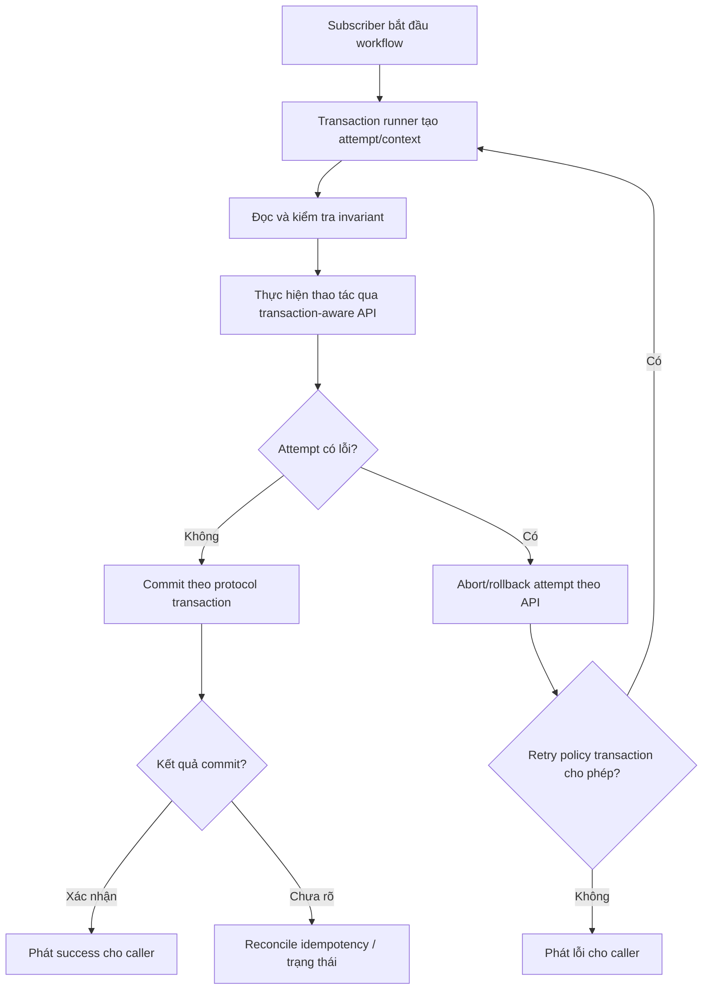

# Giao dịch phản ứng và truyền ngữ cảnh đúng vòng đời

Trong **SPRING_DATA_COUCHBASE**, một luồng xử lý nghiệp vụ có thể gồm nhiều thao tác bất đồng bộ: đọc một document, kiểm tra quyền tenant, cập nhật trạng thái, ghi lịch sử và phát kết quả cho WebFlux. Vì `Mono`/`Flux` có thể chuyển qua nhiều thread và scheduler mà không giữ một thread cố định, việc **truyền ngữ cảnh đúng vòng đời** trở thành yêu cầu thiết yếu. Nếu thao tác thứ hai chạy ngoài ngữ cảnh giao dịch, hoặc service tự `subscribe()` làm xuất hiện một subscription độc lập, chuỗi code nhìn có vẻ “nằm trong transaction” nhưng dữ liệu vẫn có thể bị ghi một phần.

Bài thuộc chương **Truy cập phản ứng** của module **SPRING_DATA_COUCHBASE**. Phạm vi học là xây dựng tầng truy cập Couchbase bằng document mapping, repository, `CouchbaseTemplate`/`ReactiveCouchbaseTemplate` và SQL++; nắm rõ bucket/scope/collection, chỉ mục, TTL, CAS, giao dịch và lựa chọn API reactive để cân bằng hiệu năng, tính nhất quán và khả năng vận hành. Trọng tâm bài này là **vòng đời một giao dịch**, **cách phối hợp publisher để mọi thao tác tham gia đúng context**, **khác biệt giữa Reactor Context và transaction attempt context**, và **cách xử lý rollback, retry, timeout, cancellation mà không khẳng định quá mức**.

> **Nguyên tắc nền tảng:** `flatMap`, `then`, `Mono.when` hay `concatMap` chỉ tạo **quan hệ giữa các publisher**; chúng không tự mở giao dịch Couchbase. Muốn các thao tác nằm trong cùng transaction, phải dùng **transaction API/transaction manager thực sự tương thích với Spring Data Couchbase và SDK đang chạy**, truyền đúng attempt context, không tự tách subscription, và chỉ kết luận commit khi transaction boundary xác nhận.

## 1. Mục tiêu học tập

Sau khi học, bạn có thể:

1. Phân biệt *reactive composition*, optimistic locking bằng CAS và transaction nhiều document.
2. Mô tả các pha **bắt đầu → thực hiện attempt → commit/rollback hoặc kết quả chưa rõ → cleanup**.
3. Hiểu vì sao reactive transaction context không thể được quản lý dựa đơn thuần vào `ThreadLocal` trong ứng dụng Reactor.
4. Dùng `Context`, `ContextView`, `contextWrite`, `deferContextual` để truyền metadata ứng dụng có phạm vi subscription.
5. Phân biệt **Reactor Context**, **Spring reactive transaction context** khi có transaction manager phù hợp, và **Couchbase SDK transaction attempt context**.
6. Tổ chức callback transaction để mọi KV/SQL++ operation thực sự đi qua giao diện transaction-aware.
7. Tránh `subscribe()`, `block()`, callback bất đồng bộ bị bỏ quên hoặc helper mở transaction lồng ngoài ý muốn.
8. Hiểu vai trò của `@Transactional`/`TransactionalOperator` **chỉ khi** có `ReactiveTransactionManager` phù hợp và các operation tham gia đúng resource.
9. Xử lý CAS conflict, retry có giới hạn, callback có thể chạy lại, timeout/cancel và trạng thái commit chưa rõ.
10. Không vô tình thực hiện side effect ngoài database nhiều lần trong transaction callback.
11. Kiểm tra scan consistency, index và truy vấn SQL++ khi đọc trong/ngoài giao dịch.
12. Viết `StepVerifier` và integration test xác minh dữ liệu thực tế sau commit, abort, conflict và cancellation.

## 2. Tại sao cần transaction? Ví dụ hai document phải nhất quán

Giả sử hệ thống CRM có yêu cầu:

> Chuyển 50 điểm thưởng từ tài khoản A sang B, đồng thời lưu một bản ghi giao dịch. Không được xảy ra việc trừ điểm A nhưng không cộng điểm B.

Một implementation không transaction:

```java
Mono<Void> transfer = accountRepository.findById(fromId)
    .flatMap(from -> {
        from.setPoints(from.getPoints() - 50);
        return accountRepository.save(from);
    })
    .then(accountRepository.findById(toId))
    .flatMap(to -> {
        to.setPoints(to.getPoints() + 50);
        return accountRepository.save(to);
    })
    .then();
```

Đây là **anti-pattern cho yêu cầu nguyên tử**; còn thiếu kiểm tra số dư, tenant, ID, validation và audit. Quan trọng hơn: nếu lần ghi thứ nhất thành công nhưng lần ghi thứ hai lỗi, việc nối bằng `then` không rollback lần thứ nhất.

### 2.1. Reactive composition chỉ đảm bảo thứ tự tín hiệu

| Cơ chế | Bảo đảm chính | Không tự bảo đảm |
| --- | --- | --- |
| `flatMap` | Nối publisher theo kết quả của bước trước. | Atomicity qua nhiều Couchbase documents. |
| `then` | Chờ nguồn complete bình thường rồi thực hiện nguồn tiếp. | Rollback nguồn trước nếu nguồn sau lỗi. |
| `Mono.when` | Phối hợp completion nhiều nguồn, có thể subscribe đồng thời. | Một transaction chung. |
| `concatMap` | Xử lý inner lần lượt trong một subscription. | Khóa dữ liệu xuyên request/worker. |
| CAS/`@Version` | Có thể phát hiện xung đột cập nhật **một document** khi dùng đúng API. | All-or-nothing cho ba documents. |
| Couchbase transaction API | Phối hợp các mutation tham gia cùng giao dịch theo hợp đồng transaction. | Tự bao trùm hệ thống bên ngoài Couchbase. |

**Thứ tự các publisher không đồng nghĩa tính nguyên tử của dữ liệu.** Đây là phân biệt quan trọng nhất trước khi chọn transaction.

### 2.2. Khi nào giao dịch là cần thiết?

Một transaction có thể phù hợp khi:

- Một chuyển điểm phải ghi đồng thời **hai account documents** và một **ledger document**.
- Một order chỉ được chuyển trạng thái cùng với reservation/inventory nằm trong phạm vi transaction được hỗ trợ.
- Nhiều document phải thỏa một invariant chung khi commit.
- Một thao tác chuyển trạng thái không được phép để lại dữ liệu nửa chừng nếu gặp lỗi thông thường.

Một transaction **không** mặc định là lựa chọn tốt nhất cho mọi CRUD. Nếu chỉ sửa một document, CAS và mutation có điều kiện thường nhẹ và đơn giản hơn. Nếu cần gửi email hoặc gọi dịch vụ thanh toán bên ngoài, transaction Couchbase không thể tự đảm bảo atomicity cùng dịch vụ ngoài đó.

## 3. Mô hình dữ liệu minh họa

Giả sử bucket `app`, scope `crm` có hai collections: `accounts` và `point_transfers`. Tên chỉ là giả định để minh họa; ứng dụng phải cấu hình namespace thật.

Document account:

```json
{
  "tenant_id": "tenant-a",
  "account_code": "A001",
  "status": "ACTIVE",
  "points": 500
}
```

Document ledger:

```json
{
  "tenant_id": "tenant-a",
  "transfer_id": "tr-2026-001",
  "from_account": "A001",
  "to_account": "A002",
  "amount": 50,
  "status": "COMPLETED"
}
```

Document IDs có thể là `account::tenant-a::A001` và `transfer::tenant-a::tr-2026-001`. ID là metadata KV, không nhất thiết xuất hiện dưới tên JSON `id`.

### 3.1. Entity Spring Data Couchbase

```java
package example.crm;

import org.springframework.data.annotation.Id;
import org.springframework.data.annotation.Version;
import org.springframework.data.couchbase.core.mapping.Collection;
import org.springframework.data.couchbase.core.mapping.Document;
import org.springframework.data.couchbase.core.mapping.Field;
import org.springframework.data.couchbase.core.mapping.Scope;

@Document
@Scope("crm")
@Collection("accounts")
public class LoyaltyAccount {

    @Id
    private String id;

    @Field("tenant_id")
    private String tenantId;

    @Field("account_code")
    private String accountCode;

    @Field
    private String status;

    @Field
    private Long points;

    @Version
    private Long version;

    protected LoyaltyAccount() {}

    public String getId() { return id; }
    public String getTenantId() { return tenantId; }
    public String getStatus() { return status; }
    public Long getPoints() { return points; }

    public void setPoints(Long points) {
        this.points = points;
    }
}
```

`@Field` chỉ rõ mapping giữa property Java và JSON; `@Id` ánh xạ document ID. `@Version` liên quan đến optimistic locking/CAS trong Spring Data Couchbase theo **đúng release và đường mutation sử dụng**, không tự tạo transaction hoặc một field JSON `version` tùy ý.

Repository:

```java
import org.springframework.data.couchbase.repository.ReactiveCouchbaseRepository;

public interface LoyaltyAccountRepository
        extends ReactiveCouchbaseRepository<LoyaltyAccount, String> {
}
```

**Lưu ý quan trọng:** Repository trên là API reactive thông thường. Việc khai báo nó **không chứng minh** mọi method từ repository tự tham gia một **Couchbase SDK transaction callback**. Nếu transaction đi qua SDK, phải dùng những operation được attempt context hỗ trợ; nếu qua Spring transaction manager, phải chứng minh manager và repository/template thực sự liên kết với cùng transaction.

## 4. Vòng đời của một transaction reactive

Một cách hiểu ở cấp thiết kế:



Sơ đồ là **mô hình khái niệm**, không phải state machine hay callback name được một SDK bảo đảm nguyên văn. Tùy API và lỗi, transaction engine có thể tự thực hiện một số retries hoặc trả trạng thái cần recovery.

Một transaction đúng phải có:

1. **Boundary** xác định khi nào bắt đầu và khi nào kết thúc.
2. **Context** được truyền đến mọi operation tham gia.
3. **Kiểm soát quyền và invariant** bên trong attempt thích hợp.
4. **Commit/abort semantics** từ API transaction thực, không tự suy từ `onComplete` của một thao tác con.
5. **Cleanup** khi complete, error, cancellation hoặc process shutdown.
6. **Idempotency** cho trường hợp callback được thử lại hoặc kết quả cuối không rõ.

## 5. Một nhầm lẫn lớn: reactive không có “thread giao dịch” cố định

Trong hệ thống imperative, nhiều transaction manager truyền trạng thái bằng `ThreadLocal` vì các thao tác chạy trên cùng thread trong một phạm vi gọi đồng bộ.

Trong Reactor, các operator có thể thay đổi thread thực thi:

```java
Mono<LoyaltyAccount> result = repository.findById(id)
    .publishOn(reactor.core.scheduler.Schedulers.parallel())
    .map(account -> {
        // Một bước xử lý giá trị, có thể chạy trên scheduler khác.
        return account;
    });
```

**Không nên** dựa vào một `ThreadLocal<Transaction>` do ứng dụng tự đặt rồi mong mọi callback bất đồng bộ đọc được cùng giá trị. Có những cơ chế bridge context với ThreadLocal, nhưng chúng đòi hỏi cấu hình và phạm vi cụ thể, không tự xuất hiện chỉ vì dùng `publishOn`.

Trong Spring reactive transaction infrastructure, **Reactor subscriber context** là cơ chế quan trọng để gắn trạng thái transaction của `ReactiveTransactionManager` tương ứng khi có manager phù hợp. Còn Couchbase SDK transaction API có **attempt context riêng** phải được truyền đến đúng operation.

### 5.1. Ba loại context không được đánh đồng

| Loại ngữ cảnh | Dùng để làm gì? | Có tự mở Couchbase transaction không? |
| --- | --- | --- |
| **Reactor `Context`** | Dữ liệu theo subscription: correlation ID, metadata, trạng thái do framework gắn. | **Không.** |
| **Spring reactive transaction context** | Transaction state do transaction infrastructure của Spring quản lý với `ReactiveTransactionManager` đúng loại. | Chỉ khi có manager và resource integration hỗ trợ. |
| **Couchbase SDK transaction attempt context** | Thực thi các KV/SQL++ thao tác tham gia một attempt của Couchbase transaction. | Là một phần của API transaction thực, nhưng phải dùng operation đúng context. |
| **Security context** | Principal/quyền trong một request reactive. | **Không.** |
| **Trace/MDC context** | Gắn request/trace IDs vào log/tracing. | **Không.** |

Một key `"tx"` tự thêm vào Reactor Context **không biến `repository.save()` thành transactional**. Dữ liệu context chỉ có ý nghĩa nếu một transaction-aware component thực sự đọc và dùng nó.

## 6. Reactor Context cơ bản: `contextWrite` và `deferContextual`

`Context` của Reactor là dữ liệu gắn theo **subscription**, đọc qua `ContextView`. Nó khác biến toàn cục và khác `ThreadLocal`.

```java
import reactor.core.publisher.Mono;
import reactor.util.context.Context;

Mono<String> action = Mono.deferContextual(ctx -> {
    String requestId = ctx.get("requestId");
    return Mono.just("request=" + requestId);
});

Mono<String> result = action.contextWrite(
    Context.of("requestId", "req-123")
);
```

Khi được subscribe, `result` phát `"request=req-123"`. `deferContextual` đọc context **tại thời điểm subscription**, không lấy một snapshot ThreadLocal ở thời điểm assembly.

### 6.1. Vị trí `contextWrite` mang tính phạm vi

`contextWrite` ảnh hưởng context mà **các operator upstream của vị trí đó** quan sát trong chuỗi subscription tương ứng:

```java
Mono<String> operation = Mono.deferContextual(ctx ->
    Mono.just(ctx.<String>get("requestId"))
);

Mono<String> withContext = operation
    .map(value -> "observed:" + value)
    .contextWrite(Context.of("requestId", "req-456"));
```

Do `contextWrite` nằm downstream so với `deferContextual`, thao tác upstream có thể đọc key. Nếu đặt context ở một nhánh publisher không liên quan hoặc subscribe một publisher mới độc lập, **không được giả định** ngữ cảnh sẽ tự chảy qua.

### 6.2. Không dùng string key để quyết định quyền khi đã có cơ chế Security

Ví dụ `"requestId"` thích hợp để học. Với tenant và principal, nên dựa vào **Spring Security reactive context** hoặc lớp xác thực đáng tin cậy, không cho client truyền một key `"tenant"` tùy ý rồi xem đó là quyền.

Một helper rõ ràng có thể:

```java
public Mono<String> currentRequestId() {
    return Mono.deferContextual(ctx -> {
        if (!ctx.hasKey("requestId")) {
            return Mono.error(new IllegalStateException(
                "Missing request correlation ID"
            ));
        }
        return Mono.just(ctx.<String>get("requestId"));
    });
}
```

Nếu key thiếu, **báo lỗi rõ** thay vì âm thầm gán một tenant hoặc transaction mới. Đối với correlation ID không nhạy cảm, ứng dụng có thể có chính sách phát sinh ID mặc định, nhưng không tự mặc định tương tự cho security context.

### 6.3. Context là dữ liệu cho một subscription, không phải kho tài nguyên dài hạn

Không nên lưu password, token thô, hoặc object transaction attempt sống quá vòng đời vào một cache/global static map rồi kỳ vọng an toàn. Reactor Context có thể truyền **tham chiếu tới object**, nhưng nó không quản lý transaction lifecycle hay bảo đảm object an toàn để dùng giữa các subscription.

## 7. Truyền context xuyên `flatMap`, `then` và scheduler

Một workflow được compose trong cùng subscription:

```java
Mono<String> workflow = currentRequestId()
    .flatMap(id -> repository.findById(documentId)
        .map(account -> id + ":" + account.getId())
    )
    .contextWrite(Context.of("requestId", "req-789"));
```

Tất cả publisher được **trả về và compose** qua `flatMap` thuộc pipeline chung; Reactor có cơ chế truyền subscriber Context qua những operator phù hợp. Điều này không bảo đảm một giao dịch Couchbase, nhưng giúp metadata của subscription đi đến helper cần dùng.

### 7.1. `publishOn`/`subscribeOn` và ngữ cảnh

`publishOn`/`subscribeOn` có thể đổi thread/scheduler, nhưng **Reactor Context** được thiết kế gắn với subscription thay vì một thread cố định. Vì vậy code đọc bằng `deferContextual` thường vẫn có thể lấy context trong pipeline đã compose đúng. Ngược lại, code đọc từ `ThreadLocal`/MDC tùy ý **không được bảo đảm** nhìn thấy thông tin cũ khi đổi thread.

### 7.2. Đừng lấy ThreadLocal để kiểm tra transaction

Sai:

```java
// Anti-pattern: tùy thuộc một ThreadLocal tự gắn.
String txId = customTransactionThreadLocal.get();
```

Trong một chuỗi Reactor có scheduling, `txId` có thể null hoặc thuộc request khác nếu code thiết kế sai. Nếu dùng Spring transaction infrastructure, phải kiểm tra trạng thái qua API của framework phù hợp; nếu dùng SDK transaction callback, dùng chính attempt context của callback.

### 7.3. Mỗi subscription là một vòng đời

Nếu cùng `Mono` được subscribe hai lần, thao tác upstream cold có thể chạy **hai lần**. Context cũng được xác lập cho từng subscription riêng. Không cố giữ một transaction attempt context để tái sử dụng ở lần subscribe thứ hai.

## 8. Security context: tenant phải lấy từ nguồn đáng tin cậy

Một transaction có thể cập nhật nhiều tài khoản; nếu thiếu kiểm tra tenant, dữ liệu có thể bị chuyển chéo tenant ngay trong một transaction vốn nguyên tử.

Ở ứng dụng dùng Spring Security reactive, security context được truy cập qua API reactive:

```java
import org.springframework.security.core.context.ReactiveSecurityContextHolder;
import reactor.core.publisher.Mono;

Mono<String> principalName =
    ReactiveSecurityContextHolder.getContext()
        .map(securityContext ->
            securityContext.getAuthentication().getName()
        );
```

Đoạn trên chỉ lấy **tên principal**, không tự khẳng định đó là tenant. Ứng dụng phải có hàm ánh xạ/kiểm tra tenant từ claims/identity đã xác thực và áp RBAC/ABAC theo chính sách của hệ thống.

Trong transaction:

1. Lấy tenant đáng tin cậy ở biên request hoặc trong context xác thực.
2. Xác định các document IDs/keyspace được quyền thao tác.
3. Đọc document qua transaction-aware API.
4. Xác minh tenant và trạng thái **ở nơi transaction cần bảo đảm invariant**.
5. Chỉ ghi sau khi các điều kiện thỏa; không tin tenant do client tự nhập.

Một document ID chứa tenant prefix có thể hỗ trợ phân vùng khóa, nhưng **chuỗi ID tự nó không phải bằng chứng phân quyền**.

## 9. API transaction nào thực sự được dùng?

Có hai hướng thường cần phân biệt trong ứng dụng Spring:

**Hướng A — Couchbase SDK transaction API:** transaction runner quản lý callback/attempt context; các operation phải dùng **API nằm trong attempt context**, không tùy tiện gọi repository/SDK thông thường bên cạnh đó.

**Hướng B — Spring reactive transaction infrastructure:** một `ReactiveTransactionManager` thực sự tương thích resource, cùng `TransactionalOperator` hoặc `@Transactional` cho method trả publisher, quản lý transaction qua Reactor context.

**Không được tự giả định hướng B tồn tại hoặc tự bao gồm Couchbase trên mọi Spring Data Couchbase release.** Spring có transaction infrastructure chung; khả năng thực tế tùy Couchbase integration, dependency và configuration. Nếu ứng dụng chỉ có Couchbase SDK transactions, sử dụng **hướng A hoặc adapter rõ ràng**, không thêm `@Transactional` như phép màu.

### 9.1. Câu hỏi phải xác minh trên release đang chạy

- Spring Data Couchbase version nào?
- Couchbase Java SDK/transactions component version nào?
- API nào mở transaction, cấp attempt context và phát kết quả commit?
- Những operation KV/SQL++ nào được hỗ trợ trong attempt?
- Có reactive transaction manager thật sự được cấu hình không?
- Repository/template operation này có tham gia manager đó không?
- Query transaction có dùng đúng query context/collection không?
- Callback transaction có thể bị retry bao nhiêu lần và trong tình huống nào?
- Timeout/cancellation khi đang commit sẽ được báo và recover ra sao?
- Transaction có thể bao gồm những collections/keyspaces nào theo version/server config?

Nếu thiếu câu trả lời, bài toán vẫn là **thiết kế mong muốn**, chưa phải giao dịch đã được chứng minh.

## 10. Một ứng dụng dùng SDK transaction callback phải giữ context trong callback

Mẫu ý tưởng của transaction runner:

```text
transactions.run(attempt -> {
    // Chỉ thao tác qua API transaction-aware nhận attempt này.
    // Mọi Publisher phải được RETURN từ callback.
    return attempt.get(accountCollection, fromId)
        .flatMap(fromDoc -> attempt.get(accountCollection, toId)
            .flatMap(toDoc -> {
                validateAndCompute(...);
                return attempt.replace(fromDoc, updatedFrom)
                    .then(attempt.replace(toDoc, updatedTo))
                    .then(attempt.insert(ledgerCollection, transferId, ledger));
            }));
});
```

Đây là **pseudocode mô tả cấu trúc**, không phải Java API compilable: chữ ký `transactions.run`, cách truyền collection, kiểu transaction document, operations và cách gọi query **phụ thuộc Couchbase SDK release**. Tra cứu transaction reference đúng phiên bản trước khi triển khai.

**Ý chính cần giữ:**

- Transaction runner tạo một **attempt context** mới theo vòng đời của nó.
- Lệnh `get`/`replace`/`insert` trong attempt dùng chính context đó.
- Callback **return** một publisher đại diện **toàn bộ** công việc.
- Không tạo publisher rồi bỏ quên; không tự `subscribe()`; không gọi non-transactional KV mutation giữa attempt rồi tưởng nó đã nhập giao dịch.
- Engine giao dịch quyết định commit/retry/abort dựa trên protocol, không phải `then()` của ứng dụng tự quyết định.

### 10.1. Không lưu attempt context vào singleton

Sai về vòng đời:

```java
// Anti-pattern: context giao dịch bị giữ ngoài callback.
this.currentAttempt = attempt;
return Mono.empty();
```

Một attempt có thể commit/abort rồi kết thúc; object của nó không được xem là tài nguyên sống vô hạn. Singleton có thể bị nhiều request chồng nhau ghi đè; request sau vô tình dùng context cũ hoặc context của tenant khác. Chỉ truyền context trong **scope callback** hoặc adapter đảm bảo vòng đời tương ứng.

## 11. Tổ chức code qua một transaction-aware gateway

Để tách nghiệp vụ khỏi cú pháp SDK, có thể tạo **port ứng dụng** mà implementation bắt buộc dùng API transaction-aware.

```java
package example.crm;

import java.util.function.Function;
import reactor.core.publisher.Mono;

// Đây là interface do ứng dụng định nghĩa, KHÔNG phải Spring Data API.
public interface CustomerTransactionGateway {

    <T> Mono<T> execute(
        Function<CustomerAttempt, Mono<T>> work
    );

    interface CustomerAttempt {
        Mono<LoyaltyAccount> getAccount(String documentId);

        Mono<Void> replaceAccount(LoyaltyAccount account);

        Mono<Void> insertLedger(TransferLedger ledger);
    }
}
```

`TransferLedger` là DTO/document nghiệp vụ phải được dự án định nghĩa. Đây là **port minh họa**: implementation có trách nhiệm chuyển operation thành transaction KV/SQL++ đúng context và bảo đảm transaction chỉ hoàn tất thành công sau khi commit được xác nhận theo hợp đồng SDK.

### 11.1. Service chuyển điểm với một context nhất quán

```java
import reactor.core.publisher.Mono;

public Mono<Void> transferPoints(
        String authenticatedTenant,
        String fromId,
        String toId,
        long amount,
        String transferId) {

    if (amount <= 0 || fromId.equals(toId)) {
        return Mono.error(new IllegalArgumentException(
            "Invalid transfer"
        ));
    }

    return transactionGateway.execute(tx ->
        tx.getAccount(fromId)
            .switchIfEmpty(Mono.error(
                new IllegalArgumentException("Source missing")
            ))
            .flatMap(from -> tx.getAccount(toId)
                .switchIfEmpty(Mono.error(
                    new IllegalArgumentException("Target missing")
                ))
                .flatMap(to -> {
                    if (!authenticatedTenant.equals(from.getTenantId())
                            || !authenticatedTenant.equals(to.getTenantId())) {
                        return Mono.error(new SecurityException(
                            "Account does not belong to tenant"
                        ));
                    }
                    if (!"ACTIVE".equals(from.getStatus())
                            || !"ACTIVE".equals(to.getStatus())) {
                        return Mono.error(new IllegalStateException(
                            "Account is not active"
                        ));
                    }
                    if (from.getPoints() == null
                            || to.getPoints() == null
                            || from.getPoints() < amount) {
                        return Mono.error(new IllegalStateException(
                            "Invalid balance"
                        ));
                    }

                    long targetPoints;
                    try {
                        targetPoints = Math.addExact(
                            to.getPoints(), amount
                        );
                    } catch (ArithmeticException overflow) {
                        return Mono.error(overflow);
                    }

                    from.setPoints(from.getPoints() - amount);
                    to.setPoints(targetPoints);

                    TransferLedger ledger = TransferLedger.completed(
                        transferId, authenticatedTenant,
                        fromId, toId, amount
                    );

                    return tx.replaceAccount(from)
                        .then(tx.replaceAccount(to))
                        .then(tx.insertLedger(ledger));
                })
            )
    );
}
```

Trong ví dụ, `transactionGateway` là field được inject của service; `TransferLedger.completed` là factory **do ứng dụng triển khai**. Đoạn code diễn tả luồng nghiệp vụ, **chưa là production-ready**: cần ID ledger xác định, idempotency, xử lý duplicate transfer ID, phân quyền ở transaction boundary, timeout và integration test.

**Điều kiện quyết định:** Ba thao tác ghi phải được implementation của `CustomerAttempt` thực hiện **trong cùng attempt**. Nếu `replaceAccount` lén gọi `repository.save` thông thường, giao dịch mong muốn có thể bị phá vỡ.

### 11.2. Vì sao port làm boundary rõ hơn?

Các method trong `CustomerAttempt` chỉ tồn tại khi callback đang chạy. Người viết service thấy rõ “đây là operation transaction-aware”, thay vì gọi xen kẽ repository và SDK rồi không biết thao tác nào có context.

Mẫu port cũng giúp viết test với fake attempt, nhưng **test fake chỉ chứng minh orchestration**. Phải có integration test xác minh adapter thực sự dùng Couchbase transaction API.

## 12. `@Transactional` và `TransactionalOperator`: khi nào được dùng?

Spring Framework có `@Transactional` và `TransactionalOperator` cho mô hình reactive. Nhưng annotation/utility không tự tạo hỗ trợ transaction cho mọi database/driver.

### 12.1. Mẫu chỉ hợp lệ khi có manager tương thích

```java
import org.springframework.transaction.reactive.TransactionalOperator;
import reactor.core.publisher.Mono;

// Giả định đã cấu hình ReactiveTransactionManager thực sự
// hỗ trợ các operation của resource được sử dụng ở đây.
Mono<Void> transactional = stepsUsingManagedResource()
    .as(transactionalOperator::transactional);
```

`stepsUsingManagedResource` và `transactionalOperator` là thành phần ứng dụng. Đoạn này trình bày **cách đặt boundary trong Reactor**, không khẳng định `ReactiveCouchbaseRepository` của phiên bản bất kỳ sẽ tham gia tự động.

### 12.2. Mẫu annotation cũng có điều kiện

```java
import org.springframework.transaction.annotation.Transactional;
import reactor.core.publisher.Mono;

@Transactional
public Mono<Void> updateBusinessState(String id) {
    return stepsUsingManagedResource(id);
}
```

Chỉ sử dụng khi:

1. Có manager reactive phù hợp và đã cấu hình.
2. Các operation bên trong thuộc resource được manager quản lý.
3. Method được gọi qua đường proxy/aspect thích hợp; không bypass cơ chế interception.
4. Trả `Publisher` được compose; không tự `subscribe()` hoặc `block()` bên trong.
5. Behavior commit/rollback/cancel của resource được kiểm chứng.

Nếu transaction chỉ được quản lý qua **Couchbase SDK callback API**, lời gọi `repository.save()` trong method có `@Transactional` **không được mặc định** là cùng transaction. Đây là chỗ rất dễ tạo “transaction giả” khi chuyển từ JPA sang Couchbase reactive.

### 12.3. Lời gọi nội bộ có thể bypass proxy

Khi dùng Spring AOP/proxy transaction, method `this.someTransactionalMethod()` gọi trong cùng instance có thể bỏ qua interception tùy cấu hình proxy. Một transaction annotation trên helper không phải bằng chứng transaction đã mở. Kiểm chứng tại runtime, không chỉ dựa vào code review annotation.

## 13. Truyền context vào helper: compose thay vì tự subscribe

Sai:

```java
public Mono<Void> wrongWorkflow(String id) {
    Mono<Void> audit = auditRepository.save(
        new AuditRecord(id)
    ).then();

    audit.subscribe();  // Subscription độc lập, có thể ngoài transaction.
    return repository.findById(id).then();
}
```

`AuditRecord`/`auditRepository` là thành phần minh họa. Trong code trên, audit và lookup có **hai subscriptions riêng**; một transaction boundary bao quanh publisher trả về không tự quản lý subscription audit.

Đúng về phối hợp publisher:

```java
public Mono<Void> composedWorkflow(String id) {
    return repository.findById(id)
        .switchIfEmpty(Mono.error(
            new IllegalArgumentException("Missing document")
        ))
        .flatMap(customer ->
            auditRepository.save(new AuditRecord(id)).then()
        )
        .then();
}
```

Tuy nhiên, đoạn sau **chỉ có composition**. Để cả audit và đọc nằm trong một transaction, phải thay bằng transaction-aware API hoặc manager đã chứng minh cả hai operation tham gia transaction. Đừng nhầm “không subscribe phụ” với “đã transaction”.

### 13.1. `Mono.when` tạo sự đồng thời, không tạo context chung

```java
Mono<Void> both = Mono.when(
    repository.save(first),
    repository.save(second)
);
```

Hai publishers có thể chạy đồng thời. Nếu một thất bại, cái kia có thể đã commit; `when` không rollback. Trong transaction callback, cũng không được giả định transaction attempt API cho phép gọi các operations đồng thời không giới hạn; điều này **phụ thuộc SDK transaction contract**.

### 13.2. Mọi bước cần được return hoặc compose

Một lỗi khác:

```java
// Anti-pattern: tạo Mono audit rồi bỏ quên.
return tx.replaceAccount(account)
    .doOnSuccess(v -> auditService.recordChange(account.getId()));
```

Nếu `auditService.recordChange` trả `Mono<Void>` mà không được subscribe/compose, audit **không được bảo đảm sẽ thực hiện**. Ngoài transaction, còn có nguy cơ side effect bị bỏ qua hoàn toàn. Cần `then`/`flatMap` với API thích hợp, và đặt audit trong đúng transaction boundary nếu business yêu cầu.

## 14. Context bị tách khi mở subscription ngoài vòng đời

Một trong những lỗi nguy hiểm nhất:

```java
return txGateway.execute(tx -> {
    tx.replaceAccount(account).subscribe(); // Không được làm.
    return Mono.empty();                    // Runner thấy work đã xong.
});
```

Đường transaction callback trả `Mono.empty()` ngay; runner có thể đánh giá attempt hoàn tất và bắt đầu commit, trong khi mutation được subscribe ở ngoài đã chạy bất đồng bộ, thậm chí dùng context đã hết hạn.

**Không phải cách sửa** là “thêm `subscribeOn` cho mutation”. Cách sửa đúng là **return publisher mutation**:

```java
return txGateway.execute(tx ->
    tx.replaceAccount(account)
);
```

Nếu còn bước khác:

```java
return txGateway.execute(tx ->
    tx.replaceAccount(account)
        .then(tx.insertLedger(ledger))
);
```

`txGateway`/`ledger` là adapter và dữ liệu minh họa. Điều kiện bắt buộc vẫn là cả hai method phải thực hiện theo đúng attempt context.

### 14.1. `block()` cũng phá mô hình phản ứng

```java
// Anti-pattern: chặn thread và chạy transaction như imperative.
txGateway.execute(tx -> tx.replaceAccount(account)).block();
```

Trong WebFlux/event loop, `block()` gây chặn hoặc lỗi và làm khó quản lý cancellation/context. Trả `Mono`/`Flux` cho caller; nếu phải tích hợp API blocking khác, thiết kế isolation có giới hạn và transaction boundary rõ, không cố bọc lệnh blocking vào transaction reactive tùy tiện.

## 15. Trong một attempt, tránh song song hóa thao tác phụ thuộc

Ví dụ không an toàn về thứ tự:

```java
Mono<Void> mutations = Mono.when(
    tx.replaceAccount(from),
    tx.replaceAccount(to),
    tx.insertLedger(ledger)
);
```

Dù ba bước có thể độc lập về document, việc transaction attempt API có cho phép các operation này chạy **song song** và những quan hệ dữ liệu có được kiểm tra đúng không là vấn đề phải xác minh ở SDK release. Không dùng `Mono.when` chỉ để “tăng tốc giao dịch” khi chưa hiểu quy tắc attempt.

Với các bước có quan hệ nghiệp vụ, chuỗi tường minh dễ review hơn:

```java
Mono<Void> mutations = tx.replaceAccount(from)
    .then(tx.replaceAccount(to))
    .then(tx.insertLedger(ledger));
```

Nhưng **thứ tự không thay transaction**: code chỉ đúng khi `tx` là transactional attempt interface thật. Nếu operations non-transactional, một bước lỗi vẫn có thể để lại những ghi trước.

### 15.1. `flatMap`/`concatMap` và cập nhật cùng document

`Flux.flatMap` cho phép inner chạy đồng thời; điều này dễ tạo CAS conflict nếu nhiều sự kiện chỉnh cùng document. `concatMap` serialize trong **một pipeline**, nhưng không bảo đảm thứ tự xuyên nhiều HTTP requests hoặc app instances. Nếu một invariant cần bảo vệ xuyên các worker, phải dùng key partitioning/transaction/CAS và thiết kế idempotency.

## 16. Retry của transaction không giống retry một query đơn lẻ

Một transaction runner có thể tự retry **attempt** trong một số lỗi tạm thời/xung đột, theo SDK/version. Callback transaction vì thế có thể được gọi **hơn một lần**.

```text
Transaction run
   attempt #1 -> conflict -> abort/retry
   attempt #2 -> success -> commit
```

Điều này có tác động lớn tới side effects.

### 16.1. Callback nên có thể được chạy lại an toàn

**Không nên** đặt trong callback transaction:

- Gửi email xác nhận trực tiếp.
- Gọi API thanh toán bên ngoài không có idempotency.
- Đẩy message tới broker không có transaction/outbox.
- Tăng một bộ đếm trong bộ nhớ rồi dùng để quyết định ID.
- Ghi log “chuyển điểm thành công” như sự kiện nghiệp vụ cuối cùng trước commit.
- Đọc nguồn dữ liệu không ổn định rồi giả định attempt retry sẽ thấy cùng giá trị.

Đọc, validate và mutation Couchbase thuộc transaction attempt có thể được retry theo protocol; side effects ngoài Couchbase **không tự rollback** khi attempt bị retry.

### 16.2. Tách side effect sau commit hoặc dùng outbox

Nếu cần gửi notification khi chuyển điểm hoàn tất, có hai hướng:

1. **Outbox document** nằm trong cùng transaction Couchbase (nếu được hỗ trợ), worker độc lập đọc và phát event với idempotency.
2. Sau khi transaction **được xác nhận commit**, phát event có idempotency và có cơ chế recover nếu app crash giữa commit và phát event.

Không có transaction Couchbase nào tự bảo đảm atomicity với một hệ thống email/HTTP/broker bên ngoài chỉ nhờ đặt lời gọi trong callback.

### 16.3. Không bọc transaction runner bằng `retryWhen` mù quáng

```java
// Anti-pattern nếu không hiểu retry tích hợp của transaction runner.
txGateway.execute(tx -> businessSteps(tx))
    .retryWhen(Retry.max(10));
```

Điều này có thể lặp lại **toàn bộ transaction** sau kết quả chưa rõ, không chỉ thử lại một attempt. Nếu lần trước đã commit nhưng response bị mất, việc gọi lại có thể áp dụng nghiệp vụ thêm lần nữa. Cần transaction retry protocol đúng SDK và **idempotency theo request ID**.

## 17. Idempotency: bảo vệ trước transaction retry và phản hồi bị mất

Giả sử chuyển điểm có `transferId = tr-2026-001`. Đừng sinh ID mới ở **mỗi attempt retry**. Sử dụng một transfer ID ổn định cho cùng yêu cầu nghiệp vụ.

Một quy tắc:

```text
request idempotency key: tr-2026-001
  -> nếu ledger cho key này đã CONFIRMED:
         trả kết quả cũ hoặc trạng thái đã thực hiện
  -> nếu chưa có:
         transaction: kiểm tra invariant, cập nhật accounts, ghi ledger
  -> nếu outcome UNKNOWN:
         đối chiếu trạng thái theo transferId trước khi thực hiện lại
```

Tùy transaction/version và schema, có thể dùng insert-only ledger với document ID xác định để phát hiện trùng; nhưng **duplicate ID không tự chứng minh cùng nghiệp vụ**. Phải so sánh tenant, nguồn/đích, amount và request fingerprint được lưu.

### 17.1. Retry conflict và retry kết quả không rõ khác nhau

| Tình huống | Có thể làm gì? |
| --- | --- |
| Attempt được transaction engine xác nhận abort do conflict | Runner có thể retry theo protocol. |
| Validation/business rule thất bại | Không retry nếu input/trạng thái không thể thay đổi hợp lệ. |
| Timeout khi chưa biết commit hay chưa | Đánh dấu unknown, reconcile bằng transfer ID. |
| Duplicate ledger ID | Kiểm tra có đúng request cũ không; không mặc định thành công. |
| Khách hàng đã đổi tenant/quyền/status | Phải xác minh lại theo chính sách. |

Idempotency và transaction phục vụ các mục đích bổ sung nhau: transaction bảo vệ invariant trong phạm vi tài nguyên tham gia, idempotency bảo vệ **một yêu cầu nghiệp vụ** khỏi thực hiện lặp.

## 18. Timeout và deadline ở đúng vòng đời

Một giao dịch có thể bao gồm:

```text
HTTP request
  -> authentication/authorization
  -> chờ admission slot
  -> transaction attempt(s)
  -> commit confirmation
  -> mapping response
```

Nếu toàn request có SLA 3 giây nhưng callback transaction được phép retry nhiều lần mà không có deadline tổng, client có thể timeout trước khi transaction engine báo kết quả.

### 18.1. `Mono.timeout` chỉ là deadline của subscriber

```java
Mono<Void> result = txGateway.execute(tx ->
        tx.replaceAccount(account)
    )
    .timeout(java.time.Duration.ofSeconds(3));
```

Khi quá thời hạn, Reactor có thể phát lỗi timeout và cancel upstream. Nhưng **không được kết luận** transaction đã abort/rollback ở Server. Transaction API có cơ chế expiry/timeout và recovery riêng; cần cấu hình/đối chiếu theo phiên bản thực tế.

### 18.2. Deadline tổng và retry budget

Một chính sách nên giới hạn:

- Thời gian chờ admission.
- Tổng thời gian cho transaction runner và attempts.
- Số lần retry do transaction API hỗ trợ.
- Thời gian dành cho xác nhận commit và trả response.
- Hành vi khi client disconnect.
- Cách reconcile transaction outcome không rõ.

Không cộng dồn hàng loạt `timeout(3s)` cho các bước tuần tự rồi cho rằng SLA tổng vẫn bằng 3 giây.

### 18.3. `Flux.timeout` có thể là gap timeout

Với overload `Flux.timeout(Duration)` thông dụng, timeout có thể kiểm tra thời gian chờ item đầu và khoảng cách giữa các item. Nếu một Flux phát item đều đặn, tổng duration vẫn có thể vượt ngưỡng. Đối với transaction, nên có **expiry/deadline ở transaction runner và toàn request**, không chỉ operator gap timeout.

## 19. Cancellation khi transaction đang chạy

Một client WebFlux có thể ngắt kết nối khi transaction đang chuẩn bị commit.

```text
T0: Transaction runner bắt đầu attempt
T1: Các mutation được stage/thực hiện qua context
T2: Caller disconnect -> Reactor cancel
T3: Transaction subsystem xử lý cancellation theo API
T4: Commit có thể chưa bắt đầu, đang xảy ra hoặc đã thành công
T5: App có thể không nhận được kết quả cuối
```

Một transaction manager/runner đúng có thể có cleanup/rollback logic khi nhận cancel, nhưng **không được suy từ `doFinally(CANCEL)` rằng backend đã xác nhận rollback**. Nếu xảy ra race sau commit, dữ liệu có thể đã thay đổi.

### 19.1. Đừng thả attempt context sang một job độc lập

```java
// Anti-pattern: tự subscribe trong transaction callback.
return txGateway.execute(tx -> {
    tx.replaceAccount(account).subscribe();
    return Mono.empty();
});
```

Sau khi callback hoàn tất, attempt context có thể không còn hợp lệ. Nếu cần job chạy bền vững sau HTTP disconnect, tạo **job record** và để worker khác mở **transaction mới** theo cùng idempotency key, không mang attempt context cũ sang thread/background job.

### 19.2. Phân biệt ba loại kết thúc

| Quan sát | Kết luận được | Không kết luận được |
| --- | --- | --- |
| Subscriber thấy `CANCEL` | Caller không muốn tiếp tục. | Server rollback thành công. |
| Transaction runner báo success sau commit | Theo hợp đồng API, commit được xác nhận. | Event ngoài DB cũng gửi thành công. |
| Transaction runner báo timeout/unknown | Caller thiếu xác nhận cuối. | Dữ liệu chắc chắn chưa commit. |

Với nghiệp vụ tài chính hoặc điểm thưởng, trạng thái unknown cần reconcile dựa trên ID nghiệp vụ, không retry vô hạn.

## 20. Cleanup và vòng đời tài nguyên

Một transaction runner phải quản lý tài nguyên của nó. Ứng dụng cần tránh hai lỗi ngược nhau:

1. **Không cleanup** resource tạm thời khi exception/cancel.
2. **Cleanup nhầm resource dùng chung** sau mỗi request.

### 20.1. `doFinally` cho metrics hoặc permit, không phải commit/rollback

```java
Mono<Void> tracked = txGateway.execute(tx ->
        tx.replaceAccount(account)
    )
    .doFinally(signal ->
        metrics.recordTransactionSubscriberSignal(signal)
    );
```

`metrics` là helper ứng dụng. `ON_COMPLETE`, `ON_ERROR`, `CANCEL` là tín hiệu ở **vị trí operator**, không phải một bảng kết quả commit của Couchbase. Nếu cần biết commit/abort, dùng response/status của transaction runner.

### 20.2. `usingWhen` chỉ cho tài nguyên thực sự được sở hữu

Reactor có `usingWhen` cho acquire/use/release bất đồng bộ:

```java
Mono<String> result = Mono.usingWhen(
    leaseService.acquire(),
    lease -> performWork(lease),
    lease -> leaseService.release(lease),
    (lease, error) -> leaseService.release(lease),
    lease -> leaseService.release(lease)
);
```

`leaseService` là nguồn **lease giả định của ứng dụng**; `performWork` trả publisher. Đây là pattern cleanup, **không phải cách tự triển khai transaction Couchbase**. Không dùng `usingWhen` để giả định `release` tương đương rollback một transaction đã commit.

### 20.3. Không đóng SDK Cluster trên mỗi HTTP request

`Cluster`/Couchbase SDK connection thường thuộc lifecycle ứng dụng. Đừng gọi `cluster.disconnect()` từ `doFinally` của từng truy vấn/transaction nếu cluster là shared bean. Chỉ giải phóng resource mà subscription/attempt thật sự sở hữu, theo hợp đồng SDK.

### 20.4. Tránh double cleanup

Nếu cùng một semaphore permit được release trong cả `doOnCancel` và `doFinally`, cancel có thể giải phóng **hai lần**, làm hỏng giới hạn concurrency. Thiết kế cleanup một lần, xác minh bằng test complete/error/cancel.

## 21. Multi-document transaction có giới hạn về workload

Không nên dùng transaction dài để:

- Đọc hàng trăm nghìn documents rồi mới cập nhật vài document.
- Xuất file CSV/PDF trong callback.
- Chờ người dùng xác nhận qua HTTP.
- Gọi dịch vụ bên ngoài lâu và không idempotent.
- Chạy một vòng `flatMap` không giới hạn concurrency.
- Thử lại vô hạn sau timeout.

Transaction nên có **tập thao tác rõ ràng, giới hạn tài nguyên, deadline và số attempts**, phù hợp với Couchbase Server/SDK constraints của phiên bản triển khai.

### 21.1. Query trong transaction khác query thông thường

Nếu cần SQL++ trong transaction attempt, phải sử dụng **transaction-aware query API** được SDK/version hỗ trợ, chứ không mặc định:

```java
// Không được giả định tự tham gia SDK transaction attempt.
repository.findByTenantIdAndStatus(tenantId, "ACTIVE");
```

đã nằm trong transaction chỉ vì dòng này được gọi bên trong callback của runner.

Tương tự, dùng một `@Query` annotation hoặc `ReactiveCouchbaseTemplate` bình thường trong callback SDK **không tự bảo đảm** context đã được truyền đúng. Với transaction-managed Spring integration, phải chứng minh implementation thực tế cùng manager và context.

### 21.2. Không dùng N1QL/SQL++ DML ngoài attempt để “bổ sung” transaction

Nếu một phần mutation dùng transaction-aware KV API, phần khác chạy `UPDATE`/`DELETE` SQL++ thường qua Query Service bên ngoài transaction, all-or-nothing có thể không còn. Mọi operation cần thuộc cùng cơ chế transaction theo support matrix và transaction context đã chọn.

## 22. Index, scan consistency và “đọc đúng” khi có giao dịch

Truy vấn thông thường theo field:

```sql
SELECT c.*
FROM `app`.`crm`.`accounts` AS c
WHERE c.`tenant_id` = $tenantId
  AND c.`status` = "ACTIVE";
```

có thể cần secondary index. Query ví dụ không phải projection Spring Data Couchbase sinh nguyên văn; khi mapping entity, ID/CAS/type metadata cũng quan trọng.

### 22.1. Index minh họa

```sql
CREATE INDEX ix_accounts_tenant_status
ON `app`.`crm`.`accounts` (
    `tenant_id`,
    `status`
);
```

Phải xác minh query thực tế và `EXPLAIN`, gồm discriminator, field mapping, projection và dữ liệu đại diện. Index không tự tạo transaction, cũng không tự bảo đảm đọc dữ liệu vừa ghi ở consistency mong muốn.

### 22.2. Đừng nhập nhằng ba trường hợp đọc

1. **KV read theo ID:** thông thường không cần secondary index cho tra cứu khóa.
2. **SQL++ query thường:** có query scan consistency và secondary-index visibility; kết quả sau mutation có thể chưa thấy ngay ở mức mặc định.
3. **Đọc trong transaction attempt:** tuân theo semantics của **transaction-aware API**; phải xác minh khả năng read-your-own-writes và query support trong attempt trên SDK/Server version thật.

Nếu sau một transaction đã commit, một SQL++ query **ngoài transaction** chưa thấy document mới, có thể liên quan index lag và scan consistency. Không suy rằng commit đã rollback chỉ vì query bên ngoài chưa thấy ngay.

### 22.3. `REQUEST_PLUS` là chính sách đọc, không thay transaction

Khi một use case cần read-after-write qua SQL++, có thể cân nhắc scan consistency tương đương `REQUEST_PLUS` hoặc mutation-state options khi API phiên bản hỗ trợ. Điều này ảnh hưởng mức độ mới của index và latency, **không tạo atomicity cho hai mutation chưa được đặt trong transaction**.

## 23. CAS/optimistic locking và transaction: bổ sung, không thay nhau

`@Version`/CAS hữu ích khi hai request cùng sửa **một document**. Trong service không dùng transaction, một quy trình đọc–sửa–save có thể phát hiện stale version khi Spring Data Couchbase thực sự áp dụng CAS.

```java
Mono<LoyaltyAccount> updated = accountRepository.findById(id)
    .flatMap(account -> {
        account.setPoints(account.getPoints() + 10);
        return accountRepository.save(account);
    });
```

Đây là minh họa **không phải transaction** và chưa có idempotency. Nếu đối phương đã sửa account, CAS conflict có thể xảy ra; retry phải đọc lại và xác minh invariant, không gửi lại cùng instance stale vô hạn.

| Nhu cầu | Cơ chế nên xem xét |
| --- | --- |
| Đọc theo key, đổi một field với kiểm tra version | CAS/optimistic locking. |
| Increment không được mất giá trị và chỉ một document | Mutation atomic/conditional được API hỗ trợ; idempotency nếu retry. |
| Trừ A + cộng B + ledger trong một phạm vi Couchbase transaction được hỗ trợ | Transaction API và idempotency. |
| Cập nhật Couchbase và gọi thanh toán bên ngoài | Saga/outbox/compensation/idempotency, không chỉ Couchbase transaction. |

### 23.1. CAS conflict và unknown transaction outcome không giống nhau

CAS conflict đã xác nhận là một attempt không ghi được vì version không còn phù hợp (theo API). Timeout commit có thể báo outcome không rõ. **Retry callback** khi conflict và **đối chiếu idempotency sau timeout** là hai quy trình khác nhau.

## 24. TTL, expiration và durability trong transaction

Document có TTL có thể hết hạn trong lúc ứng dụng chờ admission hoặc trong thời gian transaction attempt. Một query lần đầu thấy document, attempt khác sau đó không thấy, không nhất thiết do Reactor làm mất item.

Cần xác minh:

- Expiration của document khi được đọc/sửa trong transaction.
- TTL của document ledger/outbox so với chính sách lưu giữ nghiệp vụ.
- Mutation có giữ hay đặt lại expiry theo API/version hay không.
- Hành vi khi document hết hạn trong lúc attempt đang chạy.
- Durability/commit semantics mà transaction API/Server hỗ trợ, thay vì giả định một `save` bình thường tương đương transactional durable commit.
- Idempotency record có được giữ đủ lâu để xử lý client retry hoặc delayed event hay không.

**Không tự đặt TTL quá ngắn cho ledger/idempotency record** chỉ vì customer session có thể hết hạn sớm. Retention là quy tắc nghiệp vụ và tuân thủ, tách khỏi cơ chế reactive.

## 25. Observability: đo transaction boundary, không chỉ publisher signals

Một dashboard chỉ đếm `Mono` completed chưa thể cho biết giao dịch đã được commit thật, callback đã retry bao nhiêu lần hay client có nhận response hay không.

| Tầng | Dấu hiệu cần có |
| --- | --- |
| HTTP/WebFlux | Correlation ID, client timeout/disconnect, status/latency. |
| Reactor | Subscribe, error, cancel, retries bên ngoài runner. |
| Transaction runner | Attempts, commit confirmed, abort/failure, unknown outcome theo capability. |
| SDK | KV/query request IDs, timeout, operations context, error diagnostics. |
| Query Service/Index | Plan, scans, latency, visibility sau commit. |
| Business ledger | Transfer ID, idempotency state, reconciliation result. |
| Security | Authenticated tenant, kết quả kiểm tra quyền, không lộ dữ liệu chéo tenant. |
| Operations | Transaction expiry, retry storm, in-flight count, p95/p99. |

Tên metric cụ thể phụ thuộc Spring Data, SDK, Server, Micrometer và cấu hình quan sát. Bảng mô tả **câu hỏi cần đo**, không khẳng định các tên metric tồn tại sẵn ở mọi release.

### 25.1. Correlation ID không phải transaction ID

Một HTTP request ID hữu ích để nối log. Transaction SDK có thể có attempt/transaction identifiers riêng. Không dùng request ID tự đặt làm bằng chứng một server transaction đã bắt đầu hoặc commit.

### 25.2. Bảo vệ dữ liệu trong log

Không ghi document JSON chứa thông tin cá nhân, token, credentials, giá trị bind nhạy cảm hoặc toàn bộ object transaction context. Ghi transaction ID/transfer ID an toàn, phase, code lỗi, elapsed time và phiên bản/namespace cần thiết theo chính sách vận hành.

## 26. Test Reactor Context với `StepVerifier`

### 26.1. Đọc context ở đúng thời điểm subscription

```java
import org.junit.jupiter.api.Test;
import reactor.core.publisher.Mono;
import reactor.test.StepVerifier;
import reactor.util.context.Context;

class ReactiveContextTest {

    @Test
    void readsRequestIdFromSubscriberContext() {
        Mono<String> readRequestId =
            Mono.deferContextual(ctx ->
                Mono.just(ctx.<String>get("requestId"))
            );

        StepVerifier.create(
                readRequestId.contextWrite(
                    Context.of("requestId", "req-1001")
                )
            )
            .expectNext("req-1001")
            .verifyComplete();
    }

    @Test
    void failsWhenRequiredContextIsMissing() {
        Mono<String> required = Mono.deferContextual(ctx -> {
            if (!ctx.hasKey("requestId")) {
                return Mono.error(new IllegalStateException(
                    "requestId required"
                ));
            }
            return Mono.just(ctx.<String>get("requestId"));
        });

        StepVerifier.create(required)
            .expectError(IllegalStateException.class)
            .verify();
    }
}
```

Test này chứng minh propagation của **Reactor Context**, không chứng minh một manager đã mở Couchbase transaction.

### 26.2. Test mỗi subscription có context riêng

```java
Mono<String> source = Mono.deferContextual(ctx ->
    Mono.just(ctx.<String>get("requestId"))
);

StepVerifier.create(
        source.contextWrite(
            Context.of("requestId", "request-A")
        )
    )
    .expectNext("request-A")
    .verifyComplete();

StepVerifier.create(
        source.contextWrite(
            Context.of("requestId", "request-B")
        )
    )
    .expectNext("request-B")
    .verifyComplete();
```

Hai subscription đọc giá trị khác nhau. Không có `ThreadLocal` toàn cục hay một attempt context singleton được chia sẻ giữa chúng.

## 27. Test cancellation và cleanup, không giả định rollback

```java
import static org.assertj.core.api.Assertions.assertThat;

import java.util.concurrent.atomic.AtomicBoolean;
import org.junit.jupiter.api.Test;
import reactor.core.publisher.Mono;
import reactor.test.StepVerifier;

class CancellationLifecycleTest {

    @Test
    void cancellationReachesUpstream() {
        AtomicBoolean cancelled = new AtomicBoolean();

        Mono<String> pending = Mono.<String>never()
            .doOnCancel(() -> cancelled.set(true));

        StepVerifier.create(pending)
            .thenCancel()
            .verify();

        assertThat(cancelled.get()).isTrue();
    }
}
```

Đây là **unit test Reactor**. Nó không kiểm chứng Couchbase transaction đã abort; chỉ chứng minh source nhận cancel.

### 27.1. Khi dùng Spring transaction infrastructure

Một test `TransactionalOperator` (nếu resource manager tương thích) phải xác minh **DB state** sau khi pipeline phát lỗi/cancel, không chỉ quan sát `doFinally(SignalType.CANCEL)`. Trong một số cửa sổ thời gian commit, outcome có thể chưa rõ; test phải xử lý theo semantics transaction cụ thể.

### 27.2. Dùng fake gateway để test orchestration

Có thể tạo fake `CustomerTransactionGateway` để xác minh callback **không gọi audit ngoài** và mọi method được compose. Nhưng fake **không có transaction protocol**; test success/error của fake không chứng minh Couchbase có rollback thật. Chỉ integration test với SDK và cluster mới xác nhận behavior backend.

## 28. Integration test Couchbase: điều gì bắt buộc?

Cần test trên bucket/scope/collections **dành riêng cho test** và phiên bản SDK/Server như production, có cấu hình transaction metadata/index/permissions theo yêu cầu API.

### 28.1. Bài test commit thành công

1. Seed hai account cùng tenant, điểm ban đầu lần lượt 500 và 100.
2. Thực thi `transferPoints` với `transferId` xác định và amount 50.
3. Subscribe/chờ completion bằng `StepVerifier`.
4. Đọc lại bằng KV sau commit.
5. Assert A=450, B=150, ledger tồn tại đúng một, tenant/status chính xác.
6. Gửi lại **cùng transfer ID** và xác minh không chuyển thêm 50.

```java
import reactor.test.StepVerifier;

// Khung minh họa: gateway, seed/fixture và port do dự án cung cấp.
StepVerifier.create(
        service.transferPoints(
            "tenant-a",
            "account::tenant-a::A001",
            "account::tenant-a::A002",
            50,
            "tr-2026-001"
        )
    )
    .verifyComplete();

// Sau đó đọc lại A/B/ledger và assert invariant ở test code.
```

### 28.2. Bài test abort do lỗi nghiệp vụ

1. Seed A chỉ có 10 điểm, B có 100.
2. Thực thi transfer amount 50.
3. Xác minh publisher báo lỗi nghiệp vụ.
4. Đọc lại A/B và ledger: không có mutation nào từ transfer thất bại.
5. Đảm bảo transfer ID chưa bị ghi nhận là completed.

Nếu fixture thay đổi giữa test steps, không kết luận nguyên tử chỉ từ `verifyError()`; **phải đọc trạng thái backend**.

### 28.3. Bài test conflict và retry

Tạo hai attempts cạnh tranh trên account tương ứng bằng cách điều phối có kiểm soát trong **test environment**. Xác minh một trong các outcome hợp đồng: conflict/abort/retry theo transaction SDK, invariant tổng điểm không mất và không ledger trùng.

Không dùng `Thread.sleep(1000)` để “tạo chắc xung đột”. Dùng test hooks/fault injection hoặc coordination thích hợp.

### 28.4. Bài test timeout/cancellation

Mô phỏng mất response/cancel tại điểm được kiểm soát; sau đó đối chiếu DB state theo transfer ID. Không viết assertion “cancel → dữ liệu chắc chắn rollback” nếu API không hứa. Test nên chứng minh **reconciliation** và **idempotency** xử lý được cả đã commit lẫn chưa commit.

### 28.5. Bài test context truyền đúng

Với manager Spring được xác nhận:

- Gọi transactional method qua proxy đúng.
- Chạy các bước reactive `flatMap`/`then` trong một subscription.
- Không có nested `subscribe()`.
- Thực thi trên scheduler khác nếu use case dùng scheduler.
- Chèn lỗi ở bước giữa rồi đọc DB để xác nhận behavior.
- So sánh với một operation cố ý ngoài transaction **chỉ trong test** để hiểu khác biệt, không giữ anti-pattern trong production.

Với SDK transaction callback, dùng adapter thực và xác minh **mọi thao tác** đi qua attempt context chứ không gọi repository thường.

## 29. Những sai lầm hay gặp

| Sai lầm | Rủi ro | Cách sửa |
| --- | --- | --- |
| “`then` cho hai `save` là transaction.” | Ghi một phần nếu bước sau lỗi. | Transaction API thực, hoặc compensation theo use case. |
| Thêm `@Transactional` mà không có manager Couchbase reactive phù hợp. | Cảm giác an toàn giả. | Kiểm tra manager/resource integration. |
| Dùng raw repository trong SDK transaction callback. | Operation có thể chạy ngoài attempt. | Transaction-aware API/context. |
| Tạo publisher rồi không return/compose. | Thao tác có thể không chạy hoặc chạy ngoài boundary. | `flatMap`/`then` trả đầy đủ publisher. |
| `subscribe()` trong callback. | Tách vòng đời/context, commit sai thứ tự. | Runner sở hữu subscription. |
| `block()` trong WebFlux/transaction. | Chặn thread, phá lifecycle, gây deadlock/lỗi. | Compose reactive từ đầu đến cuối. |
| Lưu attempt context trong singleton. | Context hết hạn, race, rò dữ liệu. | Chỉ dùng trong callback/attempt scope. |
| Tin `ThreadLocal` theo xuyên scheduler. | Mất/cross request context. | Reactor Context hoặc API context chính thức. |
| Tự thêm `Context.of("tx", ...)` rồi xem transaction đã mở. | Không có transaction engine. | Manager/SDK runner thực. |
| Song song hóa mọi writes trong attempt. | Phụ thuộc SDK, ordering/invariant khó bảo vệ. | Kiểm tra support; dùng sequencing khi cần. |
| Retry cả transaction khi timeout commit không rõ. | Có thể áp dụng nghiệp vụ hai lần. | Idempotency/reconciliation. |
| Gửi email trong callback có thể retry. | Duplicate side effect. | Outbox hoặc phát sau commit có idempotency. |
| Xem cancel là rollback. | Mutation có thể đã commit. | Kiểm tra transaction outcome. |
| `doFinally(ON_COMPLETE)` = DB commit. | Signal của publisher không đồng nghĩa commit nếu adapter sai. | Transaction runner result và readback. |
| Truy vấn SQL++ thường được xem như query transaction. | Read/write không tham gia cùng context. | Transaction-aware query API. |
| CAS thay transaction nhiều document. | Không có all-or-nothing. | Dùng đúng cơ chế theo invariant. |
| Transaction kéo dài qua HTTP/API ngoài. | Giữ tài nguyên, timeout/retry khó kiểm soát. | Chia bước, saga/outbox khi cần. |
| Test chỉ `StepVerifier.verifyComplete()`. | Không phát hiện partial commit. | Readback A/B/ledger trên Couchbase thật. |

## 30. Bài tập vận dụng

### Bài A — `flatMap` có phải transaction?

Một service gọi `repository.save(A).then(repository.save(B))`. A lưu thành công, B lỗi. Giao dịch đã bảo đảm rollback A chưa?

**Đáp án:** Chưa. Đây chỉ là nối publisher. Phải dùng transaction-aware API/manager thích hợp nếu yêu cầu all-or-nothing.

### Bài B — Reactor Context có tự tạo Couchbase transaction?

Ứng dụng thêm `contextWrite(Context.of("transactionId","tx-1"))` rồi gọi repository. Dữ liệu đã nằm trong transaction chưa?

**Đáp án:** Không. Đây là metadata trong subscription. Chỉ transaction infrastructure/SDK runner thật mới quản lý transaction.

### Bài C — ThreadLocal và scheduler

Một helper đọc tenant bằng `ThreadLocal` sau `publishOn`. Có chắc đọc được tenant đúng request không?

**Đáp án:** Không. Thread có thể thay đổi; cần Spring Security reactive context hoặc Reactor Context theo hợp đồng đã thiết kế, không tin ThreadLocal tự truyền.

### Bài D — Transaction callback có `subscribe()`

Trong callback SDK, developer gọi `attempt.insert(...).subscribe()` rồi return `Mono.empty()`. Có gì sai?

**Đáp án:** Insert được tách khỏi publisher do runner quản lý; runner có thể commit/complete trước khi insert thật hoàn tất. Cần return/compose tất cả operation vào callback.

### Bài E — Spring `@Transactional`

Một method reactive có `@Transactional` nhưng ứng dụng không có `ReactiveTransactionManager` tương thích với Couchbase SDK transactions. Có thể xem hai `save` nguyên tử không?

**Đáp án:** Không. Annotation chung không tạo resource integration. Cần xác minh manager, proxy và các operation thực sự tham gia.

### Bài F — Retry callback

Transaction attempt #1 conflict; SDK retry callback #2. Bên trong callback có gửi email. Có thể xảy ra gì?

**Đáp án:** Email có thể gửi hai lần dù chỉ một transaction cuối commit. Dùng outbox/idempotency và tách side effect ngoài attempt.

### Bài G — Commit outcome chưa rõ

Caller timeout sau khi transaction đã gửi commit. Có được gửi transfer mới với ID khác không?

**Đáp án:** Không. Transaction có thể đã commit. Dùng transferId cố định, reconcile ledger và replay an toàn.

### Bài H — CAS với hai documents

Dùng `@Version` trên A và B có thay transaction chuyển điểm A→B không?

**Đáp án:** Không. CAS bảo vệ từng document theo operation, không tự bảo đảm ghi cả hai cùng thành công.

### Bài I — Read-after-write

Sau commit thành công, query SQL++ ngoài transaction chưa thấy ledger. Điều này đủ chứng minh transaction rollback?

**Đáp án:** Không. Có thể liên quan secondary-index lag/scan consistency, projection hoặc filter. Đọc theo ID và kiểm tra query/index/options trước.

### Bài J — Context của hai subscriptions

Hai subscribers dùng một `Mono` cold nhưng có `contextWrite` với request IDs khác nhau. Chúng có bắt buộc chia sẻ một transaction không?

**Đáp án:** Không. Context thường theo từng subscription; một transaction riêng phải do runner/manager thiết lập và sở hữu vòng đời.

### Bài K — Cancel khi commit

`StepVerifier.thenCancel()` cho publisher transaction trả về. Có kết luận được backend abort không?

**Đáp án:** Không. Test chỉ chứng minh cancellation tại Reactor. Cần transaction SDK status/readback để xác minh outcome.

### Bài L — TTL của idempotency ledger

Ledger tự hết hạn trước thời gian client được phép retry. Có rủi ro gì?

**Đáp án:** Request cũ có thể không còn bằng chứng đã xử lý, dẫn đến áp dụng nghiệp vụ lần hai. Retention của ledger/idempotency record phải tương thích cửa sổ retry và yêu cầu kiểm toán.

### Bài M — `Mono.when` trong attempt

Có thể chạy ba mutation transaction-aware song song chỉ vì dùng `Mono.when` không?

**Đáp án:** Chưa thể khẳng định. Cần kiểm tra transaction attempt API cho phép concurrency thế nào, và bảo đảm invariant/thứ tự; khi phụ thuộc nhau nên compose tuần tự.

### Bài N — Giao dịch với hệ thống ngoài Couchbase

Chuyển điểm và đồng thời gọi HTTP gửi voucher bên ngoài. Transaction Couchbase có rollback được voucher đã phát không?

**Đáp án:** Không. Cần saga/outbox/compensation hoặc giao thức phân tán với idempotency; không chỉ đưa HTTP call vào callback.

## 31. Checklist trước khi triển khai transaction reactive

| Câu hỏi | Bằng chứng cần có |
| --- | --- |
| Invariant nào thật sự đòi hỏi transaction? | Mô tả trước/sau và tình huống partial failure. |
| Có thể giải quyết bằng CAS một document không? | So sánh độ đơn giản và yêu cầu nhất quán. |
| Đã chọn SDK transaction runner hay Spring manager? | Kiến trúc và support theo version. |
| `@Transactional` có manager reactive tương thích thật? | Bean/config/proxy và integration test. |
| Mọi operation đều transaction-aware? | Không trộn repository/SDK thường vào attempt. |
| Có giữ attempt context đúng trong callback? | Không singleton/ThreadLocal/handoff ngoài vòng đời. |
| Có return toàn bộ publisher thao tác không? | Không nested `subscribe()`/fire-and-forget. |
| Có `block()` trong WebFlux/transaction không? | Review và test event-loop. |
| Context metadata được truyền đúng subscription? | `deferContextual`/`contextWrite` tests. |
| Tenant đến từ security context tin cậy? | Cross-tenant integration tests. |
| Có concurrency không tương thích trong attempt? | SDK contract và orchestration test. |
| Callback có thể bị retry? | Không side effect ngoài DB không idempotent. |
| Có transfer/request ID ổn định? | Ledger/idempotency replay test. |
| Timeout/commit unknown có reconciliation? | Thử cả đã commit/chưa commit. |
| Cancel có bị hiểu sai là rollback không? | Test outcome và runbook. |
| Transaction expiry và retry budget phù hợp? | Benchmark/metrics và SDK config. |
| SQL++ trong transaction dùng đúng API? | Query context/namespace và integration test. |
| Index và scan consistency được xác minh? | `EXPLAIN`/read-after-write tests. |
| TTL/retention ledger đủ dài? | Chính sách lưu giữ/idempotency. |
| Có transaction integration test commit/abort/conflict? | Readback nhiều docs và ledger. |
| Có outbox/compensation cho external calls? | Side-effect workflow có ID bền vững. |
| Có metrics attempt/commit/abort/unknown? | Observability không chỉ dựa trên `doFinally`. |

## 32. Ghi nhớ

**Giao dịch phản ứng** không được tạo ra từ việc xâu chuỗi các `Mono`/`Flux`. Nó cần một **transaction runner/manager** thực sự hỗ trợ Couchbase và đảm bảo mọi operation tham gia **cùng transaction context** trong vòng đời tương ứng. `Reactor Context` giúp truyền metadata theo subscription và là nền tảng của một số hạ tầng giao dịch reactive trong Spring, nhưng **không đồng nghĩa** Couchbase SDK attempt context hoặc một transaction được mở tự động.

Thiết kế đúng phải **return/compose toàn bộ publisher**, không tự `subscribe()`/`block()`, không giữ attempt context trong singleton hoặc dựa bừa vào `ThreadLocal`, đồng thời kiểm tra quyền tenant, CAS và invariant tại đúng nơi. Callback transaction có thể bị retry; timeout/cancellation có thể khiến outcome commit chưa rõ; vì vậy **idempotency, ledger/outbox, recovery và readback** là một phần của tính đúng đắn, không chỉ là tối ưu vận hành. Chỉ sau khi kiểm thử commit, abort, conflict và cancel trên **Couchbase SDK/Server phiên bản thật**, ta mới có cơ sở khẳng định một workflow reactive bảo toàn dữ liệu đúng như nghiệp vụ yêu cầu.
