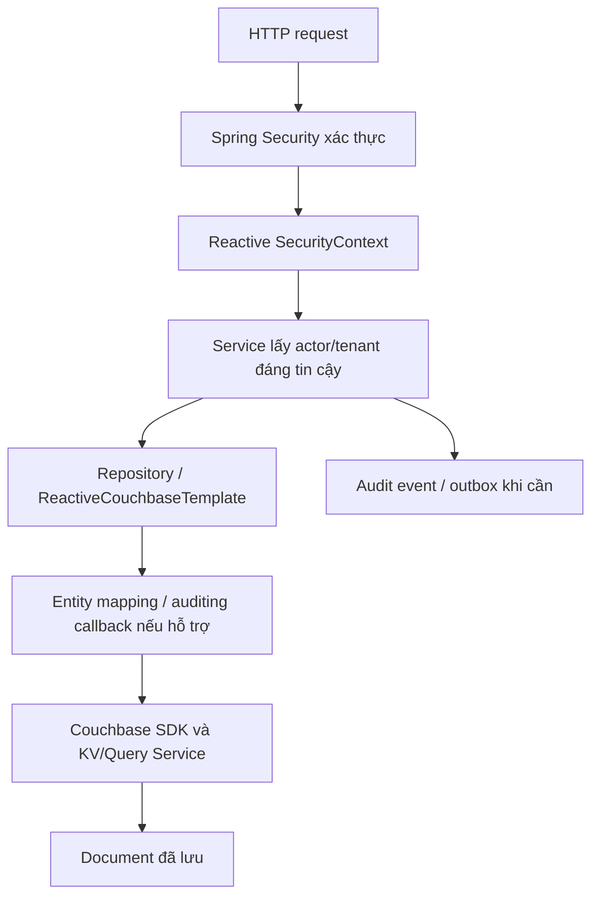

# Auditing phản ứng và xác định người thao tác từ ngữ cảnh

Trong **SPRING_DATA_COUCHBASE**, nghiệp vụ thường cần biết một document được tạo khi nào, ai tạo, ai sửa lần cuối và lần sửa gần nhất xảy ra khi nào. Khi ứng dụng dùng Spring WebFlux và `ReactiveCouchbaseRepository`, thông tin người thao tác không còn an toàn nếu chỉ lấy từ một `ThreadLocal` gắn với thread HTTP: một pipeline Reactor có thể thực thi qua nhiều thread, còn một job xử lý nền thậm chí không có HTTP request.

**Auditing phản ứng** là cách gắn metadata kiểm toán với **vòng đời subscription và thao tác lưu dữ liệu**, đồng thời lấy danh tính từ **ngữ cảnh đáng tin cậy** như Spring Security reactive context hoặc một thông điệp công việc đã được xác minh. Trong module **SPRING_DATA_COUCHBASE**, bài này thuộc chương **Truy cập phản ứng** và đặt auditing vào bối cảnh document mapping, repository, `ReactiveCouchbaseTemplate`, SQL++, bucket/scope/collection, index, TTL, CAS, giao dịch và các yêu cầu vận hành của Couchbase.

> **Nguyên tắc chính:** Người thao tác phải đến từ identity đã xác thực hoặc một nguồn nghiệp vụ được kiểm chứng; metadata auditing cần được áp dụng **ở đúng đường ghi**; `@CreatedBy`/`@LastModifiedBy` không tự biến document thành **nhật ký lịch sử bất biến**. Muốn bảo đảm vừa cập nhật document vừa ghi audit event nguyên tử, cần một transaction/outbox đúng phạm vi và phiên bản API hỗ trợ.

## 1. Mục tiêu học tập

Sau bài này, bạn có thể:

1. Phân biệt **entity auditing metadata** và **audit trail/event log**.
2. Mô tả ý nghĩa của `@CreatedBy`, `@LastModifiedBy`, `@CreatedDate` và `@LastModifiedDate`.
3. Sử dụng `ReactiveAuditorAware<T>` của Spring Data Commons để biểu diễn cách lấy người thao tác theo publisher.
4. Đọc danh tính từ `ReactiveSecurityContextHolder` mà không tin tên người dùng hoặc tenant do client tự gửi.
5. Hiểu `Reactor Context`, `contextWrite`, `deferContextual` và tại sao `ThreadLocal`/MDC thông thường không phải lựa chọn mặc định.
6. Thiết kế chính sách cho request người dùng, service account, scheduled job và công việc được ủy quyền.
7. Kiểm tra **hỗ trợ auditing reactive trong Spring Data Couchbase version thực tế**, không sao chép cấu hình của JPA/MongoDB/R2DBC rồi giả định hoạt động.
8. Chọn giữa auditing qua entity callback và **gắn audit metadata tường minh trong service**.
9. Bảo vệ `createdBy`/`createdAt` không bị thay đổi bởi JSON do client gửi, và xử lý cập nhật cạnh tranh bằng CAS.
10. Nhận diện đường ghi **bỏ qua entity auditing**: SDK trực tiếp, SQL++ DML, sub-document và bulk operations.
11. Thiết kế audit event có ID ổn định, idempotency, retention và transaction/outbox khi cần.
12. Kiểm chứng bằng `StepVerifier`, integration tests và metrics trong điều kiện retry, timeout, cancellation và background jobs.

## 2. Hai khái niệm phải tách biệt: metadata và lịch sử

Một document khách hàng có thể chứa:

```json
{
  "tenant_id": "tenant-a",
  "customer_code": "C001",
  "display_name": "Lan Anh",
  "status": "ACTIVE",
  "created_by": "user-123",
  "created_at": "2026-11-20T09:00:00Z",
  "last_modified_by": "user-456",
  "last_modified_at": "2026-11-25T03:00:00Z"
}
```

Đây là **metadata của trạng thái hiện tại**. Nó trả lời:

- Ai tạo document ban đầu?
- Document được tạo vào thời điểm nào?
- Lần ghi cuối được ứng dụng ghi nhận bởi ai?
- Thời điểm cập nhật gần nhất được ứng dụng ghi nhận là khi nào?

Nó **không** tự trả lời:

- Mỗi lần trước đó ai đã sửa?
- Thay đổi từ giá trị nào sang giá trị nào?
- Lệnh bị từ chối vì lý do gì?
- Một thay đổi có thực sự được phép theo chính sách không?
- Có thể chứng minh audit history không bị sửa hoặc xóa không?

Để trả lời các câu hỏi này, cần một **audit trail** riêng, ví dụ mỗi event có `eventId`, `commandId`, `actorId`, `tenantId`, `action`, `entityId`, `occurredAt` và thông tin thay đổi được phép lưu.

| Cơ chế | Mục đích | Giới hạn |
| --- | --- | --- |
| `@CreatedBy` / `@LastModifiedBy` | Metadata người tạo/người sửa trên entity | Có thể bị ghi đè khi update, không có toàn bộ lịch sử. |
| `@CreatedDate` / `@LastModifiedDate` | Metadata thời gian trên entity | Không chứng minh đồng hồ chuẩn, không ghi các lần trước. |
| App audit event | Lưu từng sự kiện nghiệp vụ | Cần thiết kế lưu bền, chống trùng và quyền truy cập. |
| Outbox | Đồng bộ thay đổi dữ liệu và sự kiện cần phát | Cần transaction/consumer/idempotency được triển khai. |
| Database/server access logs | Theo dõi request/operation ở hạ tầng | Không thay thế danh tính nghiệp vụ và lý do thay đổi. |

**Không ghi trong tài liệu bảo mật rằng chỉ cần thêm bốn annotation là đã có audit trail đầy đủ hoặc chống giả mạo.**

## 3. Đường đi của người thao tác trong ứng dụng reactive

Một request có thể đi theo chuỗi:



Một số quyết định quan trọng:

1. **Danh tính** là gì: username, user ID bất biến, service principal hay actor thay mặt người khác?
2. **Nguồn** có đáng tin cậy không: principal do server xác thực hay header do client tự đặt?
3. **Vòng đời**: publisher có được trả về cho WebFlux/worker và giữ chung một subscription không?
4. **Đường ghi**: có thực sự chạy qua entity lifecycle auditing callback, hay là SDK/SQL++ trực tiếp?
5. **Độ bền**: dữ liệu và audit event cần cùng commit hay cho phép eventual consistency?
6. **Lỗi/cancel**: metadata đã được gửi tới Couchbase chưa, request có thể retry hoặc commit dù caller timeout không?

### 3.1. Auditing không thay phân quyền

Một document có `last_modified_by = user-123` không chứng minh `user-123` được phép cập nhật. Phải kiểm tra tenant, role và quy tắc nghiệp vụ **trước mutation**, đồng thời chống tình trạng TOCTOU bằng CAS/transaction nếu điều kiện có thể thay đổi.

## 4. Document mapping và annotation auditing

Giả sử CRM dùng bucket `app`, scope `crm`, collection `customers`. Entity minh họa:

```java
package example.crm;

import java.time.Instant;
import org.springframework.data.annotation.CreatedBy;
import org.springframework.data.annotation.CreatedDate;
import org.springframework.data.annotation.Id;
import org.springframework.data.annotation.LastModifiedBy;
import org.springframework.data.annotation.LastModifiedDate;
import org.springframework.data.annotation.Version;
import org.springframework.data.couchbase.core.mapping.Collection;
import org.springframework.data.couchbase.core.mapping.Document;
import org.springframework.data.couchbase.core.mapping.Field;
import org.springframework.data.couchbase.core.mapping.Scope;

@Document
@Scope("crm")
@Collection("customers")
public class Customer {

    @Id
    private String id;

    @Field("tenant_id")
    private String tenantId;

    @Field("customer_code")
    private String customerCode;

    @Field("display_name")
    private String displayName;

    @Field
    private String status;

    @CreatedBy
    @Field("created_by")
    private String createdBy;

    @CreatedDate
    @Field("created_at")
    private Instant createdAt;

    @LastModifiedBy
    @Field("last_modified_by")
    private String lastModifiedBy;

    @LastModifiedDate
    @Field("last_modified_at")
    private Instant lastModifiedAt;

    @Version
    private Long version;

    protected Customer() { }

    public String getId() { return id; }
    public String getTenantId() { return tenantId; }
    public String getCustomerCode() { return customerCode; }
    public String getDisplayName() { return displayName; }
    public String getStatus() { return status; }
    public String getCreatedBy() { return createdBy; }
    public Instant getCreatedAt() { return createdAt; }
    public String getLastModifiedBy() { return lastModifiedBy; }
    public Instant getLastModifiedAt() { return lastModifiedAt; }

    public void setDisplayName(String name) {
        this.displayName = name;
    }

    public void setStatus(String value) {
        this.status = value;
    }

    // Constructors/factory và các accessors khác được lược bỏ.
}
```

Ở đây:

- `@CreatedBy` xác định property nhận người tạo theo auditing infrastructure hỗ trợ.
- `@LastModifiedBy` xác định property nhận người sửa gần nhất.
- `@CreatedDate` và `@LastModifiedDate` xác định các mốc thời gian auditing.
- `@Field` ánh xạ tên Java sang JSON field.
- `@Id` ánh xạ document ID Couchbase; `@Version` phục vụ optimistic locking/CAS khi đường ghi hỗ trợ.
- `Instant` yêu cầu converter/JSON serialization phù hợp phiên bản; xác nhận readback thay vì giả định mọi config lưu ISO string giống ví dụ JSON.

**Quan trọng:** Các annotation trên là metadata. Chỉ thêm annotation **chưa chứng minh** giá trị sẽ được điền trong mọi thao tác reactive. Cần kích hoạt auditing bằng cấu hình mà Spring Data Couchbase **release thật sự hỗ trợ**, và phải test cả reactive save, update, callback, mapping và cách lấy auditor.

Repository minh họa cho các ví dụ CRUD và truy vấn theo auditor:

```java
package example.crm;

import org.springframework.data.couchbase.repository.ReactiveCouchbaseRepository;
import reactor.core.publisher.Flux;

public interface CustomerRepository
        extends ReactiveCouchbaseRepository<Customer, String> {

    Flux<Customer> findByLastModifiedBy(String actorId);
}
```

Method truy vấn theo field Java `lastModifiedBy` cần secondary index và phải được xác minh theo từ khóa/kiểu trả về của Spring Data Couchbase version sử dụng. Các method `findById`/`save` được kế thừa từ repository.

## 5. Vòng đời trường tạo/sửa

Một mô hình nghiệp vụ hợp lý:

| Giai đoạn | `createdBy` | `createdAt` | `lastModifiedBy` | `lastModifiedAt` |
| --- | --- | --- | --- | --- |
| Tạo document lần đầu | Actor tạo | Thời điểm tạo | Theo chính sách: actor tạo hoặc chưa có | Theo chính sách: thời điểm tạo hoặc chưa có |
| Update hợp lệ | **Giữ nguyên** | **Giữ nguyên** | Actor cập nhật | Thời điểm cập nhật |
| Save không thay đổi nội dung | Giữ nguyên | Giữ nguyên | Có thể thay đổi nếu callback coi là modification | Có thể thay đổi theo chính sách auditing |
| Upsert/replace | Phụ thuộc nhận diện create/update và đường API | Cần kiểm chứng | Có thể bị ghi lại | Có thể bị ghi lại |
| Xóa cứng | Document không còn để chứa field | Document không còn | Không thể đọc từ document sau xóa | Không thể đọc từ document sau xóa |

Hệ thống không được hứa `createdAt` sẽ luôn bất biến nếu client được phép gửi nguyên entity có chứa giá trị này rồi gọi replace/save. Đảm bảo bất biến ở tầng service, quyền field, transaction/CAS và test.

### 5.1. Auditing khi insert và update không giống nhau

Ở create, actor phải được xác định **trước khi ghi**. Ở update, created fields cần được bảo toàn, còn modified fields lấy từ context của **lần thao tác này**. Một job sửa hàng nghìn documents với cùng actor có thể dùng một actor ID ổn định, nhưng timestamp có thể được xác định theo từng document/lần lưu tùy chính sách.

### 5.2. `save` thành công không chứng minh người sửa đã được stamp

Nếu auditing callback chưa được bật, thiếu `ReactiveAuditorAware`, không có context, hoặc đường save bỏ qua callback, `lastModifiedBy` có thể còn null/cũ. **Phải test readback** từ Couchbase thật.

## 6. `ReactiveAuditorAware<T>` là gì?

Spring Data Commons có abstraction `ReactiveAuditorAware<T>` để tìm auditor bằng `Mono<T>` thay vì lấy một giá trị đồng bộ.

Khái niệm:

```java
import org.springframework.data.domain.ReactiveAuditorAware;
import reactor.core.publisher.Mono;

public class ExampleAuditorAware
        implements ReactiveAuditorAware<String> {

    @Override
    public Mono<String> getCurrentAuditor() {
        // Phải đọc nguồn identity tin cậy.
        return Mono.empty();
    }
}
```

`Mono.empty()` ở đây chỉ để mô tả chữ ký; **không phải implementation production** vì không trả actor. Auditor chỉ có thể được áp dụng tự động khi Couchbase integration/version thực sự gọi abstraction này trong lifecycle auditing.

### 6.1. Vì sao auditor phải reactive?

Trên WebFlux, security context gắn với **Reactor subscription**, không nhất thiết nằm trong thread đang chạy. Một `ReactiveAuditorAware` có thể đọc principal khi được subscribe, sau đó trả `Mono<String>` để auditing subsystem kết hợp với thao tác ghi nếu được hỗ trợ.

Một `AuditorAware<String>` đồng bộ chuyên đọc `SecurityContextHolder.getContext()` trong môi trường imperative không được xem là thay thế tương đương cho luồng WebFlux khi context không được bridge đúng cách.

### 6.2. Không ngầm định mọi Couchbase release hỗ trợ cùng cách bật auditing

Cần kiểm tra chính xác:

- Version Spring Data Couchbase, Spring Data Commons, Spring Boot và Java SDK.
- Annotation/extension nào bật auditing Couchbase trong release đó.
- Cơ chế đó chọn `AuditorAware` hay `ReactiveAuditorAware` cho **reactive** operations.
- Các callbacks được đăng ký cho repository/template nào.
- Converter và loại dữ liệu ngày giờ.
- Thao tác nào **không đi qua** entity callback.
- Thứ tự callback với CAS/version, insert/update và custom conversions.

**Không sao chép `@EnableJpaAuditing`, `@EnableR2dbcAuditing` hay `@EnableMongoAuditing` vào dự án Couchbase.** Ngay cả tên annotation Couchbase tương ứng cũng phải được xác nhận là hỗ trợ auditor reactive theo dependency/version thực tế.

## 7. Lấy auditor từ Spring Security reactive context

Spring Security trong WebFlux cung cấp `ReactiveSecurityContextHolder`. Một implementation minh họa cho actor ID:

```java
package example.crm;

import org.springframework.data.domain.ReactiveAuditorAware;
import org.springframework.security.authentication.AnonymousAuthenticationToken;
import org.springframework.security.core.Authentication;
import org.springframework.security.core.context.ReactiveSecurityContextHolder;
import org.springframework.security.core.context.SecurityContext;
import org.springframework.stereotype.Component;
import reactor.core.publisher.Mono;

@Component
public class SecurityReactiveAuditorAware
        implements ReactiveAuditorAware<String> {

    @Override
    public Mono<String> getCurrentAuditor() {
        return ReactiveSecurityContextHolder.getContext()
            .map(SecurityContext::getAuthentication)
            .filter(authentication ->
                authentication != null
                    && authentication.isAuthenticated()
                    && !(authentication
                        instanceof AnonymousAuthenticationToken)
            )
            .map(Authentication::getName)
            .filter(name ->
                name != null && !name.isBlank()
            );
    }
}
```

Code này là ví dụ **lấy principal name theo reactive context**, không phải một bảo đảm rằng `Authentication.getName()` là user ID bất biến. Trong production, ưu tiên ánh xạ claims/principal đã xác thực sang **subject ID ổn định**; username/email/display name có thể thay đổi hoặc trùng trong nhiều tenant.

### 7.1. Anonymous có thể có `isAuthenticated() == true`

Trong Spring Security, `AnonymousAuthenticationToken` có thể được đánh dấu authenticated. Vì thế chỉ lọc `authentication.isAuthenticated()` là chưa đủ để phân biệt một người dùng đăng nhập thật với anonymous. Ví dụ trên loại riêng token anonymous.

Ngoài ra, một hệ thống có nhiều kiểu token (JWT, OAuth2, API key, internal service) cần validate loại principal và issuer/claims theo cấu hình bảo mật, không chỉ nhìn một chuỗi name.

### 7.2. `Mono.empty()` không tự phải là actor “system”

Khi không có `SecurityContext`, provider có thể trả `Mono.empty()`. Điều này thường có nghĩa “không xác định được auditor” đối với abstraction; **không** nên âm thầm biến mọi request mất context thành `"SYSTEM"`.

Với hành động nhạy cảm, tầng service cần **fail closed** nếu thiếu actor; với scheduled job thật sự chạy bằng service account, phải có actor của job được xác minh và gắn nhãn rõ.

### 7.3. Actor không chỉ gồm username

Một đối tượng actor nghiệp vụ có thể chứa:

```java
public record AuditActor(
    String subjectId,
    String tenantId,
    String actorType,
    String initiatedBy,
    String executionId
) {
}
```

Ví dụ:

- `subjectId`: ID bất biến của người hoặc service.
- `tenantId`: tenant từ quyền đã xác thực.
- `actorType`: `HUMAN`, `SERVICE` hoặc `SCHEDULED_JOB`.
- `initiatedBy`: actor gốc nếu service làm thay người dùng.
- `executionId`: job/request correlation ID an toàn.

Các field phải được **kiểm chứng nguồn gốc**, không map trực tiếp từ HTTP request body rồi dùng như nguồn quyền.

## 8. Reactor Context và vòng đời subscriber

`Reactor Context` là cơ chế truyền dữ liệu theo **subscription** qua pipeline. Nó không gắn mặc định với thread cụ thể.

```java
import reactor.core.publisher.Mono;
import reactor.util.context.Context;

Mono<String> currentActor = Mono.deferContextual(ctx ->
    Mono.just(ctx.<String>get("audit.actor"))
);

Mono<String> result = currentActor.contextWrite(
    Context.of("audit.actor", "user-123")
);
```

Ở subscription, `result` phát `user-123`. Trong ví dụ này, key `"audit.actor"` chỉ là metadata ứng dụng; nó **không** là Spring Security principal và không tự tạo quyền hay một giao dịch Couchbase.

### 8.1. Hướng truyền context dễ gây nhầm

`contextWrite` đặt downstream có thể làm context khả dụng cho các operator **upstream** trong subscription:

```java
Mono<String> id = Mono.deferContextual(ctx ->
    Mono.just(ctx.<String>get("requestId"))
);

Mono<String> withId = id
    .map(value -> "id=" + value)
    .contextWrite(Context.of("requestId", "req-001"));
```

Nếu tách một publisher ra subscription độc lập bằng `subscribe()`, context của HTTP pipeline không được bảo đảm tự chuyển sang subscription mới.

### 8.2. `publishOn`/`subscribeOn` không biến Context thành ThreadLocal

```java
Mono<String> actor = Mono.just(1)
    .publishOn(
        reactor.core.scheduler.Schedulers.parallel()
    )
    .flatMap(ignored ->
        Mono.deferContextual(ctx ->
            Mono.just(ctx.<String>get("audit.actor"))
        )
    )
    .contextWrite(Context.of("audit.actor", "user-123"));
```

Reactor Context được thiết kế theo subscriber context; code đọc bằng `deferContextual` có thể hoạt động qua scheduler trong một chuỗi compose đúng. Ngược lại, code đọc một `ThreadLocal` tự gắn từ HTTP thread có thể mất giá trị khi đổi scheduler.

### 8.3. MDC/tracing là chuyện khác

SLF4J MDC thông thường dựa vào thread-local và có thể cần context propagation bridge để log đúng trong reactive. Dù app đã cấu hình bridge tracing/MDC, điều đó **không chứng minh** một `AuditorAware` đồng bộ đọc đúng user trong mọi thao tác. Nên lấy identity từ API reactive và kiểm thử tách biệt.

## 9. Context từ client không phải bằng chứng quyền

Sai:

```java
// Anti-pattern: client tự khai người sửa.
public Mono<Customer> change(
        String id,
        String userIdFromHeader,
        String newName) {

    return repository.findById(id)
        .flatMap(c -> {
            c.setDisplayName(newName);
            c.markUpdated(
                userIdFromHeader,
                java.time.Instant.now()
            );
            return repository.save(c);
        });
}
```

Đoạn trên mang tính minh họa anti-pattern; entity ở mục 4 không chủ trương expose setter cho `lastModifiedBy`. Nếu copy trực tiếp header `X-User-Id` vào audit field, client có thể mạo danh người sửa.

Đúng về nguyên tắc:

1. Security filter xác thực request/token.
2. Lớp identity ánh xạ principal sang actor ID bền vững và tenant từ claims/quyền đã xác minh.
3. Service kiểm tra quyền trên document trước khi ghi.
4. Auditing/callback hoặc service stamping dùng actor đó.
5. Không cho DTO từ client chứa `createdBy`, `createdAt`, `lastModifiedBy`, `lastModifiedAt`.
6. Nếu có impersonation/on-behalf-of, lưu **cả actor thực thi và actor được ủy quyền** theo chính sách, không ghi đè danh tính gốc.

### 9.1. Tenant có thể cần được kiểm tra lại sau khi đọc

Một document ID do client gửi có thể thuộc tenant khác. `repository.findById(id)` theo key-value thường **không tự thêm điều kiện tenant**. Service cần kiểm tra tenant từ principal sau khi đọc; với điều kiện có thể thay đổi đồng thời, sử dụng CAS/transaction khi cần.

## 10. Cấu hình auditing: kiểm chứng framework trước khi dựa vào annotation

Một hệ thống Spring Data có thể dùng auditing entity callbacks để điền `@CreatedBy`/`@LastModifiedBy` và ngày giờ. Nhưng **mức hỗ trợ reactive theo module/version là một yêu cầu kiểm chứng**, không phải điều được suy ra từ tên annotation.

Một bean provider thuần có thể khai báo:

```java
import org.springframework.context.annotation.Bean;
import org.springframework.context.annotation.Configuration;
import org.springframework.data.domain.ReactiveAuditorAware;

@Configuration
public class AuditPrincipalConfiguration {

    @Bean
    ReactiveAuditorAware<String> reactiveAuditorAware() {
        return new SecurityReactiveAuditorAware();
    }
}
```

**Đây mới là khai báo provider, chưa phải cấu hình Couchbase auditing hoàn chỉnh.** Trong thực tế, nếu class `SecurityReactiveAuditorAware` đã có `@Component` thì tránh khai báo bean trùng như ví dụ này. Chọn **một** cách đăng ký bean; thêm cơ chế kích hoạt auditing **đúng API và release Couchbase** sau khi xác minh nó tiêu thụ `ReactiveAuditorAware` như mong muốn.

### 10.1. Checklist kích hoạt auditing

- Module Couchbase auditing tương ứng đã được enable chưa?
- Repository đang dùng reactive hay imperative?
- Provider nào được chọn khi có nhiều bean?
- Callback được gọi ở create và update không?
- Auditor có được đọc tại **subscription/write time**, không phải lúc khởi tạo service không?
- Field tạo có được bảo toàn khi update không?
- Mapping `Instant` và `@Field` ra JSON đúng không?
- `@Version`/CAS có đi cùng auditing update mà không bị mất không?
- Dòng ghi bằng template/SDK có bỏ qua callback không?
- Khi context không có actor, hệ thống xử lý fail-closed ở tầng nào?

Đừng dùng một unit test trả `Mono.just("user-123")` rồi khẳng định toàn bộ đường Couchbase auditing đã hoạt động. Cần integration test ghi và đọc lại document.

## 11. Khi framework chưa hỗ trợ reactive auditing theo yêu cầu

Một hướng rõ ràng và có thể kiểm soát là **gắn audit metadata tường minh trong service**, sử dụng một `ActorProvider` reactive được kiểm tra quyền. Cách này không phụ thuộc một callback không được version hỗ trợ, nhưng có chi phí quản trị: **mọi đường ghi phải tuân thủ cùng quy tắc**.

Ví dụ interface:

```java
import reactor.core.publisher.Mono;

// Port ứng dụng, không phải Spring Data API.
public interface ActorProvider {
    Mono<AuditActor> requireCurrentActor();
}
```

Triển khai cho HTTP phải lấy context xác thực đáng tin cậy và `switchIfEmpty(Mono.error(...))` khi thiếu actor.

### 11.1. Entity với setter auditing ở phạm vi nội bộ

Nếu chọn stamping tường minh, có thể cung cấp phương thức chuyên dụng thay vì setter public cho client:

```java
public void markUpdated(String actorId, Instant at) {
    this.lastModifiedBy = actorId;
    this.lastModifiedAt = at;
}
```

Đây là phương thức đặt **bên trong class `Customer` ở mục 4**, không phải Java top-level method. Để bảo vệ created fields, không dùng request DTO để ghi đè metadata; khi tạo mới có thể dùng factory:

```java
public void markCreated(String actorId, Instant at) {
    this.createdBy = actorId;
    this.createdAt = at;
    this.lastModifiedBy = actorId;
    this.lastModifiedAt = at;
}
```

Hai phương thức trên là cơ chế **thay thế có chủ đích** khi auditing callback tự động chưa đáp ứng yêu cầu. **Không đồng thời cho callback và service cùng stamp một field mà không xác định chính sách ưu tiên**, vì timestamp/actor có thể bị ghi hai lần khác nhau.

## 12. Ví dụ update customer với actor từ context

Giả sử `ActorProvider` trả `AuditActor(subjectId, tenantId, ...)` tin cậy; service có `Clock` để kiểm soát thời gian trong test.

```java
import java.time.Clock;
import java.time.Instant;
import java.util.NoSuchElementException;
import reactor.core.publisher.Mono;

public final class CustomerEditService {

    private final CustomerRepository repository;
    private final ActorProvider actorProvider;
    private final Clock clock;

    public CustomerEditService(
            CustomerRepository repository,
            ActorProvider actorProvider,
            Clock clock) {
        this.repository = repository;
        this.actorProvider = actorProvider;
        this.clock = clock;
    }

    public Mono<Customer> rename(String customerId, String newName) {
        if (newName == null || newName.isBlank()) {
            return Mono.error(new IllegalArgumentException(
                "Display name is required"
            ));
        }

        return actorProvider.requireCurrentActor()
            .flatMap(actor ->
                repository.findById(customerId)
                    .filter(customer ->
                        actor.tenantId().equals(
                            customer.getTenantId()
                        )
                    )
                    .switchIfEmpty(Mono.error(
                        new NoSuchElementException(
                            "Customer not found"
                        )
                    ))
                    .flatMap(customer -> {
                        customer.setDisplayName(newName);
                        customer.markUpdated(
                            actor.subjectId(),
                            Instant.now(clock)
                        );
                        return repository.save(customer);
                    })
            );
    }
}
```

`CustomerRepository` là `ReactiveCouchbaseRepository<Customer,String>` tương ứng. Hai method `markUpdated`/`markCreated` ở mục 11 phải được đưa vào entity thật; `AuditActor` là record minh họa mục 7.

Pipeline trên thực hiện:

1. Lấy actor từ reactive context khi được subscribe.
2. Đọc document theo ID.
3. Không tiết lộ document của tenant khác bằng chính sách not-found thống nhất.
4. Validate input và quyền.
5. Stamp actor/timestamp phía server.
6. Gọi `save` thông qua publisher được compose.
7. Trả lỗi khi actor thiếu, document không tồn tại, CAS conflict hoặc Couchbase lỗi.

### 12.1. Không có transaction chỉ vì dùng `flatMap`

Đọc → sửa → save vẫn có cửa sổ cạnh tranh. `@Version`/CAS có thể phát hiện lost update theo đường API/version phù hợp. Nếu cần cập nhật nhiều documents/audit event nguyên tử, phải dùng transaction-aware API thật, không chỉ thêm một lần `flatMap`.

### 12.2. Thời gian stamp phải có ngữ nghĩa rõ

`Instant.now(clock)` ở callback sau khi đọc phản ánh thời điểm ứng dụng chuẩn bị update, **không phải chắc chắn thời điểm Couchbase Server commit**. Một thao tác có thể bị queue, timeout hoặc retry. Nếu luật nghiệp vụ cần thời gian commit/server chính xác, phải thiết kế cơ chế ghi nhận tương ứng và xác minh API hỗ trợ, thay vì gọi timestamp do app sinh là “DB commit time”.

## 13. Vì sao không tự `subscribe()` trong audit callback?

Sai:

```java
Mono<Customer> saved = repository.save(customer)
    .doOnNext(c ->
        auditRepository.save(
            AuditEvent.forCustomerUpdate(c)
        ).subscribe()
    );
```

Đây là **anti-pattern**:

- Tạo subscription audit riêng, mất lifecycle/cancellation/context của publisher chính.
- Lỗi audit không đi về caller.
- Retry upstream có thể làm audit được gửi nhiều lần.
- Ghi customer và audit không thành transaction chung.
- Khi WebFlux hủy response, audit subscription có thể vẫn tiếp tục ngoài owner rõ ràng.

Nếu audit là **best effort**, vẫn cần cơ chế owner, queue/job và metrics rõ; không biến `subscribe()` ẩn trong service thành giải pháp đảm bảo độ bền.

### 13.1. Compose không đồng nghĩa atomicity

```java
Mono<Customer> savedWithAudit = repository.save(customer)
    .flatMap(saved ->
        auditRepository.save(
            AuditEvent.forCustomerUpdate(saved)
        ).thenReturn(saved)
    );
```

Code này tốt hơn về **composition** vì audit publisher được trả và lỗi có thể lan truyền, nhưng **chưa bảo đảm all-or-nothing**. Nếu customer đã save rồi audit lỗi, customer có thể vẫn thay đổi.

`AuditEvent.forCustomerUpdate`/`auditRepository` là các helper ứng dụng minh họa; muốn nguyên tử nhiều documents phải dùng một Couchbase transaction thực và bảo đảm cả hai mutation tham gia.

## 14. Transaction-aware auditing khi cần ghi event nguyên tử

Một yêu cầu:

> Khi đổi status customer sang `ARCHIVED`, phải ghi cả trạng thái mới và audit event; nếu không ghi được event thì không được xác nhận transaction thành công.

Thiết kế có thể gồm:

```text
HTTP request / trusted background command
    -> authenticated actor + tenant
    -> Couchbase transaction runner
        -> read customer in attempt
        -> authorize and validate transition
        -> replace customer in attempt
        -> insert audit event in same attempt
    -> commit confirmation
    -> return success
```

Ví dụ **pseudocode**, không phải Java code của một SDK version cụ thể:

```text
transactionRunner.execute(attempt -> {
    return attempt.get(customerKey)
        .flatMap(customer -> {
            validateTenantAndTransition(customer, actor);
            customer.status = "ARCHIVED";

            auditEvent = makeAuditEvent(
                fixedCommandId, actor, customer
            );

            return attempt.replace(customerKey, customer)
                .then(attempt.insert(auditKey, auditEvent));
        });
});
```

Không được thay `attempt.replace` bằng `repository.save` thường trong SDK transaction callback rồi mặc định repository tự tham gia. **Transaction context của SDK** và **Reactor Context/Spring Security context** là các loại context khác nhau. Muốn đọc actor bên trong attempt, xác định actor trước callback hoặc compose nguồn actor vào transaction flow mà vẫn giữ đúng boundary.

### 14.1. Callback transaction có thể bị retry

Nếu engine transaction thử lại attempt do conflict, callback có thể chạy nhiều lần. Vì vậy:

- `commandId` và `eventId` cần ổn định qua retries.
- Không gửi email/HTTP thanh toán trực tiếp trong callback.
- Nếu cần outbox, ghi outbox record có ID xác định trong transaction.
- Không lấy biến đếm in-memory làm duy nhất để sinh ID audit.
- Đừng ghi nhận event là `COMMITTED` ở external system trước khi transaction được xác nhận.

### 14.2. `@Transactional` không tự bao Couchbase SDK attempt

`@Transactional`/`TransactionalOperator` của Spring chỉ quản lý resource nếu có **transaction manager và integration tương thích**. Đặt annotation lên service không chứng minh các operation repository, SQL++ DML và SDK subdocument cùng nằm trong một transaction. Cần xác minh version, manager, context và đọc trạng thái thực sau lỗi.

## 15. Service account, scheduled jobs và “on behalf of”

Không phải mọi mutation đến từ request người dùng đang online. Ví dụ:

- Job đánh dấu customer hết hạn.
- Worker đọc message từ queue.
- Admin thực hiện tác vụ thay mặt khách hàng.
- Service A gọi service B để cập nhật dữ liệu.
- Data migration chạy qua một account vận hành.

Nếu job không có Spring Security HTTP context, `ReactiveSecurityContextHolder.getContext()` có thể trả empty. **Không nên** mặc định mọi empty thành `user-unknown` hoặc `SYSTEM` vì sẽ che lỗi mất context của HTTP request.

### 15.1. Mô hình actor nguồn gốc rõ ràng

| Loại tác vụ | `subjectId` đề xuất | Metadata bổ sung |
| --- | --- | --- |
| Người dùng trực tiếp | Stable user subject | Tenant, request ID, auth method khi cần. |
| Service-to-service | Verified service identity | Caller service, signed request context. |
| Scheduled job | Định danh job/service account | Job ID, execution ID, reason. |
| Worker theo yêu cầu người dùng | Worker identity **và** original initiator | `initiatedBy`, command ID, tenant đã xác minh. |
| Admin impersonation hợp lệ | Admin thực thi và người được đại diện | Approved delegation reason, policy reference. |

**Không thay thế actor thực thi bằng người được đại diện.** Audit phải trả lời “ai trực tiếp thực hiện” và “thay mặt ai” khi hai vai trò khác nhau.

### 15.2. Context của background job phải được dựng từ metadata đã xác minh

Mẫu dùng Reactor Context cho một actor tin cậy:

```java
public final class AuditContextKeys {
    private AuditContextKeys() {}

    public static final String ACTOR = "audit.actor";
}
```

```java
Mono<AuditActor> trustedActor = Mono.deferContextual(ctx ->
    ctx.hasKey(AuditContextKeys.ACTOR)
        ? Mono.just(
            ctx.<AuditActor>get(AuditContextKeys.ACTOR)
          )
        : Mono.error(new IllegalStateException(
            "Missing trusted job actor"
          ))
);

// verifiedJobActor được tạo từ một job envelope đã xác thực.
Mono<Customer> work = trustedActor
    .flatMap(actor ->
        jobService.updateCustomerAs(actor, command)
    )
    .contextWrite(ctx ->
        ctx.put(AuditContextKeys.ACTOR, verifiedJobActor)
    );
```

`jobService`, `command` và `verifiedJobActor` là các thành phần minh họa. **Không lấy `verifiedJobActor` trực tiếp từ payload do client/producer không tin cậy gửi**; phải xác minh nguồn, signature/ACL, tenant và quyền thực thi. Context truyền actor, không tự xác thực actor.

### 15.3. Không đưa attempt context của giao dịch vào job lâu dài

Một transaction attempt chỉ sống trong vòng đời callback/runner của nó. Nếu job chạy sau HTTP disconnect, nó phải **mở transaction mới theo đúng job actor**, không tái sử dụng attempt context cũ từ request đã kết thúc.

## 16. Trường created không được phép đến từ request DTO

Một endpoint kiểu:

```java
@PostMapping("/customers")
public Mono<Customer> create(@RequestBody Customer customer) {
    return repository.save(customer);
}
```

là **anti-pattern bảo vệ auditing** nếu JSON của client có thể bind vào `createdBy`, `createdAt`, `lastModifiedBy` hoặc tenant mà không bị lọc. Client có thể mạo danh hoặc ghi lùi thời gian.

Thiết kế tốt hơn:

- Request DTO chỉ có các field được phép, ví dụ `customerCode`, `displayName`.
- Tenant lấy từ authenticated context.
- Actor lấy từ reactive principal/job metadata đã xác minh.
- Service factory tạo entity với server-side ID và protected metadata.
- Validate uniqueness/status và chính sách quyền.
- Ghi qua đường có auditing callback thực hoặc explicit stamping.
- Response dùng DTO không lộ internal CAS/version hay metadata không cần thiết.

### 16.1. Update cũng cần chống mass assignment

HTTP PUT có đủ JSON từ client không được phép thay `createdBy` hoặc `createdAt`. Đừng map DTO nguyên bản lên entity rồi overwrite tất cả fields trước `save`. Dùng whitelist hoặc service update từng field được phép.

## 17. CAS, concurrent updates và actor “người sửa cuối”

Hai request có thể cùng đọc customer version/CAS V1:

```text
Request A: actor=user-111, đọc V1, đổi displayName
Request B: actor=user-222, đọc V1, đổi status
A save thành công -> CAS V2, lastModifiedBy=user-111
B save với V1 -> CAS conflict (nếu optimistic locking được áp dụng)
```

Với `@Version`/CAS được triển khai đúng, B không nên âm thầm overwrite metadata của A. Nếu B cần retry, service phải **đọc lại entity mới**, kiểm tra tenant/quy tắc mới, stamp actor B và lưu lại với CAS hiện tại khi nghiệp vụ cho phép.

### 17.1. Không retry một object stale vô hạn

```java
// Anti-pattern: có thể retry cùng CAS cũ.
repository.save(staleCustomer).retry(20);
```

Không thể giải quyết xung đột CAS bằng cách chỉ lặp lại một object giữ version cũ. Đồng thời, retry sau timeout mutation có outcome chưa rõ **khác** retry một CAS conflict đã được xác nhận.

### 17.2. Auditing metadata không chứng minh mỗi attempt thành công

Một method Java gọi `customer.markUpdated(actor, now)` chỉ thay object trong RAM. Nếu `save` lỗi hoặc CAS conflict, giá trị đó **chưa được xác nhận đã lưu**. Audit event nghiệp vụ “đã cập nhật thành công” phải dựa trên kết quả mutation/transaction được xác nhận, không dựa vào việc callback được gọi.

## 18. Retry, timeout và cancellation ảnh hưởng auditing thế nào?

Một luồng:

```java
Mono<Customer> updated = service.rename(id, newName)
    .timeout(java.time.Duration.ofSeconds(3));
```

Nếu timeout xảy ra sau khi SDK gửi mutation, Couchbase có thể đã ghi. Caller không nhận success **không chứng minh** audit metadata chưa thay đổi.

| Tình huống | Rủi ro |
| --- | --- |
| Retry một create với ID mới | Tạo trùng customer và audit event. |
| Retry update sau timeout không rõ | Ghi lại metadata/side effect khi mutation đầu đã commit. |
| Transaction attempt tự retry | Audit event callback có thể được tạo nhiều lần nếu ID không ổn định. |
| Client disconnect | Request owner hủy subscription; mutation/audit vẫn có thể commit. |
| Fallback khi không có principal | Ghi sai `SYSTEM`, che lỗi propagation. |
| Replay event của worker | `lastModifiedBy`/timestamp bị stamp lại dù command đã xử lý. |

### 18.1. Idempotency phải gắn với command nghiệp vụ

Dùng một `commandId`/`eventId` ổn định cho cùng thao tác. Nếu request được xử lý lại:

1. Xác minh ID và payload fingerprint/tenant.
2. Nếu command đã commit, trả kết quả tương đương thay vì ghi lại.
3. Nếu outcome chưa rõ, đối chiếu trạng thái ledger/document.
4. Nếu có xung đột thực, báo conflict hoặc xử lý theo protocol.
5. Không phát audit event thứ hai cho cùng một mutation được xác nhận một lần.

**Tính idempotent của metadata cập nhật** không tự chứng minh exactly-once của mọi side effect: lần save thứ hai có thể đổi CAS, modified time hoặc sinh events.

## 19. Auditing với SQL++ UPDATE/DELETE và sub-document operations

Đường ghi quyết định liệu auditing callbacks có chạy.

Ví dụ SQL++ DML trực tiếp:

```sql
UPDATE `app`.`crm`.`customers` AS c
SET c.`status` = "ARCHIVED"
WHERE c.`tenant_id` = $tenantId
  AND c.`customer_code` = $customerCode;
```

Câu SQL++ này có thể thay đổi document **mà không đi qua object Java `Customer` và entity auditing callbacks**. Không được mặc định `@LastModifiedBy` tự cập nhật khi chạy query DML qua SDK.

Nếu chọn DML, phải bảo đảm:

- Tenant/authorization được ràng buộc vào query từ context tin cậy.
- Field audit được cập nhật có chủ đích nếu chính sách yêu cầu.
- Actor/command ID được bind an toàn, không ghép chuỗi SQL++ trực tiếp.
- CAS/điều kiện concurrent update được kiểm soát theo loại mutation/API.
- Index và Query Service plan phù hợp.
- Truy vết và kết quả mutation được kiểm chứng.
- Nếu cần log bất biến, dùng transaction/outbox hỗ trợ đúng phạm vi.

### 19.1. Sub-document mutation cũng cần kiểm chứng

SDK `mutateIn`/sub-document ops có thể sửa vài JSON paths trực tiếp. Vì không nhất thiết chạy qua Spring Data entity lifecycle, metadata auditing annotation có thể **không được áp dụng**. Nếu dùng sub-document path update, thêm các audit fields trong cùng mutation khi API hỗ trợ và xử lý CAS/TTL nhất quán; đừng lấy một ví dụ repository `save` để suy ra hành vi mọi API.

### 19.2. Bulk imports và migrations

Import hàng triệu documents có thể bỏ qua callbacks hoặc chủ động giữ `createdAt` lịch sử từ nguồn. Đây là chính sách migration cần được tài liệu hóa:

- `createdBy` gốc được bảo tồn hay thay bằng migration service?
- `lastModifiedBy` là migration actor hay actor lịch sử?
- Có lưu provenance/source system không?
- Có dùng index/TTL/expiration khác so với CRUD thông thường không?
- Có record một lần cho cả batch hay event cho từng document?
- Có thể replay mà không tạo trùng/ghi sai timestamps không?

Không áp dụng auditing web-request một cách vô thức cho data backfill.

## 20. Xóa document: auditing metadata một mình không đủ

Một `deleteById(id)` hoặc `remove` có thể xóa cả document, kể cả `createdBy` và `lastModifiedBy`. Nếu cần biết ai xóa, khi nào, vì sao, có hai hướng:

**Hướng A — Soft delete/tombstone:** cập nhật `deleted`, `deletedBy`, `deletedAt`, `reason` với CAS/transaction.

**Hướng B — Hard delete và audit event:** ghi một audit event bền vững với ID bất biến, rồi delete trong transaction nếu yêu cầu cùng commit; nếu không, dùng workflow/outbox/compensation và chấp nhận mô hình nhất quán đã thiết kế.

### 20.1. Soft delete không chỉ là thêm một field

Query đọc danh sách phải lọc `deleted = false` hoặc cấu trúc tương đương; index cần theo predicate, TTL/retention hold phải được xét. Nếu vô tình gọi `findAll()` không lọc tombstone, tài liệu đã xóa mềm có thể xuất hiện lại với client.

### 20.2. Hard delete cần quy tắc retention

Một audit event có thể chứa thông tin nhạy cảm, cần retention, quyền truy cập và chính sách xóa hợp pháp. Không mặc định “audit phải lưu mãi mãi”; cũng không dùng TTL quá ngắn khiến mất bằng chứng trước thời gian có thể retry/đối soát.

## 21. Phân biệt application time, server time và event time

Có ít nhất ba mốc:

| Mốc | Ý nghĩa |
| --- | --- |
| **Received/command time** | Khi ứng dụng nhận lệnh. |
| **Audit stamp time** | Khi callback/service đặt `lastModifiedAt`. |
| **Commit-confirmed time** | Khi ứng dụng nhận xác nhận commit theo transaction/mutation API. |

Trong một request tải cao, chúng có thể khác nhau. Thời gian do `Instant.now(clock)` sinh dựa trên clock JVM; không tự bằng commit time ở Couchbase. Một client event có `occurredAt` cũng cần được xem là dữ liệu đầu vào, không thay thế server stamp cho mục đích chống giả mạo.

### 21.1. Đồng hồ các node có thể lệch

Khi nhiều app instances cùng stamp metadata, đồng hồ cần đồng bộ để giảm lệch, nhưng không dùng `lastModifiedAt` làm nguồn duy nhất giải quyết lost update. CAS/`@Version` mới phù hợp để phát hiện cạnh tranh trên document theo API.

### 21.2. Query theo thời gian vẫn cần index

Nếu muốn lấy danh sách customer sửa gần đây:

```sql
SELECT c.customer_code, c.last_modified_by, c.last_modified_at
FROM `app`.`crm`.`customers` AS c
WHERE c.tenant_id = $tenantId
ORDER BY c.last_modified_at DESC,
         c.customer_code ASC
LIMIT 50;
```

Index mẫu:

```sql
CREATE INDEX ix_customers_tenant_modified_code
ON `app`.`crm`.`customers`(
    `tenant_id`,
    `last_modified_at` DESC,
    `customer_code` ASC
);
```

Đây là index **minh họa**; cần xét type discriminator và field mapping Spring Data, thời gian lưu thực tế, missing/null và plan `EXPLAIN`. `LIMIT 50` chỉ giới hạn row trả về, không bảo đảm query scan 50 document nếu index/sort chưa phù hợp.

## 22. Read-after-write và audit query qua secondary index

Sau khi lưu entity có `lastModifiedBy=user-123`, một KV read theo ID thường có đường truy cập khác với SQL++ query tìm mọi customer vừa sửa bởi user đó.

```java
Mono<Customer> byId = repository.save(customer)
    .flatMap(saved -> repository.findById(saved.getId()));
```

Trong khi:

```java
Flux<Customer> byActor = repository.save(customer)
    .flatMapMany(saved ->
        repository.findByLastModifiedBy("user-123")
    );
```

`findByLastModifiedBy` là repository method minh họa đã khai báo ở mục 4; cần kiểm tra hỗ trợ và index theo phiên bản. Query Service có thể chưa thấy mutation vừa ghi do secondary index đang cập nhật tại scan consistency thông thường.

Không dùng việc SQL++ chưa thấy document ngay để kết luận auditing callback không chạy. Cần phân biệt:

1. Đọc theo ID trực tiếp có field audit đúng không?
2. Field JSON và mapping `@Field` có khớp không?
3. Có type discriminator/collection/scope đúng không?
4. Query SQL++ có index/predicate đúng không?
5. Có cần scan consistency như `REQUEST_PLUS` theo SDK/framework version không?

Consistency mạnh hơn có thể làm query đợi index, tăng latency. Không tự bật cho mọi audit reporting query nếu không có yêu cầu cần dữ liệu ngay sau mutation.

## 23. Audit trail bền vững và outbox

Nếu cần một lịch sử sự kiện không bị ghi đè, định nghĩa schema riêng:

```json
{
  "event_id": "audit::cmd-772::customer-status",
  "command_id": "cmd-772",
  "tenant_id": "tenant-a",
  "entity_id": "customer::tenant-a::C001",
  "action": "CUSTOMER_STATUS_ARCHIVED",
  "actor_id": "user-123",
  "actor_type": "HUMAN",
  "initiated_by": "user-123",
  "occurred_at": "2026-11-25T03:00:00Z",
  "correlation_id": "req-001",
  "schema_version": 1
}
```

**Đây là schema ví dụ**, không phải định dạng chuẩn Couchbase. Chỉ lưu đủ dữ liệu phục vụ audit; tránh snapshot toàn bộ document chứa PII/secret nếu không cần.

### 23.1. Một event cần có ID ổn định

Nếu transaction callback bị retry, `event_id` không nên thay đổi mỗi attempt. Khi replay cùng `command_id`, hệ thống phải nhận diện cùng tác vụ nghiệp vụ để không tạo event trùng hoặc ghi mutation thêm lần nữa.

### 23.2. Outbox là một phần của workflow bền

Ví dụ:

```text
Couchbase transaction:
  update customer
  insert audit/outbox document (fixed event ID)
  commit

Worker:
  poll/consume outbox
  publish message with event ID
  mark delivered/checkpoint
  retry safely when transport fails
```

Transaction bảo vệ mutation và event trong **cùng phạm vi Couchbase hỗ trợ**. Worker xử lý phát ra ngoài có thể gửi trùng khi crash sau khi publish nhưng trước checkpoint; consumer phải có idempotency/dedup. Không khẳng định outbox tạo exactly-once end-to-end nếu thiếu các cơ chế đó.

### 23.3. Quyền ghi audit event phải được giới hạn

Nếu người dùng ứng dụng có thể trực tiếp sửa/xóa `audit_events`, event log không có tính tin cậy cao dù dùng `eventId`. Thiết kế RBAC, phân tách credentials, retention và giám sát việc thay đổi lịch sử, cộng với cơ chế chống sửa/xóa theo mức bảo đảm yêu cầu.

## 24. Dữ liệu nhạy cảm trong auditing

Audit có thể trở thành một kho dữ liệu nhạy cảm nếu lưu quá mức:

- Không dùng email/username có thể đổi như actor ID duy nhất nếu đã có immutable subject ID.
- Tránh lưu password, access token, session cookie, secret và nguyên JSON chứa thông tin khách hàng.
- `reason` nhập từ client cần validate/sanitize, không xem là sự thật được xác minh.
- Audit `before`/`after` nên chỉ lưu fields được phép, có mask hoặc hash theo chính sách.
- Khi một người có quyền yêu cầu xóa dữ liệu, phải xem xét chính sách retention/audit và yêu cầu pháp lý liên quan, không mặc định lưu vĩnh viễn.
- Log và tracing không nên ghi toàn bộ Reactor Context vì có thể chứa principal, token hoặc object nội bộ.
- Quyền đọc audit event thường cần chặt hơn quyền xem entity thông thường.

**Mục tiêu auditing là truy vết có kiểm soát, không phải sao chép mọi thông tin nhạy cảm sang một nơi khác.**

## 25. Test `ReactiveAuditorAware` bằng `StepVerifier`

Unit test có thể xác minh provider đọc `ReactiveSecurityContextHolder` từ subscription.

```java
import static org.assertj.core.api.Assertions.assertThat;

import java.util.List;
import org.junit.jupiter.api.Test;
import org.springframework.security.authentication.UsernamePasswordAuthenticationToken;
import org.springframework.security.core.authority.SimpleGrantedAuthority;
import org.springframework.security.core.context.ReactiveSecurityContextHolder;
import reactor.test.StepVerifier;

class SecurityReactiveAuditorAwareTest {

    private final SecurityReactiveAuditorAware aware =
        new SecurityReactiveAuditorAware();

    @Test
    void readsAuthenticatedPrincipalInReactiveContext() {
        var authentication =
            new UsernamePasswordAuthenticationToken(
                "user-123",
                "not-used",
                List.of(new SimpleGrantedAuthority("ROLE_EDITOR"))
            );

        StepVerifier.create(
                aware.getCurrentAuditor()
                    .contextWrite(
                        ReactiveSecurityContextHolder
                            .withAuthentication(authentication)
                    )
            )
            .expectNext("user-123")
            .verifyComplete();
    }

    @Test
    void noSecurityContextMeansNoAuditor() {
        StepVerifier.create(
                aware.getCurrentAuditor()
            )
            .verifyComplete();
    }
}
```

**Kiểm tra được:** provider phát actor từ reactive security context và không bịa actor khi thiếu context.

**Chưa kiểm tra được:** Couchbase auditing callback có được kích hoạt trong `repository.save` hay không; created/modified fields có được lưu đúng; SQL++/SDK mutations có bypass hay không.

### 25.1. Test anonymous đúng nghĩa

Nếu ứng dụng cho phép anonymous ở một số endpoint, bổ sung một test với `AnonymousAuthenticationToken` theo Spring Security version thực tế để bảo đảm nó không được dùng làm `createdBy` của mutation cần xác thực.

### 25.2. Đừng gắn actor giả vào mọi test rồi coi là đã xong phân quyền

`contextWrite(ReactiveSecurityContextHolder.withAuthentication(...))` giúp mô phỏng principal trong unit test, nhưng không thay integration test của authentication filter, tenant mapping và ACL trên document thật.

## 26. Kiểm thử Reactor Context khi đổi scheduler

Một test cho thấy metadata theo subscription, không lệ thuộc một ThreadLocal tự viết:

```java
import org.junit.jupiter.api.Test;
import reactor.core.publisher.Mono;
import reactor.core.scheduler.Schedulers;
import reactor.test.StepVerifier;
import reactor.util.context.Context;

class AuditReactorContextTest {

    @Test
    void contextIsVisibleAfterPublishOn() {
        Mono<String> publisher = Mono.just(1)
            .publishOn(Schedulers.parallel())
            .flatMap(i -> Mono.deferContextual(ctx ->
                Mono.just(ctx.<String>get("audit.actor"))
            ))
            .contextWrite(
                Context.of("audit.actor", "job-actor-1")
            );

        StepVerifier.create(publisher)
            .expectNext("job-actor-1")
            .verifyComplete();
    }

    @Test
    void missingActorFailsClosed() {
        Mono<String> required = Mono.deferContextual(ctx ->
            ctx.hasKey("audit.actor")
                ? Mono.just(ctx.<String>get("audit.actor"))
                : Mono.error(new IllegalStateException(
                    "Missing trusted actor"
                ))
        );

        StepVerifier.create(required)
            .expectError(IllegalStateException.class)
            .verify();
    }
}
```

Đây là test Reactor thuần. Nó chỉ chứng minh `contextWrite`/`deferContextual` trong một publisher được compose; không chứng minh Spring Data Couchbase auditing được gọi.

## 27. Integration test: tạo mới và cập nhật có audit metadata

Một test trên Couchbase thật cần:

- Cluster/bucket/scope/collection **dành riêng cho test**.
- Cấu hình auditing reactive đúng phiên bản hoặc explicit stamping đúng service.
- Fixture ID ổn định và quyền test phù hợp.
- Converter ngày giờ được kiểm tra bằng readback.
- Không dùng collection production để thử insert/delete.

Khung:

```java
import static org.assertj.core.api.Assertions.assertThat;

import org.junit.jupiter.api.Test;
import reactor.test.StepVerifier;

// Khung minh họa: service, fixture, test security context,
// constructors và repository được ứng dụng cung cấp.
@Test
void stampsCreatedFieldsFromAuthenticatedActor() {
    StepVerifier.create(
            service.createCustomer(new CreateCustomerCommand(
                "C001", "Lan Anh"
            ))
            .flatMap(created ->
                repository.findById(created.getId())
            )
            .contextWrite(
                trustedTestSecurityContext("user-123", "tenant-a")
            )
        )
        .assertNext(saved -> {
            assertThat(saved.getCreatedBy()).isEqualTo("user-123");
            assertThat(saved.getCreatedAt()).isNotNull();
            assertThat(saved.getLastModifiedBy())
                .isNotBlank();
        })
        .verifyComplete();
}
```

`CreateCustomerCommand`, `trustedTestSecurityContext` và `service` là thành phần test/app **phải triển khai**; đây không phải Java test file độc lập.

### 27.1. Test update giữ created fields

1. Seed customer được tạo bởi user A.
2. Đọc lại và ghi nhớ `createdBy`/`createdAt` và CAS/version.
3. Chạy update bằng user B.
4. Đọc lại từ Couchbase theo ID.
5. Assert `createdBy`/`createdAt` không đổi, `lastModifiedBy` là B và thời gian sửa phù hợp.
6. Assert business field đúng và version/CAS được xử lý theo API.

### 27.2. Test không có actor

Gọi mutation qua route/service được yêu cầu authentication nhưng thiếu security context. Xác minh nó **không** ghi metadata thành `SYSTEM` hoặc user giả. Nếu chính sách fail-closed, assert không có mutation sau lỗi. Nếu framework auditing chỉ để field null, tầng service vẫn phải enforce actor requirement cho operation nhạy cảm.

### 27.3. Test không tin field từ client

Gửi DTO cố tình chứa `createdBy`/`lastModifiedBy` hoặc tenant tự khai (nếu API tiếp nhận dạng dữ liệu này). Assert field giả bị từ chối/bỏ qua, actor/tenant từ security context thắng. Không để test chỉ kiểm tra HTTP 200 mà không đọc document cuối.

### 27.4. Test SQL++/SDK bypass

Nếu hệ thống có một đường `UPDATE` SQL++ hoặc `mutateIn` SDK, tạo test riêng kiểm tra audit fields sau operation. Điều quan trọng là **không mặc định callbacks luôn chạy**; hãy xác định đường ghi nào phải stamp thủ công hoặc sử dụng transaction/outbox.

## 28. Integration test: concurrency, transaction và idempotency

### 28.1. CAS conflict không được làm sai người sửa cuối

1. Đọc hai instance entity độc lập từ cùng version.
2. Request A dùng actor A stamp và save.
3. Request B dùng actor B với CAS cũ cố save.
4. Xác minh conflict behavior theo Spring Data Couchbase version.
5. Đọc lại: `lastModifiedBy` phản ánh mutation thực sự commit; không lấy actor từ object B chưa ghi.
6. Nếu business cho phép retry B, phải re-read, re-authorize và stamp B theo attempt mới.

### 28.2. Transaction mutation + audit event

Nếu ứng dụng cam kết atomicity:

- Test commit: business entity và event cùng tồn tại.
- Test lỗi trước commit: cả hai không được xác nhận ghi.
- Test duplicate `commandId`: không tạo hai event hoặc hai business mutations.
- Test timeout/unknown outcome: reconcile theo command ID trước retry.
- Test callback được transaction engine retry: event ID không đổi và không có email/HTTP side effect trùng.
- Test cross-tenant access: không thể dùng actor A sửa document tenant B.

### 28.3. TTL/expiration

Document hết hạn có thể không tồn tại khi job xử lý; không được tự tạo lại document chỉ vì một retry. Audit event/idempotency record có TTL/retention khác customer record, cần xác minh thời gian giữ phù hợp quy định nghiệp vụ.

## 29. Observability: làm sao biết actor có bị mất context?

Bảng metric và dấu hiệu hữu ích:

| Tín hiệu | Giá trị chẩn đoán |
| --- | --- |
| Mutation attempts | Biết có bao nhiêu lần try/retry. |
| Missing authenticated actor | Phát hiện mất context hoặc route không bảo vệ. |
| Auditing callback invoked | Kiểm tra callback thực sự chạy theo đường repository/template. |
| Actor kind | Phân biệt người dùng, service và job. |
| CAS conflict | Thao tác không ghi vì version stale. |
| Confirmed mutation | Có kết quả ghi/transaction được xác nhận. |
| Unknown write outcome | Cần reconciliation/idempotency. |
| Audit event insert failure | Không che lỗi sự kiện nếu nghiệp vụ cần. |
| Outbox pending/delivered/retried | Biết event phát ra ngoài có tiến triển. |
| SQL++ index/query latency | Phân biệt query audit chậm với lỗi auditing metadata. |
| Created/modified field missing | Báo rủi ro callback/config/context. |

Không đưa actor ID đầy đủ vào mọi tag metrics nếu cardinality quá lớn; có thể dùng nhóm actor type, endpoint và mã lỗi. Actor ID cụ thể chỉ trong log/tracing đã kiểm soát quyền truy cập và bảo vệ dữ liệu.

### 29.1. `doOnNext` không phải “audit đã commit”

```java
Mono<Customer> observed = repository.save(customer)
    .doOnNext(saved ->
        metrics.incrementSaveResultEmitted()
    );
```

Publisher phát entity cho thấy API đã trả kết quả theo hợp đồng, nhưng chưa chứng minh một **audit event riêng** đã commit. Nếu audit event cần cùng transaction, đo kết quả transaction runner, không chỉ hook sau một `save` thường.

### 29.2. Cancellation có thể che trạng thái cuối của mutation

Khi client disconnect hoặc `timeout` cancel publisher, mutation vẫn có thể đã gửi/commit phía Couchbase. Không đặt `lastModifiedBy` hoặc audit ledger thành “chưa ghi” chỉ vì HTTP client không nhận response. Dùng trạng thái outcome/command ID và đọc lại.

## 30. Những lỗi thiết kế phổ biến

| Sai lầm | Hậu quả | Hướng sửa |
| --- | --- | --- |
| Lấy actor từ header `X-User-Id` do client gửi | Mạo danh người sửa. | Identity đã xác thực, stable subject. |
| Dùng `SecurityContextHolder` ThreadLocal mặc định trong WebFlux | Có thể mất/sai context khi chuyển thread. | `ReactiveSecurityContextHolder`/Reactor Context đúng lifecycle. |
| Chỉ thêm `@CreatedBy` mà không bật auditing | Field không được stamp. | Cấu hình hỗ trợ version và integration test. |
| Tin `ReactiveAuditorAware` tự được Couchbase version bất kỳ gọi | Cảm giác an toàn giả. | Kiểm tra callback/annotation hỗ trợ thực tế. |
| Fallback mọi missing auditor thành `SYSTEM` | Che lỗi auth/context. | Fail closed; service actor chỉ ở job có kiểm chứng. |
| Dùng username/email thay stable subject ID | Mất liên kết lịch sử khi tên đổi. | Immutable actor key, tenant rõ. |
| Cho client bind entity audit fields | Ghi đè created/modified metadata. | Request DTO whitelist và stamping server-side. |
| Dùng `subscribe()` trong auditing side effect | Mất lifecycle/error/context, có thể ghi trùng. | Compose hoặc outbox/job owner. |
| Xem `then(saveAudit)` là transaction | Mutation trước có thể commit dù event lỗi. | Transaction-aware operations khi cần atomicity. |
| Gọi repository thường trong SDK transaction callback | Audit có thể nằm ngoài attempt. | Transaction-aware API/context. |
| Retry với event ID ngẫu nhiên mới | Tạo audit event trùng. | ID dựa trên command ID ổn định. |
| Stamp `createdAt` lại khi update | Mất nguồn gốc tạo ban đầu. | Bảo toàn created fields và test. |
| SQL++ UPDATE tự động kích hoạt entity auditing | Bỏ qua callbacks do không qua entity. | Stamp audit fields/DML hoặc transaction/outbox có chủ đích. |
| SDK subdocument update tự stamp `lastModifiedBy` | Metadata cũ dù dữ liệu thay đổi. | Xử lý field trong mutation theo API hỗ trợ. |
| Chỉ log `lastModifiedBy` trên entity rồi gọi là audit trail | Mất toàn bộ lịch sử các lần trước. | Event log/ledger bền vững. |
| Coi `Instant.now()` bằng thời điểm DB commit | Sai timestamp semantics. | Phân biệt stamp time/commit time. |
| Đánh giá thành công khi callback được gọi | Mutation có thể lỗi/CAS conflict. | Đọc kết quả ghi/transaction confirmation. |
| Không có quyền đọc audit riêng | Lộ dữ liệu nhạy cảm. | RBAC, redaction và retention. |
| Dùng TTL audit quá ngắn | Mất bằng chứng/idempotency khi replay. | Retention theo nghiệp vụ/pháp lý. |
| Không phân biệt audit của job và user | Không truy vết đúng người/nguồn tác động. | Actor type, executedBy và initiatedBy. |

## 31. Bài tập vận dụng

### Bài A — Annotation có đủ không?

Một entity có `@CreatedBy` và `@LastModifiedBy`. Khi chạy `repository.save` reactive, có thể khẳng định chúng luôn được điền?

**Đáp án:** Không. Cần đúng cấu hình auditing Spring Data Couchbase hỗ trợ trên release đang dùng, auditor provider, lifecycle callback và context. Kiểm tra bằng readback sau create/update.

### Bài B — Principal từ đâu?

Client gửi `X-User-Id: admin`, còn Spring Security đã xác thực subject `user-123`. Audit field nên lấy giá trị nào?

**Đáp án:** Lấy immutable subject từ identity/security context đã xác thực, không lấy header client tự khai.

### Bài C — ThreadLocal

Một callback reactive chuyển sang scheduler khác rồi đọc `SecurityContextHolder.getContext()`. Vì sao có thể sai?

**Đáp án:** ThreadLocal không tự gắn với subscription. Dùng `ReactiveSecurityContextHolder` hoặc cơ chế context propagation được xác minh, không giả định cùng thread.

### Bài D — Anonymous

Vì sao chỉ kiểm tra `Authentication.isAuthenticated()` có thể chưa đủ?

**Đáp án:** `AnonymousAuthenticationToken` có thể được đánh dấu authenticated; cần loại anonymous và xác minh loại token/identity đáng tin cậy.

### Bài E — Không có principal

Một job thật sự cần sửa customer nhưng không có HTTP security context. Có nên mặc định actor `SYSTEM` cho mọi trường hợp?

**Đáp án:** Không. Job cần identity service/job và execution metadata được xác minh; mất context của HTTP request phải được nhận diện và xử lý fail-closed khi policy yêu cầu.

### Bài F — Created fields bị đổi

Client gửi DTO có `createdBy=user-999` khi cập nhật. Điều gì cần làm?

**Đáp án:** Không cho client quyết định created metadata. Dùng request DTO chỉ chứa field được phép, giữ created fields từ entity lưu trước đó và cập nhật modified fields server-side.

### Bài G — Transaction audit event

Ghi customer thành công nhưng ghi event lỗi. `then`/`flatMap` có rollback customer không?

**Đáp án:** Không. Nếu cần all-or-nothing, dùng transaction API hỗ trợ, bảo đảm cả hai mutation tham gia đúng attempt.

### Bài H — SDK mutation

Một `mutateIn` SDK đổi status mà không qua entity callback. Có chắc `@LastModifiedBy` được cập nhật không?

**Đáp án:** Không. Cần xử lý audit metadata trong đường mutation hoặc transaction/outbox có chủ đích và test readback.

### Bài I — Retry

Transaction callback bị retry hai lần và mỗi lần sinh `eventId` mới. Hệ quả?

**Đáp án:** Có nguy cơ event trùng hoặc khó reconcile. Giữ `commandId`/`eventId` ổn định và dùng idempotency theo nghiệp vụ.

### Bài J — CAS conflict

Request B stamp `lastModifiedBy=user-B` trên object nhưng save bị CAS conflict. Có thể khẳng định Couchbase đã lưu actor B không?

**Đáp án:** Không. Stamp trong bộ nhớ không phải commit; đọc lại document để biết metadata thực.

### Bài K — Soft delete

Thêm `deletedBy` và `deletedAt` là đủ để ngăn customer đã xóa mềm xuất hiện trong danh sách?

**Đáp án:** Chưa. Query/derived repository phải lọc tombstone, index phù hợp và có chính sách riêng cho quyền đọc/khôi phục.

### Bài L — Audit retention

Idempotency/audit record hết TTL trước thời gian client được phép retry. Có rủi ro gì?

**Đáp án:** Mất bằng chứng request cũ đã xử lý, dẫn đến tạo audit event hoặc mutation trùng. Retention phải phù hợp thời gian replay/reconciliation.

### Bài M — Actor on behalf of

Admin thực hiện thay mặt một customer. Có nên chỉ lưu ID customer như người thao tác?

**Đáp án:** Không. Cần tách actor thực thi (admin/service) và người được đại diện, kèm cơ sở ủy quyền nếu policy yêu cầu.

### Bài N — Read-after-write SQL++

KV read thấy audit fields mới, còn SQL++ query theo `lastModifiedBy` chưa thấy. Có thể kết luận auditing lỗi?

**Đáp án:** Chưa. Kiểm tra index, field mapping, query predicate, type discriminator và scan consistency; secondary index có thể chưa thấy mutation ngay.

### Bài O — Time stamp

`lastModifiedAt = Instant.now(clock)` có bằng chính xác thời điểm Couchbase commit không?

**Đáp án:** Không mặc định. Đó là application stamp time; commit-confirmed time là mốc khác và cần hỗ trợ/đo riêng nếu nghiệp vụ yêu cầu.

### Checklist trước khi đưa auditing reactive vào production

| Câu hỏi | Bằng chứng cần có |
| --- | --- |
| Cần metadata gần nhất hay lịch sử bất biến? | Phân biệt entity fields và audit trail. |
| Actor ID có bất biến và thuộc identity đáng tin? | Auth principal/claims mapping được kiểm chứng. |
| Tenant lấy từ đâu? | Security context và authorization; không tin request body/header. |
| `ReactiveAuditorAware` có đúng version và được gọi? | Unit + Couchbase integration test. |
| Auditing configuration Couchbase đã được enable đúng chưa? | Bean/callback registrations, create/update readback. |
| Anonymous/unauthenticated được xử lý đúng? | Test thiếu context và anonymous. |
| Jobs/service accounts có actor riêng? | Verified job envelope và execution ID. |
| Có lưu actor thực thi và người được đại diện? | Schema/audit policy rõ. |
| Có dùng `ThreadLocal` trong reactive flow? | Review, `Reactor Context`/SecurityContext tests. |
| Có nested `subscribe()`/fire-and-forget? | Không tách publisher khỏi owner. |
| Client có thể ghi đè protected audit fields? | DTO whitelist và test mass assignment. |
| `createdBy`/`createdAt` có bất biến khi update? | Test hai actor và kiểm tra database. |
| `Instant` converter/timestamp được xác nhận? | JSON readback, timezone và clock policy. |
| Có SDK/SQL++/sub-document bypass callbacks? | Mỗi đường ghi có quy tắc stamp. |
| CAS/version áp dụng khi concurrent updates? | Test conflict và actor trên document cuối. |
| Audit event có ID cố định qua retry? | Command replay/idempotency tests. |
| Nếu cần atomic audit, có transaction-aware path? | Test commit/abort và API version. |
| Có outbox/worker cho external effects? | Checkpoint, dedup và retry an toàn. |
| Cancel/timeout không bị xem là rollback? | Outcome reconciliation. |
| Soft/hard delete có audit policy? | Tombstone/query filters hoặc ledger. |
| TTL/retention đáp ứng audit và idempotency? | Chứng cứ retention/replay policy. |
| Audit chứa PII/secret tối thiểu? | Data minimization, RBAC, redaction. |
| SQL++ audit query có index/consistency thích hợp? | `EXPLAIN`, query tests, latency. |
| Có metrics missing actor và callback? | Phát hiện mất context/lỗi config. |
| Có integration test đúng release Spring Data/SDK/Server? | Fixture create/update/delete/retry và readback. |

## 32. Ghi nhớ

**Auditing phản ứng** cần đồng thời **đúng danh tính**, **đúng ngữ cảnh subscription**, **đúng đường ghi**, và **đúng mức bảo đảm dữ liệu**. Các annotation `@CreatedBy`, `@CreatedDate`, `@LastModifiedBy` và `@LastModifiedDate` mô tả metadata trên entity; `ReactiveAuditorAware` có thể cung cấp actor qua `Mono` từ `ReactiveSecurityContextHolder`, nhưng phải xác minh **Spring Data Couchbase version** thực sự hỗ trợ và kích hoạt đúng callback. Khi không đáp ứng, explicit stamping trong service với actor đã xác thực là một lựa chọn cần được triển khai nhất quán.

Đừng lấy actor từ header client, dựa bừa vào `ThreadLocal`, fallback mọi missing context thành `SYSTEM`, cho phép mass assignment vào created fields, hoặc tự `subscribe()` một audit write. Đừng xem `lastModifiedBy` là audit trail bất biến, `then(saveAudit)` là transaction, hay timeout là bằng chứng chưa ghi. Với yêu cầu truy vết bền vững, hãy thiết kế **audit event/outbox, command ID ổn định, CAS/transaction đúng API, retention và reconciliation**, rồi kiểm chứng bằng **StepVerifier cùng readback trên Couchbase thật**. Chỉ khi cả identity, lifecycle và mutation outcome đều được kiểm chứng, metadata kiểm toán mới đáng tin cậy trong một ứng dụng reactive.
