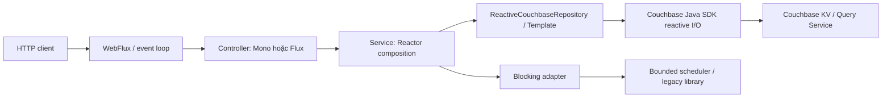

# Tích hợp WebFlux và cô lập thư viện có thao tác chặn

Khi xây API Spring WebFlux trên **Spring Data Couchbase**, một sai lầm dễ gặp là ứng dụng dùng `ReactiveCouchbaseRepository` nhưng lại gọi một thư viện **blocking** trong `map` hoặc `flatMap`: client HTTP đồng bộ, JDBC, API đọc file, hàm chờ khóa hoặc một đoạn SDK đồng bộ. Lúc đó, dù controller trả `Mono`/`Flux`, thread đang thực thi vẫn bị giữ cho đến khi lời gọi kết thúc. Nếu thread ấy là event loop của WebFlux, chỉ vài lời gọi chậm cũng có thể khiến nhiều request không liên quan phải chờ.

Bài này thuộc chương **Truy cập phản ứng** của module **SPRING_DATA_COUCHBASE**: xây dựng tầng truy cập Couchbase bằng document mapping, repository, `CouchbaseTemplate`/`ReactiveCouchbaseTemplate`, SQL++, bucket/scope/collection, index, TTL, CAS, transaction và API reactive. Trọng tâm là **tích hợp WebFlux mà không chặn event loop**, cô lập các phụ thuộc chưa có API reactive một cách có giới hạn, bảo vệ cluster Couchbase và giữ đúng vòng đời subscription, timeout, cancellation, quyền truy cập và ngữ cảnh.

> **Nguyên tắc:** Tốt nhất là dùng API **non-blocking thật sự** khi có lựa chọn. Khi không thể thay thư viện blocking, bọc đúng đoạn blocking trong `Mono.fromCallable`/`Mono.fromRunnable`, thực thi bằng scheduler phù hợp như `Schedulers.boundedElastic()`, giới hạn tổng tải và đặt timeout ở **chính thư viện đó**. Việc chuyển thread không biến I/O blocking thành I/O non-blocking, cũng không làm Couchbase Server có thêm năng lực.

## 1. Mục tiêu học tập

Sau bài này, bạn có thể:

1. Mô tả vòng đời request **WebFlux → Reactor → Spring Data Couchbase → SDK → Couchbase**.
2. Giải thích vì sao blocking trong event loop có thể làm cả ứng dụng tăng latency dù CPU chưa bão hòa.
3. Phân biệt các đường truy cập `ReactiveCouchbaseRepository`, `ReactiveCouchbaseTemplate` với `CouchbaseRepository`, `CouchbaseTemplate` và SDK KV đồng bộ.
4. Phát hiện những thao tác chặn ẩn sau `Mono.just`, `map`, `flatMap`, `block`, `Future.get`, `Thread.sleep` và các API đồng bộ.
5. Dùng `Mono.fromCallable` + `subscribeOn(Schedulers.boundedElastic())` để cô lập một thư viện blocking.
6. Hiểu khác biệt giữa `subscribeOn` và `publishOn`, tránh di chuyển toàn bộ pipeline reactive không cần thiết.
7. Thiết kế **scheduler riêng có giới hạn**, admission và concurrency budget cho một phụ thuộc blocking đắt tiền.
8. Kết hợp reactive Couchbase với thư viện legacy mà không tự `subscribe()`, không nuốt lỗi và không mất context bảo mật.
9. Phân biệt timeout của Reactor với timeout của lời gọi blocking và hiệu quả thực tế của cancellation.
10. Xử lý `Flux`, backpressure, batch, serialization, truy vấn SQL++ và pagination mà không gom kết quả lớn tùy tiện.
11. Đo queue wait, in-flight calls, event-loop latency, p95/p99, timeout, retry và SQL++/KV latency.
12. Kiểm thử adapter bằng `StepVerifier`, kiểm tra scheduling và tích hợp trên môi trường Couchbase đại diện.

## 2. WebFlux và mô hình event loop

WebFlux thường chạy trên một HTTP runtime hỗ trợ non-blocking I/O, ví dụ Reactor Netty. Một số ít **event-loop threads** có thể phục vụ nhiều kết nối vì chúng không cần giữ một thread cho mỗi kết nối trong lúc chờ socket I/O.

Một request điển hình:



Ở nhánh Couchbase reactive, thread không phải ngồi chờ mỗi KV response theo kiểu synchronous socket call. Nhưng ở nhánh legacy, một blocking call vẫn chiếm **một thread** trong lúc chờ.

### 2.1. Vì sao một lời gọi blocking nguy hiểm?

Giả sử một HTTP client đồng bộ có lúc cần 800 ms để nhận response. Nếu đặt nó ngay trong event loop:

- Thread không thể kịp xử lý các callback khác trong thời gian chờ đó.
- Nhiều requests không liên quan có thể bị ảnh hưởng.
- Các queue trong ứng dụng và ở network có thể dài thêm.
- p95/p99 tăng dù `Mono`/`Flux` vẫn xuất hiện trong code.
- Timeout dây chuyền dẫn đến retry storm nếu client và service đều retry.

**Reactive return type không chứng minh đường thực thi không blocking.** Cần nhìn vào **lệnh thực sự chạy** trên thread nào.

### 2.2. Non-blocking và concurrency không đồng nghĩa vô hạn

Couchbase reactive I/O giải quyết hiệu quả sử dụng thread. Nó **không** tự giới hạn tổng số KV/SQL++ operations đang chạy ở Server. `flatMap` trên một tập 10.000 ID vẫn cần concurrency budget, còn SQL++ query thiếu index vẫn có thể chiếm nhiều tài nguyên dù ứng dụng không chặn event loop.

## 3. Liệt kê các thao tác chặn cần kiểm tra

| API/tình huống | Nguy cơ | Hướng xử lý |
| --- | --- | --- |
| `repository.findById(id).block()` | Chặn thread đợi Couchbase response | Compose `Mono` và return cho WebFlux. |
| `CouchbaseTemplate.findById(...).one()` đồng bộ | Truy cập Couchbase blocking trong reactive flow | Ưu tiên `ReactiveCouchbaseTemplate` hoặc repository reactive. |
| Couchbase SDK KV API đồng bộ | Thread đợi network | Dùng SDK reactive/async API tương ứng. |
| `RestTemplate.getForObject(...)` | HTTP blocking | Ưu tiên `WebClient` hoặc cô lập adapter. |
| JDBC `ResultSet.next()`, JDBC client | Blocking I/O/driver | Cân nhắc R2DBC hoặc scheduler riêng và giới hạn. |
| Đọc/ghi file đồng bộ | Có thể block thread trong lúc disk I/O | API async nếu phù hợp; nếu không, cô lập bounded scheduler. |
| `Thread.sleep`, `Future.get`, `join`, `CountDownLatch.await` | Đợi đồng bộ | Dùng Reactor timer/async API khi có; không chặn event loop. |
| `synchronized`/khóa chờ lâu | Thread chờ lock | Thiết kế giảm tranh chấp, không coi scheduler là thuốc chữa mọi lock. |
| JSON/PDF/crypto xử lý CPU rất nặng | Không phải I/O blocking nhưng chiếm CPU lâu | Giới hạn CPU work; cân nhắc scheduler chuyên biệt phù hợp. |
| DNS/SDK sync initialization/credential refresh | Có thể blocking bất ngờ trong callback | Kiểm tra tài liệu và profiling, khởi tạo resource đúng lifecycle. |

Không phải mọi hàm Java “đồng bộ” đều nguy hiểm: một getter, phép tính nhỏ hoặc validate vài ký tự thường không cần scheduler riêng. **Mục tiêu là cô lập công việc có thời gian chờ dài/không dự đoán được**, không di chuyển tất cả phép toán sang thread khác.

## 4. Bối cảnh Spring Data Couchbase cho ví dụ

Giả sử ứng dụng CRM lưu customer trong bucket `app`, scope `crm`, collection `customers`:

```json
{
  "tenant_id": "tenant-a",
  "customer_code": "C001",
  "display_name": "Lan Anh",
  "status": "ACTIVE",
  "legacy_ref": "RISK-C001"
}
```

Document ID là `customer::tenant-a::C001` trong metadata KV. Entity:

```java
package example.crm;

import org.springframework.data.annotation.Id;
import org.springframework.data.annotation.Version;
import org.springframework.data.couchbase.core.mapping.Collection;
import org.springframework.data.couchbase.core.mapping.Document;
import org.springframework.data.couchbase.core.mapping.Field;
import org.springframework.data.couchbase.core.mapping.Scope;

@Document
@Scope("crm")
@Collection("customers")
public class Customer {

    @Id
    private String id;

    @Field("tenant_id")
    private String tenantId;

    @Field("customer_code")
    private String customerCode;

    @Field("display_name")
    private String displayName;

    @Field
    private String status;

    @Field("legacy_ref")
    private String legacyRef;

    @Version
    private Long version;

    protected Customer() {}

    public String getId() { return id; }
    public String getTenantId() { return tenantId; }
    public String getDisplayName() { return displayName; }
    public String getStatus() { return status; }
    public String getLegacyRef() { return legacyRef; }

    // Constructor và các accessors nghiệp vụ khác lược bỏ.
}
```

`@Id` ánh xạ key KV; `@Field` ánh xạ property Java sang JSON field; `@Version` tham gia optimistic locking/CAS khi được Spring Data Couchbase version và đường ghi hỗ trợ. Các ví dụ không giả định version/CAS là một JSON field thông thường.

Repository:

```java
package example.crm;

import org.springframework.data.couchbase.repository.ReactiveCouchbaseRepository;
import reactor.core.publisher.Flux;

public interface CustomerRepository
        extends ReactiveCouchbaseRepository<Customer, String> {

    Flux<Customer> findByTenantIdAndStatus(
        String tenantId,
        String status
    );
}
```

`findById(id)` thường dùng KV lookup; `findByTenantIdAndStatus` thường được diễn dịch thành SQL++ query theo field, cần secondary index và Query Service. Cả hai trả publisher reactive, không nên chuyển sang blocking chỉ để xây response HTTP.

## 5. Controller WebFlux: return publisher để framework quản lý

Ví dụ endpoint đọc customer:

```java
package example.crm;

import org.springframework.http.ResponseEntity;
import org.springframework.web.bind.annotation.GetMapping;
import org.springframework.web.bind.annotation.PathVariable;
import org.springframework.web.bind.annotation.RequestMapping;
import org.springframework.web.bind.annotation.RestController;
import reactor.core.publisher.Mono;

@RestController
@RequestMapping("/customers")
public class CustomerController {

    private final CustomerReadService service;

    public CustomerController(CustomerReadService service) {
        this.service = service;
    }

    @GetMapping("/{id}")
    public Mono<ResponseEntity<CustomerView>> get(
            @PathVariable String id) {

        return service.getForCurrentTenant(id)
            .map(ResponseEntity::ok);
    }
}
```

`CustomerReadService`/`CustomerView` là các thành phần ứng dụng sẽ định nghĩa ở phần sau. Lỗi không tìm thấy/không được phép phải được **ánh xạ tại service/controller advice** theo hợp đồng API; ví dụ không tự hứa mọi exception thành HTTP 404.

### 5.1. Ai sở hữu subscription?

Khi controller trả publisher, WebFlux quản lý subscription để tạo response. Service thường **không** gọi `subscribe()` hay `block()`.

```java
// Anti-pattern: subscribe một lần rồi lại return nguồn.
Mono<Customer> pending = repository.findById(id);
pending.subscribe();
return pending;
```

Nếu nguồn cold, hai subscriptions có thể thực thi hai KV requests. Lỗi của subscription “ẩn” khó quản lý; cancellation HTTP không nhất thiết dừng công việc được subscribe ngoài lifecycle request.

### 5.2. Một endpoint trả `Mono` không tự chứng minh non-blocking

```java
// Anti-pattern: lệnh chặn đã chạy trước khi Mono được tạo.
@GetMapping("/legacy-score")
public Mono<RiskScore> badScore() {
    RiskScore score = legacyClient.lookupScore("RISK-C001");
    return Mono.just(score);
}
```

`legacyClient.lookupScore` là API blocking minh họa. Code chặn thread HTTP **ngay lúc controller được gọi**. `Mono.just(score)` chỉ bọc một giá trị **đã được tính xong**.

## 6. Anti-pattern: blocking ngay trong `map`/`flatMap`

Ví dụ kết hợp repository reactive và thư viện legacy:

```java
// Sai: map callback có thể thực thi trên event loop.
Mono<CustomerView> wrong = repository.findById(id)
    .map(customer -> {
        RiskScore score = legacyClient.lookupScore(
            customer.getLegacyRef()
        );
        return toView(customer, score);
    });
```

`RiskScore` và `toView` là các type/helper do ứng dụng triển khai. Chỉ vì `findById` reactive không có nghĩa callback `map` cũng bất đồng bộ. Nó chạy ở thread phát signal theo lịch Reactor, và **lời gọi blocking bên trong vẫn giữ thread đó**.

Một cách sửa **chưa đủ**:

```java
// Defer để chạy lúc subscribe, NHƯNG vẫn có thể chặn event loop.
Mono<RiskScore> stillBlocking = Mono.defer(() ->
    Mono.just(legacyClient.lookupScore(ref))
);
```

`Mono.defer` chỉ trì hoãn việc tạo publisher tới lúc subscription. Nếu subscription diễn ra trên event loop, `lookupScore` vẫn chạy ở event loop.

## 7. Mẫu an toàn: `fromCallable` và `subscribeOn`

Khi không có API bất đồng bộ tương đương, cô lập **đúng đoạn blocking**:

```java
import reactor.core.publisher.Mono;
import reactor.core.scheduler.Schedulers;

Mono<RiskScore> risk = Mono.fromCallable(
        () -> legacyClient.lookupScore(ref)
    )
    .subscribeOn(Schedulers.boundedElastic());
```

Cơ chế:

1. `fromCallable` trì hoãn thực thi `Callable` tới lúc có subscription.
2. `subscribeOn(boundedElastic())` sắp xếp việc subscribe và phần synchronous producer upstream lên scheduler phù hợp với blocking work.
3. Event loop của WebFlux không phải chờ `lookupScore` kết thúc bằng một synchronous call.
4. Khi callable thành công, publisher phát một giá trị; khi ném exception, publisher phát `onError`.
5. Nếu callable trả `null`, `Mono.fromCallable` thông thường **hoàn tất rỗng**; phải xử lý empty nếu nghiệp vụ đòi kết quả.
6. Một thread boundedElastic vẫn **bị giữ** trong khi legacy call chặn; cần kiểm soát concurrency/queue và timeout phía client.

### 7.1. `fromRunnable` cho thao tác không trả giá trị

```java
Mono<Void> auditBestEffort = Mono.fromRunnable(() ->
        legacyAuditSink.write(event)
    )
    .subscribeOn(Schedulers.boundedElastic())
    .then();
```

`legacyAuditSink` là thư viện đồng bộ minh họa. Mẫu này cho phép compose việc ghi vào cùng pipeline, nhưng **không tạo transaction** giữa Couchbase và audit sink. Nếu audit bắt buộc và cần bền vững, dùng transaction/outbox/job phù hợp, không dùng fire-and-forget.

### 7.2. Không tạo scheduler cho mỗi lời gọi

```java
// Anti-pattern: mỗi HTTP request tạo thêm scheduler.
return Mono.fromCallable(() -> legacyClient.lookupScore(ref))
    .subscribeOn(
        Schedulers.newBoundedElastic(4, 100, "temporary")
    );
```

Scheduler được tạo riêng như trên cần được dispose. Tạo hàng nghìn scheduler theo request có thể làm cạn thread và khó quan sát. Dùng shared `Schedulers.boundedElastic()` hoặc **một scheduler riêng được tạo ở application lifecycle**.

## 8. Lười thực thi đúng chỗ: `just`, `defer`, `fromCallable`

| Cách viết | Thời điểm gọi blocking library | Đúng cho WebFlux? |
| --- | --- | --- |
| `Mono.just(legacyClient.call())` | Ngay khi đánh giá đối số. | **Sai**, có thể block event loop lúc assembly. |
| `Mono.defer(() -> Mono.just(legacyClient.call()))` | Khi subscribe, trên thread subscription. | **Chưa đủ** nếu không chuyển scheduler. |
| `Mono.fromCallable(legacyClient::call)` | Khi subscribe, trên thread subscription. | **Chưa đủ** nếu thread là event loop. |
| `Mono.fromCallable(legacyClient::call).subscribeOn(boundedElastic)` | Khi subscribe, Callable chạy trên scheduler. | **Mẫu phù hợp** cho blocking dependency có kiểm soát. |
| `Mono.fromFuture(...nonBlockingFuture...)` | Phụ thuộc future/API bất đồng bộ. | Có thể phù hợp, không nên chuyển sang boundedElastic chỉ để chờ future. |

Điểm quan trọng là **lời gọi blocking phải nằm trong callable/runnable được lên lịch**, không được gọi trước rồi mới đưa kết quả vào Reactor.

### 8.1. Lỗi đồng bộ từ Callable được chuyển thành `onError`

```java
Mono<RiskScore> wrapped = Mono.fromCallable(() -> {
    if (ref == null || ref.isBlank()) {
        throw new IllegalArgumentException("ref required");
    }
    return legacyClient.lookupScore(ref);
}).subscribeOn(Schedulers.boundedElastic());
```

Nếu Java method ném exception, Reactor phát lỗi cho subscriber thay vì để controller thread bị chặn hoặc exception lộ ra trước khi publisher được tạo. Nhưng **phân loại lỗi vẫn cần thực hiện**: validation không nên retry, timeout tạm thời cũng không nên retry vô hạn.

## 9. `subscribeOn` và `publishOn` khác nhau như thế nào?

`subscribeOn(scheduler)` ảnh hưởng nơi thực hiện subscription/request và nguồn producer **upstream** theo semantics của Reactor. `publishOn(scheduler)` chuyển việc xử lý các signal **downstream từ vị trí đặt operator** sang scheduler.

Ví dụ:

```java
Mono<RiskScore> isolated = Mono.fromCallable(
        () -> legacyClient.lookupScore(ref)
    )
    .subscribeOn(Schedulers.boundedElastic())
    .map(this::normalizeScore);
```

Blocking code trong `fromCallable` được offload. Hàm `normalizeScore` nhẹ có thể chạy trên thread đang phát signal sau Callable; không bắt buộc phải đổi thread về event loop để đúng.

### 9.1. `publishOn` trước một `map` có blocking call

```java
Mono<CustomerView> isolatedMapper = repository.findById(id)
    .publishOn(Schedulers.boundedElastic())
    .map(customer ->
        toView(
            customer,
            legacyClient.lookupScore(
                customer.getLegacyRef()
            )
        )
    );
```

Mẫu này có thể tránh blocking event loop đối với `map` sau `publishOn`, nhưng nó chuyển **mọi downstream processing** qua scheduler đó cho tới khi có một ranh giới scheduling khác. Với một dependency cụ thể, cách bọc bằng `fromCallable` trong `flatMap` thường **dễ cô lập và kiểm thử hơn**.

### 9.2. Đặt `publishOn` sau blocking call là quá muộn

```java
// Sai: blocking map chạy trước publishOn.
Mono<CustomerView> wrong = repository.findById(id)
    .map(customer ->
        toView(customer, legacyClient.lookupScore(
            customer.getLegacyRef()
        ))
    )
    .publishOn(Schedulers.boundedElastic());
```

Scheduler được áp dụng **sau khi blocking đã xảy ra**.

### 9.3. Đừng bọc mọi Couchbase I/O trong `boundedElastic`

```java
// Không cần nếu repository đã reactive đúng chuẩn:
return repository.findById(id)
    .subscribeOn(Schedulers.boundedElastic());
```

Cách này không làm SDK reactive nhanh hơn hay Couchbase Server có thêm năng lực; nó chỉ tác động vị trí scheduling phía subscription và có thể tăng context switch. Hãy để I/O non-blocking hoạt động theo thiết kế, chỉ cô lập **đoạn legacy blocking**.

## 10. Adapter riêng cho thư viện legacy

Thay vì đặt code cô lập scheduler khắp service, tạo một adapter có contract rõ:

```java
package example.crm;

public record RiskScore(String level, int points) {
}
```

```java
package example.crm;

// Thư viện giả định có API chặn; không phải Couchbase API.
public interface LegacyRiskClient {
    RiskScore lookupScore(String externalReference);
}
```

```java
package example.crm;

import org.springframework.beans.factory.annotation.Qualifier;
import org.springframework.stereotype.Component;
import reactor.core.publisher.Mono;
import reactor.core.scheduler.Scheduler;

@Component
public final class LegacyRiskGateway {

    private final LegacyRiskClient client;
    private final Scheduler scheduler;

    public LegacyRiskGateway(
            LegacyRiskClient client,
            @Qualifier("legacyScheduler") Scheduler legacyScheduler) {
        this.client = client;
        this.scheduler = legacyScheduler;
    }

    public Mono<RiskScore> lookup(String reference) {
        if (reference == null || reference.isBlank()) {
            return Mono.error(new IllegalArgumentException(
                "Legacy reference is required"
            ));
        }

        return Mono.fromCallable(
                () -> client.lookupScore(reference)
            )
            .subscribeOn(scheduler)
            .switchIfEmpty(Mono.error(
                new IllegalStateException(
                    "Legacy risk service returned no score"
                )
            ));
    }
}
```

Ưu điểm của adapter:

- Nơi duy nhất biết API legacy có blocking.
- Nơi duy nhất kiểm soát scheduler, timeout/library options, mã lỗi và metrics.
- Service không phải biết thread nào đang được dùng.
- Có thể mock hoặc thay bằng non-blocking implementation về sau.
- `Mono` vẫn lazy; gọi `gateway.lookup(ref)` chưa đồng nghĩa đã gọi client cho đến khi được subscribe.

### 10.1. Không mặc định adapter là nguồn sự thật tuyệt đối

Nếu phụ thuộc là scoring/risk service, phải định nghĩa thế nào là stale, unavailable, timeout hoặc trả `null`. Nếu lookup có tác động ghi/chi phí thanh toán theo request, không retry như “read-only” chỉ vì method tên `lookup`.

## 11. Scheduler riêng, chia sẻ trong vòng đời ứng dụng

Có thể dành budget riêng cho thư viện blocking:

```java
package example.crm;

import org.springframework.context.annotation.Bean;
import org.springframework.context.annotation.Configuration;
import reactor.core.scheduler.Scheduler;
import reactor.core.scheduler.Schedulers;

@Configuration
public class LegacySchedulingConfiguration {

    @Bean(destroyMethod = "dispose")
    Scheduler legacyScheduler() {
        return Schedulers.newBoundedElastic(
            8,               // Giới hạn threads backing cho scheduler này.
            100,             // Bound queue theo semantics Reactor release.
            "legacy-risk"
        );
    }
}
```

Các số `8` và `100` **chỉ để minh họa một ngân sách thử tải**; không phải khuyến nghị chung cho JVM hoặc Couchbase. Ý nghĩa cụ thể của queued-task cap/đơn vị queue phải xác minh theo phiên bản Reactor. Đối tượng scheduler được Spring quản lý một lần cho cả application instance, dispose khi app shutdown.

### 11.1. Dedicated scheduler có lợi ở đâu?

Nếu ứng dụng còn một nguồn blocking khác như tạo PDF hoặc JDBC, scheduler riêng cho risk client giúp cô lập việc risk service chậm khỏi công việc blocking khác. Nhưng có quá nhiều scheduler riêng cũng khiến tổng số threads và RAM tăng; phải có **ngân sách tổng** trên mỗi instance.

### 11.2. Shared `boundedElastic()` và scheduler riêng

`Schedulers.boundedElastic()` là scheduler dùng chung của Reactor, phù hợp làm **điểm bắt đầu** cho blocking I/O có giới hạn. Scheduler riêng phù hợp khi cần:

- Giới hạn threads/queue riêng cho một dependency.
- Metrics và policy overload riêng.
- Tránh nguồn chặn A chiếm slot của nguồn chặn B.
- Điều chỉnh theo SLA và headroom của downstream service.

Không có lựa chọn tốt nhất cho mọi hệ thống; cần đo tài nguyên và số dependencies thực tế.

## 12. Không nhầm scheduler giới hạn với admission control

Một scheduler hữu hạn có thể có hàng đợi. Nếu client gửi thêm việc nhanh hơn năng lực xử lý, queue vẫn có thể tăng tới giới hạn của nó. Khi đầy, scheduling có thể thất bại bằng exception loại phù hợp, chẳng hạn rejection.

Điều đó **không** là một API admission có chủ đích cho nghiệp vụ. Nên xác định:

| Giới hạn | Câu hỏi nó trả lời |
| --- | --- |
| `maxInFlight` | Có bao nhiêu blocking calls thực sự được cho chạy/đang chờ kết quả? |
| `maxQueued` | Cho phép bao nhiêu công việc chờ scheduler/worker? |
| `maxWait` | Một request được chờ permit bao lâu? |
| `perTenantQuota` | Một tenant được chiếm bao nhiêu năng lực? |
| `deadline` | Caller còn bao nhiêu thời gian để hoàn tất? |
| `retryBudget` | Cho phép bao nhiêu attempts bổ sung? |

Không phụ thuộc vào hàng đợi scheduler khó quan sát để giữ hàng chục nghìn HTTP requests, đặc biệt khi caller đã timeout. Với nguồn request có thể bùng nổ, sử dụng shared bulkhead/admission không blocking và phản hồi overload có chủ đích.

### 12.1. Không dùng semaphore blocking trên event loop

```java
// Anti-pattern trong callback WebFlux.
permits.acquire(); // Có thể block event loop.
try {
    return legacyClient.lookupScore(ref);
} finally {
    permits.release();
}
```

`permits` là biến minh họa. Nếu cần fail-fast, dùng `tryAcquire()` không blocking và bao việc nhả permit trong cleanup của publisher. Với bounded waiting, dùng cơ chế admission bất đồng bộ có queue hữu hạn và cancellation support, không giữ event loop để chờ một permit.

### 12.2. Một mức concurrency per request không giới hạn toàn instance

```java
Flux<RiskScore> scores = Flux.fromIterable(refs)
    .flatMap(gateway::lookup, 4);
```

`4` giới hạn số inner publishers trong **Flux này**. Với 100 HTTP requests đồng thời, tổng blocking calls/scheduled work có thể lớn hơn rất nhiều. Shared scheduler, bulkhead và quota ở instance/tenant vẫn quan trọng.

## 13. Service kết hợp Couchbase reactive với blocking adapter

Một response DTO:

```java
package example.crm;

public record CustomerView(
    String id,
    String displayName,
    String status,
    String riskLevel
) {
}
```

Một port lấy tenant đã xác thực:

```java
import reactor.core.publisher.Mono;

// API ứng dụng, không phải API built-in của Spring.
public interface TrustedTenantProvider {
    Mono<String> requireCurrentTenant();
}
```

Service:

```java
package example.crm;

import java.util.NoSuchElementException;
import org.springframework.stereotype.Service;
import reactor.core.publisher.Mono;

@Service
public class CustomerReadService {

    private final CustomerRepository repository;
    private final LegacyRiskGateway riskGateway;
    private final TrustedTenantProvider tenantProvider;

    public CustomerReadService(
            CustomerRepository repository,
            LegacyRiskGateway riskGateway,
            TrustedTenantProvider tenantProvider) {
        this.repository = repository;
        this.riskGateway = riskGateway;
        this.tenantProvider = tenantProvider;
    }

    public Mono<CustomerView> getForCurrentTenant(String id) {
        return tenantProvider.requireCurrentTenant()
            .flatMap(tenantId ->
                repository.findById(id)
                    .filter(customer ->
                        tenantId.equals(customer.getTenantId())
                    )
                    .switchIfEmpty(Mono.error(
                        new NoSuchElementException(
                            "Customer not found"
                        )
                    ))
                    .flatMap(customer ->
                        riskGateway.lookup(
                            customer.getLegacyRef()
                        )
                        .map(score -> new CustomerView(
                            customer.getId(),
                            customer.getDisplayName(),
                            customer.getStatus(),
                            score.level()
                        ))
                    )
            );
    }
}
```

**Luồng xử lý:** actor/tenant được lấy từ context bảo mật; repository đọc KV bằng API reactive; kiểm tra tenant xảy ra **trước khi gọi** blocking risk service; adapter cô lập phần chặn và trả `Mono`; kết quả được compose thành response cho WebFlux.

### 13.1. Vì sao không tạo response trước khi biết quyền?

Nếu service gọi scoring service cho customer ID do client nhập mà chưa kiểm tra tenant, nó có thể làm lộ tồn tại/thông tin customer qua timing, chi phí hoặc log ngay cả khi response cuối là 404. Ưu tiên xác thực/ủy quyền trước fan-out tới legacy services.

### 13.2. Not-found, forbidden và unavailable phải khác nhau

`NoSuchElementException` ở đây là error minh họa. Tầng API có thể map nó sang 404 (bao gồm che tồn tại của tenant khác theo policy). Timeout/overload từ legacy client phải được map sang 502/503/504 tùy kiến trúc, **không** dùng `onErrorResume(error -> Mono.empty())` để biến outage thành “không có customer”.

### 13.3. Đường thao tác không tự tạo transaction

`findById(...).flatMap(riskGateway::lookup)` không tạo transaction phân tán giữa Couchbase và risk service. Nếu response chỉ để hiển thị, dữ liệu có thể thay đổi giữa hai bước. Nếu quyết định nghiệp vụ cần trạng thái nhất quán, cần thiết kế CAS/transaction/check/version/compensation phù hợp thay vì giả định hai publisher nằm trong một transaction.

## 14. Spring Security và Reactor Context khi đổi scheduler

Trong WebFlux, `ReactiveSecurityContextHolder` truyền security context theo reactive subscription. `Reactor Context` không phải `ThreadLocal` của thread HTTP.

Ví dụ đọc principal:

```java
import org.springframework.security.core.context.ReactiveSecurityContextHolder;
import reactor.core.publisher.Mono;

Mono<String> principalName =
    ReactiveSecurityContextHolder.getContext()
        .map(ctx -> ctx.getAuthentication().getName());
```

Đoạn này minh họa lấy tên principal; cần xác minh authentication không null, không anonymous, và map sang immutable subject/tenant từ identity server tin cậy. `Authentication.getName()` không mặc định là tenant.

### 14.1. Context vẫn có ý nghĩa trong composed publisher

```java
import reactor.util.context.Context;

Mono<String> actor = Mono.deferContextual(ctx ->
    Mono.just(ctx.<String>get("audit.actor"))
);

Mono<String> result = actor
    .publishOn(Schedulers.boundedElastic())
    .contextWrite(Context.of("audit.actor", "user-123"));
```

Với pipeline được compose đúng, Reactor Context gắn với subscription và không tự mất chỉ vì chuyển scheduler. Nhưng một blocking library đọc **MDC/ThreadLocal** sẽ không tự có context khi worker thread khác, trừ khi ứng dụng đã cấu hình bridge phù hợp.

### 14.2. Không truyền token bí mật vào mọi thread để “tiện gọi”

Nếu legacy client cần credentials, dùng API credential management thích hợp với token scope/expiry và truyền đúng dữ liệu đã xác thực. Đừng log nguyên Reactor Context, principal object hoặc access token vào scheduler tasks/MDC.

### 14.3. `subscribe()` trong adapter có thể tách context

```java
// Anti-pattern: background subscribe không thuộc HTTP request.
repository.findById(id)
    .doOnNext(c -> gateway.lookup(c.getLegacyRef()).subscribe())
    .subscribe();
```

Ở đây có các subscriptions độc lập. HTTP cancel/error handler/transaction owner không thể bảo đảm cleanup hay kết quả tổng. Hãy **return publisher** và compose bằng `flatMap`/`then`.

## 15. Timer, timeout và deadline ở các tầng

Một request bao gồm:

```text
WebFlux request
  -> xác thực tenant
  -> Couchbase KV read
  -> chờ scheduler/admission
  -> legacy blocking HTTP/JDBC call
  -> mapping response
```

Cần ít nhất ba mức thời gian:

1. **HTTP end-to-end deadline:** request được chờ tối đa bao lâu.
2. **Blocking library timeout:** socket connect/read/operation timeout ngay trong client legacy.
3. **Couchbase KV/SQL++ SDK timeout:** theo API và version đang dùng.

### 15.1. Reactor `timeout` không đảm bảo chặn call kết thúc

```java
Mono<RiskScore> timed = gateway.lookup(ref)
    .timeout(java.time.Duration.ofSeconds(2));
```

Khi không có signal đúng hạn, Reactor có thể báo timeout và cancel subscription. Nhưng nếu callable blocking đã bắt đầu trên worker thread, **không bảo đảm** thư viện đó được interrupt hoặc ngừng ngay. Thread có thể tiếp tục bị giữ tới khi socket/client timeout riêng hoặc lệnh kết thúc.

**Thiết kế đúng:** configure timeout của legacy client **ở bên trong** thư viện; dùng Reactor timeout như lớp giới hạn chờ của caller, không phải cơ chế duy nhất để thu hồi tài nguyên.

### 15.2. Time spent waiting for scheduler cũng tính vào deadline

Nếu scheduler đã đầy queue, request có thể chờ trước khi Callable được chạy. Nếu chỉ đo thời gian thực thi của client sau khi bắt đầu, bạn sẽ bỏ qua queue wait và report latency sai.

Nên đo:

- Subscription/admission start.
- Queue enter và task start.
- Blocking call duration.
- Total endpoint latency.
- Timeout hoặc rejection trước khi Callable bắt đầu.
- Số task còn chạy sau khi downstream cancel.

### 15.3. Không đặt mỗi bước timeout 5 giây khi SLA tổng 5 giây

Nếu KV read, legacy call và mapping cùng có timeout riêng 5 giây, tổng latency có thể lớn hơn 5 giây. Cần một deadline end-to-end và ngân sách con cho I/O, backoff, queue wait và response.

## 16. Cancellation: ai còn chạy sau khi caller hủy?

Giả sử HTTP client ngắt kết nối sau khi blocking legacy call bắt đầu:

```text
T0: WebFlux subscribe service publisher
T1: Couchbase findById hoàn tất
T2: fromCallable bắt đầu trên legacyScheduler
T3: Client disconnect -> WebFlux cancel upstream
T4: Blocking legacyClient.lookupScore vẫn có thể chờ socket
T5: Legacy call cuối cùng kết thúc/timeout
```

`doFinally(SignalType.CANCEL)` trên pipeline phản ánh **subscription bị cancel**, không chứng minh legacy call đã ngừng hoặc thread đã được thu hồi.

### 16.1. Interrupt có thể hữu ích nhưng không phải bảo đảm

Một số SDK/client hỗ trợ cancellation/interrupt; một số thao tác blocking không phản ứng hoặc chỉ phản ứng sau khi I/O hoàn tất. Hành vi còn phụ thuộc scheduler, client và thời điểm cancel. Không đưa câu “`dispose()` luôn hủy lời gọi blocking ngay” vào runbook.

### 16.2. Khi công việc bắt buộc tiếp tục sau HTTP disconnect

Nếu người dùng gửi tác vụ xuất báo cáo quan trọng hoặc thay đổi trạng thái không thể bỏ:

- Nhận request và tạo job/command ID bền vững.
- Persist trạng thái/idempotency và phân quyền.
- Worker có owner subscription riêng chạy với deadline và concurrency cap.
- API trả job ID để client theo dõi.
- Không dùng `subscribe()` lén trong controller như một job queue.

### 16.3. Mutation Couchbase cũng có unknown outcome

Nếu service sau legacy call thực hiện `repository.save(customer)` và client timeout sau khi SDK gửi mutation, Couchbase **có thể đã commit**. Không retry tự động với document ID khác, không suy `cancel` là rollback. Dùng ID/command ID ổn định, CAS/`@Version`, transaction/outbox hoặc kiểm tra trạng thái cuối tùy nghiệp vụ.

## 17. Retry khi kết hợp hai phụ thuộc

Một ví dụ nguy hiểm:

```java
// Anti-pattern: retry toàn bộ pipeline, có thể lặp cả KV và legacy.
Mono<CustomerView> badRetry = service
    .getForCurrentTenant(id)
    .retry(10);
```

Mỗi retry có thể tạo subscription mới, đọc Couchbase lại và gọi legacy client lần nữa. Nếu lỗi là permission, validation, missing index hay client trả 400, retry vô nghĩa. Nếu legacy call tính phí theo lượt, hậu quả có thể nghiêm trọng.

### 17.1. Retry đúng phạm vi

Đặt retry gần operation được phép lặp:

```java
import java.time.Duration;
import reactor.util.retry.Retry;

Retry legacyReadRetry = Retry.backoff(
        2,
        Duration.ofMillis(150)
    )
    .maxBackoff(Duration.ofSeconds(1))
    .jitter(0.5)
    .filter(this::isTransientLegacyReadFailure);

Mono<RiskScore> risk = gateway.lookup(ref)
    .retryWhen(legacyReadRetry);
```

`isTransientLegacyReadFailure` là classifier ứng dụng phải triển khai, dựa trên exception thực tế và hợp đồng legacy API. Với read-only được xác nhận an toàn, retry hữu hạn có thể phù hợp; với side-effect, phải có idempotency.

### 17.2. Retry budget phải tính cả queue

Nếu mỗi attempt đi vào scheduler queue rồi chạy 2 giây, ba attempts có thể vượt SLA rất xa. Mỗi attempt phải chịu admission, timeout và backoff trong **deadline tổng**. Đừng để retry storm làm nghẽn scheduler và Couchbase cùng lúc.

### 17.3. Không che outage thành `Mono.empty()`

```java
// Sai nếu risk score là bắt buộc cho quyết định.
Mono<RiskScore> wrong = gateway.lookup(ref)
    .onErrorResume(error -> Mono.empty());
```

Nếu score thiếu mà service vẫn phát một customer “an toàn” mặc định, hệ thống có thể quyết định sai. Phải định nghĩa fallback/stale/default theo chính sách nghiệp vụ và ghi metric khi fallback dùng.

## 18. Backpressure và batch khi một item gọi blocking dependency

`Flux<Customer>` có thể trả nhiều document từ SQL++:

```java
Flux<Customer> active =
    repository.findByTenantIdAndStatus(
        authenticatedTenant, "ACTIVE"
    );
```

Nếu mỗi row gọi legacy client:

```java
Flux<CustomerView> enriched = active
    .flatMap(
        customer -> gateway.lookup(customer.getLegacyRef())
            .map(score -> new CustomerView(
                customer.getId(),
                customer.getDisplayName(),
                customer.getStatus(),
                score.level()
            )),
        4 // Tối đa bốn inner publishers ở pipeline này.
    );
```

`flatMap(..., 4)` giúp **không fan-out toàn bộ** requests legacy trong một batch. Nó không bảo đảm toàn app chỉ có bốn legacy calls đang chạy.

### 18.1. `flatMap` không giữ nguyên thứ tự

Nếu người dùng cần thứ tự giống SQL++ output, cân nhắc `flatMapSequential(mapper, concurrency)`: có thể chạy inner đồng thời nhưng phát kết quả theo thứ tự đầu vào, đổi lại có thể buffer kết quả chờ. Nếu bước xử lý phải chạy tuần tự vì side effect, `concatMap` phù hợp hơn trong **một pipeline**, nhưng không là transaction/serialization toàn hệ thống.

### 18.2. Không dùng `collectList` trên truy vấn không giới hạn

```java
// Nguy hiểm nếu tenant có hàng trăm nghìn customer.
Mono<java.util.List<Customer>> all = repository
    .findByTenantIdAndStatus(tenantId, "ACTIVE")
    .collectList();
```

Nó gom toàn bộ kết quả trong RAM. `Flux` reactive không tự bảo đảm memory bounded nếu downstream gom list hoặc operator buffer quá nhiều. Muốn UI trả 20 customers, đặt **`LIMIT 20` tại SQL++**, projection và index phù hợp.

### 18.3. Không xem `limitRate` là rate limiter toàn app

`Flux.limitRate(n)` điều chỉnh demand upstream trong Reactor, không tự tạo token bucket hay giới hạn QPS tổng instance. Cần admission/quota khi có nhiều concurrent WebFlux requests.

## 19. SQL++: giảm dữ liệu tại server trước khi gọi legacy service

Một derived query như `findByTenantIdAndStatus` thường dùng SQL++/secondary index, không phải KV get theo ID. Nếu query quá rộng, hàng nghìn rows có thể dẫn tới hàng nghìn blocking legacy calls.

SQL++ minh họa cho một trang:

```sql
SELECT c.customer_code, c.display_name, c.status, c.legacy_ref
FROM `app`.`crm`.`customers` AS c
WHERE c.tenant_id = $tenantId
  AND c.status = "ACTIVE"
ORDER BY c.customer_code ASC
LIMIT $pageSize;
```

Đây là SQL++ **minh họa ý định**, không phải statement Spring Data sinh nguyên văn. Nếu mapping trực tiếp vào entity, có thể cần ID/CAS/type metadata; projection DTO cần cấu hình và mapping tương ứng.

### 19.1. Index mẫu

```sql
CREATE INDEX ix_customers_tenant_status_code
ON `app`.`crm`.`customers`(
    `tenant_id`,
    `status`,
    `customer_code`
);
```

Dùng `EXPLAIN` cho câu query thực thi để xác minh index scan/fetch/sort. Một index tồn tại không bảo đảm planner dùng nó; Spring Data có thể thêm type discriminator hoặc predicate khác.

### 19.2. `take(20)` không tự thêm `LIMIT 20`

```java
Flux<Customer> preview = repository
    .findByTenantIdAndStatus(tenantId, "ACTIVE")
    .take(20);
```

`take` giới hạn item downstream và có thể cancel upstream khi đủ, **không bảo đảm** Couchbase Server chỉ scan/sort 20 rows. Khi mỗi row còn kích hoạt blocking legacy call, query-side LIMIT và admission ở app đều cần thiết.

### 19.3. KV tra theo ID khác SQL++ query

`findById(id)` thông thường là một KV lookup, không cần secondary index. Nhưng nếu một HTTP request nhận 5.000 IDs, `flatMap(repo::findById)` vẫn cần giới hạn đồng thời; và nếu sau mỗi KV get còn gọi legacy blocking client, cần cap **cả hai tài nguyên**, không chỉ Couchbase.

## 20. WebClient thay vì `RestTemplate` khi có thể

Nếu phụ thuộc legacy thực ra là một HTTP service hỗ trợ giao thức bình thường, cân nhắc thay client đồng bộ bằng Spring `WebClient` non-blocking:

```java
package example.crm;

import org.springframework.http.MediaType;
import org.springframework.web.reactive.function.client.WebClient;
import reactor.core.publisher.Mono;

public final class RiskWebClientGateway {

    private final WebClient client;

    public RiskWebClientGateway(WebClient client) {
        this.client = client;
    }

    public Mono<RiskScore> lookup(String ref) {
        return client.get()
            .uri(uriBuilder ->
                uriBuilder.path("/risk/{ref}")
                    .build(ref)
            )
            .accept(MediaType.APPLICATION_JSON)
            .retrieve()
            .bodyToMono(RiskScore.class);
    }
}
```

Cấu hình `WebClient` gồm base URL, authentication, connection/read/response timeouts và error mapping theo deployment. Ví dụ không khẳng định `retrieve()` có đủ retry/circuit breaker hay mọi response lỗi đã được dịch thành domain error.

### 20.1. WebClient không bắt buộc chuyển sang boundedElastic

`WebClient` dùng connector non-blocking phù hợp thì I/O của nó không cần bọc bằng `fromCallable`. Việc dùng `boundedElastic` cho mọi call `WebClient` không biến backend nhanh hơn, còn có thể gây scheduling không cần thiết.

### 20.2. Blocking client chỉ là đường tạm/được kiểm soát

Khi không thể thay SDK HTTP/JDBC/PDF writer blocking vì ràng buộc phiên bản/hệ thống, adapter boundedElastic là cách tương thích. Nhưng nên ghi rõ owner, timeout, concurrency và kế hoạch thay thế khi phụ thuộc non-blocking sẵn có.

## 21. Tích hợp JDBC, file và CPU work

Ba nhóm công việc cần xử lý khác nhau:

### 21.1. JDBC blocking

Một thư viện JDBC đồng bộ có thể chờ connection pool và database I/O. Có thể cô lập bằng `fromCallable(...).subscribeOn(dedicatedScheduler)` nếu chưa thể đổi, đồng thời cần **pool size và timeout ngay ở JDBC**. Bounded scheduler không thay connection pool; nhiều threads có thể chờ pool rồi khiến cả hai queue tăng.

Nếu backend/driver hỗ trợ API reactive như R2DBC và yêu cầu phù hợp, cân nhắc migrate có kiểm soát. Không mặc định mọi JDBC transaction và Couchbase transaction trở thành một transaction nguyên tử chỉ vì cùng nằm trong một `Mono`.

### 21.2. File/PDF export blocking

Với `Files.readAllBytes`, PDF generation hoặc thư viện ghi ZIP đồng bộ, offload khi có blocking/CPU đáng kể và giới hạn tổng bytes/file size. Chỉ dùng boundedElastic không bảo đảm memory bounded: một `byte[]` vài GB vẫn nguy hiểm.

Đối với export lớn, cân nhắc pipeline theo batch, output streaming có quản lý resource và job bền vững với checkpoint. Nếu user disconnect, việc dừng ghi file phải dựa vào contract của thư viện file I/O; cancel Reactor không luôn interrupt hoạt động đã bắt đầu.

### 21.3. Tác vụ CPU-bound

Mã hóa nặng, hình ảnh, nén hoặc phép tính lớn có thể chiếm CPU lâu mà không blocking I/O. Có thể dùng `Schedulers.parallel()` cho phần CPU phù hợp và concurrency cap, nhưng đừng dùng nó để chờ socket hoặc lock.

```java
Mono<ReportDigest> digest = Mono.fromCallable(
        () -> heavyCpuDigest(report)
    )
    .subscribeOn(Schedulers.parallel());
```

`ReportDigest` và `heavyCpuDigest` là API minh họa; chỉ phù hợp khi tác vụ tính toán được kiểm soát. Không đẩy 10.000 CPU-heavy tasks cùng lúc rồi kỳ vọng `parallel()` tự xử lý overload.

## 22. Khi thư viện đã có API asynchronous

Một số SDK trả `CompletableFuture<T>` hoặc `CompletionStage<T>` không blocking. Khi đó nên **chuyển đổi completion signal**, không gọi `get()` trên Future ở event loop.

Sai:

```java
// Anti-pattern: blocking wait.
Mono<RiskScore> wrong = Mono.fromCallable(() ->
    legacyAsyncClient.lookup(ref).get()
);
```

Đoạn này có thể cần boundedElastic để không chặn event loop, nhưng tạo một thread chờ Future không cần thiết nếu có adapter bất đồng bộ.

Ví dụ ý tưởng cho API hoàn toàn async:

```java
// Kiểm tra overload từ Future/Supplier theo Reactor version.
Mono<RiskScore> async = Mono.fromFuture(
    () -> legacyAsyncClient.lookup(ref)
);
```

`legacyAsyncClient.lookup` được giả định trả `CompletableFuture<RiskScore>` không chặn. Cần kiểm tra thời điểm bắt đầu Future, khả năng cancel/timeout và semantics của API. Một SDK có tên "async" vẫn có thể làm synchronous setup/blocking trong lời gọi tạo Future; cần profiling khi nghi ngờ.

### 22.1. Không tự block Future để “chuyển về Mono”

`Mono.fromFuture` hoặc `Mono.fromCompletionStage` theo Reactor release giúp compose kết quả bất đồng bộ. Đừng dùng `future.join()` trong `map`/`flatMap` rồi xem đó là reactive vì cuối cùng return `Mono`.

### 22.2. Async ≠ không giới hạn

Future-based API có thể tạo hàng nghìn requests ngay khi được gọi. Vẫn cần concurrency/admission, deadline và bộ nhớ có giới hạn. Tương tự, Couchbase Java SDK reactive không có nghĩa SQL++ query có thể chạy vô hạn mà cluster không quá tải.

## 23. Giữ đúng vòng đời Spring Data Couchbase transaction

Một service có thể cần transaction nhiều document và đồng thời tra một thư viện legacy:

```text
Couchbase transaction attempt
   -> đọc và ghi document Couchbase bằng API transaction-aware
   -> commit

External legacy service
   -> KHÔNG nằm trong cùng Couchbase transaction theo mặc định
```

**Không** gọi blocking legacy HTTP bên trong transaction attempt kéo dài nếu không cần thiết: nó giữ transaction sống lâu, tăng khả năng expiry/conflict. Nếu một yêu cầu cần phối hợp nhiều hệ thống, cân nhắc saga/outbox/idempotency và định nghĩa failure semantics.

### 23.1. `@Transactional` không phải phép màu

Spring `@Transactional`/`TransactionalOperator` chỉ có ý nghĩa với transaction manager/resource integration tương thích. Gắn annotation vào một method WebFlux không tự làm mọi `repository.save`, Couchbase SDK call, JDBC và legacy HTTP call trở thành một transaction chung.

### 23.2. Callback transaction có thể bị retry

Transaction engine có thể retry attempt theo SDK/version. Nếu đặt legacy call có side effect trong callback, nó có thể chạy nhiều lần; một email, thanh toán hoặc external mutation không tự rollback cùng Couchbase. Dùng idempotency key ổn định và outbox/compensation nếu nghiệp vụ yêu cầu.

### 23.3. Reactor Context khác SDK transaction attempt context

`Reactor Context` truyền metadata theo subscriber; transaction attempt context của Couchbase SDK quản lý operation tham gia giao dịch. Không tự đặt `Context.of("tx", ...)` rồi xem operation repository thường đã tham gia SDK transaction.

## 24. CAS, TTL và auditing khi kết hợp API blocking

### 24.1. CAS bảo vệ update cạnh tranh

`@Version` trên entity có thể giúp phát hiện xung đột CAS khi Spring Data Couchbase thực sự dùng optimistic locking cho đường save. Nếu legacy call chạy lâu giữa `findById` và `save`, nhiều thao tác khác có thể sửa document trong khoảng đó.

```java
Mono<Customer> updateAfterExternalCheck = repository.findById(id)
    .flatMap(customer ->
        gateway.lookup(customer.getLegacyRef())
            .flatMap(score -> {
                // Validate quyền/trạng thái và version trước khi save.
                // Kiểu cập nhật Customer lược bỏ ở ví dụ này.
                return repository.save(customer);
            })
    );
```

Đây chỉ là **khung** cho thấy khoảng thời gian chờ, không phải workflow cập nhật đúng: còn thiếu entity setter, rules, authorization và idempotency. Với nghiệp vụ nhạy cảm, tránh đọc một document rồi chờ lâu mới ghi; có thể xác minh lại trạng thái/CAS hoặc thiết kế lại transaction boundary.

### 24.2. TTL có thể hết hạn trong lúc chờ

Document có TTL có thể biến mất sau khi KV read nhưng trước update, hoặc khi request đang chờ scheduler queue. Không chuyển lỗi/not-found thành một upsert “tạo lại” nếu nghiệp vụ không cho phép. Cần kiểm tra expiration và các behavior giữ/đặt lại TTL của mutation theo API/version.

### 24.3. Auditing lấy actor đúng context

Nếu entity dùng `@LastModifiedBy`/`@LastModifiedDate`, cần xác minh auditing callback được Spring Data Couchbase version hỗ trợ ở reactive path. Cô lập blocking library trên scheduler không tự truyền `SecurityContextHolder` ThreadLocal; hãy lấy actor từ reactive security context và truyền dữ liệu đã xác thực vào service, hoặc dùng `ReactiveAuditorAware` khi integration thật sự hỗ trợ.

### 24.4. Không dùng scheduler để che lỗi bảo mật

Nếu blocking SDK cần tenant/credential, không nên lấy tenant từ một `ThreadLocal` không được propagate rồi fallback mọi missing tenant thành `SYSTEM`. Điều đó có thể làm request chạy bằng quyền quá rộng. Fail closed với actor/tenant thiếu và kiểm chứng source của context.

## 25. Quan sát event loop, worker pool và Couchbase

Để biết offload có hiệu quả hay chỉ chuyển nghẽn sang nơi khác, cần đo ở nhiều tầng:

| Tầng | Chỉ số/dấu hiệu | Ý nghĩa |
| --- | --- | --- |
| HTTP/WebFlux | Requests active, p50/p95/p99, 4xx/5xx, client disconnect | SLO và áp lực đầu vào. |
| Event loop | Event-loop pending tasks/latency, thread stack, slow callback | Có code blocking trên event loop không? |
| Legacy scheduler | Active tasks, queued tasks, worker saturation, rejected tasks | Có chuyển nghẽn sang queue mới không? |
| Legacy client | Connect/read timeout, latency, retries, pool exhaustion | Nguồn blocking chậm vì đâu? |
| Couchbase SDK | KV/query latency, timeout, retried ops, request diagnostics | Có lỗi I/O hoặc retry storm riêng không? |
| Query/Index Service | Query plan, scans, rows/bytes, CPU và index load | Có SQL++ thiếu index/limit không? |
| Security/context | Missing actor/tenant, unauthorized attempts | Có mất ngữ cảnh khi chuyển scheduler không? |
| Mutation | CAS conflicts, unknown outcomes, duplicate commands | Retry/cancel có gây sai dữ liệu không? |
| Memory | Heap/GC, payload size, buffers, queue depth | Có `collectList`/buffer hoặc queue tăng không? |

Tên metric cụ thể phụ thuộc Reactor, Spring Boot/Micrometer, Netty, Couchbase SDK/Server và công cụ quan sát được bật. Bảng diễn đạt **bằng chứng cần tìm**, không khẳng định mọi metric đều có sẵn trong mọi release.

### 25.1. Đo total latency và blocking-call latency riêng

Nếu `legacyClient.lookupScore` mất 40 ms nhưng HTTP endpoint mất 2 giây, nguyên nhân có thể ở queue scheduler, KV read, auth, serialization hoặc contention. Đừng chỉ tăng `boundedElastic` threads khi chưa đo phân đoạn.

### 25.2. Không log dữ liệu nhạy cảm

Ghi correlation ID, loại operation, queue wait, elapsed time, exception class đã phân loại và bounded payload size; tránh ghi customer JSON, token, full SQL++ bind params hoặc thông tin chéo tenant.

## 26. Phát hiện blocking: profiling và BlockHound

Một hướng kiểm tra là:

- Dùng thread dump/profiler để phát hiện event-loop threads đang chờ network/file/lock.
- Xem tracing/timing theo từng operator và external client.
- Quan sát event-loop latency, Netty metrics và slow callback.
- Dùng **BlockHound** trong môi trường test nếu tương thích reactor/JDK/dependencies và được cấu hình đúng.

**BlockHound** là công cụ có thể phát hiện một số blocking call trên thread được đánh dấu non-blocking. Nó không phát hiện mọi tình huống, có thể cần allowlist cho library thực sự an toàn và có ràng buộc tương thích phiên bản.

### 26.1. Không coi BlockHound PASS là chứng minh mọi API non-blocking

Một thư viện blocking có thể chạy trên boundedElastic nên BlockHound không báo lỗi — điều này đúng nếu offload đã có chủ đích, nhưng nó không chứng minh scheduler không đầy hoặc legacy client có timeout an toàn.

### 26.2. Không dùng `Thread.sleep` làm “test chịu tải”

Sleep trong unit test có thể giúp quan sát một thread bị chặn nhưng rất dễ flaky và làm chậm suite. Để đo tải thật, dùng tool load test/circuit breaker/connection timeouts và một stub server có kiểm soát trên môi trường test, thay vì race với `Thread.sleep` tùy ý.

## 27. Unit test adapter: chỉ chạy khi subscribe

Ví dụ test dùng một scheduler riêng và một fake client đếm số lần gọi:

```java
import static org.assertj.core.api.Assertions.assertThat;

import java.util.concurrent.atomic.AtomicInteger;
import org.junit.jupiter.api.Test;
import reactor.core.scheduler.Scheduler;
import reactor.core.scheduler.Schedulers;
import reactor.test.StepVerifier;

class LegacyRiskGatewayTest {

    @Test
    void blockingCallIsLazyAndRunsOnDedicatedScheduler() {
        Scheduler scheduler = Schedulers.newSingle("test-legacy");
        try {
            AtomicInteger calls = new AtomicInteger();
            java.util.concurrent.atomic.AtomicReference<String> thread =
                new java.util.concurrent.atomic.AtomicReference<>();

            LegacyRiskClient client = ref -> {
                calls.incrementAndGet();
                thread.set(Thread.currentThread().getName());
                return new RiskScore("LOW", 1);
            };

            LegacyRiskGateway gateway =
                new LegacyRiskGateway(client, scheduler);

            var publisher = gateway.lookup("RISK-C001");

            assertThat(calls.get()).isZero();

            StepVerifier.create(publisher)
                .assertNext(score ->
                    assertThat(score.level()).isEqualTo("LOW")
                )
                .verifyComplete();

            assertThat(calls.get()).isEqualTo(1);
            assertThat(thread.get()).contains("test-legacy");
        } finally {
            scheduler.dispose();
        }
    }
}
```

`LegacyRiskClient` là interface minh họa ở mục 10. Test xác minh callable **chưa chạy khi assembly**, chỉ chạy khi có subscription, và được chạy ở scheduler được chỉ định. Đây là unit test scheduler, **không phải benchmark** chứng minh legacy library có thể chạy 8 threads hoặc Couchbase response đáp ứng SLA.

### 27.1. Test null và exception của thư viện

Nên thêm các trường hợp:

- Legacy client trả `null` → `fromCallable` hoàn tất rỗng, adapter chuyển thành lỗi theo policy.
- Legacy client ném validation exception → publisher báo error, không retry.
- Legacy client ném lỗi transient → classifier retry nếu operation an toàn.
- Scheduler đã dispose/reject → API trả lỗi overload rõ ràng, không biến thành not-found.
- Subscriber cancel khi Callable chưa bắt đầu → kiểm tra queuing/cancellation theo scheduler version.
- Caller timeout khi Callable đang block → xác minh client timeout thực sự ngăn giữ thread quá lâu, không chỉ `Mono.timeout`.

## 28. Unit test pipeline Couchbase + legacy gateway

Dùng mock hoặc fake reactive repository để kiểm tra service **chỉ gọi legacy sau khi kiểm tra tenant**.

Khung minh họa:

```java
import static org.mockito.Mockito.*;
import reactor.core.publisher.Mono;
import reactor.test.StepVerifier;

// Đặt trong test class có setup mock Customer, repository, gateway.
when(tenantProvider.requireCurrentTenant())
    .thenReturn(Mono.just("tenant-a"));

when(repository.findById("customer::tenant-b::C002"))
    .thenReturn(Mono.just(customerBelongingToTenantB));

StepVerifier.create(
        service.getForCurrentTenant("customer::tenant-b::C002")
    )
    .expectError(java.util.NoSuchElementException.class)
    .verify();

verifyNoInteractions(riskGateway);
```

`customerBelongingToTenantB` là fixture đã seed; `service`/mock theo constructor ở mục 13. Mục tiêu là không gọi dependency blocking cho dữ liệu chưa qua authorization. Đây **không** phải source file Java độc lập; phải cấu hình Mockito/JUnit cho test thực tế.

### 28.1. Test positive path

Với tenant đúng, repository phát một customer; gateway phát `Mono.just(new RiskScore("LOW",1))`; `StepVerifier` assert `CustomerView` có ID, display name và risk level mong muốn.

### 28.2. Test không tự subscribe

Dùng `AtomicInteger` trong fake repository/gateway, assert trước `StepVerifier.create(...).verify()` chưa có I/O. Kịch bản này bảo vệ khỏi việc service gọi `subscribe()` ngầm và trả một publisher không đại diện toàn bộ công việc.

## 29. Integration test WebFlux và Couchbase

Một bài test tích hợp cần Spring Boot WebFlux, test database Couchbase riêng, index/fixture phù hợp và stub cho legacy service. **Không chạy benchmark/thử timeout trên production**.

### 29.1. Kịch bản tối thiểu

| Test | Điều cần chứng minh |
| --- | --- |
| Đọc theo ID hợp lệ | `Mono<ResponseEntity<CustomerView>>` trả kết quả đúng tenant. |
| Không tồn tại/khác tenant | Trả not-found hoặc forbidden theo chính sách, không gọi legacy. |
| Legacy client chậm | Event loop không bị chặn; p95/p99 còn trong SLA hoặc fail-fast đúng. |
| Scheduler saturated | Có rejection/admission, không tăng queue/RAM vô hạn. |
| Client ngắt kết nối | Không tự tuyên bố blocking call/SDK đã dừng ngay. |
| Legacy timeout thực | Thread được giải phóng theo timeout library, không chỉ Reactor error. |
| KV lỗi/timeout | Không trả dữ liệu giả, phân loại 5xx/timeout. |
| SQL++ query theo status | Có index/`LIMIT` server-side và không gọi legacy vô hạn. |
| Concurrent tenants | Quota/authorization và không có dữ liệu chéo tenant. |
| Request retry | Không tạo trùng mutation nếu có đường ghi. |
| TTL và CAS | Outcome phù hợp khi document hết hạn hoặc bị sửa cạnh tranh. |
| Transaction/audit nếu có | Không tạo cảm giác hai hệ thống cùng một transaction. |

### 29.2. Khung repository integration test

```java
import static org.assertj.core.api.Assertions.assertThat;

import org.junit.jupiter.api.Test;
import org.springframework.beans.factory.annotation.Autowired;
import org.springframework.boot.test.context.SpringBootTest;
import reactor.test.StepVerifier;

@SpringBootTest
class ReactiveCustomerRepositoryIT {

    @Autowired
    CustomerRepository repository;

    @Test
    void readsSeededDocumentByKey() {
        StepVerifier.create(
                repository.findById("customer::tenant-a::C001")
            )
            .assertNext(c -> {
                assertThat(c.getTenantId()).isEqualTo("tenant-a");
                assertThat(c.getDisplayName()).isEqualTo("Lan Anh");
            })
            .verifyComplete();
    }
}
```

Test cần cluster/credentials/test collection/fixture. Nó không tự kiểm chứng event-loop scheduling; dùng fake/stub và integration/load test riêng để kiểm tra legacy adapter.

### 29.3. `WebTestClient` cho HTTP behavior

`WebTestClient` có thể kiểm tra status/body của controller reactive trong test configuration. Nhưng một test HTTP 200 không chứng minh event loop chưa từng bị block. Cần profiling/metrics hoặc test với stub slow dependency, xác minh nhiều concurrent requests vẫn có độ trễ chấp nhận được.

## 30. Lỗi và response: đừng che timeout thành 404

Một API cần ánh xạ lỗi rõ ràng:

| Lỗi | Response thường xem xét |
| --- | --- |
| Input ID sai | 400 Bad Request |
| Document không tồn tại theo policy | 404 Not Found |
| Không được quyền | 403 hoặc 404 theo chính sách bảo mật |
| External legacy client trả lỗi 4xx có ý nghĩa nghiệp vụ | Map sang domain error phù hợp; không retry mù quáng |
| Legacy dependency unavailable | 502 Bad Gateway hoặc 503 Service Unavailable |
| Deadline vượt | 504 Gateway Timeout tùy kiến trúc |
| Scheduler/bulkhead quá tải | 503 hoặc 429 theo quota/overload policy |
| CAS conflict trên update | 409 Conflict |
| SQL++ syntax/index error | Lỗi hệ thống kèm correlation ID, không lộ raw query |

Không có ánh xạ tự động chỉ vì `Mono` báo `RejectedExecutionException`. Tầng exception handler (ví dụ `@RestControllerAdvice`) cần gắn code và thông báo phù hợp.

### 30.1. Fallback chỉ khi business chấp nhận

Nếu risk score không có, fallback cache có thể stale. Với UI mang tính tham khảo có thể gắn nhãn `source=cache`/`asOf`; với quyết định cấp tín dụng, quyền truy cập hoặc thanh toán, dữ liệu cũ có thể không chấp nhận được. Không dùng `onErrorResume(error -> Mono.just(defaultRisk))` khi chưa có chính sách.

## 31. Những sai lầm thường gặp

| Sai lầm | Vì sao nguy hiểm? | Cách sửa |
| --- | --- | --- |
| `Mono.just(blockingClient.call())` | Blocking chạy trước khi Mono được tạo. | `fromCallable` + `subscribeOn`. |
| `Mono.defer` nhưng không scheduler | Lazy nhưng vẫn chặn thread subscribe. | Offload đúng nguồn blocking. |
| Blocking trong `map` trên event loop | Giữ event-loop thread. | Cô lập adapter hoặc `publishOn` đúng vị trí. |
| `publishOn` sau blocking `map` | Chuyển thread quá muộn. | Đặt trước hoặc bọc callable. |
| `block()` trong WebFlux controller | Chặn event loop/mất lifecycle. | Return publisher. |
| `Future.get()` trong `map` | Chờ đồng bộ dù future đã async. | `fromFuture`/`fromCompletionStage`. |
| `subscribe()` trong service | Tách request owner/context/error. | Compose `flatMap`/`then`. |
| Mỗi request tạo một scheduler | Cạn threads/resource leaks. | Scheduler bean chia sẻ. |
| Chỉ thêm boundedElastic, không có cap | Saturation chuyển sang queue. | Admission/concurrency/quota/deadline. |
| Dùng `Schedulers.parallel()` cho blocking HTTP/JDBC | Chiếm CPU workers. | BoundedElastic hoặc async API thật. |
| Chạy cả repository reactive trên boundedElastic vô cớ | Context switch, không tăng năng lực Server. | Chỉ offload blocking. |
| `Mono.timeout` được xem là interrupt bảo đảm | Thread/socket có thể còn bị giữ. | Timeout ở chính library. |
| Retry toàn service nhiều lần | Lặp KV query và external call. | Retry có điều kiện đúng phạm vi. |
| `flatMap(..., 4)` được xem là cap toàn app | Mỗi request có operator riêng. | Shared bulkhead và quota. |
| `collectList` query không giới hạn | Tăng RAM. | Query-side LIMIT, paging/streaming. |
| `take(10)` được xem là SQL++ LIMIT | Server vẫn có thể scan/sort nhiều. | `WHERE`/`ORDER BY`/`LIMIT` và index. |
| Tin tenant từ request header | Có thể lộ dữ liệu chéo tenant. | Security context và auth. |
| Dùng ThreadLocal thay Reactor Context | Mất/sai context khi đổi scheduler. | ReactiveSecurityContextHolder. |
| Coi hai `flatMap` là transaction | Không có all-or-nothing. | Transaction/outbox nếu cần. |
| Tin cancel là rollback mutation | Couchbase có thể đã commit. | CAS/idempotency và xác minh outcome. |
| Chỉ test HTTP 200 | Không phát hiện event-loop blocking. | Scheduler tests, profiling, load test. |

## 32. Bài tập vận dụng

### Bài A — `Mono.just` hay `fromCallable`?

Một thư viện đồng bộ gọi HTTP mất khoảng 500 ms. Controller thực hiện `return Mono.just(client.fetch())`. Điều gì sai?

**Đáp án:** `client.fetch()` chạy ngay trên caller thread, có thể chặn event loop trước khi `Mono` được tạo. Chuyển thành `Mono.fromCallable(client::fetch).subscribeOn(boundedScheduler)` và cấu hình timeout thực trong client.

### Bài B — `defer` đã đủ chưa?

Thay `Mono.just(client.fetch())` bằng `Mono.defer(() -> Mono.just(client.fetch()))` có bảo vệ event loop không?

**Đáp án:** Không. Nó chỉ trì hoãn lời gọi tới subscription; nếu subscription trên event loop, vẫn chặn. Cần scheduler offload hoặc API non-blocking.

### Bài C — Vị trí `publishOn`

Pipeline dùng `repository.findById(id).map(c -> blockingScore(c)).publishOn(boundedElastic)`. Blocking đã được cô lập chưa?

**Đáp án:** Chưa. `map` chạy trước `publishOn`. Đặt scheduling trước callback blocking hoặc tốt hơn bọc riêng trong `fromCallable`/`flatMap`.

### Bài D — Thêm threads mãi?

Legacy client đang chậm do pool connection 10 slots. Tăng boundedElastic threads từ 10 lên 200 có chắc cải thiện throughput?

**Đáp án:** Không. Có thể chỉ tăng số threads chờ connection pool, queue, RAM và timeout. Đo pool/queue/latency, giới hạn admission và tối ưu dependency.

### Bài E — Shared concurrency

Một endpoint dùng `flatMap(gateway::lookup, 4)` và có 100 HTTP requests đồng thời. Có phải toàn app tối đa bốn legacy calls?

**Đáp án:** Không. Mỗi Flux có giới hạn riêng; cần shared scheduler/bulkhead và quota theo instance/tenant.

### Bài F — Cancellation

Client đóng tab khi legacy synchronous call đã chạy. `Mono.timeout` hoặc cancel có chắc hủy socket ngay không?

**Đáp án:** Không. Cần client socket/connect/read timeout hoặc API cancellation được kiểm chứng. Reactor cancellation chỉ là tín hiệu, không đảm bảo blocking call dừng tức thì.

### Bài G — WebClient

Một external REST service có API HTTP và không yêu cầu thư viện đồng bộ riêng. Giữa `WebClient` và `RestTemplate` bọc boundedElastic, lựa chọn nên xem xét đầu tiên?

**Đáp án:** `WebClient` non-blocking nếu phù hợp, vì không phải giữ worker thread chờ I/O. Vẫn cần timeout, retry budget và admission.

### Bài H — Future

Thư viện đã trả `CompletableFuture<RiskScore>`. Có cần gọi `get()` trong `fromCallable` không?

**Đáp án:** Không nên. Dùng adapter future/CompletionStage vào Reactor theo version, tránh dành một thread chỉ để chờ Future.

### Bài I — CPU-bound

Một bước xử lý ảnh mất nhiều CPU nhưng không chờ I/O. Có nên cho vào boundedElastic mặc định để “bất đồng bộ” không?

**Đáp án:** Không mặc định. Đây là CPU workload; cân nhắc scheduler phù hợp như `parallel`/worker riêng với cap, hoặc job offloading, sau khi đo CPU và memory. Không dùng `parallel` cho socket blocking.

### Bài J — SQL++ server-side LIMIT

Query có hàng triệu customer, WebFlux áp `take(20)` trước khi gọi legacy. Có chắc Couchbase chỉ scan 20 document?

**Đáp án:** Không. `take` giới hạn item downstream; cần query-side `LIMIT`/`ORDER BY`/index và `EXPLAIN` để giảm chi phí server.

### Bài K — Security context

Sau `subscribeOn`, một blocking client đọc tenant từ `ThreadLocal` được set trong HTTP filter. Có chắc tenant đúng request?

**Đáp án:** Không. Thread có thể khác; lấy tenant từ reactive security context, xác thực ở tầng service và truyền dữ liệu đã kiểm chứng vào adapter.

### Bài L — Timeout và retry

Legacy client timeout sau 2 giây nhưng thực tế socket call tiếp tục treo 30 giây. Có thể giải quyết chỉ bằng `Mono.timeout(2s).retry(3)` không?

**Đáp án:** Không. Nhiều blocking calls cũ có thể vẫn chiếm threads trong khi retry mới được lên lịch. Cần native timeout, concurrency budget, backoff/jitter và deadline tổng.

### Bài M — Transaction

Service đọc Couchbase, gọi legacy HTTP để tính phí, rồi save, tất cả qua `flatMap`. Đây có phải transaction giữa hai hệ thống?

**Đáp án:** Không. `flatMap` chỉ compose publisher; Couchbase transaction không tự bao gồm external API. Thiết kế saga/outbox/idempotency/compensation nếu yêu cầu giao dịch phân tán.

### Bài N — Auditing

Entity reactive save dùng `@LastModifiedBy`. Scheduler đổi thread có đảm bảo `SecurityContextHolder.getContext()` trả đúng actor không?

**Đáp án:** Không. Cần `ReactiveSecurityContextHolder`/`ReactiveAuditorAware` khi Couchbase integration/version thực sự hỗ trợ, hoặc server-side stamping với actor tin cậy.

### Bài O — Kiểm thử

`StepVerifier.verifyComplete()` trên `Mono.fromCallable` thành công. Điều đó có chứng minh WebFlux không bị block hoặc cluster Couchbase không quá tải không?

**Đáp án:** Không. Cần test thread scheduler, latency/queue, integration WebFlux/Couchbase và load test đại diện.

### Checklist trước khi đưa WebFlux + blocking dependency vào production

| Câu hỏi | Bằng chứng cần có |
| --- | --- |
| Có thực sự cần thư viện blocking? | Đã xét WebClient/SDK reactive/async API. |
| Blocking call nằm trong `fromCallable`/`fromRunnable`? | Không thực thi trước subscription. |
| Có `subscribeOn` đúng vị trí? | Unit test kiểm tra thread. |
| Có blocking `map` trước `publishOn` không? | Review operator order. |
| Có `block()`/`Future.get()`/`Thread.sleep()` trong WebFlux không? | Static review/profiler/BlockHound phù hợp. |
| Scheduler có được chia sẻ đúng lifecycle? | Một bean, dispose khi shutdown. |
| Scheduler có thread/queue bounds? | Cấu hình đúng Reactor release. |
| Có shared admission và quota không? | Concurrency, queue wait, rejects. |
| Có timeout ngay trong legacy library? | Client connect/read/operation timeout. |
| Có deadline end-to-end? | Tổng thời gian gồm queue, I/O, retry, mapping. |
| Cancellation có thể không dừng call? | Fault tests và in-flight metrics. |
| Retry có budget, backoff, idempotency? | Không retry mọi lỗi hoặc side-effect. |
| Couchbase vẫn dùng API reactive đúng đường? | `ReactiveCouchbaseRepository`/Template/SDK. |
| Có SQL++ query-side LIMIT/index? | Statement thực và `EXPLAIN`. |
| Có hạn chế `collectList`/buffer? | Memory bounds và bytes/row. |
| `flatMap` concurrency được cấu hình? | Load test per request và tổng instance. |
| Có phân quyền tenant trước external call? | Cross-tenant tests. |
| Actor/tenant có dựa vào ThreadLocal không? | Reactor/Security Context tests. |
| Có entity CAS/TTL nếu update sau chờ dài? | Conflict/expiration tests. |
| Có transaction/outbox nếu nhiều side effects? | API integration và reconciliation. |
| Có metrics event loop/worker pool/SDK? | p95/p99, saturation, timeouts. |
| Có test source lazy và scheduler thread? | `StepVerifier` + fake client. |
| Có integration test WebFlux và Couchbase? | Stub slow dependency và DB fixtures. |
| Có runbook overload/rollback config? | Limits, retry, alerting và deployment version. |

## 33. Ghi nhớ

**WebFlux non-blocking chỉ hiệu quả khi những đoạn chạy trên event loop không thực hiện thao tác chặn kéo dài.** Với Spring Data Couchbase, dùng `ReactiveCouchbaseRepository`, `ReactiveCouchbaseTemplate` hoặc SDK reactive đúng API; return publisher cho WebFlux thay vì `block()`/`subscribe()`. Khi bắt buộc dùng thư viện blocking, **cô lập đúng lời gọi** bằng `Mono.fromCallable`/`Mono.fromRunnable` và `subscribeOn(Schedulers.boundedElastic())` hoặc scheduler riêng, có giới hạn threads/queue/admission. `publishOn` khác `subscribeOn`; đặt scheduler sai vị trí có thể khiến event loop vẫn bị chặn.

Một adapter đúng không chỉ là chuyển thread: nó cần **native timeout, deadline tổng, concurrency/quota, retry có điều kiện, observability và cancellation semantics rõ**. Đồng thời phải đặt SQL++ `WHERE`/`ORDER BY`/`LIMIT` và index ở phía Couchbase, không trông chờ `take`/`limitRate` giảm server scan; bảo vệ tenant/actor qua reactive context, và xử lý CAS/TTL/transaction/idempotency nếu có mutation. Chỉ khi kiểm tra **cả Reactor scheduler, WebFlux latency, legacy worker saturation và Couchbase KV/Query Service** trên dữ liệu đại diện, ta mới có thể khẳng định giải pháp thật sự ổn định và bảo vệ cluster.
