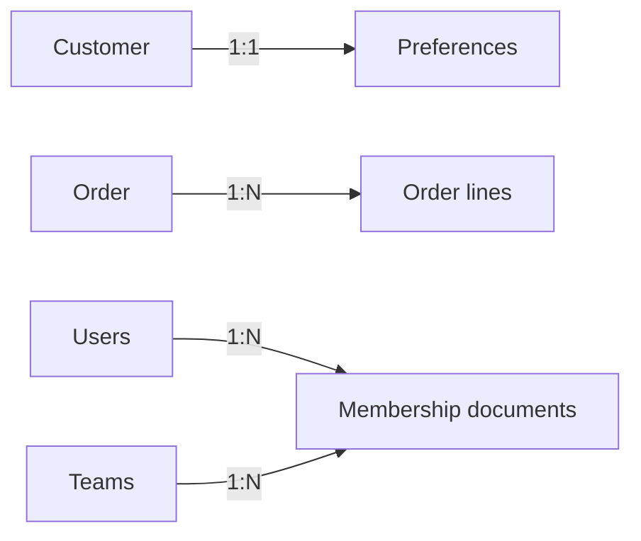
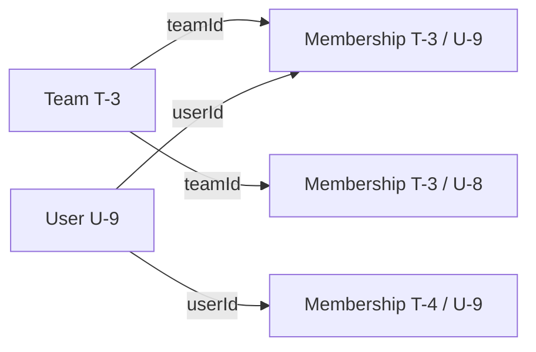

# Quan hệ một–một, một–nhiều và nhiều–nhiều trong Spring Data Couchbase

Trong cơ sở dữ liệu quan hệ, ta thường biểu diễn quan hệ **một–một (1:1)**, **một–nhiều (1:N)** và **nhiều–nhiều (N:M)** bằng khóa chính, khóa ngoại và bảng liên kết. Với Couchbase, các kiểu quan hệ này vẫn tồn tại trong **nghiệp vụ**, nhưng cách lưu trữ không nhất thiết là một bảng/document cho mỗi thực thể. Tùy mẫu truy cập, một quan hệ có thể được biểu diễn bằng **object nhúng**, **mảng nhúng**, **document ID tham chiếu** hoặc **document liên kết (edge/membership)**.

Điểm then chốt: **cardinality cho biết có bao nhiêu đối tượng liên quan; nó không tự quyết định mô hình lưu trữ**. Một khách hàng có đúng một cấu hình giao diện có thể nhúng cấu hình vào hồ sơ. Cũng là một–một, nhưng dữ liệu cần quyền riêng và vòng đời xóa khác có thể đặt trong collection độc lập. Một đơn hàng có ít dòng hàng thường phù hợp với mảng nhúng, còn một nhóm có hàng triệu thành viên thì không thể quản lý hiệu quả bằng mảng ID tăng mãi.

Bài thuộc chương **Quan hệ và JOIN** của module **SPRING_DATA_COUCHBASE**: xây dựng tầng truy cập Couchbase với document mapping, repository, `CouchbaseTemplate` và SQL++, thiết kế bucket/scope/collection, chỉ mục, TTL, CAS, giao dịch và API reactive. Mục tiêu là chuyển từ khái niệm cardinality sang một thiết kế dữ liệu **đúng nghiệp vụ, hiệu quả khi đọc–ghi và có thể vận hành lâu dài**.

## 1. Mục tiêu học tập

Sau bài này, bạn có thể:

1. Nhận diện 1:1, 1:N và N:M ở mức nghiệp vụ, phân biệt với cách tổ chức document trong Couchbase.
2. Chọn embedding, reference ID hoặc document liên kết dựa trên số lượng, vòng đời, tần suất đọc/ghi, yêu cầu nhất quán và phân quyền.
3. Thiết kế schema và ID ổn định để đi theo hai chiều quan hệ; tránh mảng không giới hạn và các bản sao quan hệ khó đồng bộ.
4. Viết SQL++ với `UNNEST`, `ANY ... SATISFIES`, `JOIN ... ON KEYS` và truy vấn collection liên kết; nhận biết khi nào một lần KV read đủ.
5. Ánh xạ các document qua `@Document`, `@Scope`, `@Collection`, `@Id`, `@Version` và repository Spring Data Couchbase.
6. Thiết kế index theo `WHERE`, `ORDER BY` và đường truy cập hai chiều, kiểm chứng bằng `system:indexes` và `EXPLAIN`.
7. Xác định chính sách tạo/xóa quan hệ, tính duy nhất, đồng bộ hai phía, CAS, giao dịch, TTL, eventual consistency và xử lý reference không còn tồn tại.
8. Lập kế hoạch chuyển mô hình khi cardinality thực tế lớn hơn dự kiến.

## 2. Cardinality là quy tắc nghiệp vụ, không phải câu lệnh tạo index

### 2.1. Ba kiểu quan hệ

| Kiểu | Ví dụ | Ý nghĩa |
| --- | --- | --- |
| **1:1** | Một khách hàng có tối đa một bộ tùy chọn thông báo | Với một customer, có không quá một preferences hiện hành |
| **1:N** | Một đơn hàng có nhiều dòng hàng | Một line thuộc một order, order chứa nhiều line |
| **N:M** | Một người dùng tham gia nhiều nhóm, mỗi nhóm có nhiều người dùng | Không bên nào sở hữu độc quyền một bản ghi của bên kia |

Đây là quy tắc logic. Couchbase không tự hiểu `customerId` là foreign key, không tự kiểm tra chỉ tồn tại một preferences khi ứng dụng ghi document, và không tự xóa dòng hàng khi xóa order. Bất biến về số lượng và sự tồn tại phải được **mã hóa bằng thiết kế ID, thao tác ghi, validation, transaction hoặc quy trình đối soát phù hợp**.

### 2.2. Tách “một hay nhiều” khỏi “ít hay rất nhiều”

Hai quan hệ đều 1:N:

- Đơn hàng có tối đa 20 dòng hàng và chi tiết đơn luôn tải toàn bộ 20 dòng.
- Nhóm có thể có 2 triệu thành viên, API phải phân trang và cập nhật tư cách thành viên liên tục.

Quan hệ đầu có thể nhúng mảng. Quan hệ sau cần collection thành viên riêng hoặc mô hình dữ liệu phân vùng phù hợp. Vì vậy các thông số cần hỏi thêm là:

- **Cardinality thực tế:** trung bình, p95, lớn nhất, mức tăng theo thời gian.
- **Hướng đọc:** đọc cha→con, con→cha, hay cả hai; có cần phân trang không?
- **Đơn vị ghi:** sửa cả aggregate hay sửa từng con độc lập?
- **Tần suất thay đổi:** field của con có bị cập nhật liên tục không?
- **Vòng đời:** con bị xóa cùng cha hay có retention riêng?
- **Độ mới và tính nguyên tử:** một update phải xuất hiện ngay ở cả hai phía không?
- **Quyền truy cập:** hai bên có mức bảo vệ dữ liệu khác nhau không?

### 2.3. Ma trận lựa chọn nhanh

| Tiêu chí | Nhúng object/mảng | Tham chiếu document ID | Document liên kết |
| --- | --- | --- | --- |
| Đọc aggregate nhỏ | Rất thuận tiện, một KV read | Có thể cần nhiều lượt đọc | Thường không cần thiết |
| Cập nhật phần tử độc lập | Cạnh tranh trên document cha | Mỗi document có CAS riêng | Mỗi quan hệ có vòng đời riêng |
| Quan hệ tăng không giới hạn | Không phù hợp | Phù hợp khi con lưu riêng | Phù hợp cho N:M lớn |
| Truy vấn ngược từ con sang cha | Cần index trên field/mảng nếu có | Index theo `parentId` hoặc KV theo ID | Index từng hướng `leftId`/`rightId` |
| Tính nguyên tử | Một mutation của một document | Nhiều document cần điều phối | Thao tác tạo/xóa edge cần định danh và kiểm soát |
| Dữ liệu trùng lặp | Có thể thấp cho aggregate | Thường ít trùng lặp | Edge chứa thêm metadata của quan hệ |
| Quyền/retention độc lập | Khó hơn | Rõ hơn | Có thể quản lý theo collection quan hệ |

Không có ô nào là mệnh lệnh tuyệt đối: một aggregate nhỏ nhưng có chứa dữ liệu cần xóa độc lập vẫn có lý do để tách collection.

## 3. Mô hình xuyên suốt: khách hàng, đơn hàng và nhóm cộng tác

Giả sử bucket `commerce` gồm các scope/collection:

```text
commerce
├── crm
│   ├── customers
│   └── customer_preferences
├── sales
│   ├── orders
│   └── order_lines
└── collaboration
    ├── users
    ├── teams
    └── memberships
```

Các đường truy cập nghiệp vụ:



Hai mũi tên từ `Users` và `Teams` tới `Memberships` biểu diễn một quan hệ N:M được phân rã thành **hai quan hệ 1:N với collection liên kết**, không có nghĩa một user hoặc team lưu toàn bộ memberships trong một mảng.

Một số ID mẫu:

```text
customer::TENANT-A::C-42
preferences::TENANT-A::C-42
order::TENANT-A::1001
line::TENANT-A::1001::L1
user::TENANT-A::U-9
team::TENANT-A::T-3
membership::TENANT-A::T-3::U-9
```

ID mẫu giúp thấy ranh giới tenant và tính xác định của quan hệ. Khi áp dụng, phải chọn quy tắc escape/canonicalization hoặc mã hóa thành phần để tránh va chạm giữa các giá trị chứa dấu phân cách. Không xem ID mang tenant là một hình thức phân quyền.

## 4. Quan hệ một–một: nhúng hay tách document?

### 4.1. Cùng vòng đời, cùng nơi đọc: nhúng object

Nếu mỗi customer có một đối tượng cấu hình hiển thị nhỏ, hiếm khi cần truy cập riêng:

```json
{
  "_class": "customer",
  "tenantId": "TENANT-A",
  "displayName": "Nguyen An",
  "preferences": {
    "language": "vi",
    "timezone": "Asia/Ho_Chi_Minh",
    "emailNotifications": true
  }
}
```

Document ID của customer ở `commerce.crm.customers` là `customer::TENANT-A::C-42`. `preferences` nhúng có thể được đọc cùng customer bằng một KV `findById`.

Lợi ích:

- Một document chứa trạng thái cần hiển thị cùng nhau.
- Không cần thêm repository hoặc một lần KV read cho preferences.
- Khi lưu **một document** thành công, trạng thái trong chính mutation đó không bị tách làm hai bản ghi cập nhật dở.

Giới hạn:

- Mỗi lần thay preferences có thể cạnh tranh CAS với một lần sửa thông tin customer.
- Quyền truy cập hoặc TTL của preferences không thể độc lập đơn giản như một document khác.
- Nếu preferences trở thành object rất lớn hoặc có lịch sử thay đổi riêng, mô hình ban đầu có thể không phù hợp.

### 4.2. Cần vòng đời hoặc quyền khác: tách 1:1

Một mô hình tách:

```json
{
  "_class": "customerPreferences",
  "tenantId": "TENANT-A",
  "customerId": "customer::TENANT-A::C-42",
  "language": "vi",
  "emailNotifications": true,
  "updatedAt": "2026-11-20T10:00:00Z"
}
```

Document đặt tại `commerce.crm.customer_preferences` với ID xác định `preferences::TENANT-A::C-42`. Khi biết customer ID, ứng dụng có thể **tính ID preferences** và đọc KV trực tiếp mà không cần secondary index.

Mẫu ID “mỗi customer chỉ có một preferences” làm tính duy nhất dễ kiểm soát **nếu ứng dụng dùng thao tác insert-if-absent và toàn bộ writer tuân thủ một quy tắc ID**. Couchbase không tự biến field `customerId` thành unique constraint chỉ vì document chứa nó.

Ví dụ đối chiếu:

| Quyết định | Nhúng preferences | Tách preferences |
| --- | --- | --- |
| Đọc profile đầy đủ | Một KV read | Có thể hai KV reads |
| Chỉ sửa preferences | Sửa customer document | Sửa preferences document |
| Xử lý xung đột | CAS chung của customer | CAS riêng trên preferences |
| TTL hoặc xóa riêng | Phải thao tác trên toàn customer | Có thể điều khiển document preferences riêng |
| Index/query riêng trên preferences | Query nested field của customer | Tạo index trên collection preferences nếu cần tìm kiếm theo thuộc tính |

### 4.3. 1:1 không đồng nghĩa lúc nào cũng tồn tại cả hai bên

Ở thời điểm đăng ký, customer có thể chưa có preferences. Đó là quan hệ **0..1** phía preferences, dù quy tắc tối đa vẫn là một. Service cần xác định:

- Tạo preferences mặc định ngay khi tạo customer hay tạo khi người dùng lần đầu cấu hình?
- Nếu preferences chưa tồn tại, trả default hay lỗi?
- Nếu customer bị xóa, preferences có bị xóa/expire theo retention không?
- Nếu cập nhật hai document liên quan và yêu cầu tính nguyên tử, có cần transaction không?

Không tự giả định xóa document Customer sẽ kích hoạt cascade delete cho preferences.

### 4.4. Không dùng quan hệ 1:1 để mô phỏng khóa ngoại vô điều kiện

Ví dụ thông tin thanh toán nhạy cảm, file xác minh lớn hoặc tài liệu có retention riêng có thể cần tách, dù cardinality là một. Lý do chính là **độc lập quyền/lifecycle/ghi**, không phải số lượng con.

Ngược lại, cấu hình hiển thị nhỏ ít thay đổi không cần một collection mới chỉ vì hai class Java khác nhau. Trong Spring Data Couchbase, một class Java lồng trong entity có thể đơn giản được ánh xạ thành object JSON.

## 5. Quan hệ một–nhiều nhỏ: mảng nhúng trong aggregate

Một order có tối đa vài chục dòng hàng, và trang chi tiết gần như luôn trả đầy đủ dòng:

```json
{
  "_class": "salesOrder",
  "tenantId": "TENANT-A",
  "customerId": "customer::TENANT-A::C-42",
  "status": "PAID",
  "createdAt": "2026-11-20T08:15:00Z",
  "items": [
    {
      "lineId": "L1",
      "productId": "product::SKU-42",
      "unitPriceAtPurchase": 350000,
      "quantity": 2
    },
    {
      "lineId": "L2",
      "productId": "product::SKU-18",
      "unitPriceAtPurchase": 800000,
      "quantity": 1
    }
  ],
  "total": 1500000
}
```

ID order: `order::TENANT-A::1001` tại `commerce.sales.orders`.

Mô hình nhúng hợp lý khi:

- Mỗi item chỉ thuộc một order.
- Số item có **giới hạn nghiệp vụ** và không tăng mãi.
- Khi hiển thị đơn cần tất cả item.
- Thay item thường là một phần của thay đổi aggregate order.
- Địa chỉ, giá bán tại thời điểm mua và quantity cần có ý nghĩa nhất quán tại thời điểm lưu đơn.

### 5.1. Đọc aggregate bằng KV

```java
SalesOrder order = orderRepository
    .findById("order::TENANT-A::1001")
    .orElseThrow();
```

Với document chứa mảng `items`, một lần KV lookup theo ID trả về cả order. Không cần SQL++ `JOIN` giữa order và từng dòng, vì các dòng **không phải những document độc lập**.

### 5.2. Truy vấn document cha theo phần tử mảng

Tìm các order có ít nhất một item của sản phẩm:

```sql
SELECT META(o).id AS orderId, o.status
FROM `commerce`.`sales`.`orders` AS o
WHERE o.tenantId = "TENANT-A"
  AND ANY i IN o.items
      SATISFIES i.productId = "product::SKU-42"
      END;
```

`ANY ... SATISFIES` là phép kiểm tra tồn tại item thỏa điều kiện; một order phù hợp vẫn là **một document trong kết quả**, dù có nhiều item cùng `productId`.

Nếu truy vấn này thường xuyên và collection lớn, có thể cân nhắc array index:

```sql
CREATE INDEX ix_orders_tenant_item_product
ON `commerce`.`sales`.`orders`(
    `tenantId`,
    DISTINCT ARRAY i.productId FOR i IN items END
);
```

Index mảng có thể sinh nhiều entry cho một document. Cần đo độ dài mảng, số giá trị phân biệt và chi phí cập nhật khi `items` thay đổi; không tạo array index chỉ vì JSON có mảng.

### 5.3. Mở từng phần tử thành hàng với `UNNEST`

```sql
SELECT META(o).id AS orderId,
       i.lineId,
       i.productId,
       i.quantity
FROM `commerce`.`sales`.`orders` AS o
UNNEST o.items AS i
WHERE o.tenantId = "TENANT-A"
  AND i.productId = "product::SKU-42";
```

Với hai item cùng product ID, `UNNEST` có thể trả **hai hàng**, trong khi `ANY` chỉ chọn order một lần. Đây là khác biệt cardinality của **kết quả query** chứ không phải thay đổi mô hình lưu trữ.

### 5.4. Cẩn thận phân trang sau `UNNEST`

Nếu UI cần “20 đơn mới nhất”, không được tự động cho:

```sql
SELECT META(o).id AS orderId, i.lineId
FROM `commerce`.`sales`.`orders` AS o
UNNEST o.items AS i
WHERE o.tenantId = "TENANT-A"
LIMIT 20;
```

rồi hiểu là 20 order. `LIMIT 20` ở đây giới hạn **20 hàng item sau UNNEST**; một order có 20 item có thể chiếm cả trang. Hãy phân trang ở cấp order trước, sau đó mới mở các item phù hợp với hợp đồng API.

### 5.5. Ranh giới nguyên tử của một document và CAS

Khi sửa `items` và `total` trong cùng document, một mutation thành công có thể ghi trạng thái nhất quán của aggregate. Nhưng nếu hai request đồng thời cùng đọc order cũ rồi cập nhật các item khác nhau, vẫn có rủi ro mất cập nhật nếu ứng dụng ghi đè không kiểm soát.

`@Version`/CAS hoặc mutation API phù hợp có thể phát hiện/thực hiện cập nhật cạnh tranh theo khả năng của phiên bản Couchbase. CAS **không tự quyết định cách merge hai danh sách item**; ứng dụng phải retry và tái kiểm tra bất biến như `total = Σ(unitPrice × quantity)`.

## 6. Quan hệ một–nhiều lớn: tách document con và lưu `parentId`

Một order có thể phát sinh hàng chục nghìn event vận chuyển, hoặc mỗi team có rất nhiều nhiệm vụ. Nếu mỗi event được nhúng vào mảng cha:

- Document cha phình to theo thời gian và có thể chạm giới hạn kích thước.
- Mỗi request thêm event cạnh tranh ghi trên cùng document.
- Đọc 20 event gần nhất có thể phải đọc dữ liệu không cần thiết.
- TTL, phân trang, tìm kiếm và retention theo từng event trở nên khó quản lý.

Đặt event tại `commerce.sales.order_events`:

```json
{
  "_class": "orderEvent",
  "tenantId": "TENANT-A",
  "orderId": "order::TENANT-A::1001",
  "eventType": "PACKAGE_DISPATCHED",
  "eventTime": "2026-11-21T08:00:00Z",
  "sequence": 103
}
```

ID riêng của event có thể là `event::TENANT-A::1001::103` khi sequence được cấp ổn định. Cần quy trình bảo đảm sequence không trùng và xử lý retry; nếu sự kiện có ID từ nguồn nghiệp vụ, có thể dùng ID đó.

### 6.1. Query từ cha sang con

```sql
SELECT META(e).id AS eventId,
       e.eventType,
       e.eventTime,
       e.sequence
FROM `commerce`.`sales`.`order_events` AS e
WHERE e.tenantId = "TENANT-A"
  AND e.orderId = "order::TENANT-A::1001"
ORDER BY e.eventTime DESC, e.sequence DESC
LIMIT 50;
```

Index ứng viên:

```sql
CREATE INDEX ix_order_events_by_order_time
ON `commerce`.`sales`.`order_events`(
    `tenantId`,
    `orderId`,
    `eventTime` DESC,
    `sequence` DESC
);
```

Quan hệ 1:N lúc này là tập các document chứa `orderId`. Query Service cần secondary index theo khóa tham chiếu để tìm nhiều con hiệu quả, khác với KV lookup của **một order đã biết ID**.

### 6.2. Đi ngược: từ event đến order

Khi đã tải event và có `orderId`, đọc order bằng KV `findById(event.getOrderId())`; không cần index riêng trên document ID của order chỉ để thực hiện lookup này.

Nếu dùng SQL++:

```sql
SELECT META(e).id AS eventId,
       e.eventType,
       o.status,
       o.createdAt
FROM `commerce`.`sales`.`order_events` AS e
JOIN `commerce`.`sales`.`orders` AS o
  ON KEYS e.orderId
WHERE e.tenantId = "TENANT-A"
  AND e.orderId = "order::TENANT-A::1001";
```

`JOIN ... ON KEYS` dùng document ID được lưu trong event để tìm order. Nó không cần một “foreign key index” trên phía ID của order. Tuy vậy, phía event vẫn cần đường tìm kiếm phù hợp với `WHERE`.

### 6.3. Vì sao không giữ thêm mảng `eventIds` vô hạn ở order?

Nếu order lưu mọi `eventId`, mỗi event mới có thể khiến ứng dụng vừa insert event, vừa sửa order để thêm ID. Ta lại tạo **một điểm ghi nóng** ở document cha và một bản sao danh sách có thể lệch khi chỉ một trong hai mutation thành công.

Chỉ giữ thông tin tổng hợp thực sự cần ở cha, ví dụ:

```json
{
  "lastEventType": "PACKAGE_DISPATCHED",
  "lastEventTime": "2026-11-21T08:00:00Z",
  "eventCount": 103
}
```

Đây là dữ liệu phi chuẩn hóa/tổng hợp cần chính sách cập nhật và đối soát; không tự chứng minh đồng bộ chính xác chỉ vì event và order cùng bucket.

## 7. Quan hệ nhiều–nhiều: tạo document liên kết có danh tính riêng

### 7.1. Tình huống người dùng–nhóm

Một `User` có thể tham gia nhiều `Team`; một `Team` có nhiều `User`. Ngoài sự tồn tại của liên kết, nghiệp vụ còn cần:

- Vai trò `ADMIN`, `MEMBER` hoặc `VIEWER`.
- Thời điểm gia nhập.
- Trạng thái lời mời/được chấp thuận.
- Người cấp quyền hoặc hủy tư cách thành viên.
- Kiểm soát việc một người không được gia nhập cùng team hai lần.

Đây là trường hợp thích hợp để tạo **document membership độc lập**, không chỉ lưu hai mảng ID.

```json
{
  "_class": "teamMembership",
  "tenantId": "TENANT-A",
  "teamId": "team::TENANT-A::T-3",
  "userId": "user::TENANT-A::U-9",
  "role": "MEMBER",
  "state": "ACTIVE",
  "joinedAt": "2026-11-20T09:00:00Z",
  "updatedAt": "2026-11-20T09:00:00Z"
}
```

Document đặt tại `commerce.collaboration.memberships` với ID:

```text
membership::TENANT-A::T-3::U-9
```

ID xác định từ tenant/team/user giúp có **một vị trí khóa chuẩn cho mỗi cặp**. Nếu tất cả writer dùng cùng quy tắc và thao tác **insert-if-absent** khi tạo, hai yêu cầu đồng thời muốn tạo cùng membership sẽ cạnh tranh trên một document ID; một yêu cầu có thể nhận lỗi “đã tồn tại” và ứng dụng xử lý idempotent.

Chỉ dùng `save` theo kiểu upsert mù quáng không phải là bằng chứng đã bảo đảm quy tắc “không trùng”: nó có thể ghi đè membership có sẵn. Cần chọn thao tác tạo, chính sách retry và kiểm soát quyền cụ thể.

### 7.2. N:M trở thành hai chiều tra cứu 1:N



Một membership đại diện cho một cặp. Nó thuộc về cả một team và một user theo quan hệ nghiệp vụ, nhưng **được lưu đúng một lần** ở collection memberships. Nếu cần truy vấn hai chiều, tạo index cho cả hai hướng có workload thực.

### 7.3. Từ team sang danh sách user

```sql
SELECT META(m).id AS membershipId,
       m.userId, m.role, m.joinedAt
FROM `commerce`.`collaboration`.`memberships` AS m
WHERE m.tenantId = "TENANT-A"
  AND m.teamId = "team::TENANT-A::T-3"
  AND m.state = "ACTIVE"
ORDER BY m.joinedAt DESC
LIMIT 50;
```

Index ứng viên:

```sql
CREATE INDEX ix_memberships_by_team
ON `commerce`.`collaboration`.`memberships`(
    `tenantId`,
    `teamId`,
    `state`,
    `joinedAt` DESC
);
```

### 7.4. Từ user sang danh sách team

```sql
SELECT m.teamId, m.role, m.joinedAt
FROM `commerce`.`collaboration`.`memberships` AS m
WHERE m.tenantId = "TENANT-A"
  AND m.userId = "user::TENANT-A::U-9"
  AND m.state = "ACTIVE"
ORDER BY m.joinedAt DESC
LIMIT 50;
```

Index ứng viên thứ hai:

```sql
CREATE INDEX ix_memberships_by_user
ON `commerce`.`collaboration`.`memberships`(
    `tenantId`,
    `userId`,
    `state`,
    `joinedAt` DESC
);
```

Không thể mong đợi index `(tenantId,teamId,state,joinedAt)` luôn tối ưu cho truy vấn chỉ có `userId`: khóa dẫn đầu sau tenant khác nhau. Khi cả hai hướng đều nóng, hai index có thể hợp lý. Khi một hướng hiếm, cần cân nhắc chi phí duy trì index so với SLA thực tế.

### 7.5. Join thêm thông tin User

Truy vấn danh sách membership kèm tên người dùng:

```sql
SELECT m.role,
       m.joinedAt,
       META(u).id AS userId,
       u.displayName AS userName
FROM `commerce`.`collaboration`.`memberships` AS m
JOIN `commerce`.`collaboration`.`users` AS u
  ON KEYS m.userId
WHERE m.tenantId = "TENANT-A"
  AND m.teamId = "team::TENANT-A::T-3"
  AND m.state = "ACTIVE"
  AND u.tenantId = m.tenantId
ORDER BY m.joinedAt DESC
LIMIT 50;
```

Đường scan phía memberships chịu trách nhiệm tìm những edge phù hợp. `JOIN ... ON KEYS` tra document User theo ID được lưu trên edge. Cần kiểm tra Query Profile: lọc/`LIMIT` được áp dụng ở đâu, có bao nhiêu lookup và có mất các hàng user không tồn tại không.

Khi cần giữ membership dù User đã xóa, dùng `LEFT JOIN` và thiết kế fallback cho thông tin User, thay vì âm thầm làm mất membership trong inner join.

### 7.6. Thuộc tính của quan hệ thuộc về edge

`role` và `joinedAt` mô tả **mối quan hệ User–Team**, không phải thuộc tính cố hữu của User hoặc Team. Một user có thể là `ADMIN` trong team A nhưng là `VIEWER` ở team B. Nếu đặt một field `role` toàn cục trên User, mô hình sẽ sai nghiệp vụ.

Đây là lý do document liên kết có giá trị hơn mảng `userIds`: ngoài khả năng mở rộng, nó còn là nơi phù hợp để lưu metadata, CAS/version và lịch sử vòng đời của từng quan hệ.

## 8. Vì sao hai mảng tham chiếu đối xứng thường khó bảo trì?

Một thiết kế ban đầu có thể là:

```json
{
  "teamId": "T-3",
  "userIds": ["U-9", "U-8", "U-7"]
}
```

và trên User:

```json
{
  "userId": "U-9",
  "teamIds": ["T-3", "T-4"]
}
```

Khi User U-9 gia nhập Team T-5, cần thay đổi **hai document**. Nếu một update thành công còn update kia thất bại, quan hệ không còn đối xứng. Ngoài ra:

- Mảng `userIds` có thể lớn không giới hạn và trở thành điểm ghi nóng.
- Không có chỗ tự nhiên để lưu `role`, `joinedAt` và state riêng cho từng cặp.
- Nhiều người đồng thời gia nhập cùng team cạnh tranh trên cùng document Team.
- Có thể sinh ID trùng trong mảng nếu không kiểm soát.
- Query hai chiều vẫn cần thiết kế array index, không miễn phí.

Mảng nhỏ có giới hạn và một nguồn sự thật duy nhất vẫn có thể hợp lý. Nhưng **lưu đồng thời hai mảng phản chiếu** cần cơ chế consistency; nó hiếm khi đơn giản hơn một membership collection khi quan hệ N:M lớn hoặc cập nhật thường xuyên.

### 8.1. Một nguồn chân lý, nhiều read model là lựa chọn khác

Nếu cần truy cập cực nhanh hai chiều, có thể giữ membership documents là **nguồn chân lý**, rồi xây cache/read model liệt kê thành viên của những team nhỏ hoặc team được xem nhiều. Khi đó phải thiết kế:

1. Luồng sự kiện thay đổi membership.
2. Cơ chế idempotent và thứ tự version để tránh ghi cũ đè dữ liệu mới.
3. Backfill, reconciliation và tiêu chí độ trễ đồng bộ.
4. Quyền/retention khi User hoặc Team bị xóa.

Một read model trùng lặp được tạo có chủ đích là khác với việc coi hai mảng cùng là nguồn chân lý mà không có quy tắc phân xử.

## 9. Spring Data Couchbase: ánh xạ 1:1 và 1:N

### 9.1. Customer với preferences nhúng

```java
import org.springframework.data.annotation.Id;
import org.springframework.data.annotation.Version;
import org.springframework.data.annotation.TypeAlias;
import org.springframework.data.couchbase.core.mapping.Document;
import org.springframework.data.couchbase.core.mapping.Scope;
import org.springframework.data.couchbase.core.mapping.Collection;

@Document
@TypeAlias("customer")
@Scope("crm")
@Collection("customers")
public class Customer {
    @Id
    private String id;

    @Version
    private Long version;

    private String tenantId;
    private String displayName;
    private CustomerPreferences preferences;

    // Constructor, getter và setter được lược bỏ.
}

public class CustomerPreferences {
    private String language;
    private boolean emailNotifications;

    // Constructor, getter và setter được lược bỏ.
}
```

Trong ví dụ, `CustomerPreferences` là value object lồng, không phải `@Document` riêng. Nếu chọn mô hình tách 1:1, hãy đổi sang một entity `CustomerPreferencesDocument` có `@Id` và `@Collection("customer_preferences")`, giữ `customerId` để truy vết nguồn.

`@Version` được Spring Data Couchbase dùng cho optimistic locking dựa trên CAS trong các phiên bản hỗ trợ. Nó giúp phát hiện document đã đổi trước khi ghi; **không** phải cơ chế kiểm tra foreign key hay tự merge mọi update.

### 9.2. Order với danh sách item nhúng

```java
import java.time.Instant;
import java.util.List;
import org.springframework.data.annotation.Id;
import org.springframework.data.annotation.Version;
import org.springframework.data.annotation.TypeAlias;
import org.springframework.data.couchbase.core.mapping.Document;
import org.springframework.data.couchbase.core.mapping.Scope;
import org.springframework.data.couchbase.core.mapping.Collection;

@Document
@TypeAlias("salesOrder")
@Scope("sales")
@Collection("orders")
public class SalesOrder {
    @Id
    private String id;

    @Version
    private Long version;

    private String tenantId;
    private String customerId;
    private String status;
    private Instant createdAt;
    private List<OrderItem> items;
    private long total;

    // Constructor, getter và setter được lược bỏ.
}

public class OrderItem {
    private String lineId;
    private String productId;
    private long unitPriceAtPurchase;
    private int quantity;

    // Constructor, getter và setter được lược bỏ.
}
```

`OrderItem` không có `@Id` riêng: nó chỉ là một object trong mảng JSON của order. Một field `productId` vẫn là **chuỗi ID**, không tự gọi repository Product hoặc thực hiện JOIN.

### 9.3. OrderEvent tách riêng

```java
import java.time.Instant;
import org.springframework.data.annotation.Id;
import org.springframework.data.annotation.TypeAlias;
import org.springframework.data.couchbase.core.mapping.Document;
import org.springframework.data.couchbase.core.mapping.Scope;
import org.springframework.data.couchbase.core.mapping.Collection;

@Document
@TypeAlias("orderEvent")
@Scope("sales")
@Collection("order_events")
public class OrderEvent {
    @Id
    private String id;
    private String tenantId;
    private String orderId;
    private Instant eventTime;
    private String eventType;

    // Constructor, getter và setter được lược bỏ.
}
```

Ở đây `OrderEvent` mới là entity độc lập. Document có `orderId` có thể được lưu dù order chưa tồn tại nếu ứng dụng không kiểm soát. Để bảo đảm invariant, cần chính sách xác minh order, giao dịch hoặc xử lý tạm trạng thái chưa đồng bộ theo nghiệp vụ.

## 10. Spring Data Couchbase: ánh xạ N:M bằng Membership

### 10.1. Membership là một entity độc lập

```java
import java.time.Instant;
import org.springframework.data.annotation.Id;
import org.springframework.data.annotation.Version;
import org.springframework.data.annotation.TypeAlias;
import org.springframework.data.couchbase.core.mapping.Document;
import org.springframework.data.couchbase.core.mapping.Scope;
import org.springframework.data.couchbase.core.mapping.Collection;

@Document
@TypeAlias("teamMembership")
@Scope("collaboration")
@Collection("memberships")
public class TeamMembership {
    @Id
    private String id;

    @Version
    private Long version;

    private String tenantId;
    private String teamId;
    private String userId;
    private String role;
    private String state;
    private Instant joinedAt;
    private Instant updatedAt;

    // Constructor, getter và setter được lược bỏ.
}
```

Entity này không cần một tham chiếu Java `Team` chứa `List<User>` hay `User` chứa `List<Team>` để biểu diễn N:M. Các field `teamId`/`userId` là ID; service quyết định khi nào lấy document bên kia.

### 10.2. Repository cho hai chiều quan hệ

```java
import java.util.List;
import org.springframework.data.couchbase.repository.CouchbaseRepository;

public interface TeamMembershipRepository
        extends CouchbaseRepository<TeamMembership, String> {

    List<TeamMembership> findByTenantIdAndTeamIdAndStateOrderByJoinedAtDesc(
        String tenantId, String teamId, String state
    );

    List<TeamMembership> findByTenantIdAndUserIdAndStateOrderByJoinedAtDesc(
        String tenantId, String userId, String state
    );
}
```

Hai method tìm theo thuộc tính thường được chuyển thành SQL++ và cần index trên collection `memberships`. Chúng **không** tự join User/Team; kết quả là các document membership. Repository trả toàn entity có thể cần `Fetch` và bộ lọc loại `_class` tùy mapping.

### 10.3. `@Query` có tham số

```java
import java.util.List;
import org.springframework.data.couchbase.repository.Query;

public interface TeamMembershipRepository
        extends CouchbaseRepository<TeamMembership, String> {

    @Query("#{#n1ql.selectEntity} WHERE #{#n1ql.filter} " +
           "AND tenantId = $1 AND teamId = $2 AND state = $3 " +
           "ORDER BY joinedAt DESC LIMIT 50")
    List<TeamMembership> findRecentMembers(
        String tenantId, String teamId, String state
    );
}
```

`#{#n1ql.selectEntity}` và `#{#n1ql.filter}` hỗ trợ ánh xạ entity, bao gồm metadata/lọc kiểu trong mô hình Spring Data hỗ trợ. `$1`–`$3` là tham số truy vấn, tránh ghép giá trị request trực tiếp vào SQL++.

Khi benchmark, phải lấy SQL++ thực được sinh ra để kiểm tra `EXPLAIN`: projection trả entity, điều kiện `_class` và các mapping field có thể làm plan khác câu SQL++ viết tay chỉ chọn vài field.

### 10.4. Đọc Membership rồi KV User/Team theo nhu cầu

Ví dụ một màn hình “các team của user” chỉ cần tên Team:

1. Query membership theo `tenantId`/`userId` với giới hạn và sắp xếp.
2. Thu thập các `teamId` phân biệt.
3. Đọc những Team cần thiết theo ID, kiểm tra cùng tenant/quyền.
4. Kết hợp kết quả, quyết định hành vi khi Team đã xóa.

Không tự tạo một lượt `findById(teamId)` tuần tự cho mỗi membership của một trang lớn nếu có thể khử trùng lặp hoặc dùng batch/KV concurrent có giới hạn. Đây là **N+1 lookup ở tầng ứng dụng**, dù dữ liệu nằm trong NoSQL.

## 11. Tính duy nhất, CAS và bất biến quan hệ

### 11.1. 1:1: ID xác định không đủ nếu writer không tuân quy tắc

Nếu mọi preferences của một customer đều phải có ID `preferences::TENANT-A::C-42`, ta đã chọn một vị trí document chuẩn. Nhưng nếu service khác tự tạo `preferences::TENANT-A::C-42::copy2`, dữ liệu vẫn có thể chứa hai preferences.

Giữ tính duy nhất cần:

- Định nghĩa ID chuẩn và dùng cùng một logic tạo trên tất cả writer.
- Ưu tiên thao tác KV **insert-if-absent** khi tạo mới quan hệ.
- Xử lý “document đã tồn tại” như kết quả cạnh tranh hoặc retry có chủ đích.
- Đối soát để tìm legacy data không tuân quy tắc.

Không dùng secondary index như một unique constraint của cơ sở dữ liệu quan hệ.

### 11.2. N:M: thêm thành viên phải idempotent

Ví dụ hai request cùng tạo `membership::TENANT-A::T-3::U-9`:

```text
Request A -> KV insert(id chuẩn) -> thành công
Request B -> KV insert(cùng id) -> đã tồn tại
```

Kết quả B có thể được xử lý là “membership đã có” nếu request cùng ý định, hoặc báo xung đột nếu payload/role không khớp. Một thao tác `upsert` có thể ghi đè role/state ngoài ý muốn, nên nó không tương đương với “tạo nếu chưa tồn tại”.

Khi đổi `role` hoặc `state` của membership đã có, CAS/`@Version` giúp phát hiện cập nhật cạnh tranh. Ứng dụng phải quyết định thứ tự ưu tiên, quyền thực hiện và cách retry.

### 11.3. 1:N tách riêng: invariant nhiều document

Nếu order và order_lines ở các document riêng, bất biến:

```text
total = tổng(unitPriceAtPurchase × quantity của tất cả line)
```

không còn được bảo vệ chỉ bằng một KV update. Có thể:

- Dùng **transaction** nếu yêu cầu nguyên tử nhiều document và API/phiên bản hỗ trợ.
- Dùng trạng thái `CREATING` / `CONFIRMED`, chỉ hiển thị order khi đã hoàn tất và đối soát được.
- Dùng cơ chế event + retry/idempotency nếu eventual consistency được chấp nhận.

Chọn theo tính đúng, latency, retry và khả năng vận hành; không coi transaction là miễn phí hay thay thế mọi quyết định mô hình hóa.

### 11.4. Quan hệ có nhiều bên không tự cascade

Xóa Team không tự xóa mọi membership tham chiếu team; xóa Customer không tự xóa preferences tách riêng; xóa Order không tự xóa order_events. Cần phân biệt:

| Chiến lược | Khi áp dụng | Điều cần lưu ý |
| --- | --- | --- |
| Xóa đồng bộ trong transaction | Số document trong phạm vi được hỗ trợ và phải nguyên tử | Giới hạn/scope transaction, retry và timeout |
| Đánh dấu `DELETED`, cleanup nền | Fanout lớn | Query phải lọc tombstone, cleanup cần idempotent |
| TTL cho relation tạm | Lời mời có thời hạn, session relation | TTL không áp ràng buộc FK và không bảo đảm xóa đồng thời mọi phía |
| Giữ edge để audit | Nghiệp vụ cần lịch sử | Phân quyền, retention và dữ liệu cá nhân |

Xóa một Team với hàng triệu membership không nên mặc nhiên cố đưa hàng triệu document vào một transaction. Cần chọn cơ chế đánh dấu trạng thái và cleanup theo lô, với read path nhận biết Team không còn hoạt động.

## 12. SQL++ JOIN, UNNEST và KV: chọn đúng phép truy cập

### 12.1. Phân biệt ba thao tác

| Cần gì? | Đường đọc ứng viên | Vì sao |
| --- | --- | --- |
| Lấy một Customer bằng ID | KV `findById` | Biết document ID |
| Lấy Order và các item đã nhúng | Một KV read Order hoặc SQL++ với `UNNEST` nếu cần từng item | Không có document item riêng |
| Liệt kê toàn bộ event của Order | SQL++ theo `orderId` + index ở collection events | Không biết ID từng event |
| Lấy một event và Order tương ứng | KV event rồi KV order, hoặc `JOIN ... ON KEYS` | Event giữ khóa của Order |
| Lấy danh sách membership theo team | SQL++ với index `teamId` | Một team có nhiều membership |
| Lấy membership kèm User | SQL++ `JOIN ... ON KEYS m.userId` hoặc KV batch | Đã có ID của bên User |
| Join theo một thuộc tính khác document ID | SQL++ ANSI `JOIN ... ON` với index phù hợp | Không có khóa KV của phía được join |

`CouchbaseTemplate` và Java SDK có thể gửi SQL++ trực tiếp, còn repository derived query có thể tạo SQL++ theo method name. Việc các class Java có cùng field `userId`/`teamId` **không** làm JOIN tự diễn ra.

### 12.2. ANSI JOIN khác key join

Giả sử `Team` có field `externalCode` và `Membership` lưu `teamExternalCode` mà **không** lưu document ID:

```sql
SELECT m.userId, t.name
FROM `commerce`.`collaboration`.`memberships` AS m
JOIN `commerce`.`collaboration`.`teams` AS t
  ON m.teamExternalCode = t.externalCode
WHERE m.tenantId = "TENANT-A"
  AND t.tenantId = m.tenantId;
```

Đây là **join theo thuộc tính**: cần kiểm tra cardinality của `externalCode`, tính duy nhất nghiệp vụ và index phía Teams nếu Query Service cần. Nó khác `JOIN ... ON KEYS m.teamId`: key join sử dụng ID trực tiếp để định danh document bên kia.

Nếu business key `externalCode` không duy nhất, một membership có thể join ra nhiều Team, làm tăng số hàng và sai ngữ nghĩa. Không coi `JOIN` là phép xác minh dữ liệu duy nhất thay cho validation.

### 12.3. LEFT JOIN và dữ liệu tham chiếu bị thiếu

Với membership tham chiếu User đã bị xóa:

```sql
SELECT META(m).id AS membershipId,
       m.userId,
       u.displayName
FROM `commerce`.`collaboration`.`memberships` AS m
LEFT JOIN `commerce`.`collaboration`.`users` AS u
  ON KEYS m.userId
WHERE m.tenantId = "TENANT-A"
  AND m.teamId = "team::TENANT-A::T-3";
```

`LEFT JOIN` giúp giữ membership dù không tìm được user. Nhưng nếu thêm `AND u.tenantId = m.tenantId` ngay trong `WHERE` và không xét trường hợp `MISSING`, có thể vô tình loại những membership không join được, làm mất ý nghĩa left join.

Hãy thiết kế predicate và bộ lọc tenant/quyền ở vị trí phù hợp, kiểm tra trường hợp reference thiếu; không hiển thị User sai tenant chỉ để giữ một dòng kết quả.

### 12.4. Hiểu đúng số hàng khi JOIN nhiều quan hệ

Khi JOIN Team→Membership→User, một Team có 1000 membership có thể tạo 1000 hàng. Nếu mỗi User lại được JOIN với một collection khác có nhiều bản ghi phù hợp, số hàng trung gian có thể tiếp tục tăng.

Một `LIMIT 20` đặt sau các phép join không tự chứng minh chỉ có 20 lượt tra dữ liệu. Cần đọc `EXPLAIN`, `spans`, `Fetch`, `Order` và Query Profile để biết số hàng được tạo/quét trước `LIMIT`.

## 13. Chỉ mục được thiết kế theo hướng đọc, không theo tên quan hệ

### 13.1. 1:1 dùng ID chuẩn: có thể không cần GSI

Nếu ứng dụng biết customer ID và tính được preferences ID, hai `findById` KV không cần secondary index. Chỉ tạo index ở `customer_preferences` khi cần tìm **nhiều** preferences theo thuộc tính, ví dụ tất cả người bật nhận email theo tenant.

### 13.2. 1:N child collection: index theo `parentId`

Query `WHERE tenantId = ? AND orderId = ? ORDER BY eventTime DESC` hợp với `(tenantId,orderId,eventTime DESC)` trên `order_events`. Index này không nằm trên `orders` vì chính `order_events` mới chứa nhiều document cần lọc.

### 13.3. N:M thường cần index cho hai chiều

`(tenantId,teamId,state,joinedAt DESC)` và `(tenantId,userId,state,joinedAt DESC)` ở `memberships` có mục đích khác nhau. Khi một chiều hiếm gặp, có thể không cần index riêng; khi hai chiều đều nóng, chi phí thêm index có thể được bù bằng latency đọc giảm.

### 13.4. Kiểm chứng metadata theo đúng keyspace

```sql
SELECT name, state, index_key, condition,
       bucket_id, scope_id, keyspace_id
FROM system:indexes
WHERE bucket_id = "commerce"
  AND scope_id = "collaboration"
  AND keyspace_id = "memberships";
```

Index ở `commerce.sales.order_events` hoặc `commerce.collaboration.users` không thay thế index trên `memberships`. Sau khi DDL chạy, kiểm tra trạng thái khả dụng (`online` ở cấu hình thông thường) rồi mới dựa vào index cho truy vấn mới.

### 13.5. Đọc `EXPLAIN` trên đúng mẫu truy vấn

```sql
EXPLAIN
SELECT m.userId, m.role, m.joinedAt
FROM `commerce`.`collaboration`.`memberships` AS m
WHERE m.tenantId = "TENANT-A"
  AND m.teamId = "team::TENANT-A::T-3"
  AND m.state = "ACTIVE"
ORDER BY m.joinedAt DESC
LIMIT 50;
```

Cần xác nhận:

- `IndexScan`/`IndexScan3` chọn index nào ở collection memberships?
- `spans` có thu hẹp theo tenant/team/state không?
- `Order` có được tránh nhờ khóa `joinedAt DESC` không?
- `Fetch` có cần thiết để lấy `role`/`userId` hay có thể dùng projection nhỏ?
- Có operator/chi phí phát sinh khi `JOIN` sang User?

Không đánh giá index chỉ theo thứ tự khóa trên giấy: phải kiểm chứng SQL++ thực, dữ liệu và latency dưới tải đại diện. Tạo nhiều index cho hai chiều quan hệ cũng làm tăng chi phí duy trì khi membership đổi role/state.

## 14. Nhất quán và vòng đời khi có reference

### 14.1. Foreign key không tự có

Trong Couchbase, một document:

```json
{
  "teamId": "team::TENANT-A::T-3",
  "userId": "user::TENANT-A::U-9"
}
```

có thể được lưu dù `Team` hoặc `User` chưa tồn tại, nếu ứng dụng không kiểm tra. Cần thiết kế:

- Kiểm tra tồn tại và tenant/quyền khi tạo membership.
- Trạng thái pending cho reference chưa xác nhận, nếu nghiệp vụ cho phép.
- Quy trình khôi phục/cleanup cho membership mồ côi.
- Không cho phép một bản ghi thuộc tenant này tham chiếu document tenant khác.

Nếu chỉ kiểm tra tồn tại rồi ghi sau đó, giữa hai thao tác vẫn có thể xảy ra race (parent bị xóa). Với bất biến mạnh, cần quy trình giao dịch hoặc trạng thái nghiệp vụ thích hợp; không xem việc kiểm tra tồn tại trước ghi là giải pháp nguyên tử tuyệt đối.

### 14.2. TTL không tạo cascade

Nếu User hết hạn/xóa theo retention, membership không tự bị xóa theo chỉ vì có `userId`. Với lời mời team có TTL, có thể cho **invitation document** hết hạn riêng; membership đã được chấp thuận có vòng đời khác.

Những quyết định retention phải phù hợp nghiệp vụ, quyền truy cập và quy định về dữ liệu cá nhân. Khi một user bị xóa, read model phi chuẩn hóa có thể vẫn giữ tên/email ở nơi khác; cần có quy trình rà soát tất cả bản sao.

### 14.3. Eventual consistency và index scan

GSI của Couchbase được cập nhật bất đồng bộ từ mutation dữ liệu. Khi thêm membership bằng KV, một truy vấn SQL++ liệt kê theo `teamId` có thể tạm chưa thấy membership mới nếu dùng scan consistency không chờ.

| Scan consistency thường gặp | Hệ quả |
| --- | --- |
| `NOT_BOUNDED` | Có thể trả trạng thái index tạm cũ, thường tránh chờ bắt kịp |
| `REQUEST_PLUS` | Đợi index bắt kịp mutation liên quan tại thời điểm query, có thể tăng độ trễ |

Chọn theo yêu cầu UI/authorization. **Không** dùng một danh sách membership có thể tạm cũ như nguồn kiểm tra phân quyền duy nhất nếu ứng dụng đòi quyết định thu hồi quyền phải có hiệu lực ngay; cần kiến trúc kiểm tra trạng thái/quyền phù hợp.

### 14.4. CAS và transaction là hai tầng khác nhau

- **CAS** giúp phát hiện ghi đè trên một document đã được người khác sửa.
- **Transaction** giúp thực hiện nhóm thao tác có tính nguyên tử theo giới hạn/phạm vi được Couchbase và SDK hỗ trợ.
- **Scan consistency** điều chỉnh độ mới của dữ liệu đọc qua GSI.

Ba cơ chế giải quyết ba nhóm vấn đề khác nhau. Không có cơ chế nào thay thế logic nghiệp vụ xác định “ai được thêm thành viên”, “team đã đóng có cho gia nhập không” hoặc “role nào được phép quản lý role khác”.

### 14.5. Tránh xóa dây chuyền khối lượng lớn trong request đồng bộ

Một team có một triệu membership. Khi xóa team, tránh giả định phải xóa cả triệu edge ngay trong request HTTP hoặc một transaction khổng lồ. Một chiến lược khả dĩ:

1. Đánh dấu Team `DELETING`/`DELETED` bằng CAS, chặn thêm member mới.
2. Read path không coi membership của team bị xóa là còn hiệu lực.
3. Worker cleanup theo lô, có checkpoint/idempotency, xóa dần edge.
4. Xác minh số edge còn lại, đồng bộ các read model/search index liên quan.
5. Xử lý chính sách audit/retention và thất bại có thể retry.

Đây là ví dụ state machine theo nghiệp vụ, không phải một tính năng cascade tự động của Couchbase.

## 15. Reactive API, N+1 và kiểm soát fan-out

### 15.1. Reactive không tự gom các lượt truy cập

Ví dụ service tải 50 membership, rồi `flatMap` mỗi membership để tìm User:

```java
Flux<TeamMembership> memberships = findMembershipsForTeam(teamId);

Flux<UserWithRole> view = memberships.flatMap(
    membership -> userRepository.findById(membership.getUserId())
        .map(user -> new UserWithRole(user, membership.getRole())),
    8 // Giới hạn tối đa số lookup đang hoạt động đồng thời.
);
```

Đoạn code **minh họa**, phụ thuộc các kiểu repository/record được định nghĩa trong ứng dụng; `UserWithRole` là DTO ví dụ. Concurrency `8` không phải giá trị tối ưu phổ quát.

Điểm quan trọng:

- Vẫn có thể có một KV lookup **cho mỗi membership**.
- `flatMap` có thể thay đổi thứ tự trả kết quả; nếu UI cần giữ thứ tự `joinedAt`, cần chiến lược giữ thứ tự/ghép lại.
- Phải kiểm soát số lookup đồng thời để tránh làm quá tải KV/Query Service.
- Nếu nhiều membership cùng trỏ một User, có thể khử trùng lặp ID/cache theo request.
- Với list page lớn, cân nhắc bulk read, `JOIN ... ON KEYS` hoặc read model.

### 15.2. Đừng chạy truy vấn N:M không phân trang

Một team có một triệu thành viên. Repository trả `List<TeamMembership>` không giới hạn có thể gây áp lực lên bộ nhớ, mạng và thời gian phản hồi. Thiết kế API với phân trang và thứ tự ổn định; với khối lượng lớn, cân nhắc keyset/cursor pagination thay vì offset sâu.

Đối chiếu `EXPLAIN` khi thêm khóa sắp xếp phụ để đảm bảo thứ tự ổn định (ví dụ `joinedAt` kèm ID/khóa khác). Index theo `joinedAt DESC` không tự bảo đảm thứ tự giữa những hàng có timestamp bằng nhau.

### 15.3. Đo cả chi phí đọc và ghi

Tối ưu N:M có thể cần hai secondary index phục vụ hai hướng, trong khi mỗi lần thêm/xóa membership đều làm Index Service có thêm việc duy trì. Theo dõi:

| Phía đọc | Phía ghi/vận hành |
| --- | --- |
| SQL++ p95/p99, timeout, query profile | KV write p95, mutation rate |
| Entries scanned/rows returned | Dung lượng index, CPU/memory/disk Index Service |
| Join fan-out và số `Fetch` | Tốc độ cập nhật GSI, backlog/lag theo metrics hỗ trợ |
| KV lookup count và concurrency | Chi phí build/rebalance, replica/partition |

Đừng duy trì hai bản sao mảng relationship chỉ để tránh một index nếu chi phí đồng bộ và CAS trở thành vấn đề lớn hơn.

## 16. Quyền truy cập và tenant trong quan hệ nhiều chiều

Index có khóa `tenantId` giúp quét chọn lọc, **không** là cơ chế authorization. Với mỗi read/write qua User, Team hoặc Membership:

1. Lấy tenant/identity từ context đã xác thực, không tin một `tenantId` bất kỳ do client gửi.
2. Kiểm tra bên trái và bên phải đều thuộc tenant được phép truy cập.
3. Khi tạo membership, kiểm tra người thực hiện có quyền mời/cấp role trên Team.
4. Khi hiển thị User qua join, bảo đảm không rò dữ liệu từ tenant khác.
5. Khi Team bị xóa hoặc vô hiệu hóa, không chỉ dựa vào cache membership có thể trễ.
6. Cấp RBAC cho service theo collection cần thiết, và giới hạn riêng quyền DDL/index.

Ví dụ thêm điều kiện tenant trong JOIN là cần thiết nhưng không đủ nếu business rule của team/role phức tạp. Truy vấn nhanh nhưng vượt quyền dữ liệu vẫn là lỗi nghiêm trọng.

## 17. Khi nào chuyển đổi mô hình quan hệ?

### 17.1. Từ 1:N nhúng sang child collection

Giả sử `orders.items` ban đầu chứa tối đa 10 dòng, nay có thể chứa vài nghìn dòng và mỗi dòng được sửa độc lập. Migration:

1. Chốt schema mới cho `order_lines`, quy tắc ID ổn định và retention.
2. Tạo collection/index trên đích, đợi trạng thái khả dụng.
3. Backfill `items` thành document line độc lập, sử dụng ID xác định để retry idempotent.
4. Xử lý các mutation đến trong lúc backfill: dual write hoặc luồng đồng bộ có kiểm soát.
5. Đối soát số line, giá, quantity và total; kiểm tra cả order có `items` rỗng.
6. Chuyển đường đọc bằng feature flag/canary, đo số query, độ trễ và trường hợp dữ liệu thiếu.
7. Chỉ gỡ mảng nhúng khi tất cả writer/reader/job đã chuyển và có phương án rollback.

Không dùng “index trên `order_lines` đã online” làm bằng chứng backfill đã đủ dữ liệu.

### 17.2. Từ hai mảng N:M sang membership collection

Nếu Team lưu `userIds[]` và User lưu `teamIds[]`:

1. Quyết định một phía/source tạm thời là dữ liệu đáng tin và xử lý cặp hai chiều không khớp.
2. Sinh membership ID chuẩn cho từng cặp; chuyển role/state/metadata có nguồn gốc rõ.
3. Xử lý cặp bị trùng và User/Team đã xóa, không âm thầm tạo edge sai.
4. Tạo index `by_team` và `by_user` trên memberships; xác minh `EXPLAIN`.
5. Đồng bộ thay đổi trong lúc backfill, tránh mất membership mới tạo.
6. Chuyển read path theo giai đoạn; chỉ sau khi ổn định mới loại bỏ hai mảng cũ.

Nếu hai mảng cũ mâu thuẫn, migration cần **quy tắc phân xử nghiệp vụ**; không có phép UNION/INTERSECT nào tự biết cặp nào đúng.

### 17.3. Tách 1:1 vì yêu cầu retention

Nếu preferences từng nhúng trong Customer nhưng nay cần xóa riêng, chuyển chúng sang collection độc lập có ID xác định. Cần kiểm tra những document không có preferences, default, CAS đang hoạt động và thời điểm các phiên bản code cũ/new cùng chạy.

Rollback ứng dụng không đồng nghĩa phải xóa collection/index vừa tạo; cleanup thuộc giai đoạn riêng sau khi không còn phụ thuộc.

## 18. Những lỗi thường gặp và cách kiểm tra

| Hiện tượng | Nguyên nhân có thể | Hướng xử lý |
| --- | --- | --- |
| Mỗi Customer có nhiều Preferences dù quy tắc 1:1 | Writer dùng ID ngẫu nhiên, upsert không kiểm uniqueness | ID xác định + insert-if-absent + đối soát |
| Order lớn dần theo lịch sử event | Nhúng một 1:N không giới hạn | Tách event, index theo `orderId` và phân trang |
| Cập nhật item làm mất thay đổi request khác | Ghi đè aggregate mà không kiểm CAS | Optimistic locking, retry/merge theo invariant |
| Danh sách Team load rất chậm | 1 triệu `userIds` trong Team hoặc N+1 lookups | Membership collection, phân trang, index và batch |
| Một user có role sai trên team | Đặt role trên User thay vì trên quan hệ | Đưa role lên membership edge |
| Membership xuất hiện hai lần | Không có quy tắc ID cặp, retry sinh edge mới | Deterministic ID và idempotent insert |
| Team còn edge sau khi xóa | Không có cascade delete tự động | Tombstone/state machine + cleanup theo lô |
| Left join mất các membership không có User | Predicate phía User đặt ở `WHERE`, vô tình loại `MISSING` | Kiểm tra vị trí predicate và fallback |
| `UNNEST LIMIT 20` trả ít order hơn dự kiến | Phân trang theo item, không theo order | Phân trang cha trước khi unnest |
| Index tồn tại nhưng query vẫn chậm | Index ở collection khác, thiếu khóa dẫn đầu, join fan-out | `system:indexes`, `EXPLAIN` và Query Profile |
| Vừa thêm membership nhưng list chưa thấy | GSI cập nhật bất đồng bộ | Chọn scan consistency hoặc KV theo ID |
| User tenant khác xuất hiện trong danh sách | Reference ID không được kiểm tenant/quyền | Validation và authorization theo từng phía |
| Sửa một mảng quan hệ làm ghi quá chậm | Điểm ghi nóng và mảng quá lớn | Thay bằng document edge/child |
| Read model sau migration thiếu dữ liệu | Backfill không xử lý mutation đồng thời | Dual-write/event, đối soát và canary |

## 19. Bài thực hành: mô hình hóa đủ ba kiểu quan hệ

### Bài A — 1:1 Customer–Preferences

Tạo hai thiết kế:

**A1 — nhúng:**

```json
{
  "_class": "customer",
  "tenantId": "TENANT-A",
  "displayName": "Nguyen An",
  "preferences": {
    "language": "vi",
    "emailNotifications": true
  }
}
```

**A2 — tách document:** Customer lưu ở `crm.customers`; preferences dùng ID `preferences::TENANT-A::C-42` tại `crm.customer_preferences`.

Trả lời: điều gì xảy ra khi customer chưa có preferences; khi hai request cùng tạo preferences; khi chỉ muốn xóa preferences; khi Customer được sửa đồng thời? Chọn thiết kế và nêu lý do **đọc cùng nhau hay độc lập, vòng đời, CAS và quyền**.

### Bài B — 1:N Order–Events

Đầu vào: mỗi Order có thể có 10–100.000 sự kiện theo thời gian; UI cần 50 sự kiện mới nhất.

1. Thiết kế document event có `orderId`, `tenantId`, `eventTime`, `sequence` và ID ổn định.
2. Tạo chỉ mục `(tenantId,orderId,eventTime DESC,sequence DESC)` trên `sales.order_events`.
3. Chạy:

```sql
EXPLAIN
SELECT META(e).id AS eventId, e.eventTime, e.eventType
FROM `commerce`.`sales`.`order_events` AS e
WHERE e.tenantId = "TENANT-A"
  AND e.orderId = "order::TENANT-A::1001"
ORDER BY e.eventTime DESC, e.sequence DESC
LIMIT 50;
```

4. Đọc `IndexScan`, `spans`, `Fetch`, `Order`; đo trên Order ít event và Order rất nhiều event.
5. Mô tả cách xóa Order khi còn 100.000 event, tránh request đồng bộ cố xóa mọi event một lần.

### Bài C — N:M Users–Teams

Chuẩn bị hai User, hai Team, ba Membership:

```text
T-3 / U-9 : ADMIN
T-3 / U-8 : MEMBER
T-4 / U-9 : VIEWER
```

1. Đặt một document membership cho mỗi cặp với ID xác định.
2. Tạo hai index:

```sql
CREATE INDEX ix_lab_memberships_team
ON `commerce`.`collaboration`.`memberships`(
    `tenantId`, `teamId`, `state`, `joinedAt` DESC
);

CREATE INDEX ix_lab_memberships_user
ON `commerce`.`collaboration`.`memberships`(
    `tenantId`, `userId`, `state`, `joinedAt` DESC
);
```

3. Viết SQL++ liệt kê User của T-3 và Team của U-9. Chạy `EXPLAIN` cho hai câu, xác minh index được chọn và `spans`.
4. Thử tạo lại membership T-3/U-9 với cùng ID bằng insert-if-absent; ghi nhận ứng dụng cần xử lý kết quả “đã tồn tại” thế nào.
5. Thử xóa User U-8 trong môi trường lab. So sánh inner `JOIN` và `LEFT JOIN` từ Membership sang User, rồi thiết kế chính sách cleanup.
6. Đặt `role` của U-9 là `ADMIN` ở T-3 và `VIEWER` ở T-4, giải thích vì sao không thể lưu một field `role` duy nhất trên User.

### Mẫu bảng đánh giá thiết kế

| Quan hệ | Cardinality hiện tại/dự kiến | Chiều đọc nóng | Cách lưu được chọn | Index cần thiết | Rủi ro ghi/xóa | Chính sách nhất quán |
| --- | --- | --- | --- | --- | --- | --- |
| Customer–Preferences | Điền sau thiết kế | Điền sau thiết kế | Embed/reference | KV hoặc index | CAS/retention | Ghi rõ |
| Order–Events | Điền sau thiết kế | Order→events | Child docs | Theo `orderId` | Fanout cleanup | Ghi rõ |
| Users–Teams | Điền sau thiết kế | Cả hai chiều | Membership docs | Theo `teamId`/`userId` | Trùng ID/role | Ghi rõ |

Đây là bảng để **người học tự hoàn thiện**, không phải kết quả đo của một cluster thật.

### Câu hỏi tự kiểm tra

1. Vì sao hai quan hệ 1:N có thể cần hai cách lưu trữ hoàn toàn khác nhau?
2. Khi nào cấu hình 1:1 nên nhúng vào document cha, khi nào nên tách?
3. Vì sao `customerId` không phải foreign key do Couchbase tự kiểm soát?
4. Khi nhúng `items`, `UNNEST` và `ANY` khác nhau ở cardinality kết quả thế nào?
5. Vì sao `LIMIT 20` sau `UNNEST` không đảm bảo 20 document cha?
6. Index nào phục vụ `WHERE tenantId = ? AND orderId = ? ORDER BY eventTime DESC` khi event ở collection riêng?
7. Vì sao một membership nên có ID xác định từ tenant/team/user?
8. Vì sao cần hai index khác nhau nếu cả “User của Team” và “Team của User” đều là đường đọc nóng?
9. `role` và `joinedAt` nên nằm trên User, Team hay Membership? Tại sao?
10. `JOIN ... ON KEYS` khác `JOIN ... ON m.externalCode = t.externalCode` ở điểm nào?
11. `LEFT JOIN` có thể bị thay đổi ngữ nghĩa thế nào khi lọc field phía phải trong `WHERE`?
12. CAS, transaction và scan consistency giải quyết những vấn đề nào khác nhau?
13. Xóa User có tự xóa mọi Membership không? Nêu một chính sách hợp lý cho team rất lớn.
14. Vì sao reactive `flatMap(findById)` vẫn có thể gây N+1 lookup?
15. Nếu chuyển từ hai mảng N:M sang membership collection, làm sao tránh mất các thay đổi phát sinh trong thời gian backfill?

## 20. Kết luận

**1:1, 1:N và N:M là mô hình quan hệ của nghiệp vụ, không phải quy tắc buộc phải lưu mỗi đối tượng thành một document riêng.** Trong Spring Data Couchbase:

- Quan hệ **1:1** thường nhúng khi nhỏ, cùng vòng đời và thường được đọc cùng cha; tách thành document riêng nếu cần quyền, TTL, CAS hoặc truy cập độc lập.
- Quan hệ **1:N** có giới hạn và được quản lý như một aggregate có thể nhúng mảng. Quan hệ tăng dài hạn, cần phân trang/cập nhật độc lập nên lưu document con với `parentId` và secondary index theo hướng tra cứu.
- Quan hệ **N:M** lớn hoặc có metadata nên ưu tiên **document liên kết** với ID ổn định, một nguồn chân lý và index phục vụ mỗi chiều được sử dụng thường xuyên.

Khi triển khai, cần phân biệt KV lookup theo document ID với SQL++ `JOIN`/`UNNEST`, đọc `EXPLAIN` để biết chỉ mục thật được sử dụng, đồng thời thiết kế CAS, giao dịch, TTL, cleanup, quyền tenant và scan consistency theo yêu cầu tính đúng của nghiệp vụ. Một thiết kế quan hệ tốt phải phù hợp **quy mô dữ liệu, hướng truy cập, tính nhất quán và kế hoạch phát triển lâu dài**, chứ không chỉ mô phỏng sơ đồ khóa ngoại từ hệ quản trị quan hệ.
