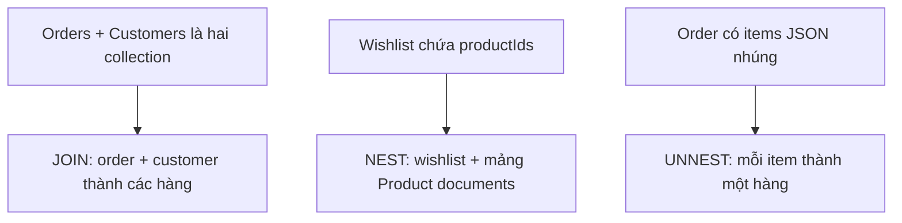

# JOIN, NEST và UNNEST trong truy vấn SQL++ với Spring Data Couchbase

Couchbase lưu dữ liệu dưới dạng document JSON, nhưng SQL++ vẫn cho phép **kết hợp nhiều nguồn dữ liệu** và **truy vấn các cấu trúc lồng nhau**. Ba phép rất dễ bị nhầm là `JOIN`, `NEST` và `UNNEST`. Chúng không chỉ khác tên: **hình dạng kết quả**, **số hàng trung gian**, **đường truy cập dữ liệu** và **cách tối ưu chỉ mục** có thể khác nhau đáng kể.

Để xây dựng tầng truy cập bằng **SPRING_DATA_COUCHBASE**, người học cần hiểu lựa chọn nào phù hợp khi repository xử lý một đơn hàng có dòng hàng nhúng, một đơn hàng tham chiếu khách hàng bằng document ID, hoặc một danh sách yêu thích chứa ID của nhiều sản phẩm. Một câu SQL++ đúng cú pháp nhưng dùng sai phép kết hợp có thể trả quá nhiều hàng, làm biến mất document không có quan hệ, nhân bản bản ghi khi phân trang hoặc tạo gánh nặng lớn cho Query Service.

Bài thuộc chương **Quan hệ và JOIN**. Các ví dụ áp dụng cùng tư duy cho repository, `CouchbaseTemplate` hoặc Java SDK, đồng thời đặt truy vấn trong bối cảnh bucket/scope/collection, GSI, TTL, CAS, giao dịch, scan consistency và API reactive. Nội dung diễn giải những khả năng SQL++ phổ biến trong Couchbase hiện đại; **cú pháp, tên operator trong `EXPLAIN` và tùy chọn tối ưu cụ thể cần đối chiếu phiên bản Couchbase/Spring Data đang dùng**.

## 1. Mục tiêu học tập

Sau bài này, bạn có thể:

1. Diễn giải đúng ngữ nghĩa và hình dạng kết quả của `JOIN`, `NEST` và `UNNEST`.
2. Phân biệt **lookup join/nest theo document ID** qua `ON KEYS` với **ANSI join theo điều kiện** qua `ON`.
3. Hiểu sự khác biệt giữa `INNER` và `LEFT OUTER` khi dữ liệu liên quan vắng mặt.
4. Tránh bẫy `LIMIT`, `ORDER BY`, `WHERE` và lọc phía phải làm đổi cardinality hoặc ngữ nghĩa outer join.
5. Lập index theo từng keyspace cho phần scan của truy vấn, dùng `EXPLAIN` và Query Profile để xác định nguồn chi phí.
6. Đưa SQL++ vào Spring Data Couchbase mà không nhầm entity mapping với khả năng tự tải quan hệ của ORM.
7. Lựa chọn KV lookup, `JOIN`, `NEST`, `UNNEST` hoặc read model theo workload thực tế.

## 2. Chuẩn bị mô hình dữ liệu: ba tình huống quan hệ

Trong bucket `commerce` có các collection:

```text
commerce
├── sales
│   └── orders                 # Đơn hàng, items được nhúng
├── crm
│   └── customers              # Khách hàng độc lập
└── catalog
    ├── products               # Sản phẩm độc lập
    └── wishlists              # Danh sách productIds
```

### 2.1. Đơn hàng: tham chiếu Customer, nhúng Items

ID `order::1001` tại `commerce.sales.orders`:

```json
{
  "_class": "salesOrder",
  "tenantId": "TENANT-A",
  "customerId": "customer::C-42",
  "status": "PAID",
  "createdAt": "2026-11-20T08:15:00Z",
  "total": 1500000,
  "items": [
    {
      "lineId": "L1",
      "productId": "product::SKU-42",
      "sku": "SKU-42",
      "quantity": 2,
      "unitPriceAtPurchase": 350000
    },
    {
      "lineId": "L2",
      "productId": "product::SKU-18",
      "sku": "SKU-18",
      "quantity": 1,
      "unitPriceAtPurchase": 800000
    }
  ]
}
```

Order có một **ID tham chiếu** đến Customer, đồng thời có `items` là **mảng object ngay trong cùng document**. `unitPriceAtPurchase` là giá đã chốt của đơn, không nên luôn thay bằng giá hiện hành từ catalog.

### 2.2. Customer: một document độc lập

ID `customer::C-42` tại `commerce.crm.customers`:

```json
{
  "_class": "customer",
  "tenantId": "TENANT-A",
  "displayName": "Nguyen An",
  "email": "an@example.test",
  "customerCode": "C-42"
}
```

Khi order cần tên khách hiện hành, ứng dụng có thể **đọc Customer bằng KV**, hoặc dùng **SQL++ `JOIN ... ON KEYS`** để lấy cùng với danh sách order. Vì order đã lưu đúng document ID của Customer, không cần dò customer bằng email.

### 2.3. Wishlist: mảng ID tham chiếu sang Product

ID `wishlist::W-9` tại `commerce.catalog.wishlists`:

```json
{
  "_class": "wishlist",
  "tenantId": "TENANT-A",
  "ownerUserId": "user::U-9",
  "productIds": [
    "product::SKU-42",
    "product::SKU-18"
  ]
}
```

Hai document ở `commerce.catalog.products`:

```json
{
  "_class": "product",
  "tenantId": "TENANT-A",
  "sku": "SKU-42",
  "name": "Binh giu nhiet",
  "currentPrice": 390000,
  "status": "ACTIVE"
}
```

```json
{
  "_class": "product",
  "tenantId": "TENANT-A",
  "sku": "SKU-18",
  "name": "Balo du lich",
  "currentPrice": 800000,
  "status": "ACTIVE"
}
```

Wishlist **không nhúng Product JSON**: nó lưu một mảng **document ID của các Product độc lập**. Đây là trường hợp hữu ích để minh họa `NEST ... ON KEYS`: một Wishlist được kết hợp với các Product phù hợp rồi trả về **mảng**.

## 3. Phân biệt nhanh ba phép qua hình dạng kết quả

| Phép | Nguồn dữ liệu | Hình dạng kết quả điển hình | Cardinality cần chú ý |
| --- | --- | --- | --- |
| `JOIN` | Hai nguồn/document sets | **Một hàng cho mỗi cặp khớp** | Một bên trái khớp nhiều bên phải thì sinh nhiều hàng |
| `NEST` | Hai nguồn/document sets | **Một hàng cho mỗi bên trái**, bên phải được gom thành **mảng** | Số document khớp quyết định độ dài mảng, không số hàng cha |
| `UNNEST` | Một nguồn với mảng nằm trong từng hàng | **Một hàng cho mỗi phần tử mảng** | Một document cha có N phần tử có thể sinh N hàng |

Ba phép cùng có thể phục vụ một yêu cầu “đọc dữ liệu liên quan”, nhưng hợp đồng trả về khác nhau.



**Quy tắc thực hành:** Trước khi chọn toán tử, hãy vẽ kết quả JSON bạn muốn trả cho API. Nếu muốn **20 đơn** kèm khách, thường cần giữ đơn vị hàng theo order. Nếu muốn **mỗi dòng hàng** để tổng hợp, cần mở mảng. Nếu muốn **một wishlist** cùng một mảng Product, một kết quả dạng nested sẽ tự nhiên hơn việc nhận nhiều hàng rồi nhóm lại trong Java.

## 4. `JOIN`: kết hợp các hàng từ hai nguồn

### 4.1. Lookup `JOIN ... ON KEYS` theo document ID

Truy vấn lấy Order cùng tên Customer:

```sql
SELECT META(o).id AS orderId,
       o.status,
       o.createdAt,
       META(c).id AS customerId,
       c.displayName AS customerName
FROM `commerce`.`sales`.`orders` AS o
JOIN `commerce`.`crm`.`customers` AS c
  ON KEYS o.customerId
WHERE o.tenantId = "TENANT-A"
  AND c.tenantId = o.tenantId
ORDER BY o.createdAt DESC
LIMIT 20;
```

Điểm cần đọc:

- `o` là alias bên trái; `c` là alias bên phải.
- `ON KEYS o.customerId` dùng **giá trị ID ở Order** để tìm document Customer tương ứng.
- `META(c).id` là document ID của Customer; nó khác field thường như `customerCode`.
- `c.tenantId = o.tenantId` cho thấy dữ liệu hai phía cần thuộc cùng tenant theo quy tắc nghiệp vụ.
- `JOIN` mặc định là inner join trong dạng ví dụ: Order không có Customer phù hợp có thể không xuất hiện.

**Không phải mọi `JOIN` đều cần index trên khóa Customer.** Khi dùng lookup join theo document ID, phía Customer có thể được truy cập bằng cơ chế key lookup. Phía Order vẫn cần **đường quét phù hợp** để tìm những Order thỏa `tenantId`, `ORDER BY` và `LIMIT`.

### 4.2. Hình dạng kết quả của `JOIN`

Một hàng kết quả có thể là:

```json
{
  "orderId": "order::1001",
  "status": "PAID",
  "createdAt": "2026-11-20T08:15:00Z",
  "customerId": "customer::C-42",
  "customerName": "Nguyen An"
}
```

Nếu phía trái có 20 Order và mỗi Order trỏ đúng một Customer, ta thường nhận tối đa 20 hàng khớp (trước các điều kiện/bước khác). Nếu mỗi Order có thể kết hợp nhiều document phía phải, `JOIN` có thể **nhân số hàng**.

Không suy rằng `JOIN` tự áp dụng unique constraint: nếu dùng join theo field không duy nhất, một Order có thể xuất hiện nhiều lần.

### 4.3. `INNER JOIN` và `LEFT JOIN`

**Inner join** chỉ giữ các cặp có match. Với Order tham chiếu Customer đã bị xóa, bản ghi Order đó có thể biến mất khỏi kết quả.

Để vẫn giữ Order và dùng tên đã chụp khi mua:

```sql
SELECT META(o).id AS orderId,
       o.customerNameAtPurchase,
       c.displayName AS currentCustomerName
FROM `commerce`.`sales`.`orders` AS o
LEFT JOIN `commerce`.`crm`.`customers` AS c
  ON KEYS o.customerId
WHERE o.tenantId = "TENANT-A"
ORDER BY o.createdAt DESC
LIMIT 20;
```

Khi không có Customer, các field phía `c` có thể là `MISSING` hoặc không xuất hiện trong object kết quả tùy projection và ngữ nghĩa SQL++. Phải thiết kế fallback ở SQL++/service và kiểm thử **reference không tồn tại**, không giả định object `c` luôn có đủ trường.

**Bẫy phổ biến:** Nếu thêm `AND c.tenantId = o.tenantId` vào `WHERE` của `LEFT JOIN`, các Order không join được thường sẽ bị loại do điều kiện trên phía `c` không thỏa. Khi cần vừa giữ Order vừa kiểm soát tenant, phải thiết kế predicate/validation cẩn thận; không lấy các field Customer từ tenant khác chỉ vì ID được lưu trong Order.

### 4.4. `JOIN ... ON` theo thuộc tính: ANSI JOIN

Khi khóa liên kết **không phải document ID**, dùng điều kiện `ON` theo field:

```sql
SELECT META(o).id AS orderId,
       c.displayName,
       c.customerCode
FROM `commerce`.`sales`.`orders` AS o
JOIN `commerce`.`crm`.`customers` AS c
  ON o.customerCode = c.customerCode
 AND o.tenantId = c.tenantId
WHERE o.tenantId = "TENANT-A";
```

Đoạn này minh họa một schema **khác** với mẫu chỉ lưu `customerId`: ở đây Order cần có thêm `customerCode`. Nếu business key `customerCode` không duy nhất trong tenant, một Order có thể join nhiều Customer. Phải kiểm soát tính duy nhất ở nghiệp vụ/dữ liệu, không coi index thường là unique constraint.

Khác lookup `ON KEYS`, join theo field có thể cần secondary index thích hợp ở phía `customers`:

```sql
CREATE INDEX ix_customers_by_tenant_code
ON `commerce`.`crm`.`customers`(
    `tenantId`,
    `customerCode`
);
```

Query Service vẫn quyết định kế hoạch join/scan theo dữ liệu và thống kê; index được tạo không đồng nghĩa optimizer bắt buộc chọn nó.

### 4.5. Không nhầm `JOIN` với yêu cầu tải thêm dữ liệu khi đã biết ID

Nếu API cần **một** Order cụ thể:

```text
KV GET order::1001
    -> đọc order.customerId
    -> KV GET customer::C-42
    -> kết hợp DTO trong service
```

có thể đơn giản hơn SQL++ Join, nhất là khi truy vấn chỉ bằng ID. Nhưng khi cần trang danh sách Order kèm Customer, làm một `findById(customerId)` cho từng Order có thể dẫn tới N+1 KV reads. Khi đó, SQL++ `JOIN`, bulk read hoặc read model đều là ứng viên cần benchmark.

## 5. `NEST`: gom nhiều document liên quan thành mảng

### 5.1. Vấn đề: Wishlist có một mảng ID tham chiếu Product

Wishlist `wishlist::W-9` chứa:

```json
{
  "productIds": [
    "product::SKU-42",
    "product::SKU-18"
  ]
}
```

Nếu dùng một phép join tạo hàng cho mỗi Product, Java có thể phải nhóm lại các hàng theo wishlist. `NEST` diễn đạt trực tiếp yêu cầu: **một Wishlist cùng một mảng Product documents đã tìm được**.

### 5.2. Lookup `NEST ... ON KEYS`

```sql
SELECT META(w).id AS wishlistId,
       w.ownerUserId,
       p AS products
FROM `commerce`.`catalog`.`wishlists` AS w
NEST `commerce`.`catalog`.`products` AS p
  ON KEYS w.productIds
WHERE w.tenantId = "TENANT-A"
  AND META(w).id = "wishlist::W-9";
```

Ở ví dụ này:

- `w.productIds` là **mảng document ID**; `ON KEYS` cho biết các khóa Product cần tra.
- Kết quả của alias `p` trong phép `NEST` là **mảng các Product phù hợp** với mỗi Wishlist.
- Phép `NEST` không nhúng dữ liệu vật lý trở lại document Wishlist; nó chỉ **định hình kết quả của truy vấn**.
- Khi một Product không tồn tại, kết quả không tự tạo ra Product thay thế; ứng dụng cần chính sách với reference thiếu.

Một kết quả minh họa:

```json
{
  "wishlistId": "wishlist::W-9",
  "ownerUserId": "user::U-9",
  "products": [
    {
      "_class": "product",
      "tenantId": "TENANT-A",
      "sku": "SKU-42",
      "name": "Binh giu nhiet",
      "currentPrice": 390000,
      "status": "ACTIVE"
    },
    {
      "_class": "product",
      "tenantId": "TENANT-A",
      "sku": "SKU-18",
      "name": "Balo du lich",
      "currentPrice": 800000,
      "status": "ACTIVE"
    }
  ]
}
```

Ví dụ chỉ minh họa **cấu trúc mong muốn**; thứ tự phần tử Product trong mảng `NEST` không nên được coi là bảo đảm trùng thứ tự `productIds` nếu query không cung cấp cơ chế sắp xếp rõ ràng. Kiểm tra cả quy tắc xử lý ID trùng và ID không tồn tại trong môi trường/phiên bản thực tế.

### 5.3. `NEST` khác `JOIN` trên cùng bộ khóa

Thử phép `JOIN` trên mảng ID:

```sql
SELECT META(w).id AS wishlistId,
       META(p).id AS productId,
       p.name AS productName
FROM `commerce`.`catalog`.`wishlists` AS w
JOIN `commerce`.`catalog`.`products` AS p
  ON KEYS w.productIds
WHERE META(w).id = "wishlist::W-9";
```

Kết quả có thể có **nhiều hàng cho một Wishlist** — mỗi Product khớp tạo một hàng. Trong khi đó, `NEST` giữ một hàng Wishlist và đưa các Product khớp vào mảng.

| Phép | Ví dụ kết quả cho Wishlist W-9 |
| --- | --- |
| `JOIN` | Hàng 1: W-9, Product SKU-42; hàng 2: W-9, Product SKU-18 |
| `NEST` | Một hàng W-9, `products: [SKU-42, SKU-18]` |

Sự khác nhau là **hình dạng kết quả**, không phải giả định NEST sẽ luôn nhanh hơn JOIN. Phải đo số document tham gia, số byte được trả và chi phí tập hợp dữ liệu trong Query Service.

### 5.4. `LEFT NEST` và danh sách không có Product khớp

`NEST` theo dạng inner có thể không trả Wishlist khi không có Product nào khớp. Nếu cần **giữ Wishlist dù chưa có Product**, có thể dùng:

```sql
SELECT META(w).id AS wishlistId,
       p AS products
FROM `commerce`.`catalog`.`wishlists` AS w
LEFT NEST `commerce`.`catalog`.`products` AS p
  ON KEYS w.productIds
WHERE META(w).id = "wishlist::W-9";
```

Đây là **left outer nest**: giữ bản ghi bên trái và biểu diễn bên phải dưới dạng mảng rỗng/không có phần tử khớp theo kết quả thực tế của phiên bản. Phải kiểm thử wishlist có `productIds: []`, không có field `productIds`, có ID không tồn tại hoặc có nhiều ID.

Đừng tự thêm một `WHERE p.status = "ACTIVE"` mà chưa kiểm tra ngữ nghĩa outer nest. Alias `p` là **mảng**, không phải một Product đơn lẻ như trong `JOIN`. Muốn lọc từng Product trong mảng kết quả, cần chọn biểu thức xử lý mảng hoặc thiết kế truy vấn đáp ứng đúng yêu cầu.

### 5.5. NEST không thay thế phân trang quan hệ lớn

Một Wishlist có 10 Product có thể phù hợp để NEST toàn bộ. Nhưng nếu một tài nguyên chứa **100.000 ID tham chiếu** và API chỉ cần 20 Product, trả toàn bộ mảng bằng NEST là tốn tài nguyên và làm response lớn.

Khi quan hệ tăng không giới hạn và cần phân trang, cân nhắc collection liên kết:

```text
catalog.wishlist_items:
  { wishlistId, productId, addedAt, position }
```

Truy vấn trang `wishlist_items` theo `wishlistId`/`addedAt` với index phù hợp, sau đó lấy Product theo ID cho 20 mục. Một NEST lớn không phải cách giải quyết mọi quan hệ 1:N hoặc N:M.

## 6. `UNNEST`: trải mảng nằm trong document thành nhiều hàng

### 6.1. Mảng `items` đã được nhúng, không có collection Items

Order `order::1001` chứa hai item. Nếu cần một hàng cho từng item:

```sql
SELECT META(o).id AS orderId,
       o.status,
       i.lineId,
       i.sku,
       i.quantity,
       i.unitPriceAtPurchase
FROM `commerce`.`sales`.`orders` AS o
UNNEST o.items AS i
WHERE o.tenantId = "TENANT-A";
```

`UNNEST` lấy mỗi phần tử `o.items` và gắn alias `i`. Nếu Order có hai item, phép này có thể tạo **hai hàng** từ Order đó.

Khác `NEST`, `UNNEST` **không truy cập sang Product collection** chỉ vì mỗi item có `productId`. Nó xử lý mảng JSON đã nằm ngay trong Order.

### 6.2. Phân biệt `UNNEST` với `ANY ... SATISFIES`

Hai câu hỏi nghiệp vụ khác nhau:

**A — Những Order nào có ít nhất một item SKU-42?**

```sql
SELECT META(o).id AS orderId
FROM `commerce`.`sales`.`orders` AS o
WHERE o.tenantId = "TENANT-A"
  AND ANY i IN o.items
      SATISFIES i.sku = "SKU-42"
      END;
```

**B — Những dòng hàng SKU-42 cụ thể thuộc các Order nào?**

```sql
SELECT META(o).id AS orderId,
       i.lineId,
       i.sku,
       i.quantity
FROM `commerce`.`sales`.`orders` AS o
UNNEST o.items AS i
WHERE o.tenantId = "TENANT-A"
  AND i.sku = "SKU-42";
```

Nếu một Order có hai dòng cùng SKU-42:

- Query A chọn **Order** một lần vì điều kiện tồn tại đã đúng.
- Query B có thể trả **hai hàng Item** vì cả hai phần tử đều khớp.

**`ANY` là điều kiện trên parent document; `UNNEST` thay đổi cấp dữ liệu của kết quả.** Không tự thay câu A bằng câu B nếu API yêu cầu danh sách Order phân biệt.

### 6.3. `LEFT UNNEST` với mảng rỗng hoặc thiếu

Inner `UNNEST` có thể loại document cha không có phần tử để mở. Khi muốn giữ cả Order chưa có item:

```sql
SELECT META(o).id AS orderId,
       o.status,
       i.sku AS itemSku
FROM `commerce`.`sales`.`orders` AS o
LEFT UNNEST o.items AS i
WHERE o.tenantId = "TENANT-A";
```

Lúc Order có `items: []` hoặc không có `items`, left outer unnest giữ parent với phần dữ liệu item vắng hoặc `MISSING` theo ngữ nghĩa biểu thức. Khi ánh xạ kết quả sang DTO, xử lý item không tồn tại; không coi mọi hàng đều có `i.sku`.

Giống outer join, một bộ lọc `WHERE i.sku = "SKU-42"` có thể loại những Order không có item, làm mất mục đích giữ parent. Nếu muốn giữ cả Order rỗng nhưng chỉ chọn SKU-42 cho Order có item, cần thiết kế lại điều kiện hoặc cách tách luồng kết quả, không chèn bộ lọc một cách máy móc.

### 6.4. Hai tầng `UNNEST` làm tăng số hàng trung gian

Giả sử Order lưu:

```json
{
  "packages": [
    {
      "packageId": "P1",
      "lines": [
        { "sku": "SKU-42", "quantity": 2 },
        { "sku": "SKU-18", "quantity": 1 }
      ]
    },
    {
      "packageId": "P2",
      "lines": [
        { "sku": "SKU-99", "quantity": 1 }
      ]
    }
  ]
}
```

Mở hai cấp:

```sql
SELECT META(o).id AS orderId,
       p.packageId,
       l.sku,
       l.quantity
FROM `commerce`.`sales`.`orders` AS o
UNNEST o.packages AS p
UNNEST p.lines AS l
WHERE o.tenantId = "TENANT-A";
```

Kết quả của ví dụ gồm ba hàng line cho một Order, không phải hai package hoặc một Order. Nếu các mảng rất lớn, số hàng trung gian và chi phí sort/aggregate có thể tăng đáng kể. Cần kiểm tra `EXPLAIN` và Query Profile trên dữ liệu thực.

### 6.5. Tập hợp lại sau `UNNEST`

Ví dụ đếm số dòng item của mỗi Order:

```sql
SELECT META(o).id AS orderId,
       COUNT(1) AS lineCount
FROM `commerce`.`sales`.`orders` AS o
UNNEST o.items AS i
WHERE o.tenantId = "TENANT-A"
GROUP BY META(o).id;
```

Lưu ý: Với inner unnest, Order có mảng rỗng **không xuất hiện** trong kết quả nhóm; nếu nghiệp vụ muốn `lineCount = 0` cho tất cả Order, cần một query/biểu thức xử lý parent rỗng phù hợp, chẳng hạn tính kích thước mảng có điều kiện từ document cha. Không suy rằng `COUNT(1)` trên các hàng sau unnest tự tạo nhóm cho dữ liệu không có hàng.

## 7. Bốn tình huống rất dễ nhầm cardinality

### 7.1. `JOIN` theo thuộc tính không duy nhất

Order trỏ Customer bằng `customerCode`, nhưng collection Customers vô tình chứa hai document cùng code. Một Order có thể sinh **hai hàng** sau ANSI JOIN. Truy vấn không tự quyết định Customer nào đúng.

Để tránh sai ngữ nghĩa, cần chọn document ID ổn định hoặc validation/ID quy ước để duy trì uniqueness nghiệp vụ, kiểm tra dữ liệu legacy và xử lý trường hợp trùng.

### 7.2. `NEST` nhóm kết quả nhưng không sửa dữ liệu nguồn

Wishlist NEST hai Product trả một hàng chứa mảng Product. Nó không làm Wishlist lưu Product JSON mới trong Couchbase. Khi Product đổi `currentPrice`, một lần chạy NEST mới có thể trả giá hiện hành theo mức nhất quán/độ mới dữ liệu được sử dụng; wishlist vẫn chỉ chứa ID.

### 7.3. `UNNEST` với `LIMIT`

Truy vấn:

```sql
SELECT META(o).id AS orderId, i.sku
FROM `commerce`.`sales`.`orders` AS o
UNNEST o.items AS i
WHERE o.tenantId = "TENANT-A"
LIMIT 20;
```

giới hạn **20 hàng Item sau khi mở mảng**, không phải 20 Order. Một Order có 20 item có thể lấp đầy trang. Nếu UI cần “20 Order gần nhất kèm các Item”, phải chọn/phân trang **20 Order** rồi mới tải/mở mảng tương ứng.

### 7.4. `LEFT JOIN` rồi lọc phía phải trong `WHERE`

`LEFT JOIN` giữ Order không có Customer. Nhưng nếu dùng `WHERE c.status = "ACTIVE"`, các Order thiếu Customer thường bị loại. Đây là lỗi ngữ nghĩa, không phải lỗi chỉ mục. Khi muốn giữ cả Order trong mọi trường hợp, cần thiết kế predicate, fallback và projection tương thích với kết quả vắng phía phải.

## 8. Chỉ mục cho `JOIN`: phân biệt phía scan và phía lookup

### 8.1. Lookup `ON KEYS` có khóa phía phải

Ví dụ Order→Customer theo ID:

```sql
SELECT META(o).id AS orderId, c.displayName
FROM `commerce`.`sales`.`orders` AS o
JOIN `commerce`.`crm`.`customers` AS c
  ON KEYS o.customerId
WHERE o.tenantId = "TENANT-A"
  AND o.status = "PAID"
ORDER BY o.createdAt DESC
LIMIT 20;
```

Index ứng viên cho **phía Orders**:

```sql
CREATE INDEX ix_orders_tenant_status_created
ON `commerce`.`sales`.`orders`(
    `tenantId`,
    `status`,
    `createdAt` DESC
);
```

Vì phía Customer được định danh bằng `customerId` tương ứng document ID, không cần tạo một GSI theo `META(c).id` chỉ để thực hiện lookup. Tuy nhiên, nếu query khác tìm Customer theo email/code, nó có thể cần GSI trên `customers` cho mẫu truy vấn đó.

### 8.2. ANSI JOIN cần xem index theo field

Nếu dùng `o.customerCode = c.customerCode` và lọc tenant, index ứng viên trên Customer:

```sql
CREATE INDEX ix_customers_tenant_code
ON `commerce`.`crm`.`customers`(
    `tenantId`, `customerCode`
);
```

Trên Order, một index khác có thể phục vụ `WHERE tenantId = ? AND status = ?`. Kế hoạch có thể sử dụng nhiều kiểu join/scan tùy optimizer, thống kê và phiên bản; không cố gán mọi ANSI JOIN vào một thuật toán cố định.

### 8.3. Số hàng phía trái quyết định lượng lookup bên phải

Ngay cả khi key lookup mỗi Customer tương đối rẻ, bắt đầu từ 500.000 Order rồi join Customer cho từng Order vẫn có thể tốn nhiều tài nguyên. Đặt predicate chọn lọc ở nơi hiệu quả, kiểm tra index spans và projection; không cho rằng “`ON KEYS` là KV nên query luôn rẻ”.

Nếu trang chỉ cần 20 Order, xem kế hoạch đẩy `LIMIT`/`ORDER BY` như thế nào. Không tự chuyển thứ tự hoạt động trong đầu người đọc thành bảo đảm của optimizer: cần `EXPLAIN` và Query Profile thực tế.

## 9. Chỉ mục cho `UNNEST` và truy vấn mảng

### 9.1. `ANY` và array index

Với query tìm **Order có ít nhất một SKU**:

```sql
SELECT META(o).id AS orderId
FROM `commerce`.`sales`.`orders` AS o
WHERE o.tenantId = "TENANT-A"
  AND ANY i IN o.items
      SATISFIES i.sku = "SKU-42"
      END;
```

Index ứng viên:

```sql
CREATE INDEX ix_orders_tenant_item_sku
ON `commerce`.`sales`.`orders`(
    `tenantId`,
    DISTINCT ARRAY i.sku FOR i IN items END
);
```

`DISTINCT ARRAY` phục vụ những mẫu tìm tồn tại phù hợp trong nhiều trường hợp. Tính sử dụng được phụ thuộc sự tương thích giữa **biểu thức array index** và **biểu thức truy vấn**; phải xác minh bằng `EXPLAIN`.

### 9.2. `UNNEST` và `ALL ARRAY`

Nếu cần từng **hàng Item** có SKU phù hợp:

```sql
SELECT META(o).id AS orderId, i.lineId, i.sku
FROM `commerce`.`sales`.`orders` AS o
UNNEST o.items AS i
WHERE o.tenantId = "TENANT-A"
  AND i.sku = "SKU-42";
```

Một index thử nghiệm:

```sql
CREATE INDEX ix_orders_tenant_all_item_sku
ON `commerce`.`sales`.`orders`(
    `tenantId`,
    ALL ARRAY i.sku FOR i IN items END
);
```

`ALL ARRAY` có thể phù hợp hơn với các mẫu truy vấn cần bảo tồn nhiều lần xuất hiện phần tử, đặc biệt với `UNNEST`; không giả định mọi index `DISTINCT ARRAY` đều hỗ trợ mọi dạng unnest. Tùy biểu thức và phiên bản Couchbase, khả năng pushdown/scan có thể khác nhau; cần chạy `EXPLAIN` và benchmark.

Một array index có thể lưu nhiều entry tương ứng những phần tử được trích từ mỗi document, nên dung lượng và chi phí duy trì khi sửa `items` có thể tăng. Không thêm array index cho một endpoint ít dùng mà chưa đánh giá chi phí viết dữ liệu.

### 9.3. `NEST` theo document IDs không cần array index trên Product chỉ để tra ID

`NEST products p ON KEYS w.productIds` dựa trên danh sách **document ID của phía Product**. Trong lookup nest dạng này, phía Product thường được tra theo key. Nếu dùng **ANSI NEST** theo thuộc tính thay vì document ID trong phiên bản hỗ trợ, cần đánh giá index của phía được kết hợp và kế hoạch thực thi như với các join theo field.

Phía Wishlist vẫn cần được lấy bằng ID hoặc lọc theo field. Nếu truy vấn:

```sql
SELECT META(w).id AS wishlistId, p AS products
FROM `commerce`.`catalog`.`wishlists` AS w
LEFT NEST `commerce`.`catalog`.`products` AS p
  ON KEYS w.productIds
WHERE w.tenantId = "TENANT-A"
  AND w.ownerUserId = "user::U-9";
```

thì một index `(tenantId, ownerUserId)` **trên collection wishlists** có thể hữu ích:

```sql
CREATE INDEX ix_wishlists_tenant_owner
ON `commerce`.`catalog`.`wishlists`(
    `tenantId`, `ownerUserId`
);
```

Một index trên `wishlists` không tự áp dụng cho `products`, dù hai collection cùng scope.

## 10. Đọc `EXPLAIN`: xác minh loại phép và số công việc

`EXPLAIN` mô tả kế hoạch Query Service dự định dùng; Query Profile/metrics mới cho biết số entry và thời gian thực tế. Với các truy vấn có `JOIN`, `NEST` hoặc `UNNEST`, chú ý:

| Dấu hiệu trong plan | Điều cần xác minh |
| --- | --- |
| `IndexScan`/`IndexScan3` | Scan trên collection nào, index gì, khóa phù hợp không? |
| `spans` | Predicate theo tenant/status/orderId có thu hẹp dải scan không? |
| `Fetch` | Có phải lấy document gốc hoặc object lớn không? |
| Toán tử Join/Lookup Join | Hai nguồn được kết hợp theo key hay field, fan-out thế nào? |
| Toán tử Nest | Bên phải được gom thành mảng ở đâu, mảng có thể lớn đến mức nào? |
| `Unnest` | Một document sinh bao nhiêu hàng phần tử? |
| `Filter` | Điều kiện nào chưa được áp dụng trước khi tạo nhiều hàng? |
| `Order` và `Limit` | Sort/limit trên document cha hay sau khi tạo nhiều hàng? |
| `Group`/`Distinct` | Có phải gom/loại trùng để khôi phục đơn vị document cha không? |

Tên operator và cách tổ chức JSON khác nhau theo phiên bản Couchbase. Không khẳng định cứ viết `JOIN` sẽ có một tên operator duy nhất.

### 10.1. `EXPLAIN` cho key join

```sql
EXPLAIN
SELECT META(o).id AS orderId, c.displayName
FROM `commerce`.`sales`.`orders` AS o
JOIN `commerce`.`crm`.`customers` AS c
  ON KEYS o.customerId
WHERE o.tenantId = "TENANT-A"
  AND o.status = "PAID"
LIMIT 20;
```

Hỏi: đã hạn chế Order đủ hẹp chưa? Bên Customer có lookup đúng ID không? Có Order nào bị mất vì Customer thiếu không? Kế hoạch có phải lấy toàn bộ entity để phục vụ projection không?

### 10.2. `EXPLAIN` cho nest

```sql
EXPLAIN
SELECT META(w).id AS wishlistId, p AS products
FROM `commerce`.`catalog`.`wishlists` AS w
LEFT NEST `commerce`.`catalog`.`products` AS p
  ON KEYS w.productIds
WHERE w.tenantId = "TENANT-A";
```

Hỏi: có bao nhiêu Wishlist ở phía trái? Mỗi Wishlist tham chiếu bao nhiêu Product? Product nào thiếu? Nếu trả toàn Product object, response/memory có quá lớn không?

### 10.3. `EXPLAIN` cho unnest

```sql
EXPLAIN
SELECT META(o).id AS orderId, i.sku, i.quantity
FROM `commerce`.`sales`.`orders` AS o
UNNEST o.items AS i
WHERE o.tenantId = "TENANT-A"
  AND i.sku = "SKU-42";
```

Hỏi: optimizer có sử dụng array index phù hợp không? Số hàng sau unnest lớn hơn số Order ban đầu bao nhiêu? Query có cần `Fetch` cả document để mở mảng không?

### 10.4. Một plan nhanh chưa bảo đảm kết quả đúng

Một index rất tốt không sửa được:

- `JOIN` làm trùng Order do thuộc tính phía phải không duy nhất.
- `LEFT JOIN` bị vô hiệu hóa bởi predicate ở `WHERE`.
- `UNNEST` làm trang “20 đơn” thành “20 item”.
- `NEST` trả mảng Product hiện tại trong khi nghiệp vụ cần **snapshot giá tại thời điểm mua**.

Đánh giá **đúng ngữ nghĩa trước**, tối ưu thứ hai; dùng cả kiểm thử dữ liệu thiếu, mảng rỗng, ID lặp, tenant khác và phân bố lớn/nhỏ.

## 11. Spring Data Couchbase không phải ORM tự tải mọi quan hệ

### 11.1. Entity Order với field nhúng và field tham chiếu

```java
import java.time.Instant;
import java.util.List;
import org.springframework.data.annotation.Id;
import org.springframework.data.annotation.TypeAlias;
import org.springframework.data.annotation.Version;
import org.springframework.data.couchbase.core.mapping.Document;
import org.springframework.data.couchbase.core.mapping.Scope;
import org.springframework.data.couchbase.core.mapping.Collection;

@Document
@TypeAlias("salesOrder")
@Scope("sales")
@Collection("orders")
public class SalesOrder {
    @Id
    private String id;

    @Version
    private Long version;

    private String tenantId;
    private String customerId;
    private String status;
    private Instant createdAt;
    private List<OrderItem> items;

    // Constructor, getters, setters được lược bỏ.
}
```

`OrderItem` là một value object JSON nằm trong `items`:

```java
public class OrderItem {
    private String lineId;
    private String productId;
    private String sku;
    private int quantity;
    private long unitPriceAtPurchase;

    // Constructor, getters, setters được lược bỏ.
}
```

Trong mô hình này:

- `@Id` là khóa document Order; không tạo SQL++ primary index chỉ vì Java có `@Id`.
- `customerId` chỉ là **chuỗi tham chiếu**, không tự tạo foreign-key constraint hoặc tự load Customer.
- `items` được mapping vào **một mảng JSON**, nên muốn trả mỗi item thành hàng trong SQL++ cần `UNNEST`.
- `@Version` hỗ trợ optimistic locking/CAS trong những phiên bản Spring Data Couchbase tương ứng; nó không thay thế xử lý business conflict.

Bucket `commerce` phải được xác định trong cấu hình Couchbase/operations runtime. `@Scope("sales")` và `@Collection("orders")` không tự bảo đảm repository dùng đúng bucket.

### 11.2. Derived repository query chỉ làm việc với hình dạng entity

```java
import java.util.List;
import org.springframework.data.couchbase.repository.CouchbaseRepository;

public interface SalesOrderRepository
        extends CouchbaseRepository<SalesOrder, String> {

    List<SalesOrder> findByTenantIdAndStatus(
        String tenantId, String status
    );
}
```

Method này có thể được Spring Data dịch thành SQL++ theo thuộc tính. Nó **không tự JOIN Customer** để lấy `displayName` và cũng không chuyển `items` thành các hàng riêng. Nếu endpoint muốn DTO kết hợp nhiều nguồn, có thể dùng một SQL++ tường minh qua SDK/`CouchbaseTemplate` hoặc query tùy chỉnh và ánh xạ kết quả.

### 11.3. `@Query` dùng cho một entity khác SQL++ kết hợp

Một method trả entity:

```java
import java.util.List;
import org.springframework.data.couchbase.repository.Query;

public interface SalesOrderRepository
        extends CouchbaseRepository<SalesOrder, String> {

    @Query("#{#n1ql.selectEntity} WHERE #{#n1ql.filter} " +
           "AND tenantId = $1 AND status = $2")
    List<SalesOrder> findOrders(String tenantId, String status);
}
```

Các macro `#{#n1ql.selectEntity}` và `#{#n1ql.filter}` hỗ trợ chọn document và bộ lọc kiểu entity. Chúng không tự định nghĩa phép JOIN/NEST và không bảo đảm một projection DTO có cấu trúc tùy ý sẽ map thành `SalesOrder`.

Nếu một `@Query` thực hiện SQL++ kết hợp nhiều nguồn, cần thiết kế `SELECT` alias và kiểu kết quả phù hợp, xác minh khả năng mapping của phiên bản Spring Data đang dùng. Đừng mặc định một row chứa `order + customer + nested products` sẽ tự trở thành object graph Java giống JPA.

### 11.4. Ví dụ truy vấn kết hợp bằng Java SDK

Khi cần chủ động điều khiển SQL++ và DTO, có thể dùng Java SDK 3.x:

```java
import com.couchbase.client.java.Cluster;
import com.couchbase.client.java.json.JsonObject;
import com.couchbase.client.java.query.QueryResult;
import static com.couchbase.client.java.query.QueryOptions.queryOptions;

import java.util.List;

public final class OrderCustomerQuery {
    private final Cluster cluster;

    public OrderCustomerQuery(Cluster cluster) {
        this.cluster = cluster;
    }

    public List<OrderCustomerRow> findByTenant(String tenantId) {
        String statement = """
            SELECT META(o).id AS orderId,
                   o.status AS status,
                   c.displayName AS customerName
            FROM `commerce`.`sales`.`orders` AS o
            LEFT JOIN `commerce`.`crm`.`customers` AS c
              ON KEYS o.customerId
            WHERE o.tenantId = $tenantId
            LIMIT 20
            """;

        QueryResult result = cluster.query(
            statement,
            queryOptions().parameters(
                JsonObject.create().put("tenantId", tenantId)
            )
        );

        return result.rowsAsObject().stream()
            .map(row -> new OrderCustomerRow(
                row.getString("orderId"),
                row.getString("status"),
                row.getString("customerName")
            ))
            .toList();
    }

    public record OrderCustomerRow(
        String orderId,
        String status,
        String customerName
    ) {}
}
```

Đây là ví dụ dịch vụ đọc, sử dụng Java text block/record và Java SDK tương ứng; ở dự án thật phải quản lý lifecycle của bean `Cluster`, timeout, lỗi query, cấu hình consistency, phân quyền và xác nhận tên keyspace. `LEFT JOIN` có thể khiến `customerName` vắng, nên DTO/mapping cần cho phép `null` hoặc fallback được định nghĩa.

Sử dụng **named parameter** thay vì nối trực tiếp giá trị người dùng vào SQL++. Nếu cần query qua `CouchbaseTemplate`, phải chọn API phù hợp với loại projection và phiên bản đang sử dụng; bản chất của SQL++ JOIN/NEST/UNNEST vẫn không thay đổi.

## 12. Chọn operator theo hợp đồng API

| Hợp đồng API | Lựa chọn khởi đầu | Lý do |
| --- | --- | --- |
| Chi tiết một Order đã có ID, trả toàn `items` | KV `findById` | Một document đủ dữ liệu; không cần SQL++ |
| Trang 20 Order kèm tên Customer hiện hành | Lookup `JOIN ... ON KEYS` hoặc KV batch | Mỗi Order có Customer ID, cần projection chung |
| Một Wishlist và tất cả Product đã tham chiếu | `NEST ... ON KEYS` | Trả mảng Product gắn với Wishlist |
| Báo cáo từng Item của các Order | `UNNEST` | Cần một hàng trên mỗi item nhúng |
| Tìm Order có ít nhất một SKU | `ANY ... SATISFIES` | Chỉ cần chọn Order, không cần mở thành hàng item |
| Quan hệ có nhiều triệu thành viên, phân trang | Collection edge/child riêng + index | Không nên NEST hoặc nhúng toàn bộ một mảng vô hạn |
| Tìm Customer theo `customerCode`/email | ANSI `JOIN ... ON` hoặc query riêng với GSI | Không có document ID bên phải |

Kết luận phải dựa trên **số byte và số hàng thực tế**, tần suất gọi, tải ghi và yêu cầu tính nhất quán. Không dùng `NEST` chỉ vì UI muốn mảng nếu tập tham chiếu quá lớn; không dùng `JOIN` cho một object đã nằm ngay trong JSON; không dùng `UNNEST` khi chỉ cần điều kiện tồn tại.

## 13. Phân trang, sắp xếp và kết quả trùng

### 13.1. Phân trang Order trước khi mở Items

Yêu cầu: “20 Order mới nhất của tenant, kèm toàn bộ item”.

Một cách đơn giản là query trang Order bằng index theo `tenantId/createdAt`, lấy document ID rồi đọc chi tiết KV theo ID. Vì `items` đã nhúng, DTO Order chứa sẵn danh sách Item; không cần UNNEST nếu client chấp nhận JSON nested.

Nếu bắt buộc trải item thành các hàng, cần chủ động chọn 20 Order ở một bước trước, rồi `UNNEST` tập Order đó; một `LIMIT` sau `UNNEST` đơn thuần không đủ. Có thể dùng subquery/CTE được phiên bản hỗ trợ hoặc thực hiện hai bước tại service, với sự đánh đổi consistency và số lượt query.

### 13.2. `JOIN` theo thuộc tính có thể sinh trùng

Nếu một Order kết hợp hai Customer do business key trùng, một trang có `LIMIT 20` có thể chỉ chứa 10 Order duy nhất. Dùng `DISTINCT` không tự sửa dữ liệu bị trùng và có thể tăng chi phí; giải pháp gốc là thiết kế khóa và validation đúng.

### 13.3. `NEST` trả mảng nhưng thứ tự bên trong cần định nghĩa riêng

Không giả định thứ tự của mảng Product trả từ `NEST` trùng thứ tự `productIds` lưu trên Wishlist. Nếu UI cần thứ tự thủ công (wishlist rank), cân nhắc collection liên kết có `position` hoặc cơ chế sắp xếp rõ ràng sau khi lấy dữ liệu.

### 13.4. Tie-breaker khi dùng `ORDER BY` và cursor

Nếu nhiều Order có cùng `createdAt`, thứ tự chỉ theo ngày giờ có thể không ổn định. Cursor pagination cần thêm khóa phụ duy nhất và thiết kế index phù hợp. Với `JOIN`/`UNNEST`, khóa phụ phải phản ánh **đơn vị phân trang**: Order ID cho trang Order, Line ID/position cho trang item.

## 14. Tính đúng, nhất quán và vòng đời dữ liệu liên quan

### 14.1. Không có foreign key tự động

Field `customerId` hoặc mảng `productIds` không làm Couchbase tự xác nhận rằng các document đích tồn tại. Do đó:

- `INNER JOIN`/`NEST` có thể không trả bên trái khi không có match.
- `LEFT JOIN`/`LEFT NEST` có thể giữ bên trái nhưng thông tin phía phải vắng/rỗng.
- Ứng dụng cần chính sách khi Customer/Product bị xóa, đổi tenant hoặc hết hạn.

Đối với Order đã thanh toán, giá/tên sản phẩm **tại thời điểm mua** nên được lưu dưới dạng snapshot nếu nghiệp vụ yêu cầu bảo toàn lịch sử; không liên tục đọc `Product.currentPrice` để hiển thị hóa đơn cũ.

### 14.2. TTL không tự xóa mọi reference

Product hết hạn hoặc bị xóa không làm mảng `wishlist.productIds` tự xóa phần tử. Customer bị xóa không tự xóa `order.customerId`. Khi có retention khác nhau giữa các collection, phải định nghĩa cleanup, tombstone, fallback và quyền truy cập với dữ liệu sao chép/đã nhúng.

### 14.3. CAS bảo vệ mutation của từng document

Hai request đồng thời sửa mảng `items` hoặc `productIds` có thể gây ghi đè nếu không kiểm soát. `@Version`/CAS giúp phát hiện phiên bản cũ, nhưng **không tự merge hai thay đổi**. Cần retry có giới hạn và áp dụng lại business rule trên trạng thái mới.

`NEST` hay `UNNEST` là phép đọc/query; chúng không thay thế chiến lược ghi mảng an toàn.

### 14.4. Giao dịch và độ mới của GSI là hai vấn đề khác nhau

Nếu cần thay đổi nhiều document nguyên tử, Couchbase hỗ trợ cơ chế transaction trong phạm vi SDK/phiên bản tương ứng; truy vấn `JOIN` không tự biến các document nguồn thành một aggregate giao dịch.

Global Secondary Index được cập nhật bất đồng bộ so với KV mutation. Query SQL++ sử dụng index có thể tạm chưa thấy dữ liệu vừa ghi ở mức scan consistency không yêu cầu chờ:

| Scan consistency | Hệ quả |
| --- | --- |
| `NOT_BOUNDED` | Có thể thấy dữ liệu index tạm cũ; thường không đợi bắt kịp |
| `REQUEST_PLUS` | Đợi index bắt kịp các mutation liên quan trước query; có thể tăng latency |

Với lookup `ON KEYS`, cần phân biệt **phần scan theo index** ở phía trái và **phần lookup theo key** ở phía phải; một kết quả kết hợp có thể phản ánh các thời điểm cập nhật khác nhau nếu không có đảm bảo snapshot/giao dịch phù hợp. Đừng hứa một câu JOIN thông thường luôn là ảnh chụp nhất quán tuyệt đối của nhiều document.

### 14.5. Đa tenant và quyền truy cập

Một document ID tham chiếu không chứng minh document đích thuộc tenant đang truy cập. Với JOIN/NEST:

1. Giới hạn tập gốc theo tenant từ context đã xác thực.
2. Kiểm tra tenant/quyền của tài nguyên liên quan trước khi trả field nhạy cảm.
3. Cấu hình RBAC trên đúng bucket/scope/collection; không coi index theo `tenantId` là authorization.
4. Không trả toàn Product/Customer JSON nếu UI chỉ cần một vài field.
5. Định nghĩa hành vi khi ID tham chiếu sai, không tồn tại hoặc không có quyền đọc.

Việc thêm `WHERE c.tenantId = o.tenantId` vào `LEFT JOIN` có thể làm mất hàng bên trái; cần kiểm soát bảo mật mà vẫn giữ ngữ nghĩa outer join theo một thiết kế rõ ràng.

## 15. Reactive, fan-out và vấn đề N+1

### 15.1. Reactive không thay đổi ngữ nghĩa SQL++

`ReactiveCouchbaseRepository` và API reactive của Spring Data hoặc SDK cho phép xử lý I/O không đồng bộ. Nhưng `JOIN` vẫn tạo hàng theo cặp, `NEST` vẫn gom mảng, và `UNNEST` vẫn nhân số hàng theo phần tử. Backpressure ở phía Java không khiến Query Service miễn chi phí scan/Fetch/join.

### 15.2. `flatMap(findById)` có thể là N+1 lookup

Một service dùng:

```java
ordersFlux.flatMap(
    order -> customerRepository.findById(order.getCustomerId())
        .map(customer -> new OrderWithCustomer(order, customer)),
    8
);
```

vẫn có thể phát sinh một KV lookup cho mỗi Order. Tham số `8` chỉ minh họa mức giới hạn concurrency, không phải cấu hình tốt nhất cho mọi cụm. Cần cân nhắc:

- Khử trùng lặp Customer ID theo trang.
- KV batch hoặc concurrent lookup có giới hạn.
- SQL++ lookup JOIN nếu cần trả một trang nhiều Order và Customer.
- Read model đã phi chuẩn hóa nếu endpoint cực nóng và chấp nhận độ trễ cập nhật.

Đừng mặc định NEST hoặc JOIN luôn vượt trội hơn KV batch; so sánh latency, số lượt lookup, số hàng/byte trả về và áp lực KV/Query Service.

### 15.3. Kiểm soát fan-out của NEST/UNNEST

Với một Wishlist chứa 100.000 productIds, `NEST` toàn bộ có thể tạo một object kết quả rất lớn. Với một Order chứa 100.000 items, `UNNEST` có thể tạo 100.000 hàng trung gian. Những truy vấn như vậy cần xem lại mô hình dữ liệu: collection liên kết, phân trang và index theo đường đọc có thể bền vững hơn.

## 16. Vận hành trong production: từ DDL đến kiểm thử

Trước khi bổ sung JOIN/NEST/UNNEST cho một API nóng:

1. **Định nghĩa hình dạng kết quả:** một hàng per Order, mảng Product per Wishlist, hay một hàng per Item?
2. **Chọn keyspace chính xác:** mỗi `FROM`, `JOIN` và `NEST` đọc bucket/scope/collection nào?
3. **Lập index theo phần quét:** `WHERE`, `ORDER BY`, `LIMIT` của phía trái, và index join theo field nếu cần.
4. **Kiểm tra bản ghi thiếu:** mảng rỗng, ID không tồn tại, Customer bị xóa, Product inactive và tenant khác.
5. **Chạy `EXPLAIN`:** IndexScan, spans, Fetch, join/nest/unnest, sort và số bước trung gian.
6. **Đo Query Profile:** số entry, số hàng sau join/unnest, latency, memory và timeout trên dữ liệu đại diện.
7. **Kiểm soát triển khai:** tạo/build index trước khi bật code phụ thuộc, đợi `online` và giữ rollback feature/query.
8. **Đo dưới tải thật:** p95/p99, kích thước response, CPU/IO Index Service, write/TTL và scan consistency wait.

Kiểm tra index:

```sql
SELECT name, state, index_key, condition,
       bucket_id, scope_id, keyspace_id
FROM system:indexes
WHERE bucket_id = "commerce"
  AND scope_id = "sales"
  AND keyspace_id = "orders";
```

Index trên `commerce.sales.orders` không tự bao phủ `commerce.crm.customers` hay `commerce.catalog.products`. `JOIN`/`NEST` đa collection không có nghĩa có một index duy nhất “trên cả quan hệ”.

Với nhiều replica Spring Boot, không nên dùng auto-index creation của mỗi instance như một pipeline DDL production không kiểm soát. Nếu Spring Data Couchbase hỗ trợ `@QueryIndexed`, `@CompositeQueryIndex` và `autoIndexCreation()` ở phiên bản đang dùng, cơ chế tự tạo index thuận tiện cho lab/local nhưng không thay thế migration có kiểm thử, chờ build và quyền triển khai tách biệt.

## 17. Các lỗi thường gặp và cách khắc phục

| Triệu chứng | Khả năng nguyên nhân | Cách xác minh |
| --- | --- | --- |
| `JOIN` không trả Order khi Customer bị xóa | Dùng inner join | Thử `LEFT JOIN`, kiểm tra fallback và tenant |
| `LEFT JOIN` vẫn mất Order thiếu Customer | Lọc field `c` trong `WHERE` | Kiểm tra ngữ nghĩa outer join và predicate |
| Một Order lặp nhiều hàng sau join | Join theo field không duy nhất | Kiểm tra dữ liệu phía phải, khóa và điều kiện `ON` |
| `NEST` không trả Wishlist rỗng | Dùng inner nest hoặc không có match | Thử `LEFT NEST` và test `[]`/`MISSING` |
| Product trong `NEST` không theo thứ tự `productIds` | Không có bảo đảm thứ tự mảng join | Xác định/sắp xếp theo thứ tự nghiệp vụ |
| `UNNEST` trả nhiều hàng hơn số Order | Mỗi item sinh một hàng | Chọn `ANY` nếu chỉ cần parent hoặc group có chủ đích |
| Trang 20 Order sau unnest chỉ còn vài Order | `LIMIT` áp trên hàng item | Phân trang ở cấp parent trước |
| `UNNEST` mất các Order có mảng rỗng | Dùng inner unnest | Thử `LEFT UNNEST` và xử lý missing item |
| JOIN theo mã khách chậm | ANSI join không có index lọc thích hợp | `EXPLAIN` phía Order/Customer, thống kê và index |
| NEST Product làm response lớn | Một Wishlist tham chiếu quá nhiều IDs | Đổi sang collection edge và phân trang |
| `@Query` không map thành entity | Projection nhiều nguồn không khớp entity mapping | Dùng DTO/SDK/query mapping rõ ràng |
| Quan hệ vừa ghi không thấy ngay qua SQL++ | GSI chưa bắt kịp mutation | Xem scan consistency; KV theo ID nếu phù hợp |
| Dữ liệu tenant khác lọt qua reference | Tin document ID là kiểm tra quyền | Validation/RBAC/authorization hai phía |
| Mảng Product IDs có trùng hoặc ID chết | Không có FK/cascade tự động | Quy tắc ghi, cleanup và reconciliation |

## 18. Bài thực hành: một dataset, ba hình dạng kết quả

Mục tiêu là tự viết và so sánh `JOIN`, `NEST` và `UNNEST` trên cùng một bộ dữ liệu thực hành. Chỉ thao tác DDL trên môi trường lab được cấp quyền; không gỡ/tạo index production ngoài quy trình đã phê duyệt.

### Bước 1 — Nạp dữ liệu minh họa

Chuẩn bị:

| Collection | ID | Giá trị cần có |
| --- | --- | --- |
| `sales.orders` | `order::1001` | `customerId=customer::C-42`, hai `items` |
| `sales.orders` | `order::1002` | `customerId` không tồn tại, `items=[]` |
| `crm.customers` | `customer::C-42` | `displayName=Nguyen An` |
| `catalog.wishlists` | `wishlist::W-9` | `productIds` chứa hai ID hợp lệ |
| `catalog.wishlists` | `wishlist::W-10` | `productIds=[]` |
| `catalog.products` | `product::SKU-42`, `product::SKU-18` | Hai Product độc lập |

Đặt `tenantId` nhất quán là `TENANT-A`. Với Order 1002, cố ý thiếu Customer để quan sát outer join; dữ liệu này chỉ dùng cho bài lab.

### Bước 2 — So sánh inner `JOIN` và `LEFT JOIN`

```sql
-- Inner: Order thiếu Customer có thể bị loại.
SELECT META(o).id AS orderId, c.displayName
FROM `commerce`.`sales`.`orders` AS o
JOIN `commerce`.`crm`.`customers` AS c
  ON KEYS o.customerId
WHERE o.tenantId = "TENANT-A";

-- Left: giữ Order ở phía trái.
SELECT META(o).id AS orderId, c.displayName
FROM `commerce`.`sales`.`orders` AS o
LEFT JOIN `commerce`.`crm`.`customers` AS c
  ON KEYS o.customerId
WHERE o.tenantId = "TENANT-A";
```

So sánh số hàng, sự hiện diện của `order::1002` và giá trị `displayName` khi không có match. Thử thêm bộ lọc trên `c` ở `WHERE` để thấy khả năng thay đổi ngữ nghĩa outer join.

### Bước 3 — So sánh `JOIN` và `NEST` từ wishlist đến products

```sql
SELECT META(w).id AS wishlistId,
       META(p).id AS productId,
       p.name
FROM `commerce`.`catalog`.`wishlists` AS w
JOIN `commerce`.`catalog`.`products` AS p
  ON KEYS w.productIds
WHERE META(w).id = "wishlist::W-9";

SELECT META(w).id AS wishlistId,
       p AS products
FROM `commerce`.`catalog`.`wishlists` AS w
NEST `commerce`.`catalog`.`products` AS p
  ON KEYS w.productIds
WHERE META(w).id = "wishlist::W-9";
```

Ghi số hàng kết quả của hai truy vấn và hình dạng JSON. Sau đó đổi `NEST` thành `LEFT NEST`, thử với Wishlist W-10 để kiểm tra cách xử lý mảng không có sản phẩm.

### Bước 4 — So sánh `ANY` và `UNNEST` trên Order Items

```sql
SELECT META(o).id AS orderId
FROM `commerce`.`sales`.`orders` AS o
WHERE ANY i IN o.items
      SATISFIES i.sku = "SKU-42"
      END;

SELECT META(o).id AS orderId, i.lineId, i.sku
FROM `commerce`.`sales`.`orders` AS o
UNNEST o.items AS i
WHERE i.sku = "SKU-42";
```

Thêm vào Order 1001 một item thứ ba cùng `SKU-42`. So sánh số Order được chọn với số hàng Item. Thử `LEFT UNNEST` để quan sát Order 1002 có mảng rỗng.

### Bước 5 — Kiểm tra kế hoạch và tài nguyên

Chạy `EXPLAIN` cho ba query đại diện. Xem đúng keyspace và loại toán tử, xác minh IndexScan trên Orders/Wishlists hoặc index array khi thích hợp. Dùng Query Profile nếu môi trường có công cụ phù hợp để đo số hàng sau join/unnest và độ trễ.

Thử tăng số item trong Order hoặc số productIds của Wishlist. Khi kích thước vượt ngưỡng nghiệp vụ đã dự kiến, hãy nêu phương án tách **child/edge collection** thay vì trả mảng khổng lồ.

### Bước 6 — Thiết kế DTO và lỗi reference

Định nghĩa hợp đồng API:

```json
{
  "orderId": "order::1002",
  "status": "OPEN",
  "customerName": null,
  "items": []
}
```

Nêu rõ xử lý customer missing là `null`, snapshot fallback, lỗi hay cảnh báo. Sau đó thiết kế DTO cho Wishlist với `products: []` và cho báo cáo Item dạng nhiều hàng. Đừng để cùng một API lúc trả object đơn, lúc trả array không thống nhất chỉ do thay operator.

### Câu hỏi tự kiểm tra

1. `JOIN`, `NEST` và `UNNEST` khác nhau chủ yếu ở nguồn dữ liệu và hình dạng kết quả thế nào?
2. Vì sao `JOIN ... ON KEYS o.customerId` khác `JOIN ... ON o.customerCode = c.customerCode`?
3. Một Order thiếu Customer sẽ ra sao với inner `JOIN` và `LEFT JOIN`?
4. Vì sao một predicate trên alias bên phải đặt trong `WHERE` có thể làm mất hàng của `LEFT JOIN`?
5. `NEST` trả một mảng Product cho Wishlist nhưng có làm thay đổi JSON Wishlist được lưu không?
6. Với Wishlist chứa một mảng 100.000 ID, vì sao `NEST` không phải lựa chọn lý tưởng cho API phân trang 20 Product?
7. Khi một Order có hai item cùng SKU, `ANY` và `UNNEST` trả số hàng khác nhau thế nào?
8. `LEFT UNNEST` dùng khi nào, và điều gì xảy ra với bộ lọc `WHERE i.sku = ?`?
9. Vì sao `LIMIT 20` sau `UNNEST` không có nghĩa chọn 20 Order?
10. Khi tối ưu `JOIN`, cần index ở phía nào đối với lookup `ON KEYS` và ANSI join theo field?
11. Query Profile cung cấp thông tin gì mà riêng `EXPLAIN` chưa đủ?
12. Tại sao Spring Data repository không tự tải mọi ID tham chiếu như một ORM có lazy association?
13. Vì sao scan consistency và transaction/CAS là các cơ chế giải quyết vấn đề khác nhau?
14. Khi Product/Customer bị xóa, SQL++ có tự cascade xóa reference không?
15. Hãy chọn KV, JOIN, NEST hoặc UNNEST cho màn hình chi tiết một Order, trang Order list, Wishlist và báo cáo từng Item.

## 19. Kết luận

Trong SQL++ của Couchbase, **`JOIN` kết hợp các hàng**, **`NEST` gom document phía phải thành mảng theo từng hàng bên trái**, còn **`UNNEST` trải mảng đang nằm trong một document thành những hàng phần tử**. `ON KEYS` phù hợp khi có document ID tham chiếu; `JOIN ... ON` theo thuộc tính cần kiểm chứng uniqueness, index và kế hoạch riêng.

Khi dùng **Spring Data Couchbase**, đừng bắt đầu bằng câu “phải JOIN vì có hai Java class”. Hãy bắt đầu từ **hợp đồng API**, ranh giới document, số phần tử liên quan và độ mới dữ liệu. Dùng KV khi đã có ID và chỉ cần một aggregate; dùng JOIN khi cần hàng kết hợp; dùng NEST khi kết quả thực sự cần mảng document tham chiếu với cardinality phù hợp; dùng UNNEST khi cần xử lý phần tử JSON nhúng. Sau đó kiểm tra `EXPLAIN`, số hàng thực, quyền tenant, TTL, CAS, giao dịch và scan consistency để đảm bảo truy vấn **đúng ngữ nghĩa, đủ nhanh và có thể vận hành lâu dài**.
