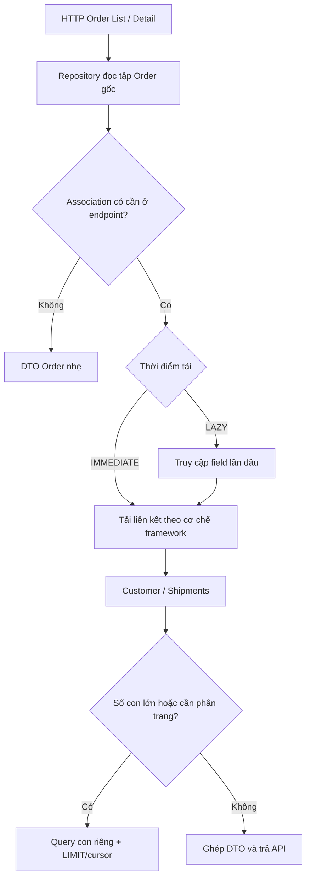

# Phạm vi tải liên kết và các tùy chọn phụ thuộc phiên bản trong Spring Data Couchbase

Một ứng dụng bán hàng có thể cần lấy đơn hàng cùng khách hàng, danh sách lô giao hàng, lịch sử trạng thái và dữ liệu sản phẩm. Trong mô hình document, câu hỏi không chỉ là **có quan hệ gì** mà còn là **khi nào và bằng cách nào tải từng quan hệ**. Tải quá nhiều ngay từ đầu làm API danh sách chậm; trì hoãn mọi liên kết đến lúc truy cập có thể tạo hàng trăm truy vấn bổ sung; còn gắn hint join không tương thích phiên bản có thể làm truy vấn lỗi hoặc không đạt hiệu năng như dự tính.

Với **Spring Data Couchbase**, `@N1qlJoin` cung cấp cách khai báo quan hệ theo trường dữ liệu và điều khiển thời điểm tải qua `FetchType.IMMEDIATE` hoặc `FetchType.LAZY`. Nhưng phạm vi tải liên kết không chỉ nằm ở một enum. Nó còn phụ thuộc vào **phương thức repository**, số entity được đọc, field nào thực sự được truy cập, keyspace đang dùng, quy tắc lọc, tình trạng chỉ mục, phiên bản Couchbase Server/SDK/Spring Data và edition của Couchbase.

Bài thuộc chương **Quan hệ và JOIN** của module **SPRING_DATA_COUCHBASE** — tầng truy cập Couchbase dựa trên document mapping, repository, `CouchbaseTemplate` và SQL++; gắn với bucket/scope/collection, index, TTL, CAS, giao dịch và API reactive để giữ hiệu năng, tính nhất quán và khả năng vận hành.

**Nguyên tắc cốt lõi:** Chọn phạm vi tải nhỏ nhất đáp ứng đúng hợp đồng API, sau đó dùng bằng chứng từ **SQL++ thực, `EXPLAIN`, Query Profile và metrics** thay vì suy đoán chỉ từ tên annotation.

## 1. Mục tiêu học tập

Sau bài này, bạn có thể:

1. Phân biệt **tập entity gốc**, **association được khai báo**, **thời điểm tải**, **độ sâu quan hệ** và **projection trả về**.
2. Sử dụng `@N1qlJoin` với `on`, `where` và `fetchType`, hiểu các alias `lks`/`rks`.
3. So sánh `FetchType.IMMEDIATE` và `FetchType.LAZY` theo số query/round trip, số document và kích thước response, nhận diện N+1.
4. Hiểu phạm vi và giới hạn của các hint `index`, `rightIndex`, `hashside`, `keys` phụ thuộc Couchbase Server/edition và Spring Data.
5. Xác định phiên bản thực tế của Spring Data Couchbase, Java SDK, Couchbase Server, edition và schema trước khi dùng một tùy chọn.
6. Chọn DTO/projection, query tường minh, KV lookup hoặc reactive pipeline khi annotation không đem lại phạm vi tải mong muốn.
7. Kiểm soát quyền tenant, dữ liệu thiếu, CAS, transaction, TTL và scan consistency khi tải nhiều document.
8. Xây dựng bài kiểm chứng compatibility và hiệu năng trước khi nâng phiên bản hoặc rollout production.

## 2. “Phạm vi tải liên kết” thực ra có những chiều nào?

Khi phát biểu “tải Order cùng Customer và Shipments”, ít nhất phải chốt năm chiều:

| Chiều | Câu hỏi bắt buộc | Ví dụ |
| --- | --- | --- |
| **Tập gốc** | Lấy mấy Order? Dựa trên ID hay query? | Một Order theo ID; hoặc 50 Order theo tenant |
| **Quan hệ** | Field nào cần đọc thêm? | Customer; Shipments; hay cả hai |
| **Thời điểm** | Tải ngay khi có Order hay khi code truy cập field? | `IMMEDIATE` hoặc `LAZY` |
| **Độ sâu** | Có tải thêm quan hệ của Customer/Shipment không? | Customer → preferences; Shipment → events |
| **Độ rộng dữ liệu** | Cần toàn entity hay vài field trong DTO? | `customerName` thay vì email/toàn Customer |

Một lựa chọn `LAZY` chỉ tác động **thời điểm tải association**, không tự biến quan hệ 1:N thành truy vấn phân trang, không tự tạo projection nhỏ, và không quyết định những quan hệ sâu hơn có được truy cập hay không.

### 2.1. Một entity gốc không đồng nghĩa một document được đọc

Giả sử:

```java
SalesOrder order = repository.findById("order::1001").orElseThrow();
```

`findById` theo ID thường khởi đầu bằng KV lookup. Nhưng nếu entity được cấu hình tải association theo cơ chế framework hỗ trợ, tổng chi phí truy cập ở tầng mapping/service có thể vượt một lần KV read. Ngược lại, repository query dùng SQL++ để tìm **nhiều** Order có thể tạo một tập gốc lớn và làm chi phí tải các association phình theo số Order.

Không đếm round trip bằng cách nhìn đúng một method call Java.

### 2.2. Phạm vi tải còn là một quyết định nghiệp vụ

Trang **Order List** có thể chỉ cần `orderId`, `status`, `createdAt` và tổng tiền. Trang **Order Detail** cần Customer, địa chỉ giao hàng và 3 Shipment. Trang **Shipment Timeline** cần phân trang 50 sự kiện trong tổng hàng chục nghìn.

Nếu dùng một object graph tải tất cả quan hệ cho cả ba màn hình, API list sẽ chịu chi phí của detail và timeline mà không nhận lợi ích. Cách thiết kế tốt là xác định **read model riêng cho từng loại endpoint**, dù các entity dùng chung storage.

## 3. Dataset xuyên suốt và ranh giới collection

Giả sử bucket `commerce`:

```text
commerce
├── crm
│   └── customers
└── sales
    ├── orders
    ├── shipments
    └── shipment_events
```

Order tại `commerce.sales.orders`, ID `order::TENANT-A::1001`:

```json
{
  "_class": "salesOrder",
  "tenantId": "TENANT-A",
  "orderNumber": "ORD-1001",
  "customerCode": "C-42",
  "status": "PAID",
  "createdAt": "2026-11-20T08:15:00Z",
  "total": 1500000,
  "deleted": false
}
```

Customer tại `commerce.crm.customers`, ID `customer::TENANT-A::42`:

```json
{
  "_class": "customer",
  "tenantId": "TENANT-A",
  "customerCode": "C-42",
  "displayName": "Nguyen An",
  "accountStatus": "ACTIVE"
}
```

Hai Shipment thuộc Order, lưu riêng trong `commerce.sales.shipments`:

```json
{
  "_class": "shipment",
  "tenantId": "TENANT-A",
  "orderNumber": "ORD-1001",
  "trackingNumber": "TRACK-7001",
  "state": "IN_TRANSIT",
  "shippedAt": "2026-11-21T08:00:00Z"
}
```

```json
{
  "_class": "shipment",
  "tenantId": "TENANT-A",
  "orderNumber": "ORD-1001",
  "trackingNumber": "TRACK-7002",
  "state": "PREPARING",
  "shippedAt": null
}
```

Một Shipment có thể có hàng nghìn `shipment_events` với `trackingNumber` hoặc `shipmentId` làm khóa tham chiếu. **Không** mặc định tải toàn bộ events khi chỉ cần hai dòng Shipment trên trang chi tiết Order.

Các ví dụ dùng `tenantId` làm ranh giới logic. Hai tenant có thể có cùng `customerCode` hoặc `orderNumber`; điều kiện liên kết **bắt buộc** bảo đảm cùng tenant theo mô hình nghiệp vụ. Tên `_class`, cấu trúc `Instant` hoặc aliases phải được kiểm tra trên JSON runtime.

## 4. Ranh giới khả năng theo phiên bản: phải xem cả Server, framework và edition

Tài liệu chính thức Spring Data Couchbase mô tả ANSI JOIN trên Couchbase Server **từ 5.5**, cho phép kết hợp document theo các field. Các phiên bản Server trước đó có những hình thức index/lookup join khác, không nên giả định `@N1qlJoin` theo ANSI JOIN chạy giống hệt. Đây là **mốc của tính năng Server**, không phải mã phiên bản của Spring Data.

### 4.1. Ba tầng không được đánh đồng

| Tầng | Cần kiểm tra | Vì sao |
| --- | --- | --- |
| **Couchbase Server** | Phiên bản, edition, SQL++/Query Service, Index Service | Quyết định cú pháp ANSI JOIN, join algorithm, hints, scope/collection và quyền |
| **Spring Data Couchbase** | Phiên bản dependency thực được ứng dụng dùng | Quyết định annotation/API có tồn tại, tên field, mapping, cách immediate/lazy hoạt động |
| **Java SDK và Spring Boot** | Phiên bản SDK được quản lý bởi BOM/Boot, Java runtime | Quyết định query options, reactive/sync API, timeouts, serializer và khả năng tích hợp |

Không suy từ “ứng dụng dùng Spring Boot mới” rằng mọi kiểu JOIN, collection mapping hay query hint cũng sẽ hoạt động trên một Couchbase Server cũ.

### 4.2. Bảng kiểm chứng theo nhóm version

| Khả năng | Điều có thể xác nhận từ tài liệu | Việc phải thử trên dự án |
| --- | --- | --- |
| ANSI JOIN theo field | Tài liệu Couchbase mô tả từ Server 5.5 | Chạy SQL++ trên Server thực và xem plan |
| `@N1qlJoin(on = "...")` | Có trong các Javadoc Spring Data Couchbase cũ và mới | Kiểm tra package/API của đúng dependency |
| `FetchType.IMMEDIATE` / `LAZY` | `IMMEDIATE` là mặc định; `LAZY` tải khi truy cập | Đo query khi `findById`, derived query và getter |
| `where`, `index`, `rightIndex`, `keys` | Các phần tử được mô tả trong Javadoc | Xác minh generated SQL++ và hint được chấp nhận |
| `hashside` | Javadoc ghi chú hỗ trợ liên quan Enterprise Edition | Xem license/edition và `EXPLAIN` |
| Scope/collection mapping | Có API phù hợp ở những dòng Spring Data/Server hỗ trợ collections | Xác nhận đúng bucket/scope/collection tại runtime |
| Reactive query | Có API reactive tùy dòng framework/SDK | Kiểm tra loại trả về và lazy getter không vô tình blocking |

Bảng này **không cam kết** tính năng xuất hiện ở mọi patch release hoặc mọi tổ hợp version. Để tránh sai, cần lập *compatibility matrix theo phiên bản thực tế* trước rollout. Tài liệu annotation riêng của từng bản có giá trị hơn suy đoán từ bài viết của bản khác.

### 4.3. Cách xác định version thực mà không đoán

Trong một dự án thật, người vận hành cần:

1. Kiểm tra dependency graph/lockfile/BOM của build để biết **Spring Data Couchbase** và **Java SDK** thực.
2. Xem Spring Boot version và các override riêng, không chỉ đọc cấu hình ở cấp cao.
3. Xem phiên bản **Couchbase Server** và edition từ hệ thống được kết nối.
4. Xác nhận Query Service, Index Service, bucket/scope/collection đang dùng.
5. Mở Javadoc và Reference **đúng nhánh version**; build một ví dụ tối thiểu rồi chạy integration test.

Trong bài học này không tự đọc cấu hình project hay khẳng định version cụ thể. Các snippet mang tính minh họa API trên những version có hỗ trợ; phương pháp xác minh được trình bày để áp dụng vào môi trường thật.

## 5. `@N1qlJoin` là khai báo association, không phải foreign key

### 5.1. Annotation, alias và điều kiện

Theo tài liệu Spring Data Couchbase, `@N1qlJoin` nằm trong package:

```java
import org.springframework.data.couchbase.core.query.N1qlJoin;
```

Nó được khai báo trên field liên quan:

```java
@N1qlJoin(
    on = "lks.tenantId = rks.tenantId " +
         "AND lks.customerCode = rks.customerCode"
)
private Customer customer;
```

`lks` là **left keyspace**, entity chứa annotation; `rks` là **right keyspace**, entity đích. `on` là biểu thức boolean được dùng làm tiêu chí kết hợp.

Khi dùng tên field, phải căn cứ **key JSON thực**, không mặc định annotation `@Field`/converter của một version luôn biến mọi tên Java thành tên SQL++ theo đúng cách dự đoán.

### 5.2. Không đồng nghĩa phép liên kết luôn được materialize vào JSON gốc

`@N1qlJoin` mô tả **cách tải dữ liệu liên quan**, không tự sửa JSON Order để nhúng toàn bộ Customer/Shipment vào document. Một field association được materialize trong Java theo cơ chế framework khác với mảng object thực lưu dưới `order.items`.

| Khái niệm | Dữ liệu lưu ở đâu? | Cách đọc |
| --- | --- | --- |
| Object nhúng `shippingAddress` | Trong JSON Order | Một KV read Order thường đã có |
| `customerCode` | Chuỗi trong Order; Customer riêng | ANSI JOIN theo trường hoặc truy vấn tương đương |
| `customerId` | Document ID tham chiếu trong Order | KV lookup hoặc lookup `JOIN ... ON KEYS` |
| `@N1qlJoin Customer customer` | Association ở mức mapping Java | Framework tải theo query khi điều kiện/fetch áp dụng |
| DTO `customerName` | Chỉ ở response/read model hoặc một field denormalized | Projection SQL++/service rõ ràng |

Do đó, `@N1qlJoin` không tự bảo đảm cascade save/delete, uniqueness của business key hay transaction nhiều document.

### 5.3. Sơ đồ phạm vi tải



Mũi tên trong sơ đồ là luồng quyết định, **không phải cam kết số query SQL++**. Cùng một annotation có thể được kích hoạt qua các đường mapping khác nhau; cần quan sát runtime.

## 6. Ví dụ Spring Data: một Customer và nhiều Shipment

### 6.1. Entity bên phải

```java
import org.springframework.data.annotation.Id;
import org.springframework.data.annotation.TypeAlias;
import org.springframework.data.couchbase.core.mapping.Document;
import org.springframework.data.couchbase.core.mapping.Scope;
import org.springframework.data.couchbase.core.mapping.Collection;

@Document
@TypeAlias("customer")
@Scope("crm")
@Collection("customers")
public class Customer {
    @Id private String id;
    private String tenantId;
    private String customerCode;
    private String displayName;
    // Constructor, getters và setters được lược bỏ.
}
```

```java
import java.time.Instant;
import org.springframework.data.annotation.Id;
import org.springframework.data.annotation.TypeAlias;
import org.springframework.data.couchbase.core.mapping.Document;
import org.springframework.data.couchbase.core.mapping.Scope;
import org.springframework.data.couchbase.core.mapping.Collection;

@Document
@TypeAlias("shipment")
@Scope("sales")
@Collection("shipments")
public class Shipment {
    @Id private String id;
    private String tenantId;
    private String orderNumber;
    private String trackingNumber;
    private String state;
    private Instant shippedAt;
    // Constructor, getters và setters được lược bỏ.
}
```

### 6.2. Entity gốc có hai association khác phạm vi

```java
import java.time.Instant;
import java.util.List;
import org.springframework.data.annotation.Id;
import org.springframework.data.annotation.Version;
import org.springframework.data.annotation.TypeAlias;
import org.springframework.data.couchbase.core.mapping.Document;
import org.springframework.data.couchbase.core.mapping.Scope;
import org.springframework.data.couchbase.core.mapping.Collection;
import org.springframework.data.couchbase.core.query.FetchType;
import org.springframework.data.couchbase.core.query.N1qlJoin;

@Document
@TypeAlias("salesOrder")
@Scope("sales")
@Collection("orders")
public class SalesOrder {
    @Id private String id;
    @Version private Long version;
    private String tenantId;
    private String orderNumber;
    private String customerCode;
    private String status;
    private Instant createdAt;
    private long total;

    @N1qlJoin(
        on = "lks.tenantId = rks.tenantId " +
             "AND lks.customerCode = rks.customerCode",
        fetchType = FetchType.LAZY
    )
    private Customer customer;

    @N1qlJoin(
        on = "lks.tenantId = rks.tenantId " +
             "AND lks.orderNumber = rks.orderNumber",
        fetchType = FetchType.LAZY
    )
    private List<Shipment> shipments;

    // Constructor, getters và setters được lược bỏ.
}
```

Lý do dùng `LAZY` trong ví dụ là để **không cố ý tải Customer/Shipments cho mọi endpoint danh sách**. Nếu trang Order Detail luôn cần cả hai và cardinality nhỏ, có thể thử `IMMEDIATE`; quyết định dựa trên profile của endpoint.

Field `customer` có kỳ vọng 0..1 hoặc 1:1; `shipments` có 0..N. Nếu `customers` có hai document cùng `(tenantId,customerCode)`, việc field Java chỉ có kiểu `Customer` **không tạo uniqueness trong Couchbase**; phải xử lý dữ liệu trùng.

### 6.3. Repository đọc Order gốc

```java
import java.util.List;
import org.springframework.data.couchbase.repository.CouchbaseRepository;

public interface SalesOrderRepository
        extends CouchbaseRepository<SalesOrder, String> {

    List<SalesOrder> findByTenantIdAndStatusOrderByCreatedAtDesc(
        String tenantId, String status
    );
}
```

Phương thức `findBy...` tìm entity theo thuộc tính, thường dựa trên SQL++ ở phiên bản hỗ trợ. Ngược lại `findById` với ID được biết thường đi qua KV. Nhưng **chi phí association phải tính riêng với chi phí tìm Order**, nhất là khi mapping/fetch policy kích hoạt truy vấn liên quan.

Bucket `commerce` được ứng dụng cấu hình qua operations; chỉ có `@Scope` và `@Collection` không quyết định bucket. Khi chạy ví dụ cần xác nhận entity bên phải thực sự được mapping vào `crm.customers` hoặc `sales.shipments` ở runtime.

## 7. `FetchType.IMMEDIATE`: tải ngay, nhưng ngay đến mức nào?

### 7.1. Mặc định của annotation

Theo Javadoc Spring Data Couchbase, `FetchType.IMMEDIATE` là mặc định của `@N1qlJoin`:

```java
@N1qlJoin(
    on = "lks.tenantId = rks.tenantId " +
         "AND lks.customerCode = rks.customerCode",
    fetchType = FetchType.IMMEDIATE
)
private Customer customer;
```

Ý nghĩa ở mức API: framework **tải associated entity ngay** thay vì trì hoãn đến khi truy cập association. Tuy nhiên, đừng tự suy ra mọi lần tải dùng **một SQL++ JOIN duy nhất** hoặc một round trip: cách materialization phụ thuộc đường repository, mapping và version. Cần log/trace query thực trên đúng luồng gọi.

### 7.2. Ví dụ chi phí của một trang Order

Giả sử trang `/orders` trả 50 Order, mỗi Order có một Customer và 3 Shipment:

| Phạm vi tải | Khối lượng logic nếu nạp đủ |
| --- | --- |
| Chỉ Order | 50 Order |
| Order + Customer | 50 Order + tối đa 50 Customer |
| Order + Customer + Shipment | 50 Order + tối đa 50 Customer + khoảng 150 Shipment |

Đây là **số đối tượng logic giả định**, không phải số SQL++ query hoặc KV round trip chắc chắn xảy ra. Có thể nhiều Order dùng chung Customer; có thể framework/SDK gom truy vấn hoặc tải riêng. Để biết thực tế phải đo.

Nếu endpoint chỉ trả `orderNumber`, `status` và `total`, 150 Shipment nạp thêm không mang giá trị. `IMMEDIATE` làm đường read phình dù client không đọc field.

### 7.3. Khi immediate hợp lý

- Trang chi tiết **luôn cần** một association nhỏ.
- Cardinality có giới hạn thấp và dữ liệu thường tồn tại.
- Truy cập từng quan hệ sau đó là phần chính của endpoint, và profile xác nhận chi phí chấp nhận được.
- Đơn giản hóa object mapping có giá trị hơn việc viết query riêng, sau khi kiểm tra version.

Immediate không tự động là “xấu”; nó chỉ là một **quyết định tải dữ liệu trước**, cần chứng minh phù hợp bằng workload.

## 8. `FetchType.LAZY`: tải lần đầu khi truy cập, không phải phân trang tự động

### 8.1. Cấu hình lazy

```java
@N1qlJoin(
    on = "lks.tenantId = rks.tenantId " +
         "AND lks.orderNumber = rks.orderNumber",
    fetchType = FetchType.LAZY
)
private List<Shipment> shipments;
```

Theo Javadoc enum `FetchType`, `LAZY` tải associated entities **khi được truy cập** và lần fetch của association được mô tả là **chỉ xảy ra một lần** trên đối tượng được quản lý theo semantics của API. Câu này không đồng nghĩa toàn request chỉ có một query.

### 8.2. Một request có thể chạm vào nhiều object khác nhau

```java
List<SalesOrder> orders = repository
    .findByTenantIdAndStatusOrderByCreatedAtDesc(
        "TENANT-A", "PAID"
    );

for (SalesOrder order : orders) {
    int count = order.getShipments().size();
    // Tạo dòng hiển thị của từng Order.
}
```

Nếu có 100 Order, vòng lặp truy cập 100 association. Mỗi proxy/association có thể fetch một lần, **nhưng vẫn có 100 lần tải ở mức logic**. Đây là một biến thể **N+1**: một truy vấn lấy danh sách cha và nhiều truy vấn/lookup theo từng cha.

Không thể nhìn `fetchType = LAZY` rồi khẳng định API đã tránh được N+1. Nó chỉ **trì hoãn** phần công việc có thể phát sinh.

### 8.3. Serialization, `toString()` và mapping DTO có thể kích hoạt tải

Những đoạn code tưởng như không liên quan:

```java
logger.debug("order={}", order);  // toString() có thể gọi getter
return objectMapper.writeValueAsString(order); // serializer có thể đọc getter
```

có thể truy cập `getCustomer()` hoặc `getShipments()` tùy cách định nghĩa class/serializer. Vì thế:

1. Không expose trực tiếp entity có association lazy như một API response lớn.
2. Không đưa association getter vào `toString()`, `equals()` hoặc hash logic vô tình kích hoạt I/O.
3. Dùng DTO/projection rõ các field cần trả.
4. Đo số query trong **toàn request**, gồm cả serialize response, không chỉ repository call.

### 8.4. Lazy không tự tạo snapshot bất biến

Giả sử Order được tải lúc 10:00, nhưng Shipment được lazy fetch lúc 10:01 sau khi một nhân viên thêm lô giao mới. Phần Order và Shipments có thể phản ánh **những thời điểm khác nhau**. Điều này không nhất thiết sai nếu UI muốn “thông tin mới nhất”; nhưng không được dùng làm snapshot kế toán nguyên tử khi nghiệp vụ yêu cầu tính đồng bộ nhiều document.

Nếu một association đã tải, việc data bên phải đổi sau đó cũng **không mặc nhiên làm field Java tự refresh**. Tài liệu `FetchType.LAZY` nói tải khi truy cập lần đầu, không hứa cơ chế subscription/watch liên tục.

### 8.5. Lazy không có nghĩa giới hạn số child

Một Order có 30.000 Shipment hoặc Event sẽ vẫn có một tập liên kết rất lớn nếu getter được truy cập và API cố materialize tất cả. Nếu cần 20 mới nhất, hãy tạo query con riêng với `WHERE`, `ORDER BY`, `LIMIT` và chỉ mục phù hợp.

## 9. Phạm vi tải ở các đường truy cập khác nhau

Không nên coi tất cả các đường sau là tương đương:

| Đường đọc | Cần kiểm chứng | Rủi ro |
| --- | --- | --- |
| `repository.findById(id)` | KV lookup gốc, association có được xử lý không và khi nào | Đếm thiếu query nếu chỉ nhìn KV |
| Derived query `findByTenantId...` | SQL++ của root, discriminator, projection, association fetch | Fan-out khi trả nhiều root |
| Repository `@Query` trả entity | Query tùy chỉnh có tạo đủ metadata để map entity không | Mapping khác expected |
| Repository `@Query` trả projection | Có thực sự tạo full entity/association không | Projection có thể khác root entity |
| `CouchbaseTemplate` | Entity conversion và query API cụ thể của version | Đường map/fetch khác repository |
| Java SDK `Cluster.query(...)` | Chỉ nhận JSON/rows rồi map thủ công | Không tự áp `@N1qlJoin` của Spring Data |
| Reactive repository/template | Loại trả về, mapping, khả năng lazy không blocking | Blocking getter, concurrency, N+1 |

### 9.1. Hai lớp tải khác nhau

Trong bài nên giữ ranh giới:

- **Root acquisition:** tìm hay đọc document Order, theo KV hoặc SQL++.
- **Association materialization:** tải Customer/Shipments dựa trên điều kiện join và fetch policy.

Việc `EXPLAIN` cho root query nhanh không chứng minh tổng request nhanh nếu sau đó materialize rất nhiều association.

### 9.2. Không suy từ annotation rằng custom projection sẽ load quan hệ

`@N1qlJoin` thuộc mapping entity; một query chỉ trả DTO như:

```sql
SELECT META(o).id AS orderId, o.status
FROM `commerce`.`sales`.`orders` AS o
WHERE o.tenantId = "TENANT-A";
```

không tự biến thành “DTO có Customer và Shipments” chỉ vì entity Java có hai field annotation. Projection và phương thức map kết quả quyết định những field nào có mặt. Nếu API cần field từ nhiều collection, phải truy vấn rõ hoặc xác nhận đường association loading có hỗ trợ.

## 10. `on`, `where` và giới hạn của filter

### 10.1. `on` xác định quan hệ

```java
@N1qlJoin(
    on = "lks.tenantId = rks.tenantId " +
         "AND lks.orderNumber = rks.orderNumber"
)
private List<Shipment> shipments;
```

Điều kiện ghép giúp xác định Shipment thuộc Order nào. Việc thiếu tenant trong một hệ thống có mã đơn trùng giữa tenant có thể gây kết quả sai và rò dữ liệu.

### 10.2. `where` là điều kiện bổ sung

API annotation có tham số `where`:

```java
@N1qlJoin(
    on = "lks.tenantId = rks.tenantId " +
         "AND lks.orderNumber = rks.orderNumber",
    where = "rks.state = 'IN_TRANSIT'"
)
private List<Shipment> inTransitShipments;
```

Với annotation, `on` và `where` dùng các alias `lks`/`rks`; cách chúng được kết hợp vào SQL++ cần được xác nhận trên version đang chạy. Đoạn minh họa trên không tự chứng minh framework sẽ giữ root Order trong mọi trường hợp không có Shipment.

### 10.3. Cảnh báo `LEFT JOIN`: đặt predicate ở đâu làm thay đổi ý nghĩa

Truy vấn giữ Order không có Shipment:

```sql
SELECT META(o).id AS orderId, s.trackingNumber
FROM `commerce`.`sales`.`orders` AS o
LEFT JOIN `commerce`.`sales`.`shipments` AS s
  ON o.tenantId = s.tenantId
 AND o.orderNumber = s.orderNumber
 AND s.state = "IN_TRANSIT"
WHERE o.tenantId = "TENANT-A";
```

Nếu chuyển `s.state = "IN_TRANSIT"` từ `ON` xuống `WHERE`, những Order không có Shipment phù hợp có thể **bị loại khỏi kết quả**. Đây là khác biệt ngữ nghĩa của SQL++, không phải chỉ vấn đề performance.

Với `@N1qlJoin(where=...)`, cần kiểm tra generated SQL++ và kết quả cho root không có match; không tự kết luận nó tương đương với điều kiện `ON`.

### 10.4. Filter trong annotation không thay thế phân trang

`where = "rks.state = 'IN_TRANSIT'"` có thể thu hẹp tập Shipment theo trạng thái, nhưng không diễn đạt rõ “20 Shipment mới nhất theo `shippedAt` của mỗi Order”. Đối với truy vấn per-parent có limit/sort, hãy cân nhắc API riêng trên Shipment collection:

```sql
SELECT META(s).id AS shipmentId,
       s.trackingNumber, s.shippedAt, s.state
FROM `commerce`.`sales`.`shipments` AS s
WHERE s.tenantId = "TENANT-A"
  AND s.orderNumber = "ORD-1001"
ORDER BY s.shippedAt DESC, META(s).id DESC
LIMIT 20;
```

Với dữ liệu cần phân trang theo con, explicit query thường cho hợp đồng rõ ràng hơn một association list không giới hạn.

## 11. Các tùy chọn annotation phụ thuộc hỗ trợ của version

Theo Javadoc `N1qlJoin`, ngoài `on`, các phần tử tùy chọn gồm `fetchType`, `where`, `index`, `rightIndex`, `hashside` và `keys`. Hãy đọc chúng như **bộ công cụ có điều kiện**, không phải danh sách “bật tất cả để nhanh hơn”.

| Tùy chọn | Phạm vi tác động | Mặc định theo Javadoc | Lưu ý |
| --- | --- | --- | --- |
| `on` | Điều kiện join giữa `lks` và `rks` | Bắt buộc | Phải đúng JSON field, tenant và cardinality |
| `fetchType` | Thời điểm tải association | `IMMEDIATE` | `LAZY` trì hoãn, không tự batch/paginate |
| `where` | Điều kiện lọc bổ sung | Chuỗi rỗng | Outer join có thể thay đổi ngữ nghĩa |
| `index` | Index hint cho **`lks`**, phía entity hiện tại | Chuỗi rỗng | Chỉ có tác dụng khi planner hỗ trợ và index hợp lệ |
| `rightIndex` | Index hint cho **`rks`**, phía associated entity | Chuỗi rỗng | Cần theo dõi khi đổi DDL |
| `hashside` | Hint phía `rks` trong hash join | `NONE` | Có yêu cầu edition theo tài liệu |
| `keys` | Hint tập document keys giới hạn keyspace | Mảng rỗng | Không thay foreign key hoặc biến `on` thành `ON KEYS` |

### 11.1. `index` và `rightIndex` không phải annotation tạo index

```java
@N1qlJoin(
    on = "lks.tenantId = rks.tenantId " +
         "AND lks.customerCode = rks.customerCode",
    index = "ix_orders_tenant_status_created",
    rightIndex = "ix_customers_tenant_code"
)
private Customer customer;
```

Đây là **ví dụ hint**, không phải lời khuyên bắt buộc thêm cho mọi entity. Hai index phải:

1. Tồn tại trên **đúng collection**; đúng tên không đủ nếu ở scope khác.
2. Đã build và có trạng thái có thể phục vụ query.
3. Phù hợp với predicate và join algorithm mà optimizer sử dụng.
4. Được đo trên workload đại diện trước/sau hint.
5. Có kế hoạch thay khi tên index hoặc query schema đổi.

Nếu chưa có bằng chứng, **bỏ hint trước** để optimizer tự chọn. Một hint có thể làm truy vấn kém linh hoạt khi statistics và phân bố dữ liệu thay đổi.

### 11.2. `hashside` và edition: không giả định Community hỗ trợ

API có `HashSide.BUILD`, `HashSide.PROBE` và `HashSide.NONE`. Tài liệu Spring Data Couchbase ghi chú **hash join hint cần hỗ trợ Enterprise Edition** của Couchbase Server theo tổ hợp version tương ứng.

Hash join xây dựng một cấu trúc hash ở phía build và dò từ phía probe; hiệu quả phụ thuộc kích thước hai tập, khả năng memory và độ chọn lọc. Không chỉ thấy `BUILD` rồi cố định `hashside` vào mọi query.

Ví dụ minh họa cú pháp Java **chỉ dùng khi đã xác minh hỗ trợ**:

```java
import org.springframework.data.couchbase.core.query.HashSide;

@N1qlJoin(
    on = "lks.tenantId = rks.tenantId " +
         "AND lks.customerCode = rks.customerCode",
    hashside = HashSide.BUILD
)
private Customer customer;
```

Trong một môi trường không có hỗ trợ tương ứng, hint có thể bị bỏ qua hoặc không tạo kế hoạch như dự kiến tùy phiên bản. Chỉ tin **SQL++ thực và `EXPLAIN`**, không tin riêng việc Java biên dịch.

### 11.3. `keys` giới hạn keyspace, không có nghĩa tham chiếu tự động

```java
@N1qlJoin(
    on = "lks.tenantId = rks.tenantId " +
         "AND lks.customerCode = rks.customerCode",
    keys = {"customer::TENANT-A::42"}
)
private Customer customer;
```

Ví dụ cho thấy hình thức của phần tử `String[] keys` trong những phiên bản hỗ trợ. **Không sao chép key cố định này vào mô hình production multi-tenant**: nó giới hạn keyspace theo đúng giá trị đã ghi trong annotation, không tự lấy ID động của mỗi Order.

Nếu Order đã giữ document ID Customer, giải pháp tự nhiên hơn có thể là **KV lookup theo ID** hoặc SQL++ lookup `JOIN ... ON KEYS`, thay vì cố ép một `keys` tĩnh. Khi cần key hint, xác minh cách biểu thức được dịch sang SQL++ và hành vi khi thiếu key.

### 11.4. Không trộn khả năng API của các phiên bản

Một ứng dụng có source code import `N1qlJoin` không chứng minh tất cả `hashside`/`rightIndex`/`keys` trên tài liệu mới đều hoạt động với bản đang chạy. Cần:

- Kiểm tra annotation elements tại compile time của dependency thật.
- Xác minh SQL++/hint mà framework gửi tới Server.
- Kiểm tra edition và phiên bản Server.
- So sánh `EXPLAIN`, số hàng và latency sau khi bật hint.
- Đưa kiểm thử này vào pipeline nâng version.

## 12. Tài nguyên và chỉ mục: phạm vi tải lớn dễ biến thành vấn đề Query Service

### 12.1. Index phía Order

Cho truy vấn danh sách theo tenant/status/time:

```sql
CREATE INDEX ix_orders_tenant_status_created
ON `commerce`.`sales`.`orders`(
    `tenantId`, `status`, `createdAt` DESC
);
```

Index là **ứng viên** giúp chọn Order đầu vào. Một query root không có predicate phù hợp có thể quét nhiều document hơn và từ đó làm association fan-out lớn.

### 12.2. Index phía Customer và Shipment

```sql
CREATE INDEX ix_customers_tenant_code
ON `commerce`.`crm`.`customers`(
    `tenantId`, `customerCode`
);

CREATE INDEX ix_shipments_tenant_order_time
ON `commerce`.`sales`.`shipments`(
    `tenantId`, `orderNumber`, `shippedAt` DESC
);
```

Index Customer hỗ trợ ghép theo `tenantId/customerCode`; index Shipment hỗ trợ lấy child theo `tenantId/orderNumber` và một số query sắp xếp thời gian. Cần kiểm tra SQL++ thực vì association query không mặc nhiên có `ORDER BY shippedAt`.

Mỗi index làm tăng chi phí build, lưu trữ và duy trì khi data mutation. Không tạo thêm `ix_shipments_tenant_order` ngắn hơn nếu chưa thấy lợi ích đủ lớn so với index hiện có.

### 12.3. Kiểm tra trên đúng keyspace

```sql
SELECT name, state, index_key, condition,
       bucket_id, scope_id, keyspace_id
FROM system:indexes
WHERE bucket_id = "commerce"
  AND (
       (scope_id = "sales" AND keyspace_id IN ["orders", "shipments"])
    OR (scope_id = "crm"   AND keyspace_id = "customers")
  );
```

Một index ở `commerce.sales.orders` không dùng để index field JSON của `commerce.crm.customers`. Đợi trạng thái khả dụng (thường `online`), xác minh đúng định nghĩa, rồi mới bật query phụ thuộc.

### 12.4. `EXPLAIN` của root query chưa phản ánh toàn chi phí lazy

Ví dụ root:

```sql
EXPLAIN
SELECT META(o).id AS orderId, o.status, o.createdAt
FROM `commerce`.`sales`.`orders` AS o
WHERE o.tenantId = "TENANT-A"
  AND o.status = "PAID"
ORDER BY o.createdAt DESC
LIMIT 50;
```

Nếu sau đó service truy cập `getShipments()` của 50 Order, đây không còn là toàn bộ workload. Cần `EXPLAIN`/Query Profile cả **những query do association loading phát sinh**, nếu có, và đếm số lần chúng chạy.

### 12.5. Những chỉ số phải đo

| Tầng | Chỉ số | Điều cần chẩn đoán |
| --- | --- | --- |
| HTTP/API | p50/p95/p99, response bytes, timeout | Association có làm response phình? |
| Java | Repository calls, getter accesses, DTO/serialization time | Lazy bị kích hoạt khi nào? |
| SQL++ | Tổng số query, total/avg duration, rows returned | N+1 hay một query lớn? |
| Operator | IndexScan, spans, Fetch, join, Order, Limit | Đang quét/fetch bao nhiêu document? |
| Index Service | CPU, memory, disk và tình trạng index | Có thiếu capacity/lag? |
| KV | Lượt đọc theo ID, write latency | Có chuyển tải từ Query sang KV không? |
| Consistency | Thời gian chờ index theo chế độ scan | Query đang đợi độ mới hay quét chậm? |

Tên metric cụ thể khác nhau theo phiên bản và công cụ quan sát. Đừng tự báo số request “chắc chắn là N+1” nếu chưa đếm query thực tế.

## 13. Khi một association có cardinality lớn: chọn API chuyên biệt

### 13.1. Phân biệt quan hệ nhỏ và quan hệ không giới hạn

| Quan hệ | Cardinality giả định | Chiến lược hợp lý để thử |
| --- | --- | --- |
| Order → Customer | 0 hoặc 1 | `@N1qlJoin`/KV |
| Order → Shipments | 0–5 | Association list hoặc query tường minh |
| Shipment → Events | 0–100.000 | Query child riêng, phân trang |
| Team → Members | 0–1.000.000 | Edge collection + index/cursor |

Một `List<Shipment>` được tải lazy vẫn là **cả list** khi getter materialize association. Nó không tự trở thành `Page<Shipment>` với giới hạn và cursor.

### 13.2. Query child riêng với phân trang

```sql
SELECT META(e).id AS eventId,
       e.eventTime, e.eventType
FROM `commerce`.`sales`.`shipment_events` AS e
WHERE e.tenantId = "TENANT-A"
  AND e.trackingNumber = "TRACK-7001"
ORDER BY e.eventTime DESC, META(e).id DESC
LIMIT 50;
```

Index ứng viên:

```sql
CREATE INDEX ix_events_tenant_tracking_time
ON `commerce`.`sales`.`shipment_events`(
    `tenantId`, `trackingNumber`, `eventTime` DESC
);
```

Đối với cursor có tie-breaker theo ID, có thể cần kiểm tra thêm việc optimizer phục vụ thứ tự và điều kiện trang. Không khẳng định index trên chỉ ba field chắc chắn tránh `Order` cho biểu thức `META(e).id`; xác minh bằng `EXPLAIN`.

### 13.3. Phân trang ở cấp parent trước khi join nhiều child

Một query:

```sql
SELECT META(o).id AS orderId, s.trackingNumber
FROM `commerce`.`sales`.`orders` AS o
JOIN `commerce`.`sales`.`shipments` AS s
  ON o.tenantId = s.tenantId
 AND o.orderNumber = s.orderNumber
WHERE o.tenantId = "TENANT-A"
LIMIT 50;
```

trả tối đa 50 **hàng sau join**, không bảo đảm 50 **Order phân biệt**. Khi endpoint yêu cầu trang Order, hãy chọn tập Order trước và quyết định cách lấy dữ liệu child theo trang; không chỉ thêm `LIMIT` sau phép join rồi coi pagination đã đúng.

## 14. DTO, `@Query` và KV: tránh kéo object graph không cần thiết

### 14.1. DTO cho Order List

Một DTO nhẹ:

```java
import java.time.Instant;

public record OrderListRow(
    String orderId,
    String orderNumber,
    String status,
    Instant createdAt,
    long total
) {}
```

Truy vấn SQL++ có thể chỉ chọn những field đó:

```sql
SELECT META(o).id AS orderId,
       o.orderNumber, o.status, o.createdAt, o.total
FROM `commerce`.`sales`.`orders` AS o
WHERE o.tenantId = $tenantId
ORDER BY o.createdAt DESC
LIMIT $limit;
```

DTO không cần field `Customer customer` hay `List<Shipment> shipments`, nên API có thể tránh materialize association cho list. Hành vi mapping cụ thể phải tương thích Spring Data version; nếu cần chủ động hoàn toàn, dùng Java SDK Query và map JSON rows rõ ràng.

### 14.2. `@Query` cho một entity và câu SQL++ đa nguồn khác nhau

Repository hỗ trợ `@Query` và các macro liên quan đến mapping entity:

```java
@Query("#{#n1ql.selectEntity} WHERE #{#n1ql.filter} " +
       "AND tenantId = $1 AND status = $2")
List<SalesOrder> findOrdersForTenant(
    String tenantId, String status
);
```

Macro phục vụ ánh xạ entity, không tự tạo “fetch plan” đa quan hệ cho một DTO tùy ý. Khi cần chọn Customer cùng Order, có thể dùng SQL++ tường minh:

```sql
SELECT META(o).id AS orderId,
       o.status,
       c.displayName AS customerName
FROM `commerce`.`sales`.`orders` AS o
LEFT JOIN `commerce`.`crm`.`customers` AS c
  ON o.tenantId = c.tenantId
 AND o.customerCode = c.customerCode
WHERE o.tenantId = $tenantId
  AND o.status = $status
LIMIT $limit;
```

Để trả DTO đúng, cần ánh xạ alias/`NULL`/`MISSING` rõ ràng. Không giả định field có cùng tên ở hai class Java được framework tự JOIN.

### 14.3. KV theo ID khác SQL++ theo field

Nếu Order lưu document ID Customer:

```json
{
  "customerId": "customer::TENANT-A::42"
}
```

và API đã biết ID, `customerRepository.findById(customerId)` có thể dùng KV, không cần secondary index theo `customerCode` chỉ để tra một document.

Trong SQL++ có thể viết lookup:

```sql
SELECT META(o).id AS orderId, c.displayName
FROM `commerce`.`sales`.`orders` AS o
JOIN `commerce`.`crm`.`customers` AS c
  ON KEYS o.customerId
WHERE o.tenantId = "TENANT-A";
```

Đây là một **kiểu join khác** `@N1qlJoin` khai báo ANSI match theo field. Nếu mô hình có ID đích ổn định, hãy so sánh lợi ích của KV/lookup join so với việc duy trì quan hệ qua business key.

## 15. Reactive: giới hạn phiên bản và hợp đồng non-blocking

Reactive query giúp Java xử lý I/O bất đồng bộ, nhưng **getter lazy của entity không tự biến thành một `Flux` hoặc `Mono`**.

### 15.1. Vì sao cần thận trọng?

```java
Flux<SalesOrder> orders = reactiveOrderRepository
    .findByTenantId("TENANT-A");

Flux<Integer> shipmentCounts = orders.map(
    order -> order.getShipments().size()
);
```

Đây là **minh họa ý tưởng**; repository method, getter và type phải được định nghĩa trong dự án. Lời gọi `getShipments()` có thể kích hoạt cơ chế tải association riêng, và không được tự suy ra nó non-blocking chỉ vì nằm trong `map`.

Trong một pipeline reactive, gọi API chặn thread của scheduler nhạy cảm có thể làm giảm throughput hoặc vi phạm kỳ vọng latency. Phải kiểm tra trên version Spring Data Couchbase thực, và dùng công cụ đo thread/I/O nếu cần.

### 15.2. Reactive query explicit thường dễ kiểm soát hơn

Ví dụ repository reactive cho Shipment:

```java
import reactor.core.publisher.Flux;
import org.springframework.data.couchbase.repository.ReactiveCouchbaseRepository;

public interface ReactiveShipmentRepository
        extends ReactiveCouchbaseRepository<Shipment, String> {

    Flux<Shipment> findByTenantIdAndOrderNumber(
        String tenantId, String orderNumber
    );
}
```

Service có thể chủ động gọi query này khi màn hình chi tiết thực sự cần Shipment, kiểm soát số request và timeout. Với danh sách 50 Order, `flatMap` gọi repository một lần cho mỗi Order vẫn có thể tạo N+1; cần giới hạn concurrency, gom các khóa nếu phù hợp hoặc thay bằng SQL++ query theo trang.

### 15.3. Các điều kiện cần test cho reactive

1. Dùng bản Spring Data/SDK có reactive API tương ứng.
2. Ghi lại thread và thời gian I/O khi truy cập association.
3. Kiểm tra timeout, cancellation và backpressure của endpoint.
4. Đo số query đồng thời và pool resources trên Query/KV Service.
5. Đảm bảo object không bị serialize khiến lazy getter được gọi không kiểm soát.
6. Xác nhận kết quả association không bị đọc nhầm tenant hoặc nhận dữ liệu đã hết TTL.

Không nên tăng concurrency chỉ để che một thiết kế nạp liên kết quá rộng.

## 16. Tính đúng và bảo mật: phạm vi tải không được vượt phạm vi quyền

### 16.1. Multi-tenant join

Quan hệ:

```java
@N1qlJoin(on = "lks.customerCode = rks.customerCode")
private Customer customer;
```

không đủ nếu `C-42` xuất hiện ở nhiều tenant. Cần ít nhất:

```java
@N1qlJoin(
    on = "lks.tenantId = rks.tenantId " +
         "AND lks.customerCode = rks.customerCode"
)
private Customer customer;
```

Điều kiện join chỉ bảo đảm matching theo data; **authorization** vẫn phải dựa trên danh tính, quyền và context tin cậy. Không cho phép client tùy ý chọn tenant hoặc xem mọi field Customer chỉ vì cùng mã khách.

### 16.2. `NULL`, `MISSING` và dữ liệu trùng key

Nếu Order `customerCode` là chuỗi `"42"` còn Customer là số `42`, đừng giả định phép equality sẽ tự chuẩn hóa. Nếu nhiều Customer cùng một business key, một field `Customer customer` chỉ có kiểu Java đơn lẻ **không sửa được lỗi uniqueness**.

Cần:

- Quy ước kiểu dữ liệu JSON nhất quán và canonicalization khi ghi.
- Xác minh `NULL`/`MISSING`, key rỗng, soft delete, discriminator `_class`.
- Định nghĩa ứng xử với 0/1/nhiều match.
- Nếu cần uniqueness chặt, cân nhắc ID xác định và thao tác KV insert-if-absent hoặc cơ chế nghiệp vụ phù hợp.
- Đối soát legacy data trước khi bật association ở mọi endpoint.

### 16.3. TTL và quyền xóa

Customer hết hạn/xóa theo retention không tự xóa Order hay `customerCode`. Shipment hết hạn không tự làm `order.shipments` Java field trở thành một danh sách tự cập nhật. Nếu association lazy đã được tải, nó có thể giữ dữ liệu theo trạng thái tại thời điểm fetch cho tới khi entity được reload.

Phải xử lý chính sách dữ liệu cá nhân, retention của snapshot/copy và quyền đối với collection đích. Tải rộng toàn Customer vào DTO công khai có thể làm lộ email/địa chỉ không cần thiết.

### 16.4. CAS và transaction là cơ chế ghi riêng

`@Version`/CAS giúp phát hiện ghi đè document cùng phiên bản; nó không đồng bộ thay đổi mã Customer ở cả Order và Customer. Giao dịch (trong phạm vi SDK/Couchbase hỗ trợ) phục vụ yêu cầu nguyên tử của nhiều thao tác; `@N1qlJoin` không tự tạo transaction hay cascade khi `save`.

Một mô hình đọc association phải có **hợp đồng độ mới** rõ:

- Snapshot lịch sử của Order có thể không đổi khi Customer cập nhật.
- Tên Customer hiện hành có thể cần lấy lại khi mở trang.
- Quyết định quyền nhạy cảm có thể đòi kiểm tra nguồn dữ liệu cập nhật hơn một cache association.

### 16.5. GSI consistency và nhiều thời điểm đọc

GSI được duy trì bất đồng bộ so với KV mutations. SQL++ dùng index có hai mức scan consistency thường gặp:

| Mức | Hành vi |
| --- | --- |
| `NOT_BOUNDED` | Không đợi index bắt kịp mutation; có thể thấy trạng thái tạm cũ |
| `REQUEST_PLUS` | Đợi index bắt kịp các mutation liên quan ở thời điểm query; có thể tăng latency |

Nếu entity gốc được tải trước, Customer/Shipments được lazy fetch sau, dữ liệu có thể thuộc **các thời điểm khác nhau**. `REQUEST_PLUS` không tự tạo snapshot giao dịch xuyên nhiều lượt đọc, và không thay thế kiểm soát CAS/transaction.

## 17. Bảng quyết định chọn phạm vi tải theo endpoint

| Đường đọc | Cardinality | Phạm vi khởi đầu phù hợp | Vì sao |
| --- | --- | --- | --- |
| `GET /orders/{id}` | 1 Order, 1 Customer, vài Shipment | IMMEDIATE nhỏ hoặc explicit DTO | Chi tiết cần association, nhưng vẫn nên đo |
| `GET /orders?status=PAID` | 50 Order/trang | DTO không load association; hoặc LAZY nhưng không truy cập field | Hạn chế dữ liệu thừa |
| `GET /orders/{id}/shipments` | 0–5 Shipment | Query riêng hoặc field association | Phân tách lifecycle và quyền |
| `GET /shipments/{id}/events` | 0–100.000 Event | Query child phân trang/cursor | Không materialize toàn bộ list |
| Dashboard hiển thị tên Customer cho hàng nghìn Order | Lặp Customer ID/code | SQL++ JOIN/DTO, batch, hoặc read model | Tránh N+1, chọn theo workload |
| Thanh toán/đối soát kế toán | Yêu cầu snapshot chính xác | Snapshot/transaction theo nghiệp vụ | Lazy không đảm bảo snapshot |
| API reactive tải nhiều Order | Độ đồng thời cao | Reactive query explicit, có giới hạn | Không giả định getter LAZY non-blocking |

### 17.1. Quy tắc đề xuất

**Màn hình list nên có một read model list**, không dựa vào khả năng serialization nguyên entity. **Màn hình detail có thể có read model detail**, chọn association nhỏ và nhu cầu thật. Những quan hệ tăng vô hạn nên có endpoint phân trang riêng.

Đây là hướng thiết kế, không phải cấm dùng `@N1qlJoin`. Khi framework hỗ trợ tốt và workload nhỏ, annotation giúp code đơn giản; khi yêu cầu query phức tạp/cursor/DTO, explicit SQL++ có thể dễ tối ưu hơn.

## 18. Checklist nâng phiên bản và rollout

### 18.1. Trước khi nâng dependency

| Cổng kiểm tra | Cần xác minh |
| --- | --- |
| API hiện diện | `N1qlJoin`, `FetchType`, `HashSide`, annotation elements trong Javadoc version |
| Server compatible | ANSI JOIN trên Server, scope/collection mapping, Query Service |
| Edition | Hash join/`hashside` có được hỗ trợ? |
| JSON mapping | `@TypeAlias`, `@Field`, discriminator, `Instant` converter |
| Repository path | `findById`, derived query, `@Query`, reactive có thay generated SQL++ không |
| Fetch semantics | IMMEDIATE/LAZY có nạp đúng lúc và mấy query? |
| Error behavior | 0/1/nhiều match, `NULL`/`MISSING`, timeout, index missing |
| Performance | Query p95/p99, N+1, response bytes, Index Service load |

### 18.2. Khi thêm một hint

Ví dụ muốn thử `rightIndex = "ix_customers_tenant_code"`:

1. Xác nhận index đúng keyspace/definition và `online`.
2. Chạy query không hint, lưu plan và Query Profile.
3. Bật hint trong môi trường thử, đọc **generated SQL++**.
4. Chạy lại trên cùng workload; đo latency, entries scanned, Fetch, Join rows.
5. Đánh giá hiệu quả với tenant lớn/nhỏ và data skew.
6. Nếu lợi ích không rõ, bỏ hint để giảm ràng buộc khi DDL thay đổi.
7. Thử lại sau nâng Server/Spring Data vì optimizer và API có thể đổi.

### 18.3. Expand → verify → switch → observe → contract

```text
Giữ đường đọc cũ
   |
   v
Tạo index cần thiết và chờ online
   |
   v
Thử @N1qlJoin / DTO / explicit query ở staging
   |
   v
Verify SQL++ thực, kết quả, N+1 và hiệu năng
   |
   v
Canary / feature flag cho endpoint mới
   |
   v
Theo dõi Query/Index/KV, kiểm tra quyền và rollback
   |
   v
Gỡ index/đường đọc cũ khi hết phụ thuộc
```

Nếu đổi code giữa hai phiên bản Spring Data, **giữ schema/index tương thích trong giai đoạn rolling deployment**. Đừng xóa index cũ ngay chỉ vì annotation mới đã build thành công; các instance/job cũ có thể vẫn dùng câu query khác.

## 19. Chẩn đoán nhanh các vấn đề loading và version

| Triệu chứng | Nguyên nhân có thể | Kiểm tra/giải pháp |
| --- | --- | --- |
| Mã Java compile nhưng hint không tác dụng | Server/edition/plan không hỗ trợ hoặc optimizer không dùng | Đọc generated SQL++, `EXPLAIN`, edition |
| Không biên dịch được `hashside`/`rightIndex` | API của dependency không trùng Javadoc đã xem | Kiểm tra version dependency và Javadoc đúng bản |
| Một `findById` tạo nhiều request | IMMEDIATE association hoặc mapping tải bổ sung | Trace toàn request, so sánh IMMEDIATE/LAZY |
| `getShipments()` rất chậm | LAZY đã kích hoạt tải một list lớn | Query Shipment riêng, phân trang và index |
| List endpoint đột nhiên chậm | Serializer gọi getter lazy hoặc thêm IMMEDIATE | DTO, đo số query/response bytes |
| Chuyển sang reactive nhưng vẫn có block | Getter lazy không được đảm bảo non-blocking | Dùng reactive repository/SDK query tường minh |
| Customer tenant B xuất hiện | `on` thiếu tenant hoặc filter sai | Kiểm tra matching, authorization hai phía |
| Association chỉ có một Customer dù data trùng | Bất biến uniqueness bị vi phạm, mapping khó dự đoán | Đối soát data, ID xác định, kiểm thử phiên bản |
| `where` làm Order không còn kết quả | Lọc phía phải sau outer join | So sánh `ON`/`WHERE` trong SQL++ runtime |
| Field liên kết luôn rỗng | Khác tên JSON, kiểu dữ liệu, `_class` hoặc scope | So sánh document thực, alias `lks`/`rks` |
| Index vẫn `online` nhưng API chậm | Index không được chọn, fan-out/Fetch lớn | `EXPLAIN` và Query Profile của tất cả query |
| LAZY lần sau trả thông tin cũ | Association đã fetch trước, không tự refresh | Định nghĩa reload/refresh, consistency phù hợp |
| Query lỗi sau đổi tên index | Hint ghim tên cũ | Migration theo giai đoạn, bỏ/đổi hint |
| Chỉ khi có Shipment mới gặp timeout | Tải nhiều child hoặc phân bố lệch | Kiểm tra cardinality, limit, pagination |
| Vừa ghi Shipment nhưng không thấy | GSI chưa bắt kịp, timing lazy | Chọn scan consistency hoặc KV lookup |
| Xóa Customer nhưng Order vẫn giữ mã | Không có FK/cascade tự động | Chính sách fallback, retention, cleanup |
| Thay version làm khác số query | Materialization/mapping thay đổi | Integration regression trên chính version mới |

## 20. Bài thực hành: đo phạm vi tải liên kết theo phiên bản

**Môi trường:** lab có Spring Data Couchbase bản thực sự cung cấp `@N1qlJoin`, Couchbase Server đủ điều kiện ANSI JOIN, các collection `commerce.sales.orders`, `commerce.sales.shipments` và `commerce.crm.customers`. Các DDL và thao tác xóa chỉ chạy trên dữ liệu thử nghiệm được cấp quyền.

### Bước 1 — Ghi nhận capability matrix

Điền:

| Thành phần | Giá trị thực cần ghi | Bằng chứng |
| --- | --- | --- |
| Spring Boot | Chưa xác định | Build/dependency report |
| Spring Data Couchbase | Chưa xác định | Dependency tree + Javadoc đúng version |
| Java SDK | Chưa xác định | Dependency tree |
| Couchbase Server | Chưa xác định | Cluster metadata |
| Server edition | Chưa xác định | Cluster/enterprise licensing |
| `@N1qlJoin` có `rightIndex` không | Chưa xác định | Compile/Javadoc |
| `hashside` có được hỗ trợ không | Chưa xác định | Edition + generated SQL++/`EXPLAIN` |

Không điền từ trí nhớ. Mục tiêu là nhận ra **hai môi trường cùng chạy Java code có thể có Server/edition và plan khác nhau**.

### Bước 2 — Chuẩn bị dữ liệu chuẩn và dữ liệu biên

Tạo các trường hợp:

1. Order A có một Customer và ba Shipment.
2. Order B không có Customer, không có Shipment.
3. Order C có mã Customer trùng mã của một Customer ở tenant khác.
4. Order D có 100 Shipment để mô phỏng quan hệ lớn.
5. Một Shipment có `state = "IN_TRANSIT"`, một Shipment có `state = "CANCELLED"`.
6. Một Customer bị thay đổi `displayName` sau khi đã tải Order.

Các document phải có ID và `tenantId` rõ ràng; tránh dùng dữ liệu production.

### Bước 3 — So sánh IMMEDIATE và LAZY trên một Order

Ở phiên bản A:

```java
@N1qlJoin(
    on = "lks.tenantId = rks.tenantId " +
         "AND lks.orderNumber = rks.orderNumber",
    fetchType = FetchType.IMMEDIATE
)
private List<Shipment> shipments;
```

Ở phiên bản B:

```java
@N1qlJoin(
    on = "lks.tenantId = rks.tenantId " +
         "AND lks.orderNumber = rks.orderNumber",
    fetchType = FetchType.LAZY
)
private List<Shipment> shipments;
```

Đo:

- Số SQL++ query khi `findById` chưa đọc getter.
- Số query sau `getShipments()` lần đầu.
- Số query khi truy cập getter lần thứ hai trên **cùng entity instance**.
- Latency và bytes cho Order B (không có Shipment).
- Thay đổi sau khi serialize entity thành JSON.

Chỉ báo kết quả sau khi đo; không mặc định một config luôn thực thi bằng đúng một query.

### Bước 4 — Thử N+1 trên danh sách

Tải 50 Order, mỗi Order có 1–3 Shipment:

```java
List<SalesOrder> orders = repository
    .findByTenantIdAndStatusOrderByCreatedAtDesc(
        "TENANT-A", "PAID"
    );

for (SalesOrder order : orders) {
    int numberOfShipments = order.getShipments().size();
    // Ghi lại số query và thời gian sau mỗi lượt.
}
```

So sánh `LAZY` có truy cập getter, `LAZY` không truy cập getter, và DTO list. Đo tất cả query SQL++/KV từ lúc bắt đầu đến khi response được serialize.

### Bước 5 — Thử `where` và dữ liệu thiếu

```java
@N1qlJoin(
    on = "lks.tenantId = rks.tenantId " +
         "AND lks.orderNumber = rks.orderNumber",
    where = "rks.state = 'IN_TRANSIT'",
    fetchType = FetchType.LAZY
)
private List<Shipment> inTransitShipments;
```

Với Order không Shipment, xem có giữ được root Order không và field liên quan trả gì. So sánh generated SQL++ với hai câu `LEFT JOIN` đặt `s.state` ở `ON` hoặc `WHERE` để rút ra ngữ nghĩa thực tế.

### Bước 6 — Đo index và thử hint ở staging

Tạo index cho Customer và Shipment ở môi trường lab:

```sql
CREATE INDEX ix_lab_customers_tenant_code
ON `commerce`.`crm`.`customers`(
    `tenantId`, `customerCode`
);

CREATE INDEX ix_lab_shipments_tenant_order
ON `commerce`.`sales`.`shipments`(
    `tenantId`, `orderNumber`
);
```

Chờ index `online`, chạy `EXPLAIN` trên query association thật và lưu plan. Sau đó thử `rightIndex` với tên index lab **chỉ nếu version hỗ trợ**, so sánh kế hoạch/latency. Với `hashside`, chỉ thử nếu edition và Server support đã được xác nhận; không bật bất chấp bản đang dùng.

### Bước 7 — Kiểm tra thời điểm và tính nhất quán

Tải Order, sau đó cập nhật Customer hoặc thêm Shipment. So sánh:

- Association `LAZY` chưa từng được fetch, lần đầu fetch sau mutation.
- Association đã fetch rồi trên **cùng Java object**.
- Reload entity từ repository rồi fetch.
- SQL++ `NOT_BOUNDED` so với `REQUEST_PLUS` khi endpoint cần thấy dữ liệu mới.

Giải thích vì sao sự khác nhau không nhất thiết là bug của annotation: có **trạng thái Java đã materialize**, **độ mới của GSI**, và **nhiều lượt đọc không có snapshot transaction chung**.

### Mẫu bảng ghi nhận

| Trường hợp | Query SQL++/KV | p95 latency | Documents/rows returned | Consistency | Kết luận |
| --- | --- | --- | --- | --- | --- |
| IMMEDIATE 1 Order | Chưa đo | Chưa đo | Chưa đo | Chưa xác định | |
| LAZY, chưa getter | Chưa đo | Chưa đo | Chưa đo | Chưa xác định | |
| LAZY, getter lần đầu | Chưa đo | Chưa đo | Chưa đo | Chưa xác định | |
| LAZY, getter lần hai | Chưa đo | Chưa đo | Chưa đo | Chưa xác định | |
| List 50 Order + getter | Chưa đo | Chưa đo | Chưa đo | Chưa xác định | |
| DTO Order list | Chưa đo | Chưa đo | Chưa đo | Chưa xác định | |
| Hint rightIndex | Chưa đo | Chưa đo | Chưa đo | Chưa xác định | |

Mẫu này là **khung thu thập bằng chứng**, không phải kết quả benchmark đã thực hiện.

### Câu hỏi tự kiểm tra

1. Phạm vi tải liên kết gồm những chiều nào ngoài `IMMEDIATE`/`LAZY`?
2. Vì sao `findById` theo KV không bảo đảm tổng request chỉ có một lần đọc?
3. `@N1qlJoin` đặt ở đâu và hai alias `lks`/`rks` đại diện điều gì?
4. Mặc định của `fetchType` là gì theo Javadoc?
5. “Lazy fetch một lần” có ngăn N+1 khi 100 entity cùng được truy cập association không?
6. Serializer hoặc `toString()` có thể ảnh hưởng hiệu năng lazy loading thế nào?
7. Vì sao association đã fetch có thể không tự đổi khi document phía phải đổi?
8. `where` khác `on` thế nào khi cần giữ root không có match?
9. `index` và `rightIndex` áp dụng cho bên nào?
10. `hashside` phụ thuộc edition, kế hoạch và tài nguyên gì?
11. `keys` có phải cơ chế thay thế foreign key hay `ON KEYS` động không?
12. Vì sao version Spring Data và Couchbase Server phải được kiểm tra độc lập?
13. Một danh sách 50 Order chỉ cần status có nên tải `List<Shipment>` không? Lựa chọn thay thế?
14. Vì sao `LAZY` không phải API phân trang cho 100.000 events?
15. Reactive repository có bảo đảm getter lazy là non-blocking không?
16. `REQUEST_PLUS` có tạo snapshot nguyên tử qua hai lượt đọc cách nhau một phút không?
17. Khi nâng version framework, cần lưu những bằng chứng gì để kết luận không có regression?
18. Nếu JSON dùng field `customer_code` thay vì `customerCode`, phải kiểm tra gì ở điều kiện annotation?

## 21. Tài liệu tham khảo theo phiên bản

Các nguồn chính thức cần mở đúng phiên bản:

1. [Spring Data Couchbase — ANSI Joins](https://docs.spring.io/spring-data/couchbase/reference/couchbase/ansijoins.html): mô tả `@N1qlJoin`, `lks`/`rks`, `LAZY` và join hints.
2. [Spring Data Couchbase — Javadoc `N1qlJoin`](https://docs.spring.io/spring-data/couchbase/reference/api/java/org/springframework/data/couchbase/core/query/N1qlJoin.html): phần tử bắt buộc/tùy chọn và giá trị mặc định.
3. [Spring Data Couchbase — Javadoc `FetchType`](https://docs.spring.io/spring-data/couchbase/reference/api/java/org/springframework/data/couchbase/core/query/FetchType.html): định nghĩa `IMMEDIATE`, `LAZY` và lần fetch khi truy cập.
4. [Couchbase Server — ANSI JOIN](https://docs.couchbase.com/server/current/n1ql/n1ql-language-reference/join.html): các kiểu join, predicates, index/nested-loop/hash hints và giới hạn theo edition.
5. [Spring Data Couchbase — Repository](https://docs.spring.io/spring-data/couchbase/reference/couchbase/repository.html): repository, query và các lựa chọn truy cập dữ liệu.

Với dự án thực tế, thay đường dẫn tài liệu tổng quát bằng **nhánh version tương ứng** của framework/Server đã kiểm chứng. Chỉ khi đã biết dependency và cấu hình cluster mới có thể đưa ra khẳng định chính xác về một hint hoặc hành vi fetch cụ thể trong ứng dụng.

## 22. Kết luận

**Phạm vi tải liên kết là một hợp đồng thiết kế, không phải chỉ một giá trị enum.** `@N1qlJoin` giúp khai báo association theo field, `IMMEDIATE` nạp sớm, `LAZY` trì hoãn đến khi truy cập, còn `where` và các hint điều chỉnh query trong giới hạn tính năng được hỗ trợ. Nhưng không tùy chọn nào tự giải quyết N+1, phân trang quan hệ lớn, uniqueness, cascade, transaction hay quyền truy cập.

Trong **Spring Data Couchbase**, hãy giới hạn dữ liệu theo từng endpoint: dùng DTO nhẹ cho list, lựa chọn nạp association nhỏ khi thật sự cần, query child riêng cho tập lớn, hoặc KV/SQL++ tường minh khi cần điều khiển chính xác. Trước khi rollout hoặc nâng phiên bản, kiểm tra **Spring Data/SDK/Server/edition**, quan sát generated SQL++, đọc `EXPLAIN` và Query Profile, kiểm thử dữ liệu thiếu/trùng, tenant, TTL, CAS, giao dịch và scan consistency. Làm được như vậy, ứng dụng mới **tải đúng quan hệ, đúng thời điểm, đúng dung lượng và vẫn vận hành ổn định khi hệ thống phát triển**.
