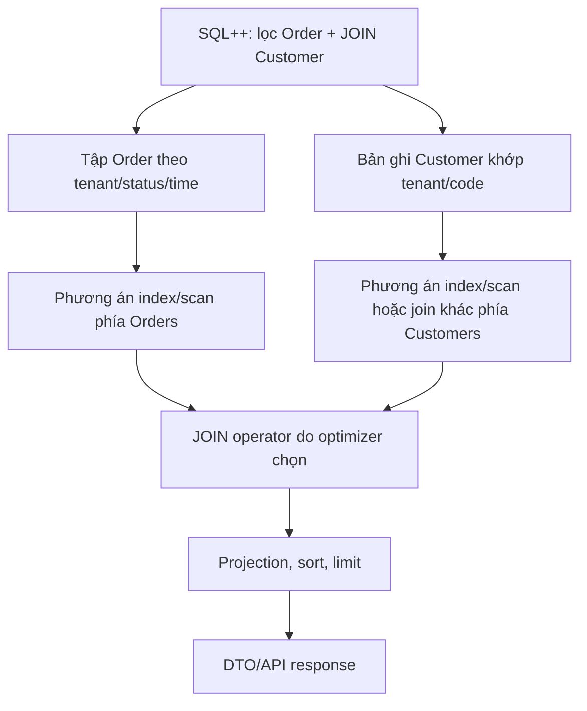

# Chỉ mục phục vụ điều kiện JOIN trong Spring Data Couchbase

Trong Couchbase, một truy vấn SQL++ có thể kết hợp các document từ nhiều collection bằng `JOIN`. Nhưng việc truy vấn chạy nhanh hay chậm không chỉ do đã viết `JOIN ... ON` đúng cú pháp. Query Service cần **tìm được tập document đầu vào**, **xác định những document liên quan ở phía còn lại** và đôi khi còn phải **lọc, sắp xếp, đọc JSON gốc hoặc tổng hợp kết quả**. Chỉ mục tốt là chỉ mục phục vụ chính những bước này, trên **đúng collection** và **đúng mẫu truy vấn**.

Một hiểu lầm phổ biến là “đã JOIN thì tạo index trên mọi field được nhắc tới”, hoặc “thấy `JOIN` thì chỉ cần một index trên khóa liên kết”. Cách nghĩ ấy bỏ qua thứ tự khóa ghép, phía nào được lọc trước, cardinality, `ORDER BY`, loại `JOIN`, tính duy nhất nghiệp vụ, chi phí `Fetch` và sự khác biệt giữa **ANSI JOIN theo field** với **lookup JOIN theo document ID**.

Bài thuộc chương **Quan hệ và JOIN** của module **SPRING_DATA_COUCHBASE**. Mục tiêu phù hợp với phạm vi dịch vụ: xây dựng tầng truy cập Couchbase bằng document mapping, repository, `CouchbaseTemplate` và SQL++; thiết kế bucket/scope/collection, index, TTL, CAS, giao dịch và API reactive nhằm bảo đảm hiệu năng, tính nhất quán và vận hành ổn định.

Các câu DDL và SQL++ dưới đây là **ứng viên thiết kế**. Optimizer quyết định kế hoạch thực tế dựa trên phiên bản Couchbase, thống kê, dữ liệu, điều kiện truy vấn và chỉ mục hiện có. Không có tên index hay thứ tự khóa nào bảo đảm nhanh trong mọi workload: phải dùng `EXPLAIN`, Query Profile và đo đạc trên dữ liệu đại diện.

## 1. Mục tiêu học tập

Sau bài này, bạn có thể:

1. Phân biệt chỉ mục trên **phía khởi đầu của truy vấn** với chỉ mục trên **phía được join**, thay vì chỉ nhìn vào khóa liên kết.
2. Thiết kế composite index phục vụ đồng thời `WHERE`, các điều kiện `ON`, `ORDER BY` và projection được sử dụng thường xuyên.
3. Phân biệt **ANSI `JOIN ... ON`** với **lookup `JOIN ... ON KEYS`**, xác định khi nào một phía được tra theo document ID và không cần secondary index cho ID đó.
4. Phân tích cardinality của quan hệ 1:1/1:N, join fan-out, kết quả sau `LIMIT` và chi phí `Fetch`/`Sort`.
5. Hiểu phạm vi sử dụng của partial, covering và array index, điều kiện tương thích giữa predicate SQL++ với định nghĩa chỉ mục.
6. Đọc `system:indexes`, `EXPLAIN` và Query Profile để kiểm chứng index được chọn, dải `spans` và các operator join.
7. Đối chiếu SQL++ sinh từ Spring Data repository, `@Query` và `@N1qlJoin` với SQL++ viết tay, tránh dùng index hint khi chưa có bằng chứng.
8. Lập quy trình DDL, readiness, canary và rollback; cân bằng chi phí đọc với chi phí duy trì index khi ghi.

## 2. Mô hình dữ liệu xuyên suốt

Giả sử hệ thống có bucket `commerce` và các collection:

```text
commerce
├── scope crm
│   └── collection customers
└── scope sales
    ├── collection orders
    ├── collection shipments
    └── collection order_events
```

### 2.1. Document Order

ID `order::TENANT-A::1001` ở `commerce.sales.orders`:

```json
{
  "_class": "salesOrder",
  "tenantId": "TENANT-A",
  "orderNumber": "ORD-1001",
  "customerCode": "C-42",
  "customerId": "customer::TENANT-A::42",
  "status": "PAID",
  "createdAt": "2026-11-20T08:15:00Z",
  "total": 1500000,
  "deleted": false
}
```

`customerCode` là **business key**; `customerId` là **document ID tham chiếu**. Hai cách liên kết này sẽ được so sánh riêng: dữ liệu có cả hai field để phục vụ bài học, nhưng một ứng dụng thật không nhất thiết phải lưu cả hai.

### 2.2. Document Customer

ID `customer::TENANT-A::42` ở `commerce.crm.customers`:

```json
{
  "_class": "customer",
  "tenantId": "TENANT-A",
  "customerCode": "C-42",
  "displayName": "Nguyen An",
  "accountStatus": "ACTIVE",
  "email": "an@example.test"
}
```

Ứng dụng kỳ vọng cặp `(tenantId, customerCode)` xác định **tối đa một Customer**. Đó là một **bất biến nghiệp vụ**; secondary index thông thường không biến cặp field thành unique constraint.

### 2.3. Document Shipment

Hai Shipment có thể cùng trỏ đến `ORD-1001` qua field `orderNumber`, ở `commerce.sales.shipments`:

```json
{
  "_class": "shipment",
  "tenantId": "TENANT-A",
  "orderNumber": "ORD-1001",
  "trackingNumber": "TRACK-7001",
  "state": "IN_TRANSIT",
  "shippedAt": "2026-11-21T08:00:00Z"
}
```

```json
{
  "_class": "shipment",
  "tenantId": "TENANT-A",
  "orderNumber": "ORD-1001",
  "trackingNumber": "TRACK-7002",
  "state": "PREPARING",
  "shippedAt": null
}
```

Quan hệ Order → Shipment là **1:N**. Một Order có hai Shipment có thể tạo **hai hàng sau ANSI JOIN**; chỉ mục không tự làm kết quả trở thành một hàng trên mỗi Order.

### 2.4. Ba yêu cầu API khác nhau

| API | Mẫu đọc | Khóa liên kết | Chi phí cần chú ý |
| --- | --- | --- | --- |
| Danh sách 20 Order `PAID` mới nhất kèm tên Customer | Lọc/sắp xếp Order, ghép Customer | `tenantId + customerCode` | Scan Order, lookup/scan Customer, sort và Fetch |
| Chi tiết một Order bằng document ID kèm Customer | KV theo ID, đọc Customer | `customerId` | Có thể chỉ cần hai KV reads |
| Danh sách Shipment của một Order | Tìm nhiều Shipment theo mã đơn | `tenantId + orderNumber` | Index trên Shipment và phân trang theo thời gian |

Một thiết kế index tối ưu cho API thứ nhất chưa chắc phù hợp API thứ ba. Hãy luôn bắt đầu từ **truy vấn thật** chứ không phải chỉ từ sơ đồ quan hệ.

## 3. Hai phía của JOIN: phía lọc đầu vào và phía tìm bản ghi khớp

Xét truy vấn:

```sql
SELECT META(o).id AS orderId,
       o.orderNumber,
       o.createdAt,
       c.displayName AS customerName
FROM `commerce`.`sales`.`orders` AS o
JOIN `commerce`.`crm`.`customers` AS c
  ON o.tenantId = c.tenantId
 AND o.customerCode = c.customerCode
WHERE o.tenantId = "TENANT-A"
  AND o.status = "PAID"
ORDER BY o.createdAt DESC
LIMIT 20;
```

Có hai nhu cầu index mang tính logic:

1. **Tìm Order đầu vào:** lọc `tenantId` và `status`, có thể tận dụng thứ tự `createdAt DESC` để lấy nhóm Order phù hợp.
2. **Tìm Customer khớp:** với mỗi Order hoặc tập Order đã chọn, xác định Customer có cùng `tenantId` và `customerCode`.

Một cặp index ứng viên:

```sql
CREATE INDEX ix_orders_tenant_status_created
ON `commerce`.`sales`.`orders`(
    `tenantId`,
    `status`,
    `createdAt` DESC
);

CREATE INDEX ix_customers_tenant_code
ON `commerce`.`crm`.`customers`(
    `tenantId`,
    `customerCode`
);
```

Index thứ nhất đặt trên **orders**, index thứ hai đặt trên **customers**. Query Service có thể chọn index scan, index join, hash join hoặc một phương án thực thi khác tùy phiên bản, thống kê và dữ liệu. Đây là **hai đường truy cập khả dĩ**, không phải chỉ dẫn bắt buộc optimizer phải thực hiện “đọc Order rồi lookup Customer” theo đúng thứ tự hình dung.



Sơ đồ mô tả **phạm vi trách nhiệm của index**, không cam kết operator hoặc thứ tự thực thi cụ thể của một plan.

## 4. Đọc `ON` và `WHERE` để suy ra index hữu ích

### 4.1. Điều kiện `WHERE` chọn tập gốc

Truy vấn Order list:

```sql
WHERE o.tenantId = "TENANT-A"
  AND o.status = "PAID"
ORDER BY o.createdAt DESC
```

gợi ý index bắt đầu bằng các field equality, sau đó là khóa sắp xếp:

```sql
CREATE INDEX ix_orders_tenant_status_created
ON `commerce`.`sales`.`orders`(
    `tenantId`, `status`, `createdAt` DESC
);
```

Khi `tenantId` và `status` được ràng buộc bằng equality, tập chỉ mục tương ứng có thể được quét theo `createdAt` với phạm vi hẹp hơn. Nhưng query có thể còn cần `Fetch` để lấy `customerCode` và `orderNumber`, vì những field này không nằm trong key index.

### 4.2. Điều kiện `ON` giúp tìm phía được join

```sql
ON o.tenantId = c.tenantId
AND o.customerCode = c.customerCode
```

gợi ý composite index ở Customer:

```sql
CREATE INDEX ix_customers_tenant_code
ON `commerce`.`crm`.`customers`(
    `tenantId`, `customerCode`
);
```

Khi optimizer có thể tạo lookup theo hai equality, một index như vậy giúp truy tìm Customer theo cặp khóa. Nếu Customer rất nhỏ, optimizer có thể chọn cách đọc/build khác thay vì index lookup; vì thế cần `EXPLAIN`.

### 4.3. `ON` có điều kiện khác equality

Không phải mọi JOIN đều là phép bằng đơn giản:

```sql
SELECT META(o).id AS orderId, c.displayName
FROM `commerce`.`sales`.`orders` AS o
JOIN `commerce`.`crm`.`customers` AS c
  ON o.tenantId = c.tenantId
 AND o.customerCode = c.customerCode
 AND c.accountStatus = "ACTIVE"
WHERE o.tenantId = "TENANT-A";
```

Ở đây `accountStatus` là một điều kiện bổ sung trên Customer. Có thể cân nhắc index:

```sql
CREATE INDEX ix_customers_tenant_code_status
ON `commerce`.`crm`.`customers`(
    `tenantId`, `customerCode`, `accountStatus`
);
```

Nhưng thêm `accountStatus` không mặc định tốt hơn index hai khóa. Nếu mỗi cặp tenant/code vốn chỉ có một Customer, `accountStatus` chủ yếu là phép lọc sau khi tìm được một bản ghi. Việc tăng index key có thể chỉ thêm chi phí ghi/lưu trữ. Đo `Fetch`, số record khớp và chi phí thực để quyết định.

### 4.4. `LEFT JOIN`: predicate phía phải ảnh hưởng ngữ nghĩa

Giữ mọi Order nhưng chỉ lấy Customer đang `ACTIVE`:

```sql
SELECT META(o).id AS orderId,
       c.displayName AS activeCustomerName
FROM `commerce`.`sales`.`orders` AS o
LEFT JOIN `commerce`.`crm`.`customers` AS c
  ON o.tenantId = c.tenantId
 AND o.customerCode = c.customerCode
 AND c.accountStatus = "ACTIVE"
WHERE o.tenantId = "TENANT-A";
```

Điều kiện `c.accountStatus = "ACTIVE"` nằm ở `ON` nhằm xác định **Customer match hợp lệ**, vẫn giữ Order không match. Nếu chuyển nó xuống `WHERE`:

```sql
WHERE o.tenantId = "TENANT-A"
  AND c.accountStatus = "ACTIVE"
```

thì Order không có Customer phù hợp có thể bị loại; bản chất outer join đổi đi. **Chỉ mục không sửa được lỗi ngữ nghĩa này.** Hãy xác định kết quả đúng trước khi tối ưu index.

## 5. Thứ tự trường của composite index cho JOIN

### 5.1. Equality prefix và field dẫn đầu

Giả sử hai query chính:

```sql
-- A: tìm Customer theo tenant và mã.
SELECT META(c).id, c.displayName
FROM `commerce`.`crm`.`customers` AS c
WHERE c.tenantId = "TENANT-A"
  AND c.customerCode = "C-42";

-- B: liệt kê Customer đang ACTIVE của một tenant.
SELECT META(c).id, c.displayName
FROM `commerce`.`crm`.`customers` AS c
WHERE c.tenantId = "TENANT-A"
  AND c.accountStatus = "ACTIVE";
```

Index `(tenantId,customerCode)` rất phù hợp với A nhưng không nhất thiết tối ưu cho B vì `accountStatus` không có trong key. Index `(tenantId,accountStatus)` phù hợp hơn cho B. Một index “thêm mọi field”:

```sql
CREATE INDEX ix_customers_everything
ON `commerce`.`crm`.`customers`(
    `tenantId`, `customerCode`, `accountStatus`,
    `displayName`, `email`
);
```

không tự động tối ưu cho tất cả các mẫu truy vấn, đồng thời làm tăng dung lượng index và bản sao của thông tin cá nhân. Không áp dụng phương án này máy móc.

### 5.2. Khi cả hai vế JOIN dùng equality

Giữa:

```text
(tenantId, customerCode)
(customerCode, tenantId)
```

cả hai đều có thể có ích khi query ràng buộc cả hai field; khác biệt quan trọng xuất hiện ở **những query chỉ ràng buộc một field**, độ chọn lọc, khả năng index scan và thống kê. Với hệ multi-tenant, `tenantId` ở đầu thường mang lại mẫu truy cập dễ kiểm soát và phù hợp các truy vấn khác, nhưng không phải luật tuyệt đối.

### 5.3. Khi kết hợp lọc, sort và join

Index Order:

```sql
CREATE INDEX ix_orders_tenant_status_created_code
ON `commerce`.`sales`.`orders`(
    `tenantId`,
    `status`,
    `createdAt` DESC,
    `customerCode`
);
```

đặt `customerCode` sau phần lọc/sắp xếp. Nó có thể giúp lấy field join từ index khi plan và projection cho phép, nhưng không biến `customerCode` thành một điều kiện tìm kiếm dẫn đầu trong index. Nếu query nóng lại là “tất cả Order của Customer C-42”, hãy thử index khác:

```sql
CREATE INDEX ix_orders_tenant_customer_created
ON `commerce`.`sales`.`orders`(
    `tenantId`,
    `customerCode`,
    `createdAt` DESC
);
```

Không giữ cả hai index chỉ vì chúng xuất hiện trong ví dụ. Chọn theo endpoint quan trọng, kết quả benchmark và chi phí mỗi mutation Order.

### 5.4. Một trường trong `ON` không bắt buộc xuất hiện ở cả hai index

Với một kế hoạch lấy Order trước rồi index join Customer, điều kiện `o.customerCode = c.customerCode` cần giá trị `o.customerCode`. Nếu index phía Order không có field đó, Query Service có thể `Fetch` Order rồi đọc field từ JSON. Có thể thêm field vào index phía Order nếu giảm `Fetch` đáng kể; không bắt buộc tạo một index thứ hai ở Orders chỉ để “có customerCode”.

Ngược lại, nếu optimizer chọn phía Customer trước, vai trò các đường truy cập có thể thay đổi. Vì vậy **đọc plan** quan trọng hơn việc gắn nhãn cố định “left index/right index” trong mọi trường hợp.

## 6. Phân biệt ANSI JOIN theo field và lookup `ON KEYS`

### 6.1. ANSI JOIN theo business key

```sql
SELECT META(o).id AS orderId, c.displayName
FROM `commerce`.`sales`.`orders` AS o
JOIN `commerce`.`crm`.`customers` AS c
  ON o.tenantId = c.tenantId
 AND o.customerCode = c.customerCode
WHERE o.tenantId = "TENANT-A";
```

`customerCode` là field bình thường trong JSON Customer. Khi dùng indexed nested-loop join, một index như `ix_customers_tenant_code` có thể hỗ trợ tìm bản ghi phía Customer. Kế hoạch khác, chẳng hạn hash join, có thể sử dụng đường quét/build khác tùy optimizer.

### 6.2. Lookup JOIN khi Order giữ document ID Customer

```sql
SELECT META(o).id AS orderId, c.displayName
FROM `commerce`.`sales`.`orders` AS o
JOIN `commerce`.`crm`.`customers` AS c
  ON KEYS o.customerId
WHERE o.tenantId = "TENANT-A";
```

Ở đây `o.customerId` chứa **document ID** của Customer. Key lookup phía `customers` không yêu cầu một secondary index `(tenantId,customerCode)` chỉ để định vị ID. Đây là khác biệt quan trọng giữa:

- Truy cập **theo thuộc tính JSON** `customerCode`: có thể cần secondary index.
- Truy cập **theo document ID**: dùng cơ chế KV/key lookup.

Tuy vậy, phía Orders vẫn cần scan phù hợp nếu `WHERE o.tenantId = ?` phải tìm nhiều Order. Không thể nói “`ON KEYS` thì cả query không cần index”.

### 6.3. Nếu chỉ đọc một Order theo ID

Một endpoint `GET /orders/{id}` đã biết `order::TENANT-A::1001` có thể:

```text
KV GET order::TENANT-A::1001
      |
      +-- customerId = customer::TENANT-A::42
                  |
                  +-- KV GET customer::TENANT-A::42
```

Hai KV lookup có thể đơn giản hơn một câu SQL++ join nếu UI chỉ cần đúng hai document. Nhưng API list 100 Order có thể phát sinh N+1 reads nếu service đọc Customer tuần tự cho từng Order. Khi đó cân nhắc batch, lookup join hoặc read model.

### 6.4. Những rủi ro vẫn còn khi dùng key lookup

Document ID tham chiếu có thể:

- Không tồn tại hoặc đã hết TTL.
- Trỏ nhầm collection hoặc tenant.
- Được ghi trước khi document đích được tạo.
- Bị thay đổi trong một migration chưa đồng bộ.

`JOIN ... ON KEYS` không tạo foreign key constraint và không tự kiểm tra quyền nghiệp vụ. Phải xác minh tenant/authorization trước khi trả dữ liệu nhạy cảm.

## 7. Index cho quan hệ 1:N và join fan-out

### 7.1. Order có nhiều Shipment

```sql
SELECT META(o).id AS orderId,
       o.orderNumber,
       s.trackingNumber,
       s.shippedAt
FROM `commerce`.`sales`.`orders` AS o
JOIN `commerce`.`sales`.`shipments` AS s
  ON o.tenantId = s.tenantId
 AND o.orderNumber = s.orderNumber
WHERE o.tenantId = "TENANT-A"
  AND o.status = "PAID";
```

Index ứng viên trên Shipments:

```sql
CREATE INDEX ix_shipments_tenant_order_time
ON `commerce`.`sales`.`shipments`(
    `tenantId`,
    `orderNumber`,
    `shippedAt` DESC
);
```

Giúp tìm những Shipment có cùng cặp tenant/orderNumber; phần `shippedAt` hữu ích nếu workload còn có query phân trang Shipment theo thời gian. Nhưng nếu query luôn chỉ join và không sắp xếp theo `shippedAt`, một index hai field có thể đủ và rẻ hơn. Không tạo index thứ ba theo thời gian khi chưa có nhu cầu thực.

### 7.2. Index không giới hạn số hàng sau join

Nếu có 100 Order và trung bình mỗi Order có 3 Shipment, join có thể tạo khoảng 300 hàng. Đây là minh họa cardinality, không phải số liệu cluster. Nếu mỗi Order có 100 Shipment, số hàng trung gian còn lớn hơn.

Vì vậy:

- `LIMIT 20` ở cuối join chỉ giới hạn **20 hàng kết quả**, không phải 20 Order duy nhất.
- `SUM(o.total)` sau join 1:N có thể nhân doanh thu theo số Shipment.
- `COUNT(*)` sau outer join có thể tính cả hàng giữ phía trái khi không có Shipment.
- `DISTINCT` chỉ dùng khi ngữ nghĩa thực sự yêu cầu loại trùng; nó không sửa dữ liệu tham chiếu sai và có thể tăng chi phí.

### 7.3. Đếm Shipment an toàn theo mục đích

Một câu query tổng hợp:

```sql
SELECT META(o).id AS orderId,
       COUNT(s.trackingNumber) AS shipmentCount
FROM `commerce`.`sales`.`orders` AS o
LEFT JOIN `commerce`.`sales`.`shipments` AS s
  ON o.tenantId = s.tenantId
 AND o.orderNumber = s.orderNumber
WHERE o.tenantId = "TENANT-A"
GROUP BY META(o).id;
```

`COUNT(s.trackingNumber)` đếm những giá trị trackingNumber hiện diện. Nếu Shipment hợp lệ có thể thiếu field này, cần dùng một định danh thích hợp hơn hoặc cơ chế đếm khác, rồi kiểm thử kết quả 0. `COUNT(*)` trên outer join không tự có nghĩa “số child”.

### 7.4. Khi muốn phân trang đúng theo Order

Có thể tách thành:

1. Chọn **trang 20 Order** theo `tenantId/status/createdAt`.
2. Lấy Customer hoặc Shipment liên quan cho đúng 20 Order.
3. Trả DTO có đơn vị pagination là Order.

Đối với child có rất nhiều document, hãy cung cấp endpoint phân trang theo `orderNumber`. Một JOIN với index tốt vẫn có thể trả một tập child quá lớn; lúc đó cần **đổi hợp đồng API**, không chỉ tăng số index.

## 8. Partial index cho JOIN có điều kiện

### 8.1. Giới hạn tập index bằng discriminator

Nếu collection Customers chứa nhiều loại document hoặc một số record không liên quan, có thể dùng partial index:

```sql
CREATE INDEX ix_customers_active_by_code
ON `commerce`.`crm`.`customers`(
    `tenantId`,
    `customerCode`
)
WHERE `_class` = "customer"
  AND `accountStatus` = "ACTIVE";
```

Index chỉ chứa những document thỏa điều kiện `WHERE` của định nghĩa index. Query phải có predicate **hàm ý** điều kiện đó thì optimizer mới có cơ sở sử dụng index mà vẫn trả kết quả đầy đủ.

Một query chỉ join theo `tenantId/customerCode` và cần cả Customer inactive **không** thể coi index chỉ có ACTIVE là index đầy đủ cho mọi Customer.

### 8.2. `LEFT JOIN` và điều kiện active

Đúng với yêu cầu “giữ Order nhưng chỉ ghép Customer ACTIVE”:

```sql
SELECT META(o).id AS orderId,
       c.displayName AS activeCustomerName
FROM `commerce`.`sales`.`orders` AS o
LEFT JOIN `commerce`.`crm`.`customers` AS c
  ON o.tenantId = c.tenantId
 AND o.customerCode = c.customerCode
 AND c.accountStatus = "ACTIVE"
 AND c.`_class` = "customer"
WHERE o.tenantId = "TENANT-A";
```

Việc predicate nằm trong `ON` giúp xác định phía Customer nào được coi là match. Tuy nhiên, khả năng optimizer sử dụng partial index cho **outer join** và cách chứng minh predicate tùy phiên bản/plan. Không hứa rằng chỉ cần thêm `ON ... accountStatus` thì `ix_customers_active_by_code` chắc chắn được chọn. Hãy kiểm tra `EXPLAIN`.

### 8.3. `@TypeAlias` và discriminator phải khớp

Spring Data Couchbase có thể lưu hoặc dùng field kiểu `_class` cho mapping polymorphic. Nếu entity `@TypeAlias("customer")`, JSON mới có thể chứa `_class = "customer"` theo mapping đang sử dụng, nhưng dữ liệu legacy có thể chứa tên class đầy đủ.

Nếu partial index dùng `WHERE _class = "customer"`, hãy:

- Đọc JSON thực của các document mẫu trong collection được phép.
- Xem SQL++ thực do repository/`@N1qlJoin` sinh ra.
- Kiểm tra predicate loại entity ở cả phía root và phía được join.
- Không tạo index loại trừ dữ liệu legacy mà API vẫn cần.

### 8.4. Partial index là quyết định độ đúng trước tiên

Giảm số entry index có thể tiết kiệm dung lượng, nhưng chỉ khi tập query được giới hạn đúng. Nếu cần both active/inactive Customer, hãy dùng index đủ bao phủ hoặc tổ chức hai query/index theo workload; không gắn hint ép dùng partial index rồi làm mất bản ghi hợp lệ.

## 9. Covering index, projection và chi phí `Fetch`

### 9.1. Index tìm key khác index trả đủ dữ liệu

Index:

```sql
CREATE INDEX ix_customers_tenant_code
ON `commerce`.`crm`.`customers`(
    `tenantId`, `customerCode`
);
```

giúp tìm Customer theo business key, nhưng nếu query cần `c.displayName` thì Query Service có thể phải **Fetch document JSON** để lấy field đó.

Một ứng viên covering:

```sql
CREATE INDEX ix_customers_tenant_code_name
ON `commerce`.`crm`.`customers`(
    `tenantId`,
    `customerCode`,
    `displayName`
);
```

có thể cung cấp `displayName` trực tiếp từ index với những query/plan tương thích. Tuy nhiên, khi projection còn đọc `email` hoặc nhiều field khác, index có thể không còn cover đầy đủ. `META(c).id` có thể được lấy từ metadata/index theo cách optimizer hỗ trợ; vẫn phải kiểm tra plan, không suy diễn.

### 9.2. Không mở rộng index chỉ để loại một `Fetch` rẻ

Thêm `displayName`, `email` hoặc các field projection khác vào GSI khiến:

- Entry index có thể lớn hơn và tốn storage/memory.
- Mỗi lần sửa những field đó có thể phát sinh thêm công việc cho Index Service.
- Các giá trị có thể xuất hiện ở nhiều cấu trúc index, tăng phạm vi quản trị dữ liệu nhạy cảm.
- Thời gian build/rebalance/backup và chi phí vận hành có thể tăng.

Nếu mỗi truy vấn sau lọc chỉ Fetch 20 Customer, lợi ích covering có thể nhỏ. Nếu một dashboard chạy rất thường xuyên và Fetch hàng nghìn Customer, covering có thể đáng thử. Quyết định phải dựa vào **số Fetch, response bytes và đo latency**.

### 9.3. Projection entity khác projection DTO

SQL++:

```sql
SELECT META(c).id AS customerId,
       c.displayName
FROM `commerce`.`crm`.`customers` AS c
WHERE c.tenantId = "TENANT-A"
  AND c.customerCode = "C-42";
```

chỉ cần một vài field. Nhưng repository trả đầy đủ entity `Customer` có thể chọn thêm `_class`, metadata và những field khác, khiến index tưởng như covering ở SQL++ viết tay không cover được query thực.

Không tối ưu theo một câu demo chỉ chọn hai field nếu ứng dụng đang chạy câu query trả toàn entity. Thu thập **generated SQL++ thực** và kiểm tra `Fetch`.

## 10. Array index, `UNNEST` và JOIN trên dữ liệu lồng

Không phải mọi “liên kết” xuất hiện trong SQL++ đều là join giữa hai collection. Nếu Order có mảng:

```json
{
  "tenantId": "TENANT-A",
  "items": [
    { "sku": "SKU-42", "quantity": 2 },
    { "sku": "SKU-18", "quantity": 1 }
  ]
}
```

thì `items` là một field nested của **document Order**.

### 10.1. `ANY` tìm Order có item phù hợp

```sql
SELECT META(o).id AS orderId
FROM `commerce`.`sales`.`orders` AS o
WHERE o.tenantId = "TENANT-A"
  AND ANY i IN o.items
      SATISFIES i.sku = "SKU-42"
      END;
```

Index ứng viên:

```sql
CREATE INDEX ix_orders_tenant_item_sku
ON `commerce`.`sales`.`orders`(
    `tenantId`,
    DISTINCT ARRAY i.sku FOR i IN items END
);
```

`DISTINCT ARRAY` phù hợp với một số mẫu kiểm tra tồn tại; phải bảo đảm biểu thức array index tương thích với query và đọc `EXPLAIN`.

### 10.2. `UNNEST` mở item thành các hàng

```sql
SELECT META(o).id AS orderId,
       i.sku,
       i.quantity
FROM `commerce`.`sales`.`orders` AS o
UNNEST o.items AS i
WHERE o.tenantId = "TENANT-A"
  AND i.sku = "SKU-42";
```

Khi cần từng phần tử, index dạng `ALL ARRAY` có thể là ứng viên cho một số truy vấn:

```sql
CREATE INDEX ix_orders_tenant_all_item_sku
ON `commerce`.`sales`.`orders`(
    `tenantId`,
    ALL ARRAY i.sku FOR i IN items END
);
```

Không coi `DISTINCT ARRAY` và `ALL ARRAY` là hoán đổi hoàn toàn: chúng khác cách xử lý nhiều phần tử/giá trị trùng và sự phù hợp với từng mẫu `ANY`/`UNNEST`. Tên biến trong biểu thức, đường dẫn field, điều kiện và phiên bản đều có thể ảnh hưởng việc optimizer dùng index.

### 10.3. UNNEST rồi ANSI JOIN sang Product

Nếu item chứa SKU nhưng Product là document riêng có field `sku`:

```sql
SELECT META(o).id AS orderId,
       i.sku,
       i.quantity,
       p.name AS currentProductName
FROM `commerce`.`sales`.`orders` AS o
UNNEST o.items AS i
JOIN `commerce`.`catalog`.`products` AS p
  ON o.tenantId = p.tenantId
 AND i.sku = p.sku
WHERE o.tenantId = "TENANT-A";
```

Đây là **hai cơ chế** trong cùng query:

1. `UNNEST` sinh hàng từ mảng JSON Order; array index trên Orders có thể hỗ trợ các điều kiện tương thích.
2. ANSI JOIN tìm Product theo field `tenantId/sku`; có thể cần index **riêng trên Products** khi dùng đường join qua index.

Index trên Orders **không tự lập chỉ mục trên Products**. Nếu báo cáo chỉ cần giá/tên **tại thời điểm mua**, hãy dùng snapshot trong item thay vì luôn join catalog hiện tại.

Lưu ý: ví dụ này cần collection `commerce.catalog.products` được tạo trong môi trường lab nếu muốn chạy; nó được đưa ra để minh họa tổ hợp `UNNEST` + `JOIN`, không phải collection bắt buộc của dataset Order–Customer–Shipment ở đầu bài.

### 10.4. Chi phí array index khi mảng lớn

Array index có thể tạo nhiều index entries cho một document, làm dung lượng và chi phí ghi tăng theo đặc tính mảng. Nếu mỗi Order có hàng chục nghìn item hoặc nhiều writer sửa mảng liên tục, cân nhắc tách item thành document con với `orderId` và index theo ID cha, thay vì tạo thêm nhiều array index trên một document khổng lồ.

## 11. `NEST` và nhu cầu index: đừng nhầm hình dạng với đường truy cập

`NEST` gom các document phía phải thành mảng trong một hàng của phía trái. Ví dụ (nếu muốn Order với danh sách Shipment):

```sql
SELECT META(o).id AS orderId,
       o.orderNumber,
       s AS shipments
FROM `commerce`.`sales`.`orders` AS o
LEFT NEST `commerce`.`sales`.`shipments` AS s
  ON o.tenantId = s.tenantId
 AND o.orderNumber = s.orderNumber
WHERE o.tenantId = "TENANT-A";
```

Với dạng ANSI NEST được phiên bản Server hỗ trợ, điều kiện liên kết vẫn dùng field `tenantId/orderNumber` và có nhu cầu lập index tương tự một ANSI JOIN thích hợp. `NEST` thay **hình dạng kết quả** chứ không tự giúp tìm Shipment không cần index.

Ngược lại, nếu Order giữ mảng `shipmentIds` là **document ID** của các Shipment, một dạng lookup `NEST ... ON KEYS o.shipmentIds` có thể truy cập phía Shipment theo key và không cần GSI trên business key chỉ để tìm ID.

**Giới hạn thực tế:** Nếu một Order có 100.000 Shipment và UI chỉ cần 20 Shipment mới nhất, trả cả mảng qua NEST là một hợp đồng dữ liệu không phù hợp dù index tốt. Hãy phân trang ở collection Shipment hoặc dùng read model phù hợp.

## 12. Đọc `EXPLAIN` để biết optimizer đang làm gì

### 12.1. Luôn giải thích câu query thực

```sql
EXPLAIN
SELECT META(o).id AS orderId,
       o.orderNumber,
       c.displayName AS customerName
FROM `commerce`.`sales`.`orders` AS o
JOIN `commerce`.`crm`.`customers` AS c
  ON o.tenantId = c.tenantId
 AND o.customerCode = c.customerCode
WHERE o.tenantId = "TENANT-A"
  AND o.status = "PAID"
ORDER BY o.createdAt DESC
LIMIT 20;
```

Không phải kết quả `EXPLAIN` nào cũng có cùng operator/tên field. Một số dấu hiệu phổ biến:

| Thành phần kế hoạch | Điều cần tìm |
| --- | --- |
| `IndexScan` / `IndexScan3` | Index được dùng ở keyspace nào? Có dùng ix_orders hoặc ix_customers? |
| `spans` | Predicate tenant/status/customerCode có thu hẹp dải scan không? |
| `Fetch` | Vì sao phải đọc document gốc? Số Fetch lớn hay nhỏ? |
| Join operator | Kế hoạch dạng indexed nested loop, hash join hoặc cơ chế khác? |
| `Filter` | Predicate nào còn lọc sau scan/join? |
| `Order` | Có sort trung gian hay index đã hỗ trợ thứ tự? |
| `Limit` | Giới hạn áp trên hàng Order hay hàng sau join? |
| `Group` / aggregate | Có group/sum trên dữ liệu đã fan-out không? |

Tên operator khác nhau theo phiên bản, ví dụ Query Service có thể biểu diễn một dạng indexed nested-loop join hoặc hash join bằng cấu trúc kế hoạch riêng. Tránh xây logic ứng dụng phụ thuộc tên operator trong một bản Server duy nhất.

### 12.2. `EXPLAIN` không phải Query Profile

`EXPLAIN` cho **kế hoạch dự kiến**. Để biết chi phí thật, chạy query với Query Profile/metrics phù hợp:

- Số index entries được scan trên mỗi phía.
- Số document được Fetch.
- Số hàng vào/ra của phép JOIN.
- Chi phí build/probe hoặc lookup, khi metrics cung cấp.
- Số hàng trước/sau `Order`, `Group`, `Limit`.
- Thời gian chạy, p50/p95/p99, timeout và response bytes.
- Mức sử dụng CPU/memory/disk của Query/Index Service.

Nếu một index mới làm `IndexScan` nhanh hơn nhưng `JOIN` tạo số hàng gấp 100 do dữ liệu trùng, endpoint vẫn có thể chậm/sai. **Độ đúng của dữ liệu và cardinality** quan trọng không kém khả năng sử dụng index.

### 12.3. Khi index không được chọn

Đừng vội thêm hint. Kiểm tra lần lượt:

1. Index có đúng bucket/scope/collection không?
2. Index đã build và có trạng thái khả dụng chưa?
3. Predicate của query có khớp field và thứ tự key không?
4. Nếu là partial index, query có hàm ý điều kiện partial không?
5. Có kiểu JSON khác nhau, `MISSING`, `NULL`, biểu thức `LOWER`/`TRIM` hay converter đổi tên field không?
6. Optimizer đang chọn hash join/scan vì cách đó rẻ hơn trên dataset này không?
7. Thống kê dữ liệu có đại diện cho phân bố tenant/cardinality không?
8. SQL++ runtime từ Spring Data có thêm `_class`, projection hoặc filter khác câu viết tay không?

Nếu tất cả đều phù hợp nhưng plan vẫn kém, mới thử phương án index/hint thay thế trong staging và đo đối chứng.

## 13. `system:indexes`, trạng thái index và readiness gate

### 13.1. Xem danh mục index

```sql
SELECT name, state, index_key, condition,
       bucket_id, scope_id, keyspace_id
FROM system:indexes
WHERE bucket_id = "commerce"
  AND (
      (scope_id = "sales" AND keyspace_id IN ["orders", "shipments"])
      OR
      (scope_id = "crm" AND keyspace_id = "customers")
  );
```

Kiểm tra **tên**, **định nghĩa key**, **partial predicate**, **collection đích** và **state**. Một index cùng tên hoặc cùng key nhưng nằm ở collection khác không đáp ứng truy vấn hiện tại.

### 13.2. Tạo deferred rồi build

Với index lớn, pipeline DDL có thể chủ động tạo index ở trạng thái deferred, sau đó build khi đủ capacity:

```sql
CREATE INDEX ix_customers_tenant_code_v2
ON `commerce`.`crm`.`customers`(
    `tenantId`,
    `customerCode`,
    `displayName`
)
WITH {"defer_build": true};

BUILD INDEX ON `commerce`.`crm`.`customers`(
    `ix_customers_tenant_code_v2`
);
```

Không bật code mới chỉ vì `CREATE INDEX` trả về thành công. Phải kiểm tra index đã build xong và sẵn sàng cho Query Service. Không dùng vòng retry không giới hạn; nếu index không đạt trạng thái mong đợi trong giới hạn triển khai, hãy dừng rollout và báo lỗi.

### 13.3. Ready khác Used

| Trạng thái | Có ý nghĩa gì? | Chưa chứng minh điều gì? |
| --- | --- | --- |
| DDL được chấp nhận | Định nghĩa đã được nhận xử lý | Chưa chứng minh build xong |
| Index xuất hiện trong `system:indexes` | Catalog nhận diện index | Chưa chắc `online` |
| Index `online` | Index có thể phục vụ các query phù hợp | Chưa chứng minh optimizer chọn index |
| `EXPLAIN` dùng index | Kế hoạch chọn index theo query | Chưa chứng minh latency tốt dưới tải |
| Benchmark đạt SLA | Query chạy đạt mức mục tiêu trong thử nghiệm | Chưa chứng minh sẽ mãi tốt với data growth |

Đừng bỏ index cũ ngay khi index mới `online`; cần thử query/canary và có đường rollback.

## 14. Spring Data Couchbase: truy vấn thực có thể khác ví dụ SQL++ viết tay

### 14.1. Entity mapping và ranh giới collection

Ví dụ hai entity:

```java
import java.time.Instant;
import org.springframework.data.annotation.Id;
import org.springframework.data.annotation.TypeAlias;
import org.springframework.data.couchbase.core.mapping.Collection;
import org.springframework.data.couchbase.core.mapping.Document;
import org.springframework.data.couchbase.core.mapping.Scope;

@Document
@TypeAlias("salesOrder")
@Scope("sales")
@Collection("orders")
public class SalesOrder {
    @Id private String id;
    private String tenantId;
    private String customerCode;
    private String customerId;
    private String status;
    private Instant createdAt;
    private String orderNumber;
    // Constructors, getters và setters được lược bỏ.
}
```

```java
import org.springframework.data.annotation.Id;
import org.springframework.data.annotation.TypeAlias;
import org.springframework.data.couchbase.core.mapping.Collection;
import org.springframework.data.couchbase.core.mapping.Document;
import org.springframework.data.couchbase.core.mapping.Scope;

@Document
@TypeAlias("customer")
@Scope("crm")
@Collection("customers")
public class Customer {
    @Id private String id;
    private String tenantId;
    private String customerCode;
    private String displayName;
    private String accountStatus;
    // Constructors, getters và setters được lược bỏ.
}
```

`@Scope` và `@Collection` xác định mapping collection trong những version Spring Data Couchbase hỗ trợ. Bucket `commerce` được xác định bởi cấu hình Couchbase/operations; không tự suy từ tên class. Field JSON có thể được đổi tên bởi converter/`@Field`, vì vậy index phải theo **tên JSON được lưu**, không chỉ tên biến Java.

### 14.2. Derived repository query

```java
import java.util.List;
import org.springframework.data.couchbase.repository.CouchbaseRepository;

public interface SalesOrderRepository
        extends CouchbaseRepository<SalesOrder, String> {

    List<SalesOrder> findByTenantIdAndStatusOrderByCreatedAtDesc(
        String tenantId, String status
    );
}
```

Truy vấn này có thể được dịch thành SQL++ lọc `tenantId/status` trên Orders. Nếu entity có discriminator `_class`, Spring Data có thể thêm predicate loại và projection phục vụ mapping. Index `(tenantId,status,createdAt)` là ứng viên nhưng **phải nhìn generated SQL++ thật**.

### 14.3. `@Query` cho entity và hiệu ứng discriminator

```java
import java.util.List;
import org.springframework.data.couchbase.repository.Query;

public interface SalesOrderRepository
        extends CouchbaseRepository<SalesOrder, String> {

    @Query("#{#n1ql.selectEntity} WHERE #{#n1ql.filter} " +
           "AND tenantId = $1 AND status = $2")
    List<SalesOrder> findOrders(
        String tenantId, String status
    );
}
```

Các macro `#{#n1ql.selectEntity}` / `#{#n1ql.filter}` giúp mapping entity và lọc kiểu theo khả năng của phiên bản. Nhưng projection trả toàn entity có thể cần nhiều field hơn một query báo cáo chỉ trả ID + trạng thái; điều đó ảnh hưởng covering index và `Fetch`.

### 14.4. `@N1qlJoin` có `on`, `index` và `rightIndex`

Trong các phiên bản Spring Data Couchbase hỗ trợ, có thể khai báo quan hệ theo field:

```java
import org.springframework.data.couchbase.core.query.N1qlJoin;

@N1qlJoin(
    on = "lks.tenantId = rks.tenantId " +
         "AND lks.customerCode = rks.customerCode"
)
private Customer customer;
```

`lks` là keyspace của entity có field annotation (Order); `rks` là entity đích (Customer). Điều kiện này mô tả **ANSI join theo dữ liệu**, không tự tạo foreign key hay index.

Annotation cũng có các tùy chọn như `index`/`rightIndex` trong các phiên bản hỗ trợ. Ví dụ **chỉ để minh họa khả năng hint**:

```java
@N1qlJoin(
    on = "lks.tenantId = rks.tenantId " +
         "AND lks.customerCode = rks.customerCode",
    index = "ix_orders_tenant_status_created",
    rightIndex = "ix_customers_tenant_code"
)
private Customer customer;
```

**Đừng vội áp dụng hint này.** Tên index phải đúng, annotation API/Server phải hỗ trợ, và `EXPLAIN` phải cho thấy kế hoạch tốt hơn. Hint không sửa được business key trùng, điều kiện thiếu tenant, hay việc chọn sai đường đọc.

### 14.5. Immediate/Lazy làm thay đổi số lần sử dụng index

Nếu một màn hình danh sách lấy 100 Order, mỗi Order được cấu hình tải Customer/Shipments ngay, tổng lượng query/lookup có thể vượt nhiều so với query gốc. `FetchType.LAZY` có thể trì hoãn việc này đến lúc truy cập field, nhưng nếu serializer gọi getter cho mọi Order, **N+1** vẫn có thể xảy ra.

Tối ưu index của một truy vấn join **không giải quyết** việc service gửi cùng truy vấn liên kết 100 lần không cần thiết. Hãy đo số query mỗi request và xét DTO/projection cho endpoint list.

## 15. Java SDK hoặc `CouchbaseTemplate`: chủ động kiểm soát projection JOIN

Khi cần một DTO từ nhiều collection, dùng SQL++ có projection rõ ràng. Ví dụ Java SDK 3.x:

```java
import com.couchbase.client.java.Cluster;
import com.couchbase.client.java.json.JsonObject;
import com.couchbase.client.java.query.QueryResult;
import java.util.List;
import static com.couchbase.client.java.query.QueryOptions.queryOptions;

public class OrderCustomerReadService {
    private final Cluster cluster;

    public OrderCustomerReadService(Cluster cluster) {
        this.cluster = cluster;
    }

    public List<OrderCustomerRow> findRecentPaid(String tenantId) {
        String sql = """
            SELECT META(o).id AS orderId,
                   o.orderNumber AS orderNumber,
                   c.displayName AS customerName
            FROM `commerce`.`sales`.`orders` AS o
            LEFT JOIN `commerce`.`crm`.`customers` AS c
              ON o.tenantId = c.tenantId
             AND o.customerCode = c.customerCode
            WHERE o.tenantId = $tenantId
              AND o.status = "PAID"
            ORDER BY o.createdAt DESC
            LIMIT 20
            """;

        QueryResult result = cluster.query(sql,
            queryOptions().parameters(
                JsonObject.create().put("tenantId", tenantId)
            )
        );

        return result.rowsAsObject().stream()
            .map(row -> new OrderCustomerRow(
                row.getString("orderId"),
                row.getString("orderNumber"),
                row.containsKey("customerName")
                    ? row.getString("customerName")
                    : null
            ))
            .toList();
    }

    public record OrderCustomerRow(
        String orderId, String orderNumber, String customerName
    ) {}
}
```

Ví dụ dùng Java text block/record và Java SDK API tương ứng. Trong production cần bổ sung timeout/error handling, tracing, giới hạn result set, quyền đọc, scan consistency theo SLA, cấu hình bean `Cluster` và phân trang ổn định.

`CouchbaseTemplate` cũng có những khả năng truy vấn/mapping theo phiên bản, nhưng không giả định mọi API của SDK đều tồn tại nguyên vẹn trên template. Dù gọi bằng repository, template hay SDK, **index phải phục vụ SQL++ thực** và projection thực, không phải tên phương thức Java.

## 16. Chỉ số hiệu năng và chi phí duy trì index

### 16.1. Đổi chi phí đọc lấy chi phí ghi

Một secondary index giúp Query Service tìm document chọn lọc hơn; đổi lại:

- Mutation vào document có thể cần duy trì các index có field liên quan.
- Chỉ mục chiếm disk, memory và tài nguyên Index Service.
- Build/rebuild/rebalance có chi phí và có thể ảnh hưởng workload.
- Index bao phủ hoặc partial có cấu trúc lớn/đặc biệt cần được giám sát riêng.
- Tạo thêm nhiều index có khóa tương tự có thể làm write amplification tăng mà latency đọc không cải thiện đủ.

Với workload có mutation rate cao, cân bằng số index so với các đường đọc thực sự quan trọng. Đừng giữ đồng thời `(tenantId,customerCode)`, `(customerCode,tenantId)`, `(tenantId,customerCode,displayName)` và nhiều index gần trùng nếu chỉ có một endpoint dùng.

### 16.2. Bộ số liệu cần thu thập

| Bên đọc | Bên ghi/vận hành |
| --- | --- |
| p50/p95/p99 query latency, timeout | KV mutation latency, write throughput |
| Số rows sau JOIN, số rows trả về | Dung lượng từng index |
| Entries scanned và documents fetched | Index Service CPU/memory/disk |
| Sort/aggregate time, query memory | Build/rebalance duration |
| Số query/round trip từ repository | Index update lag theo metrics hỗ trợ |
| Response bytes, DTO serialization | Replica/partition/capacity dự phòng |

So sánh trước/sau DDL với cùng query, dataset và concurrency. Một benchmark trên tenant nhỏ không đủ đại diện cho tenant có hàng triệu Order hoặc Shipment.

### 16.3. Một index unused không miễn phí

Index không xuất hiện trong `EXPLAIN` của endpoint mục tiêu vẫn có thể được duy trì khi dữ liệu thay đổi. Sau khi xác nhận không còn query/job nào sử dụng, có thể lên kế hoạch thu hồi. Không `DROP INDEX` ngay trong thời gian canary/rollback khi phiên bản ứng dụng cũ vẫn có thể phụ thuộc.

## 17. Quyền truy cập, tính nhất quán và vòng đời dữ liệu

### 17.1. Index không phải authorization

Điều kiện `o.tenantId = c.tenantId` trong `ON` là cần thiết nếu business key chỉ duy nhất trong tenant. Nhưng index `(tenantId,customerCode)` không tự bảo đảm ứng dụng chỉ đọc tenant được phép.

Cần:

1. Lấy tenant từ context đã xác thực, không tin `tenantId` tự khai trong request.
2. Ràng buộc root query đúng tenant và kiểm soát quyền đọc collection phía join.
3. Tránh `SELECT c.*` khi chỉ cần `c.displayName`, đặc biệt với email/PII.
4. Cấu hình RBAC theo bucket/scope/collection và tách quyền index DDL khỏi runtime.
5. Test reference sai tenant, customer trùng mã và document bị xóa/hết TTL.

### 17.2. Không có khóa ngoại/cascade tự động

Order có `customerCode` hoặc `customerId` không khiến Couchbase bắt buộc Customer phải tồn tại. Khi Customer bị xóa, inner JOIN có thể không trả Order; left JOIN có thể giữ Order nhưng field Customer vắng. Thiết kế fallback, snapshot lịch sử và retention phải được quyết định trước.

Secondary index chỉ tăng tốc việc tìm dữ liệu hợp lệ theo query, không sửa tính đúng của reference.

### 17.3. GSI có độ trễ cập nhật

Global Secondary Index được cập nhật bất đồng bộ từ KV mutations. Query SQL++ có thể tạm chưa thấy một Order/Shipment mới theo thuộc tính nếu không chờ index bắt kịp.

| Chế độ | Hệ quả |
| --- | --- |
| `NOT_BOUNDED` | Không yêu cầu chờ index cập nhật tới các mutation hiện tại; có thể đọc dữ liệu index cũ |
| `REQUEST_PLUS` | Yêu cầu chờ index bắt kịp thời điểm query; thường tăng độ mới nhưng có thể tăng latency |

`REQUEST_PLUS` không tạo ràng buộc khóa ngoại, không bảo đảm transaction xuyên nhiều lượt đọc và không chữa được predicate JOIN sai.

### 17.4. CAS và giao dịch giải quyết vấn đề ghi khác index

`CAS`/`@Version` giúp tránh ghi đè document đã bị thay đổi. Nếu Order và Customer cùng thay business key, CAS trên một document không tự đồng bộ document còn lại. Giao dịch hoặc state machine/event có thể cần khi nghiệp vụ yêu cầu cập nhật nhiều document như một đơn vị nhất quán theo API Couchbase được hỗ trợ.

JOIN index chỉ phục vụ tìm/đọc; nó không tự đặt tính nguyên tử cho thay đổi ở nhiều collection.

### 17.5. TTL và read model

Khi Customer TTL hết hạn, các Order vẫn có thể giữ `customerCode` hoặc snapshot tên. Khi Shipment hết hạn, JOIN/COUNT có thể trả số Shipment khác trước. Nếu cần lịch sử đơn hàng bất biến, phải thiết kế snapshot/retention và ghi nhận nguồn chân lý; đừng coi join tới dữ liệu hiện tại là hình ảnh lịch sử chính xác.

## 18. Reactive và chi phí fan-out qua repository

Một pipeline reactive có thể:

```java
ordersFlux.flatMap(
    order -> reactiveCustomerRepository
        .findByTenantIdAndCustomerCode(
            order.getTenantId(),
            order.getCustomerCode()
        )
        .map(customer -> new OrderWithCustomer(order, customer)),
    8
);
```

Đây là **mẫu minh họa**, với repository method/DTO do ứng dụng định nghĩa. Concurrency `8` chỉ là một giới hạn ví dụ, không phải cấu hình tối ưu phổ quát.

Với 100 Order, pipeline có thể sinh **100 lookup/query** dù mỗi query có index hiệu quả. Giảm latency từng query không đồng nghĩa loại bỏ N+1; cần:

- Khử trùng lặp các cặp `(tenantId,customerCode)` theo trang.
- Xem xét batch query hoặc ANSI JOIN khi có nhiều Order.
- Giới hạn concurrency để tránh tạo tải quá lớn cho Query/Index Service.
- Dùng projection nhỏ thay vì trả toàn Customer.
- Chọn read model phi chuẩn hóa có chính sách đồng bộ nếu endpoint rất nóng.

Reactive chỉ điều chỉnh cách điều phối I/O và dữ liệu; **không biến một JOIN có fan-out lớn thành truy vấn miễn chi phí**.

## 19. Quy trình triển khai index phục vụ JOIN có kiểm soát

### 19.1. Chốt truy vấn và kết quả nghiệp vụ

Viết rõ:

- API cần hàng theo Order, theo Shipment hay theo cặp Order–Shipment?
- Muốn inner hay left join? Hàng thiếu Customer có được giữ không?
- Có bao nhiêu Order/Customer/Shipment theo tenant?
- Business key có duy nhất không? Trường hợp `NULL`/`MISSING`/khác kiểu?
- Projection gồm những field nào, có thông tin nhạy cảm không?
- Sắp xếp/pagination theo đơn vị nào?

Không bắt đầu bằng `CREATE INDEX` khi chưa biết kết quả JOIN nào được coi là đúng.

### 19.2. Ghi nhận kế hoạch hiện tại

Chạy `EXPLAIN` và Query Profile cho query cũ, lưu:

```text
keyspace mỗi nguồn
index được chọn
spans / operator / Fetch / Order
rows vào/ra Join
p95 latency và timeout
số query gọi từ API
```

Nếu query cũ đang thực hiện N+1 từ Java, một index mới có thể chỉ cải thiện một phần. Cần đo toàn request.

### 19.3. Tạo index mới mà không phá đường đọc cũ

Ví dụ thêm `ix_customers_tenant_code_v2` để thử covering. Tạo trong pipeline DDL có quyền được cấp, theo dõi Index Service, đợi index sẵn sàng. Không yêu cầu tất cả application instance tự tạo index khi khởi động.

### 19.4. Readiness và `EXPLAIN`

Kiểm tra:

1. Index nằm đúng `commerce.crm.customers`.
2. `index_key`/`condition` đúng với schema và query.
3. `state` khả dụng (thường `online`).
4. `EXPLAIN` của SQL++ thật dùng hoặc không dùng index mới vì lý do gì.
5. Query Profile có cải thiện entries scanned, Fetch hoặc latency không.

Để tránh chờ vô hạn, readiness gate cần deadline, retry có backoff và báo lỗi nếu hết hạn.

### 19.5. Canary, quan sát, rollback

Chuyển một phần lưu lượng/query qua index hoặc phiên bản code mới, theo dõi p95/p99, row count, error rate, write latency và Index Service. Nếu số hàng sai hoặc query thoái hóa, rollback query/feature trước; đừng vội xóa index mới khi các instance/job đang trong giai đoạn chuyển tiếp.

Chỉ thu hồi index cũ sau khi xác nhận toàn bộ phiên bản ứng dụng, job và báo cáo không còn dùng, có cửa sổ triển khai phù hợp và phương án khôi phục.

## 20. Bài thực hành: đo index trên hai phía JOIN

**Môi trường:** Couchbase Server hỗ trợ scope/collection và SQL++ ANSI JOIN, có quyền tạo index trong lab. Dữ liệu bên dưới chỉ là mẫu; không chạy thử tạo duplicate/xóa trên production.

### Bước 1 — Chuẩn bị những trường hợp biên

Tạo các document:

| Collection | Dữ liệu lab | Mục đích |
| --- | --- | --- |
| `sales.orders` | Order `ORD-1001` tenant A, Customer C-42, `PAID` | Match hợp lệ |
| `sales.orders` | Order `ORD-1002` tenant A, Customer C-99 | Customer không tồn tại |
| `sales.orders` | Order `ORD-2001` tenant B, Customer C-42 | Mã trùng giữa tenant |
| `crm.customers` | Customer C-42 tenant A `ACTIVE` | Match hợp lệ |
| `crm.customers` | Customer C-42 tenant B `ACTIVE` | Phát hiện thiếu tenant |
| `sales.shipments` | Hai Shipment cùng `ORD-1001` tenant A | Fan-out 1:N |

Chọn ID riêng cho từng document. Nếu thử tạo thêm Customer cùng `(tenantId,customerCode)`, hãy chỉ làm trên lab và ghi nhận hậu quả ở số hàng JOIN.

### Bước 2 — Chạy JOIN trước khi tối ưu

```sql
EXPLAIN
SELECT META(o).id AS orderId,
       o.orderNumber,
       c.displayName AS customerName
FROM `commerce`.`sales`.`orders` AS o
JOIN `commerce`.`crm`.`customers` AS c
  ON o.tenantId = c.tenantId
 AND o.customerCode = c.customerCode
WHERE o.tenantId = "TENANT-A"
  AND o.status = "PAID";
```

Ghi plan hiện tại, scan path và lỗi nếu Query Service chưa có index thích hợp. Trong môi trường không có bất kỳ index phù hợp nào, optimizer có thể không lập được kế hoạch; **không giả định query chắc chắn chạy được để benchmark trước index**. Tạo index tối thiểu theo yêu cầu môi trường rồi lấy baseline trước khi thử phương án tối ưu hơn.

### Bước 3 — Tạo index cho hai phía

```sql
CREATE INDEX ix_lab_orders_tenant_status_created
ON `commerce`.`sales`.`orders`(
    `tenantId`, `status`, `createdAt` DESC
);

CREATE INDEX ix_lab_customers_tenant_code
ON `commerce`.`crm`.`customers`(
    `tenantId`, `customerCode`
);
```

Đợi index sẵn sàng, chạy `system:indexes` để xác minh đúng collection. Chạy lại `EXPLAIN` và Query Profile. Ghi index được chọn, `spans`, số `Fetch`, số hàng JOIN và latency; không điền bằng con số ước tính.

### Bước 4 — Thử covering trên Customer

Trong lab, thử một index thay thế:

```sql
CREATE INDEX ix_lab_customers_tenant_code_name
ON `commerce`.`crm`.`customers`(
    `tenantId`, `customerCode`, `displayName`
);
```

So sánh query trả `displayName` giữa hai index bằng kế hoạch thực. Nếu optimizer không chọn index mới, không ép hint ngay: trước hết xem có predicate/projection/plan khác với kỳ vọng không. Khi benchmark xong, đánh giá dung lượng và chi phí mutation trước khi quyết định giữ index nào.

### Bước 5 — Thử `JOIN ... ON KEYS`

Đảm bảo mỗi Order có `customerId` là document ID hợp lệ. Chạy:

```sql
EXPLAIN
SELECT META(o).id AS orderId, c.displayName
FROM `commerce`.`sales`.`orders` AS o
JOIN `commerce`.`crm`.`customers` AS c
  ON KEYS o.customerId
WHERE o.tenantId = "TENANT-A";
```

So sánh với ANSI JOIN theo `customerCode`:

- Phía Orders được tìm như thế nào?
- Phía Customers có cần GSI để định vị document ID không?
- Dữ liệu orphan/trùng business key làm hai truy vấn khác nhau thế nào?
- Có vấn đề tenant/authorization nào khi Customer ID bị sai không?

Không chỉ so sánh latency; phải so sánh **ngữ nghĩa và bộ kết quả**.

### Bước 6 — Thử JOIN với nhiều Shipment

```sql
SELECT META(o).id AS orderId,
       o.total,
       s.trackingNumber
FROM `commerce`.`sales`.`orders` AS o
JOIN `commerce`.`sales`.`shipments` AS s
  ON o.tenantId = s.tenantId
 AND o.orderNumber = s.orderNumber
WHERE o.tenantId = "TENANT-A";
```

Tạo index `(tenantId,orderNumber)` trên Shipments nếu cần. Ghi **số Order phân biệt** so với **số hàng JOIN**, rồi giải thích vì sao `SUM(o.total)` sau JOIN có thể sai. Thêm `ORDER BY o.createdAt DESC LIMIT 20` và xem có đúng mục tiêu “20 Order” không.

### Bước 7 — Thử partial index

Tạo Customer inactive và Customer `_class` khác nhau trong lab. Thử index:

```sql
CREATE INDEX ix_lab_active_customers_by_code
ON `commerce`.`crm`.`customers`(
    `tenantId`, `customerCode`
)
WHERE `_class` = "customer"
  AND `accountStatus` = "ACTIVE";
```

So sánh `EXPLAIN` cho query chỉ cần active Customer với query cần cả active/inactive. Giải thích vì sao partial index không thể tự phục vụ đầy đủ mọi truy vấn Customer.

### Bước 8 — Đọc query từ Spring Data

Tạo repository tìm Order theo tenant/status và một entity có `@N1qlJoin` tới Customer theo `tenantId/customerCode` trong phiên bản framework hỗ trợ. Ghi:

- SQL++ runtime của root query và association query, nếu có.
- Số request khi tải 1, 20, 100 Order.
- Ảnh hưởng `FetchType.IMMEDIATE`/`LAZY` khi truy cập getter.
- `_class`, alias và projection trong query thực.
- Kế hoạch sử dụng index trước/sau khi thay DTO hoặc fetch policy.

Không kết luận index đang tốt chỉ từ `EXPLAIN` của SQL++ viết tay nếu repository runtime tạo query khác.

### Mẫu ghi số liệu

| Thử nghiệm | Index được chọn | Entries scanned | Fetch | Rows sau Join | p95 latency | Kết quả đúng? |
| --- | --- | --- | --- | --- | --- | --- |
| ANSI JOIN baseline | Chưa đo | Chưa đo | Chưa đo | Chưa đo | Chưa đo | Chưa kiểm |
| Composite index hai phía | Chưa đo | Chưa đo | Chưa đo | Chưa đo | Chưa đo | Chưa kiểm |
| Customer covering | Chưa đo | Chưa đo | Chưa đo | Chưa đo | Chưa đo | Chưa kiểm |
| Lookup `ON KEYS` | Chưa đo | Chưa đo | Chưa đo | Chưa đo | Chưa đo | Chưa kiểm |
| JOIN Shipments 1:N | Chưa đo | Chưa đo | Chưa đo | Chưa đo | Chưa đo | Chưa kiểm |
| Partial index ACTIVE | Chưa đo | Chưa đo | Chưa đo | Chưa đo | Chưa đo | Chưa kiểm |

Các ô “Chưa đo” là nơi người học điền **kết quả thực tế**. Bảng không giả định đã kết nối một cluster hoặc chạy benchmark.

### Câu hỏi tự kiểm tra

1. Vì sao index trên phía Orders và index trên phía Customers phục vụ hai nhiệm vụ khác nhau trong ANSI JOIN?
2. Vì sao `JOIN ... ON KEYS` có thể không cần GSI trên Customer ID nhưng vẫn có thể cần index trên Orders?
3. Điều gì khiến một composite index `(tenantId,status,createdAt DESC)` phù hợp với một số Order list query?
4. Vì sao `(tenantId,customerCode)` không tự là unique constraint?
5. Tại sao chỉ thêm `accountStatus` vào index Customer chưa chắc làm JOIN nhanh hơn?
6. `ON` và `WHERE` khác nhau thế nào với `LEFT JOIN` và filter Customer ACTIVE?
7. Nếu một Order có 3 Shipment, vì sao `LIMIT 20` sau join không đồng nghĩa 20 Order?
8. Vì sao `SUM(o.total)` trên hàng sau Order–Shipment JOIN có thể bị nhân?
9. Khi nào index covering giúp giảm `Fetch`, và phải đánh đổi điều gì?
10. Partial index dùng `WHERE _class = "customer" AND accountStatus = "ACTIVE"` có thể phục vụ query cần inactive Customer không?
11. Index `DISTINCT ARRAY` và `ALL ARRAY` khác nhau ra sao với `ANY`/`UNNEST`?
12. Khi `UNNEST o.items` rồi JOIN Product theo SKU, index trên Orders có đủ thay thế index Products không?
13. Những dấu hiệu nào trong `EXPLAIN` cho biết index scan có chọn lọc hoặc bị Fetch/sort nhiều?
14. Vì sao SQL++ do Spring Data sinh ra có thể khác câu viết tay?
15. `@N1qlJoin` có tự tạo index, foreign key, cascade hoặc transaction không?
16. Tại sao một index `online` chưa bảo đảm query sẽ dùng nó hoặc đạt SLA?
17. `REQUEST_PLUS` giải quyết vấn đề nào và không thay thế CAS/transaction ra sao?
18. Tại sao reactive pipeline vẫn có thể tạo N+1 query dù mỗi query dùng index tốt?
19. Khi nào nên bỏ index cũ sau khi thêm index JOIN mới?
20. Nếu JOIN trả Customer tenant khác, cần sửa logic nào trước khi tối ưu hiệu năng?

## 21. Tài liệu tham khảo và cách đối chiếu phiên bản

Khi triển khai thực tế, hãy mở đúng phiên bản tương ứng với dependency và Couchbase Server đang dùng:

- [Couchbase Server SQL++ — JOIN](https://docs.couchbase.com/server/current/n1ql/n1ql-language-reference/join.html): các dạng JOIN, điều kiện liên kết, đường thực thi và gợi ý optimizer.
- [Couchbase Server SQL++ — CREATE INDEX](https://docs.couchbase.com/server/current/n1ql/n1ql-language-reference/createindex.html): cú pháp, composite/array/partial index và build options.
- [Couchbase Server SQL++ — EXPLAIN](https://docs.couchbase.com/server/current/n1ql/n1ql-language-reference/explain.html): cách quan sát kế hoạch thực thi.
- [Spring Data Couchbase — ANSI Joins](https://docs.spring.io/spring-data/couchbase/reference/couchbase/ansijoins.html): `@N1qlJoin`, `lks`/`rks` và những tùy chọn liên quan.
- [Spring Data Couchbase — Repositories](https://docs.spring.io/spring-data/couchbase/reference/couchbase/repository.html): truy cập theo ID, derived query và query tường minh.

Các link chỉ đóng vai trò định hướng tài liệu. **Không coi tên operator, khả năng hint, trạng thái index hoặc hành vi materialization trên một bản Couchbase là cam kết cho mọi phiên bản.** Luôn đối chiếu với dependency graph, Server edition và kết quả kiểm thử của môi trường thực.

## 22. Kết luận

**Chỉ mục phục vụ JOIN phải xuất phát từ điều kiện truy vấn và hình dạng dữ liệu, không phải từ việc đếm số field trong `ON`.** Với ANSI JOIN theo field, một phía cần tìm tập document đầu vào từ `WHERE`/`ORDER BY`, phía còn lại cần đường tìm bản ghi khớp theo khóa liên kết. Với lookup `ON KEYS`, phía đích có thể được đọc theo document ID mà không cần GSI cho thuộc tính khóa, nhưng phía đầu vào vẫn cần đường scan phù hợp.

Trong **Spring Data Couchbase**, hãy kiểm tra SQL++ thực của repository/`@N1qlJoin`/SDK, thiết kế composite, partial, covering hoặc array index theo workload và kiểm chứng bằng `system:indexes`, `EXPLAIN` cùng Query Profile. Luôn đánh giá fan-out, phân trang, tenant, TTL, CAS, transaction, scan consistency và chi phí duy trì index. Một thiết kế tốt phải **trả đúng document, quét đúng phạm vi và duy trì được hiệu năng khi dữ liệu cũng như hệ thống lớn lên**.
