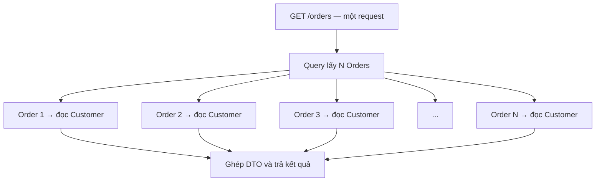

# Chi phí nhiều truy vấn và phát hiện kiểu truy cập N+1 trong Spring Data Couchbase

Một endpoint liệt kê 50 đơn hàng có thể trả kết quả đúng và rất nhanh khi thử với hai bản ghi. Nhưng trên môi trường thật, thời gian phản hồi tăng mạnh theo số đơn: một truy vấn lấy danh sách đơn, rồi mỗi đơn lại yêu cầu thêm một truy vấn lấy khách hàng, một truy vấn lấy vận đơn và đôi khi nhiều truy vấn lấy sự kiện của từng vận đơn. Đó là biểu hiện điển hình của **N+1**, vấn đề thường được nhắc đến ở ORM nhưng cũng xuất hiện trong ứng dụng **Spring Data Couchbase** dùng KV, repository, `CouchbaseTemplate`, SQL++, `@N1qlJoin` hoặc reactive API.

N+1 không chỉ là chuyện “nhiều câu SQL++”. Một lần đọc document bằng KV vẫn là thao tác I/O; một `findById` trong vòng lặp vẫn có chi phí mạng và tài nguyên KV Service; một association `LAZY` vẫn có thể phải tìm dữ liệu khi getter bị truy cập. Ngược lại, có những endpoint chủ đích thực hiện nhiều lookup có giới hạn và vẫn nhanh hơn một phép JOIN lớn. Vấn đề cần giải quyết là **số lượt truy cập tăng như thế nào theo số entity gốc**, mỗi lượt mang bao nhiêu chi phí và có đáp ứng hợp đồng API hay không.

Bài thuộc chương **Quan hệ và JOIN** của module **SPRING_DATA_COUCHBASE**: xây dựng tầng truy cập Couchbase bằng document mapping, repository, `CouchbaseTemplate` và truy vấn SQL++, kết hợp tổ chức bucket/scope/collection, chỉ mục, TTL, CAS, giao dịch và lựa chọn API reactive để giữ hiệu năng, nhất quán và khả năng vận hành.

## 1. Mục tiêu học tập

Sau bài này, bạn có thể:

1. Định nghĩa N+1 trong cả **SQL++ query** và **KV lookup**, phân biệt số thao tác logic, số round trip thực và số document được đọc.
2. Phát hiện N+1 ở service vòng lặp, repository, association `@N1qlJoin` `IMMEDIATE`/`LAZY`, serialization JSON và reactive `flatMap`.
3. Mô hình hóa chi phí latency, network, Query Service/KV Service, Index Service, CPU/memory và số byte được truyền; giải thích vì sao tăng concurrency không tự xóa N+1.
4. Thiết lập telemetry theo request: đếm query/lookup, phân loại statement, gắn trace/correlation ID, đo p50/p95/p99 và fan-out.
5. Sử dụng `EXPLAIN`, Query Profile và chỉ mục để phân biệt **một truy vấn chậm** với **một truy vấn nhanh bị gọi quá nhiều lần**.
6. Chọn DTO/projection, JOIN theo ID/field, truy vấn `IN` theo tập khóa, KV lookup có giới hạn đồng thời, embedding hoặc read model phi chuẩn hóa theo dữ liệu và workload.
7. Tránh lỗi khi tối ưu: phân trang sai cấp, nhân hàng 1:N, mất dữ liệu vì inner join, trùng tham chiếu, lộ tenant, sai độ mới của GSI và cache.
8. Thiết kế một bài benchmark có thể chứng minh giảm số lượt truy cập mà vẫn giữ kết quả nghiệp vụ.

## 2. Kịch bản xuyên suốt: Order, Customer, Shipment và Event

Giả sử bucket `commerce` có các collection:

```text
commerce
├── crm
│   └── customers
└── sales
    ├── orders
    ├── shipments
    └── shipment_events
```

Một Order ở `commerce.sales.orders`:

```json
{
  "_class": "salesOrder",
  "tenantId": "TENANT-A",
  "orderNumber": "ORD-1001",
  "customerId": "customer::TENANT-A::42",
  "customerCode": "C-42",
  "status": "PAID",
  "createdAt": "2026-11-20T08:15:00Z",
  "total": 1500000,
  "items": [
    { "sku": "SKU-42", "quantity": 2, "unitPriceAtPurchase": 350000 },
    { "sku": "SKU-18", "quantity": 1, "unitPriceAtPurchase": 800000 }
  ]
}
```

Customer ở `commerce.crm.customers`:

```json
{
  "_class": "customer",
  "tenantId": "TENANT-A",
  "customerCode": "C-42",
  "displayName": "Nguyen An",
  "accountStatus": "ACTIVE"
}
```

Shipment ở `commerce.sales.shipments`:

```json
{
  "_class": "shipment",
  "tenantId": "TENANT-A",
  "orderId": "order::TENANT-A::1001",
  "trackingNumber": "TRACK-7001",
  "state": "IN_TRANSIT",
  "shippedAt": "2026-11-21T08:00:00Z"
}
```

Event ở `commerce.sales.shipment_events`:

```json
{
  "_class": "shipmentEvent",
  "tenantId": "TENANT-A",
  "shipmentId": "shipment::TENANT-A::S-7",
  "eventType": "PACKAGE_DISPATCHED",
  "eventTime": "2026-11-21T08:00:00Z"
}
```

Ứng dụng có những API sau:

| API | Cần trả về | Đơn vị phân trang |
| --- | --- | --- |
| `GET /orders` | 20–50 Order gần đây, tên Customer | Order |
| `GET /orders/{id}` | Một Order, Customer, vài Shipment | Một Order |
| `GET /orders/{id}/shipments` | Các Shipment của Order | Shipment |
| `GET /shipments/{id}/events` | 50 Event gần nhất | Event |

`items` **được nhúng trong Order**, nên đọc một Order bằng ID đã có các item; nó không đòi query tới collection riêng. Ngược lại `customerId` và `orderId`/`shipmentId` là **ID tham chiếu sang document độc lập**. Đây là nơi thiết kế vòng lặp đọc liên kết dễ sinh N+1.

## 3. N+1 là gì trong một hệ thống document?

### 3.1. Định nghĩa thao tác

Một pattern N+1 cơ bản:

1. **Một thao tác** lấy danh sách gồm N entity gốc.
2. Với **mỗi entity**, ứng dụng thực hiện thêm **một thao tác** lấy entity/quan hệ liên quan.
3. Tổng số thao tác đọc bên dưới thường xấp xỉ **1 + N**, trước khi tính các tầng sâu hơn.



Nếu mỗi Order lại đọc Shipment rồi mỗi Shipment đọc Event, số thao tác có thể tăng theo nhiều cấp. Ví dụ N Order, mỗi Order có trung bình M Shipment và mỗi Shipment cần query Event:

```text
1 truy vấn Orders
+ N truy vấn tìm Shipments
+ (N × M) truy vấn tìm Events
--------------------------------
Tổng logic ≈ 1 + N + N×M
```

Đây là **mô hình** để nhận diện fan-out, không phải dự đoán chính xác request vật lý. Framework có thể dùng nhiều câu query khác nhau, cache, batch, prepared plan hoặc lặp thao tác KV; phải đo thực tế.

### 3.2. N+1 vẫn tồn tại khi thao tác con là KV

`CouchbaseRepository.findById(...)` thường truy cập document theo ID bằng KV. Nếu một service gọi `findById` 50 lần để đọc 50 Customer, có thể không phát sinh 50 câu SQL++, nhưng vẫn có **50 KV lookup logic**.

Vì thế telemetry chỉ đếm SQL++ mà không đếm KV có thể kết luận sai “không có N+1”.

### 3.3. N+1 không đồng nghĩa mọi multi-get đều là lỗi

Trong một trang có 20 Order và 20 Customer khác nhau, thực hiện 20 KV GET đồng thời có giới hạn có thể phù hợp với SLA hơn một JOIN query phải scan nhiều document. Điều quan trọng:

- Có **bị buộc đọc dư** khi endpoint không cần Customer không?
- Số operation tăng tuyến tính theo số Order hay đã được gom/khử trùng lặp?
- Có thể lấy đúng tập dữ liệu bằng một/few queries với chi phí thấp hơn không?
- Có chạm giới hạn concurrency, network, pool, timeout hoặc tài nguyên service không?
- Khi số Order mỗi trang hoặc concurrency tăng, p95/p99 có ổn định không?

Do đó, nhận diện N+1 là **chẩn đoán mẫu truy cập**; sửa hay giữ một phần phụ thuộc workload và số liệu.

## 4. Mô hình chi phí: số lượt gọi, độ trễ và fan-out

### 4.1. Chi phí tuần tự

Giả sử một endpoint có:

- `T_root`: thời gian query Order.
- `N`: số Order cần enrich.
- `T_lookup`: thời gian trung bình một lookup Customer.
- `T_map`: thời gian dựng/serialize DTO.

Nếu lookup thực hiện **tuần tự**, một ước lượng sơ bộ:

```text
T_request ≈ T_root + N × T_lookup + T_map
```

Ví dụ **minh họa**, không phải số liệu đo: `T_root = 12 ms`, `N = 40`, `T_lookup = 4 ms`, `T_map = 8 ms`:

```text
T_request ≈ 12 + 40 × 4 + 8 = 180 ms
```

Dù mỗi lookup chỉ mất vài mili-giây, tổng latency đã có thể vượt ngân sách API. Mạng, connection scheduling và các giai đoạn đồng bộ khác làm con số thực không nhất thiết cộng đơn giản.

### 4.2. Khi dùng concurrency có giới hạn

Nếu cho phép tối đa `C` lookup đang hoạt động đồng thời, latency của phần lookup có thể gần:

```text
T_lookup_phase ≈ ceil(N / C) × T_lookup
```

đối với công việc đồng đều và không có cạnh tranh tài nguyên. Đây **chỉ là mô hình trực giác**; trong thực tế, các request có p95 khác nhau, Queue/Network Service có thể nghẽn và Query Service có thể tốn công hơn khi concurrency tăng.

Ngay cả khi latency giảm, **số operation vẫn là N**. Tăng `C` không làm 40 requests biến thành một request; nó chuyển chi phí từ **thời gian chờ tuần tự** sang **tải đồng thời** trên ứng dụng, KV/Query Service và network.

### 4.3. Chi phí không chỉ là round trip

| Thành phần | Ví dụ trong N+1 | Hậu quả |
| --- | --- | --- |
| Network | N lần gửi request/nhận response | Overhead, RTT, queue và retransmit |
| KV Service | N lần GET theo ID | Tăng QPS/CPU và hoạt động trên dữ liệu phân tán |
| Query Service | N câu SQL++ theo từng `orderId` | Parse/plan/cache, scheduler, execution và result handling |
| Index Service | N lần index scan theo parent/business key | Entries scanned, CPU/memory/disk, contention |
| Application | N lần map DTO, callback/reactive subscription | CPU, allocations, GC, context propagation |
| Serialization | Getter association bị truy cập ngoài dự kiến | Tải dữ liệu muộn, response lớn |
| Hệ thống phân tán | Một vài lookup tail-latency cao | p95/p99 request bị kéo dài |

Một query có độ trễ nhỏ nhưng bị lặp 100 lần vẫn tốn tài nguyên cụm; ngược lại một JOIN tập hợp có thể giảm round trip nhưng làm phát sinh nhiều hàng, `Fetch` hoặc sort lớn. Cần đo cả hai phía.

### 4.4. Độ trễ dài đuôi quan trọng hơn thời gian trung bình

Trong một tập 100 lookup, cơ hội gặp ít nhất một lookup chậm cao hơn so với một lookup đơn lẻ, đặc biệt nếu endpoint đợi **tất cả** kết quả trước khi trả response. Vì vậy hãy theo dõi **p95/p99 toàn request**, không chỉ `avg query duration`.

Không lấy p95 của một lookup rồi nhân N để kết luận p95 request. Các phân bố, sự phụ thuộc và scheduling khiến công thức đơn giản không chính xác; hãy dùng công thức chỉ để nhận diện rủi ro và **đo trên workload thật**.

## 5. N+1 trong synchronous Java service: vòng lặp `findById`

### 5.1. Code dễ đọc nhưng sinh nhiều KV GET

Giả sử repository:

```java
import org.springframework.data.couchbase.repository.CouchbaseRepository;

public interface SalesOrderRepository
        extends CouchbaseRepository<SalesOrder, String> {}

public interface CustomerRepository
        extends CouchbaseRepository<Customer, String> {}
```

Service:

```java
public List<OrderRow> listRecentOrders(String tenantId) {
    List<SalesOrder> orders = findRecentOrders(tenantId);

    List<OrderRow> rows = new ArrayList<>();
    for (SalesOrder order : orders) {
        Customer customer = customerRepository
            .findById(order.getCustomerId())
            .orElse(null);

        rows.add(new OrderRow(
            order.getId(),
            order.getOrderNumber(),
            customer == null ? null : customer.getDisplayName()
        ));
    }
    return rows;
}
```

Đây là **ví dụ service rút gọn**: `findRecentOrders`, `OrderRow` và getter do dự án định nghĩa. Giả sử root trả 50 Order, code có thể tạo **một query tìm Order và 50 KV GET**. Nếu 50 Order cùng thuộc một Customer, code vẫn gọi GET lặp 50 lần trừ khi có dedupe/cache hiệu quả.

### 5.2. Đọc lại cùng Customer không nhất thiết tự được cache

Đừng giả định Spring Data Couchbase có một persistence context cấp request tự quản identity map và cache mọi `findById` giống những kỳ vọng từ Hibernate. Có thể có cache riêng ở service hoặc tầng SDK, nhưng phải biết cấu hình/hiệu lực; mặc định an toàn khi review code là **mỗi lời gọi là một thao tác có thể chạm hạ tầng**.

### 5.3. Cách phát hiện nhanh khi code review

Tìm các mẫu:

```text
for (Order order : orders)
    customerRepository.findById(...)

orders.stream()
    .map(order -> customerRepository.findById(...))

orderIds.forEach(id ->
    shipmentRepository.findByOrderId(id))

flatMap(order ->
    reactiveCustomerRepository.findById(order.customerId))
```

Không phải cứ thấy vòng lặp là khẳng định lỗi. Hãy kiểm tra **kích thước N**, method con có I/O hay không, cache/dedupe và mục đích của endpoint. Một vòng lặp xử lý `OrderItem` đã nhúng **không tự tạo N+1** nếu không gọi thêm dịch vụ lưu trữ.

## 6. N+1 qua derived repository query trên collection con

Không phải quan hệ nào cũng có ID con để KV lookup. Với `orders` và `shipments` độc lập:

```java
public interface ShipmentRepository
        extends CouchbaseRepository<Shipment, String> {

    List<Shipment> findByTenantIdAndOrderId(
        String tenantId, String orderId
    );
}
```

Code:

```java
for (SalesOrder order : orders) {
    List<Shipment> shipments = shipmentRepository
        .findByTenantIdAndOrderId(
            order.getTenantId(), order.getId()
        );

    // Ghép Shipment vào OrderDetail DTO.
}
```

Với 50 Order, đây có thể là **50 câu SQL++** quét index `shipments` cho từng `orderId`, cộng một root query. Dù mỗi câu SQL++ dùng index tốt, tổng số lần lập kế hoạch/thực thi/truyền dữ liệu có thể gây chi phí đáng kể.

Index ứng viên cho query riêng:

```sql
CREATE INDEX ix_shipments_tenant_order
ON `commerce`.`sales`.`shipments`(
    `tenantId`,
    `orderId`
);
```

Một index giúp **mỗi lượt tìm Shipment nhanh hơn**. Nó **không loại bỏ số lượt tìm** do vòng lặp. Khi thấy plan dùng index và latency từng query thấp nhưng endpoint vẫn chậm, cần nghi ngờ N+1 ở tầng ứng dụng.

## 7. `@N1qlJoin`: IMMEDIATE và LAZY đều có thể gây tải lớn

Trong những phiên bản Spring Data Couchbase hỗ trợ ANSI association, `@N1qlJoin` được khai báo trên field với alias `lks`/`rks`:

```java
import java.util.List;
import org.springframework.data.couchbase.core.query.FetchType;
import org.springframework.data.couchbase.core.query.N1qlJoin;

@N1qlJoin(
    on = "lks.tenantId = rks.tenantId " +
         "AND lks.orderNumber = rks.orderNumber",
    fetchType = FetchType.LAZY
)
private List<Shipment> shipments;
```

### 7.1. IMMEDIATE có thể tải những quan hệ không cần

`FetchType.IMMEDIATE` là mặc định theo tài liệu Spring Data Couchbase cho `@N1qlJoin`. Khi query tìm 50 Order, framework có thể phải materialize các association ngay theo đường mapping được hỗ trợ, dù API list chỉ cần ID/status.

Hậu quả cần kiểm tra:

- Có phát sinh query/lookup bổ sung trong quá trình tải Order không?
- Tổng số Shipment được materialize có tương xứng với endpoint không?
- Có biến một trang Order nhỏ thành một object graph rất lớn không?
- Có association lồng nhau vô tình được truy cập tiếp không?

**Không kết luận IMMEDIATE luôn tạo chính xác N SQL++ query.** Cách Spring Data tải association phụ thuộc phiên bản, đường truy cập và cách query được sinh. Phải đếm các thao tác **runtime**.

### 7.2. LAZY trì hoãn, nhưng không tự batch

`FetchType.LAZY` có thể tải association khi field được truy cập lần đầu. Ví dụ:

```java
List<SalesOrder> orders = repository.findRecentOrders("TENANT-A");

for (SalesOrder order : orders) {
    int shipmentCount = order.getShipments().size();
    // Tạo DTO.
}
```

Nếu có 50 Order, service truy cập 50 association khác nhau. Dù mỗi association chỉ được fetch một lần trên cùng entity instance theo mô hình API, **50 association vẫn có thể tạo nhiều lần truy cập dữ liệu**.

LAZY giải quyết **“khi nào tải?”**; N+1 yêu cầu trả lời **“tải bao nhiêu lần khi có N parent?”**. Hai câu hỏi liên quan nhưng không đồng nghĩa.

### 7.3. `@N1qlJoin` không tạo foreign key, cascade hoặc batch guarantee

Annotation `on` khai báo điều kiện ghép theo field, không tự:

- Bảo đảm `orderNumber` là duy nhất ở Order hay có đúng một Customer.
- Tự xóa Shipment khi xóa Order.
- Cập nhật nhiều document bằng transaction.
- Gộp 50 association thành một truy vấn cho mọi cách sử dụng.
- Giới hạn 20 Shipment trên mỗi Order.

Nếu cần phân trang con hoặc một DTO chỉ có vài field, truy vấn tường minh thường rõ ràng hơn một association list không giới hạn.

## 8. N+1 “ẩn” ở serialization, mapper và log

Một endpoint có thể tưởng chỉ trả 20 Order:

```java
@GetMapping("/orders")
public List<SalesOrder> listOrders() {
    return orderRepository.findRecentOrders("TENANT-A");
}
```

Nếu trả thẳng entity với getter `getCustomer()` hoặc `getShipments()` dạng lazy, bộ serialize JSON có thể **đọc các getter**, từ đó kích hoạt association loading sau khi method controller đã trả về. Vì vậy:

| Vị trí | Điều xảy ra | Vì sao dễ bỏ sót |
| --- | --- | --- |
| Repository | Root query trả Order nhanh | Đo riêng repository method thấy ổn |
| Mapper | Mapper DTO gọi getter Customer | I/O phát sinh trong bước map |
| Jackson hoặc serializer khác | Duyệt getter của entity | Query xảy ra ngoài phần code đọc dữ liệu dễ nhìn |
| `toString()` / debug | In mọi field, kể cả association | Log được thêm vào lại làm thay đổi hiệu năng |
| UI GraphQL/resolver | Mỗi node tự resolve con | Query tăng theo số node/level |

### 8.1. Không dùng entity làm hợp đồng API mặc định

DTO list:

```java
public record OrderListRow(
    String orderId,
    String orderNumber,
    String status,
    long total
) {}
```

Chỉ trả những field endpoint cần, không đụng tới association. Nếu API list cần tên Customer, hãy **quyết định chủ động** batch/JOIN/read model thay vì để serializer tự truy cập getter.

### 8.2. Kiểm thử phải bao trùm bước serialize

Một benchmark chỉ gọi `repository.find...` rồi dừng stopwatch sẽ bỏ qua phần tải lazy ở DTO/serialization. Hãy đo từ **lúc nhận HTTP request** đến **khi response hoàn thành**, đồng thời gắn trace cho các thao tác data access phát sinh trong toàn khoảng đó.

## 9. Reactive `flatMap`: tránh hiểu nhầm “song song là hết N+1”

Ví dụ reactive:

```java
Flux<OrderWithCustomer> rows = ordersFlux.flatMap(
    order -> customerRepository.findById(order.getCustomerId())
        .map(customer -> new OrderWithCustomer(order, customer)),
    8
);
```

Đây là code minh họa với `ordersFlux`, `customerRepository` và DTO do ứng dụng định nghĩa. Tham số `8` giới hạn số inner publishers hoạt động đồng thời; nó **không biến N lời gọi `findById` thành một lần đọc**.

### 9.1. Vấn đề chính của reactive N+1

- **Tổng số I/O:** vẫn có thể là N KV GET hoặc N SQL++ queries.
- **Concurrency:** nếu quá lớn, áp lực trên KV/Query Service và network tăng.
- **Thứ tự:** `flatMap` có thể trả kết quả không theo thứ tự Order đầu vào.
- **Lỗi một phần:** một lookup thất bại có thể làm cả flux lỗi hoặc bị xử lý fallback tùy code.
- **Cancellation:** client hủy request nhưng tài nguyên backend đã bị sử dụng cần được kiểm soát qua API và operator phù hợp.
- **Backpressure:** giúp quản lý luồng tiêu thụ, nhưng không tự lập chỉ mục tốt hoặc loại trùng lookup.

### 9.2. Khi nào dùng `concatMap` hoặc `flatMapSequential`?

`concatMap` giữ thứ tự nhưng có thể tuần tự hóa lookup, làm latency tăng. `flatMapSequential` có thể xử lý inner publishers đồng thời nhưng giữ thứ tự phát kết quả, đổi lại có buffering. Đừng chọn một operator chỉ vì muốn “tăng tốc”; hãy xác định **thứ tự API**, giới hạn concurrency, memory và p95 latency.

### 9.3. Lazy getter không đồng nghĩa non-blocking

Với `@N1qlJoin(fetchType = LAZY)` trên một entity, truy cập getter từ Reactor pipeline không có nghĩa getter trở thành `Mono`/`Flux` non-blocking. Cần kiểm chứng implementation/version; nếu muốn kiểm soát I/O reactive, nên viết repository/SDK reactive query tường minh và không để getter bất ngờ làm I/O.

## 10. N+1 ở nhiều tầng: Order → Shipment → Event

Giả sử một trang có N Order, mỗi Order có trung bình M Shipment:

```text
GET /orders
  ├─ 1 query: tìm N Order
  ├─ N query: tìm Shipment theo từng Order
  └─ N×M query: tìm Event theo từng Shipment
```

Nếu một event collection có hàng triệu document, các query Event có index tốt vẫn tạo nhiều lần sử dụng Query/Index Service.

### 10.1. Phát hiện fan-out lũy kế

Quan sát trace theo cây:

```text
http.server GET /orders
  couchbase.query orders_page                × 1
  couchbase.query shipments_by_order         × N
  couchbase.query events_by_shipment         × K
  response.serialize                         × 1
```

Trong đó K có thể gần tổng số Shipment đã tải. Đừng kết luận chỉ có một vấn đề N+1 ở Customer nếu request còn lặp query ở tầng Shipment/Event.

### 10.2. Giới hạn độ sâu theo endpoint

Trang Order List không cần Event; trang Order Detail có thể cần vài Shipment nhưng không cần toàn timeline. Đưa `GET /shipments/{id}/events` thành endpoint riêng, có phân trang và chỉ mục phù hợp, là một cách **loại bỏ nhu cầu tải tầng sâu**.

Giảm **phạm vi dữ liệu cần trả** thường mang lại lợi ích lớn hơn việc cố tối ưu một cây JOIN nhiều tầng mà endpoint vốn không cần.

## 11. Quy trình phát hiện N+1 bằng telemetry

### 11.1. Đặt giả thuyết có thể kiểm chứng

Một giả thuyết tốt:

> Với `GET /orders?size=N`, số thao tác truy cập Customer tăng xấp xỉ tuyến tính theo N, dù số Customer phân biệt ít hơn N.

Một giả thuyết khác:

> `getShipments()` từ DTO mapper làm phát sinh SQL++ sau khi repository root query đã hoàn tất.

Những giả thuyết này có thể được kiểm tra bằng **đếm thao tác theo request** và thay đổi N giữa các lần chạy. Không chỉ nhìn một trace ngẫu nhiên rồi kết luận toàn ứng dụng có lỗi.

### 11.2. Gắn correlation ID cho toàn request

Ở tầng HTTP/service, dùng một request/trace ID nhất quán:

```text
traceId = 8f...      (ví dụ ngẫu nhiên)
route   = GET /orders
tenant  = TENANT-A   (đã xác thực)
pageSize= 50
```

Các span/metric của data access cần nằm dưới cùng trace. Với Couchbase SDK, có thể sử dụng tracing/observability tích hợp phù hợp phiên bản; SQL++ query options có cơ chế `clientContextId` để hỗ trợ đối chiếu request query. Không mặc định mọi KV GET sẽ có `clientContextId` giống SQL++: KV và Query Service có cơ chế observability riêng.

**Bảo vệ dữ liệu:** không log email, token, toàn bộ bind parameters hoặc SQL++ chứa dữ liệu nhạy cảm vào hệ thống telemetry không được phép. Mask/giới hạn tag tenant/customer theo chính sách bảo mật và cardinality của metric.

### 11.3. Những con số tối thiểu cần ghi

| Metric theo request | Mục đích |
| --- | --- |
| `orders.returned` | Kích thước N của tập gốc |
| `customer.uniqueIds` | Số ID Customer phân biệt |
| `kv.get.count` | Số GET theo ID |
| `sqlpp.query.count` | Số SQL++ query |
| `query.fingerprint.count` | Một dạng query bị lặp bao nhiêu lần |
| `shipment.lookup.count` | Số truy vấn con theo Order |
| `data_access.total_duration` | Chi phí truy cập tích lũy hoặc thời gian đoạn truy cập |
| `http.duration` | p50/p95/p99 request |
| `response.bytes` | Khối lượng kết quả |

`data_access.total_duration` có thể là **tổng thời gian các span**, không bằng wall-clock khi I/O chạy song song. Không cộng các span đồng thời rồi gọi đó là thời gian request.

### 11.4. Fingerprint thay vì log nguyên văn mọi query

Những query:

```sql
SELECT ... FROM `commerce`.`sales`.`shipments` AS s
WHERE s.tenantId = $tenantId AND s.orderId = $orderId;
```

khác nhau ở `orderId` nhưng cùng một **query shape/fingerprint**. Nếu trong một HTTP request có một fingerprint xuất hiện 50 lần với 50 `orderId`, rất đáng điều tra N+1.

Hãy parameterize query và gắn nhãn **truy vấn nghiệp vụ** như `shipments_by_order` ở telemetry. Không dùng chuỗi chứa giá trị từng đơn làm tên metric vì làm bùng nổ metric cardinality.

## 12. Từ trace đến kết luận: phân biệt lặp nhiều với một query chậm

### 12.1. Hai trường hợp khác nhau

| Quan sát | Có thể là | Hướng điều tra |
| --- | --- | --- |
| 50 query `by_orderId`, mỗi query vài ms | N+1 theo parent | Batch/IN/JOIN hoặc đổi phạm vi tải |
| Một query 2 giây, scan hàng triệu entries | Index/predicate/plan kém | `EXPLAIN`, spans, Fetch, Query Profile |
| Một JOIN trả 500.000 hàng | Fan-out/cardinality | Đổi projection, phân trang, query shape |
| Một KV GET theo ID nhanh, lặp 100 lần cho cùng ID | Thiếu dedupe theo request | Gom ID phân biệt/cache đúng phạm vi |
| Query count không tăng nhưng response quá lớn | Tải/nest một mảng khổng lồ | Giới hạn dữ liệu, phân trang child |
| Query count vừa tăng vừa mỗi query chậm | N+1 kết hợp thiếu index | Cần sửa cả access pattern lẫn index |

Mục tiêu không phải đưa `sqlpp.query.count` về 1 bằng mọi giá. Một query lớn sai cardinality hoặc trả toàn bộ dữ liệu có thể còn tệ hơn vài query nhỏ được kiểm soát.

### 12.2. Một chỉ số định hướng

Có thể tính trong báo cáo thử nghiệm:

```text
read_operations_per_root =
    (sqlpp.query.count + kv.get.count) / max(1, root_count)
```

Đây **không phải metric chuẩn của Couchbase** và không dùng để so sánh Query với KV như cùng chi phí. Nó chỉ cho thấy mức tăng thao tác theo số root. Hãy theo dõi riêng hai loại operation để không đánh mất thông tin.

Một mẫu N+1 rõ rệt thường có **query count tăng gần tuyến tính theo N**, trong khi một phương án batch tốt có thể giữ số query theo số trang, không theo số Order.

### 12.3. Đo với nhiều kích thước N

Thử cùng endpoint ở các kích thước trang:

| `N` | Số thao tác theo mẫu N+1 (1 + N) | Số thao tác với một truy vấn tập hợp |
| --- | --- | --- |
| 1 | 2 | Có thể 1–2 |
| 10 | 11 | Có thể 1–2 |
| 50 | 51 | Có thể 1–2 |
| 100 | 101 | Có thể 1–2 |

Đây là **mô hình số thao tác logic**, không phải kết quả benchmark hoặc bảo đảm rằng batch sẽ luôn chỉ có một request vật lý. Kết luận dựa trên đường tăng trưởng khi đo thực tế.

## 13. `EXPLAIN` và Query Profile: nhìn thấy chi phí của mỗi query

Giả sử mỗi Order khiến repository tìm Shipment:

```sql
SELECT META(s).id AS shipmentId,
       s.trackingNumber,
       s.state
FROM `commerce`.`sales`.`shipments` AS s
WHERE s.tenantId = "TENANT-A"
  AND s.orderId = "order::TENANT-A::1001";
```

Chạy:

```sql
EXPLAIN
SELECT META(s).id AS shipmentId,
       s.trackingNumber,
       s.state
FROM `commerce`.`sales`.`shipments` AS s
WHERE s.tenantId = "TENANT-A"
  AND s.orderId = "order::TENANT-A::1001";
```

Index ứng viên:

```sql
CREATE INDEX ix_shipments_tenant_order
ON `commerce`.`sales`.`shipments`(
    `tenantId`,
    `orderId`
);
```

Trong plan và profile:

- `IndexScan`/`IndexScan3`: optimizer đang chọn index nào?
- `spans`: hai equality có giúp thu hẹp vùng scan?
- `Fetch`: có phải đọc JSON đầy đủ để lấy `trackingNumber`/`state`?
- Số entries scanned, documents fetched, rows returned.
- `elapsedTime`/`executionTime` và thời gian của từng operator nếu có Query Profile.

Nếu plan tốt và mỗi query trả hai Shipment, nhưng HTTP trace có 100 query tương tự, nguyên nhân chính có thể nằm ở **cách gọi lặp**. Đừng tiếp tục thêm index vô hạn khi access pattern mới là nút thắt.

### 13.1. Plan của query gốc chưa đủ

Khi `@N1qlJoin(fetchType=LAZY)` hoặc một mapper kích hoạt query sau đó, `EXPLAIN` của câu `SELECT orders` chỉ phản ánh **phần root**. Muốn chẩn đoán N+1, cần thu thập **cả SQL++/KV của các association** trong cùng trace.

### 13.2. Phân biệt index readiness với N+1

Chỉ mục `online` chứng minh nó có thể được sử dụng, **không** chứng minh optimizer đã chọn hoặc service không lặp query. Kiểm tra metadata:

```sql
SELECT name, state, index_key, condition,
       bucket_id, scope_id, keyspace_id
FROM system:indexes
WHERE bucket_id = "commerce"
  AND scope_id = "sales"
  AND keyspace_id = "shipments";
```

Không cần tạo thêm index nếu query lặp đã có kế hoạch đủ tốt; ưu tiên giảm **số lần gọi**.

## 14. Cách khắc phục A: không tải dữ liệu chưa cần thiết

Đây thường là phương án dễ hiểu và rẻ nhất: **nếu endpoint không cần Customer/Shipment, không lấy chúng**.

### 14.1. Projection nhỏ cho danh sách

```sql
SELECT META(o).id AS orderId,
       o.orderNumber,
       o.status,
       o.createdAt,
       o.total
FROM `commerce`.`sales`.`orders` AS o
WHERE o.tenantId = $tenantId
  AND o.status = $status
ORDER BY o.createdAt DESC
LIMIT $limit;
```

Một DTO:

```java
public record OrderListRow(
    String orderId,
    String orderNumber,
    String status,
    java.time.Instant createdAt,
    long total
) {}
```

Không có getter `getCustomer()` hoặc `getShipments()` để serializer vô tình kích hoạt lazy association. Nếu ứng dụng dùng repository entity, cần kiểm soát mapping/projection thật để chắc chắn code không materialize những field liên kết không cần.

### 14.2. Tách list và detail

```text
GET /orders
    -> fields nhẹ, không load mọi relationship

GET /orders/{id}
    -> một Order + Customer + các Shipment cần thiết

GET /orders/{id}/shipments?limit=20
    -> danh sách con có giới hạn, phân trang riêng
```

Một endpoint tổng hợp toàn bộ graph không phải lúc nào cũng tiện lợi: nó buộc list nhỏ và timeline khổng lồ cùng dùng một kiểu tải.

## 15. Cách khắc phục B: JOIN khi cần thông tin từ nhiều collection

### 15.1. Khi Order giữ document ID của Customer

Lấy trang Order kèm tên Customer hiện hành:

```sql
SELECT META(o).id AS orderId,
       o.orderNumber,
       o.status,
       c.displayName AS customerName
FROM `commerce`.`sales`.`orders` AS o
LEFT JOIN `commerce`.`crm`.`customers` AS c
  ON KEYS o.customerId
WHERE o.tenantId = $tenantId
  AND o.status = $status
ORDER BY o.createdAt DESC
LIMIT $limit;
```

`ON KEYS o.customerId` dùng **document ID** để lookup Customer. Nó không cần secondary index trên `customerCode` ở phía Customer chỉ để tìm document theo ID. Phía Orders vẫn cần một đường scan/index phù hợp theo `tenantId/status/createdAt` khi tìm nhiều đơn.

Sử dụng `LEFT JOIN` để giữ Order không còn Customer; projection/DTO phải xử lý trường `customerName` vắng hoặc `MISSING`. Kiểm tra tenant/authorization của Customer liên quan: document ID không phải bằng chứng rằng người dùng được phép đọc tất cả field của document đó.

### 15.2. Khi chỉ có business key

Nếu Order chỉ lưu `customerCode` và Customer có cùng field:

```sql
SELECT META(o).id AS orderId,
       o.orderNumber,
       c.displayName AS customerName
FROM `commerce`.`sales`.`orders` AS o
LEFT JOIN `commerce`.`crm`.`customers` AS c
  ON o.tenantId = c.tenantId
 AND o.customerCode = c.customerCode
WHERE o.tenantId = $tenantId;
```

Đây là **ANSI JOIN theo field**, có thể cần index trên `customers(tenantId,customerCode)` cho kế hoạch index join, bên cạnh index của root query. Phải bảo đảm cặp key Customer **duy nhất theo nghiệp vụ**; nếu dữ liệu Customer trùng key, một Order có thể bị nhân thành nhiều hàng.

### 15.3. JOIN giảm số query nhưng không bảo đảm ít công việc hơn

Một SQL++ JOIN có thể:

- Scan nhiều Order hoặc Customer nếu index không phù hợp.
- Fetch nhiều JSON gốc.
- Nhân hàng khi quan hệ 1:N hoặc business key bị trùng.
- Sort/group một tập trung gian lớn.
- Tăng kích thước response vì lặp lại các field Order.

Do đó, **đừng biến N+1 thành một JOIN khổng lồ mà không kiểm tra cardinality, projection và `EXPLAIN`**. Với 50 Order và 10.000 Shipment mỗi Order, một JOIN thẳng có thể trả hàng trăm nghìn hàng và không phù hợp UI.

### 15.4. `LIMIT` sau JOIN 1:N là bẫy phân trang

```sql
SELECT META(o).id AS orderId, s.trackingNumber
FROM `commerce`.`sales`.`orders` AS o
JOIN `commerce`.`sales`.`shipments` AS s
  ON o.tenantId = s.tenantId
 AND META(o).id = s.orderId
WHERE o.tenantId = $tenantId
ORDER BY o.createdAt DESC
LIMIT 20;
```

`LIMIT 20` giới hạn **20 hàng sau join**, không phải 20 Order phân biệt. Một Order có 20 Shipment có thể chiếm toàn bộ trang. Nếu hợp đồng API là “20 Order”, hãy **chọn 20 Order trước** rồi lấy Shipment theo tập Order đó hoặc dùng một kế hoạch/query chia hai giai đoạn có kiểm soát.

## 16. Cách khắc phục C: một truy vấn con theo **tập khóa**

### 16.1. Từ N query sang một query với `IN`

Sau khi lấy trang 20 Order, thu thập `orderId`:

```text
orderIds =
  ["order::TENANT-A::1001",
   "order::TENANT-A::1002",
   "order::TENANT-A::1003", ...]
```

Thay vì gọi 20 lần:

```sql
WHERE s.orderId = $oneOrderId
```

gọi một query:

```sql
SELECT META(s).id AS shipmentId,
       s.orderId,
       s.trackingNumber,
       s.state,
       s.shippedAt
FROM `commerce`.`sales`.`shipments` AS s
WHERE s.tenantId = $tenantId
  AND s.orderId IN $orderIds;
```

`$orderIds` phải là **tham số mảng** được truyền qua SDK/framework, không ghép chuỗi SQL++ từ các ID user nhập.

Sau đó group kết quả theo `orderId` trong service:

```java
Map<String, List<ShipmentRow>> byOrder = rows.stream()
    .collect(Collectors.groupingBy(ShipmentRow::orderId));

for (SalesOrder order : orders) {
    List<ShipmentRow> shipments = byOrder
        .getOrDefault(order.getId(), List.of());
    // Ghép DTO, giữ đúng thứ tự Orders đã chọn.
}
```

Đây là code mẫu của service; `ShipmentRow`, `rows`, `orders` là kiểu/biến thuộc ứng dụng. Cần xác nhận mọi Shipment trả về cùng tenant và thuộc tập order ID đã được phép truy cập.

### 16.2. Index và `EXPLAIN` cho query tập hợp

```sql
CREATE INDEX ix_shipments_tenant_order
ON `commerce`.`sales`.`shipments`(
    `tenantId`,
    `orderId`
);
```

Lọc equality tenant và membership trong tập `orderId` có thể được optimizer xử lý thành các dải scan hoặc chiến lược khác tùy phiên bản/số giá trị trong mảng. Cần kiểm tra:

- Truy vấn có dùng index đúng không?
- Danh sách `orderIds` quá dài có làm payload hoặc planning/execution tốn kém không?
- Có tập ID trùng phải khử trước khi gửi không?
- Có Shipment quá nhiều làm response vượt khả năng memory không?

**Không biến một batch vô hạn thành truy vấn có mảng một triệu ID.** Chunk theo kích thước trang và ngưỡng tài nguyên, có giới hạn concurrency; số query khi chunking có thể là vài query, vẫn tốt hơn N query theo từng parent trong nhiều tình huống.

### 16.3. Không dùng một `LIMIT 20` toàn cục khi cần 20 Shipment cho mỗi Order

Truy vấn:

```sql
SELECT ...
FROM `commerce`.`sales`.`shipments` AS s
WHERE s.orderId IN $orderIds
ORDER BY s.shippedAt DESC
LIMIT 20;
```

chỉ trả **20 Shipment tổng cộng**, không phải 20 Shipment *cho từng Order*. Đây là lỗi rất dễ xảy ra khi “batch hóa” một endpoint vốn có giới hạn per-parent.

Nếu thực sự cần “20 Shipment mới nhất cho **mỗi** Order”, cần kế hoạch khác, chẳng hạn:

- Phân trang từng collection con theo yêu cầu UI, không cố mang tất cả vào list page.
- Dùng khả năng window/aggregation theo từng group nếu phiên bản SQL++ hỗ trợ và đã kiểm chứng plan.
- Thực hiện một số query theo từng nhóm/order với giới hạn concurrency và ngân sách query rõ ràng.
- Dùng read model lưu preview `latestShipments` có giới hạn với chính sách cập nhật.

Tối ưu truy vấn nhưng thay đổi hợp đồng “20 mỗi Order” thành “20 tất cả” là lỗi nghiệp vụ, không phải cải thiện hiệu năng hợp lệ.

### 16.4. Mảng `IN` cần xử lý tập rỗng

Nếu trang không có Order:

- Không chạy query Shipment vô nghĩa.
- Trả danh sách rỗng/DTO rỗng theo hợp đồng.
- Không cố dựng `IN ()` bằng nối chuỗi SQL++.

Nếu tập ID có `null`/trùng/lệch tenant, chuẩn hóa và kiểm soát tại service trước khi query.

## 17. Cách khắc phục D: dedupe và điều phối KV GET có giới hạn

Nếu mỗi Order giữ `customerId` và nhiều Order dùng chung Customer:

1. Lấy tập Customer ID **phân biệt** từ những Order trong trang.
2. Bỏ giá trị trống, kiểm tra ID thuộc phạm vi tenant hợp lệ.
3. Đọc mỗi Customer **một lần logic** trong request, với concurrency có giới hạn.
4. Ghép theo ID, xử lý Customer không tồn tại hoặc không được phép đọc.

Ví dụ:

```text
50 Orders
  → 12 Customer IDs phân biệt
  → 12 KV GET có giới hạn concurrency
  → 50 DTO OrderWithCustomer
```

So với 50 lần gọi lặp, đây có thể giảm đáng kể I/O khi ID được dùng lại.

### 17.1. `findAllById` không nhất thiết là một round trip vật lý

Một interface repository có thể hỗ trợ `findAllById(ids)`. Nhưng **không** mặc định rằng method này tương đương một yêu cầu mạng duy nhất đến Couchbase. Implementation có thể thực hiện nhiều KV get bên dưới, có thể xử lý concurrent hoặc tuần tự tùy phiên bản/đường gọi.

Hãy đo **số KV operations** và latency. “Một Java method call” khác với “một I/O operation”.

### 17.2. Bounded concurrency khác cache vô hạn

Giữ một map cấp request từ `customerId` tới kết quả đã đọc giúp tránh đọc lại cùng ID trong chính request. Cache dùng chung process/distributed cache là một quyết định lớn hơn:

- TTL/eviction bao nhiêu?
- Khi Customer đổi tên hoặc bị vô hiệu hóa, cache được invalidation thế nào?
- Cache key có bao gồm tenant và quyền không?
- Có cho phép cache negative result (không tìm thấy) không và trong bao lâu?
- Khi service scale nhiều instance, consistency được bảo đảm ra sao?

Không đưa một cache vô hạn vào RAM để “giải quyết N+1” mà không có chính sách độ mới, phân quyền, eviction và quan sát.

### 17.3. Đừng lẫn bulk KV với SQL++ batch query

- **KV theo ID:** phù hợp khi có danh sách **document ID**; có thể cần nhiều GET vật lý dù gọi theo một phương thức tổng hợp.
- **SQL++ `WHERE field IN $ids`:** phù hợp khi lọc nhiều document theo một field như `orderId`; cần GSI và kế hoạch phù hợp.
- **SQL++ `JOIN ... ON KEYS`:** phù hợp khi bên trái có document ID của bên phải; có thể gom enrichment ở Query Service.

Không có phương án nào luôn tốt nhất. Hãy so sánh query/GET count, p95 latency, result bytes và ảnh hưởng tải ở từng service.

## 18. Cách khắc phục E: embedding và denormalized read model

### 18.1. Khi nhúng dữ liệu nhỏ, cùng vòng đời

Order có `items` nhúng, nên một `findById(orderId)` đã có mảng item. Nếu các item luôn được đọc cùng Order, có giới hạn kích thước và thay đổi cùng aggregate, embedding tránh những query tìm item riêng.

Nhưng không nhúng một danh sách `shipmentEvents` tăng mãi hoặc mảng ID hàng triệu phần tử vào một document. Điều đó chỉ đổi N+1 thành **document lớn, contention CAS và chi phí ghi/đọc khác**.

### 18.2. Snapshot khác cache tên hiện tại

Order có thể chứa:

```json
{
  "customerId": "customer::TENANT-A::42",
  "customerNameAtPurchase": "Nguyen An",
  "customerDisplayNameCache": "Nguyen An",
  "customerDisplayNameCacheVersion": 17
}
```

Hai field có ý nghĩa khác nhau:

- `customerNameAtPurchase` là **snapshot lịch sử**; không nhất thiết đổi khi Customer đổi tên.
- `customerDisplayNameCache` là **bản sao hiển thị hiện tại**, cần chính sách cập nhật, retry và đối soát.

Nếu API Order List chỉ cần tên tại thời điểm mua, dùng snapshot có thể loại bỏ hoàn toàn Customer lookup mà không làm sai nghiệp vụ. Nếu API cần tên Customer hiện hành, phải kiểm soát độ mới của cache.

### 18.3. Event-driven read model có chi phí riêng

Một read model lưu `OrderSummary` có thể chứa:

```json
{
  "tenantId": "TENANT-A",
  "orderNumber": "ORD-1001",
  "status": "PAID",
  "customerName": "Nguyen An",
  "shipmentCount": 2,
  "lastShipmentState": "IN_TRANSIT",
  "sourceVersion": 17
}
```

Đường đọc nhẹ hơn nhưng hệ thống phải quản lý:

1. Nguồn chân lý của mỗi field.
2. Event/cơ chế đồng bộ khi Customer hoặc Shipment thay đổi.
3. Idempotency, xử lý event đến trễ/lặp/sai thứ tự.
4. Backfill, reconciliation và chính sách migration.
5. Độ trễ cho phép và xử lý khi dữ liệu read model tạm cũ.
6. TTL/xóa dữ liệu cá nhân trong mọi bản sao.

Đừng dùng denormalization để che N+1 rồi mặc nhiên tuyên bố dữ liệu nhiều collection đã nhất quán.

## 19. SQL++ JOIN, batch và quyền tenant

Tối ưu N+1 thường kết hợp nhiều nguồn, nên phải giữ đúng ranh giới quyền:

```sql
SELECT META(o).id AS orderId, c.displayName
FROM `commerce`.`sales`.`orders` AS o
LEFT JOIN `commerce`.`crm`.`customers` AS c
  ON o.tenantId = c.tenantId
 AND o.customerCode = c.customerCode
WHERE o.tenantId = $tenantId;
```

`$tenantId` phải được lấy từ identity/context đã xác thực. Nếu dùng business key chỉ `customerCode` mà thiếu điều kiện tenant, dữ liệu hai tenant có thể bị kết hợp sai.

### 19.1. JOIN không làm business key thành duy nhất

Nếu trong một tenant có hai Customer cùng `customerCode`, ANSI JOIN có thể sinh hai hàng cho một Order. Khi thay N+1 bằng JOIN, cần so sánh **tập Order phân biệt**, không chỉ đếm tổng rows. Một kết quả nhanh nhưng nhân bản Order là lỗi nghiệp vụ.

Với `ON KEYS`, document ID cụ thể tránh việc match nhiều document theo business key, nhưng ID vẫn có thể sai tenant/không tồn tại và phải kiểm tra quyền.

### 19.2. `LEFT JOIN` và bộ lọc phía phải

Nếu muốn giữ Order khi Customer không có hoặc bị xóa, dùng left join và thiết kế fallback. Đừng vô tình viết:

```sql
SELECT META(o).id AS orderId, c.displayName
FROM `commerce`.`sales`.`orders` AS o
LEFT JOIN `commerce`.`crm`.`customers` AS c
  ON o.tenantId = c.tenantId
 AND o.customerCode = c.customerCode
WHERE o.tenantId = $tenantId
  AND c.accountStatus = "ACTIVE";
```

và nghĩ mọi Order vẫn còn: bộ lọc `c.accountStatus` trong `WHERE` có thể loại Order không có Customer. Nếu nghiệp vụ muốn **chỉ ghép Customer ACTIVE nhưng vẫn giữ Order**, đặt điều kiện match thích hợp trong `ON` rồi kiểm tra hành vi với `MISSING`.

### 19.3. Không batch dữ liệu vượt quyền

Tập `orderIds` dùng cho `IN` phải được lấy từ những Order mà caller có quyền. Không nhận một mảng ID tùy ý từ client rồi truy cập Shipment hoặc Customer của mọi tenant. Giữ **authorization check ở từng phía** và dùng RBAC trên collection phù hợp.

## 20. Nhất quán, TTL, CAS và transaction khi thay đổi chiến lược tải

### 20.1. Batch hai bước có thể thấy hai thời điểm khác nhau

Ví dụ:

1. Lúc 10:00, query trang Order trả 20 ID.
2. Lúc 10:00:01, một Shipment mới được tạo.
3. Lúc 10:00:02, query batch Shipment theo tập Order ID.

Kết quả có thể bao gồm Shipment mới dù Order list được lấy trước đó. Điều này không nhất thiết là bug nếu API chấp nhận dữ liệu hiện hành. Nhưng nếu yêu cầu snapshot giao dịch tại một thời điểm, hai query độc lập **không tự bảo đảm** điều đó.

### 20.2. `NOT_BOUNDED` và `REQUEST_PLUS`

Global Secondary Index (GSI) được cập nhật bất đồng bộ từ KV mutations. Với SQL++ truy vấn theo field:

| Chế độ scan | Hệ quả |
| --- | --- |
| `NOT_BOUNDED` | Không chờ index bắt kịp mutation mới; kết quả có thể tạm cũ |
| `REQUEST_PLUS` | Chờ index bắt kịp mutation liên quan tại thời điểm query; có thể tăng latency |

Sau khi thêm Shipment bằng KV, query `WHERE orderId = $id` có thể chưa thấy ngay Shipment ở mức không chờ index. Không dùng một query list có độ mới không rõ làm nguồn kiểm tra quyền nhạy cảm duy nhất.

Việc tăng `REQUEST_PLUS` cho **50 query N+1** có thể làm ngân sách latency tệ hơn nếu mỗi query chờ riêng. Trước hết nên thiết kế đường truy cập phù hợp với yêu cầu độ mới; sau đó benchmark consistency cần thiết.

### 20.3. CAS không chữa N+1, N+1 không phải vấn đề giao dịch

`@Version`/CAS phục vụ phát hiện ghi đè một document bị sửa đồng thời. Transaction phục vụ nhóm thay đổi đa document có yêu cầu nguyên tử, trong phạm vi Couchbase/SDK hỗ trợ. Chúng **không tự gộp** N lời gọi `findById`/SQL++ thành một truy vấn.

Ngược lại, việc batch 50 Shipment thành một query không làm thao tác ghi Order/Shipment trở thành nguyên tử. Không dùng một kỹ thuật tối ưu read path làm lý do bỏ kiểm soát nhất quán ở write path.

### 20.4. TTL và association mồ côi

Customer/Shipment hết hạn hoặc bị xóa không tự làm mọi reference được dọn. Khi dùng inner JOIN, một Order thiếu Customer có thể biến mất khỏi kết quả. Khi dùng cache, một Customer đã xóa có thể vẫn hiện nếu cache chưa được invalidation.

Chọn rõ:

- Giữ Order và fallback tên đã lưu?
- Dọn cache khi nhận sự kiện xóa?
- Không trả thông tin nhạy cảm sau khi quyền bị thu hồi?
- Xử lý `null`/missing Customer trong DTO?
- Khi batch theo ID, có cho phép kết quả thiếu một phần không?

Một refactor N+1 đạt hiệu năng nhưng làm sai retention/quyền là refactor không đạt yêu cầu.

## 21. Benchmark theo đường tăng trưởng, không chỉ theo một request

### 21.1. Xây dataset đại diện

Ít nhất tạo các trường hợp:

- Tenant nhỏ: 10 Order.
- Tenant vừa: 1000 Order, mỗi Order 0–3 Shipment.
- Tenant lớn: số Order đáng kể và một số Order có nhiều Shipment bất thường.
- Nhiều Order cùng một Customer để đo lợi ích dedupe.
- Nhiều Customer khác nhau để kiểm tra trường hợp khó nhất cho batch KV.
- Customer không tồn tại, Shipment đã xóa hoặc dữ liệu khác tenant.
- Mảng `items` nhúng lớn/nhỏ để tránh quy nhầm chi phí network do kích thước document thành N+1.

Không cần tạo hàng triệu document nếu môi trường không đủ nguồn lực; mục tiêu là mô hình hóa **phân bố thực tế** trong phạm vi lab.

### 21.2. Thử cùng một endpoint bằng các phương án

| Phương án | Đường đọc | Chỉ số cần so |
| --- | --- | --- |
| A — Loop `findById` | Root Orders + từng Customer KV GET | KV count, p95, cache hit/dedupe |
| B — Loop derived query | Root Orders + SQL++ Shipment từng Order | Query count, IndexScan/Fetch, p95 |
| C — ANSI/lookup JOIN | Một SQL++ kết hợp thích hợp | Rows sau join, sort, Fetch, p95 |
| D — Query `IN` tập Order IDs | Root Orders + 1/vài query Shipments | Query count, response size, grouping |
| E — KV dedupe | Root Orders + Customer IDs phân biệt | Unique IDs, GET count, concurrency |
| F — DTO/read model | Query OrderSummary nhẹ | Dữ liệu sao chép, độ mới và chi phí ghi |

Giữ cùng điều kiện tenant, page size, sort, dữ liệu và concurrency. **So sánh sự tương đương về kết quả trước khi so latency**.

### 21.3. Tách các thành phần thời gian

Đo:

```text
T_http_total
  T_root_query
  T_related_data
  T_mapping_and_grouping
  T_serialization
  T_network_response
```

Các khoảng thời gian có thể chồng lấn trong reactive/concurrent code. Không cộng chúng như những bước hoàn toàn tuần tự nếu trace cho thấy overlap. Bên cạnh p95/p99 toàn request, quan sát QPS đến Query/KV Service và mức sử dụng tài nguyên khi đồng thời nhiều request.

### 21.4. Tiêu chí chấp nhận

Một refactor nên chứng minh:

1. Kết quả business tương đương, gồm Customer thiếu, Shipment 0/1/nhiều.
2. Số truy cập dữ liệu không tăng tuyến tính ngoài dự kiến khi page size tăng.
3. p95/p99 và error/timeout đạt SLA dưới tải đại diện.
4. Không tăng response bytes hoặc chi phí scan/Join quá mức.
5. Không làm sai pagination, sort, tenant/authorization, TTL và độ mới cần thiết.
6. Index mới (nếu có) không gây chi phí ghi/Index Service quá lớn.

“Số SQL++ từ 51 xuống 1” là tín hiệu tốt, nhưng không đủ nếu JOIN trả 5000 hàng hoặc làm mất Order không có Customer.

## 22. Tự động phát hiện regression N+1 trong kiểm thử

### 22.1. Test số lời gọi repository — hữu ích nhưng chưa đủ

Trong unit test service, có thể dùng mock để đếm:

```text
Khi load 50 Orders:
  customerRepository.findById(...) có bị gọi 50 lần?
  shipmentRepository.findByTenantIdAndOrderId(...) có bị gọi 50 lần?
```

Mock giúp phát hiện vòng lặp rõ ràng. Nhưng nó không thấy I/O do Spring Data mapping, SDK, lazy getter hoặc serializer phát sinh bên dưới một method. Vì vậy cần thêm integration test/observability.

### 22.2. Integration test “N tăng nhưng query không tăng cùng tỷ lệ”

Một test bảo vệ pattern:

```text
N=5:
  data_access_operation_count = đo thực tế

N=50:
  data_access_operation_count = đo thực tế

ASSERT:
  Số query theo tập không tăng 10 lần
  nếu thiết kế kỳ vọng một truy vấn batch cho mỗi trang.
```

Ngưỡng thực phụ thuộc version, số chunk, cache và hướng truy cập. Không cứng hóa test thành “luôn đúng 2 query” nếu implementation có query metadata hoặc SDK internal operations khác không ảnh hưởng nghĩa vụ nghiệp vụ. Nên gắn **operation label** cho đường dữ liệu cần bảo vệ.

### 22.3. Bảo vệ serializer và GraphQL resolver

Nếu API trả entity lazy, test phải thực sự serialize response hoặc thực thi resolver tương ứng. Nếu chỉ mock controller method và không serialize, test có thể bỏ qua N+1 phát sinh sau đó.

Với endpoint truy vấn trường con tùy chọn, đo cả trường hợp **client không yêu cầu relation** và **client yêu cầu relation**. Một resolver dạng DataLoader/batch có thể giảm query khi nhiều node cùng cần Customer, nhưng vẫn phải kiểm soát cache theo request/tenant và tính nhất quán.

### 22.4. Kiểm tra bằng budget theo route

Có thể đặt mục tiêu vận hành như:

```text
route: GET /orders
page_size_max: 50
expected_data_access:
  root_query: 1 logical query
  related_query: 0..few, tùy projection
  KV GET: đo và giới hạn theo unique IDs
```

Đây là **quy ước telemetry nội bộ**, không phải cấu hình mặc định của Couchbase hay Spring Data. Budget phải được phê duyệt theo workload và cập nhật khi API thêm chức năng.

## 23. Triển khai refactor N+1 an toàn trong production

### 23.1. Expand → measure → switch → observe → contract

```text
Giữ đường đọc cũ + instrument
          |
          v
Xác định fingerprint bị lặp và fan-out
          |
          v
Thêm index cần thiết / query batch / DTO mới
          |
          v
So kết quả và performance ở staging
          |
          v
Canary qua feature flag
          |
          v
Theo dõi p95/p99, Query/KV count và Index Service
          |
          v
Mở rộng rollout, thu hồi đường đọc/index cũ khi an toàn
```

### 23.2. Đừng tự tạo index ở mọi instance

Nếu giải pháp mới cần GSI trên `shipments(tenantId,orderId)`, tạo/build index qua pipeline DDL được phép, đợi `online` và xác minh `EXPLAIN` trước khi bật code. Các instance Spring Boot không nên cùng nhau tự chạy DDL production không có kiểm soát.

### 23.3. Theo dõi cả tải mới lên Query Service

Chuyển 50 KV GET sang một SQL++ JOIN có thể giảm round trip, nhưng tăng trách nhiệm của Query Service và Index Service. Kiểm tra capacity, timeout, CPU/memory, số row và tài nguyên khi nhiều request concurrent.

Nếu query batch làm response lớn, xem lại projection, số child per parent và giới hạn trang. Không che lỗi bằng cách tăng timeout vô hạn.

### 23.4. Rollback vẫn phải giữ tính đúng dữ liệu

Trong giai đoạn canary, hai đường đọc có thể dùng mức scan consistency khác nhau. Trước khi kết luận “kết quả khác là lỗi”, xác minh dữ liệu có mutation đồng thời hay không, quyền truy cập, thời điểm query, cache và JOIN semantics. Khi rollback, giữ index mới nếu còn phiên bản/query khác phụ thuộc; thu hồi DDL là bước vận hành riêng.

## 24. Các lỗi thường gặp và cách chẩn đoán

| Triệu chứng | Nguyên nhân khả dĩ | Hướng xử lý |
| --- | --- | --- |
| p95 tăng gần tuyến tính theo page size | Một lookup/SQL++ trên mỗi Order | Đếm thao tác theo trace, thử JOIN/batch |
| SQL++ count ít nhưng KV GET count cao | N+1 theo document ID | Dedupe ID, batch/concurrency có giới hạn |
| Repository root query rất nhanh nhưng HTTP chậm | Getter lazy, mapper hoặc serializer gây tải sau đó | Instrument toàn request, dùng DTO |
| `@N1qlJoin(LAZY)` vẫn có N query | Getter của N entity đều được truy cập | Đổi phạm vi tải/explicit query |
| Reactive nhanh ở tải thấp nhưng timeout dưới tải cao | Concurrency fan-out quá lớn | Giới hạn concurrency, giảm số lookup |
| Một câu SQL++ chậm với scan rộng | Thiếu index hoặc plan không phù hợp | `EXPLAIN`, `spans`, Query Profile |
| Chuyển N+1 sang JOIN làm Order trùng | Quan hệ 1:N hoặc business key không duy nhất | Phân trang theo root, kiểm tra cardinality |
| Batch `LIMIT 20` chỉ trả child của vài Order | Limit toàn bộ tập thay vì limit per parent | Thiết kế per-parent pagination đúng |
| Một Customer được KV GET 40 lần | Không khử trùng lặp ID | Dedupe/cache cấp request |
| Cache giảm query nhưng hiển thị tên sai | Cache invalidation/TTL/version kém | Chính sách cập nhật, đối soát |
| Query Count không đổi, response bytes tăng mạnh | JOIN/NEST trả dữ liệu thừa | Projection nhỏ, giới hạn child |
| Vừa ghi Shipment nhưng batch query chưa thấy | GSI async/scan consistency | Chọn consistency theo SLA |
| Truy vấn chỉ đúng khi Customer còn | Inner JOIN làm mất Order orphan | Left join và fallback |
| Ghép nhầm tenant sau khi batch hóa | Thiếu tenant trong `ON`/`WHERE` hoặc danh sách ID không kiểm | Thêm validation/authorization |
| Số query tăng khi bổ sung logging | `toString()` chạm lazy getter | Không log cả graph entity |
| Mất thứ tự Order sau reactive `flatMap` | Kết quả inner publishers hoàn thành khác thứ tự | Giữ thứ tự/ghép theo ID |
| Index mới không cải thiện request | N+1 vẫn giữ nguyên số query | Sửa access pattern trước |
| Unit test không bắt được N+1 | Mock không thấy SDK/mapping/serialization | Integration test + trace |
| Optimizer không dùng index batch mới | Predicate không khớp, state chưa online, plan khác | `system:indexes` và `EXPLAIN` |
| Denormalized summary trả dữ liệu cũ | Đồng bộ event bất đồng bộ | Định nghĩa consistency/version/repair |

## 25. Bài thực hành: nhận diện và giảm N+1 có bằng chứng

**Môi trường:** một ứng dụng Spring Data Couchbase với collection `commerce.sales.orders`, `commerce.sales.shipments` và `commerce.crm.customers` trên lab. Dữ liệu và DDL chỉ được tạo trong môi trường thử nghiệm có quyền; không xóa/thay đổi dữ liệu production.

### Bước 1 — Tạo dataset

Tạo:

- 50 Order tenant A, chia thành 10 Customer phân biệt.
- Mỗi Order có 0–3 Shipment; một Order có 100 Shipment để làm dữ liệu biên.
- Một Order tham chiếu Customer đã xóa.
- Một Order có `items` nhúng nhưng không có Shipment.
- Một Customer cùng `customerCode` với tenant B để kiểm tra ranh giới tenant.

Giữ các ID và timestamp ổn định giữa các lượt benchmark, tránh kết quả bị thay đổi vì mutation trong lúc đo.

### Bước 2 — Viết phiên bản N+1 rõ ràng

Service giả định:

```java
List<SalesOrder> orders = orderRepository
    .findByTenantIdAndStatusOrderByCreatedAtDesc(
        "TENANT-A", "PAID"
    );

for (SalesOrder order : orders) {
    customerRepository.findById(order.getCustomerId());
    shipmentRepository.findByTenantIdAndOrderId(
        "TENANT-A", order.getId()
    );
}
```

Ghi số SQL++ query, số KV GET, p50/p95/p99 HTTP, response bytes và kết quả trả về. Với 50 Order, tổng thao tác lý thuyết có thể gần một query Orders + 50 GET Customer + 50 query Shipments; kết quả thật phụ thuộc cache/framework.

### Bước 3 — Đếm theo fingerprint và thay N

Chạy với page size 5, 10, 25 và 50. Lập bảng:

| Page size N | SQL++ query count | KV GET count | Customer unique IDs | p95 HTTP | Ghi chú |
| --- | --- | --- | --- | --- | --- |
| 5 | Chưa đo | Chưa đo | Chưa đo | Chưa đo | |
| 10 | Chưa đo | Chưa đo | Chưa đo | Chưa đo | |
| 25 | Chưa đo | Chưa đo | Chưa đo | Chưa đo | |
| 50 | Chưa đo | Chưa đo | Chưa đo | Chưa đo | |

Nếu SQL++ `shipments_by_order` tăng gần tương ứng N, ghi nhận đây là dấu hiệu N+1; nếu query khác chiếm chi phí chính, không bỏ qua nó.

### Bước 4 — Thay truy vấn Shipment bằng `IN`

```sql
SELECT META(s).id AS shipmentId,
       s.orderId, s.trackingNumber, s.state
FROM `commerce`.`sales`.`shipments` AS s
WHERE s.tenantId = $tenantId
  AND s.orderId IN $orderIds;
```

Tạo index nếu môi trường chưa có:

```sql
CREATE INDEX ix_lab_shipments_tenant_order
ON `commerce`.`sales`.`shipments`(
    `tenantId`, `orderId`
);
```

Đọc `system:indexes`, đợi `online`, chạy `EXPLAIN` và Query Profile. Group các Shipment về Order tương ứng trong Java. So kết quả với phiên bản vòng lặp, bao gồm Order không có Shipment và Order có 100 Shipment.

### Bước 5 — Khử trùng lặp Customer ID hoặc JOIN

Thử hai phương án:

1. Dedupe 50 Customer ID của 50 Order thành 10 ID phân biệt, đọc mỗi ID một lần logic bằng KV GET có giới hạn concurrency.
2. Dùng SQL++ `LEFT JOIN ... ON KEYS o.customerId` để trả Order cùng `customerName` cho cả trang.

So p95, tổng GET/query, rows/bytes và missing Customer. Nếu dùng ANSI join theo `customerCode`, thêm tenant vào `ON` và xác minh uniqueness.

### Bước 6 — Thử association `IMMEDIATE`/`LAZY`

Nếu Spring Data Couchbase version hỗ trợ `@N1qlJoin`:

```java
@N1qlJoin(
    on = "lks.tenantId = rks.tenantId " +
         "AND lks.orderNumber = rks.orderNumber",
    fetchType = FetchType.LAZY
)
private List<Shipment> shipments;
```

So số query của:

- Tải Order nhưng **không** truy cập getter Shipments.
- Tải Order rồi truy cập getter ở một Order.
- Tải 50 Order rồi truy cập getter ở mọi Order.
- Trả thẳng entity qua serializer so với trả DTO list.

Không giả định số query cụ thể: ghi dữ liệu đo của version framework đang chạy.

### Bước 7 — Kiểm tra độ mới và tính đúng

Sau khi benchmark cơ bản:

- Thêm một Shipment và kiểm tra query `NOT_BOUNDED`/`REQUEST_PLUS` khi nghiệp vụ cần thấy dữ liệu mới.
- Xóa một Customer rồi so inner/left JOIN và fallback.
- Thử Order tenant A trùng business key với Customer tenant B để kiểm tra isolation.
- Kiểm tra `LIMIT 20` áp trên Shipment tổng cộng so với yêu cầu giới hạn theo **mỗi** Order.
- So xem ID Order, số Shipment và tên Customer có tương đương giữa các phương án hay không.

### Bước 8 — Lập báo cáo kết quả cuối

| Phương án | SQL++ query count | KV GET count | Rows trả về | p95 HTTP | Correctness |
| --- | --- | --- | --- | --- | --- |
| Loop N+1 | Chưa đo | Chưa đo | Chưa đo | Chưa đo | Chưa kiểm |
| Query `IN` cho Shipment | Chưa đo | Chưa đo | Chưa đo | Chưa đo | Chưa kiểm |
| KV Customer dedupe | Chưa đo | Chưa đo | Chưa đo | Chưa đo | Chưa kiểm |
| Lookup JOIN Customer | Chưa đo | Chưa đo | Chưa đo | Chưa đo | Chưa kiểm |
| DTO list, không association | Chưa đo | Chưa đo | Chưa đo | Chưa đo | Chưa kiểm |
| LAZY, getter ở tất cả Order | Chưa đo | Chưa đo | Chưa đo | Chưa đo | Chưa kiểm |

Các giá trị “Chưa đo” là vị trí học viên cần điền; bảng **không khẳng định một benchmark đã được thực hiện**.

## 26. Câu hỏi tự kiểm tra

1. Vì sao N+1 có thể xuất hiện ngay cả khi không hề có SQL++ JOIN?
2. Một service lấy 50 Order rồi gọi `findById` Customer trong vòng lặp có thể tạo bao nhiêu thao tác KV logic?
3. Vì sao `findAllById` không đồng nghĩa chắc chắn có đúng một round trip mạng?
4. Tại sao một index tốt không tự loại bỏ N+1?
5. Mô hình latency tuần tự `T_root + N × T_lookup` hữu ích ở điểm nào và hạn chế gì?
6. Reactive `flatMap` với concurrency 8 làm thay đổi số lookup hay chỉ cách thực thi chúng?
7. `FetchType.IMMEDIATE` và `LAZY` ảnh hưởng thế nào đến thời điểm tải association?
8. Vì sao serializer hoặc `toString()` có thể là nguồn phát sinh query bất ngờ?
9. Khi đã có `customerId`, khi nào nên dùng KV/dedupe và khi nào dùng `JOIN ... ON KEYS`?
10. Khi chỉ có `customerCode`, ANSI JOIN cần kiểm soát những điều kiện gì?
11. Vì sao LEFT JOIN có thể biến mất Order khi bộ lọc phía phải nằm trong `WHERE`?
12. `WHERE s.orderId IN $orderIds` giảm số query theo Order bằng cách nào?
13. Vì sao `LIMIT 20` của query `IN` không có nghĩa 20 Shipment **mỗi** Order?
14. Vì sao `JOIN` một Order với nhiều Shipment có thể làm sai báo cáo `SUM(o.total)`?
15. Khi nào nên tách child collection và khi nào embedding hợp lý hơn?
16. Cache trong phạm vi request và cache toàn ứng dụng khác nhau ở rủi ro consistency như thế nào?
17. Query Profile cung cấp điều gì mà việc đếm số query chưa đủ?
18. `REQUEST_PLUS` có tự giải quyết transaction và uniqueness của Customer không?
19. Vì sao một test chỉ mock repository method có thể bỏ qua N+1 ở SDK/serialization?
20. Khi đưa refactor vào production, các metric nào phải theo dõi ngoài SQL++ query count?

## 27. Tài liệu tham khảo và lưu ý theo phiên bản

Để kiểm chứng API và công cụ quan sát trong hệ thống thật, tham khảo tài liệu chính thức theo **đúng phiên bản** đang triển khai:

- [Spring Data Couchbase — Repositories](https://docs.spring.io/spring-data/couchbase/reference/couchbase/repository.html): repository queries, truy cập theo ID và mapping entity.
- [Spring Data Couchbase — ANSI Joins](https://docs.spring.io/spring-data/couchbase/reference/couchbase/ansijoins.html): `@N1qlJoin`, `FetchType.IMMEDIATE`/`LAZY`, hints và giới hạn.
- [Couchbase Java SDK — Querying](https://docs.couchbase.com/java-sdk/current/howtos/n1ql-queries-with-sdk.html): SQL++ query options, parameters và thực thi query.
- [Couchbase Server — EXPLAIN](https://docs.couchbase.com/server/current/n1ql/n1ql-language-reference/explain.html): kế hoạch SQL++ và operator.
- [Couchbase Server — Indexes](https://docs.couchbase.com/server/current/learn/services-and-indexes/indexes/indexes.html): hệ thống index và cơ chế truy cập.

Các API observability, Query Profile, tên operator, integration tracing và hành vi lazy materialization có thể khác giữa các dòng Spring Data/Couchbase Server/Java SDK. Khi bài học nói “đo query runtime”, đó là yêu cầu xác minh **trên tổ hợp version thực**, không mặc định mọi môi trường có cùng instrumentation hoặc số round trip.

## 28. Kết luận

**N+1 là vấn đề về hình dạng luồng truy cập dữ liệu:** một lần lấy N entity gốc kéo theo N lượt đọc liên quan, có thể tiếp tục nhân theo các cấp quan hệ sâu hơn. Trong Spring Data Couchbase, nó xuất hiện ở vòng lặp `findById` KV, derived SQL++ queries, association `@N1qlJoin`, serializer, mapper hoặc reactive `flatMap`. Vì vậy, muốn chẩn đoán đúng phải đếm **cả SQL++ và KV**, gắn chúng vào cùng request trace, đối chiếu p95/p99 và kiểm tra những query bị lặp cùng fingerprint.

Cách cải thiện không phải lúc nào cũng là “một JOIN thay cho mọi thao tác”. Trước tiên **đừng tải relation mà endpoint không cần**; sau đó cân nhắc dedupe ID, query theo tập khóa, KV có giới hạn concurrency, ANSI/lookup JOIN, embedding hoặc read model. Luôn xác minh cardinality, phân trang, tenant, dữ liệu thiếu, TTL, CAS, giao dịch và scan consistency. Một giải pháp N+1 thành công phải **giảm công việc thừa, giữ đúng kết quả nghiệp vụ và duy trì độ trễ ổn định khi số document cũng như lưu lượng tăng lên**.
