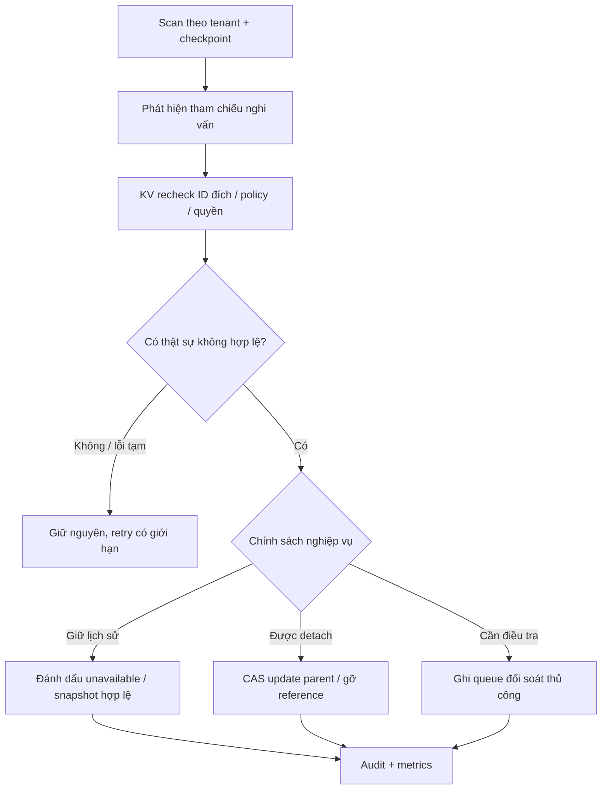

# Dữ liệu liên kết thiếu, đã hết hạn hoặc đã bị xóa trong Spring Data Couchbase

Khi một đơn hàng chứa `customerId`, điều đó chỉ nói rằng đơn hàng **đang giữ một giá trị tham chiếu**. Nó không bảo đảm Customer tương ứng hiện còn tồn tại, đang hoạt động, cùng tenant hoặc người gọi được phép đọc. Customer có thể chưa bao giờ được tạo, đã bị xóa bằng KV, đã hết TTL, bị xóa mềm, bị chuyển sang collection khác hoặc tạm không xuất hiện trong một truy vấn SQL++ do độ mới của chỉ mục. Nếu ứng dụng coi tất cả những trường hợp ấy là “không có quan hệ” rồi trả dữ liệu mặc định, lỗi nghiệp vụ và lỗi bảo mật có thể bị che giấu.

Vấn đề càng rõ khi dùng **Spring Data Couchbase**: repository `findById`, `@N1qlJoin`, `CouchbaseTemplate` và SQL++ `JOIN`/`NEST` có thể gặp cùng một quan hệ không hợp lệ nhưng **hành vi biểu hiện khác nhau**. `INNER JOIN` có thể loại luôn đơn hàng gốc; `LEFT JOIN` giữ đơn hàng nhưng trả thiếu field phía Customer; `LAZY` có thể chỉ bộc lộ lỗi khi serializer đọc getter; một cache còn giữ bản sao Customer cũ dù document gốc đã bị xóa.

Bài thuộc chương **Quan hệ và JOIN** trong module **SPRING_DATA_COUCHBASE**. Phạm vi gắn trực tiếp với việc xây dựng tầng truy cập Couchbase bằng document mapping, repository, `CouchbaseTemplate`, truy vấn SQL++, thiết kế bucket/scope/collection, TTL, CAS, giao dịch, chỉ mục và lựa chọn API reactive để bảo đảm tính đúng, hiệu năng và khả năng vận hành. Mục tiêu không phải chỉ tránh exception, mà là thiết kế **hợp đồng rõ ràng khi dữ liệu liên kết không còn sử dụng được**.

Các ví dụ dựa trên SQL++ và mô hình Spring Data Couchbase hiện đại. Tên class/annotation, behavior khi association không match, API expiry và các lựa chọn consistency phụ thuộc phiên bản Spring Data, Java SDK và Couchbase Server; cần kiểm thử trên tổ hợp phiên bản thực tế.

## 1. Mục tiêu học tập

Sau bài này, bạn có thể:

1. Phân biệt **tham chiếu thiếu**, **document không tồn tại**, **hết TTL**, **xóa cứng**, **xóa mềm** và **không được phép đọc**.
2. Giải thích vì sao một truy vấn không tìm thấy dữ liệu **không đủ** để kết luận nguyên nhân đã hết hạn hay bị xóa.
3. Chọn `INNER JOIN`, `LEFT JOIN`, `LEFT NEST`, KV lookup hoặc DTO theo hợp đồng API; xử lý đúng `MISSING` và `NULL`.
4. Không vô tình làm mất document gốc vì đặt bộ lọc phía phải trong `WHERE` của outer join.
5. Thiết kế reference có ràng buộc tenant, vòng đời và fallback; phân biệt snapshot lịch sử với bản sao thông tin hiện hành.
6. Hiểu ảnh hưởng của TTL, mutation, soft delete, CAS và giao dịch đối với document độc lập.
7. Tổ chức đối soát dangling reference theo lô có checkpoint, giới hạn tải, xử lý race và idempotency.
8. Kiểm thử các trường hợp liên quan bị thiếu, vừa xóa, hết hạn, không có quyền và bị cập nhật đồng thời; giám sát tỷ lệ lỗi liên kết trong production.

## 2. Kịch bản: Order tham chiếu Customer và Shipment độc lập

Giả sử bucket `commerce` có các keyspace:

```text
commerce
├── crm
│   └── customers
└── sales
    ├── orders
    ├── shipments
    └── shipment_events
```

Order tại `commerce.sales.orders`, document ID `order::TENANT-A::1001`:

```json
{
  "_class": "salesOrder",
  "tenantId": "TENANT-A",
  "orderNumber": "ORD-1001",
  "customerId": "customer::TENANT-A::42",
  "customerCode": "C-42",
  "customerNameAtPurchase": "Nguyen An",
  "status": "PAID",
  "createdAt": "2026-11-20T08:15:00Z",
  "items": [
    {
      "sku": "SKU-42",
      "quantity": 2,
      "unitPriceAtPurchase": 350000
    }
  ]
}
```

Customer tại `commerce.crm.customers`, document ID `customer::TENANT-A::42`:

```json
{
  "_class": "customer",
  "tenantId": "TENANT-A",
  "customerCode": "C-42",
  "displayName": "Nguyen An",
  "accountStatus": "ACTIVE",
  "deleted": false
}
```

Shipment tại `commerce.sales.shipments`:

```json
{
  "_class": "shipment",
  "tenantId": "TENANT-A",
  "orderId": "order::TENANT-A::1001",
  "trackingNumber": "TRACK-7001",
  "state": "IN_TRANSIT"
}
```

Một Shipment có thể trỏ tới Order bằng document ID; một Order có thể giữ Customer ID. Cả hai là quan hệ giữa **các document độc lập**; Couchbase không tự áp dụng foreign-key constraint, `ON DELETE CASCADE` hay referential validation như một hệ quản trị quan hệ truyền thống.

Trong khi đó, `items` là mảng nhúng trong Order: nó được đọc cùng document Order. Nếu một Item không có Product catalog hiện tại, snapshot `unitPriceAtPurchase` vẫn có thể là nguồn chính xác của hóa đơn. Đây là khác biệt lớn giữa **giá trị đã được lưu cùng aggregate** và **đọc lại một entity đang thay đổi**.

### 2.1. Bốn trạng thái nghiệp vụ cần phân biệt

| Trạng thái | Dấu hiệu có thể nhìn thấy | Giải thích đúng |
| --- | --- | --- |
| **Missing reference** | `customerId` không có, `null` hoặc rỗng | Bên gốc không mang khóa tham chiếu có thể dùng |
| **Dangling reference** | Có `customerId` nhưng lookup không lấy được Customer | Quan hệ không giải được; nguyên nhân có thể là chưa tạo, xóa, TTL hoặc sai ID |
| **Soft-deleted/inactive** | Customer vẫn tồn tại nhưng `deleted=true` hoặc trạng thái không cho dùng | Dữ liệu tồn tại vật lý nhưng **không còn hợp lệ nghiệp vụ** |
| **Not visible/forbidden** | Query bị từ chối hoặc policy chặn trả Customer | Vấn đề quyền truy cập, không phải bằng chứng document bị xóa |

**Hệ quả:** Không bao giờ biến mọi lỗi của repository/SDK thành `Optional.empty()` hoặc `Mono.empty()`. “Không tìm thấy” cần khác “timeout”, “không đủ quyền”, “lỗi query” và “hệ thống chưa sẵn sàng”.

## 3. Vì sao một kết quả vắng mặt không cho biết nguyên nhân?

Một KV GET theo ID có thể không tìm được document bởi:

1. ID chưa từng được tạo.
2. ID bị ghi sai, đã đổi quy tắc hoặc trỏ sai collection.
3. Document bị xóa cứng.
4. Document đã đến thời điểm hết TTL.
5. Một luồng ghi/xóa đang chạy trước khi quan hệ được cập nhật.

Từ góc độ **lookup thông thường**, những trạng thái 1–4 thường đều biểu hiện là document không tồn tại để đọc. Muốn biết nguyên nhân lịch sử, hệ thống cần **audit log, event/tombstone có retention, hoặc metadata nghiệp vụ đã được thiết kế trước**. Không suy ra “đã hết hạn” chỉ vì dữ liệu vắng và trước đây có cấu hình TTL.

Ngoài ra còn trường hợp SQL++ dùng chỉ mục: truy vấn theo field có thể chưa thấy mutation mới khi GSI cập nhật bất đồng bộ. Đó là một **nguồn khác biệt về độ mới** với KV đọc document bằng ID, không phải kết luận rằng document thực sự đã bị xóa.

### 3.1. Phân loại trạng thái ở tầng ứng dụng

Một mô hình nội bộ hữu ích:

```text
ReferenceResolution
  ├─ RESOLVED          (đúng document, đúng tenant, được phép)
  ├─ NOT_REFERENCED    (parent không có ID)
  ├─ NOT_FOUND         (lookup đã hoàn tất, không thấy document)
  ├─ INACTIVE          (có document nhưng không hợp lệ nghiệp vụ)
  ├─ FORBIDDEN         (policy không cho đọc)
  └─ UNAVAILABLE       (timeout/network/query/cluster lỗi)
```

Không buộc phải công khai tất cả trạng thái qua REST. Đây là cách **không đánh đồng các tình huống bên trong**. Nếu không có audit evidence, `NOT_FOUND` không được tự đổi tên thành `EXPIRED` hay `DELETED`.

## 4. TTL của Couchbase: thời điểm hết hạn và sự biến mất khi đọc

### 4.1. TTL là thuộc tính vòng đời document

Couchbase hỗ trợ thời hạn hết hạn cho document, qua chính sách bucket/collection và thời hạn do thao tác ghi thiết lập trong các phiên bản tương ứng. Khi hết hạn, document có thể không còn đọc được qua API bình thường, dù việc dọn dẹp vật lý/metadata nội bộ không nhất thiết diễn ra tức thời.

Ví dụ cùng Customer có TTL ngắn nhưng Order giữ nhiều năm:

```text
09:00  Customer được ghi với TTL 30 phút
09:05  Order tham chiếu customerId
09:30  Customer hết hạn
09:31  Order vẫn tồn tại; lookup Customer không còn match
```

Không có quy tắc mặc định nào tự xóa `order.customerId` khi Customer hết TTL. Ứng dụng phải quyết định “giữ reference chết”, “dùng snapshot”, “xóa tham chiếu”, hay “giữ tombstone theo chính sách”.

### 4.2. Hết hạn logic khác dọn dẹp vật lý

Đừng dùng “document còn hiện trong một chỉ số dung lượng, nên chắc chắn truy cập được”. Hệ thống có thể có chu kỳ dọn dẹp, compaction và cập nhật index không đồng bộ; trạng thái vật lý/chỉ mục không thay thế kết quả lookup hợp lệ.

Khi debug, so sánh:

- ID và keyspace đang gọi.
- Metadata expiry nếu API/phiên bản/ quyền cho phép xem.
- KV GET tại thời điểm quan sát.
- SQL++ query và scan consistency nếu đường đọc dùng index.
- Log/audit mutation/delete nếu hệ thống có lưu.

Nếu quá hạn thì không dựa vào việc “chưa bị dọn vật lý” để phục vụ dữ liệu.

### 4.3. Ví dụ SDK ghi Customer tạm thời

Ví dụ Java SDK 3.x, chỉ dùng trong lab:

```java
import java.time.Duration;
import com.couchbase.client.java.Collection;
import com.couchbase.client.java.json.JsonObject;
import static com.couchbase.client.java.kv.InsertOptions.insertOptions;

Collection customers = cluster.bucket("commerce")
    .scope("crm")
    .collection("customers");

JsonObject body = JsonObject.create()
    .put("_class", "customer")
    .put("tenantId", "TENANT-A")
    .put("customerCode", "C-TEMP")
    .put("displayName", "Khach tam thoi");

customers.insert(
    "customer::TENANT-A::TEMP",
    body,
    insertOptions().expiry(Duration.ofMinutes(5))
);
```

`cluster` được giả định là một bean/đối tượng SDK đã kết nối và có quyền ghi. Thời gian hết hạn thực phải chịu chính sách max TTL, cách xử lý expiry và phiên bản SDK/Server; đoạn trên **không phải cấu hình phù hợp cho Customer lịch sử**.

### 4.4. Mutation có thể ảnh hưởng expiry

Khi document được `replace`, `upsert` hoặc thao tác cập nhật khác, **không suy đoán TTL tự được bảo toàn**. Java SDK có những tùy chọn như bảo toàn expiry trong các phiên bản hỗ trợ, nhưng hiệu ứng phụ thuộc thao tác/cấu hình. Nếu business yêu cầu retention chính xác:

1. Quy định nguồn thiết lập expiry: ứng dụng, collection hoặc policy.
2. Kiểm thử insert, replace, update, retry và migration.
3. Không làm thời gian sống bị kéo dài hoặc đặt về mặc định ngoài ý muốn.
4. Không thiết lập TTL ngắn cho entity mà Order cần tra trong nhiều năm nếu không có snapshot/tombstone thay thế.
5. Đo độ trễ giữa expiration và cập nhật đường query/index mà ứng dụng thực sự sử dụng.

## 5. Xóa cứng, xóa mềm và tombstone

### 5.1. Hard delete: document không còn để join

Khi gọi KV remove/delete thành công theo API được hỗ trợ, Customer không còn là document hợp lệ để tra. Order vẫn chứa `customerId`.

```text
Order.customerId = "customer::TENANT-A::42"
                     |
                     v
           KV GET Customer -> NOT_FOUND
```

Nếu có yêu cầu hủy dữ liệu cá nhân, hard delete có thể cần được phối hợp với cache, snapshot, read model, logs và chính sách sao lưu/retention. Không giữ lại PII dưới tên “fallback” mà không được phép.

### 5.2. Soft delete: document vẫn có thể được trả

Một Customer được đánh dấu:

```json
{
  "tenantId": "TENANT-A",
  "customerCode": "C-42",
  "displayName": "Nguyen An",
  "deleted": true,
  "deletedAt": "2026-11-24T12:00:00Z"
}
```

vẫn có thể tìm thấy theo ID hoặc field vì JSON còn trong collection. Nếu API không được hiển thị hồ sơ đã xóa mềm, **query/service phải lọc theo policy**. Chỉ kiểm tra “KV GET thành công” không đủ để coi Customer còn dùng được.

### 5.3. Tombstone nghiệp vụ không giống tài liệu đã xóa

Ứng dụng có thể tạo **một record trạng thái đã xóa** riêng, ví dụ:

```json
{
  "_class": "customerDeletionRecord",
  "customerId": "customer::TENANT-A::42",
  "tenantId": "TENANT-A",
  "deletedAt": "2026-11-24T12:00:00Z",
  "reasonCode": "RETENTION_POLICY"
}
```

Record này dùng cho audit/reconciliation theo quy định; nó **không phải** tombstone nội bộ của storage engine và không cần chứa PII gốc. Nếu cần chứng minh “đã xóa”, phải xác định record nào có thẩm quyền, retention bao lâu và ai được phép xem.

### 5.4. Bảng lựa chọn

| Chiến lược | Khi nào phù hợp | Điểm phải đánh đổi |
| --- | --- | --- |
| Hard delete | Xóa dữ liệu thật theo policy, không giữ hồ sơ gốc | Dangling reference, cache/snapshot cleanup |
| Soft delete | Cần giữ lịch sử kỹ thuật/khả năng khôi phục có kiểm soát | Phải lọc mọi đường đọc, quản trị PII |
| Tombstone nghiệp vụ tối giản | Cần đối soát vòng đời mà không giữ full Customer | Phát sinh thêm dữ liệu và quy tắc retention |
| Anonymization | Cần giữ thống kê/lịch sử nhưng bỏ thông tin nhận diện | Không tự đủ cho mọi quy định; phải kiểm chứng dữ liệu còn có thể nhận diện không |

Không dùng soft delete như cách lách chính sách hủy dữ liệu. Ngược lại, không hard delete mù quáng một entity mà nhiều giao dịch đang phụ thuộc nếu business cần cơ chế đối soát hoặc lịch sử.

## 6. `INNER JOIN` khi phía liên kết không tồn tại

Tìm Order kèm Customer theo document ID:

```sql
SELECT META(o).id AS orderId,
       o.orderNumber,
       c.displayName AS customerName
FROM `commerce`.`sales`.`orders` AS o
JOIN `commerce`.`crm`.`customers` AS c
  ON KEYS o.customerId
WHERE o.tenantId = "TENANT-A";
```

`JOIN` ở đây là inner lookup join: khi không có Customer khớp `o.customerId`, Order có thể **bị loại khỏi kết quả**.

Đây là lựa chọn có thể đúng với báo cáo “chỉ các Order có Customer hiện tồn tại”, nhưng thường **sai** với màn hình danh sách tất cả giao dịch đã thanh toán. Một Order hợp lệ không nên bị xóa khỏi báo cáo doanh thu chỉ vì Customer hết TTL.

### 6.1. Mẫu lỗi: một trang “20 Order” bỗng thiếu giao dịch

```sql
SELECT META(o).id AS orderId, c.displayName
FROM `commerce`.`sales`.`orders` AS o
JOIN `commerce`.`crm`.`customers` AS c
  ON KEYS o.customerId
WHERE o.tenantId = "TENANT-A"
  AND o.status = "PAID"
ORDER BY o.createdAt DESC
LIMIT 20;
```

Nếu một số Customer đã hết hạn, trang này không nhất thiết phản ánh **20 Order mới nhất**. Ngoài vấn đề thiếu Customer, `LIMIT` ở cuối xử lý kết quả join, không có hợp đồng tự động “trang 20 Order gốc trước khi enrich”.

Nếu nhu cầu là “20 Order gần nhất, Customer có thể vắng”, cần chọn **đơn vị parent** và outer join hoặc hai bước query rõ ràng.

### 6.2. Đúng ngữ nghĩa phải được xác định trước tối ưu

Đừng tạo thêm index để “giảm số Order mất” khi nguyên nhân là **inner join loại hàng không match**. Chỉ mục giúp tìm dữ liệu nhanh hơn; nó không tạo lại Customer đã xóa và không thay đổi chính sách dữ liệu.

## 7. `LEFT JOIN`: giữ Order nhưng xử lý đúng dữ liệu thiếu

### 7.1. Lookup left join theo document ID

```sql
SELECT META(o).id AS orderId,
       o.orderNumber,
       o.customerId,
       o.customerNameAtPurchase,
       c.displayName AS currentCustomerName
FROM `commerce`.`sales`.`orders` AS o
LEFT JOIN `commerce`.`crm`.`customers` AS c
  ON KEYS o.customerId
WHERE o.tenantId = "TENANT-A"
  AND o.status = "PAID"
ORDER BY o.createdAt DESC
LIMIT 20;
```

`LEFT JOIN` giữ Order dù không có Customer match. Khi phía `c` vắng, projection `c.displayName` có thể là `MISSING` và **không xuất hiện trong JSON row**, khác với field có giá trị `null` tường minh. DTO Java cần xử lý cả hai trường hợp.

### 7.2. Fallback bằng snapshot

Nếu chính sách cho phép dùng tên đã chụp tại thời điểm mua:

```sql
SELECT META(o).id AS orderId,
       IFMISSINGORNULL(
           c.displayName,
           o.customerNameAtPurchase,
           "Khach hang khong con ho so"
       ) AS customerName
FROM `commerce`.`sales`.`orders` AS o
LEFT JOIN `commerce`.`crm`.`customers` AS c
  ON KEYS o.customerId
WHERE o.tenantId = "TENANT-A";
```

`IFMISSINGORNULL` minh họa fallback khi field vắng hoặc `NULL`. **Không tự dùng snapshot chứa PII** nếu retention/consent không cho phép; nếu có yêu cầu xóa thông tin nhận diện, phải dùng mã hóa/ẩn danh hoặc thông báo trung tính theo policy.

### 7.3. Fallback không xác định nguyên nhân vắng mặt

Kết quả `customerName = "Khach hang khong con ho so"` chỉ là **cách hiển thị**. Không nên kết luận chính xác Customer “đã xóa” hoặc “đã hết hạn”. Muốn phân biệt, cần audit/sự kiện vòng đời có thể tin cậy.

### 7.4. `LEFT JOIN` không tự bảo vệ tenant

Trong lookup `ON KEYS`, nếu `o.customerId` trỏ đến document thuộc tenant B, phép join vẫn có thể tìm ID đó theo quyền truy cập của Query Service. Vì vậy chỉ trả tên khi đã kiểm tra cùng tenant và authorization.

Một projection phòng vệ bổ sung:

```sql
SELECT META(o).id AS orderId,
       CASE
         WHEN c.tenantId = o.tenantId
              AND c.deleted = FALSE
         THEN c.displayName
         ELSE NULL
       END AS allowedCustomerName
FROM `commerce`.`sales`.`orders` AS o
LEFT JOIN `commerce`.`crm`.`customers` AS c
  ON KEYS o.customerId
WHERE o.tenantId = $tenantId;
```

Đây là **lọc ở projection theo dữ liệu**, không thay thế quyền RBAC hoặc policy service; trường `deleted` phải được chuẩn hóa ở schema. Nếu caller không có quyền đọc collection Customer ở mức Couchbase, truy vấn có thể **thất bại do quyền**, chứ không tự trả hàng với `NULL`.

## 8. ANSI `LEFT JOIN` và bẫy `ON`/`WHERE` khi xóa mềm

Giả sử Order chỉ có `customerCode`; Customer có thể bị xóa mềm.

**Giữ Order; chỉ ghép Customer active:**

```sql
SELECT META(o).id AS orderId,
       o.customerCode,
       c.displayName AS activeCustomerName
FROM `commerce`.`sales`.`orders` AS o
LEFT JOIN `commerce`.`crm`.`customers` AS c
  ON o.tenantId = c.tenantId
 AND o.customerCode = c.customerCode
 AND c.deleted = FALSE
WHERE o.tenantId = "TENANT-A";
```

Điều kiện `c.deleted = FALSE` ở `ON` xác định match hợp lệ. Order không có Customer, hoặc chỉ có Customer bị xóa mềm, vẫn có thể được giữ ở bên trái.

**Câu có ngữ nghĩa khác:**

```sql
SELECT META(o).id AS orderId,
       c.displayName
FROM `commerce`.`sales`.`orders` AS o
LEFT JOIN `commerce`.`crm`.`customers` AS c
  ON o.tenantId = c.tenantId
 AND o.customerCode = c.customerCode
WHERE o.tenantId = "TENANT-A"
  AND c.deleted = FALSE;
```

Khi `c` không tồn tại, bộ lọc `c.deleted = FALSE` trong `WHERE` thường không thỏa và có thể **loại luôn Order**. Bởi vậy “đã dùng `LEFT JOIN`” chưa đủ để giữ parent nếu predicate phía phải nằm sai chỗ.

### 8.1. Field `deleted` vắng trong dữ liệu legacy

`c.deleted = FALSE` **không nhất thiết** đúng với Customer chưa từng được gắn field `deleted`. Nếu convention hiện tại là “thiếu `deleted` nghĩa là chưa xóa”, phải định nghĩa/chuẩn hóa dữ liệu hoặc sử dụng biểu thức fallback tương thích SQL++ rồi kiểm tra khả năng dùng index.

Không tùy tiện chuyển tất cả `MISSING` thành active nếu dữ liệu legacy có thể không đáng tin cậy. Quyết định cần phù hợp chính sách nghiệp vụ và bảo mật.

### 8.2. Index partial cho Customer chưa xóa

Một ứng viên:

```sql
CREATE INDEX ix_customers_active_tenant_code
ON `commerce`.`crm`.`customers`(
    `tenantId`,
    `customerCode`
)
WHERE `deleted` = FALSE;
```

Chỉ mục này chỉ bao gồm Customer có `deleted = FALSE`. Nó có thể hữu ích với một số truy vấn chỉ cần Customer active khi predicate tương thích, nhưng **không đầy đủ cho query cần cả Customer bị xóa mềm**. Khả năng optimizer dùng partial index trong outer join phụ thuộc query và phiên bản; cần `EXPLAIN`.

Không dùng index như một unique constraint; hai Customer active cùng tenant/code vẫn có thể trùng match.

## 9. `NEST`, `UNNEST` và mảng rỗng: không đồng nghĩa document đã bị xóa

### 9.1. `NEST` gom document liên quan thành mảng

Giả sử một Wishlist có `productIds`:

```json
{
  "tenantId": "TENANT-A",
  "productIds": [
    "product::SKU-42",
    "product::SKU-18"
  ]
}
```

Truy vấn trên các collection tương ứng trong scope catalog:

```sql
SELECT META(w).id AS wishlistId,
       p AS products
FROM `commerce`.`catalog`.`wishlists` AS w
LEFT NEST `commerce`.`catalog`.`products` AS p
  ON KEYS w.productIds
WHERE w.tenantId = "TENANT-A";
```

`LEFT NEST` giữ Wishlist ngay cả khi không có Product match và biểu diễn kết quả Product thành mảng. Nếu một ID Product không còn tồn tại, kết quả mảng không tự mang một object thay thế cho ID đó.

Hệ quả:

- Không thể chỉ đếm `products.length` để suy ra `productIds` có bao nhiêu phần tử **đang hợp lệ** nếu có duplicate/reference chết.
- Không được mặc định thứ tự `products` trùng thứ tự `productIds`.
- Muốn hiển thị từng mục wishlist kể cả mục đã bị xóa, cần giữ danh sách ID nguồn và xác định cách gắn trạng thái “không khả dụng”.

### 9.2. `UNNEST` mở dữ liệu nhúng, không tra Product tự động

Nếu Order có `items` nhúng:

```sql
SELECT META(o).id AS orderId, i.sku, i.quantity
FROM `commerce`.`sales`.`orders` AS o
UNNEST o.items AS i
WHERE o.tenantId = "TENANT-A";
```

`UNNEST` trải các item nằm trong **chính Order**. Nó không tra Product ở catalog; vì vậy Product bị xóa **không** tự làm item snapshot biến mất.

Ngược lại, nếu `items` là `[]` hoặc thiếu field, inner `UNNEST` có thể loại Order khỏi kết quả theo cardinality mảng. Để giữ Order không có item:

```sql
SELECT META(o).id AS orderId, i.sku
FROM `commerce`.`sales`.`orders` AS o
LEFT UNNEST o.items AS i
WHERE o.tenantId = "TENANT-A";
```

**Mảng rỗng trong một document còn tồn tại** khác với **document được tham chiếu đã bị xóa**. Hai tình huống cần test riêng.

## 10. Thiết kế hợp đồng tham chiếu: required, optional, historical

Không phải mọi reference phải còn tồn tại mãi. Thiết kế rõ **vai trò** của mỗi quan hệ:

| Quan hệ | Ý nghĩa | Khi đích không còn |
| --- | --- | --- |
| Order → Customer hiện hành | Bổ sung tên/trạng thái CRM | Có thể trả `null`/fallback snapshot, giữ Order |
| Order → Product snapshot | Giá/tên **tại lúc mua** | Giữ snapshot, không phụ thuộc catalog hiện hành |
| Shipment → Order | Tham chiếu giao dịch nguồn | Thường là bất biến nghiệp vụ cần đối soát nếu mất |
| Session → User | Quan hệ ngắn hạn mang quyền | Thường phải từ chối nếu User không còn hợp lệ |
| Wishlist → Product | Mục quan tâm tùy chọn | Có thể hiển thị unavailable/dọn reference theo policy |
| Audit event → Aggregate ID | Bằng chứng lịch sử | Có thể giữ ID đã được ẩn danh theo retention |

### 10.1. Required không đồng nghĩa tự động có khóa ngoại

Một field `orderId` được đánh dấu bắt buộc trong Java validation chỉ kiểm tra **trường có giá trị**, không bảo đảm document Order đích tồn tại.

Nếu business quy định Shipment **không được tạo khi Order không tồn tại**, service phải xác thực Order và xử lý cuộc đua xóa/ghi bằng thiết kế giao dịch/trạng thái phù hợp. Validation riêng trước khi insert có thể vẫn gặp race nếu Order bị xóa ngay sau khi check.

### 10.2. Optional reference phải có contract DTO

Ví dụ:

```json
{
  "orderId": "order::TENANT-A::1001",
  "orderNumber": "ORD-1001",
  "customer": null,
  "customerDisplayName": "Khach hang khong con ho so",
  "customerResolution": "NOT_FOUND"
}
```

Trường `customerResolution` chỉ là ví dụ hợp đồng nội bộ/API khi được phép công khai. Không cung cấp thông tin tiết lộ trạng thái nhạy cảm của Customer cho caller không có quyền.

### 10.3. Historical snapshot phải định nghĩa rõ bất biến

`customerNameAtPurchase` và `unitPriceAtPurchase` là giá trị đã chốt. Chúng có thể cần tồn tại ngay cả khi Customer/Product hiện hành bị xóa, miễn retention cho phép.

Đừng lấy `Product.currentPrice` qua JOIN để dựng lại hóa đơn cũ. Nếu thông tin lịch sử bắt buộc xóa/ẩn danh, phải có chính sách lưu trữ/sao lưu riêng thay vì mặc định “snapshot luôn giữ vĩnh viễn”.

## 11. Spring Data entity mapping: ID tham chiếu không tự được kiểm chứng

Ví dụ entity:

```java
import java.time.Instant;
import java.util.List;
import org.springframework.data.annotation.Id;
import org.springframework.data.annotation.TypeAlias;
import org.springframework.data.annotation.Version;
import org.springframework.data.couchbase.core.mapping.Document;
import org.springframework.data.couchbase.core.mapping.Scope;
import org.springframework.data.couchbase.core.mapping.Collection;

@Document
@TypeAlias("salesOrder")
@Scope("sales")
@Collection("orders")
public class SalesOrder {
    @Id
    private String id;

    @Version
    private Long version;

    private String tenantId;
    private String customerId;
    private String customerNameAtPurchase;
    private String orderNumber;
    private String status;
    private Instant createdAt;
    private List<OrderItem> items;

    // Constructor, getters và setters được lược bỏ.
}
```

`@Id` định danh document Order. `@Version` hỗ trợ optimistic locking theo khả năng của Spring Data Couchbase đang dùng. Field `customerId` là chuỗi thông thường trong JSON, không có auto foreign-key validation hoặc cascade khi `repository.save(order)`.

Một entity Customer:

```java
import org.springframework.data.annotation.Id;
import org.springframework.data.annotation.TypeAlias;
import org.springframework.data.couchbase.core.mapping.Document;
import org.springframework.data.couchbase.core.mapping.Scope;
import org.springframework.data.couchbase.core.mapping.Collection;

@Document
@TypeAlias("customer")
@Scope("crm")
@Collection("customers")
public class Customer {
    @Id private String id;
    private String tenantId;
    private String customerCode;
    private String displayName;
    private boolean deleted;

    // Constructor, getters và setters được lược bỏ.
}
```

Bucket `commerce` phải được cấu hình trong operations/runtime. `@Scope("crm")` và `@Collection("customers")` không tự xác nhận permission hoặc TTL phù hợp với Order.

### 11.1. Repository `findById` và `Optional.empty()`

```java
import org.springframework.data.couchbase.repository.CouchbaseRepository;

public interface CustomerRepository
        extends CouchbaseRepository<Customer, String> {
}
```

`customerRepository.findById(id)` trả `Optional.empty()` khi repository không tìm thấy entity theo hành vi được hỗ trợ. Nhưng khi gặp timeout, lỗi xác thực, lỗi ánh xạ hoặc KV Service không khả dụng, không nên tự bắt mọi exception rồi đổi sang `Optional.empty()`.

**Nguyên tắc:** Một lookup không có kết quả hợp lệ là trạng thái dữ liệu có thể xử lý; một lỗi hạ tầng cần đi theo đường lỗi/retry/observability riêng.

## 12. Lookup KV và cách xử lý `NOT_FOUND` đúng lớp

Ví dụ Java SDK 3.x, chỉ bắt đúng loại exception document không tồn tại:

```java
import java.util.Optional;
import com.couchbase.client.core.error.DocumentNotFoundException;
import com.couchbase.client.java.Collection;
import com.couchbase.client.java.json.JsonObject;

public final class CustomerLookup {
    private final Collection customers;

    public CustomerLookup(Collection customers) {
        this.customers = customers;
    }

    public Optional<JsonObject> findVisibleCustomer(
        String customerId, String expectedTenant
    ) {
        if (customerId == null || customerId.isBlank()) {
            return Optional.empty();
        }

        try {
            JsonObject body =
                customers.get(customerId).contentAsObject();

            if (!expectedTenant.equals(
                    body.getString("tenantId"))) {
                // Đây là lỗi ranh giới quyền/dữ liệu.
                throw new SecurityException(
                    "Customer not available for tenant"
                );
            }

            if (Boolean.TRUE.equals(
                    body.getBoolean("deleted"))) {
                return Optional.empty();
            }

            return Optional.of(body);
        } catch (DocumentNotFoundException notFound) {
            return Optional.empty();
        }
    }
}
```

Đoạn code giả định `customers` là Collection đã xác định đúng bucket/scope; `expectedTenant` lấy từ context đáng tin cậy. Đây là minh họa xử lý lookup đơn lẻ:

- **Chỉ** `DocumentNotFoundException` được quy thành kết quả không tìm thấy.
- `SecurityException` được cố ý để khác với dữ liệu vắng và nên được ánh xạ qua policy/service.
- Timeout, lỗi quyền SDK, lỗi mạng và các exception khác **không** bị nuốt.
- Không suy từ `Optional.empty()` rằng Customer đã hết TTL hay bị hard delete.
- Trong dự án thật có thể dùng enum resolution thay vì `Optional` để phân biệt `NOT_REFERENCED` và `INACTIVE`.

Nếu Customer chứa PII, không trả nguyên `JsonObject` ra API; chọn DTO chỉ gồm field caller được quyền xem.

### 12.1. Lỗi quyền không phải “không có Customer”

Couchbase RBAC có thể từ chối một câu query/GET nếu identity ứng dụng không có quyền trên collection. Điều đó không phải bằng chứng Customer không tồn tại. Đồng thời, authorization cấp ứng dụng có thể cấm hiển thị Customer dù service account có quyền đọc hạ tầng. Cần phân tách cả hai lớp.

### 12.2. Tránh retry vô hạn khi thiếu dữ liệu thật

Với `NOT_FOUND` đã xác thực, việc retry liên tục không tự tạo lại Customer. Có thể retry có giới hạn nếu nghiệp vụ biết đang có replication/eventual propagation hoặc race hợp lệ và có SLA rõ; còn đối với hard delete/TTL, nên chọn fallback hoặc quy trình đối soát.

Đừng retry lỗi quyền. Với timeout hoặc lỗi tạm thời, retry phải có backoff, deadline và giới hạn concurrency để tránh khuếch đại tải.

## 13. `@N1qlJoin` và liên kết vắng trong mapping Java

Trong các phiên bản Spring Data Couchbase hỗ trợ, annotation:

```java
import org.springframework.data.couchbase.core.query.FetchType;
import org.springframework.data.couchbase.core.query.N1qlJoin;

@N1qlJoin(
    on = "lks.tenantId = rks.tenantId " +
         "AND lks.customerCode = rks.customerCode",
    fetchType = FetchType.LAZY
)
private Customer customer;
```

giúp khai báo association theo các field `lks` và `rks`. Tuy nhiên:

1. `@N1qlJoin` không bảo đảm Customer tồn tại, cũng không tạo foreign key.
2. Field `Customer customer` không chứng minh kết quả join chỉ có một document. Nếu cặp business key bị trùng, cần xử lý dữ liệu trùng.
3. Với `IMMEDIATE`, associated entity có thể được tải trong quá trình tải parent; với `LAZY`, vấn đề có thể chỉ phát lộ khi truy cập getter.
4. Hành vi khi không match (null, empty association, mapping/proxy) **cần kiểm thử theo phiên bản và đường truy cập**; không khẳng định mọi mapping đều trả đúng một dạng.
5. `where` trong annotation không thể được xem là hoán đổi vô điều kiện với `on` của outer join; cần quan sát generated SQL++.

### 13.1. Lazy loading có thể che việc reference bị hỏng

```java
SalesOrder order = repository.findById(orderId).orElseThrow();

// Có thể chưa tải Customer nếu association là LAZY.
String status = order.getStatus();

// Đây có thể là lúc association được thực sự truy cập.
Customer customer = order.getCustomer();
```

Không kết luận “đọc Order thành công = quan hệ hợp lệ”. Một mapper DTO, serializer hoặc log gọi getter cũng có thể kích hoạt việc giải quyết liên kết muộn.

### 13.2. Không cho phép lỗi “không tìm thấy” bị che thành danh sách rỗng

Với `List<Shipment> shipments`, mảng rỗng có thể có hai nghĩa:

- Order hợp lệ, **chưa có Shipment**.
- Những Shipment từng được tham chiếu nay đã xóa/hết TTL hoặc query đã lọc chúng đi.

Nếu nghiệp vụ cần phân biệt “chưa từng giao” với “lịch sử giao đã bị xóa”, cần event/audit hoặc trạng thái ở Order, không chỉ dựa vào kích thước association list.

## 14. Reactive repository: empty result khác với failure signal

Reactive API giúp biểu đạt sự vắng mặt bằng `Mono.empty()`/`Flux.empty()` theo method, nhưng không nên biến mọi exception thành empty:

```java
import java.util.Optional;
import reactor.core.publisher.Mono;

public Mono<Optional<Customer>> lookupCustomer(
    ReactiveCustomerRepository repository,
    String customerId
) {
    return repository.findById(customerId)
        .map(customer -> Optional.of(customer))
        .defaultIfEmpty(Optional.<Customer>empty());
}
```

`ReactiveCustomerRepository` là repository reactive của ứng dụng. Minh họa cho thấy **empty completion** được chuyển thành một giá trị Optional trống; **error signal** vẫn lan truyền.

Ngược lại, mẫu:

```java
// Không nên nuốt mọi lỗi hạ tầng thành "không có Customer".
return repository.findById(customerId)
    .onErrorResume(error -> Mono.empty());
```

có thể làm timeout, lỗi RBAC hoặc lỗi ánh xạ bị trình bày như dữ liệu không tồn tại. Nếu cần fallback ở reactive, chỉ xử lý loại lỗi đã phân loại và ghi nhận telemetry phù hợp, không làm mất tín hiệu lỗi.

### 14.1. Missing relation và N+1

Đọc trang 50 Order rồi gọi `findById` Customer cho từng Order có thể tạo 50 KV GET, bao gồm GET tới ID đã chết. Reactive `flatMap` giúp điều phối đồng thời nhưng không tự loại bỏ N+1 hoặc cache âm.

Khi muốn giảm truy cập lặp:

- Khử trùng lặp Customer ID trong **phạm vi trang/request**.
- Không gửi GET cho ID trống.
- Dùng batch/lookup JOIN hoặc read model khi phù hợp.
- Giới hạn concurrency để tránh bão request vào KV Service.
- Không cache `NOT_FOUND` vô hạn: Customer có thể được tạo sau hoặc quyền thay đổi.

## 15. Hợp đồng API: 404, 410, 403, 409 hay 200?

Cách trả HTTP phụ thuộc **tài nguyên chính đang được yêu cầu** và policy:

| Tình huống | Phương án thường hợp lý | Không nên làm |
| --- | --- | --- |
| `GET /orders/{id}` nhưng Order không tồn tại | `404 Not Found`, hoặc che tồn tại theo policy | Trả `200` giả chỉ vì Customer khác còn |
| Order còn, Customer tùy chọn không tìm được | `200` với Customer `null`/fallback | Biến Order hợp lệ thành `404` mặc định |
| Customer có tombstone đáng tin và API đã định nghĩa “đã xóa” | Có thể `410 Gone` | Gán `410` chỉ vì KV `NOT_FOUND` |
| Caller không có quyền xem Customer | `403` hoặc `404` theo chính sách chống rò sự tồn tại | Trả tên/ID nhạy cảm chỉ vì JOIN được |
| Shipment bắt buộc phải có Order nhưng reference hỏng | `409 Conflict`/lỗi dữ liệu nội bộ/đối soát tùy endpoint | Tự tạo Order giả để qua validation |
| KV/Query Service timeout hoặc không khả dụng | Lỗi hạ tầng phù hợp, có retry/backoff ở đúng lớp | Trả `null` và báo thành công như mọi thứ bình thường |

Đây là **gợi ý thiết kế API**, không phải quy tắc HTTP bắt buộc cho mọi doanh nghiệp. Hợp đồng phải thống nhất giữa các endpoint và không tiết lộ trạng thái tài nguyên người gọi không được biết.

### 15.1. Phân biệt “không được yêu cầu” với “không tìm thấy”

Trong GraphQL hoặc DTO theo projection, field Customer có thể không được lấy vì client **không yêu cầu field đó**. Không suy diễn `customer = null` trong kết quả projection là Customer đã bị xóa; cần phân biệt **field không được tải** và **đã tải nhưng không match** nếu nghiệp vụ quan trọng.

### 15.2. Trạng thái hiển thị phải không lừa dối

“Khách hàng đã xóa” là khẳng định lịch sử. Nếu chỉ biết lookup không tìm thấy, thông điệp “Thông tin khách hàng không khả dụng” thường chính xác hơn. Một backend có audit log có thể hiển thị trạng thái cụ thể cho nhân viên đủ quyền.

## 16. Tính nhất quán: KV, GSI và nhiều thời điểm đọc

### 16.1. KV GET theo ID và SQL++ theo index khác nhau

`customerRepository.findById(customerId)` thường đi qua KV. Truy vấn:

```sql
SELECT META(c).id AS customerId
FROM `commerce`.`crm`.`customers` AS c
WHERE c.tenantId = "TENANT-A"
  AND c.customerCode = "C-42";
```

có thể cần Global Secondary Index trên `(tenantId, customerCode)`. GSI được cập nhật bất đồng bộ từ KV mutations, nên đường SQL++ theo field có thể có độ mới khác với KV.

### 16.2. `NOT_BOUNDED` và `REQUEST_PLUS`

| Scan consistency | Ý nghĩa | Hạn chế |
| --- | --- | --- |
| `NOT_BOUNDED` | Không yêu cầu chờ GSI bắt kịp thay đổi tại thời điểm query | Có thể tạm không thấy mutation mới |
| `REQUEST_PLUS` | Yêu cầu chờ index bắt kịp các thay đổi liên quan trước query | Có thể tăng latency; không tạo transaction nghiệp vụ |

Nếu Customer vừa được tạo và lập tức dùng query theo `customerCode`, kết quả thiếu dưới `NOT_BOUNDED` **không tự chứng minh Customer chưa tồn tại**. Cần phân biệt lỗi độ mới index với dữ liệu thực sự mất.

### 16.3. Đọc ở nhiều thời điểm không phải snapshot nguyên tử

```text
t0: Query lấy Order và customerId
t1: Customer bị xóa
t2: KV GET theo customerId -> NOT_FOUND
```

Hai thao tác này **không bảo đảm** cùng một ảnh chụp nghiệp vụ. Nếu yêu cầu đối soát tài chính cần snapshot giao dịch, hãy lưu dữ liệu lịch sử phù hợp hoặc thiết kế transaction/mô hình trạng thái phù hợp; `REQUEST_PLUS` không biến hai lượt đọc riêng thành một transaction.

### 16.4. Consistency không giải quyết lỗi quyền

Một câu query bị từ chối vì RBAC không được “sửa” bằng tăng scan consistency. Một Customer khác tenant không được trở thành hợp lệ chỉ vì query dùng `REQUEST_PLUS`.

## 17. CAS và transaction: tham chiếu có thể gãy giữa bước kiểm tra và ghi

### 17.1. Race: validate rồi tạo Shipment

```text
T1: Service A đọc Order, thấy tồn tại
T2: Service B xóa Order
T3: Service A ghi Shipment trỏ tới Order vừa xóa
```

Một câu kiểm tra tồn tại trước insert **không tự bảo đảm** quan hệ tại T3. Đây là lỗi *time-of-check to time-of-use*.

### 17.2. `@Version`/CAS không tạo foreign key

CAS giúp phát hiện việc một document bị sửa kể từ lúc đọc. Nhưng:

- CAS của Shipment không tự bảo vệ Order.
- CAS của Order không tự bảo đảm Customer còn tồn tại.
- Một update thành công với CAS không tự xác thực mọi ID tham chiếu bên trong JSON.

Khi nhiều document phải thay đổi nguyên tử, cần dùng transaction được Couchbase/SDK hỗ trợ hoặc thiết kế state machine/saga với idempotency và compensation thích hợp.

### 17.3. Trình tự ghi giảm rủi ro nhưng không thay transaction

Một luồng tạo Order và Shipment:

1. Tạo Order với ID xác định/idempotency key.
2. Chỉ tạo Shipment khi Order đang ở trạng thái cho phép.
3. Nếu business yêu cầu atomically tồn tại cả hai, dùng transaction hoặc cơ chế ghi thống nhất được hỗ trợ.
4. Nếu chấp nhận eventual consistency, ghi trạng thái `PENDING` và một job đối soát.
5. Chỉ công bố Order “sẵn sàng giao” khi các bước bắt buộc đã hoàn tất.

Đừng gán mọi trường hợp dangled reference thành “lỗi Couchbase”: phần lớn đến từ **thiết kế vòng đời nhiều document** và xử lý failure giữa các bước.

### 17.4. Xóa đồng thời cần chính sách

Khi delete Customer, có thể có Order đang được tạo. Chính sách có thể:

- Từ chối xóa khi còn quan hệ bắt buộc (*restrict*).
- Xóa tham chiếu ở những nơi được phép (*detach*).
- Xóa/đánh dấu liên quan theo saga, có checkpoint (*cascade có kiểm soát*).
- Giữ snapshot/ID lịch sử đã ẩn danh (*archive*).

Không có lựa chọn nào được `@N1qlJoin` hoặc field `customerId` tự thực hiện.

## 18. Chọn vòng đời liên kết: RESTRICT, DETACH, CASCADE, ARCHIVE

| Chính sách | Ý tưởng | Khi cần thận trọng |
| --- | --- | --- |
| **RESTRICT** | Không cho xóa parent nếu còn child bắt buộc | Check trước delete có race; cần transaction/state |
| **DETACH** | Giữ child nhưng gỡ reference hoặc đánh dấu unavailable | Không làm mất giá trị audit/history |
| **CASCADE** | Xóa/mark child theo parent có kiểm soát | Không xóa nhầm dữ liệu có retention riêng |
| **ARCHIVE/SNAPSHOT** | Giữ dữ liệu lịch sử cần thiết, bỏ liên kết tới nguồn hiện hành | PII, TTL, quyền và quy định lưu trữ |

### 18.1. Ví dụ xóa Customer sau khi Order đã thanh toán

Nếu hóa đơn cần tồn tại nhưng hồ sơ CRM phải xóa:

- Không hard delete Order chỉ vì Customer không còn.
- Giữ `customerId` nếu policy cho phép audit liên kết vô danh, hoặc xóa/anonymize khi cần.
- Dùng snapshot lịch sử đã được bảo vệ hoặc một tên hiển thị trung tính.
- Xóa bản sao PII trong cache, read model và các nơi áp dụng retention.
- Tránh JOIN Customer tại thời điểm hiển thị hóa đơn như nguồn dữ liệu lịch sử duy nhất.

### 18.2. Tham chiếu nhiều chiều

Nếu Shipment trỏ Order và Order trỏ Customer, xóa Customer không nhất thiết kéo theo xóa Shipment. Phải xác định **đối tượng nào là aggregate root** và dữ liệu nào giữ nguyên vì nghĩa vụ nghiệp vụ độc lập.

Thiết kế **theo vòng đời**, không theo mong muốn có một chuỗi cascade mặc định thuận tiện.

## 19. Phát hiện dangling reference bằng SQL++

### 19.1. Query tìm Order có customerId nhưng không còn Customer

```sql
SELECT META(o).id AS orderId,
       o.tenantId,
       o.customerId,
       o.createdAt
FROM `commerce`.`sales`.`orders` AS o
LEFT JOIN `commerce`.`crm`.`customers` AS c
  ON KEYS o.customerId
WHERE o.tenantId = $tenantId
  AND o.customerId IS NOT MISSING
  AND o.customerId IS NOT NULL
  AND META(c).id IS MISSING
ORDER BY o.createdAt DESC
LIMIT 100;
```

Ý nghĩa: tìm Order có ID tham chiếu nhưng **không có Customer match qua key lookup tại thời điểm query**. Query này **không xác định được** Customer là chưa tạo, hard-deleted hay expired. Một kết quả thiếu cũng cần được đối chiếu với quy định quyền/tenant và độ mới dữ liệu.

### 19.2. Phân biệt “không có ID” và “ID chết”

```sql
-- Order không khai báo customerId hoặc để null.
SELECT META(o).id AS orderId
FROM `commerce`.`sales`.`orders` AS o
WHERE o.tenantId = $tenantId
  AND (
       o.customerId IS MISSING
       OR o.customerId IS NULL
  );
```

Không trộn thống kê **missing field** vào thống kê **dangling reference**. Hai trường hợp có thể cần remediation khác nhau: một bên bổ sung dữ liệu bắt buộc, bên kia đối soát vòng đời document đích.

### 19.3. Query phát hiện soft delete

```sql
SELECT META(o).id AS orderId,
       o.customerId,
       c.deleted,
       c.deletedAt
FROM `commerce`.`sales`.`orders` AS o
JOIN `commerce`.`crm`.`customers` AS c
  ON KEYS o.customerId
WHERE o.tenantId = $tenantId
  AND c.deleted = TRUE
LIMIT 100;
```

Khác anti-join, query này tìm Customer **vẫn tồn tại** nhưng mang trạng thái đã xóa mềm. Không trả các field này ra API công khai trừ khi policy cho phép.

### 19.4. Tìm reference sai tenant

```sql
SELECT META(o).id AS orderId,
       o.tenantId AS orderTenant,
       o.customerId,
       c.tenantId AS customerTenant
FROM `commerce`.`sales`.`orders` AS o
JOIN `commerce`.`crm`.`customers` AS c
  ON KEYS o.customerId
WHERE o.tenantId = $tenantId
  AND (
       c.tenantId IS MISSING
       OR c.tenantId IS NULL
       OR c.tenantId != o.tenantId
  )
LIMIT 100;
```

Query kiểm toán này có thể truy cập dữ liệu nhiều tenant và phải chạy bằng **job có thẩm quyền, môi trường kiểm soát và log đã giới hạn PII**, không phải endpoint nghiệp vụ dành cho người dùng thường.

### 19.5. Không dùng anti-join quét toàn bộ production không giới hạn

Muốn rà hàng triệu Order, cần index/phạm vi quét thích hợp, phân trang ổn định hoặc cursor/checkpoint, giới hạn tốc độ và theo dõi tải Query/Index Service. `LIMIT 100` **không có nghĩa** hệ thống sẽ không quét nhiều index entries: `EXPLAIN` mới cho biết đường scan và `ORDER BY`/filter có được đẩy xuống hiệu quả không.

## 20. Chỉ mục cho phát hiện và xử lý dữ liệu liên kết vắng

### 20.1. Index cho Order được rà soát

Một ứng viên nếu job chạy theo tenant và thời gian:

```sql
CREATE INDEX ix_orders_tenant_created
ON `commerce`.`sales`.`orders`(
    `tenantId`,
    `createdAt` DESC
);
```

Index giúp tìm Order theo phạm vi phù hợp. Nó không cần chứa `customerId` trong mọi trường hợp; Query Service có thể `Fetch` document Order để đọc field, tùy projection và plan.

### 20.2. Lookup theo document ID phía Customer

Với `LEFT JOIN customers c ON KEYS o.customerId`, phía Customer được định vị bằng document ID. Không tạo một GSI `(tenantId, customerCode)` chỉ để thực hiện **lookup theo Customer ID**.

Nếu job kiểm toán lại phải tìm Customer theo `customerCode`, nó có thể cần index trên `commerce.crm.customers` theo `tenantId/customerCode`. **Hai mẫu đọc khác nhau, yêu cầu index khác nhau**.

### 20.3. Soft delete và partial index

Một index chỉ chứa Customer có `deleted = FALSE` hữu ích cho query chỉ đọc Customer active. Nhưng nó không giúp job tìm **Customer deleted=true** nếu query cần tập bị xóa. Không ép partial index khiến dữ liệu audit bị loại khỏi kết quả.

### 20.4. `EXPLAIN` và `system:indexes`

```sql
EXPLAIN
SELECT META(o).id AS orderId, o.customerId
FROM `commerce`.`sales`.`orders` AS o
LEFT JOIN `commerce`.`crm`.`customers` AS c
  ON KEYS o.customerId
WHERE o.tenantId = $tenantId
  AND o.customerId IS NOT MISSING
  AND META(c).id IS MISSING
LIMIT 100;
```

Kiểm tra catalog:

```sql
SELECT name, state, index_key, condition,
       bucket_id, scope_id, keyspace_id
FROM system:indexes
WHERE bucket_id = "commerce"
  AND (
       (scope_id = "sales" AND keyspace_id = "orders")
    OR (scope_id = "crm" AND keyspace_id = "customers")
  );
```

Phải xác minh đúng keyspace, index `online`, `spans` và số `Fetch` trong Query Profile. Một index tốt có thể giảm chi phí query audit, nhưng không làm mất tính cần thiết của cơ chế **double-check và sửa an toàn** trước khi mutate.

## 21. Reconciliation: sửa tham chiếu hỏng mà không tạo lỗi mới

Một job dọn dangling references có thể nguy hiểm hơn lỗi gốc nếu mặc định xóa tất cả Order “mất Customer”. Thiết kế một quy trình có kiểm soát:



### 21.1. Quy trình theo từng bước

1. **Phát hiện** theo tenant/collection/thời gian bằng query giới hạn và checkpoint.
2. **Phân loại**: không có ID, ID chết, soft-deleted, sai tenant hay query/permission failure.
3. **Recheck** bằng KV hoặc đường dữ liệu đáng tin cậy; không coi một kết quả SQL++ tạm cũ là bằng chứng đủ để xóa tham chiếu.
4. **Áp dụng policy**: detach, giữ snapshot, cấm thao tác, hoặc đưa vào queue điều tra.
5. **Ghi an toàn** bằng CAS/transaction khi cần; nếu conflict, đọc lại và đánh giá lại policy.
6. **Đánh dấu idempotency/checkpoint** để chạy lại không tạo thêm thay đổi sai.
7. **Giám sát** số case, tỷ lệ thành công, retry, lỗi và số record chờ.

### 21.2. Tránh race “Customer vừa được tạo lại”

Giả sử lần scan thấy Customer không tồn tại, nhưng một job khác vừa phục hồi Customer. Nếu reconciler gỡ `customerId` sau khi Customer đã tồn tại, nó sẽ tạo mất mát liên kết mới.

Vì thế:

- Recheck gần thời điểm mutation.
- Dùng điều kiện CAS/`@Version` trên Order.
- Đảm bảo chính sách recreate ID rõ ràng; không cho tùy tiện dùng lại ID lịch sử nếu điều đó làm đảo nghĩa quan hệ.
- Xử lý conflict bằng cách đọc lại, không ghi đè vô điều kiện.
- Với quy tắc bất biến đa document mạnh, xem xét transaction/state machine thay vì chỉ recheck rời rạc.

### 21.3. Không để một job cleanup tự động lạm quyền

Job có thể đọc Order/Customer nhiều tenant để đối soát nhưng không nhất thiết được phép xóa toàn bộ hoặc ghi lại PII. Tách quyền đọc, quyền sửa và quyền triển khai; giới hạn phạm vi theo tenant, có dry-run, quota và audit trail.

## 22. Giám sát production: tỷ lệ missing là tín hiệu, không phải kết luận

Các metric có ích:

| Metric gợi ý | Diễn giải |
| --- | --- |
| `reference.resolve.attempts` | Số lần service cố giải liên kết |
| `reference.resolve.not_found` | Không tìm được document theo đường lookup đã chọn |
| `reference.resolve.inactive` | Document có nhưng bị soft delete/inactive |
| `reference.resolve.forbidden` | Không được phép xem |
| `reference.resolve.unavailable` | Hệ thống lỗi/timeout; **không** cộng vào not found |
| `reference.orphan_candidates` | Số case nghi vấn từ job scan |
| `reference.repair.success` | Số case đã xử lý hợp lệ |
| `reference.repair.conflict` | Số lần CAS/transaction conflict cần đọc lại |
| `query.index_lag` | Tín hiệu độ mới GSI nếu công cụ hỗ trợ |
| `api.fallback.rate` | Tỷ lệ API phải dùng snapshot/message thay vì Customer hiện hành |

Không tạo metric label có `customerId` hay `orderId` trực tiếp; cardinality sẽ tăng vô hạn và có thể lộ thông tin. Có thể phân nhóm theo loại quan hệ, endpoint, tenant được ẩn danh/phân nhóm và loại lỗi, tùy chính sách quan sát.

### 22.1. Một đợt tăng missing có nhiều nguyên nhân

Ví dụ `reference.resolve.not_found` tăng sau deploy:

- Một writer mới ghi sai document ID.
- TTL policy của Customer bị thay đổi.
- Một migration chuyển collection nhưng Order chưa được backfill.
- Query sang scope cũ hoặc chỉ mục chưa bắt kịp.
- Job hard-delete chạy sai phạm vi.

Không kết luận “Couchbase bị mất dữ liệu” trước khi phân biệt đường đọc KV/SQL++, scope/collection, TTL, permission và logs của writers.

### 22.2. Cảnh báo theo tỷ lệ và ngưỡng

Theo dõi tỷ lệ missing của từng loại quan hệ và độ tăng so với baseline. Tỷ lệ “wishlist item đã bị xóa” có thể bình thường hơn “shipment không còn Order”; threshold vì thế phải theo **rủi ro nghiệp vụ**, không một con số chung.

Ngoài tỷ lệ, theo dõi lỗi nghiêm trọng như một Order `PAID` bị loại khỏi báo cáo vì inner join hoặc dữ liệu tenant khác bị hiển thị; những trường hợp này cần báo động ưu tiên hơn một ảnh đại diện sản phẩm đã hết TTL.

## 23. Kiểm thử vòng đời: bộ test không thể bỏ qua

### 23.1. Ma trận dữ liệu

| Case | Parent | Related | Kỳ vọng |
| --- | --- | --- | --- |
| A | Order tồn tại, customerId hợp lệ | Customer ACTIVE cùng tenant | Enrichment thành công |
| B | Order tồn tại, customerId thiếu | Không có ID để tra | `NOT_REFERENCED`/fallback rõ |
| C | Order tồn tại, customerId trỏ ID chưa tạo | KV not found | Giữ Order theo policy |
| D | Order tồn tại | Customer hard-deleted | Không trả PII cũ ngoài policy |
| E | Order tồn tại | Customer TTL đã hết | KV không còn document hợp lệ |
| F | Order tồn tại | Customer deleted=true | Không hiển thị như Customer active |
| G | Order tenant A | Customer ID trỏ tenant B | Không trả Customer trái tenant |
| H | Order tồn tại | KV/Query timeout | Báo lỗi hạ tầng, không giả thành missing |
| I | Order tồn tại | RBAC/policy deny | Không lộ existence/PII |
| J | Order cập nhật đồng thời | Reconciler đang sửa reference | CAS conflict được xử lý an toàn |
| K | Order có `items=[]` | Không có item nhúng | Không nhầm với Customer bị xóa |
| L | Order có hai Shipment | Một Shipment bị xóa | Tập con được cập nhật đúng policy |

### 23.2. Test TTL theo thời gian có giới hạn

Trong lab, tạo Customer TTL ngắn bằng SDK, sau đó kiểm tra:

1. Trước expiry, KV GET hoạt động.
2. Sau expiry, KV GET không còn thấy document hợp lệ.
3. `LEFT JOIN` giữ Order trong query.
4. `INNER JOIN` có thể không còn trả Order.
5. Job audit không báo “đã hard delete” nếu chỉ có bằng chứng not found.

Tránh dùng `Thread.sleep` rất dài hoặc vòng chờ vô hạn trong test. Sử dụng polling có timeout rõ, tránh phụ thuộc sai lệch đồng hồ và hiểu rằng cơ chế dọn vật lý/index có độ trễ riêng.

### 23.3. Test dưới thay đổi đồng thời

Tạo tình huống:

- Service A kiểm tra Customer tồn tại.
- Service B xóa/soft delete Customer.
- Service A tạo/đọc Order.
- Reconciler phát hiện và sửa reference.

Test cần kiểm tra không gây ghi đè mù quáng, không bỏ qua CAS conflict, không trả Customer khác tenant và không biến lỗi Query Service thành not found.

### 23.4. Test serializer và lazy relation

Nếu entity có `@N1qlJoin(fetchType=LAZY)`, thực hiện cả bước chuyển entity sang DTO/JSON để kiểm tra lúc getter được gọi và kết quả khi linked document không tồn tại. Unit test chỉ mock repository có thể bỏ qua I/O phát sinh trong mapping/proxy.

## 24. Bài thực hành: xử lý dữ liệu liên kết mất/TTL/xóa

**Phạm vi:** lab có Couchbase Server hỗ trợ bucket/scope/collection, Spring Data Couchbase hoặc Java SDK phù hợp. Không thực hiện hard delete hoặc thay TTL trên production nếu chưa có thẩm quyền và kế hoạch rollback.

### Bước 1 — Chuẩn bị bộ dữ liệu

Tạo:

- Order `order::TENANT-A::1001`, tham chiếu Customer `customer::TENANT-A::42`, có `customerNameAtPurchase`.
- Order `order::TENANT-A::1002`, tham chiếu Customer ID không tồn tại.
- Order `order::TENANT-A::1003`, không có `customerId`.
- Customer `customer::TENANT-A::42` đang ACTIVE.
- Customer `customer::TENANT-A::43` với `deleted=true`, được tham chiếu bởi một Order khác.
- Customer tạm `customer::TENANT-A::TEMP` có TTL ngắn, được tham chiếu bởi một Order lab.
- Customer tenant B có ID khác nhưng cùng business code `C-42`.

Trước khi chạy, ghi nhận document ID và chính sách tenant; không dùng email/thông tin cá nhân thật trong dataset.

### Bước 2 — So sánh INNER và LEFT JOIN

```sql
-- Inner lookup: Order thiếu Customer có thể không xuất hiện.
SELECT META(o).id AS orderId, c.displayName
FROM `commerce`.`sales`.`orders` AS o
JOIN `commerce`.`crm`.`customers` AS c
  ON KEYS o.customerId
WHERE o.tenantId = "TENANT-A";

-- Left lookup: giữ Order gốc.
SELECT META(o).id AS orderId,
       o.customerId,
       o.customerNameAtPurchase,
       c.displayName
FROM `commerce`.`sales`.`orders` AS o
LEFT JOIN `commerce`.`crm`.`customers` AS c
  ON KEYS o.customerId
WHERE o.tenantId = "TENANT-A";
```

Ghi những Order bị loại trong inner join và cách `displayName` xuất hiện/vắng ở left join. Đừng coi field missing trong JSON giống một giá trị `null` tường minh.

### Bước 3 — Thử TTL và phân biệt kết luận

Tạo Customer tạm bằng SDK với expiry vài phút, đọc trước và sau thời điểm hết hạn. Với cùng Order:

- So KV GET Customer.
- So query `LEFT JOIN` và `INNER JOIN`.
- Kiểm tra index/scan consistency nếu dùng query theo field.
- Ghi rằng kết quả vắng **không đủ cho người ngoài biết** document đã hết TTL nếu không có metadata/audit.

### Bước 4 — So soft delete với hard delete

Đối với Customer lab:

1. Set `deleted=true` mà vẫn giữ document.
2. Chạy `LEFT JOIN` có `c.deleted=FALSE` trong `ON`.
3. Chuyển predicate sang `WHERE` rồi quan sát Order có bị loại không.
4. Hard delete một Customer khác trong lab; so kết quả lookup.
5. Kiểm tra fallback snapshot có đúng retention/policy không.

### Bước 5 — Thử anti-join và job đối soát

Chạy query:

```sql
SELECT META(o).id AS orderId, o.customerId
FROM `commerce`.`sales`.`orders` AS o
LEFT JOIN `commerce`.`crm`.`customers` AS c
  ON KEYS o.customerId
WHERE o.tenantId = "TENANT-A"
  AND o.customerId IS NOT MISSING
  AND o.customerId IS NOT NULL
  AND META(c).id IS MISSING
LIMIT 100;
```

So kết quả với Order thiếu `customerId` và Order có Customer `deleted=true`. Hai loại này không nhất thiết xuất hiện trong cùng anti-join; giải thích sự khác nhau.

Thiết kế bản ghi job:

```json
{
  "orderId": "order::TENANT-A::1002",
  "customerId": "customer::TENANT-A::UNKNOWN",
  "resolution": "NOT_FOUND",
  "action": "REVIEW",
  "checkedAt": "2026-11-25T10:00:00Z"
}
```

Không ghi log PII. Thử chạy job hai lần để xác minh idempotency; cập nhật Order bằng CAS nếu chính sách cho phép detach.

### Bước 6 — Kiểm tra lỗi hạ tầng và quyền

Trong môi trường thử nghiệm:

- Dùng identity không đủ quyền đọc `crm.customers`, quan sát lỗi RBAC.
- Cố tình gây timeout giả lập qua test double hoặc một môi trường được kiểm soát.
- Xác minh service không biến các lỗi này thành `NOT_FOUND`.
- Thử Customer tenant B trỏ từ Order tenant A, xác minh response không trả PII phía B.

### Bước 7 — Tạo báo cáo kết quả

| Case | KV result | INNER JOIN | LEFT JOIN | Phân loại service | Hành động hợp lệ |
| --- | --- | --- | --- | --- | --- |
| Customer active | Chưa đo | Chưa đo | Chưa đo | Chưa xác nhận | |
| Reference trống | Chưa đo | Chưa đo | Chưa đo | Chưa xác nhận | |
| ID không tồn tại | Chưa đo | Chưa đo | Chưa đo | Chưa xác nhận | |
| Expired | Chưa đo | Chưa đo | Chưa đo | Chưa xác nhận | |
| Hard deleted | Chưa đo | Chưa đo | Chưa đo | Chưa xác nhận | |
| Soft deleted | Chưa đo | Chưa đo | Chưa đo | Chưa xác nhận | |
| Sai tenant | Chưa đo | Chưa đo | Chưa đo | Chưa xác nhận | |
| Unauthorized/timeout | Chưa đo | Chưa đo | Chưa đo | Chưa xác nhận | |

Những ô “Chưa đo” để học viên điền từ môi trường thật. Bài không tuyên bố đã tạo cluster hoặc chạy benchmark.

## 25. Các lỗi thường gặp và cách xử lý

| Triệu chứng | Nguyên nhân có thể | Cách kiểm tra/khắc phục |
| --- | --- | --- |
| Trang Order mất vài giao dịch sau xóa Customer | Inner join loại parent không match | Dùng left join/DTO phù hợp hợp đồng |
| `LEFT JOIN` vẫn mất Order | Lọc `c.deleted` hoặc `c.status` trong `WHERE` | Đưa điều kiện match vào `ON` khi cần giữ parent |
| `customerName` không có trong JSON response | SQL++ field là `MISSING` | Mapping DTO xử lý missing/null, dùng fallback có policy |
| API báo “đã hết hạn” dù chỉ thấy not found | Suy diễn nguyên nhân từ lookup | Dùng trạng thái trung tính; audit khi cần |
| Vừa insert Customer mà SQL++ không thấy | GSI chưa bắt kịp | Xem scan consistency, đối chiếu KV theo ID |
| KV GET thành công nhưng vẫn không được trả | Customer deleted/inactive hoặc caller không được quyền | Kiểm tra trạng thái/policy và tenant |
| Timeout biến thành Customer không tồn tại | Catch-all exception hoặc reactive `onErrorResume` | Chỉ bắt not found; báo lỗi hạ tầng riêng |
| Sau soft delete vẫn thấy Customer | Query không lọc `deleted` | Kiểm tra mọi đường đọc, index và DTO |
| Order trỏ Customer tenant khác | ID/reference ghi sai, thiếu authorization | Validation hai phía, không trả dữ liệu nhạy cảm |
| Một Order có nhiều Customer từ ANSI join | Business key Customer trùng | Không coi GSI là unique constraint |
| Job cleanup xóa reference hợp lệ | Scan cũ, race với recreate, không recheck | KV double-check, CAS/transaction, idempotency |
| Migration đổi collection làm nhiều reference chết | ID/keyspace chưa backfill | Phased migration, dual-read có kiểm soát, reconciliation |
| Customer đã xóa nhưng cache vẫn hiện PII | Invalidation/TTL cache kém | Dọn cache/read model theo policy |
| Order lâu năm hết Customer còn hơn hạn retention | TTL không thống nhất vòng đời | Snapshot phù hợp và quy tắc reference |
| Lazy getter gây lỗi sau khi controller trả entity | Association được resolve khi serialize | DTO, test serialization, trace |
| Query audit rất chậm | Scan toàn collection/thiếu index | Phân trang, giới hạn tenant, `EXPLAIN` |
| Một REST endpoint trả `410` cho mọi not found | Không có tombstone chứng minh đã xóa | Chỉ dùng 410 khi có bằng chứng và policy |
| CAS conflict bị nuốt trong cleanup | Update parent bị tranh chấp | Đọc lại, re-evaluate, retry có giới hạn |

## 26. Câu hỏi tự kiểm tra

1. Vì sao `customerId` có giá trị không chứng minh Customer còn tồn tại?
2. Khi KV GET trả “not found”, có thể kết luận Customer **đã hết TTL** không? Vì sao?
3. Hard delete, soft delete và tombstone nghiệp vụ khác nhau ở đâu?
4. Vì sao Order vẫn tồn tại khi Customer hết hạn?
5. `INNER JOIN` và `LEFT JOIN` khác nhau thế nào khi Customer không match?
6. Vì sao predicate `c.deleted = FALSE` đặt trong `WHERE` có thể làm mất Order sau left join?
7. `MISSING` khác `NULL` như thế nào trong SQL++ projection?
8. Vì sao fallback sang `customerNameAtPurchase` cần xem xét retention dữ liệu cá nhân?
9. Trường hợp Customer tenant B bị Order tenant A tham chiếu phải được xử lý ra sao?
10. `@N1qlJoin(fetchType=LAZY)` có tự bảo đảm dữ liệu liên kết còn tồn tại không?
11. Vì sao không nên dùng reactive `onErrorResume(error -> Mono.empty())` cho mọi lỗi?
12. Khi nào có thể trả HTTP 410 và khi nào 404/403/200 phù hợp hơn?
13. GSI `NOT_BOUNDED` có thể làm một association mới trông như thiếu trong trường hợp nào?
14. `REQUEST_PLUS` có phải transaction giữa Order và Customer không?
15. CAS bảo vệ thao tác ghi nào và không giải quyết vấn đề gì của foreign key?
16. Vì sao validate Order trước khi tạo Shipment vẫn có thể gặp race?
17. Một anti-join tìm reference chết có xác định được lý do delete/expiry không?
18. Reconciler phải làm gì trước khi sửa `customerId` trên Order?
19. Vì sao job cleanup cần checkpoint, idempotency và giới hạn tải?
20. Nếu Order có `items=[]`, có thể coi đây là bằng chứng Product catalog bị xóa không?
21. Tại sao một partial index chỉ gồm Customer active không phục vụ đủ query audit cần Customer deleted?
22. KPI nào phân biệt thiếu dữ liệu với hạ tầng không khả dụng?
23. Kể tên ba test bắt buộc trước khi đổi từ inner join sang left join trong production.
24. Với Product thay giá hiện hành, hóa đơn cũ nên dùng nguồn giá nào?

## 27. Tài liệu tham khảo và lưu ý theo phiên bản

Đối chiếu tài liệu chính thức **theo đúng phiên bản** được triển khai:

- [Spring Data Couchbase — Repository](https://docs.spring.io/spring-data/couchbase/reference/couchbase/repository.html): đọc theo ID, query theo thuộc tính và cách ánh xạ entity.
- [Spring Data Couchbase — ANSI Joins](https://docs.spring.io/spring-data/couchbase/reference/couchbase/ansijoins.html): `@N1qlJoin`, điều kiện `on`, fetch eager/lazy và những tùy chọn hỗ trợ.
- [Couchbase Java SDK — KV Operations](https://docs.couchbase.com/java-sdk/current/howtos/kv-operations.html): `get`, `insert`, `remove`, CAS và expiry options.
- [Couchbase SQL++ — JOIN](https://docs.couchbase.com/server/current/n1ql/n1ql-language-reference/join.html): inner/left join, lookup theo key và điều kiện kết hợp.
- [Couchbase SQL++ — EXPLAIN](https://docs.couchbase.com/server/current/n1ql/n1ql-language-reference/explain.html): xác minh kế hoạch query/index.

Những đường dẫn này phục vụ kiểm tra khái niệm/API. Hành vi expiry, materialization của association, cơ chế TTL mặc định, khả năng transaction và tên operator có thể thay đổi theo version/edition. **Không tự suy ra chính sách production từ một ví dụ lab.**

## 28. Kết luận

Trong Couchbase, **tham chiếu chỉ là dữ liệu**, còn việc tài liệu đích có tồn tại, đang hợp lệ, thuộc đúng tenant và được phép đọc phải được ứng dụng cùng truy vấn kiểm chứng. Thiếu Customer có thể do ID chưa từng tồn tại, xóa, hết TTL, thay schema, quyền truy cập hoặc đường query theo index chưa bắt kịp. **Một kết quả không tìm thấy không tự chỉ ra nguyên nhân.**

Với **Spring Data Couchbase**, dùng `LEFT JOIN`/`LEFT NEST` hoặc đọc KV có kiểm soát để giữ entity gốc khi policy yêu cầu; xử lý `MISSING`/`NULL`, tránh lọc phía phải sai vị trí, không nuốt timeout/RBAC thành “không có dữ liệu”, và dùng snapshot lịch sử chỉ khi retention cho phép. Thiết kế TTL, CAS, transaction, soft delete, tombstone, reconciliation và telemetry như **một phần của hợp đồng vòng đời quan hệ**, không phải xử lý phụ sau sự cố. Làm được như vậy, hệ thống sẽ **giữ đúng dữ liệu gốc, nhận diện rõ liên kết không khả dụng và vẫn vận hành an toàn khi document thay đổi hoặc biến mất**.
