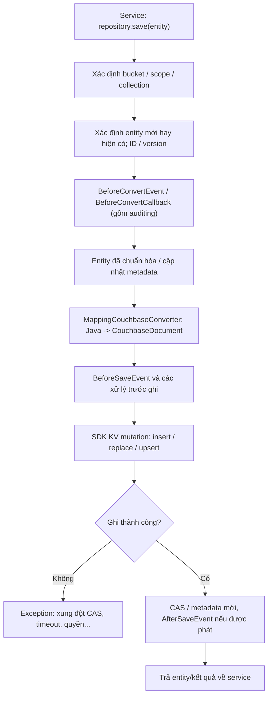
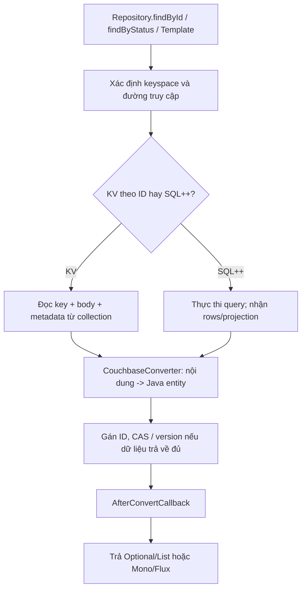

# Các giai đoạn chuyển đổi, đọc và ghi tài liệu trong Spring Data Couchbase

Khi gọi `repository.save(order)` hay `repository.findById(id)`, Spring Data Couchbase không chỉ gửi một object Java thẳng đến Couchbase Server rồi nhận lại chính object đó. Ở giữa là quá trình **xác định keyspace**, **xử lý metadata entity**, **gọi lifecycle hook**, **chuyển đổi kiểu dữ liệu**, **thực hiện thao tác KV hoặc SQL++**, và **khôi phục object Java** từ kết quả.

Hiểu các giai đoạn này giúp giải thích vì sao `@CreatedDate` được cập nhật trước khi lưu, tại sao `@Version` mang giá trị CAS, vì sao một field đánh dấu `@Transient` không xuất hiện trong JSON, và tại sao hook mà bạn mong chờ có thể không chạy khi một job sử dụng Couchbase Java SDK trực tiếp.

Bài thuộc chương **Vòng đời và auditing** của module `SPRING_DATA_COUCHBASE`. Phạm vi tập trung vào vòng đời document trong tầng truy cập Spring Data: document mapping, repository, `CouchbaseTemplate`, truy vấn SQL++, auditing, CAS, TTL, và biến thể reactive.

## 1. Phân biệt ba đối tượng trong một vòng đời

Một thực thể nghiệp vụ thường đi qua ba cách biểu diễn:

| Biểu diễn | Ví dụ | Nơi tồn tại |
| --- | --- | --- |
| **Entity Java** | `OrderDocument` có `id`, `status`, `createdAt` | Bộ nhớ JVM, được tầng service hoặc repository xử lý |
| **CouchbaseDocument / biểu diễn mapping** | Cấu trúc field/value được `CouchbaseConverter` tạo hoặc đọc | Bên trong Spring Data Couchbase |
| **Document trên Couchbase Server** | Key `order::1001` cùng nội dung JSON, CAS và expiry | Một collection thuộc bucket/scope cụ thể |

Ví dụ entity:

```java
OrderDocument order = new OrderDocument("order::1001", "NEW");
```

Sau khi mapping, nội dung có thể tương đương:

```json
{
  "_class": "example.shop.OrderDocument",
  "status": "NEW",
  "createdAt": "2026-11-25T03:00:00Z"
}
```

JSON này chỉ **minh họa hình dạng**. Tên type key, định dạng thời gian và tập field thực tế phụ thuộc cấu hình converter và các annotation. ID của Couchbase thường là **document key**, không bắt buộc có một field `id` lặp lại trong JSON. CAS và expiry là metadata của document, không nên coi là trường JSON nghiệp vụ mặc định.

### Chọn keyspace là bước độc lập với chuyển đổi

Giả sử document được lưu tại:

```text
shop.commerce.orders
```

Spring Data phải biết đúng bucket, scope, collection để gửi request. Sau đó converter mới ánh xạ các property entity thành nội dung document. Cùng entity `OrderDocument` có thể được dùng trên collection khác, nhưng **converter không tự tạo collection hay chuyển dữ liệu cũ**.

## 2. Sơ đồ tổng thể: chiều ghi và chiều đọc

### 2.1. Luồng ghi



Sơ đồ là **mô hình khái niệm**, không phải trace chính xác cho mọi API, phiên bản hoặc trường hợp bulk operation. Đặc biệt, các application event và entity callback là hai cơ chế khác nhau; chúng không tạo một hàng đợi sự kiện đồng bộ duy nhất. Không dựa vào sơ đồ để khẳng định một listener bất đồng bộ chạy xong trước khi mutation bắt đầu.

### 2.2. Luồng đọc



Với SQL++ trả **projection/DTO** thay vì entity đầy đủ, cách materialize và callback thực tế có thể khác. Đừng mặc định một query chỉ chọn hai cột sẽ đi qua toàn bộ quá trình giống `findById(Entity.class)`.

## 3. Entity mẫu để quan sát lifecycle

Dưới đây là entity được sử dụng trong các ví dụ. Các annotation quan trọng:

- `@Document`: đánh dấu kiểu dùng cho Couchbase mapping.
- `@Id`: nhận document key.
- `@Field`: có thể đổi tên field khi lưu JSON.
- `@Version`: gắn optimistic locking với CAS.
- `@CreatedDate`, `@LastModifiedDate`: thời điểm tạo/sửa khi auditing được bật.
- `@Transient`: field phục vụ hiển thị trong JVM, không ghi thành field dữ liệu thông thường.

```java
package example.shop;

import java.time.Instant;

import org.springframework.data.annotation.CreatedDate;
import org.springframework.data.annotation.Id;
import org.springframework.data.annotation.LastModifiedDate;
import org.springframework.data.annotation.Transient;
import org.springframework.data.annotation.Version;
import org.springframework.data.couchbase.core.mapping.Document;
import org.springframework.data.couchbase.core.mapping.Field;
import org.springframework.data.couchbase.repository.Collection;
import org.springframework.data.couchbase.repository.Scope;

@Document
@Scope("commerce")
@Collection("orders")
public class OrderDocument {

    @Id
    private String id;

    @Field("customer_id")
    private String customerId;

    private String status;

    @Version
    private long version;

    @CreatedDate
    private Instant createdAt;

    @LastModifiedDate
    private Instant updatedAt;

    @Transient
    private String displayLabel;

    public OrderDocument() {
    }

    public OrderDocument(String id, String status) {
        this.id = id;
        this.status = status;
    }

    public String getId() { return id; }
    public void setId(String id) { this.id = id; }

    public String getCustomerId() { return customerId; }
    public void setCustomerId(String customerId) {
        this.customerId = customerId;
    }

    public String getStatus() { return status; }
    public void setStatus(String status) { this.status = status; }

    public long getVersion() { return version; }

    public Instant getCreatedAt() { return createdAt; }
    public Instant getUpdatedAt() { return updatedAt; }

    public String getDisplayLabel() { return displayLabel; }
    public void setDisplayLabel(String displayLabel) {
        this.displayLabel = displayLabel;
    }
}
```

Chú ý package của hai annotation scope/collection: `org.springframework.data.couchbase.repository.Scope` và `org.springframework.data.couchbase.repository.Collection`. Không nhầm `@Scope` này với `org.springframework.context.annotation.Scope` của Spring bean.

Repository:

```java
package example.shop;

import java.util.List;

import org.springframework.data.couchbase.repository.CouchbaseRepository;

public interface OrderRepository
        extends CouchbaseRepository<OrderDocument, String> {

    List<OrderDocument> findByStatus(String status);
}
```

Giả định bucket được cấu hình là `shop`, repository sẽ hướng các thao tác phù hợp đến `shop.commerce.orders`, trừ khi có override cao hơn ở repository/method hoặc runtime.

## 4. Giai đoạn ghi 1: service chuẩn bị dữ liệu và chọn nơi lưu

Ví dụ:

```java
OrderDocument order = new OrderDocument("order::1001", "NEW");
order.setCustomerId("customer::42");

OrderDocument saved = orderRepository.save(order);
```

Trước cả quá trình mapping, ứng dụng phải chịu trách nhiệm:

1. Xác thực và phân quyền người gọi; không dùng lifecycle callback để thay thế authorization.
2. Kiểm tra yêu cầu nghiệp vụ, ví dụ khách hàng có quyền tạo đơn hàng.
3. Xây dựng ID hợp lệ hoặc dùng chiến lược sinh ID của Spring Data/Couchbase.
4. Chọn repository hoặc Template đã được cấu hình đúng bucket/scope/collection.
5. Xác định có cần optimistic locking, TTL, durability hoặc transaction hay không.

Các quyết định này thuộc tầng nghiệp vụ/hạ tầng, không phải việc `MappingCouchbaseConverter` có thể suy ra từ JSON.

### Save không phải luôn là insert

`save()` là API lưu entity. Spring Data cân nhắc trạng thái entity mới/cũ và cách ánh xạ version để chọn mutation phù hợp với phiên bản API. Khi yêu cầu **không được ghi đè document đã tồn tại**, một thao tác insert rõ ràng thường dễ hiểu hơn:

```java
OrderDocument inserted = couchbaseTemplate
    .insertById(OrderDocument.class)
    .inScope("commerce")
    .inCollection("orders")
    .one(order);
```

Nếu key đã tồn tại, insert có thể thất bại. Ngược lại, các biến thể upsert có thể thay thế nội dung của document đã có. Đừng gộp semantics insert, upsert và replace làm một khi thiết kế lifecycle và xử lý lỗi.

## 5. Giai đoạn ghi 2: BeforeConvertCallback

Trong Spring Data Couchbase hiện đại, `BeforeConvertCallback<T>` là một hook kiểu **EntityCallback** chạy khi entity chuẩn bị được chuyển đổi để lưu. Chữ ký được định nghĩa như sau:

```java
T onBeforeConvert(T entity, String collection);
```

Nó nhận entity và **tên collection**, rồi trả lại entity có thể đã được chỉnh sửa. Nếu entity immutable, có thể trả về một bản sao mới thay vì thay đổi tại chỗ.

### Ví dụ chuẩn hóa trạng thái trước khi ghi

```java
package example.shop;

import java.util.Locale;

import org.springframework.core.annotation.Order;
import org.springframework.data.couchbase.core.mapping.event.BeforeConvertCallback;
import org.springframework.stereotype.Component;

@Component
@Order(100)
public class NormalizeOrderStatus
        implements BeforeConvertCallback<OrderDocument> {

    @Override
    public OrderDocument onBeforeConvert(
            OrderDocument entity, String collection) {

        String status = entity.getStatus();

        if (status == null || status.isBlank()) {
            throw new IllegalArgumentException("Order status is required");
        }

        entity.setStatus(
            status.trim().toUpperCase(Locale.ROOT)
        );

        return entity;
    }
}
```

Khi ghi `new OrderDocument("order::1001", " confirmed ")`, callback có thể biến `status` thành `CONFIRMED` trước khi converter ghi JSON.

**Dùng phù hợp:** chuẩn hóa dữ liệu nội bộ có tính quyết định, đặt các field kỹ thuật cần thiết trước khi chuyển đổi, hoặc kiểm tra một bất biến cơ bản.

**Không nên dùng:** gửi email, gọi API thanh toán, thực hiện ghi chéo nhiều collection hoặc xử lý side effect không idempotent. Callback có thể được chạy lại khi ứng dụng retry; việc ghi chính có thể thất bại sau khi callback hoàn tất.

**Về thứ tự:** `@Order` hoặc `Ordered` có thể quyết định thứ tự của các callback cùng pha. Auditing cũng dùng callback, vì vậy nếu một quy tắc phụ thuộc vào thời điểm auditing cập nhật field, hãy thiết kế thứ tự rõ ràng và kiểm thử với phiên bản Spring Data hiện dùng.

## 6. Giai đoạn ghi 3: auditing và quyết định entity mới/cũ

Spring Data có thể tự cập nhật metadata:

| Annotation | Ý nghĩa |
| --- | --- |
| `@CreatedDate` | Thời điểm tạo entity. |
| `@LastModifiedDate` | Thời điểm entity được sửa/lưu. |
| `@CreatedBy` | Actor được ghi nhận là người tạo. |
| `@LastModifiedBy` | Actor được ghi nhận là người sửa gần nhất. |
| `@Version` | Phiên bản/CAS phục vụ optimistic locking và nhận diện trạng thái mới trong Couchbase. |

### 6.1. Bật Couchbase auditing

```java
package example.shop;

import java.util.Optional;

import org.springframework.context.annotation.Bean;
import org.springframework.context.annotation.Configuration;
import org.springframework.data.domain.AuditorAware;
import org.springframework.data.couchbase.repository.auditing.EnableCouchbaseAuditing;

@Configuration
@EnableCouchbaseAuditing
public class AuditConfiguration {

    // Chỉ minh họa: production lấy actor từ
    // security context đã xác thực, không cố định "system-demo".
    @Bean
    AuditorAware<String> auditorAware() {
        return () -> Optional.of("system-demo");
    }
}
```

Nếu cần lưu actor, thêm các field:

```java
import org.springframework.data.annotation.CreatedBy;
import org.springframework.data.annotation.LastModifiedBy;

@CreatedBy
private String createdBy;

@LastModifiedBy
private String updatedBy;
```

Trong ví dụ này, hai field phải được thêm vào entity thực tế, kèm getter nếu cần. `AuditorAware<String>` trả về đúng kiểu `String` tương ứng với các annotation.

**Điểm đặc thù Couchbase:** tài liệu Spring Data Couchbase lưu ý entity cần có field `@Version` để phân biệt đáng tin cậy trạng thái tạo mới khi auditing. Nếu không, một lần tạo có thể bị diễn giải thành update, làm sai dữ liệu creation auditing.

Với timestamp, không nhất thiết phải có `AuditorAware` nếu chỉ dùng `@CreatedDate` và `@LastModifiedDate`. Nếu dùng `@CreatedBy`/`@LastModifiedBy`, nguồn actor phải có sẵn trong context phù hợp.

### 6.2. Creation không phải lúc nào đồng nghĩa “chưa có ID”

Một entity mới có thể đã được cấp sẵn key trước khi lưu. `@Version` giúp cơ chế nhận diện trạng thái mới của Couchbase rõ ràng hơn. Đừng tự viết logic chỉ dựa trên `id == null` nếu ứng dụng đặt ID bằng UUID hay key nghiệp vụ từ trước.

Auditing được thực hiện trong lifecycle mapping, không có nghĩa Couchbase Server tự biết ai đăng nhập vào ứng dụng. Dùng Java SDK trực tiếp để upsert một JSON document **không tự kích hoạt** Couchbase auditing callback của Spring Data.

### 6.3. Auditing không thay thế audit log nghiệp vụ

`createdBy`/`updatedBy` và timestamp cho biết metadata gần nhất. Chúng **không tạo lịch sử đầy đủ từng thay đổi**: ví dụ không tự lưu giá trị cũ/mới, quyết định phê duyệt hay toàn bộ event “đơn hàng đã xác nhận”.

Nếu cần audit trail có độ tin cậy cao, thiết kế event/outbox hoặc cơ chế CDC riêng. Không phát event nghiệp vụ quan trọng chỉ từ callback trước mutation rồi coi chắc chắn mutation đã thành công.

## 7. Giai đoạn ghi 4: MappingCouchbaseConverter tạo biểu diễn lưu trữ

`MappingCouchbaseConverter` là thành phần ánh xạ object sang cấu trúc có thể lưu trong Couchbase và đọc ngược lại. Nó xét metadata của entity như:

- `@Id`: document key.
- `@Field("customer_id")`: property `customerId` được biểu diễn bằng tên field JSON `customer_id`.
- `@Transient`: không lưu field kỹ thuật chỉ dùng trong JVM.
- Các kiểu được hỗ trợ và custom converters.
- Type metadata, thường là `_class`, theo cấu hình type mapper.
- `@Version`: tương tác với CAS khi load/save qua API Spring Data phù hợp.

Ví dụ object:

```java
OrderDocument order = new OrderDocument("order::1001", "CONFIRMED");
order.setCustomerId("customer::42");
```

Nội dung JSON tương ứng có thể trông như:

```json
{
  "_class": "example.shop.OrderDocument",
  "customer_id": "customer::42",
  "status": "CONFIRMED",
  "createdAt": "2026-11-25T03:00:00Z",
  "updatedAt": "2026-11-25T03:00:00Z"
}
```

Ví dụ không giả định `_class` luôn có giá trị như trên: package thực, type alias và custom converter có thể thay đổi. Giá trị `@Version` không nên được ép gán thủ công vào một field JSON như số lần cập nhật.

### Tại sao lifecycle callback khác custom converter?

| Cơ chế | Phạm vi | Ví dụ |
| --- | --- | --- |
| `BeforeConvertCallback<OrderDocument>` | Entity ngay trước khi mapping để ghi | Chuẩn hóa status, tính field kỹ thuật. |
| `AfterConvertCallback<OrderDocument>` | Entity sau khi đọc và materialize | Bổ sung nhãn hiển thị không lưu. |
| `Converter<X, Y>` đăng ký qua `CouchbaseCustomConversions` | Chuyển biểu diễn cho kiểu/value object | `PriorityCode` ⇄ `String`. |
| Mapping annotations | Quy tắc trường/property và metadata | `@Field`, `@Id`, `@Transient`. |
| `AbstractCouchbaseEventListener` | Nhận application events tương ứng lifecycle | Log trước/sau save, trước/sau delete. |

Callback là điểm can thiệp vào **entity**, trong khi converter tùy chỉnh phục vụ chuyển đổi **kiểu dữ liệu**. Không nên viết logic có side effect ở custom converter vì nó có thể được gọi nhiều lần và không phải một bước “save thành công”.

## 8. Custom conversions: biến đổi value object khi ghi và đọc

Giả sử domain có kiểu giá trị:

```java
package example.shop;

public record PriorityCode(String value) {
    public PriorityCode {
        if (value == null || value.isBlank()) {
            throw new IllegalArgumentException("Priority must not be blank");
        }
    }
}
```

Muốn lưu `PriorityCode("HIGH")` dưới dạng chuỗi `"HIGH"`, đăng ký hai converter đối xứng:

```java
import org.springframework.core.convert.converter.Converter;
import org.springframework.data.convert.WritingConverter;
import org.springframework.data.convert.ReadingConverter;

@WritingConverter
public class PriorityCodeWriteConverter
        implements Converter<PriorityCode, String> {

    @Override
    public String convert(PriorityCode source) {
        return source.value();
    }
}

@ReadingConverter
public class PriorityCodeReadConverter
        implements Converter<String, PriorityCode> {

    @Override
    public PriorityCode convert(String source) {
        return new PriorityCode(source);
    }
}
```

Ví dụ cách tạo tập custom conversions:

```java
import java.util.List;

import org.springframework.data.couchbase.core.convert.CouchbaseCustomConversions;

CouchbaseCustomConversions conversions =
    new CouchbaseCustomConversions(List.of(
        new PriorityCodeWriteConverter(),
        new PriorityCodeReadConverter()
    ));
```

Đoạn này mô tả đối tượng cấu hình. Trong dự án thực phải **đăng ký** nó vào `MappingCouchbaseConverter` qua cơ chế cấu hình Spring Data/Couchbase của ứng dụng (chẳng hạn cấu hình Bean hoặc `AbstractCouchbaseConfiguration`), và kiểm tra không ghi đè những converter mặc định ngoài ý muốn.

Dùng `@WritingConverter` và `@ReadingConverter` giúp định hướng khi cả hai phía của conversion là kiểu có thể được engine hiểu. Tránh đăng ký converter toàn cục quá rộng như biến mọi `String` thành một kiểu domain không liên quan.

**Kiểm thử cần có:** entity với priority được ghi qua repository phải ra JSON đúng, sau đó đọc lại từ SDK/repository phải khôi phục `PriorityCode` chính xác.

## 9. Mapping events: BeforeConvert, BeforeSave, AfterSave và Delete

Ngoài `EntityCallback`, Spring Data Couchbase còn công bố các **application events** thông qua hệ thống sự kiện của Spring.

Các loại đáng biết:

| Event | Vị trí ý nghĩa |
| --- | --- |
| `BeforeConvertEvent` | Khi entity chuẩn bị đi vào quá trình chuyển đổi để lưu. |
| `BeforeSaveEvent` | Sau khi đã có biểu diễn document, trước mutation lưu. |
| `AfterSaveEvent` | Sau khi thao tác lưu thành công theo lifecycle tương ứng. |
| `BeforeDeleteEvent` | Trước thao tác xóa tương ứng. |
| `AfterDeleteEvent` | Sau thao tác xóa tương ứng. |

Các event có thể được nhận qua `AbstractCouchbaseEventListener<E>`.

Ví dụ logging:

```java
package example.shop;

import org.slf4j.Logger;
import org.slf4j.LoggerFactory;

import org.springframework.data.couchbase.core.mapping.CouchbaseDocument;
import org.springframework.data.couchbase.core.mapping.event.AbstractCouchbaseEventListener;
import org.springframework.stereotype.Component;

@Component
public class OrderLifecycleLogger
        extends AbstractCouchbaseEventListener<OrderDocument> {

    private static final Logger log =
        LoggerFactory.getLogger(OrderLifecycleLogger.class);

    @Override
    public void onBeforeConvert(OrderDocument source) {
        log.debug("Before convert: {}", source.getId());
    }

    @Override
    public void onBeforeSave(
            OrderDocument source, CouchbaseDocument document) {
        log.debug("Before save: {}", source.getId());
    }

    @Override
    public void onAfterSave(
            OrderDocument source, CouchbaseDocument document) {
        log.debug("After save: {}", source.getId());
    }
}
```

**Giới hạn quan trọng:**

1. Application events dựa trên Spring `ApplicationEventMulticaster`; nếu cấu hình phát bất đồng bộ thì thứ tự và thời điểm xử lý listener **không bảo đảm** giống một callback đồng bộ.
2. Spring Data Commons khuyến nghị **EntityCallback** cho các thao tác cần **thay đổi entity có thứ tự xác định**.
3. Đừng coi `AfterSaveEvent` là một transaction hook đảm bảo event bên ngoài được giao đúng một lần. Thành công lưu dữ liệu và thành công gửi email/event tới hệ thống khác là hai điều kiện riêng.
4. Không suy rằng mọi lệnh Java SDK trực tiếp, statement SQL++ UPDATE/DELETE hay các API bulk đều phát đầy đủ các event Spring Data.
5. Phần code cho event chỉ log ID giả định; production cần tránh log nội dung cá nhân hoặc dữ liệu nhạy cảm trong payload.

### Có BeforeSaveCallback và AfterSaveCallback trong Couchbase không?

Đừng sao chép API từ mô-đun Spring Data khác mà chưa kiểm tra package. Trong Spring Data Couchbase hiện nay, các callback riêng được tài liệu/Javadoc liệt kê rõ là **`BeforeConvertCallback` và `AfterConvertCallback`**, cùng phiên bản reactive tương ứng. `BeforeSaveEvent` và `AfterSaveEvent` là **application events**, không phải mặc nhiên là hai interface `BeforeSaveCallback`/`AfterSaveCallback` trong package Couchbase.

Đây là khác biệt dễ khiến code không compile khi chuyển ví dụ từ Spring Data MongoDB/JDBC sang Couchbase.

## 10. Giai đoạn ghi 5: thực thi mutation và xử lý CAS

Khi entity đã được chuyển thành biểu diễn lưu trữ, Spring Data sử dụng SDK để gửi thao tác tới collection mục tiêu.

| Thao tác | Kỳ vọng |
| --- | --- |
| Insert | Tạo key mới, thất bại nếu đã tồn tại. |
| Replace | Thay document đã có, có thể kèm điều kiện CAS. |
| Upsert | Tạo hoặc thay document theo semantics API đang dùng. |
| Remove | Xóa theo key/điều kiện yêu cầu. |

Một document có metadata **CAS** (*Compare-And-Swap*). Mỗi mutation có thể làm CAS thay đổi. Khi dùng entity `@Version` và đọc/ghi qua Spring Data, CAS được mang theo entity để hỗ trợ optimistic locking; **không tăng giá trị `version` như bộ đếm do ứng dụng tự quản lý**.

Ví dụ cập nhật:

```java
OrderDocument order = orderRepository
    .findById("order::1001")
    .orElseThrow();

order.setStatus("CONFIRMED");

// Save có thể kiểm tra version/CAS đã đọc.
OrderDocument saved = orderRepository.save(order);
```

Nếu một tiến trình khác đã cập nhật document và CAS đổi, lần lưu có thể gặp `OptimisticLockingFailureException` hoặc exception tương ứng được Spring Data chuyển đổi. Cách xử lý đúng là chọn một trong hai chính sách:

- Báo xung đột cho tầng gọi, yêu cầu user nạp lại trạng thái.
- Thực hiện **load → áp dụng lại lệnh nghiệp vụ → save** có retry giới hạn và idempotent.

Không đơn giản bắt lỗi CAS rồi retry liên tiếp cùng entity và version cũ. Retry không kiểm soát có thể gây vòng lặp hoặc ghi đè logic nghiệp vụ.

### Save thành công không đồng nghĩa đã gửi event nghiệp vụ

Một lifecycle hook có thể chạy trước mutation nhưng mutation thất bại vì CAS, quyền, timeout hoặc tài nguyên không tồn tại. Vì vậy không tạo hóa đơn, trừ tiền hoặc phát thông điệp “đã thanh toán” chỉ trong `BeforeConvertCallback`.

Ngay cả khi mutation đã thành công, việc gửi message ở `AfterSaveEvent` vẫn có thể thất bại độc lập. Với yêu cầu nhất quán cao, cần thiết kế outbox/transaction hoặc cơ chế CDC phù hợp, không chỉ dựa vào callback.

## 11. Giai đoạn đọc 1: KV theo ID và SQL++ theo thuộc tính

### 11.1. Đọc KV theo key

```java
java.util.Optional<OrderDocument> order =
    orderRepository.findById("order::1001");
```

Đường KV thường truy cập trực tiếp một document trong collection được chọn. Nó không cần secondary index SQL++ khi đã biết ID. Bản đọc có thể kèm CAS và thông tin metadata để mapper đưa vào field `@Version`.

Nếu document không tồn tại trong **collection đang chọn**, kết quả rỗng không chứng minh document không tồn tại ở một collection khác.

### 11.2. Đọc theo thuộc tính thông qua SQL++

```java
java.util.List<OrderDocument> orders =
    orderRepository.findByStatus("CONFIRMED");
```

Finder này thường được Spring Data tạo thành SQL++ và cần index hoặc đường query phù hợp. Ví dụ truy vấn:

```sql
SELECT META(o).id AS id, o.status, o.customer_id
FROM `shop`.`commerce`.`orders` AS o
WHERE o.status = "CONFIRMED";
```

Câu trên chỉ nhằm minh họa SQL++; repository sẽ tự tạo query theo mapping, thông tin keyspace và field/alias cần thiết. Khi lấy **entity đầy đủ**, Spring Data có thể cần field metadata và type discriminator để khôi phục đúng kiểu, nhất là khi collection chứa nhiều loại document.

Lấy 2 field trong SQL++ rồi ép kết quả thành entity đầy đủ có thể khiến field còn lại `null`, CAS không đủ thông tin, hoặc không phù hợp với converter. Nếu chỉ cần vài trường, hãy định nghĩa DTO/projection rõ ràng.

### 11.3. Đọc ngay sau ghi và độ trễ chỉ mục

Một lệnh KV upsert thành công có thể được `findById` nhìn thấy trước khi SQL++ query theo `status` nhìn thấy document đó, tùy scan consistency và thời điểm index cập nhật.

Đó là **độ trễ đồng bộ chỉ mục**, không tự chứng minh callback `BeforeConvert` bị bỏ qua hay mapping sai. Khi chẩn đoán:

1. Kiểm tra document bằng KV theo ID ở đúng collection.
2. Kiểm tra JSON được ghi và metadata mapping.
3. Kiểm tra chỉ mục Query Service.
4. Kiểm tra scan consistency; `REQUEST_PLUS` có thể phù hợp với bài test đọc ngay sau ghi, nhưng làm tăng độ trễ.

## 12. Giai đoạn đọc 2: converter khôi phục entity

Khi nhận document, `MappingCouchbaseConverter` đọc các field theo metadata:

- Lấy document key và ánh xạ về property `@Id`.
- Đọc `customer_id` thành `customerId` theo `@Field`.
- Khôi phục các kiểu Java từ nội dung JSON.
- Áp dụng custom reading converter nếu đã đăng ký.
- Materialize object qua constructor/setter/field access được hỗ trợ.
- Gán metadata version/CAS khi đường truy cập cung cấp đủ thông tin.
- Xử lý type discriminator khi ứng dụng cần phân biệt loại entity.

Hình minh họa:

```text
Couchbase:
  key = order::1001
  body.customer_id = customer::42
  body.status = CONFIRMED
  metadata.cas = 0x...

          |
          v
MappingCouchbaseConverter

          |
          v
OrderDocument:
  id = "order::1001"
  customerId = "customer::42"
  status = "CONFIRMED"
  version = CAS tương ứng
```

Khi document được tạo bằng Java SDK trực tiếp mà không có metadata Spring Data mong đợi, truy vấn repository theo entity có thể trả khác với SQL++ thuần. Vấn đề thường liên quan type discriminator, tên field, ID, projection và converter.

**Đừng tự đặt `@Version` theo một giá trị từ JSON.** Trong Couchbase, version mang ngữ nghĩa CAS; nó khác với số version nghiệp vụ kiểu `schemaVersion`.

## 13. Giai đoạn đọc 3: AfterConvertCallback

Hook được Spring Data Couchbase cung cấp:

```java
T onAfterConvert(
    T entity,
    CouchbaseDocument document,
    String collection
);
```

Nó chạy sau khi converter materialize entity từ document. Vì vậy, đây là nơi có thể tính dữ liệu **chỉ dùng khi đọc**, không cần lưu lại.

### Ví dụ tạo nhãn hiển thị

```java
package example.shop;

import org.springframework.core.annotation.Order;
import org.springframework.data.couchbase.core.mapping.CouchbaseDocument;
import org.springframework.data.couchbase.core.mapping.event.AfterConvertCallback;
import org.springframework.stereotype.Component;

@Component
@Order(100)
public class OrderDisplayLabelCallback
        implements AfterConvertCallback<OrderDocument> {

    @Override
    public OrderDocument onAfterConvert(
            OrderDocument entity,
            CouchbaseDocument document,
            String collection) {

        entity.setDisplayLabel(
            entity.getId() + " · " + entity.getStatus()
        );

        return entity;
    }
}
```

Vì `displayLabel` được gắn `@Transient`, converter không ghi field này vào JSON khi lưu. Nếu đọc lại entity bằng Spring Data thông qua đường đi có hỗ trợ callback, `displayLabel` có thể được tính lại.

**Không dùng để lưu sự thay đổi:** callback chạy **sau khi đọc**; việc gọi `entity.setDisplayLabel(...)` không tự phát sinh mutation ở Couchbase. Nếu muốn sửa document ở server, cần thực hiện thao tác ghi có kiểm soát.

**Không dùng làm authorization:** việc che một field sau đọc không thay thế chính sách giới hạn query/keyspace trước khi truy cập DB. Hơn nữa, callback nhận **tên collection**, không phải toàn bộ ngữ cảnh người dùng/tenant để xác thực.

## 14. Reactive lifecycle: callback được kích hoạt trong publisher

Trong ứng dụng reactive, các bước ánh xạ tương tự nhưng sử dụng `ReactiveCouchbaseRepository` hoặc `ReactiveCouchbaseTemplate` và Reactor. Hai interface callback tương ứng:

- `ReactiveBeforeConvertCallback<T>`
- `ReactiveAfterConvertCallback<T>`

Chúng trả về `org.reactivestreams.Publisher<T>`, không trả trực tiếp entity. Các callback đồng bộ và reactive thường được xem xét theo **loại API** đang sử dụng, nên không giả định đăng ký `BeforeConvertCallback<T>` đồng bộ sẽ tự áp dụng cho đường reactive.

Ví dụ:

```java
package example.shop;

import java.util.Locale;

import org.springframework.data.couchbase.core.mapping.event.ReactiveBeforeConvertCallback;
import org.springframework.stereotype.Component;

import reactor.core.publisher.Mono;

@Component
public class ReactiveOrderNormalize
        implements ReactiveBeforeConvertCallback<OrderDocument> {

    @Override
    public Mono<OrderDocument> onBeforeConvert(
            OrderDocument entity, String collection) {

        if (entity.getStatus() == null) {
            return Mono.error(
                new IllegalArgumentException("Status required")
            );
        }

        entity.setStatus(
            entity.getStatus().trim().toUpperCase(Locale.ROOT)
        );

        return Mono.just(entity);
    }
}
```

Ví dụ trên dùng `Mono` vì `Mono<T>` thực thi `Publisher<T>`. Không được gọi `block()` trong callback của luồng reactive để truy cập một service khác; hãy compose bất đồng bộ khi thực sự cần.

### ReactiveAfterConvertCallback

```java
import org.springframework.data.couchbase.core.mapping.CouchbaseDocument;
import org.springframework.data.couchbase.core.mapping.event.ReactiveAfterConvertCallback;
import reactor.core.publisher.Mono;

public class ReactiveOrderLabel
        implements ReactiveAfterConvertCallback<OrderDocument> {

    @Override
    public Mono<OrderDocument> onAfterConvert(
            OrderDocument entity,
            CouchbaseDocument document,
            String collection) {

        entity.setDisplayLabel(
            entity.getId() + " · " + entity.getStatus()
        );

        return Mono.just(entity);
    }
}
```

Nếu muốn framework tự nhận callback, đăng ký bean bằng `@Component` hoặc `@Bean` trong Spring context. Đoạn class ở trên chưa có `@Component`, nên chỉ được sử dụng sau khi bạn **đăng ký bean** tường minh.

### Subscription và thời điểm quan sát kết quả

```java
reactor.core.publisher.Mono<OrderDocument> saved =
    reactiveOrderRepository.save(order);
```

Đoạn này tạo publisher. Trừ khi có subscriber, không nên coi thao tác đã hoàn tất hoặc `ReactiveBeforeConvertCallback` đã chạy xong. Trong integration test, dùng `StepVerifier`:

```java
StepVerifier.create(
        reactiveOrderRepository.save(order)
    )
    .assertNext(savedEntity -> {
        assert "CONFIRMED".equals(savedEntity.getStatus());
    })
    .verifyComplete();
```

Ví dụ assertion Java `assert` phụ thuộc tùy chọn bật assertion của JVM; trong test thực tế nên dùng `Assertions.assertEquals("CONFIRMED", ...)` của JUnit để luôn kiểm tra điều kiện.

### Auditing trong reactive

Cơ chế auditing reactive dùng các thành phần tương ứng như `ReactiveAuditingEntityCallback` và nguồn actor reactive khi cần. Nếu actor lấy từ Reactor context/security context, hãy sử dụng chiến lược phù hợp với Spring Security reactive thay vì giả định `ThreadLocal` sẽ luôn chứa đúng principal sau khi đổi thread.

## 15. Trường hợp không đi qua Spring Data lifecycle

Đây là nguyên nhân rất thường gặp khi developer thêm callback nhưng không thấy nó chạy.

| Đường truy cập | Có mặc định đi qua Spring Data mapping/callback không? |
| --- | --- |
| `CouchbaseRepository.save(entity)` | Có, theo pipeline Spring Data của API và phiên bản tương ứng. |
| `CouchbaseTemplate.insertById/upsertById(entity)` | Có, với entity mapping của Spring Data. |
| `CouchbaseRepository.findById` | Có, khôi phục entity bằng converter. |
| Finder repository qua SQL++ | Có khi kết quả được materialize thành entity; projections có thể khác. |
| `ReactiveCouchbaseRepository.save` | Có theo reactive pipeline, với reactive callbacks. |
| `Cluster.bucket(...).scope(...).collection(...).upsert(id, JsonObject)` | **Không**: Java SDK trực tiếp bypass Spring Data entity callbacks/auditing. |
| SQL++ `UPDATE ... SET ...` chạy qua SDK Query Service | **Không tự đi qua** Spring Data entity callbacks cho từng document được cập nhật. |
| Job ETL, import/export, XDCR | Không tự kích hoạt callback của Spring application. |
| Document tự hết hạn do TTL | Không phải một lệnh delete Spring Data; không tự phát event xóa tương ứng trong JVM. |

Không nên xây dựng cơ chế bảo mật hoặc audit compliance dựa duy nhất vào giả định rằng **mọi biến động document trong Couchbase** sẽ đi qua một `@Component` listener.

Nếu nhiều ứng dụng cùng ghi vào một collection, cần quy ước schema và validation bên ngoài lifecycle của một service, hoặc kiểm tra ở tầng API/broker/pipeline phù hợp.

## 16. Delete lifecycle khác save lifecycle

Xóa theo ID:

```java
orderRepository.deleteById("order::1001");
```

khác với save. Không nên kỳ vọng `BeforeConvertCallback` sẽ luôn chạy chỉ vì một lệnh delete cần xóa một key; nhiều đường xóa không cần chuyển đổi entity hoàn chỉnh.

Couchbase có event:

- `BeforeDeleteEvent`
- `AfterDeleteEvent`

nhưng sự kiện nào xuất hiện với một **API xóa cụ thể** cần được kiểm chứng trên đúng phiên bản Spring Data và đường truy cập. Không sao chép logic của save hook sang delete mà không test.

**Sai lầm thường gặp:** dùng `AfterDeleteEvent` để đảm bảo xóa dữ liệu ở hệ thống ngoài. Nếu event listener chạy bất đồng bộ hoặc hệ thống ngoài lỗi, thao tác xóa Couchbase có thể đã hoàn tất. Với yêu cầu phải đồng bộ nhiều hệ thống, cần workflow/transaction/outbox hoặc cơ chế phục hồi phù hợp.

## 17. Ranh giới của TTL, durability và transaction

### 17.1. TTL/expiry

Expiry là chính sách vòng đời của document trên Couchbase Server. Nó có thể được đặt lúc ghi bằng API hoặc cấu hình collection/bucket. `@CreatedDate` là timestamp auditing nghiệp vụ, **không đồng nghĩa** với expiry.

Hai câu hỏi khác nhau:

- “Đơn hàng được tạo lúc nào?” → `@CreatedDate` / metadata nghiệp vụ.
- “Khi nào document tự hết hạn?” → expiry/TTL của Couchbase.

Đổi expiry không tự kích hoạt `BeforeConvertCallback`; và khi document hết hạn trên server, không có một save/delete lifecycle do Spring Data khởi xướng.

### 17.2. Durability

Couchbase cho phép khai báo mức durability để đợi dữ liệu được xác nhận ở số node phù hợp. Đạt một mức durability không đồng nghĩa transaction nhiều document, và không tự đảm bảo side effect trong event listener cũng bền vững.

### 17.3. Transaction

Ghi document A rồi B qua hai `save()` độc lập không tự tạo giao dịch nguyên tử. Nếu cần transaction, ứng dụng phải dùng API transaction phù hợp và xét cách callback/event sẽ được gọi trong các attempt/retry. Side effect không idempotent trong callback càng rủi ro khi transaction bị retry.

**Nguyên tắc:** lifecycle hook không nên chứa thao tác ngoài DB mà chỉ được phép chạy đúng một lần, trừ khi có thiết kế idempotency/chống lặp rõ ràng.

## 18. Chọn vị trí đặt business logic cho đúng

Bảng lựa chọn:

| Nhu cầu | Nên đặt ở đâu? | Vì sao? |
| --- | --- | --- |
| Kiểm tra user có quyền cập nhật đơn hàng | Tầng service/authorization | Cần principal, tenant, hành động; phải kiểm tra **trước DB**. |
| Chuẩn hóa status hoặc field phụ trước khi ghi entity | `BeforeConvertCallback` nếu áp dụng nhất quán | Hook xác định trước khi entity được chuyển đổi. |
| Chuyển value object ⇄ JSON primitive | Custom converter | Đây là vấn đề biểu diễn dữ liệu, không phải nghiệp vụ. |
| Tự cập nhật người tạo/sửa và thời điểm | Auditing annotations và cấu hình | Tránh lặp mã đặt timestamp/actor ở nhiều service. |
| Tính nhãn hiển thị không cần persist | `AfterConvertCallback` hoặc DTO mapper | Chỉ xảy ra khi đọc và không thay DB. |
| Quan sát/debug lifecycle | Application event listener/log/metrics | Không nên thay thế pipeline lưu chính. |
| Gửi email/ghi event sau khi đơn hàng lưu | Workflow/outbox/event pipeline đáng tin cậy | Tránh side effect thất bại hoặc bị lặp khi retry. |
| Kiểm soát cập nhật đồng thời | `@Version`/CAS và chính sách retry | Phát hiện stale write. |
| Giữ nhiều document nhất quán | Transaction hoặc workflow thích hợp | Callback không tạo transaction. |

Không nên “dồn” mọi thứ vào một `BeforeConvertCallback` vì nó được gọi trước ghi. Việc làm đó làm ranh giới nghiệp vụ khó kiểm thử, tạo hidden side effect và có thể chạy lặp ngoài dự kiến.

## 19. Kiểm thử lifecycle có thứ tự và oracle độc lập

### 19.1. Unit test callback

Ví dụ test trực tiếp logic normalization mà không cần Couchbase Server:

```java
import static org.junit.jupiter.api.Assertions.assertEquals;
import org.junit.jupiter.api.Test;

class NormalizeOrderStatusTest {

    @Test
    void normalizesBeforeWriting() {
        OrderDocument order =
            new OrderDocument("order::1001", " confirmed ");

        NormalizeOrderStatus callback = new NormalizeOrderStatus();
        OrderDocument result =
            callback.onBeforeConvert(order, "orders");

        assertEquals("CONFIRMED", result.getStatus());
    }
}
```

Test này chứng minh **logic Java** của callback, nhưng **không chứng minh Spring đã đăng ký bean hoặc callback thực sự được gọi khi save**.

### 19.2. Integration test Spring Data + Couchbase SDK

Một integration test có thể:

1. Bật Spring context, repository và các callback cần kiểm tra.
2. Tạo bucket/scope/collection test.
3. Gọi `repository.save(new OrderDocument(id, " confirmed "))`.
4. Đọc trực tiếp bằng Couchbase Java SDK tại đúng collection.
5. Assert field JSON `status` là `CONFIRMED`, `customer_id` được mapping đúng, `displayLabel` không bị persist.
6. Gọi `repository.findById(id)` và assert `displayLabel` đã được tính sau convert.
7. Assert `createdAt`/`updatedAt` được điền khi auditing bật và `@Version` được quản lý đúng.
8. Thử cập nhật stale entity để phát hiện CAS conflict.

Ví dụ pseudo-assertion:

```java
// SDK oracle: đọc JSON trực tiếp, tránh chỉ save rồi find cùng API.
var raw = sdk.bucket("shop")
    .scope("commerce")
    .collection("orders")
    .get(id)
    .contentAsObject();

assertEquals("CONFIRMED", raw.getString("status"));
assertFalse(raw.containsKey("displayLabel"));
```

Đoạn kiểm tra này giả định test đã có `sdk` và `id`; `assertFalse` đến từ JUnit. Nó minh họa cách tách test mapping/persist khỏi test callback đọc.

### 19.3. Kiểm thử auditing không dùng so sánh thời gian tuyệt đối

`createdAt` và `updatedAt` phụ thuộc đồng hồ được dùng bởi auditing. Đừng assert một timestamp cố định trừ khi bạn đã inject một `DateTimeProvider`/clock test xác định. Thay vào đó:

- Assert giá trị không null.
- Hoặc dùng clock được kiểm soát trong test.
- Kiểm tra timestamp tạo không bị ghi đè tùy tiện khi update.
- Kiểm tra actor đến từ `AuditorAware` đúng user.
- Kiểm tra `@Version`/CAS thay đổi theo mutation và không bị tự đặt thủ công.

### 19.4. Kiểm thử sự kiện một cách thận trọng

Nếu muốn đo thứ tự callback, dùng một recorder bean chỉ dành cho test để ghi nhận các callback đồng bộ trong cùng operation. Nhưng đừng bắt một thứ tự tuyệt đối giữa tất cả application events và callbacks nếu cấu hình event multicaster cho phép async.

Với bài test after-save notification, phân biệt rõ:

- “Spring Data phát ra lifecycle event.”
- “Listener nhận được event.”
- “Message bên ngoài được gửi thành công.”

Ba sự kiện trên không có nghĩa tương đương.

## 20. Các lỗi thường gặp và cách chẩn đoán

| Triệu chứng | Giải thích có thể | Cách kiểm tra |
| --- | --- | --- |
| `BeforeConvertCallback` không chạy khi ghi bằng Java SDK. | SDK không đi qua converter Spring Data. | Xem đường truy cập thực tế; đưa logic cần thiết về application layer hoặc dùng Spring Data. |
| Đặt `BeforeSaveCallback` nhưng IDE không tìm thấy trong package Couchbase. | Nhầm API từ mô-đun Spring Data khác. | Dùng callback được Couchbase hỗ trợ; xem `BeforeSaveEvent` nếu cần quan sát event. |
| `@CreatedDate` null sau save. | Auditing chưa bật, entity thiếu `@Version`, hoặc ghi bypass framework. | Kiểm tra `@EnableCouchbaseAuditing`, `@Version`, callback registration và đường lưu. |
| `createdBy` không được điền. | Không có `AuditorAware` phù hợp hoặc không có principal. | Kiểm tra type và bean `AuditorAware<T>`, security context. |
| `displayLabel` không có trong JSON. | Có `@Transient`, được thiết kế không lưu. | Kiểm tra entity sau đọc; không kỳ vọng field trong Couchbase. |
| Finder SQL++ trả entity thiếu dữ liệu. | Projection không chọn đủ field/metadata cần thiết. | Xem query, aliases, type filter và cách converter materialize entity. |
| `@Version` không tăng như bộ đếm 1, 2, 3. | Couchbase dùng CAS opaque chứ không dùng counter app. | Không tự tăng version; kiểm thử optimistic locking. |
| Callback gửi email hai lần. | Lệnh bị retry hoặc side effect không idempotent. | Dời side effect sang outbox/workflow, có deduplication. |
| Event listener báo thành công trước khi ghi thực sự hoàn tất. | Event được xử lý async hoặc sự kiện bạn nghe không phải xác nhận transaction. | Tách trạng thái mutation và trạng thái listener. |
| Sau ghi KV, finder SQL++ chưa thấy document. | Index/scan consistency chưa bắt kịp hoặc query sai keyspace. | Kiểm tra KV theo ID, index, query và consistency. |
| Xóa TTL không gọi `AfterDeleteEvent`. | Expiry được Couchbase xử lý trên server, không qua Spring Data delete. | Thiết kế giám sát expiry/CDC riêng nếu cần. |
| Entity thiếu `_class` khi ghi bằng SDK thô. | Type metadata không do Spring converter tạo. | Kiểm tra JSON và query filter/mapping của Spring Data. |
| Callback chạy nhưng JSON không đổi. | Chỉ sửa field `@Transient` hoặc dùng callback ở chiều đọc. | Kiểm tra field nào được persist và hook nào được gọi. |
| Tenant A nhận dữ liệu tenant B. | Routing/authorization lỗi, không phải vấn đề chỉ thuộc converter. | Kiểm tra bucket.scope.collection và policy trước khi đọc/ghi. |

## 21. Bài tập tự kiểm tra

**Câu 1.** `OrderDocument` có field `@Transient String displayLabel`. Sau `repository.save(order)`, bạn không thấy `displayLabel` trong JSON. Có phải save lỗi?

**Đáp án:** Không. `@Transient` khiến field này không được persist theo mapping thông thường. Có thể tính lại ở `AfterConvertCallback`.

**Câu 2.** Một job trực tiếp gọi Java SDK `collection.upsert(id, json)`. Nó có tự chạy `BeforeConvertCallback<OrderDocument>` và điền `@CreatedDate` không?

**Đáp án:** Không. Job đó không đi qua Spring Data mapping/auditing; cần đặt các quy tắc cần thiết tại nơi dùng SDK hoặc chuyển sang API Spring Data.

**Câu 3.** Một listener `BeforeSaveEvent` gọi API thanh toán rồi mutation Couchbase bị CAS conflict. Giao dịch thanh toán có tự rollback không?

**Đáp án:** Không. Lifecycle event không tự tạo transaction giữa DB và hệ thống thanh toán. Cần thiết kế workflow/outbox phù hợp.

**Câu 4.** Một repository có `@Version long version`. Sau hai lần save, `version` không bằng 2. Điều đó có chứng minh lỗi không?

**Đáp án:** Không. `@Version` trong Couchbase liên quan CAS opaque; không phải counter do ứng dụng tự tăng.

**Câu 5.** Gọi `findById` thấy document mới nhưng `findByStatus` ngay sau đó chưa thấy. Nên kiểm tra gì?

**Đáp án:** Đúng keyspace, mapping/type discriminator, index và scan consistency; không kết luận ngay BeforeConvert đã thất bại.

**Câu 6.** Có thể dùng `AfterConvertCallback` để sửa status rồi kỳ vọng Couchbase tự lưu status mới không?

**Đáp án:** Không. `AfterConvertCallback` chạy khi materialize entity trong JVM, không tự phát mutation. Muốn persist cần lệnh ghi riêng có kiểm soát.

**Câu 7.** Application sử dụng reactive repository nhưng chỉ đăng ký `BeforeConvertCallback` đồng bộ. Có chắc callback chạy trong pipeline `Mono` không?

**Đáp án:** Không. Reactive dùng các interface callback reactive tương ứng. Phải đăng ký đúng loại và có integration test theo publisher.

**Câu 8.** Làm sao chứng minh field chuẩn hóa được **ghi thật** vào Couchbase?

**Đáp án:** Tạo entity có input chưa chuẩn hóa, save qua Spring Data, sau đó đọc JSON bằng SDK trực tiếp tại đúng collection và assert giá trị đã chuẩn hóa. Test chỉ gọi lại repository.findById chưa hoàn toàn độc lập.

## Ghi nhớ

- **Ghi:** ứng dụng chọn keyspace và thao tác → entity callback trước chuyển đổi/auditing → `MappingCouchbaseConverter` → KV mutation → kết quả/CAS và lifecycle event phù hợp.
- **Đọc:** KV/SQL++ → converter khôi phục entity → `AfterConvertCallback` → object cho service.
- **EntityCallback** thích hợp để biến đổi entity có thứ tự, còn **application events** thích hợp để quan sát; không nhầm giữa hai cơ chế.
- **Auditing** tự điền metadata khi bật và đi qua Spring Data; với Couchbase, `@Version` quan trọng cho nhận diện creation.
- **CustomConversions** thay đổi cách một kiểu dữ liệu được lưu/đọc; không nên chứa side effect nghiệp vụ.
- **CAS** là metadata phiên bản opaque của document, **TTL** là cơ chế hết hạn của server; hai tính chất này không tương đương auditing timestamp.
- **Java SDK trực tiếp, SQL++ UPDATE, import/ETL và expiry** không tự kích hoạt toàn bộ lifecycle của Spring Data.
- **Reactive** cần callback reactive và subscriber; không sử dụng mutable thread context thiếu kiểm soát để quyết định tenant hoặc actor.

## Tài liệu tham khảo

1. [Spring Data Couchbase — Modeling Entities](https://docs.spring.io/spring-data/couchbase/reference/couchbase/entity.html): `@Document`, `@Id`, `@Field`, `@Version`, optimistic locking và auditing.
2. [Spring Data Couchbase — MappingCouchbaseConverter Javadoc](https://docs.spring.io/spring-data/couchbase/docs/current/api/org/springframework/data/couchbase/core/convert/MappingCouchbaseConverter.html): chuyển đổi giữa entity và `CouchbaseDocument`.
3. [Spring Data Couchbase — BeforeConvertCallback Javadoc](https://docs.spring.io/spring-data/couchbase/docs/current/api/org/springframework/data/couchbase/core/mapping/event/BeforeConvertCallback.html): hook trước chuyển đổi khi ghi.
4. [Spring Data Couchbase — AfterConvertCallback Javadoc](https://docs.spring.io/spring-data/couchbase/docs/current/api/org/springframework/data/couchbase/core/mapping/event/AfterConvertCallback.html): hook sau materialize khi đọc.
5. [Spring Data Couchbase — Lifecycle Event Package](https://docs.spring.io/spring-data/couchbase/docs/current/api/org/springframework/data/couchbase/core/mapping/event/package-summary.html): event và callback có trong module.
6. [Spring Data Couchbase — EnableCouchbaseAuditing Javadoc](https://docs.spring.io/spring-data/couchbase/docs/current/api/org/springframework/data/couchbase/repository/auditing/EnableCouchbaseAuditing.html): cấu hình auditing và tùy chọn.
7. [Spring Data Commons — Entity Callbacks](https://docs.spring.io/spring-data/commons/reference/entity-callbacks.html): đăng ký callback, `@Order`, synchronous/reactive và khác biệt so với application events.
8. [Spring Data Couchbase — CouchbaseCustomConversions Javadoc](https://docs.spring.io/spring-data/couchbase/docs/current/api/org/springframework/data/couchbase/core/convert/CouchbaseCustomConversions.html): đăng ký chuyển đổi tùy chỉnh.
9. [Spring Data Couchbase — Repository Reference](https://docs.spring.io/spring-data/couchbase/reference/couchbase/repository.html): CRUD, query derivation và SQL++.

