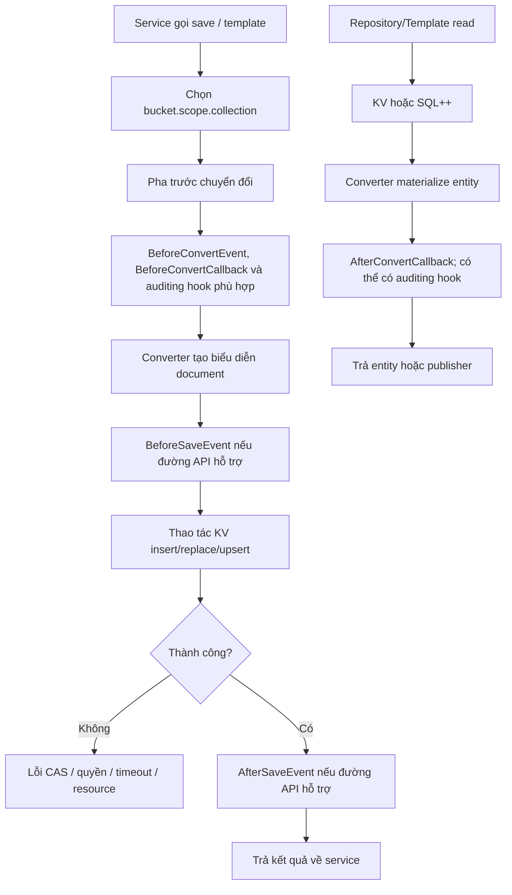

# Sự kiện ánh xạ và callback theo API của phiên bản sử dụng trong Spring Data Couchbase

Khi ứng dụng dùng Spring Data Couchbase để đọc hoặc ghi document, framework có thể phát **mapping event** (*sự kiện ánh xạ*) và gọi **entity callback** (*callback của thực thể*) tại những thời điểm nhất định. Hai cơ chế có mục đích, chữ ký phương thức và bảo đảm thực thi **khác nhau**. Rắc rối còn nằm ở chỗ tên interface, kiểu tham số và các hook hỗ trợ đã thay đổi giữa những dòng phiên bản Spring Data Couchbase.

Một đoạn mã chép từ tài liệu Spring Data MongoDB có thể chứa `BeforeSaveCallback` và không biên dịch trong Couchbase. Một ví dụ Couchbase 4.1 có thể sử dụng tham số `Document`, trong khi Javadoc của Couchbase 4.4, 5.x hoặc 6.x lại định nghĩa `CouchbaseDocument`. Nếu không xác định **phiên bản dependency thực sự được resolve**, việc sửa lỗi bằng cách đổi import ngẫu nhiên có thể làm callback không bao giờ được đăng ký.

Bài thuộc chương **Vòng đời và auditing** của module `SPRING_DATA_COUCHBASE`. Trọng tâm là cách nhận diện, chọn và kiểm chứng đúng API mapping event/callback theo phiên bản đang sử dụng, cho repository, `CouchbaseTemplate`, SQL++ và các luồng reactive. Kiến thức này cũng giúp sử dụng auditing, TTL, CAS, giao dịch và truy vấn đa collection mà không đặt business side effect vào sai chỗ.

## 1. Kết quả học tập

Sau bài học, bạn có thể:

1. Phân biệt `CouchbaseMappingEvent`/`AbstractCouchbaseEventListener` với `EntityCallback`.
2. Nêu đúng các callback đồng bộ và reactive mà **package mapping event của phiên bản** thực sự cung cấp.
3. Tìm Javadoc gắn với artifact phiên bản của dự án thay vì chỉ mở trang “current”.
4. Cài đặt `BeforeConvertCallback<T>` và `AfterConvertCallback<T>` với import, generic và chữ ký đúng.
5. Cài đặt listener cho `BeforeConvertEvent`, `BeforeSaveEvent`, `AfterSaveEvent`, `BeforeDeleteEvent` và `AfterDeleteEvent`.
6. Giải thích vì sao event listener bất đồng bộ không an toàn để thay đổi entity hoặc bảo đảm thao tác bên ngoài DB đúng một lần.
7. Viết kiểm thử xác nhận callback đã được đăng ký, gọi tại đúng pha và thực sự thay đổi dữ liệu lưu/đọc.
8. Nhận diện nơi pipeline Spring Data bị bỏ qua: Java SDK trực tiếp, SQL++ DML, ETL, expiry server-side.

## 2. Hai cơ chế song song, không phải hai tên cho cùng API

### 2.1. Mapping event: thông báo qua Spring ApplicationEvent

Mapping event của Couchbase thuộc package:

```java
org.springframework.data.couchbase.core.mapping.event
```

Những lớp thường thấy:

- `BeforeConvertEvent<E>`;
- `BeforeSaveEvent<E>`;
- `AfterSaveEvent<E>`;
- `BeforeDeleteEvent<E>`;
- `AfterDeleteEvent<E>`.

Các event kế thừa `CouchbaseMappingEvent<E>`, là sự kiện trong hạ tầng Spring. Có thể nhận chúng bằng `AbstractCouchbaseEventListener<E>` hoặc cơ chế listener phù hợp.

**Đặc điểm:** event là thông báo; listener thường trả `void`. Nó không có giao ước “trả entity mới để framework tiếp tục lưu” như callback. Cách dispatch chịu ảnh hưởng bởi `ApplicationEventMulticaster`, có thể bất đồng bộ nếu được cấu hình như vậy.

### 2.2. EntityCallback: hook thay đổi entity ở checkpoint xác định

Callback là interface mở rộng từ Spring Data Commons `EntityCallback<T>`, được tích hợp vào pipeline đọc/ghi của module.

Các callback Spring Data Couchbase hiện đại công bố gồm:

```text
BeforeConvertCallback<T>
AfterConvertCallback<T>
ReactiveBeforeConvertCallback<T>
ReactiveAfterConvertCallback<T>
```

**Đặc điểm:** callback nhận một entity và **trả lại entity** (hoặc `Publisher<T>` trong reactive). Framework có thể sử dụng entity trả về cho giai đoạn tiếp theo. Các callback cùng pha có thể được sắp theo `@Order` hoặc `Ordered`.

### 2.3. Bảng so sánh

| Tiêu chí | Mapping event | EntityCallback |
| --- | --- | --- |
| Cơ sở kỹ thuật | Spring `ApplicationEvent` | Spring Data `EntityCallback` |
| Kiểu triển khai thường gặp | `AbstractCouchbaseEventListener<T>` | `BeforeConvertCallback<T>`, `AfterConvertCallback<T>` |
| Kết quả callback | `void` | Entity mới/cũ hoặc `Publisher<T>` |
| Thay đổi entity có thứ tự xác định | Không nên dựa vào event để bảo đảm | Đây là mục đích chính của callback |
| Khả năng xử lý bất đồng bộ | Phụ thuộc `ApplicationEventMulticaster` | Reactive callback tích hợp vào publisher chain |
| Phân biệt API imperative/reactive | Event phải xét đường thực thi phát sự kiện | Có interface synchronous và reactive riêng |
| Dùng cho | Logging, metrics, quan sát lifecycle | Chuẩn hóa entity, bổ sung field kỹ thuật trước ghi, hoàn thiện entity sau đọc |
| Side effect ngoài database | Không có bảo đảm transaction/outbox | Cũng **không** có bảo đảm transaction/outbox |

Spring Data Commons nêu rõ một nguyên tắc: event đặc thù của store có thể được phát **trước khi gọi entity callback tương ứng**, nhưng không nên suy từ đó một timeline tuyệt đối cho mọi đường truy cập, phiên bản, listener bất đồng bộ và hình thức query. Nếu cần đúng thứ tự trên một thao tác, phải kiểm thử ở phiên bản thực tế.

## 3. Bản đồ lifecycle mà bạn cần kiểm tra

Cách nhìn tổng quát:



Sơ đồ có chữ **“nếu đường API hỗ trợ”** vì không phải mọi lệnh CRUD, bulk, SQL++ hoặc SDK đều đi qua cùng bộ hook. Hãy xem sơ đồ như một công cụ lập test, **không** như lời cam kết mọi callback và event luôn xảy ra trong mọi thao tác.

### Bảng điểm quan sát

| Pha | Dữ liệu đang có | API nên dùng nếu muốn can thiệp |
| --- | --- | --- |
| Trước chuyển entity để ghi | Domain entity | `BeforeConvertCallback<T>` |
| Sau converter tạo representation, trước ghi | Entity + `CouchbaseDocument` (ở API event hiện đại) | `BeforeSaveEvent`/listener để quan sát, không thay entity theo kiểu callback |
| Sau thao tác ghi | Entity + metadata theo API | `AfterSaveEvent`/listener để logging/metrics |
| Trước xóa | Tùy API: key hoặc entity/document | `BeforeDeleteEvent`/listener nếu đường xóa phát event |
| Sau xóa | Dữ liệu event theo API | `AfterDeleteEvent`/listener |
| Sau khi materialize kết quả đọc | Entity + document nội bộ | `AfterConvertCallback<T>` |

Đặc biệt, **không thấy `AfterConvertEvent` trong danh sách mapping events của Javadoc 6.1.0**; thay vì tự tạo giả định tương tự MongoDB, hãy dùng `AfterConvertCallback` cho nhu cầu sau đọc.

## 4. Quy tắc quan trọng nhất: đối chiếu API với phiên bản dependency

Tài liệu “current” có thể mô tả phiên bản mới hơn hoặc khác với ứng dụng. Quy trình đúng bắt đầu từ artifact đang được build resolve.

### 4.1. Xác định phiên bản từ Maven hoặc Gradle

Với Maven có Spring Boot parent hoặc BOM:

```xml
<dependency>
  <groupId>org.springframework.boot</groupId>
  <artifactId>spring-boot-starter-data-couchbase</artifactId>
</dependency>
```

Phiên bản Spring Data Couchbase có thể do BOM quyết định, không phải version viết trực tiếp trên starter.

Trong môi trường có quyền chạy build, có thể kiểm tra:

```bash
mvn dependency:tree -Dincludes=org.springframework.data:spring-data-couchbase
```

Với Gradle:

```bash
./gradlew dependencyInsight \
  --dependency spring-data-couchbase \
  --configuration runtimeClasspath
```

Các lệnh trên **dành cho người học tự thực hiện trên dự án**; bài viết này không chạy Maven/Gradle và không khẳng định một phiên bản nào là dependency hiện tại của repo. Khi nhiều dependency kéo các Spring Data module khác nhau, phải xem **resolved version**, không chỉ version khai báo ở một nơi.

### 4.2. Ma trận ví dụ dựa trên Javadoc đã công bố

| Dòng Javadoc được đối chiếu | API đáng chú ý | Hệ quả khi copy code |
| --- | --- | --- |
| **4.1.15** | Package liệt kê `BeforeConvertCallback<T>`, `AfterConvertCallback<T>`, `AbstractCouchbaseEventListener` và các event lưu/xóa; `AfterConvertCallback` trong Javadoc cũ dùng tham số tên `Document`. | Không copy nguyên chữ ký từ 4.4/5.x/6.x nếu dự án thực tế chạy 4.1. |
| **4.4.16** | Package liệt kê thêm `ReactiveBeforeConvertCallback`, `ReactiveAfterConvertCallback` và auditing callbacks. `AfterConvertCallback` dùng `CouchbaseDocument`. | Mã `onAfterConvert(..., CouchbaseDocument, ...)` phù hợp dòng này, không giống chữ ký trong Javadoc 4.1. |
| **5.2/5.4** | Package hiện có bốn callback sync/reactive và các mapping events được nêu ở bài. | Kiểm tra method signature **trong bản 5.x chính xác**, không mặc định mọi tài liệu “current” biên dịch nguyên trạng. |
| **6.1.0** | Package hiện vẫn liệt kê bốn callback, `CouchbaseDocument`, `AbstractCouchbaseEventListener`, `AuditingEntityCallback` và `ReactiveAuditingEntityCallback`. | Các ví dụ chính của bài nhắm kiểu API hiện đại này. |

Bảng trên **không** tuyên bố mỗi feature lần đầu xuất hiện đúng ở hàng đầu tiên mà nó được quan sát. Đây chỉ là các mốc Javadoc cụ thể để chỉ ra khác biệt dễ gây lỗi. API cũng có thể thay đổi trong minor release; hãy mở Javadoc **trùng version đã resolve**.

Một chi tiết quan trọng: trang Javadoc `AfterConvertCallback` ở 4.1.15 hiển thị tham số `Document`, còn 4.4.16 và 6.1.0 hiển thị `CouchbaseDocument`. Đừng tự đoán `Document` của bản cũ có import giống annotation `@Document` mới. Hãy **đi theo link của kiểu ngay trong Javadoc version đó và để compiler kiểm chứng**, vì tên đơn giản có thể gây nhầm lẫn.

### 4.3. Cách mở đúng Javadoc

Ví dụ đường dẫn cho 6.1.0:

```text
https://docs.spring.io/spring-data/couchbase/docs/current/api/
    org/springframework/data/couchbase/core/mapping/event/package-summary.html
```

Đường dẫn ví dụ cho 4.4.16:

```text
https://docs.spring.io/spring-data/couchbase/docs/4.4.16/api/
    org/springframework/data/couchbase/core/mapping/event/package-summary.html
```

Khi sử dụng, **nối đường dẫn về một dòng URL liên tục**. Xem phần *Package Summary*, sau đó vào *Interface/Class*, phần *Method Summary*, *Method Details* và *Since*. Kiểm tra import ở IDE/bytecode của dependency đã resolve, không chỉ thông qua tên class nhìn thấy trong bài blog.

### 4.4. Không lấy ví dụ generic từ Spring Data Commons làm API Couchbase

Tài liệu Spring Data Commons minh họa một interface **`BeforeSaveCallback<T>`** theo nghĩa chung để giải thích cơ chế. Nhưng package `org.springframework.data.couchbase.core.mapping.event` ở Javadoc 6.1.0 **không liệt kê** `BeforeSaveCallback<T>` hay `AfterSaveCallback<T>`.

Cần phân biệt:

```text
Spring Data Commons example:
  BeforeSaveCallback<T>   // minh họa một interface đặc thù store

Spring Data Couchbase current:
  BeforeConvertCallback<T>
  AfterConvertCallback<T>
  ReactiveBeforeConvertCallback<T>
  ReactiveAfterConvertCallback<T>
  BeforeSaveEvent<T>      // Event, KHÔNG PHẢI Callback
  AfterSaveEvent<T>       // Event, KHÔNG PHẢI Callback
```

Nếu IDE báo `Cannot resolve symbol 'BeforeSaveCallback'` sau khi sao chép ví dụ MongoDB, việc đúng là **tra package summary của Couchbase**, không đổi tên package theo cảm tính.

## 5. Một entity mẫu để thử các hook

Giả sử bucket `shop`, scope `commerce`, collection `orders` đã được tạo.

```java
package example.lifecycle;

import org.springframework.data.annotation.Id;
import org.springframework.data.annotation.Transient;
import org.springframework.data.annotation.Version;
import org.springframework.data.couchbase.core.mapping.Document;
import org.springframework.data.couchbase.repository.Collection;
import org.springframework.data.couchbase.repository.Scope;

@Document
@Scope("commerce")
@Collection("orders")
public class OrderDocument {

    @Id
    private String id;

    private String status;

    @Version
    private long version;

    @Transient
    private String displayLabel;

    public OrderDocument() {}

    public OrderDocument(String id, String status) {
        this.id = id;
        this.status = status;
    }

    public String getId() { return id; }
    public void setId(String id) { this.id = id; }

    public String getStatus() { return status; }
    public void setStatus(String status) { this.status = status; }

    public long getVersion() { return version; }

    public String getDisplayLabel() { return displayLabel; }
    public void setDisplayLabel(String displayLabel) {
        this.displayLabel = displayLabel;
    }
}
```

Trong ví dụ này:

- `@Document` của entity thuộc `org.springframework.data.couchbase.core.mapping`.
- `@Scope` và `@Collection` của Couchbase thuộc `org.springframework.data.couchbase.repository`.
- `@Transient` chỉ định field không persist theo mapping thông thường.
- `@Version` gắn với optimistic locking/CAS; không phải số đếm nghiệp vụ tự tăng `1, 2, 3`.

Repository:

```java
package example.lifecycle;

import org.springframework.data.couchbase.repository.CouchbaseRepository;

public interface OrderRepository
        extends CouchbaseRepository<OrderDocument, String> {
}
```

Tất cả ví dụ tiếp theo giả định đã cấu hình repository và converter chuẩn của Spring Data Couchbase cho bucket `shop`.

## 6. BeforeConvertCallback: thay entity trước khi chuyển đổi

Ở API Couchbase 4.4/5.x/6.x, chữ ký:

```java
public interface BeforeConvertCallback<T> extends EntityCallback<T> {
    T onBeforeConvert(T entity, String collection);
}
```

Ví dụ chuẩn hóa trạng thái:

```java
package example.lifecycle;

import java.util.Locale;

import org.springframework.core.annotation.Order;
import org.springframework.data.couchbase.core.mapping.event.BeforeConvertCallback;
import org.springframework.stereotype.Component;

@Component
@Order(200)
public class NormalizeOrderCallback
        implements BeforeConvertCallback<OrderDocument> {

    @Override
    public OrderDocument onBeforeConvert(
            OrderDocument entity, String collection) {

        String raw = entity.getStatus();

        if (raw == null || raw.isBlank()) {
            throw new IllegalArgumentException("status is required");
        }

        entity.setStatus(raw.trim().toUpperCase(Locale.ROOT));
        return entity;
    }
}
```

Khi service lưu:

```java
OrderDocument order =
    new OrderDocument("order::1001", " confirmed ");

orderRepository.save(order);
```

callback có cơ hội đổi `status` thành `CONFIRMED` **trước khi converter tạo document**.

### Vì sao cần return entity?

Hợp đồng callback nói rõ entity trả về có thể là **đối tượng cũ hoặc một instance mới**. Với entity immutable hoặc record/wither, dùng bản sao mới thay vì cố mutate field bất biến.

Ví dụ ý tưởng:

```java
// Pseudocode cho entity immutable có method withStatus:
return entity.withStatus(normalize(entity.status()));
```

Không copy đoạn này vào `OrderDocument` mutable ở trên vì class mẫu chưa định nghĩa `withStatus`. Mục đích là nhấn mạnh **return value mới là dữ liệu framework tiếp tục xử lý**.

### Tham số collection có nghĩa gì?

`collection` là tên collection mà callback nhận được từ framework. Không nên xem nó là full path `bucket.scope.collection` hoặc bằng chứng user đã được phân quyền vào tenant. Nếu quy tắc đòi hỏi tenant/actor, lấy context đã được xác thực từ tầng service/security thay vì tự suy ra mọi thứ từ tên collection.

**Không dùng callback cho:** xác thực người dùng, gửi email, thanh toán, transaction nhiều document hoặc đảm bảo một side effect chỉ xảy ra đúng một lần.

## 7. AfterConvertCallback: hoàn thiện entity sau khi đọc

Ở 4.4/5.x/6.x, chữ ký:

```java
public interface AfterConvertCallback<T> extends EntityCallback<T> {
    T onAfterConvert(
        T entity,
        CouchbaseDocument document,
        String collection
    );
}
```

Import nội bộ:

```java
import org.springframework.data.couchbase.core.mapping.CouchbaseDocument;
import org.springframework.data.couchbase.core.mapping.event.AfterConvertCallback;
```

Ví dụ tạo field hiển thị tạm thời:

```java
package example.lifecycle;

import org.springframework.core.annotation.Order;
import org.springframework.data.couchbase.core.mapping.CouchbaseDocument;
import org.springframework.data.couchbase.core.mapping.event.AfterConvertCallback;
import org.springframework.stereotype.Component;

@Component
@Order(200)
public class OrderDisplayCallback
        implements AfterConvertCallback<OrderDocument> {

    @Override
    public OrderDocument onAfterConvert(
            OrderDocument entity,
            CouchbaseDocument document,
            String collection) {

        entity.setDisplayLabel(
            entity.getId() + " / " + entity.getStatus()
        );

        return entity;
    }
}
```

Khi gọi `orderRepository.findById(id)` và kết quả được materialize thành `OrderDocument` qua Spring Data, callback có thể bổ sung `displayLabel`. Vì field mang `@Transient`, nó không cần nằm trong JSON đã lưu.

**Điểm giới hạn:** callback sau convert **không tự ghi** giá trị `displayLabel` về server; nó chỉ đổi entity trong JVM. Một SQL++ projection hoặc DTO chỉ chọn vài field có thể đi qua đường materialization khác; cần kiểm thử trên chính phương thức repository/Template được dùng.

### Lỗi khi dùng sai kiểu document

Mã lấy từ Javadoc cũ:

```java
// Ví dụ chữ ký cũ được trình bày về mặt khái niệm:
onAfterConvert(entity, Document document, collection)
```

không nên dán nguyên vào dự án dùng `CouchbaseDocument`. Ngược lại, mã dùng `CouchbaseDocument` có thể không biên dịch trong bản cũ. Cần kiểm tra đúng **kiểu tham số mà interface trong jar yêu cầu**, sau đó sửa import và `@Override`, không chỉ đổi tên file.

## 8. Đăng ký callback trong Spring ApplicationContext

Các callback được Spring Data phát hiện thông qua bean phù hợp trong `ApplicationContext`, thường dùng `@Component` hoặc `@Bean`.

Ví dụ đăng ký bằng `@Bean`:

```java
package example.lifecycle;

import org.springframework.context.annotation.Bean;
import org.springframework.context.annotation.Configuration;
import org.springframework.data.couchbase.core.mapping.event.BeforeConvertCallback;

@Configuration
public class OrderCallbackConfiguration {

    @Bean
    BeforeConvertCallback<OrderDocument> ensureStatus() {
        return (entity, collection) -> {
            if (entity.getStatus() == null) {
                entity.setStatus("NEW");
            }
            return entity;
        };
    }
}
```

Có hai điểm quan trọng:

1. **Bean phải thuộc context đang tạo repository/Template.** Nếu một module test hoặc cấu hình nhiều bucket dựng Template thủ công mà không liên kết đúng entity callbacks, việc có class `@Component` trong source chưa đủ chứng minh hook được thực thi.
2. Với lambda callback, Java type information có thể khó suy luận khi Spring Data thực hiện filtering generic; Spring Data Commons khuyến nghị dùng **class concrete** để bảo đảm lọc theo domain type và hiệu năng dự đoán được trong trường hợp phức tạp.

Đối với mã production, nên chọn một kiểu khai báo nhất quán, tránh đồng thời có hai callback vô tình làm cùng nhiệm vụ, đặc biệt khi một cái sửa field mà cái khác cũng sửa field đó.

### @Order và Ordered

`@Order(100)` có thể giúp một callback chạy trước `@Order(200)` trong cùng pha. Giá trị order thấp hơn có ưu tiên cao hơn trong cơ chế sắp xếp thông thường của Spring.

**Đừng mặc định một callback luôn chạy sau auditing** chỉ vì đặt `@Order(200)`. `AuditingEntityCallback` của phiên bản đang dùng có thứ tự riêng, và các callback có thể được triển khai khác giữa phiên bản. Nếu logic cần đọc giá trị `createdAt` hoặc `modifiedBy` mà auditing vừa đặt, hãy tra Javadoc `getOrder()` và dùng integration test thực tế.

## 9. Mapping event: viết listener đúng chữ ký

Spring Data Couchbase cung cấp `AbstractCouchbaseEventListener<E>`. Trong dòng API hiện đại, các method phổ biến gồm:

```text
void onBeforeConvert(E source)
void onBeforeSave(E source, CouchbaseDocument doc)
void onAfterSave(E source, CouchbaseDocument doc)
void onBeforeDelete(Object source, CouchbaseDocument doc)
void onAfterDelete(Object source, CouchbaseDocument doc)
```

Các method này **không trả lại entity**.

Ví dụ listener logging:

```java
package example.lifecycle;

import org.slf4j.Logger;
import org.slf4j.LoggerFactory;
import org.springframework.data.couchbase.core.mapping.CouchbaseDocument;
import org.springframework.data.couchbase.core.mapping.event.AbstractCouchbaseEventListener;
import org.springframework.stereotype.Component;

@Component
public class OrderMappingEventLogger
        extends AbstractCouchbaseEventListener<OrderDocument> {

    private static final Logger log =
        LoggerFactory.getLogger(OrderMappingEventLogger.class);

    @Override
    public void onBeforeConvert(OrderDocument source) {
        log.debug("beforeConvert id={}", source.getId());
    }

    @Override
    public void onBeforeSave(
            OrderDocument source, CouchbaseDocument doc) {
        log.debug("beforeSave id={}", source.getId());
    }

    @Override
    public void onAfterSave(
            OrderDocument source, CouchbaseDocument doc) {
        log.debug("afterSave id={}", source.getId());
    }

    @Override
    public void onBeforeDelete(
            Object source, CouchbaseDocument doc) {
        log.debug("beforeDelete sourceType={}",
            source == null ? "null" : source.getClass().getSimpleName());
    }

    @Override
    public void onAfterDelete(
            Object source, CouchbaseDocument doc) {
        log.debug("afterDelete sourceType={}",
            source == null ? "null" : source.getClass().getSimpleName());
    }
}
```

Chữ ký delete dùng `Object` thay vì `OrderDocument` theo Javadoc của `AbstractCouchbaseEventListener` hiện đại. **Không ép kiểu source thành OrderDocument một cách mù quáng**: một lệnh xóa theo ID có thể không materialize entity như một lệnh save.

### Quan sát event bằng ApplicationListener

Một cách khác là khai báo listener nhận event cụ thể, chẳng hạn `BeforeSaveEvent<?>`, nếu phù hợp với ứng dụng. Khi dùng `@EventListener`, kiểm tra kiểu event thực tế và phạm vi dữ liệu; với generic erased ở runtime, không nên giả định type filtering giống `EntityCallback<OrderDocument>`.

```java
import org.springframework.context.event.EventListener;
import org.springframework.data.couchbase.core.mapping.event.AfterSaveEvent;
import org.springframework.stereotype.Component;

@Component
public class AuditSaveEventObserver {

    @EventListener
    public void observe(AfterSaveEvent<?> event) {
        Object source = event.getSource();
        // Quan sát metadata / log phù hợp, không kích hoạt thanh toán.
    }
}
```

Không đưa event listener vào đường nghiệp vụ cần đảm bảo atomicity mà không có cơ chế outbox, transaction hoặc idempotency.

## 10. Khi nào BeforeSaveEvent và AfterSaveEvent hữu ích?

| Nhiệm vụ | Đánh giá |
| --- | --- |
| Ghi log loại entity và ID với mức dữ liệu tối thiểu | Phù hợp nếu quan sát được event và bảo mật log tốt. |
| Tăng metric đếm số lần một hook được gọi | Có thể, nhưng số event không nhất thiết bằng số transaction nghiệp vụ thành công. |
| Kiểm tra biểu diễn `CouchbaseDocument` để debug | Hữu ích trong môi trường kiểm soát; tránh log cả payload thật. |
| Thay entity trước convert bằng cách sửa `getSource()` | Không nên dựa vào hành vi này, nhất là listener async/immutable entity. |
| Gửi thông điệp bảo đảm “đã thanh toán” | Không đủ; event không bảo đảm outbox hay exactly-once. |
| Tạo một update ở collection khác ngay trong listener | Rủi ro recursion, partial failure và quyền/transaction khó kiểm soát. |
| Bắt sự kiện expiry tự động trên server | Không phải mục đích của Spring Data mapping event. |

Với yêu cầu thay đổi entity, **callback** rõ ràng hơn vì nó trả entity được dùng tiếp trong quá trình mapping. Với yêu cầu đo lường, **event** có thể hữu ích khi đường truy cập có phát event.

## 11. Event multicast bất đồng bộ: vì sao có thể làm code sai?

Giả sử ứng dụng cấu hình `ApplicationEventMulticaster` với `TaskExecutor` bất đồng bộ. Khi Spring Data phát `BeforeConvertEvent`:

1. Event được publish.
2. Listener có thể chạy ở thread khác sau đó.
3. Pipeline lưu có thể tiếp tục gọi callback/converter.
4. Listener cố sửa entity nhưng mutation đã bắt đầu hoặc hoàn tất.

Do đó, đoạn logic như sau không an toàn:

```java
@Override
public void onBeforeConvert(OrderDocument source) {
    // Không nên dựa vào event listener để thay dữ liệu bắt buộc
    // nếu ApplicationEventMulticaster có thể xử lý bất đồng bộ.
    source.setStatus("NORMALIZED");
}
```

Cách thay thế là `BeforeConvertCallback` có hợp đồng trả entity. Spring Data Commons phân biệt rất rõ: **entity callback chạy tại checkpoint có thứ tự**, còn application event có thể có thời điểm xử lý không dự đoán được khi cấu hình dispatch async.

Cũng không nên hứa hẹn rằng hai event `BeforeSaveEvent`/`AfterSaveEvent` luôn xuất hiện trong mọi trường hợp SQL++ bulk update/delete. Một câu lệnh Query Service cập nhật hàng loạt document không tự materialize từng entity của Spring Data để phát mọi hook.

## 12. ReactiveBeforeConvertCallback: interface riêng

Với Spring Data Couchbase reactive hiện đại, signature:

```java
public interface ReactiveBeforeConvertCallback<T>
        extends EntityCallback<T> {

    Publisher<T> onBeforeConvert(
        T entity,
        String collection
    );
}
```

Ví dụ:

```java
package example.lifecycle;

import java.util.Locale;
import org.springframework.data.couchbase.core.mapping.event.ReactiveBeforeConvertCallback;
import org.springframework.stereotype.Component;
import reactor.core.publisher.Mono;

@Component
public class ReactiveOrderNormalize
        implements ReactiveBeforeConvertCallback<OrderDocument> {

    @Override
    public Mono<OrderDocument> onBeforeConvert(
            OrderDocument entity, String collection) {

        if (entity.getStatus() == null) {
            return Mono.error(new IllegalArgumentException(
                "status is required"
            ));
        }

        entity.setStatus(
            entity.getStatus().trim().toUpperCase(Locale.ROOT)
        );
        return Mono.just(entity);
    }
}
```

`Mono<OrderDocument>` là subtype hợp lệ của `Publisher<OrderDocument>`. Không gọi `block()` trong callback của pipeline reactive để lấy một giá trị rồi tiếp tục.

**Phân tách quan trọng:** Spring Data Commons nói synchronous API xét callback synchronous, reactive API xét callback reactive. Đừng cài mỗi `BeforeConvertCallback<T>` rồi mặc định nó chạy cho `ReactiveCouchbaseRepository.save(...)`.

## 13. ReactiveAfterConvertCallback: sau materialize trong pipeline reactive

Chữ ký hiện đại:

```java
public interface ReactiveAfterConvertCallback<T>
        extends EntityCallback<T> {

    Publisher<T> onAfterConvert(
        T entity,
        CouchbaseDocument document,
        String collection
    );
}
```

Ví dụ:

```java
package example.lifecycle;

import org.springframework.data.couchbase.core.mapping.CouchbaseDocument;
import org.springframework.data.couchbase.core.mapping.event.ReactiveAfterConvertCallback;
import org.springframework.stereotype.Component;
import reactor.core.publisher.Mono;

@Component
public class ReactiveOrderLabel
        implements ReactiveAfterConvertCallback<OrderDocument> {

    @Override
    public Mono<OrderDocument> onAfterConvert(
            OrderDocument entity,
            CouchbaseDocument document,
            String collection) {

        entity.setDisplayLabel(
            entity.getId() + " / " + entity.getStatus()
        );
        return Mono.just(entity);
    }
}
```

Ví dụ trên không ghi document về server. Nó chỉ sửa entity trước khi publisher trả kết quả cho subscriber.

### Dùng StepVerifier để kích hoạt thực thi

```java
import reactor.test.StepVerifier;

StepVerifier.create(
        reactiveOrderRepository.findById("order::1001")
    )
    .assertNext(order -> {
        org.junit.jupiter.api.Assertions.assertNotNull(
            order.getDisplayLabel()
        );
    })
    .verifyComplete();
```

Đoạn này giả định fixture có document `order::1001`, bean callback đã đăng ký và `reactiveOrderRepository` đã được inject. Chỉ tạo `Mono` mà không subscribe **chưa chứng minh** callback đã được thực thi.

### Cảnh báo về callback reactive trả Mono.empty()

Callback reactive cần phát ra entity để pipeline tiếp tục xử lý. Trả `Mono.empty()` tùy tiện có thể làm luồng không còn entity để trả về; phát `Mono.error(...)` có ý nghĩa rõ hơn nếu validation không đạt.

## 14. Auditing cũng là một phần của ma trận phiên bản

Auditing không phải một “event độc lập luôn được gọi sau tất cả callback”. Nó được tích hợp vào cơ chế callback/listener tùy dòng phiên bản.

### 14.1. Phân biệt implementation theo Javadoc

- Package Javadoc **4.1.x** liệt kê `AuditingEventListener` và chưa liệt kê các auditing entity callback mới giống bản hiện đại.
- Package Javadoc **4.4/5.x/6.x** liệt kê `AuditingEntityCallback` và `ReactiveAuditingEntityCallback`.
- Ở Javadoc **6.1.0**, `AuditingEntityCallback` implements **cả** `BeforeConvertCallback<Object>` và `AfterConvertCallback<Object>`, cùng `Ordered`.

Chi tiết cuối rất quan trọng: **đừng tự kết luận auditing “chỉ là BeforeConvertCallback” trong tất cả phiên bản**. Khi bạn định viết một callback phụ thuộc timestamp, actor hoặc version, phải đối chiếu implementation và kiểm thử thứ tự trên đúng dependency.

### 14.2. Bật auditing theo phiên bản hiện đại

```java
import org.springframework.context.annotation.Configuration;
import org.springframework.data.couchbase.repository.auditing.EnableCouchbaseAuditing;

@Configuration
@EnableCouchbaseAuditing
public class CouchbaseAuditingConfig {
}
```

Entity có thể sử dụng:

```java
import java.time.Instant;
import org.springframework.data.annotation.CreatedDate;
import org.springframework.data.annotation.LastModifiedDate;
import org.springframework.data.annotation.Version;

@CreatedDate
private Instant createdAt;

@LastModifiedDate
private Instant updatedAt;

@Version
private long version;
```

Các field trên là phần bổ sung vào entity thực tế, không phải một class Java độc lập. Khi muốn `@CreatedBy` và `@LastModifiedBy`, cần cấu hình `AuditorAware<T>` hoặc nguồn auditor reactive tương ứng với cấu hình được sử dụng.

Với Couchbase, `@Version` giúp nhận diện entity mới/cũ đáng tin cậy cho auditing trong những trường hợp ID được cấp trước khi lưu. `@Version` mang ý nghĩa CAS; **không** tăng nó thủ công như bộ đếm.

### 14.3. Auditor không được lấy từ request tùy ý

Nếu auditor xác định từ security context, chỉ dùng principal đã xác thực. Không gán `createdBy` từ `request.getUserId()` mà không kiểm tra. Trong reactive, principal thường được truyền qua security/reactor context, không thể giả định một `ThreadLocal` bất kỳ vẫn đúng sau khi đổi thread.

Auditing timestamps không thay thế audit trail, outbox hay CDC khi cần ghi lại mọi thay đổi nghiệp vụ.

## 15. Tại sao @Query và Java SDK trực tiếp không có cùng lifecycle?

Bảng ranh giới:

| Đường truy cập | Mapping/callback nào nên kỳ vọng? |
| --- | --- |
| `repository.save(entity)` | Qua Spring Data entity mapping và các callback hỗ trợ cho API imperative. |
| `CouchbaseTemplate.upsertById(Entity.class)...one(entity)` | Qua đường entity mapping của Spring Data; xác minh hook cụ thể trong version hiện dùng. |
| `repository.findById(id)` | Materialize entity; `AfterConvertCallback` có thể tham gia. |
| Finder SQL++ trả toàn entity | Có thể materialize entity qua converter; kiểm chứng với query thật. |
| SQL++ trả DTO/projection | Không tự coi mọi callback entity đều chạy y hệt full entity. |
| `ReactiveCouchbaseRepository.save(entity)` | Qua reactive callback chain tương ứng khi publisher được tiêu thụ. |
| `Couchbase Java SDK collection.upsert(id, json)` | **Không tự chạy** Spring Data entity callbacks/auditing. |
| `Cluster.query("UPDATE ...")` | **Không tự gọi** từng callback Spring Data cho mỗi document được SQL++ sửa. |
| Import, ETL, XDCR hoặc expiry do server | Không phải lifecycle của một Spring application đang chạy. |

Khi một import job bypass callback, thiết kế không nên dựa vào callback để bảo đảm bất biến bảo mật. Những bất biến quan trọng (quyền tenant, hợp lệ dữ liệu bắt buộc) phải được kiểm tra tại tất cả đường nhập dữ liệu hoặc bằng một kiến trúc chung ở tầng nghiệp vụ.

### Query finder và type metadata

Spring Data có thể sử dụng metadata phân biệt kiểu entity trong SQL++ được sinh ra. Nếu fixture được tạo bằng SDK và không mang thông tin converter mong đợi, finder có thể không thấy document dù `findById` theo KV đọc được key. Cần kiểm tra **keyspace, query cuối cùng, index, type discriminator và consistency** trước khi kết luận callback mất hiệu lực.

## 16. Quy trình nâng cấp từ callback/listener cũ sang API mới

Giả sử ứng dụng đang dùng Spring Data Couchbase 4.1 và chuyển sang một dòng mới hơn.

### Bước 1: khóa phiên bản và lập danh sách hook đang dùng

Tìm các class implements hoặc extends:

```text
BeforeConvertCallback
AfterConvertCallback
ReactiveBeforeConvertCallback
ReactiveAfterConvertCallback
AbstractCouchbaseEventListener
AuditingEventListener
AuditingEntityCallback
```

Đối với từng hook, ghi rõ: pha, domain type, side effect, kiểu trả về, dependency version, và API gọi hook đó.

### Bước 2: đối chiếu chữ ký từng interface

Đặc biệt `AfterConvertCallback` có thay đổi về tên kiểu document trên Javadoc 4.1 vs 4.4+. Nếu IDE báo `Method does not override method from its superclass`, đừng bỏ `@Override` để “lách” lỗi; hãy sửa chữ ký cho đúng interface version trong classpath.

### Bước 3: rà soát auditing và thứ tự

Nếu trước đây dùng event listener để thay entity, nên cân nhắc chuyển sang `EntityCallback` tương ứng khi phiên bản đã hỗ trợ. Nếu thêm auditing callback mới, không tự giả định thứ tự callback đã giữ nguyên. Viết integration test kiểm tra giá trị thực ghi xuống Couchbase.

### Bước 4: phân tách imperative và reactive

Nếu đổi sang reactive, viết các callback reactive tương ứng. Không gọi `block()` trong hook hoặc dùng một mutable singleton để giữ “entity hiện tại”, “tenant hiện tại” hay “principal hiện tại”.

### Bước 5: đối chiếu với Oracle độc lập

Đọc JSON trực tiếp bằng Couchbase SDK để xác nhận callback trước convert thực sự sửa document được lưu. Đọc ngược qua Spring Data để xác nhận callback sau convert chỉ sửa entity đã materialize. Test cả đường update lỗi CAS và direct SDK bypass nếu điều đó có ý nghĩa.

### Bước 6: chỉ phát hành khi negative tests đạt

Kiểm tra trường hợp callback bean không được scan, API dùng sai hook, repository quét khác configuration và query finder thiếu type metadata. Những test này thường phát hiện lỗi mà unit test gọi callback thủ công không nhận ra.

## 17. Kiểm thử đơn vị callback

Test một callback thuần túy không cần cluster:

```java
import org.junit.jupiter.api.Test;
import static org.junit.jupiter.api.Assertions.assertEquals;

class NormalizeOrderCallbackTest {

    private final NormalizeOrderCallback callback =
        new NormalizeOrderCallback();

    @Test
    void trimsAndUppercasesStatus() {
        OrderDocument order =
            new OrderDocument("order::1", " confirmed ");

        OrderDocument result =
            callback.onBeforeConvert(order, "orders");

        assertEquals("CONFIRMED", result.getStatus());
    }
}
```

Test này chứng minh logic normalize **đúng**, nhưng không chứng minh bean đã được Spring Data Couchbase gọi. Muốn kiểm chứng wiring, cần integration test qua repository/Template.

## 18. Integration test xác minh callback đã chạy

Một test chất lượng cần **hai oracle khác nhau**:

1. Lệnh ghi qua Spring Data.
2. Kiểm tra document bằng Java SDK tại đúng bucket.scope.collection.

Ví dụ khung test:

```java
import com.couchbase.client.java.Cluster;
import org.junit.jupiter.api.Test;
import org.springframework.beans.factory.annotation.Autowired;

import static org.junit.jupiter.api.Assertions.assertEquals;

class OrderLifecycleIT {

    @Autowired
    OrderRepository orderRepository;

    @Autowired
    Cluster sdk;

    @Test
    void callbackMustChangeStoredStatus() {
        String id = "it::order::" +
            java.util.UUID.randomUUID();

        orderRepository.save(
            new OrderDocument(id, " confirmed ")
        );

        var json = sdk.bucket("shop")
            .scope("commerce")
            .collection("orders")
            .get(id)
            .contentAsObject();

        assertEquals("CONFIRMED",
            json.getString("status"));
    }
}
```

Đây là **khung phương thức**, cần test context, bucket/scope/collection thực tế và bean `Cluster` đã được chuẩn bị. Đoạn mã không tự chạy chỉ vì có annotation `@Test`. Cũng cần biết kiểu `@Version` và semantics insert/update trên entity trong phiên bản đang dùng.

### Kiểm thử after-convert

```java
var loaded = orderRepository.findById(id).orElseThrow();

org.junit.jupiter.api.Assertions.assertEquals(
    id + " / CONFIRMED",
    loaded.getDisplayLabel()
);
```

Với `@Transient`, kiểm tra SDK cũng không có field `displayLabel` trong JSON. Nếu đọc qua SDK rồi tự tạo `OrderDocument`, callback không được tự động kích hoạt.

### Kiểm thử listener event

Có thể tạo recorder test ghi các event nhận được. Nhưng khi event multicaster là async, cần cơ chế đồng bộ/await phù hợp và tránh assert một thứ tự tuyệt đối giữa event và callback khi framework không bảo đảm.

Nếu listener dùng cho metrics, test số event chỉ thể hiện số **event đã quan sát**, không nhất thiết bằng số giao dịch nghiệp vụ hoàn thành.

### Kiểm thử reactive

Dùng `StepVerifier` để subscribe và xác nhận callback:

```java
StepVerifier.create(
    reactiveOrderRepository
        .findById(id)
)
.assertNext(order -> {
    org.junit.jupiter.api.Assertions.assertNotNull(
        order.getDisplayLabel()
    );
})
.verifyComplete();
```

Trong test thực, chuẩn bị fixture và bean reactive callback tương ứng. Một `Mono` chưa được subscribe thường không chứng minh được read hay callback đã chạy.

## 19. Đọc đúng log khi một hook “không chạy”

| Triệu chứng | Nguyên nhân có thể | Cách kiểm tra |
| --- | --- | --- |
| `Cannot resolve BeforeSaveCallback` | Đang copy interface ví dụ Commons/store khác, Couchbase không công bố API đó. | Xem package summary của đúng version Couchbase. |
| `onAfterConvert(...) does not override` | Mismatch `Document` và `CouchbaseDocument` hoặc sai số tham số. | Mở Javadoc của jar đang resolve và sửa signature/import. |
| Callback không chạy trong runtime nhưng unit test pass | Bean không được scan, Template wiring không dùng callbacks hoặc API bypass. | Kiểm tra Spring context và test save/find thực. |
| Callback chạy sync, không chạy reactive | Chỉ đăng ký callback synchronous. | Cài đặt `ReactiveBeforeConvertCallback`/`ReactiveAfterConvertCallback`. |
| Listener event sửa entity nhưng JSON không đổi | Event multicaster bất đồng bộ hoặc mutation diễn ra ngoài thứ tự mong đợi. | Đổi logic sang callback trả entity. |
| Một callback ghi đè field do callback khác đặt | Thứ tự `@Order`, auditing hoặc loại callback khác. | Kiểm tra `Ordered` và test thứ tự trên đúng dependency. |
| `@CreatedDate` vẫn rỗng | Auditing không bật/không đúng context, entity state nhận diện sai hoặc bypass mapping. | Kiểm tra `@EnableCouchbaseAuditing`, `@Version`, callback auditing. |
| Direct SDK upsert không có log listener | Không đi qua Spring Data. | Đặt validation/audit ở tầng import hoặc chọn API Spring Data. |
| SQL++ UPDATE đổi JSON nhưng callback không chạy | Câu DML thao tác trên server. | Đừng kỳ vọng callback được gọi trên từng document. |
| Dữ liệu trả về từ SQL++ thiếu displayLabel | Projection không qua full entity materialization. | Kiểm tra return type, query SELECT và converter. |
| `findById` thấy doc mới, finder SQL++ chưa thấy | Index/scan consistency hoặc filter khác, không nhất thiết callback lỗi. | Kiểm tra bằng KV, SQL++ và index readiness. |
| Event “after save” chạy hai lần | Retry, nhiều publisher subscription hoặc listener registration trùng. | Xem luồng thực thi, idempotency và bean graph. |
| Field tenant bị callback tự thay | Sai ranh giới bảo mật: callback không thay authorization. | Authorize trước DB; không dùng tên collection để tin người dùng. |

## 20. Mười câu hỏi tự kiểm tra

**Câu 1.** Tại sao dùng `BeforeConvertCallback` thay vì `BeforeConvertEvent` để chuẩn hóa status trước khi ghi?

**Đáp án:** callback trả entity được framework tiếp tục dùng tại checkpoint xác định, trong khi event listener có thể bị dispatch bất đồng bộ và không có hợp đồng trả entity.

**Câu 2.** Trong Couchbase 6.1.0, `AfterConvertCallback` nhận document kiểu nào?

**Đáp án:** `org.springframework.data.couchbase.core.mapping.CouchbaseDocument`; phải kiểm tra đúng chữ ký theo Javadoc phiên bản dự án.

**Câu 3.** Một ví dụ Spring Data Commons dùng `BeforeSaveCallback`. Có thể tự import interface đó từ package Couchbase 6.1.0 không?

**Đáp án:** Không, package Couchbase hiện tại được đối chiếu không liệt kê interface đó. Có `BeforeSaveEvent` là loại **event** khác.

**Câu 4.** Có thể dùng `@Order` để kiểm soát callback cùng pha không?

**Đáp án:** Có, theo cơ chế ordering của Spring. Nhưng cần xét auditing callback và kiểm thử thứ tự thực, không dựa vào tên class.

**Câu 5.** Một Job dùng `collection.upsert(id, JsonObject)`, liệu `AfterSaveEvent` của Spring Data có tự chạy không?

**Đáp án:** Không. Direct Couchbase SDK bypass pipeline Spring Data.

**Câu 6.** Vì sao callback reactive trả `Mono<OrderDocument>`?

**Đáp án:** Interface reactive yêu cầu `Publisher<T>`, và `Mono<T>` là một publisher tương thích.

**Câu 7.** Tạo `Mono<OrderDocument> m = reactiveRepository.findById(id)` rồi không subscribe có chứng minh `ReactiveAfterConvertCallback` đã chạy không?

**Đáp án:** Không. Cần subscriber, ví dụ `StepVerifier`.

**Câu 8.** `AuditingEntityCallback` trong Javadoc 6.1.0 chỉ implement `BeforeConvertCallback` hay cả `AfterConvertCallback`?

**Đáp án:** Cả hai, cùng `Ordered`. Đây là lý do phải tra API của phiên bản cụ thể.

**Câu 9.** `AfterSaveEvent` có đảm bảo email được gửi đúng một lần ngay sau mutation không?

**Đáp án:** Không. Email là side effect ngoài Couchbase; cần mô hình idempotency/outbox hoặc cơ chế tin cậy khác.

**Câu 10.** Cách nào kiểm chứng normalize callback thực sự thay đổi JSON trong collection đúng?

**Đáp án:** Ghi entity qua Spring Data rồi đọc JSON trực tiếp bằng SDK tại **đúng bucket.scope.collection**; không chỉ save rồi find lại qua cùng repository.

## 21. Checklist khi copy hoặc nâng cấp callback

- [ ] Đã xác định phiên bản `spring-data-couchbase` được resolve từ Maven/Gradle.
- [ ] Đã mở package summary/Javadoc của **cùng phiên bản**, không chỉ `current`.
- [ ] Đã phân biệt annotation `@Document`, kiểu `CouchbaseDocument`, và kiểu `Document` ở Javadoc cũ.
- [ ] Đã xác minh interface callback thật sự tồn tại trong Couchbase module.
- [ ] Đã xác minh chữ ký `onBeforeConvert/onAfterConvert` và số tham số đúng.
- [ ] Đã dùng `@Override` để compiler phát hiện sai API.
- [ ] Đã đăng ký bean callback trong context repository/Template thực sự dùng.
- [ ] Đã xác định imperative hay reactive và dùng callback tương ứng.
- [ ] Đã xem xét `@Order`/`Ordered` cùng auditing callback.
- [ ] Đã tách logic sửa entity khỏi event dùng cho quan sát.
- [ ] Đã bảo đảm callback không chứa side effect cần exactly-once.
- [ ] Đã xác nhận direct SDK, SQL++ bulk, ETL và expiry có thể bypass lifecycle.
- [ ] Đã test với SDK oracle cho JSON lưu thật và test materialize entity khi đọc.
- [ ] Đã test ít nhất một đường lỗi (CAS conflict, permission hoặc validation).
- [ ] Đã kiểm tra callback không được dùng thay authorization/tenant scoping.

## Ghi nhớ

**Không có một “lifecycle API” duy nhất bất biến cho mọi phiên bản Spring Data Couchbase.** Mapping event là thông báo qua Spring; EntityCallback là hook trả entity được tích hợp ở checkpoint. API Couchbase hiện đại cung cấp `BeforeConvertCallback`, `AfterConvertCallback` và hai biến thể reactive; package mapping event của Couchbase **không mặc nhiên có** tất cả callback được minh họa trong Spring Data Commons hoặc module khác.

Khi nâng cấp, hãy bắt đầu từ **resolved dependency → Javadoc đúng version → import/chữ ký → bean registration → integration test**, đặc biệt lưu ý thay đổi kiểu `Document`/`CouchbaseDocument` và auditing callback. Tránh dùng event bất đồng bộ để sửa entity bắt buộc, tránh dùng callback làm transaction/outbox, và nhớ rằng Java SDK hoặc SQL++ DML ngoài Spring Data không tự kích hoạt những hook này.

## Tài liệu tham khảo

1. [Spring Data Couchbase 6.1.0 — Mapping Event Package](https://docs.spring.io/spring-data/couchbase/docs/current/api/org/springframework/data/couchbase/core/mapping/event/package-summary.html): danh sách lớp/interface mapping event, callback và auditing hiện đại.
2. [Spring Data Couchbase 4.1.15 — Mapping Event Package](https://docs.spring.io/spring-data/couchbase/docs/4.1.x/api/org/springframework/data/couchbase/core/mapping/event/package-summary.html): đối chiếu giao diện các phiên bản cũ.
3. [Spring Data Couchbase 4.4.16 — Mapping Event Package](https://docs.spring.io/spring-data/couchbase/docs/4.4.16/api/org/springframework/data/couchbase/core/mapping/event/package-summary.html): bốn callback sync/reactive và auditing callback.
4. [Spring Data Couchbase 4.1.15 — AfterConvertCallback Javadoc](https://docs.spring.io/spring-data/couchbase/docs/4.1.x/api/org/springframework/data/couchbase/core/mapping/event/AfterConvertCallback.html): chữ ký cũ dùng tham số `Document`.
5. [Spring Data Couchbase 4.4.16 — AfterConvertCallback Javadoc](https://docs.spring.io/spring-data/couchbase/docs/4.4.16/api/org/springframework/data/couchbase/core/mapping/event/AfterConvertCallback.html): chữ ký dùng `CouchbaseDocument`.
6. [Spring Data Couchbase 6.1.0 — BeforeConvertCallback Javadoc](https://docs.spring.io/spring-data/couchbase/docs/current/api/org/springframework/data/couchbase/core/mapping/event/BeforeConvertCallback.html): `T onBeforeConvert(T, String)`.
7. [Spring Data Couchbase 6.1.0 — AfterConvertCallback Javadoc](https://docs.spring.io/spring-data/couchbase/docs/current/api/org/springframework/data/couchbase/core/mapping/event/AfterConvertCallback.html): `T onAfterConvert(T, CouchbaseDocument, String)`.
8. [Spring Data Couchbase 6.1.0 — AbstractCouchbaseEventListener Javadoc](https://docs.spring.io/spring-data/couchbase/docs/current/api/org/springframework/data/couchbase/core/mapping/event/AbstractCouchbaseEventListener.html): chữ ký event listener và tham số xóa kiểu `Object`.
9. [Spring Data Couchbase 6.1.0 — AuditingEntityCallback Javadoc](https://docs.spring.io/spring-data/couchbase/docs/current/api/org/springframework/data/couchbase/core/mapping/event/AuditingEntityCallback.html): implements cả callback trước và sau convert, `Ordered`.
10. [Spring Data Commons — Entity Callbacks](https://docs.spring.io/spring-data/commons/reference/entity-callbacks.html): phân biệt callback và application event, thứ tự, đăng ký bean, synchronous/reactive API.
11. [Spring Data Couchbase — MappingCouchbaseConverter Javadoc](https://docs.spring.io/spring-data/couchbase/docs/current/api/org/springframework/data/couchbase/core/convert/MappingCouchbaseConverter.html): converter materialize entity và hệ thống callback.

