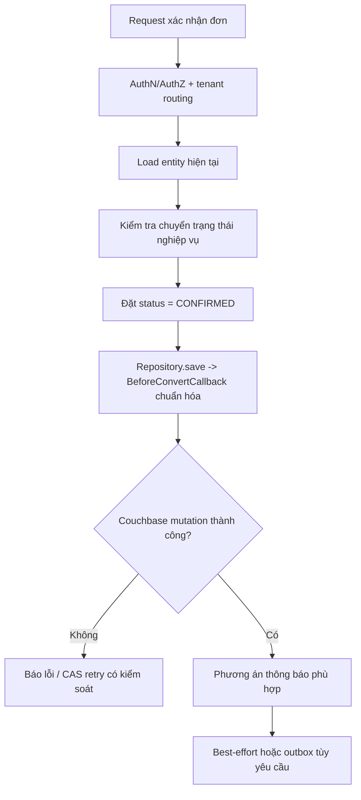
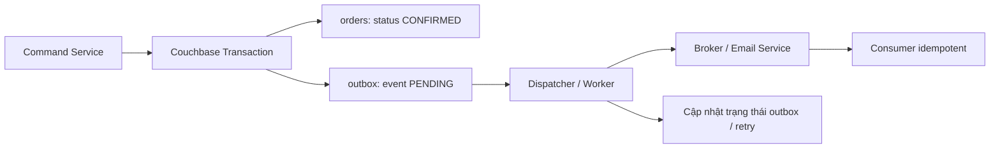

# Tách chuẩn hóa dữ liệu khỏi tác dụng phụ trong callback Spring Data Couchbase

Khi Spring Data Couchbase chuẩn bị lưu một document, `BeforeConvertCallback<T>` là nơi thuận tiện để chỉnh sửa entity: chuẩn hóa trạng thái, loại bỏ khoảng trắng thừa, áp dụng một định dạng dữ liệu nhất quán. Nhưng nếu trong chính callback đó ứng dụng **gửi email**, **gọi API thanh toán**, **ghi audit document sang collection khác** hoặc **phát thông điệp lên broker**, một thao tác lưu thất bại hoặc được retry có thể để lại hậu quả ngoài ý muốn.

Bài thuộc chương **Vòng đời và auditing** của module `SPRING_DATA_COUCHBASE`. Mục tiêu là thiết kế ranh giới rõ ràng giữa **biến đổi dữ liệu cục bộ** và **tác dụng phụ (side effects)**, áp dụng cho document mapping, repository, `CouchbaseTemplate` và API reactive. Các ví dụ còn liên hệ đến auditing, CAS, giao dịch Couchbase, TTL, SQL++, scope/collection và tính đáng tin cậy khi vận hành.

Nguyên tắc trung tâm:

> **Callback chuẩn hóa dữ liệu để ghi đúng; tầng nghiệp vụ quyết định điều gì cần xảy ra; cơ chế giao dịch/outbox bảo đảm những thay đổi và thông điệp quan trọng không bị thất lạc hoặc lặp thiếu kiểm soát.**

## 1. Phân biệt chuẩn hóa dữ liệu và tác dụng phụ

### 1.1. Chuẩn hóa dữ liệu là gì?

Chuẩn hóa (*normalization*) chuyển một cách biểu diễn thành dạng nhất quán theo quy tắc xác định. Ví dụ:

- `" confirmed "` → `"CONFIRMED"`;
- `" new "` → `"NEW"`;
- mã kênh `" web "` → `"WEB"`;
- loại bỏ khoảng trắng đầu/cuối của mã định danh do hệ thống quản lý;
- đảm bảo field bắt buộc không rỗng trước khi converter tạo JSON.

Với cùng một input, một hàm chuẩn hóa **nên cho cùng một output** và không phải gọi dịch vụ bên ngoài để xác định kết quả.

### 1.2. Tác dụng phụ là gì?

Tác dụng phụ là bất kỳ thay đổi/quan sát nào vượt ra ngoài giá trị được hàm trả về hoặc object mà pipeline đang chủ ý xử lý:

| Ví dụ | Loại | Có nên đặt trực tiếp trong callback chuẩn hóa? |
| --- | --- | --- |
| `status.trim().toUpperCase(Locale.ROOT)` | Biến đổi giá trị xác định | Có thể. |
| Kiểm tra `status` thuộc tập giá trị cho phép | Validation cục bộ | Có thể, với quy tắc đơn giản và ổn định. |
| Thay field `normalizedStatus` trên entity đang được lưu | Biến đổi entity trong pipeline | Có thể, nếu không phụ thuộc tác vụ khác. |
| `emailClient.sendOrderConfirmed(...)` | Gửi email | **Không**. |
| `paymentGateway.capture(...)` | Gọi thanh toán | **Không**. |
| `messageBroker.publish(...)` | Phát thông điệp | **Không**. |
| `auditRepository.save(...)` | Ghi document bổ sung | **Không** nếu làm side effect ẩn trong callback. |
| `otherCollection.upsert(...)` | Ghi KV ngoài thao tác hiện tại | **Không**. |
| `Instant.now()`/`UUID.randomUUID()` trên mỗi lần gọi để “chuẩn hóa” | Sinh dữ liệu không ổn định | Tránh; dùng quy tắc tạo metadata/ID có chủ đích. |
| Ghi log mức phù hợp, không chứa dữ liệu nhạy cảm | Tác dụng phụ quan sát | Có thể dùng có kiểm soát, nhưng không dựa vào log để đảm bảo nghiệp vụ. |

Callback có thể trả cùng entity hoặc bản sao mới. **“Thuần” trong thiết kế bài này** chủ yếu nói đến *logic chuẩn hóa bên trong* là xác định, không gọi I/O và không tạo tác vụ nghiệp vụ bên ngoài. Một callback sửa property của entity mutable vẫn là thay đổi trạng thái JVM, nhưng là thay đổi được phép trong hợp đồng mapping.

## 2. Vì sao callback có thể chạy nhiều lần?

Hãy xét một endpoint xác nhận đơn hàng:

```text
POST /orders/order::1001/confirm
   |
   v
service.confirmOrder(...)
   |
   v
repository.save(order)
   |
   +--> BeforeConvertCallback
   |
   +--> Couchbase KV mutation
   |
   +--> result / exception
```

Một callback có thể được kích hoạt lại khi:

1. API được client gọi lại do timeout hoặc retry ở tầng HTTP.
2. Tầng service retry thao tác sau lỗi CAS/optimistic locking.
3. Một transaction có thể thực thi lại phần xử lý do xung đột.
4. Subscriber reactive được tạo mới hoặc một publisher được resubscribe/retry.
5. Một background job nhận lại cùng công việc từ queue.
6. Cùng entity được lưu qua nhiều thao tác khác nhau trong vòng đời nghiệp vụ.

Không có hợp đồng nào nói **“một sự kiện nghiệp vụ tương đương chính xác một lần gọi `BeforeConvertCallback`”**.

Ví dụ nguy hiểm:

```java
@Component
public class UnsafeOrderCallback
        implements BeforeConvertCallback<OrderDocument> {

    private final EmailSender emailSender;

    public UnsafeOrderCallback(EmailSender emailSender) {
        this.emailSender = emailSender;
    }

    @Override
    public OrderDocument onBeforeConvert(
            OrderDocument order, String collection) {

        if ("CONFIRMED".equals(order.getStatus())) {
            // LỖI THIẾT KẾ: email đi trước khi KV mutation thành công.
            emailSender.sendConfirmation(order.getId());
        }
        return order;
    }
}
```

Trong ví dụ trên, `EmailSender` là interface giả định của ứng dụng, không phải API Spring Data. Nếu mutation Couchbase thất bại do CAS conflict, email có thể **đã được gửi** dù trạng thái đơn hàng chưa được cập nhật. Nếu retry, cùng một email có thể được gửi lần thứ hai.

## 3. Hợp đồng của BeforeConvertCallback trong Couchbase

Trong Spring Data Couchbase hiện đại, interface có dạng:

```java
package org.springframework.data.couchbase.core.mapping.event;

public interface BeforeConvertCallback<T>
        extends EntityCallback<T> {

    T onBeforeConvert(T entity, String collection);
}
```

`T` là kiểu entity. `collection` là **tên collection**, không phải đầy đủ `bucket.scope.collection` và cũng không phải chứng minh người dùng được quyền truy cập tenant tương ứng.

**Callback được gọi trước quá trình chuyển đổi entity để lưu**, nên có thể trả entity đã chuẩn hóa. Nó không cam kết thao tác ghi sẽ thành công sau đó.

### Hệ quả quan trọng

- **Trả entity:** framework dùng entity trả về ở bước tiếp theo. Với immutable entity, có thể trả instance mới.
- **Có thể ném exception:** lỗi validation ở đây dừng pipeline chuyển đổi/lưu; đó không phải lỗi giao dịch toàn hệ thống.
- **Không có bảo đảm exactly-once:** callback có thể chạy lại do các retry bên ngoài và nhiều đường gọi.
- **Không phải security boundary:** callback không thay thế authorization, tenant registry hoặc RBAC.
- **Đăng ký qua Spring context:** thường là bean `@Component` hoặc `@Bean` và được Template/repository tương ứng phát hiện.

Tài liệu Spring Data Commons khuyến nghị dùng **EntityCallback** thay cho application event khi cần thay đổi entity tại checkpoint có thứ tự xác định. Điều đó không biến callback thành cơ chế commit hoặc outbox.

## 4. Mô hình domain dùng xuyên suốt bài

Giả sử hệ thống bán hàng lưu đơn hàng tại:

```text
shop.commerce.orders
```

Entity tối giản:

```java
package example.shop;

import org.springframework.data.annotation.Id;
import org.springframework.data.annotation.Version;
import org.springframework.data.annotation.CreatedDate;
import org.springframework.data.annotation.LastModifiedDate;
import org.springframework.data.couchbase.core.mapping.Document;
import org.springframework.data.couchbase.repository.Scope;
import org.springframework.data.couchbase.repository.Collection;

import java.time.Instant;

@Document
@Scope("commerce")
@Collection("orders")
public class OrderDocument {

    @Id
    private String id;

    private String status;
    private String channel;
    private String customerId;

    @Version
    private long version;

    @CreatedDate
    private Instant createdAt;

    @LastModifiedDate
    private Instant modifiedAt;

    public OrderDocument() {}

    public OrderDocument(String id, String status) {
        this.id = id;
        this.status = status;
    }

    public String getId() { return id; }
    public void setId(String id) { this.id = id; }

    public String getStatus() { return status; }
    public void setStatus(String status) {
        this.status = status;
    }

    public String getChannel() { return channel; }
    public void setChannel(String channel) {
        this.channel = channel;
    }

    public String getCustomerId() { return customerId; }
    public void setCustomerId(String customerId) {
        this.customerId = customerId;
    }

    public long getVersion() { return version; }
    public Instant getCreatedAt() { return createdAt; }
    public Instant getModifiedAt() { return modifiedAt; }
}
```

`@Version` dùng cho CAS/optimistic locking và hỗ trợ phân biệt entity mới/cũ khi auditing; nó **không phải bộ đếm sửa đổi do ứng dụng tự tăng**. Hai annotation `@Scope`/`@Collection` ở ví dụ thuộc package `org.springframework.data.couchbase.repository`, không phải annotation scope của Spring bean.

Repository:

```java
package example.shop;

import org.springframework.data.couchbase.repository.CouchbaseRepository;

public interface OrderRepository
        extends CouchbaseRepository<OrderDocument, String> {
}
```

Các ví dụ code bên dưới minh họa từng trách nhiệm. Một số interface ứng dụng như `NotificationPort` hoặc `OutboxStore` được định nghĩa riêng để phân tách thiết kế, không phải API dựng sẵn của Spring Data.

## 5. Tách logic chuẩn hóa thành hàm xác định

Một cách kiểm soát tốt là viết **hàm chuẩn hóa thuần** rồi để callback gọi hàm đó. Ví dụ:

```java
package example.shop;

import java.util.Locale;
import java.util.Set;

public final class OrderStatusNormalizer {

    private static final Set<String> ALLOWED =
        Set.of("NEW", "CONFIRMED", "CANCELLED");

    private OrderStatusNormalizer() {}

    public static String normalize(String input) {
        if (input == null) {
            throw new IllegalArgumentException("status is required");
        }

        String normalized =
            input.trim().toUpperCase(Locale.ROOT);

        if (!ALLOWED.contains(normalized)) {
            throw new IllegalArgumentException(
                "Unsupported order status: " + normalized
            );
        }

        return normalized;
    }
}
```

Đặc điểm:

- Cùng input → cùng output, không phụ thuộc thời điểm hoặc hệ thống ngoài.
- Không gọi network, DB, queue hay filesystem.
- Không gửi thông báo hoặc thay document khác.
- Không tạo UUID/timestamp mới để làm kết quả biến động.
- Có điều kiện lỗi rõ ràng cho dữ liệu không hợp lệ.

`Locale.ROOT` tránh kết quả viết hoa phụ thuộc locale của server, hữu ích với **enum-like business codes**. Không áp dụng quy tắc này một cách máy móc cho tên người, email hoặc văn bản tự do; các dữ liệu đó có ngữ nghĩa và yêu cầu quốc tế hóa riêng.

### Tính idempotent của chuẩn hóa

Một phép chuẩn hóa tốt thường thỏa:

```text
normalize(normalize(x)) == normalize(x)
```

Ví dụ:

```text
normalize(" confirmed ") = "CONFIRMED"
normalize("CONFIRMED")   = "CONFIRMED"
```

Tính chất này giúp retry không làm giá trị tiếp tục thay đổi. Nhưng **idempotence của phép biến đổi không đồng nghĩa idempotence của gửi email hay ghi message**; tác dụng phụ cần cơ chế định danh và chống lặp riêng.

## 6. Callback chỉ làm nhiệm vụ “adapter” cho chuẩn hóa

Triển khai callback:

```java
package example.shop;

import org.springframework.core.annotation.Order;
import org.springframework.data.couchbase.core.mapping.event.BeforeConvertCallback;
import org.springframework.stereotype.Component;

@Component
@Order(200)
public class NormalizeOrderBeforeConvert
        implements BeforeConvertCallback<OrderDocument> {

    @Override
    public OrderDocument onBeforeConvert(
            OrderDocument entity, String collection) {

        entity.setStatus(
            OrderStatusNormalizer.normalize(entity.getStatus())
        );

        if (entity.getChannel() != null) {
            entity.setChannel(
                entity.getChannel().trim()
                    .toUpperCase(java.util.Locale.ROOT)
            );
        }

        return entity;
    }
}
```

Callback thực hiện một biến đổi cục bộ có chủ đích. Nó không biết và không cần biết:

- Ai đang gửi request HTTP.
- Đơn hàng đã thanh toán hay chưa.
- Đã gửi email tới khách chưa.
- Có cần audit event hay không.
- Có cần ghi document vào collection khác không.
- Khi nào message broker có thể nhận message.

**Đừng dùng tên collection trong tham số callback để suy ra tenant được phép thao tác.** Routing theo tenant phải được kiểm tra ở service trước khi lưu; callback có thể chạy từ job nội bộ hoặc đường truy cập khác.

### Với entity immutable

Nếu entity là record hoặc immutable aggregate, callback có thể trả bản sao đã chuẩn hóa:

```java
// Pseudocode: với một entity có phương thức withStatus(...)
return entity.withStatus(
    OrderStatusNormalizer.normalize(entity.status())
);
```

Đây là mẫu thiết kế, không phải phương thức có sẵn trên `OrderDocument` mutable. Ý chính là không bắt buộc mutate instance nhận vào, nhưng **phải trả đúng instance** mà pipeline sẽ sử dụng.

## 7. Validation khác quyết định chuyển trạng thái nghiệp vụ

Chuẩn hóa `" confirmed "` thành `"CONFIRMED"` **không** trả lời câu hỏi đơn hàng có được phép chuyển từ trạng thái hiện tại sang `CONFIRMED` hay không.

Phân chia trách nhiệm:

| Câu hỏi | Nơi xử lý phù hợp |
| --- | --- |
| `" confirmed "` có được chuẩn hóa thành mã hợp lệ? | Normalizer/callback. |
| `"UNKNOWN"` có nằm trong enum cho phép? | Normalizer/validation cục bộ. |
| Đơn hàng `CANCELLED` có được chuyển lại `CONFIRMED`? | Domain service/aggregate với trạng thái hiện tại. |
| Caller có quyền xác nhận đơn hàng này? | Authentication/authorization ở service. |
| Tenant đang ACTIVE và keyspace đúng? | Tenant registry/routing đã kiểm tra quyền. |
| Có đủ tiền/tồn kho để xác nhận? | Business workflow, transaction hoặc saga. |
| Sau khi xác nhận cần gửi email? | Workflow/outbox/notification worker. |

Không đặt toàn bộ business flow vào callback chỉ vì callback “luôn chạy khi save”. Một entity có thể được lưu cho nhiều mục đích: cập nhật ghi chú, đồng bộ kỹ thuật, migrate dữ liệu hoặc sửa lỗi. Nếu callback thấy `status=CONFIRMED` rồi gửi email, mọi lần lưu phụ đều có thể kích hoạt email ngoài dự kiến.

## 8. Anti-pattern: callback vừa chuẩn hóa vừa gửi thông báo

Ví dụ cần tránh:

```java
@Component
public class BadMixedResponsibilities
        implements BeforeConvertCallback<OrderDocument> {

    private final NotificationPort notifications;
    private final AuditEventRepository auditRepository;

    public BadMixedResponsibilities(
            NotificationPort notifications,
            AuditEventRepository auditRepository) {
        this.notifications = notifications;
        this.auditRepository = auditRepository;
    }

    @Override
    public OrderDocument onBeforeConvert(
            OrderDocument entity, String collection) {

        entity.setStatus(
            OrderStatusNormalizer.normalize(entity.getStatus())
        );

        if ("CONFIRMED".equals(entity.getStatus())) {
            notifications.sendOrderConfirmed(entity.getId());
            auditRepository.save(
                AuditEvent.forOrderConfirmed(entity.getId())
            );
        }

        return entity;
    }
}
```

`NotificationPort`, `AuditEventRepository` và `AuditEvent.forOrderConfirmed` trong ví dụ là các kiểu giả định của ứng dụng. Chúng minh họa lỗi **thiết kế**, không phải đoạn mã độc lập có thể biên dịch mà không khai báo thêm các dependency.

Có ít nhất sáu rủi ro:

1. **Side effect đi trước commit:** callback chạy, nhưng thao tác lưu bị lỗi CAS.
2. **Gửi trùng:** client hoặc service retry cùng thao tác; email được gửi lại.
3. **Ghi audit một nửa:** audit document được lưu, order lưu thất bại.
4. **Đệ quy ngoài ý muốn:** ghi một entity khác có callback tương tự có thể kích hoạt chuỗi ghi tiếp.
5. **Độ trễ:** gửi email/API chậm làm chậm request lưu document.
6. **Khó test:** một bước mapping cần chạy cả network, broker và repository khác.

Ngay cả khi callback đang “chỉ gửi sự kiện sau save”, không có bảo đảm sự kiện đó đồng bộ với transaction hoặc được gửi exactly once.

## 9. Mapping event không phải giải pháp thay thế outbox

Spring Data Couchbase có các mapping event như:

- `BeforeConvertEvent<E>`;
- `BeforeSaveEvent<E>`;
- `AfterSaveEvent<E>`;
- `BeforeDeleteEvent<E>`;
- `AfterDeleteEvent<E>`.

Listener như `AbstractCouchbaseEventListener<E>` có thể nhận event để quan sát quá trình mapping. Nhưng đây là **Spring application event**, không phải commit log phân tán.

So sánh:

| Điều muốn làm | `BeforeConvertCallback` | `AfterSaveEvent` | Outbox/worker |
| --- | --- | --- | --- |
| Chuẩn hóa field chuẩn bị ghi | **Phù hợp** | Quá muộn | Không nên. |
| Log kỹ thuật ở mức tối thiểu | Có thể nhưng không ưu tiên | Phù hợp nếu biết hạn chế của event | Có thể ở worker. |
| Gửi notification nghiệp vụ | Không | Không bảo đảm tin cậy | **Phù hợp hơn**. |
| Đảm bảo DB write và ghi ý định phát event nhất quán | Không | Không | Transactional outbox khi transaction hỗ trợ. |
| Retry gửi khi broker tạm lỗi | Không | Không có cơ chế bền vững mặc định | Worker + retry/backoff. |
| Đảm bảo không gửi trùng ra hệ thống ngoài | Không | Không | Idempotency/deduplication theo event ID. |

Tài liệu Spring Data Commons lưu ý application event phụ thuộc `ApplicationEventMulticaster`; với executor bất đồng bộ, thời điểm listener chạy có thể khác thứ tự mong đợi. Do vậy, **không dùng `BeforeConvertEvent` để thay entity bắt buộc**, và **không dùng `AfterSaveEvent` như giao thức giao hàng message đáng tin cậy**.

## 10. Thiết kế tầng service trước khi bàn tới outbox

Một service tốt phải làm rõ ranh giới:



### 10.1. Best-effort đơn giản, không giả vờ atomic

Với notification không quan trọng và chấp nhận mất thông báo, có thể lưu trước rồi gọi publisher:

```java
@Service
public class ConfirmOrderService {

    private final OrderRepository orders;
    private final NotificationPort notifications;

    public ConfirmOrderService(
            OrderRepository orders,
            NotificationPort notifications) {
        this.orders = orders;
        this.notifications = notifications;
    }

    public void confirm(String id) {
        OrderDocument order = orders.findById(id)
            .orElseThrow(() ->
                new IllegalArgumentException("Order not found")
            );

        if (!"NEW".equals(order.getStatus())) {
            throw new IllegalStateException(
                "Only NEW orders can be confirmed"
            );
        }

        order.setStatus("CONFIRMED");
        orders.save(order);

        // Chỉ là best-effort: DB có thể thành công nhưng
        // publisher thất bại; retry cả hàm có thể gây trùng.
        notifications.sendOrderConfirmed(id);
    }
}
```

Hai interface của service cần được khai báo trong dự án; `NotificationPort` không thuộc Spring Data. Ví dụ cố ý cho thấy **ngay cả khi gửi sau save**, không thể tuyên bố hai hệ thống đã được cập nhật nguyên tử.

Nếu thông báo là trách nhiệm bắt buộc, dùng phương án đáng tin cậy hơn.

## 11. Transactional outbox: lưu ý định phát sự kiện cùng dữ liệu nghiệp vụ

Ý tưởng **transactional outbox** là lưu một document biểu diễn “sự kiện cần phát” trong Couchbase **cùng một đơn vị giao dịch** với việc cập nhật đơn hàng. Một worker riêng đọc outbox rồi gửi tới broker/email service.



**Điểm phân biệt then chốt:** outbox không phải một document được callback tự lưu. Service hoặc transaction handler **chủ động** ghi cả nghiệp vụ và outbox bằng API transaction phù hợp.

### 11.1. Mô hình outbox document

Ví dụ tại `shop.operations.outbox_events`:

```json
{
  "eventId": "event::confirm::cmd-9d71",
  "eventType": "ORDER_CONFIRMED",
  "aggregateId": "order::1001",
  "tenantId": "tenant-42",
  "payload": {
    "orderId": "order::1001"
  },
  "deliveryState": "PENDING",
  "attempts": 0
}
```

Một thiết kế production thường bổ sung createdAt, nextAttemptAt, traceId, schemaVersion, lease/lock và phân loại lỗi, nhưng không lưu secrets hoặc toàn bộ thông tin thanh toán không cần thiết.

**Event ID nên ổn định cho cùng một business command**. Nếu mỗi retry sinh ngẫu nhiên event ID mới, consumer khó nhận ra hai message là cùng một hành động nghiệp vụ.

### 11.2. Atomicity đòi hỏi transaction thực sự

Hai lời gọi:

```java
orders.save(order);
outboxRepository.save(event);
```

**không tự tạo một transaction** chỉ vì được viết liền nhau hoặc cùng bucket. Cần dùng **Couchbase transaction API được hỗ trợ** cho đúng phiên bản và các resource liên quan, hoặc một phương án bảo đảm đáng tin cậy khác theo kiến trúc hệ thống.

Không suy rằng đặt `@Transactional` lên mọi service Spring Data Couchbase sẽ tự biến hai lệnh KV tùy ý hoặc hai hệ thống bên ngoài thành một giao dịch nguyên tử. Phải kiểm tra transaction manager và API đang dùng.

## 12. Ví dụ Couchbase Java SDK transaction: ghi order và outbox

Ví dụ tập trung vào **ranh giới transaction**, không cố lồng Spring Data callback vào SDK transaction. Java SDK trực tiếp **bỏ qua** callback của Spring Data; do đó ở đường này service phải áp dụng normalizer **trước** khi gọi transaction.

Các collection đã tồn tại:

```text
shop.commerce.orders
shop.operations.outbox_events
```

Ví dụ:

```java
import com.couchbase.client.java.Cluster;
import com.couchbase.client.java.Collection;
import com.couchbase.client.java.json.JsonObject;
import com.couchbase.client.java.transactions.TransactionGetResult;

// cluster là Cluster SDK đã kết nối/xác thực.
// Các collection được provision trước với quyền phù hợp.
Collection orders = cluster.bucket("shop")
    .scope("commerce")
    .collection("orders");

Collection outbox = cluster.bucket("shop")
    .scope("operations")
    .collection("outbox_events");

String orderId = "order::1001";
String commandId = "cmd-9d71";
String status = OrderStatusNormalizer.normalize(" confirmed ");

cluster.transactions().run(ctx -> {
    TransactionGetResult current = ctx.get(orders, orderId);
    JsonObject body = current.contentAs(JsonObject.class);

    if (!"NEW".equals(body.getString("status"))) {
        throw new IllegalStateException(
            "Order is not in NEW state"
        );
    }

    body.put("status", status);
    ctx.replace(current, body);

    JsonObject event = JsonObject.create()
        .put("eventId", "event::confirm::" + commandId)
        .put("eventType", "ORDER_CONFIRMED")
        .put("aggregateId", orderId)
        .put("deliveryState", "PENDING")
        .put("attempts", 0);

    ctx.insert(
        outbox,
        "event::confirm::" + commandId,
        event
    );
});
```

Đây là ví dụ SDK 3.3+ có transaction được tích hợp, dựa trên các thao tác `ctx.get/replace/insert` được tài liệu hóa. Cần đối chiếu API, version, quyền và khả năng giao dịch của môi trường thực tế.

### 12.1. Những điều ví dụ bảo đảm và không bảo đảm

- **Có chủ đích dùng transaction:** update order và insert outbox cùng transaction; nếu transaction thất bại thì không được coi nghiệp vụ đã commit.
- **Không gọi `email.send` hay `broker.publish` trong lambda.**
- **Không dùng `orders.replace(...)` ngoài `ctx` trong lambda**, vì thao tác đó không thuộc transaction đang xét.
- **Không kích hoạt Spring Data entity callbacks:** đây là SDK direct path; việc chuẩn hóa được gọi tường minh.
- **Không tự giải quyết duplicate business command:** nếu cùng `commandId` bị gửi lại sau commit, insert cùng outbox ID có thể lỗi “already exists” và trạng thái đơn hàng không còn NEW. Service phải kiểm tra idempotency/command status, phân biệt request trùng hợp lệ với xung đột nghiệp vụ.
- **Không giao message ngay:** worker còn phải đọc outbox và gửi.

Đặc biệt, **transaction lambda có thể được chạy lại**. Chỉ thực hiện các thao tác được transaction API hỗ trợ và logic domain có khả năng tính lại. Không sử dụng `UUID.randomUUID()` để tạo event ID mới mỗi lần chạy lambda; nên sinh/tính một ID ổn định từ command đã xác thực ở ngoài lambda.

### 12.2. Kiểm tra transaction trên đúng collection

Transaction phải đọc/ghi chính xác `shop.commerce.orders` và `shop.operations.outbox_events`. Một callback có thể được gọi bởi repository ở collection khác, nên không thể thay thế việc chọn keyspace và kiểm tra quyền rõ ràng trong transaction handler.

## 13. Dispatcher: “at least once” và chống gửi trùng

Giả sử transaction đã ghi một outbox event `PENDING`. Worker có thể:

1. Tìm các event đến hạn ở `outbox_events` bằng SQL++ hoặc một hệ thống feed được hỗ trợ.
2. Claim event bằng cơ chế lock/lease và optimistic concurrency phù hợp, để nhiều worker không cùng xử lý vô hạn.
3. Gửi message đến broker hoặc dịch vụ thông báo với **event ID cố định**.
4. Chỉ sau khi nhận kết quả thành công phù hợp mới ghi trạng thái `SENT`.
5. Nếu gửi lỗi, ghi attempts và `nextAttemptAt`, retry có backoff; sau số lần quy định chuyển dead-letter/review.

### Cửa sổ lỗi không thể loại bỏ chỉ bằng trạng thái outbox

```text
Worker gửi message thành công
             |
             v
Worker bị crash trước khi cập nhật outbox = SENT
             |
             v
Event còn PENDING và được gửi lại
```

Vì vậy outbox thường cho **at-least-once delivery**, không tự tạo end-to-end exactly-once. Consumer cần xử lý idempotently theo `eventId`, ví dụ lưu khóa processed-event hoặc áp dụng một command có idempotency key tại hệ thống nhận.

### Phân biệt hai nghĩa của idempotent

| Thao tác | “Lặp lại” được hiểu thế nào? |
| --- | --- |
| `normalize(" confirmed ")` | Lặp lại cho cùng kết quả `CONFIRMED`. |
| `order.status = CONFIRMED` | Gán lại cùng value có thể không đổi nghiệp vụ, nhưng lưu lại có thể thay CAS/audit. |
| Gửi email | Hai lần gửi là hai email nếu provider không hỗ trợ dedupe. |
| Thanh toán | Hai lần capture có thể thu tiền hai lần nếu không dùng idempotency key. |
| Ghi outbox cùng event ID | Có thể phát hiện trùng bằng key/unique constraint và đối chiếu kết quả. |
| Consumer xử lý cùng event | Phải kiểm soát xem effect đã áp dụng chưa trước khi áp dụng lại. |

Nên thiết kế **business command ID, event ID và consumer dedupe key** có quan hệ rõ ràng, không tạo ID mới tùy ý mỗi lần callback hoặc retry chạy.

## 14. Không dùng AfterSaveEvent để giả làm transaction commit hook

Một lựa chọn thường được đề xuất là chuyển `email.send(...)` từ `BeforeConvertCallback` sang `AfterSaveEvent`. Điều này tránh gửi **trước** một mutation thông thường hoàn tất, nhưng vẫn không giải quyết các vấn đề:

- App crash sau DB write nhưng trước khi event handler gửi.
- Event handler gửi thành công nhưng lỗi trước khi ghi trạng thái giao hàng.
- ApplicationEventMulticaster dùng executor bất đồng bộ, listener chưa xử lý xong khi request trả thành công.
- Retry ở tầng HTTP/service tiếp tục phát một `AfterSaveEvent` mới.
- Transaction hoặc workflow nhiều document có thể thất bại ở bước khác.
- SDK trực tiếp hoặc SQL++ DML không tự phát Spring Data mapping event.

Do đó:

- `AfterSaveEvent` có thể dùng cho **log/metrics/quan sát cục bộ**.
- Dùng outbox, CDC hoặc một workflow tin cậy hơn khi **sự kiện nghiệp vụ không được phép thất lạc**.
- Không làm `AfterSaveEvent` trở thành nguồn sự thật duy nhất về transaction commit hoặc external delivery.

## 15. CAS: lý do một callback “đã chạy” nhưng save vẫn thất bại

Couchbase dùng CAS (*Compare-And-Swap*) làm metadata phiên bản của document. Spring Data Couchbase hỗ trợ `@Version` để optimistic locking khi lưu entity.

Trường hợp:

```text
T1 đọc order::1001, CAS=A, status=NEW
T2 đọc order::1001, CAS=A, status=NEW
T1 đổi CONFIRMED, save thành công, CAS=B
T2 đổi CANCELLED, save dùng CAS=A -> xung đột
```

Nếu callback của T2 đã gửi email “đơn hàng bị hủy” trước mutation, email có thể đến dù hủy **không thành công**.

### Retry có kiểm soát

Thay vì retry vô hạn chính entity cũ:

1. Bắt lỗi optimistic locking tại service.
2. Nạp lại document hiện tại và version mới.
3. Kiểm tra lại điều kiện chuyển trạng thái nghiệp vụ.
4. Áp dụng command một cách xác định.
5. Retry có giới hạn, có backoff phù hợp, có metrics.
6. Nếu không thể áp dụng, trả conflict/validation error.

Khi lặp, normalizer an toàn vì cho cùng kết quả. Nhưng email/thanh toán trong callback **không an toàn** vì lặp lại nghĩa là thêm tác vụ bên ngoài.

Lưu ý `@Version` của Couchbase liên quan đến CAS opaque, không phải số `version++` do app tự đặt. Hai document cùng ID ở hai collection khác nhau có CAS khác nhau.

## 16. Auditing: metadata là trách nhiệm khác side effect nghiệp vụ

Spring Data auditing hỗ trợ:

- `@CreatedDate`, `@LastModifiedDate`;
- `@CreatedBy`, `@LastModifiedBy`;
- `@EnableCouchbaseAuditing`;
- `AuditorAware<T>` / cơ chế auditor reactive tương ứng.

Auditing có thể chạy trong hệ thống entity callback. Đây là cơ chế **điền metadata của document đang được lưu**, không phải tự phát audit trail đầy đủ hoặc message bên ngoài.

### Cần phân biệt

| Trách nhiệm | Ví dụ | Hướng xử lý |
| --- | --- | --- |
| Thời điểm entity được tạo | `createdAt` | Spring Data auditing. |
| Người cập nhật gần nhất | `modifiedBy` | Auditing từ security context tin cậy. |
| Chuẩn hóa status | `"confirmed" → "CONFIRMED"` | Normalizer và `BeforeConvertCallback`. |
| Nhật ký không thể bỏ sót mỗi transition | `ORDER_CONFIRMED` event | Domain workflow + outbox/CDC. |
| Gửi notification | Email/SMS/webhook | Dispatcher sau commit với retry/dedup. |

Nếu callback tự ghi `createdAt = Instant.now()` trên mỗi lần save, retry có thể làm mất ý nghĩa thời điểm tạo. Nên dùng auditing với cấu hình clock/DateTimeProvider phù hợp, hoặc quy tắc tạo timestamp tường minh ở service.

Trong Couchbase, `@Version` có vai trò quan trọng khi auditing nhận diện entity mới/cũ. Khi nâng cấp Spring Data, kiểm tra thứ tự các auditing callback và callback tự định nghĩa thay vì giả định mọi phiên bản giống nhau.

## 17. TTL, keyspace và index không phải chuyện của callback chuẩn hóa

### 17.1. TTL

TTL/expiry là chính sách vòng đời document trên Couchbase Server, không đồng nghĩa thời điểm `createdAt`/`modifiedAt`. Ví dụ session cần hết hạn sau 30 phút, trong khi đơn hàng không nên tự hết hạn cùng quy tắc đó.

Chọn expiry ở thao tác ghi hoặc cấu hình bucket/collection theo nhu cầu. **Không gửi email “session expired” trong callback save** rồi coi đó là thông báo expiry thực tế: document có thể hết hạn về sau do server, không đi qua callback Java của ứng dụng.

### 17.2. Scope và collection

`BeforeConvertCallback<T>` nhận tên collection, nhưng không xác nhận đầy đủ bucket, scope, tenant hoặc quyền. Nếu một ứng dụng có:

```text
shop.tenant_acme.orders
shop.tenant_globex.orders
```

cả hai callback có thể nhận tên `orders`. Vì vậy không dựa vào tham số `collection` để xác định người gọi được phép đọc/ghi tenant nào.

### 17.3. SQL++ và chỉ mục

Finder như `findByStatus` thường đi qua SQL++ và cần lựa chọn index/scan consistency phù hợp; `findById` thường dùng KV. Một callback chuẩn hóa trước ghi có thể tạo `status=CONFIRMED`, nhưng SQL++ ngay sau ghi có thể tạm chưa thấy document do secondary index cập nhật chậm.

Không sửa lỗi đó bằng cách đưa `Thread.sleep(...)`, `cluster.query(...)` hoặc `indexManager.createIndex(...)` vào callback. Thiết kế query/index ở tầng truy cập và vận hành; chọn scan consistency khi nghiệp vụ cần read-your-writes.

## 18. Khi dùng reactive: side effect có thể lặp do subscription/retry

Spring Data Couchbase reactive có `ReactiveBeforeConvertCallback<T>` trả `Publisher<T>`:

```java
package example.shop;

import org.springframework.data.couchbase.core.mapping.event.ReactiveBeforeConvertCallback;
import org.springframework.stereotype.Component;
import reactor.core.publisher.Mono;

@Component
public class ReactiveNormalizeOrder
        implements ReactiveBeforeConvertCallback<OrderDocument> {

    @Override
    public Mono<OrderDocument> onBeforeConvert(
            OrderDocument entity, String collection) {

        try {
            entity.setStatus(
                OrderStatusNormalizer.normalize(entity.getStatus())
            );
            return Mono.just(entity);
        } catch (IllegalArgumentException error) {
            return Mono.error(error);
        }
    }
}
```

Không dùng callback reactive để gọi:

```java
// Không nên:
return Mono.fromRunnable(() -> emailSender.sendConfirmation(id))
    .thenReturn(entity);
```

Bởi vì publisher có thể được subscribe lại, retry hoặc bị hủy. Logic gọi dịch vụ ngoài ở đây dễ mất kiểm soát, không đảm bảo nguyên tử với lệnh save.

### Đừng nhầm doOnNext và doOnSuccess với outbox

Đoạn sau **không đảm bảo giao thông điệp đáng tin cậy**:

```java
return reactiveOrderRepository.save(order)
    .doOnSuccess(saved ->
        notifications.sendOrderConfirmed(saved.getId())
    );
```

Ngoài việc side effect có thể blocking, `doOnSuccess` là hook quan sát trong Reactor, không phải transaction commit và không khắc phục thất bại nếu app crash giữa DB commit và notification.

Nếu thực sự cần chain thêm một tác vụ bất đồng bộ sau save, có thể dùng `flatMap` với một `Publisher` từ client reactive; nhưng đó vẫn chỉ là **best-effort sequencing**, không phải atomic cross-system delivery. Với yêu cầu tin cậy, dùng outbox/worker phù hợp.

### Reactor retry có thể kích hoạt callback lại

```java
Mono<OrderDocument> result =
    reactiveOrderRepository.save(order)
        .retry(2);
```

Khi có error, `retry(2)` có thể resubscribe upstream. Nó không xác định thao tác ghi trước đó thực sự đã commit hay chưa nếu lỗi là timeout/ambiguous. Không nên gắn notification trước khi có protocol idempotency. Với `@Version`, retry cùng entity version cũ có thể vẫn thất bại; cần đọc lại và áp dụng command mới ở tầng service.

## 19. Định nghĩa kiến trúc bằng các interface nhỏ

Một thiết kế dễ test có thể tách bốn thành phần:

```java
public interface OrderStatusPolicy {
    void requireCanConfirm(OrderDocument order);
}

public interface OrderCommandStore {
    // Thực hiện command nghiệp vụ; có thể được triển khai
    // bằng Spring Data repository hoặc Couchbase SDK transaction.
    void confirmOrder(String orderId, String commandId);
}

public interface NotificationPort {
    void sendOrderConfirmed(String orderId, String eventId);
}

public interface OutboxPublisher {
    // Worker gọi sau khi đã claim một outbox event.
    void publishPending(OutboxEvent event);
}
```

Đây là **interface minh họa của ứng dụng**, không phải API Spring Data. Sự phân tách nhằm làm rõ:

- `OrderStatusNormalizer`: chỉ xử lý giá trị dữ liệu.
- `OrderStatusPolicy`: quy tắc chuyển trạng thái nghiệp vụ.
- `OrderCommandStore`: ghi trạng thái và ý định phát event theo giao thức nhất quán.
- `OutboxPublisher`: phát sự kiện ra ngoài với retry và dedupe.
- `NotificationPort`: adapter đến email/broker, không lẫn vào entity callback.

Điều này giúp kiểm thử normalizer không cần chạy Couchbase, còn kiểm thử transaction/outbox có thể chạy với Testcontainers và một fake publisher.

## 20. Unit test cho tính đúng đắn và idempotence của normalizer

Test thuần Java + JUnit:

```java
import org.junit.jupiter.api.Test;

import static org.junit.jupiter.api.Assertions.assertEquals;
import static org.junit.jupiter.api.Assertions.assertThrows;

class OrderStatusNormalizerTest {

    @Test
    void trimsAndUppercasesWithoutExternalWork() {
        assertEquals(
            "CONFIRMED",
            OrderStatusNormalizer.normalize(" confirmed ")
        );
    }

    @Test
    void normalizationIsIdempotent() {
        String once =
            OrderStatusNormalizer.normalize(" new ");

        String twice =
            OrderStatusNormalizer.normalize(once);

        assertEquals("NEW", once);
        assertEquals(once, twice);
    }

    @Test
    void rejectsUnsupportedValue() {
        assertThrows(
            IllegalArgumentException.class,
            () -> OrderStatusNormalizer.normalize("PAID_BY_MAGIC")
        );
    }
}
```

Unit test này không có network, không cần Couchbase và cho feedback nhanh. Thêm một test trực tiếp callback để xác nhận callback trả entity được chuẩn hóa:

```java
@Test
void callbackOnlyChangesLocalEntity() {
    OrderDocument input =
        new OrderDocument("order::1", " confirmed ");

    NormalizeOrderBeforeConvert callback =
        new NormalizeOrderBeforeConvert();

    OrderDocument result =
        callback.onBeforeConvert(input, "orders");

    assertEquals("CONFIRMED", result.getStatus());
}
```

Test này **chưa chứng minh Spring đã đăng ký callback vào repository**. Cần integration test tiếp theo.

## 21. Integration test: xác minh dữ liệu được ghi và không phát tác dụng phụ ẩn

Một integration test với Couchbase test instance nên làm:

1. Tạo `shop.commerce.orders` trong môi trường test.
2. Đăng ký bean `NormalizeOrderBeforeConvert`.
3. Lưu entity `status=" confirmed "` qua repository/Template.
4. Dùng Java SDK **đọc trực tiếp JSON tại keyspace đầy đủ**.
5. Assert `status="CONFIRMED"` và dữ liệu đúng collection.
6. Dùng fake `NotificationPort`/mock broker để khẳng định **không có gửi message trong callback**.
7. Thử một lần ghi lỗi CAS hoặc validation và kiểm tra không phát notification.
8. Nếu dùng outbox, test transaction rollback và chỉ có outbox event khi nghiệp vụ commit.

Ví dụ pseudo-integration test:

```java
String id = "it::" + java.util.UUID.randomUUID();

orderRepository.save(
    new OrderDocument(id, " confirmed ")
);

// sdk là Couchbase Java SDK Cluster đã được tạo cho test.
var raw = sdk.bucket("shop")
    .scope("commerce")
    .collection("orders")
    .get(id)
    .contentAsObject();

org.junit.jupiter.api.Assertions.assertEquals(
    "CONFIRMED",
    raw.getString("status")
);
```

Đoạn này là **phần thân test**, không phải class độc lập. Nó cần app context, SDK client, credentials, scope/collection và bucket đã provision. Việc dùng SDK làm oracle tránh trường hợp hai đường `repository.save` và `repository.findById` cùng bị cấu hình sai nhưng vẫn tự xác nhận cho nhau.

### Failure injection quan trọng

| Thử nghiệm | Trạng thái DB | Tác dụng phụ mong muốn |
| --- | --- | --- |
| Validation của normalizer thất bại | Không ghi | Không gửi email/message. |
| CAS conflict | Lệnh hiện tại không được commit | Không gửi event cho lần thất bại. |
| Hết quyền ghi collection | Lệnh fail | Không có notification nghiệp vụ. |
| Transaction update order + outbox rollback | Không commit cả hai | Worker không được có event để phát. |
| Commit thành công, worker chưa chạy | Order và outbox tồn tại | Chưa gửi, nhưng ý định phát được lưu. |
| Worker crash sau khi publish trước khi ack outbox | Order/outbox vẫn tồn tại | Cho phép retry, consumer dedupe theo event ID. |
| Retry cùng commandId | Không tạo tác dụng phụ mới không kiểm soát | Trả trạng thái kết quả hoặc phát hiện trùng có chủ đích. |
| Reactive resubscribe | Có thể gọi lại lưu | Callback normalize ổn định; side effect nằm ngoài callback. |

## 22. Test callback không phụ thuộc email client hoặc clock

Nếu một callback cần mock email sender, HTTP client, payment gateway hoặc broker chỉ để test chuẩn hóa `status`, đó thường là dấu hiệu callback đang gánh **quá nhiều trách nhiệm**.

Nên giới hạn dependencies của normalizer:

```java
public final class OrderStatusNormalizer {
    // Không inject repository, clock, HTTP client, message broker.
}
```

Tuy nhiên, mọi chuẩn hóa không phải luôn “không cần dependency”. Một quy tắc có thể cần tập mã cấu hình được quản lý. Nếu tập mã thay đổi theo thời điểm hoặc tenant, hãy **snapshot/quyết định ở service** rồi truyền dữ liệu đã xác thực vào logic domain, thay vì gọi Config Service từ `BeforeConvertCallback`.

Không dùng callback để đọc một bảng tham chiếu từ DB trong mỗi lần save: điều đó gây N+1 I/O, độ trễ không dự đoán được và khó xử lý concurrency. Nếu cần quan hệ dữ liệu, quyết định tại service/aggregate hoặc pre-validation trước khi bắt đầu ghi.

## 23. Bảo mật và multi-tenant: callback không phải hàng rào truy cập

Với mô hình tenant-per-scope:

```text
shop.tenant_acme.orders
shop.tenant_globex.orders
```

một callback thường chỉ biết collection name `orders` và entity được lưu. Nếu nó tự gọi một service để tìm tenant theo request context bất ổn định hoặc mutable singleton, có nguy cơ ghi nhầm dữ liệu.

Quy trình an toàn:

1. Xác thực principal tại request hoặc job consumer.
2. Kiểm tra membership và quyền thao tác trên tenant.
3. Tra registry xác định keyspace được phép.
4. Chọn repository/Template đúng bucket.scope.collection.
5. Áp dụng business command.
6. Để callback xử lý chuẩn hóa entity cục bộ.
7. Ghi event/outbox theo transaction/workflow được chọn.

Nếu dùng shared collection với `tenantId` trong document, service phải bảo đảm tenant ID từ nguồn tin cậy; normalizer không thay thế tenant predicate/ownership check.

## 24. Những lỗi thiết kế thường gặp

| Triệu chứng | Nguyên nhân | Hướng khắc phục |
| --- | --- | --- |
| Email gửi trước khi lưu đơn thành công | Gửi trong `BeforeConvertCallback`. | Di chuyển sang workflow/outbox. |
| Email gửi hai lần sau timeout | Client retry hoặc transaction lambda chạy lại. | Event ID/command ID ổn định, consumer dedupe. |
| DB đã cập nhật nhưng không có audit event | Ghi hai document độc lập, app crash giữa hai lệnh. | Transactional outbox hoặc thiết kế phục hồi phù hợp. |
| Callback tăng `attempts` mỗi lần save | Dữ liệu normalization bị gắn với số lần thực thi. | Đưa counter sang worker/state machine, có CAS. |
| `@CreatedDate` thay đổi trên mọi save | Callback tự đặt timestamp hoặc state detection sai. | Dùng auditing chuẩn, xem `@Version` và test create/update. |
| Callback gửi email khi chạy migration | Mọi lần save đều kích hoạt cùng hook. | Không để notification trong lifecycle; phân biệt business command. |
| `AfterSaveEvent` không được worker khác nhận | ApplicationEvent chỉ trong process Spring. | Broker/outbox/CDC cho giao tiếp liên service. |
| Listener làm biến đổi field nhưng DB không đổi | Listener async hoặc event không có contract trả entity. | Dùng EntityCallback để chuẩn hóa. |
| Callback đọc tên `orders` rồi suy tenant | Tên collection không chứa đầy đủ context/authorization. | Authorize và chọn keyspace trước. |
| Reactive callback gây blocking event loop | Gọi HTTP/DB sync trong callback. | Tách I/O khỏi callback; dùng reactive service/workflow nếu cần. |
| Lưu trực tiếp bằng SDK không được chuẩn hóa | SDK bypass Spring Data callback. | Gọi normalizer tường minh hoặc chuẩn hóa ở service chung. |
| SQL++ UPDATE không phát callback | Server thực thi DML trực tiếp. | Thiết kế bất biến dữ liệu trên mọi đường ghi, không chỉ callback. |
| Callback bị retry sau CAS conflict | Lệnh save được thử lại. | Idempotent normalization, retry load/revalidate ở service. |
| Outbox worker gửi trùng sau crash | Ack outbox và publish không nguyên tử với broker. | At-least-once + consumer dedupe/producer idempotency. |
| Tách bucket nhưng notification bị thất lạc | Giao dịch không bao phủ hệ thống ngoài/cluster. | Xem khả năng transaction và saga/outbox trong phạm vi hỗ trợ. |

## 25. Câu hỏi vận dụng

**Câu 1.** Vì sao `normalize(normalize(x)) == normalize(x)` có ích trong callback?

**Đáp án:** một thao tác lưu bị retry sẽ không tiếp tục thay đổi giá trị đã chuẩn hóa, giúp dữ liệu ổn định. Tuy nhiên, điều này không bảo đảm notification ngoài hệ thống không lặp.

**Câu 2.** Chuyển `email.send(...)` từ `BeforeConvertCallback` sang `AfterSaveEvent` đã đủ an toàn chưa?

**Đáp án:** chưa. DB có thể commit nhưng app crash trước khi gửi, hoặc message đã gửi nhưng event handler không ghi nhận được. Mapping event không phải outbox hay cơ chế exactly-once.

**Câu 3.** Couchbase save bị CAS conflict sau khi callback chạy. Side effect trong callback có tự rollback không?

**Đáp án:** không. Email, HTTP call hay ghi sang hệ thống khác không tham gia mutation CAS đang thất bại. Vì vậy không đặt chúng trong callback.

**Câu 4.** Một transaction lambda có thể bị gọi lại. Có nên tạo `UUID.randomUUID()` bên trong lambda cho event ID không?

**Đáp án:** không nên nếu cần cùng business command có một event ID ổn định. Tính hoặc nhận command ID tin cậy ở ngoài transaction rồi dùng để tạo outbox key.

**Câu 5.** Có thể gọi `outboxRepository.save(...)` từ `BeforeConvertCallback<OrderDocument>` để tạo outbox không?

**Đáp án:** không nên. Nó tạo thêm thao tác ghi ẩn, không mặc nhiên nguyên tử với order save, dễ gây recursion/retry và làm mờ trách nhiệm transaction.

**Câu 6.** Ghi order và outbox bằng hai lệnh `save()` nối tiếp có được gọi là transactional outbox không?

**Đáp án:** không. Cần cơ chế transaction thực sự bao phủ hai mutation hoặc một thiết kế phục hồi tương đương, rồi dispatcher riêng.

**Câu 7.** Reactive `Mono.doOnSuccess(...)` có phải điểm commit giao dịch tin cậy để gửi email không?

**Đáp án:** không. Nó chỉ là operator/hook của Reactor; resubscribe, crash và lỗi broker vẫn có thể làm mất hoặc lặp side effect.

**Câu 8.** Vì sao callback không nên dựa vào tham số `collection` để cấp quyền tenant?

**Đáp án:** tham số đó thường chỉ là tên collection, không chứa đầy đủ bucket/scope, principal và membership đã xác thực; authorization phải ở tầng service.

**Câu 9.** Nếu dùng SDK direct transaction thì `BeforeConvertCallback` có tự chạy không?

**Đáp án:** không. SDK trực tiếp không qua Spring Data mapping; cần gọi normalizer một cách tường minh trong đường xử lý thích hợp.

**Câu 10.** Outbox worker gửi event thành công rồi crash trước khi đặt `SENT`. Có gửi trùng được không?

**Đáp án:** có. Đó là một cửa sổ lỗi điển hình của at-least-once. Consumer/notification provider cần xử lý idempotency bằng event ID.

## 26. Checklist code review

- [ ] Callback chỉ làm normalization/validation đơn giản trên entity được xử lý.
- [ ] Hàm chuẩn hóa có kết quả xác định, không phụ thuộc network, giờ hệ thống hoặc random khi không cần thiết.
- [ ] Chuẩn hóa có tính idempotent theo quy tắc nghiệp vụ.
- [ ] Không có `email.send`, `broker.publish`, gọi payment API hoặc ghi repository khác từ callback.
- [ ] Callback không tự làm authentication/authorization hay tenant routing.
- [ ] Có phân biệt business state transition ở service với normalization ở callback.
- [ ] Có xử lý CAS/optimistic locking với reload/revalidate và retry giới hạn nếu cần.
- [ ] Auditing dùng cơ chế Spring Data phù hợp; không tự sửa `@Version`/CAS.
- [ ] Không dùng `AfterSaveEvent` làm cam kết gửi message bền vững.
- [ ] Với sự kiện quan trọng, có transaction/outbox hoặc workflow phục hồi được.
- [ ] Outbox key/event ID ổn định theo business command.
- [ ] Dispatcher hỗ trợ retry/backoff, lease/CAS và xử lý dead-letter.
- [ ] Consumer hoặc provider hỗ trợ deduplication/idempotency.
- [ ] Đường SDK trực tiếp và SQL++ DML áp dụng quy tắc normalization cần thiết ngoài callback.
- [ ] Đường reactive không chứa I/O blocking trong callback và được test khi resubscribe.
- [ ] Unit test normalizer không cần DB hoặc mock email client.
- [ ] Integration test chứng minh JSON lưu thật ở đúng collection; kiểm tra lỗi rollback và không gửi message.
- [ ] TTL/index/RBAC của collection outbox được thiết kế, không xóa event trước khi xử lý xong.
- [ ] Logs/metrics không lộ dữ liệu nhạy cảm hoặc token khi ghi nhận lỗi.
- [ ] Xem lại phiên bản Spring Data/Couchbase SDK và chữ ký callback từ Javadoc tương ứng.

## Kết luận

**Chuẩn hóa dữ liệu và tác dụng phụ thuộc hai mức trách nhiệm khác nhau.** Trong Spring Data Couchbase, `BeforeConvertCallback` phù hợp để tạo biểu diễn entity ổn định trước khi converter lưu xuống document. Không dùng callback hay mapping event để quyết định một nghiệp vụ được phép xảy ra, gửi message ra ngoài hoặc ghi nhiều document mà không có ranh giới giao dịch rõ.

Khi nghiệp vụ cần side effect, hãy đưa quyết định vào service/domain layer. Nếu tác dụng phụ có thể thất lạc hoặc trùng và yêu cầu độ tin cậy cao, thiết kế **transactional outbox + dispatcher + idempotent consumer**, đồng thời xem xét CAS, retry, reactive subscription, TTL và phạm vi transaction thực sự được hỗ trợ. Callback nên **dễ chạy lại, dễ kiểm thử, không gây tác dụng phụ nghiệp vụ bất ngờ**.

## Tài liệu tham khảo

1. [Spring Data Couchbase — BeforeConvertCallback Javadoc](https://docs.spring.io/spring-data/couchbase/docs/current/api/org/springframework/data/couchbase/core/mapping/event/BeforeConvertCallback.html): chữ ký `T onBeforeConvert(T, String)` và mục đích điều chỉnh entity trước khi lưu.
2. [Spring Data Commons — Entity Callbacks](https://docs.spring.io/spring-data/commons/reference/entity-callbacks.html): thứ tự thực thi, registration, synchronous/reactive và khác biệt với application events.
3. [Spring Data Commons — EntityCallback Javadoc](https://docs.spring.io/spring-data/commons/docs/current/api/org/springframework/data/mapping/callback/EntityCallback.html): generic binding, ordering và exception propagation.
4. [Spring Data Couchbase — Entity Modeling and Auditing](https://docs.spring.io/spring-data/couchbase/reference/6.0/couchbase/entity.html): `@Version`, optimistic locking và auditing khi lưu entity.
5. [Spring Data Couchbase — ReactiveBeforeConvertCallback Javadoc](https://docs.spring.io/spring-data/couchbase/docs/5.4.7/api/org/springframework/data/couchbase/core/mapping/event/ReactiveBeforeConvertCallback.html): callback reactive trả `Publisher<T>`.
6. [Couchbase Java SDK — Distributed ACID Transactions](https://docs.couchbase.com/java-sdk/current/howtos/distributed-acid-transactions-from-the-sdk.html): transactional KV methods, transaction lambda có thể chạy lại và chú ý side effects.
7. [Couchbase — Transaction Concepts](https://docs.couchbase.com/server/current/learn/data/transactions.html): phạm vi và ngữ nghĩa giao dịch Couchbase.
8. [Spring Data Couchbase — Collection Support](https://docs.spring.io/spring-data/couchbase/reference/couchbase/collections.html): phạm vi bucket/scope/collection và cách Spring Data chọn keyspace.

