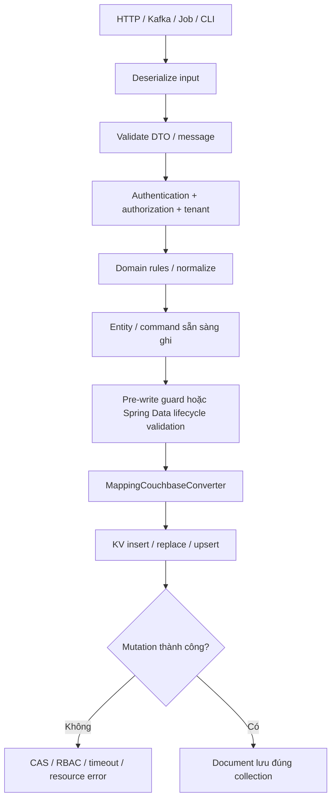

# Kiểm tra dữ liệu bằng Bean Validation tại ranh giới phù hợp trong Spring Data Couchbase

Couchbase lưu document JSON linh hoạt: hai document trong cùng collection có thể thiếu field, dùng kiểu dữ liệu khác nhau hoặc được ghi từ nhiều ứng dụng. **Spring Data Couchbase** có cơ chế mapping entity và hỗ trợ **Bean Validation** để kiểm tra những ràng buộc như trường bắt buộc, độ dài, định dạng và quan hệ giữa các trường. Tuy nhiên, đặt `@NotBlank` lên một property **không có nghĩa mọi lệnh ghi trong Couchbase Server đều bị chặn khi dữ liệu sai**.

Lựa chọn **ranh giới kiểm tra** quan trọng không kém việc chọn annotation: đầu vào HTTP, method service, đối tượng nghiệp vụ trước khi lưu, lifecycle của Spring Data, hay dữ liệu đọc từ collection do hệ thống khác ghi. Một kiểm tra đặt quá muộn có thể để side effect đã diễn ra; một kiểm tra chỉ đặt ở controller có thể bị batch job bỏ qua; một kiểm tra đặt sai trong callback có thể vô tình chặn dữ liệu legacy khi migration.

Bài thuộc chương **Vòng đời và auditing** của module `SPRING_DATA_COUCHBASE`. Chúng ta thiết kế validation cho lớp truy cập Couchbase với document mapping, repository, `CouchbaseTemplate`, truy vấn SQL++, kiểm soát scope/collection, auditing, CAS, TTL, transaction và reactive API.

**Mục tiêu sau bài học:**

- Phân biệt **validation hình dạng dữ liệu**, **business invariants**, **authorization** và **ràng buộc khi ghi xuống Couchbase**.
- Dùng đúng `jakarta.validation`, `@Valid`, `@Validated` và `Validator` theo phiên bản Spring Boot.
- Biết khi nào dùng `ValidatingCouchbaseEventListener` và khi nào cần tự kiểm tra ở service/`BeforeConvertCallback`.
- Không nhầm `BeforeSaveEvent` với một callback mặc định hay một ràng buộc bắt buộc áp dụng cho mọi lệnh SDK.
- Xử lý khác biệt giữa create, update, PATCH, message consumer và reactive pipeline.
- Viết kiểm thử chứng minh dữ liệu sai **không được lưu**, kể cả khi không đi qua controller.

## 1. Bốn loại kiểm tra thường bị trộn lẫn

Hãy xét một yêu cầu tạo đơn hàng:

```json
{
  "customerId": "customer::42",
  "status": " confirmed ",
  "items": [
    { "sku": "SKU-123", "quantity": 2 }
  ]
}
```

Có bốn câu hỏi khác nhau:

| Câu hỏi | Ví dụ | Ranh giới nên xử lý |
| --- | --- | --- |
| **Input validation** | `customerId` không rỗng, `items` có phần tử, `quantity > 0`? | Request DTO hoặc message schema ngay khi nhận. |
| **Chuẩn hóa và domain invariants** | `" confirmed "` được chuẩn hóa thành `CONFIRMED`; trạng thái `NEW` có được chuyển sang `CONFIRMED`? | Domain/service trước khi ghi. |
| **Authorization và tenant isolation** | Người gọi có quyền tạo đơn hàng cho tenant đang chọn không? | Security/service trước khi truy cập repository. |
| **Persistence validation** | Entity đã chuẩn bị ghi có thỏa ràng buộc tối thiểu của document không? | Một guard trước write hoặc validation listener/callback đã đăng ký đúng. |

Một annotation `@NotBlank` không tự trả lời tất cả bốn câu hỏi. Ví dụ `@Pattern(regexp = "CONFIRMED|NEW")` chỉ kiểm tra hình dạng của mã trạng thái; nó không biết một đơn hàng đã `CANCELLED` có được xác nhận lại hay không.

**Nguyên tắc:** đặt ràng buộc tại *ranh giới nơi dữ liệu còn có thể bị từ chối an toàn* và đảm bảo tất cả đường đi cần được bảo vệ đều đi qua ranh giới đó.

## 2. Vòng đời validation từ API đến document

Luồng tham khảo:



Đây là sơ đồ **khái niệm**, không cố khẳng định mọi hook luôn chạy theo đúng thứ tự của các ô. Chẳng hạn `ValidatingCouchbaseEventListener` là listener của **`BeforeSaveEvent`**, tức sau bước convert, còn một `BeforeConvertCallback` tự định nghĩa chạy ở thời điểm trước convert. Nếu chọn listener, thứ tự thực tế và event dispatch cần được kiểm tra trong application context.

Tại mỗi ranh giới, hãy ghi rõ **ai chịu trách nhiệm**:

1. Controller xác nhận payload đúng định dạng API.
2. Service xác nhận quyền truy cập, quy tắc nghiệp vụ và command hợp lệ.
3. Persistence boundary xác nhận entity cuối cùng có schema tối thiểu trước khi ghi.
4. Couchbase Server đảm bảo các tính chất KV/CAS/transaction đã chọn, **không tự chạy Bean Validation Java**.

## 3. Chuẩn bị dependency và chọn đúng namespace javax/jakarta

### 3.1. Spring Boot 3.x trở lên

Các API Bean Validation hiện đại dùng package `jakarta.validation`. Trong dự án Spring Boot được quản lý dependency, thường cần:

```groovy
dependencies {
    implementation("org.springframework.boot:spring-boot-starter-data-couchbase")
    implementation("org.springframework.boot:spring-boot-starter-validation")
}
```

Starter validation đưa vào implementation như Hibernate Validator theo dependency management. Có API annotation mà **không có provider thực thi** thì validation có thể không hoạt động như kỳ vọng.

Các import phổ biến:

```java
import jakarta.validation.Valid;
import jakarta.validation.Validator;
import jakarta.validation.ConstraintViolation;
import jakarta.validation.ConstraintViolationException;

import jakarta.validation.constraints.NotBlank;
import jakarta.validation.constraints.NotNull;
import jakarta.validation.constraints.NotEmpty;
import jakarta.validation.constraints.Size;
import jakarta.validation.constraints.Positive;
import jakarta.validation.constraints.Pattern;
```

`@Validated` là annotation của Spring, không thuộc `jakarta.validation`:

```java
import org.springframework.validation.annotation.Validated;
```

### 3.2. Spring Boot 2.x / Spring Data Couchbase cũ

Một số dự án cũ dùng `javax.validation.*`. Javadoc `ValidatingCouchbaseEventListener` dòng Spring Data Couchbase 4.4 khai báo constructor nhận `javax.validation.Validator`; Javadoc 5.x/6.x khai báo `jakarta.validation.Validator`.

| Dòng nền tảng minh họa | Package Bean Validation | Lưu ý |
| --- | --- | --- |
| Spring Boot 2.x / Spring Framework 5 | `javax.validation` | Kiểm tra BOM và provider tương thích với Spring Data Couchbase cũ. |
| Spring Boot 3.x / Spring Framework 6 | `jakarta.validation` | Không copy nguyên import `javax` từ bài cũ. |
| Spring Data Couchbase 5.x/6.x | `jakarta.validation.Validator` cho validating listener | Đối chiếu Javadoc **phiên bản dependency được resolve**. |

Không tự trộn `javax.validation.constraints.NotBlank` và `jakarta.validation.Validator` trong cùng mô hình rồi kỳ vọng provider sẽ xử lý giống nhau. Nếu nâng cấp Spring Boot/Spring Data, đổi đồng bộ imports, provider, custom constraints và test.

### 3.3. Xác minh provider tồn tại

Chỉ thấy `@Valid` trong mã nguồn không chứng minh provider đã hoạt động. Có thể dùng integration test với một DTO vi phạm điều kiện, xác nhận endpoint trả lỗi; hoặc inject `jakarta.validation.Validator` và kiểm tra `validator.validate(...)` cho tập dữ liệu sai.

Ở Spring Boot 3, phần validation HTTP và method validation dựa trên Bean Validation provider trong application context. **Đừng kết luận mọi repository.save sẽ tự validate chỉ vì web controller có @Valid**; behavior persistence còn phụ thuộc validating listener/hook được cấu hình.

## 4. Ranh giới HTTP: validate request DTO thay vì expose entity

Không nên nhận thẳng `OrderDocument` vào controller rồi cho client điều khiển các property như ID, `@Version`/CAS, tenant ID hoặc auditing timestamp.

DTO tạo đơn hàng:

```java
package example.shop.api;

import java.util.List;
import jakarta.validation.Valid;
import jakarta.validation.constraints.NotBlank;
import jakarta.validation.constraints.NotEmpty;
import jakarta.validation.constraints.Positive;
import jakarta.validation.constraints.Size;

public record CreateOrderRequest(
    @NotBlank
    @Size(max = 120)
    String customerId,

    @NotBlank
    @Size(max = 32)
    String status,

    @NotEmpty
    List<@Valid CreateOrderItemRequest> items
) {
    public record CreateOrderItemRequest(
        @NotBlank String sku,
        @Positive int quantity
    ) {}
}
```

Nếu API quy định `quantity` phải được client gửi, dùng `Integer` với `@NotNull` và `@Positive` sẽ phân biệt rõ “không gửi” với `0` hơn kiểu primitive `int`.

Controller:

```java
package example.shop.api;

import jakarta.validation.Valid;
import org.springframework.http.ResponseEntity;
import org.springframework.web.bind.annotation.PostMapping;
import org.springframework.web.bind.annotation.RequestBody;
import org.springframework.web.bind.annotation.RequestMapping;
import org.springframework.web.bind.annotation.RestController;

@RestController
@RequestMapping("/api/orders")
public class OrderController {

    private final OrderApplicationService orders;

    public OrderController(OrderApplicationService orders) {
        this.orders = orders;
    }

    @PostMapping
    public ResponseEntity<String> create(
            @Valid @RequestBody CreateOrderRequest request) {

        String id = orders.create(request);
        return ResponseEntity.ok(id);
    }
}
```

`OrderApplicationService` là service nghiệp vụ của ứng dụng, không phải lớp Spring Data có sẵn. Controller trên chưa trình bày authentication; production phải có cấu hình bảo mật và quyền phù hợp.

Với Spring MVC hiện đại, `@Valid @RequestBody` thường kích hoạt kiểm tra request object và lỗi có thể được thể hiện bằng `MethodArgumentNotValidException`. Nếu method có ràng buộc trực tiếp trên parameter/return value, **method validation** có thể chạy và phát `HandlerMethodValidationException`. Cần thiết kế exception handling cho **cả hai** thay vì chỉ catch một loại.

### Những gì DTO validation làm được và không làm được

`@NotBlank` kiểm tra nội dung chuỗi không chỉ gồm khoảng trắng; `@Size` kiểm tra kích thước; `@Positive` kiểm tra số dương. Chúng không chứng minh `customerId` có thật trong Couchbase, không xác thực owner, không đảm bảo số lượng tồn kho và không chống request giả mạo tenant.

Nếu payload JSON không parse được hoặc sai kiểu, lỗi có thể xảy ra **trước Bean Validation** tại bước deserialize. Đây là nhóm lỗi input khác, cần response hợp lý riêng.

## 5. @NotNull, @NotEmpty, @NotBlank và @Valid khác nhau thế nào?

| Annotation | Phù hợp với | Điều cần nhớ |
| --- | --- | --- |
| `@NotNull` | Tham chiếu, object, collection | Không yêu cầu string khác rỗng hay list có phần tử. |
| `@NotEmpty` | String, array, collection, map | Không cho rỗng; string chỉ có dấu cách vẫn có thể hợp lệ. |
| `@NotBlank` | `CharSequence` | Không chấp nhận null hoặc toàn khoảng trắng. |
| `@Size(min, max)` | String, collection, map, array | `null` thường được chấp nhận, nên kết hợp `@NotNull/@NotBlank` nếu cần. |
| `@Email` | Địa chỉ email theo định dạng | Không chứng minh mailbox tồn tại; null có thể hợp lệ nếu không thêm `@NotBlank`. |
| `@Positive` | Kiểu số | Phải lớn hơn 0; với kiểu nullable cần thêm `@NotNull`. |
| `@Pattern` | String theo regex | Chỉ kiểm tra biểu thức, không kiểm tra chuyển trạng thái nghiệp vụ. |
| `@Valid` | Property/object lồng nhau | **Kích hoạt cascading**, không tự là một constraint về null/size. |

Ví dụ:

```java
public record OrderLine(
    @NotBlank String sku,
    @NotNull @Positive Integer quantity
) {}

public record OrderPayload(
    @NotEmpty List<@Valid OrderLine> lines
) {}
```

Nếu thiếu `@Valid` ở item lồng nhau, các annotation trên `OrderLine` có thể không được đánh giá khi chỉ validate `OrderPayload`. Hãy viết test với `sku=""` trong một phần tử để bảo đảm cascading thực sự hoạt động.

## 6. Ranh giới service: method validation và domain invariants

Dữ liệu không phải lúc nào cũng đến từ HTTP. Có thể có message consumer, scheduled job, admin CLI hoặc service nội bộ. Vì vậy, nếu một service public method cần bảo vệ những ràng buộc chung, Spring method validation có thể là một lớp hỗ trợ.

Ví dụ:

```java
package example.shop.application;

import jakarta.validation.Valid;
import jakarta.validation.constraints.NotBlank;
import jakarta.validation.constraints.NotNull;

import org.springframework.stereotype.Service;
import org.springframework.validation.annotation.Validated;

@Service
@Validated
public class OrderCommandService {

    private final OrderRepository orders;

    public OrderCommandService(OrderRepository orders) {
        this.orders = orders;
    }

    public void process(
            @NotBlank String authorizedTenantId,
            @NotNull @Valid CreateOrderCommand command) {

        // Kiểm tra authorization/domain rule trong flow
        // trước khi gọi repository; không tin tenantId từ client.
        // ...
    }
}
```

`CreateOrderCommand` và `OrderRepository` cần được định nghĩa/inject trong dự án. Cần tránh hiểu ví dụ `authorizedTenantId` là chứng minh quyền: **validation chuỗi không phải authorization**.

Các điểm triển khai thực tế:

- `@Validated` trên service class giúp Spring kích hoạt method validation theo cơ chế proxy/AOP khi có provider phù hợp.
- **Self-invocation**: method bên trong cùng bean gọi trực tiếp method khác có thể không đi qua proxy, nên không nên dựa vào `@Validated` như hàng rào duy nhất cho mọi đường code.
- Tránh private methods hoặc object không được Spring quản lý nếu muốn method validation qua proxy.
- Với HTTP controller Spring Framework 6.1+, validation có tích hợp trực tiếp; không cần tự gắn `@Validated` ở class controller trong mọi trường hợp.
- Validation ở service chỉ bảo vệ **các lời gọi đi qua service**; repository hoặc SDK được gọi trực tiếp ở nơi khác vẫn có thể bypass.

### Domain invariants phải dùng trạng thái hiện tại

Ví dụ chỉ cho phép chuyển đơn hàng từ `NEW` sang `CONFIRMED`:

```java
public static void requireCanConfirm(OrderDocument order) {
    if (!"NEW".equals(order.getStatus())) {
        throw new IllegalStateException(
            "Only NEW orders can be confirmed"
        );
    }
}
```

Đây là **quy tắc nghiệp vụ**, không nên chỉ biểu diễn bằng `@Pattern(regexp = "NEW|CONFIRMED")`. Annotation kiểm tra trạng thái có nằm trong tập hợp cho phép, nhưng không thể biết trạng thái trước đó và ai có quyền chuyển.

Nếu cần xác minh customer tồn tại, hàng còn đủ hay SKU chưa bị vô hiệu, service phải đọc dữ liệu liên quan theo đúng keyspace. Đó là validation liên-document và cần xét CAS/transaction khi nhiều request cạnh tranh.

## 7. Chuẩn hóa trước khi validate giá trị canonical

Giả sử client gửi:

```text
status = " confirmed "
```

Bạn có thể:

1. **Từ chối input chưa chuẩn** ở API (quy định gửi uppercase/không space).
2. **Chấp nhận input và chuẩn hóa** thành `CONFIRMED` trước khi áp ràng buộc domain/persistence.

Phương án nào hợp lý phụ thuộc API contract. Đừng vô tình thay đổi giá trị có ngữ nghĩa như mật khẩu, case-sensitive identifier hoặc chữ ký mật mã.

Một normalizer có tính xác định:

```java
import java.util.Locale;
import java.util.Set;

public final class OrderStatusNormalizer {

    private static final Set<String> ALLOWED =
        Set.of("NEW", "CONFIRMED", "CANCELLED");

    private OrderStatusNormalizer() {}

    public static String normalize(String raw) {
        if (raw == null) {
            throw new IllegalArgumentException("status required");
        }

        String value = raw.trim().toUpperCase(Locale.ROOT);

        if (!ALLOWED.contains(value)) {
            throw new IllegalArgumentException(
                "Unsupported status: " + value
            );
        }

        return value;
    }
}
```

Nếu ràng buộc trên entity yêu cầu `@Pattern(regexp = "NEW|CONFIRMED|CANCELLED")`, hãy bảo đảm **normalizer đã chạy trước lần validation cuối cùng của entity**. Ví dụ một DTO cho phép chuỗi có khoảng trắng, service chuẩn hóa, rồi persistence guard kiểm tra bản đã chuẩn hóa.

Tính idempotent:

```text
normalize(normalize(x)) == normalize(x)
```

hữu ích với retry và transaction. Nhưng normalizer thuần không có trách nhiệm gửi email, ghi audit event hay gọi broker.

## 8. Ranh giới persistence: Bean Validation của entity

Entity Couchbase có thể mang các constraint độc lập với DTO:

```java
package example.shop.persistence;

import java.time.Instant;
import java.util.List;

import jakarta.validation.Valid;
import jakarta.validation.constraints.NotBlank;
import jakarta.validation.constraints.NotEmpty;
import jakarta.validation.constraints.Pattern;
import jakarta.validation.constraints.Positive;
import jakarta.validation.constraints.Size;

import org.springframework.data.annotation.Id;
import org.springframework.data.annotation.Version;
import org.springframework.data.annotation.CreatedDate;
import org.springframework.data.annotation.LastModifiedDate;
import org.springframework.data.couchbase.core.mapping.Document;
import org.springframework.data.couchbase.repository.Scope;
import org.springframework.data.couchbase.repository.Collection;

@Document
@Scope("commerce")
@Collection("orders")
public class OrderDocument {

    @Id
    private String id;

    @NotBlank
    @Size(max = 120)
    private String customerId;

    @NotBlank
    @Pattern(regexp = "NEW|CONFIRMED|CANCELLED")
    private String status;

    @NotEmpty
    private List<@Valid Item> items;

    @Version
    private long version;

    @CreatedDate
    private Instant createdAt;

    @LastModifiedDate
    private Instant updatedAt;

    public OrderDocument() {}

    // Getters, setters và constructor được lược bỏ.

    public record Item(
        @NotBlank String sku,
        @Positive int quantity
    ) {}
}
```

Trong ví dụ:

- `@Id` quản lý **document key**, không phải constraint xác nhận đã có quyền ghi.
- `@Version` quản lý CAS/optimistic locking.
- `@CreatedDate`/`@LastModifiedDate` là auditing metadata.
- `@NotBlank`/`@Pattern`/`@NotEmpty` là Bean Validation constraints.
- `@Valid` ở phần tử `items` cho phép kiểm tra nested entity.
- `@Scope` và `@Collection` xác định vị trí **bên trong bucket mà repository/Template đang dùng**.

**Quan trọng:** annotation Bean Validation trên entity chỉ định **ràng buộc cần kiểm tra khi có một Validator được gọi**. Couchbase Server không biết Java class này và không mặc nhiên từ chối JSON vi phạm nếu một client khác ghi trực tiếp.

## 9. API đặc thù Couchbase: ValidatingCouchbaseEventListener

Spring Data Couchbase cung cấp lớp:

```java
org.springframework.data.couchbase.core.mapping.event.ValidatingCouchbaseEventListener
```

Đây là **application event listener**, kế thừa `AbstractCouchbaseEventListener<Object>`. Javadoc hiện đại định nghĩa constructor:

```java
ValidatingCouchbaseEventListener(
    jakarta.validation.Validator validator
);
```

Listener override phương thức `onBeforeSave(Object source, CouchbaseDocument doc)`, nên phù hợp để validate entity trước khi mutation do Spring Data khởi xướng. Nếu vi phạm constraint, luồng save được thiết kế có thể ném `ConstraintViolationException`.

### 9.1. Đăng ký trong ứng dụng tự cấu hình Spring Data

Nếu ứng dụng **chưa được Spring Boot tự đăng ký listener**, có thể khai báo bean:

```java
import jakarta.validation.Validator;

import org.springframework.context.annotation.Bean;
import org.springframework.context.annotation.Configuration;
import org.springframework.data.couchbase.core.mapping.event.ValidatingCouchbaseEventListener;

@Configuration
public class CouchbaseValidationConfiguration {

    @Bean
    ValidatingCouchbaseEventListener couchbaseValidationListener(
            Validator validator) {

        return new ValidatingCouchbaseEventListener(validator);
    }
}
```

Đoạn mã áp dụng với phiên bản sử dụng `jakarta.validation.Validator`; trên dòng 4.x cũ phải đối chiếu `javax.validation.Validator` và dependencies tương ứng.

### 9.2. Đừng đăng ký hai lần nếu Spring Boot đã cấu hình

Một số phiên bản Spring Boot có autoconfiguration tạo `ValidatingCouchbaseEventListener` **khi tồn tại một Validator bean phù hợp**, ví dụ configuration dùng `@ConditionalOnSingleCandidate(Validator.class)`. Vì vậy cách an toàn là:

1. Xác định phiên bản Spring Boot/Spring Data Couchbase đã resolve.
2. Kiểm tra ApplicationContext hiện có `ValidatingCouchbaseEventListener` hay chưa.
3. Chỉ tự tạo bean nếu chưa có và chiến lược ứng dụng yêu cầu.
4. Viết integration test: gọi `repository.save(entitySai)` phải bị chặn ở đúng thời điểm.

Hai listener cùng loại có thể làm validation chạy hai lần, gây log/metrics lặp và làm khó chẩn đoán. Ngược lại, một ứng dụng tự tạo Template/configuration theo cách đặc biệt có thể **không** nhận listener như ví dụ autoconfiguration mặc định.

### 9.3. Giới hạn do cơ chế application event

`ValidatingCouchbaseEventListener` dùng `BeforeSaveEvent`, không phải một phương thức trực tiếp của Couchbase Server. Nếu ứng dụng cấu hình `ApplicationEventMulticaster` chạy listener **bất đồng bộ**, validation có thể không còn là hàng rào đồng bộ chắc chắn trước mutation. Với ràng buộc bắt buộc phải chặn ghi, hãy dùng một guard trước write có kết quả xác định (ở service hoặc callback đồng bộ phù hợp), và **kiểm thử trên cấu hình event thực tế**.

Đừng dựa vào listener để kiểm soát SDK direct write, SQL++ `UPDATE`, import/ETL hay expiry do server.

## 10. Phương án đồng bộ: kiểm tra tường minh qua Validator trước khi ghi

Với một service cần bảo đảm dữ liệu sai không rời khỏi tầng nghiệp vụ, có thể gọi `jakarta.validation.Validator` trực tiếp:

```java
package example.shop.application;

import java.util.Set;

import jakarta.validation.ConstraintViolation;
import jakarta.validation.ConstraintViolationException;
import jakarta.validation.Validator;

import org.springframework.stereotype.Component;

@Component
public class OrderEntityGuard {

    private final Validator validator;

    public OrderEntityGuard(Validator validator) {
        this.validator = validator;
    }

    public void requireValid(OrderDocument entity) {
        Set<ConstraintViolation<OrderDocument>> errors =
            validator.validate(entity);

        if (!errors.isEmpty()) {
            throw new ConstraintViolationException(errors);
        }
    }
}
```

Service kiểm tra bản **đã được chuẩn hóa**:

```java
public void createNewOrder(OrderDocument order) {
    order.setStatus(
        OrderStatusNormalizer.normalize(order.getStatus())
    );

    entityGuard.requireValid(order);
    orderRepository.save(order);
}
```

Đây là **phương thức minh họa** của một service có dependency `entityGuard` và `orderRepository`; phần class/constructor được lược bỏ.

Lợi ích:

- Bảo đảm kiểm tra diễn ra **trước lệnh save** trong đường service này.
- Không phụ thuộc cơ chế phát event hoặc listener async.
- Dễ test lỗi validation mà không cần Couchbase.
- Có thể kiểm tra constraint **theo group** nếu chủ đích.

Giới hạn: những nơi gọi repository trực tiếp **bỏ qua service** vẫn có thể ghi sai. Nếu điều đó có khả năng xảy ra, bổ sung tầng guard dùng chung/kiểm soát kiến trúc hoặc callback trước convert, và test các đường ghi.

## 11. BeforeConvertCallback: guard khi mọi save qua Spring Data cần được bảo vệ

Couchbase cung cấp `BeforeConvertCallback<T>`:

```java
T onBeforeConvert(T entity, String collection);
```

Nó là **EntityCallback** có kết quả trả về để framework dùng tiếp trước khi mapping. Ta có thể kết hợp chuẩn hóa và kiểm tra trong một callback, đảm bảo thứ tự giữa **hai bước trong callback** là rõ ràng:

```java
package example.shop.persistence;

import java.util.Set;

import jakarta.validation.ConstraintViolation;
import jakarta.validation.ConstraintViolationException;
import jakarta.validation.Validator;

import org.springframework.data.couchbase.core.mapping.event.BeforeConvertCallback;
import org.springframework.stereotype.Component;

@Component
public class OrderBeforeConvertValidation
        implements BeforeConvertCallback<OrderDocument> {

    private final Validator validator;

    public OrderBeforeConvertValidation(Validator validator) {
        this.validator = validator;
    }

    @Override
    public OrderDocument onBeforeConvert(
            OrderDocument entity, String collection) {

        entity.setStatus(
            OrderStatusNormalizer.normalize(entity.getStatus())
        );

        Set<ConstraintViolation<OrderDocument>> errors =
            validator.validate(entity);

        if (!errors.isEmpty()) {
            throw new ConstraintViolationException(errors);
        }

        return entity;
    }
}
```

**Chú ý:**

- `@Component` phải được scan trong Spring context sử dụng repository/Template.
- Không tự tạo email, audit event hoặc external API call trong callback.
- `collection` chỉ là tên collection; không dùng nó làm bằng chứng caller được phép truy cập tenant.
- Nếu auditing cũng sửa entity, hãy kiểm tra thứ tự callback và không đặt một constraint bắt buộc trên field auditing **trước khi auditing điền giá trị**.
- Có thể tồn tại `ValidatingCouchbaseEventListener` khác: khi đó guard và listener có thể cùng validate. Chọn chiến lược phù hợp và tránh chi phí lặp không cần thiết.
- Callback này thuộc **imperative API**; đường reactive cần callback reactive tương ứng.
- Không đảm bảo mọi thao tác từ SDK direct, SQL++ DML hoặc bulk operation đi qua hook.

### Vì sao không dùng BeforeSaveEvent để đổi entity?

Application events phụ thuộc `ApplicationEventMulticaster`; khi cấu hình async, thời điểm xử lý listener có thể không xác định đối với mutation. `EntityCallback` phù hợp hơn khi cần **thay đổi entity có thứ tự xác định**. Tuy nhiên, nếu dùng Bean Validation ở event listener có sẵn, phải hiểu đường phát event và đảm bảo nó là đồng bộ khi được coi là kiểm tra bắt buộc.

## 12. Validation Groups: create, update và phiên bản schema

Một object có thể có ràng buộc khác nhau khi tạo mới và cập nhật.

Định nghĩa group marker:

```java
public interface OnCreate {}
public interface OnUpdate {}
```

DTO minh họa:

```java
import jakarta.validation.constraints.NotBlank;
import jakarta.validation.constraints.NotNull;
import jakarta.validation.constraints.Size;

public record WriteOrderRequest(

    @NotBlank(groups = {OnCreate.class, OnUpdate.class})
    @Size(max = 32, groups = {OnCreate.class, OnUpdate.class})
    String status,

    @NotNull(groups = OnUpdate.class)
    String orderId
) {}
```

Controller chọn group:

```java
import org.springframework.validation.annotation.Validated;

@PostMapping("/orders")
public void create(
    @Validated(OnCreate.class) @RequestBody WriteOrderRequest body) {
    // ...
}

@PutMapping("/orders/{id}")
public void update(
    @PathVariable String id,
    @Validated(OnUpdate.class) @RequestBody WriteOrderRequest body) {
    // ...
}
```

Các method/annotation controller chỉ là minh họa; production cần class controller, imports web, authorization và kiểm tra ID trong path **khớp** với domain command. Thông thường tốt hơn nên dùng **DTO riêng cho create/update** thay vì một DTO nhiều group quá phức tạp.

**Quan trọng về group:** khi gọi `validator.validate(entity, OnCreate.class)`, các constraint chỉ thuộc group mặc định `Default` có thể **không** được chạy nếu bạn không đưa chúng vào group cần xét. Hãy thiết kế group inheritance/sequence rõ ràng hoặc chỉ định các group tương ứng.

Một `ValidatingCouchbaseEventListener` mặc định thường validate theo **Default group**; đừng mặc định nó biết request đang là create hay update để áp group khác.

## 13. PATCH không giống PUT: xử lý partial update cẩn thận

Một PATCH:

```json
{
  "status": "CONFIRMED"
}
```

thường không chứa `customerId`, `items` hay các field khác. Nếu áp ràng buộc `@NotBlank` của **full entity** lên DTO PATCH ngay khi deserialize, tất cả field bị bỏ qua có thể bị hiểu là null và làm request không hợp lệ.

Một thiết kế an toàn:

1. Nhận DTO PATCH chỉ bao gồm các trường được phép sửa, phân biệt **không gửi** và **gửi null** nếu semantics yêu cầu.
2. Kiểm tra syntax của giá trị đã được gửi.
3. Tải document hiện có từ đúng collection/tenant.
4. Kiểm tra authorization và điều kiện cập nhật.
5. Áp patch lên bản entity hiện tại, **không cho sửa tenantId/CAS/id tùy ý**.
6. Chuẩn hóa state mới.
7. Validate **toàn bộ entity sau merge** với Bean Validation.
8. Lưu có CAS/optimistic locking.
9. Xử lý retry bằng load → merge → revalidate, không retry mù entity cũ.

Do đó, **không phải cứ “field null” là lỗi** ở DTO PATCH; nhưng kết quả entity cuối cùng trước save vẫn có thể phải thỏa `@NotNull`.

### Ví dụ lỗi thiết kế

```java
// Không an toàn: nếu các field không có trong PATCH bị gán null,
// có thể vô tình xóa dữ liệu hợp lệ của entity đang tồn tại.
repository.save(requestMapper.toEntity(patchRequest));
```

Không copy entity từng phần vào `save()` thay thế toàn bộ document mà chưa tải trạng thái hiện tại.

## 14. Nested validation và ràng buộc xuyên field

Bean Validation hỗ trợ kiểm tra object lồng nhau bằng `@Valid`:

```java
public record ShippingAddress(
    @NotBlank String street,
    @NotBlank String countryCode
) {}

public record OrderDeliveryRequest(
    @NotNull @Valid ShippingAddress address
) {}
```

Có thể định nghĩa custom constraint cho mối quan hệ giữa **các field trong cùng object**, chẳng hạn `deliveryDate` phải sau `orderDate`; đây là vấn đề validation ở mức object hoặc domain.

Nhưng các quy tắc sau **không** được giải quyết chỉ bằng các constraint cục bộ:

- Mã khách hàng có tồn tại trong collection `customers` không?
- SKU còn được bán và tồn kho đủ không?
- Email có duy nhất trên toàn tenant không?
- Caller có được phép thay đổi thông tin thanh toán không?
- Một order và một inventory document có được cập nhật nguyên tử không?

Đây là kiểm tra liên-document hoặc kiểm tra quyền, cần service/transaction/thiết kế key. Couchbase không có một unique constraint quan hệ đơn giản cho mọi truy vấn SQL++; nếu cần uniqueness, cân nhắc **document key xác định và thao tác insert nguyên tử**, hoặc thiết kế transaction/coordination phù hợp. Chỉ thực hiện SQL++ `SELECT` “chưa có email” trước khi `INSERT` **không tự tránh race condition**.

## 15. ValidatingCouchbaseEventListener diễn ra ở pha nào?

Trong Spring Data Couchbase hiện đại, listener cung cấp:

```java
void onBeforeSave(Object source, CouchbaseDocument document);
```

Để hiểu ý nghĩa, so sánh các hook:

| Hook | Khi nào | Có thể sửa entity dùng để ghi theo contract? |
| --- | --- | --- |
| `BeforeConvertCallback<T>` | Trước khi converter tạo biểu diễn document | **Có**: trả entity mới/đã sửa. |
| `BeforeSaveEvent<T>` | Sau khi tạo biểu diễn lưu trữ, trước mutation theo đường Spring Data | Không dựa vào listener để đổi entity có thứ tự. |
| `ValidatingCouchbaseEventListener` | Listener cho `BeforeSaveEvent` | **Kiểm tra** entity, không phải normalizer. |
| `AfterSaveEvent<T>` | Quan sát sau lưu theo đường hỗ trợ | Quá muộn để dùng làm guard trước write. |
| `AfterConvertCallback<T>` | Sau khi đọc/materialize entity | Hữu ích để hoàn thiện object trong JVM, không tự persist. |

Nếu normalizer chạy ở `BeforeConvertCallback`, `ValidatingCouchbaseEventListener` tại `BeforeSaveEvent` có thể kiểm tra giá trị đã chuẩn hóa theo luồng Spring Data tương ứng. Nhưng nếu một listener khác mutate entity hoặc event multicaster bất đồng bộ, cần test chính xác cấu hình đang chạy.

**Không dùng `AfterConvertCallback` để “sửa lại” dữ liệu không hợp lệ rồi tin rằng JSON trong Couchbase đã được sửa.** Nó là pha đọc; muốn persist cần một mutation mới có kiểm tra quyền/CAS.

## 16. Reactive validation: dùng callback reactive hoặc guard tại service

Spring Data Couchbase reactive sử dụng `ReactiveCouchbaseRepository`/`ReactiveCouchbaseTemplate`. Callback dành cho reactive là `ReactiveBeforeConvertCallback<T>` với kết quả `Publisher<T>`.

Ví dụ validate không blocking I/O:

```java
package example.shop.persistence;

import java.util.Set;

import jakarta.validation.ConstraintViolation;
import jakarta.validation.ConstraintViolationException;
import jakarta.validation.Validator;

import org.springframework.data.couchbase.core.mapping.event.ReactiveBeforeConvertCallback;
import org.springframework.stereotype.Component;

import reactor.core.publisher.Mono;

@Component
public class ReactiveOrderGuard
        implements ReactiveBeforeConvertCallback<OrderDocument> {

    private final Validator validator;

    public ReactiveOrderGuard(Validator validator) {
        this.validator = validator;
    }

    @Override
    public Mono<OrderDocument> onBeforeConvert(
            OrderDocument entity, String collection) {

        entity.setStatus(
            OrderStatusNormalizer.normalize(entity.getStatus())
        );

        Set<ConstraintViolation<OrderDocument>> errors =
            validator.validate(entity);

        if (!errors.isEmpty()) {
            return Mono.error(
                new ConstraintViolationException(errors)
            );
        }

        return Mono.just(entity);
    }
}
```

Callback ở trên thực hiện kiểm tra Bean Validation cục bộ, không gọi network. `Mono` là subtype của `Publisher`. Nếu normalizer có thể throw, lỗi sẽ được truyền qua invocation tương ứng; trong mã thực tế cần để validation exception được lan truyền rõ ràng trong reactive pipeline và test.

### Không chặn event loop

Đừng đặt truy vấn DB blocking hoặc HTTP blocking trong custom `ConstraintValidator` hay reactive callback. Nếu một quy tắc cần truy cập service ngoài, chuyển nó sang **business validation ở tầng service** với API reactive hoặc cơ chế điều phối phù hợp.

Ví dụ service reactive định tuyến:

```java
public Mono<OrderDocument> saveChecked(
        OrderDocument order) {

    return Mono.defer(() -> {
        entityGuard.requireValid(order);
        return reactiveOrderRepository.save(order);
    });
}
```

Đây là phương án minh họa; nếu cần normalize trước khi `entityGuard` chạy, hãy gọi normalizer tường minh hoặc dùng callback có thứ tự. `Mono.defer` đảm bảo phép kiểm tra được thực hiện trên subscription và có thể được chạy lại khi retry/resubscribe. Do đó validation phải **không chứa tác dụng phụ khó lặp**.

Đừng coi việc tạo một `Mono` là bằng chứng dữ liệu đã được validate/lưu; dùng `StepVerifier` trong integration test để subscribe.

## 17. Những đường truy cập có thể bỏ qua Bean Validation của Spring Data

| Đường ghi | Validation có tự động chạy không? | Phương án kiểm soát |
| --- | --- | --- |
| HTTP `@Valid @RequestBody` | Có nếu provider/cấu hình web hợp lệ | Bảo vệ request syntax; chưa bảo vệ mọi đường ghi khác. |
| Service bean `@Validated` | Có nếu invocation đi qua proxy và method validation hoạt động | Kiểm tra service contract; lưu ý self-invocation. |
| `CouchbaseRepository.save(entity)` | Có thể qua `ValidatingCouchbaseEventListener` nếu đăng ký/đường API hỗ trợ | Test bean và lỗi save với entity vi phạm. |
| `CouchbaseTemplate.upsertById(Entity.class)...one(entity)` | Có thể qua lifecycle tương ứng | Integration test trên Template thực tế. |
| `ReactiveCouchbaseRepository.save` | Cần kiểm tra path reactive và callbacks được đăng ký | Có thể dùng `ReactiveBeforeConvertCallback` và test subscriber. |
| Java SDK `collection.upsert(id, JsonObject)` | **Không** kích hoạt Bean Validation/Spring Data callbacks của JVM | Validator/application guard riêng ở service/job. |
| SQL++ `UPDATE/INSERT/DELETE` trực tiếp | **Không** chạy từng entity callback của Spring Data | Validation/schema policy trong đường DML, query có kiểm soát. |
| XDCR, import/ETL, migration | **Không** tự chạy listener trong Spring app | Pipeline import validate riêng; đối soát dữ liệu. |
| TTL xóa document trên server | Không phải thao tác Spring Data save/delete | Chính sách expiry và giám sát riêng. |

**Hệ quả:** nếu cần một quy định “mọi document phải có `status` hợp lệ”, chỉ viết một callback trong ứng dụng A không đủ khi ứng dụng B hoặc script SDK có thể ghi vào cùng collection.

## 18. Dữ liệu đọc từ Couchbase có thể không hợp lệ

Một collection có thể chứa document cũ, document do phiên bản khác ghi hoặc dữ liệu được import trước khi bạn thêm constraint mới.

Ví dụ:

```json
{
  "status": "X",
  "customerId": "",
  "items": []
}
```

Khi repository đọc, Spring Data converter có thể vẫn tạo entity nếu JSON phù hợp mapping về mặt kỹ thuật. **Persistence validation lúc save không tự đồng nghĩa validation ở read**.

Có ba lựa chọn tùy nghiệp vụ:

1. **Reject on read ở boundary đặc biệt:** khi dữ liệu phải tuyệt đối hợp lệ trước tính tiền hoặc xác nhận, validate entity sau đọc và từ chối xử lý nếu vi phạm.
2. **Quarantine/report:** khi migration, ghi nhận ID của document không hợp lệ để xử lý/đối soát.
3. **Compatibility adapter:** chấp nhận schema cũ có kiểm soát, chuyển đổi sang domain model mới trước khi thực thi nghiệp vụ.

Không nên gắn một `AfterConvertCallback` ném lỗi vô điều kiện cho mọi document legacy rồi vô tình làm cả tính năng đọc báo cáo ngừng hoạt động mà không có kế hoạch nâng cấp.

### Tách integrity check khỏi mapping

Có thể định nghĩa hàm:

```java
public OrderDocument requireValidStoredOrder(
        OrderDocument document, Validator validator) {

    Set<ConstraintViolation<OrderDocument>> violations =
        validator.validate(document);

    if (!violations.isEmpty()) {
        throw new ConstraintViolationException(violations);
    }

    return document;
}
```

Đoạn trên thuộc một service/domain guard, cần import `java.util.Set`, `jakarta.validation.*` và package của `OrderDocument`. Nên dùng ở **read boundary** đòi hỏi dữ liệu hợp lệ, không mặc định ở mọi query/projection.

## 19. Validation không thay thế CAS, index, TTL hay transaction

### 19.1. CAS và optimistic locking

Couchbase dùng CAS cho từng document. Spring Data `@Version` giúp kiểm soát stale update. Validation có thể xác nhận `quantity > 0` trước save, nhưng một request cạnh tranh có thể thay đổi tồn kho hoặc trạng thái sau khi bạn đã kiểm tra.

Nếu cần tính nhất quán dưới cạnh tranh:

1. Đọc document và CAS/version.
2. Kiểm tra domain invariant trên trạng thái hiện tại.
3. Áp dụng thay đổi.
4. Validate entity kết quả.
5. Lưu có CAS hoặc trong transaction phù hợp.
6. Nếu conflict, load → revalidate → retry có giới hạn.

Không retry vô hạn cùng entity/version cũ. `@Version` là CAS opaque, không phải counter do ứng dụng tự quản lý.

### 19.2. Chỉ mục SQL++ không phải constraint

Chỉ mục hỗ trợ truy vấn theo `status` hoặc `customerId`. Nó không tự kiểm tra `@NotBlank` hoặc `@Pattern` của entity Java.

Truy vấn:

```sql
SELECT META(o).id AS documentId, o.status
FROM `shop`.`commerce`.`orders` AS o
WHERE o.status = "CONFIRMED";
```

có thể bỏ qua document có status sai, nhưng **không có nghĩa document sai bị chặn khi ghi**. Nếu bạn dùng query để kiểm tra uniqueness/trạng thái hiện tại, còn phải xét scan consistency và race condition.

### 19.3. TTL và auditing

`@CreatedDate` là metadata thời điểm tạo; TTL/expiry là chính sách hết hạn. `@NotNull` trên `createdAt` có thể phụ thuộc auditing đã điền field ở pha thích hợp. Đừng ép DTO create phải mang `createdAt` do client cung cấp.

Một document hết hạn ở server không đi qua Java Bean Validation hay Spring Data callback xóa.

### 19.4. Transaction và tác dụng phụ

Validator chỉ quyết định dữ liệu có hợp lệ tại thời điểm kiểm tra. Nó không tạo transaction giữa nhiều document, không đảm bảo việc ghi audit event cùng order, và không thể đảm bảo email được gửi đúng một lần. Dùng Couchbase transaction/outbox/workflow khi nghiệp vụ yêu cầu.

Nếu transaction retry, logic kiểm tra nên deterministic và tránh gọi dịch vụ ngoài trong `ConstraintValidator` hoặc callback.

## 20. Tenant isolation và bảo mật: đâu là ranh giới không thể thay thế?

Một DTO có `@NotBlank String tenantId` không ngăn caller truyền ID của tenant khác. `@Pattern(regexp = "tenant_[a-z0-9]+")` chỉ kiểm tra **hình dạng**, không kiểm tra quyền.

Luồng đúng:

```text
Principal đã xác thực
  -> requested tenant ID
  -> kiểm tra membership + permission hiện hành
  -> resolve tenant registry tin cậy
  -> chọn bucket.scope.collection
  -> domain + Bean Validation
  -> write có CAS/transaction phù hợp
```

Đặc biệt với shared collection chứa `tenantId`, mọi query/read/write phải có scoping theo tenant đã authorize. Không đưa tên scope/collection từ input chưa tin cậy trực tiếp vào `CouchbaseTemplate.inScope(...)` hoặc SQL++ `FROM`.

Nếu có lỗi 403 hay 404 sau khi validate DTO, không được quy thành “Bean Validation không hoạt động”; đó có thể là authorization hoặc keyspace routing.

## 21. Thiết kế lỗi validation và phản hồi API

Một API nên phân biệt:

| Nhóm lỗi | Ví dụ | Cách phản hồi |
| --- | --- | --- |
| Payload parse/định dạng | JSON sai kiểu hoặc thiếu cấu trúc | 400 với lỗi input. |
| Bean Validation DTO | `customerId` blank, `quantity <= 0` | 400 hoặc status do API contract định nghĩa, chỉ nêu field hợp lệ. |
| Method validation | `@NotBlank` trên parameter service/controller | Lỗi validation tương ứng framework, map sang response nhất quán. |
| Domain rule | Trạng thái `CANCELLED` không được xác nhận lại | 409/422 theo thiết kế API, không nhầm với syntax. |
| Authorization | Caller không có quyền tenant | 403 hoặc chính sách che giấu tài nguyên phù hợp. |
| CAS conflict | Entity đã bị cập nhật đồng thời | 409, hoặc retry có kiểm soát. |
| Persistence validation | Event listener/guard phát `ConstraintViolationException` | Ghi log có kiểm soát; ánh xạ nếu do input, tránh lộ data nội bộ. |
| Resource/Query Service | Scope/collection/index thiếu, timeout | Lỗi hạ tầng riêng; không biến thành “field không hợp lệ”. |

Để tránh lộ thông tin nhạy cảm, không trả nguyên entity/JSON, token, internal keyspace, hoặc thông điệp technical exception cho client. Với `ConstraintViolation`, trả về đường dẫn field và thông báo đã được kiểm soát; dùng message localization nếu cần.

Một `@RestControllerAdvice` nên xử lý ít nhất các đường input validation mà ứng dụng đang dùng; đừng catch mọi exception và trả 400 chung, vì nó che cả lỗi hạ tầng.

## 22. Unit test Bean Validation mà không cần Couchbase Server

Ví dụ JUnit 5 dùng `Validator` thực từ provider:

```java
import jakarta.validation.Validation;
import jakarta.validation.Validator;
import example.shop.api.CreateOrderRequest;

import org.junit.jupiter.api.AfterAll;
import org.junit.jupiter.api.Test;

import static org.junit.jupiter.api.Assertions.assertTrue;
import static org.junit.jupiter.api.Assertions.assertFalse;

class CreateOrderValidationTest {

    private static final jakarta.validation.ValidatorFactory FACTORY =
        Validation.buildDefaultValidatorFactory();

    private static final Validator VALIDATOR = FACTORY.getValidator();

    @AfterAll
    static void closeFactory() {
        FACTORY.close();
    }

    @Test
    void rejectBlankCustomer() {
        var invalid = new CreateOrderRequest(
            "  ",
            "NEW",
            java.util.List.of(
                new CreateOrderRequest.CreateOrderItemRequest(
                    "SKU-1", 2
                )
            )
        );

        assertFalse(VALIDATOR.validate(invalid).isEmpty());
    }

    @Test
    void acceptSyntacticallyValidRequest() {
        var valid = new CreateOrderRequest(
            "customer::42",
            "NEW",
            java.util.List.of(
                new CreateOrderRequest.CreateOrderItemRequest(
                    "SKU-1", 2
                )
            )
        );

        assertTrue(VALIDATOR.validate(valid).isEmpty());
    }
}
```

Ví dụ khởi tạo `ValidatorFactory` một lần cho lớp test, lấy `Validator` thật từ provider và đóng factory sau khi chạy. Điều cốt lõi là test dùng **provider thật**, không mock `Validator` luôn trả tập rỗng.

Cần thêm test nested invalid item (`sku=""`, `quantity=0`) để xác nhận `List<@Valid ...>` thực sự cascade.

## 23. Integration test chứng minh repository chặn dữ liệu sai

Unit test validator không thể chứng minh `ValidatingCouchbaseEventListener` đã được Spring Boot đăng ký hay Template thực sự phát event. Integration test nên có Couchbase test instance và context gần production.

Kịch bản:

1. Provision bucket `shop`, scope `commerce`, collection `orders`.
2. Bật Bean Validation provider và xác nhận có bean listener hoặc callback theo chiến lược đã chọn.
3. Tạo `OrderDocument` có `customerId="  "` hoặc `status="INVALID"`.
4. Gọi `orderRepository.save(invalid)` qua đúng ApplicationContext.
5. Xác nhận lỗi validation phù hợp, và Java SDK `collection.exists(id)` trả false.
6. Gọi `couchbaseTemplate.upsertById(...)` để kiểm tra đường Template ứng dụng dùng.
7. Thử write thành công với entity hợp lệ và xem JSON bằng Java SDK độc lập.
8. Nếu ứng dụng dùng `ReactiveCouchbaseRepository`, chạy thêm test bằng `StepVerifier`.
9. Chạy một test dùng SDK trực tiếp cố ý ghi dữ liệu sai vào môi trường test; xác nhận nó **không bị listener Java của Spring Data chặn**, làm rõ giới hạn bảo vệ.

Pseudo-code:

```java
String id = "it::invalid::" + java.util.UUID.randomUUID();

OrderDocument invalid = new OrderDocument();
invalid.setId(id);
invalid.setCustomerId("  ");
invalid.setStatus("NEW");

org.junit.jupiter.api.Assertions.assertThrows(
    jakarta.validation.ConstraintViolationException.class,
    () -> orderRepository.save(invalid)
);

boolean exists = sdk.bucket("shop")
    .scope("commerce")
    .collection("orders")
    .exists(id)
    .exists();

org.junit.jupiter.api.Assertions.assertFalse(exists);
```

Đây là **phần thân test**, giả định entity có setters, `OrderRepository` và `sdk` đã được inject/khởi tạo; cần chuẩn bị collection và Bean Validation listener. Với khác biệt về exception translation theo Spring Data/Spring Boot, có thể phải assert cause chain hoặc một exception cụ thể của version đang chạy; đừng catch mọi lỗi rồi cho pass.

### Kiểm tra bean được đăng ký

Có thể xác nhận trong test context rằng đúng **một** bean `ValidatingCouchbaseEventListener` tồn tại nếu chiến lược bạn chọn dựa vào nó. Nếu dùng pre-save guard bằng callback thay thế, kiểm tra bean `BeforeConvertCallback` tương ứng đã được scan và thực sự chạy.

Một kiểm thử tốt nên **thất bại rõ ràng nếu tắt Bean Validation listener/callback**, thay vì chỉ test `Validator.validate(...)` thủ công.

## 24. Reactive integration test và subscription

Ví dụ:

```java
import reactor.test.StepVerifier;

StepVerifier.create(
    reactiveOrderRepository.save(invalid)
)
.expectErrorMatches(error ->
    error instanceof jakarta.validation.ConstraintViolationException
        || hasValidationCause(error)
)
.verify();
```

`hasValidationCause(error)` là **helper test do ứng dụng tự định nghĩa** để duyệt cause chain, không phải API có sẵn của Reactor. Đừng dùng đoạn này mà chưa định nghĩa helper. Cần đảm bảo test kiểm tra đúng loại lỗi thay vì cho phép mọi exception đều pass.

Ngoài ra, kiểm tra document **không tồn tại** ở collection sau khi publisher lỗi. Với reactive callback, một phép validation có thể diễn ra khi có subscription; chỉ tạo `Mono` rồi không subscribe chưa kiểm tra được gì.

Nếu validation logic phụ thuộc user/tenant, tránh truyền qua mutable `ThreadLocal` thiếu context propagation. Truyền thông tin đã authorize rõ ràng từ service hoặc dùng Reactor/Spring Security context phù hợp.

## 25. Ma trận kiểm thử và regression khi nâng cấp

| Test | Đường đi | Điều cần chứng minh |
| --- | --- | --- |
| V01 | `@Valid @RequestBody` | DTO sai trả lỗi input phù hợp. |
| V02 | Nested `List<@Valid Item>` | Item sai bị phát hiện. |
| V03 | Service `@Validated` | Call qua proxy bị chặn, không dựa vào self-invocation. |
| V04 | Programmatic `Validator.validate` | Constraint trên entity được áp chính xác. |
| V05 | `ValidatingCouchbaseEventListener` | Có bean đúng cấu hình và chặn save sai. |
| V06 | `BeforeConvertCallback` guard | Normalize → validate → không ghi khi sai. |
| V07 | `CouchbaseTemplate` | Đường write dùng Template cũng được bảo vệ nếu thiết kế yêu cầu. |
| V08 | Reactive callback | Publisher lỗi khi subscribe với entity sai. |
| V09 | SDK direct | Không ngộ nhận Spring listener chặn đường SDK. |
| V10 | SQL++ UPDATE | DML direct không tự phát event validate từng entity. |
| V11 | PATCH | Merge rồi validate toàn entity, không xóa field bỏ qua. |
| V12 | Group create/update | Đúng group được chạy, không bỏ sót `Default` ngoài ý muốn. |
| V13 | Tenant isolation | DTO hợp lệ nhưng user sai tenant vẫn bị từ chối. |
| V14 | CAS race | Khi conflict, reload/revalidate theo trạng thái mới. |
| V15 | Data legacy | Document cũ sai schema được xử lý theo kế hoạch compatibility/migration. |

Mỗi test nên có ID riêng, data fixture độc lập, không dùng cluster production và sử dụng Java SDK như **oracle độc lập** để kiểm tra kết quả persist.

## 26. Các lỗi thường gặp và cách khắc phục

| Triệu chứng | Nguyên nhân khả dĩ | Giải pháp |
| --- | --- | --- |
| Có `@NotBlank` nhưng repository vẫn lưu entity sai | Chưa có listener/guard được kích hoạt, hoặc đường API bypass | Kiểm tra Bean Validation bean, lifecycle và integration test. |
| `@Valid` trên DTO không có tác dụng | Thiếu provider, import sai `javax/jakarta`, hoặc chưa đặt đúng vị trí | Thêm starter, kiểm tra provider và binding. |
| `ValidatingCouchbaseEventListener` bị đăng ký hai lần | Vừa tự khai báo vừa Boot autoconfigure | Kiểm tra bean graph, chọn một chiến lược. |
| Validation listener log lỗi nhưng document vẫn lưu | Event multicaster async hoặc path không chặn mutation | Đặt guard đồng bộ trước write; kiểm tra cấu hình event. |
| Method validation không chạy khi gọi từ cùng service | Self-invocation bypass AOP proxy | Gọi qua bean/proxy đúng hoặc validate tường minh ở service boundary. |
| DTO PATCH sai vì thiếu field bắt buộc của entity | Dùng full-entity constraints trên partial payload | Dùng PATCH DTO, merge vào entity hiện tại rồi validate. |
| Constraints ở nested item bị bỏ qua | Thiếu `@Valid` trên nested element/property | Thêm cascading và unit test. |
| Validate group create làm mất constraint chung | Group mặc định không tự chạy khi gọi group tùy chỉnh | Định nghĩa group inheritance/sequence hoặc chỉ rõ nhóm. |
| Entity audit field `createdAt` null trước save | Auditing chưa điền ở pha đang kiểm tra | Tránh `@NotNull` sớm trên field auditing hoặc kiểm tra thứ tự. |
| Validating listener không chạy với SDK upsert | Direct SDK bypass Spring Data | Validate ở job/service trước SDK call. |
| SQL++ update tạo giá trị trái constraint | DML server không gọi Bean Validation của JVM | Đặt policy trong đường DML/migration và test dữ liệu. |
| Repository query trả dữ liệu sai schema | Validation lúc save không đồng nghĩa validation lúc read | Thêm read-boundary integrity check tại nghiệp vụ nhạy cảm. |
| `@Email` chấp nhận null | Constraint định dạng cho phép null | Kết hợp `@NotBlank` nếu email bắt buộc. |
| Duplicate customer/email sau hai request | Query kiểm tra tồn tại bị race | Thiết kế deterministic key/atomic insert hoặc transaction. |
| Validator gọi HTTP và block request | Custom constraint dùng external I/O | Đưa business check sang service có timeout/circuit breaker. |
| Dữ liệu nhiều tenant lọt qua validation | Pattern tenant ID không phải authorization | Kiểm tra membership, permission và keyspace trước DB. |
| CAS conflict được trả như “validation error” | Trộn nhóm lỗi khác nhau | Phân loại conflict/hạ tầng/validation rõ ràng. |

## 27. Câu hỏi vận dụng

**Câu 1.** Một entity có `@NotBlank String status`. Gọi Java SDK `collection.upsert(id, JsonObject.create().put("status", ""))` có chắc bị từ chối không?

**Đáp án:** Không. Java SDK trực tiếp không biết Bean Validation của entity Spring Data. Cần validate tại đường ghi SDK hoặc cơ chế kiểm soát khác của hệ thống.

**Câu 2.** Chỉ có `@Valid @RequestBody` đã bảo vệ được scheduled job lưu entity chưa?

**Đáp án:** Chưa. Job không đi qua controller. Cần service-level guard hoặc persistence validation cho những đường ghi cần thiết.

**Câu 3.** Spring Data Couchbase có lớp validation listener nào?

**Đáp án:** `ValidatingCouchbaseEventListener`, chạy qua `BeforeSaveEvent` khi được đăng ký trong Spring context và đường Spring Data phát event tương ứng. Một số bản Spring Boot có thể autoconfigure bean này.

**Câu 4.** Tại sao nên kiểm tra trong `BeforeConvertCallback` hoặc service nếu validation bắt buộc phải chặn mutation?

**Đáp án:** Đó là checkpoint đồng bộ dễ kiểm soát trước write. Một mapping event listener bất đồng bộ có thể không bảo đảm chặn mutation kịp thời.

**Câu 5.** Nếu DTO gửi `status = " confirmed "` và entity có `@Pattern(regexp = "CONFIRMED|NEW")`, nên làm gì?

**Đáp án:** Thống nhất API contract: hoặc từ chối input không canonical ở DTO, hoặc chuẩn hóa trước khi chạy validation cuối cùng của entity.

**Câu 6.** Vì sao `@NotNull` và `@Valid` thường dùng cùng nhau trên nested object bắt buộc?

**Đáp án:** `@NotNull` bắt buộc object có mặt; `@Valid` kích hoạt kiểm tra các constraint bên trong object khi nó tồn tại.

**Câu 7.** Một PATCH chỉ có `status` bị từ chối do `customerId=null`. Lỗi ở đâu?

**Đáp án:** Có thể đang áp full-entity constraints trực tiếp lên DTO partial. Nên merge patch lên entity đã đọc rồi validate trạng thái đầy đủ.

**Câu 8.** Một `@Validated` service có tự kiểm tra khi method A gọi method B trên cùng bean không?

**Đáp án:** Không bảo đảm. Với AOP proxy, self-invocation thường bỏ qua proxy. Cần thiết kế boundary hoặc validate tường minh.

**Câu 9.** Bean Validation có bảo đảm email là duy nhất khi hai request cùng tạo không?

**Đáp án:** Không. Đây là ràng buộc liên-document và concurrency; cần thiết kế key/insert hoặc transaction phù hợp.

**Câu 10.** Tại sao không dùng `@CreatedDate` làm dấu hiệu document sẽ hết hạn?

**Đáp án:** Audit timestamp và TTL/expiry là hai cơ chế khác nhau. Spring Data auditing không thay Couchbase server expiry policy.

## 28. Checklist code review

- [ ] Đã xác định ranh giới kiểm tra cho HTTP, message consumer, service, repository, SDK và migration.
- [ ] Dùng đúng package `jakarta.validation` hoặc `javax.validation` theo version dependency.
- [ ] Có Bean Validation provider thực tế, không chỉ API annotations.
- [ ] Controller validate DTO, không bind trực tiếp mọi field entity/auditing/CAS từ client.
- [ ] Nested object/collection có `@Valid` đúng vị trí.
- [ ] Không nhầm `@NotBlank`, `@NotEmpty` và `@NotNull`.
- [ ] Authorization/tenant routing xảy ra trước truy cập DB; `tenantId` hợp lệ cú pháp không đồng nghĩa được phép.
- [ ] Business state transition được kiểm tra trong service/aggregate.
- [ ] Chuẩn hóa canonical có thứ tự rõ trước entity validation cuối cùng.
- [ ] Phân biệt create/update/PATCH; PATCH merge và validate trên entity đầy đủ.
- [ ] Nếu dùng `ValidatingCouchbaseEventListener`, biết chính xác bean do ai tạo và có bị đăng ký trùng không.
- [ ] Nếu event multicaster bất đồng bộ, không coi listener là hàng rào write bắt buộc.
- [ ] Nếu dùng `BeforeConvertCallback`, giữ validation thuần, tránh side effects và blocking I/O.
- [ ] Reactive callback được đăng ký đúng loại và kiểm tra bằng subscriber.
- [ ] Có policy riêng cho SDK direct, SQL++ DML, ETL và dữ liệu legacy.
- [ ] Không coi index, CAS, transaction hay TTL là Bean Validation.
- [ ] Có test đơn vị provider và integration test chứng minh entity sai không được persist.
- [ ] Phân loại lỗi input, domain, authorization, CAS và hạ tầng trong API response.
- [ ] Có test negative xuyên tenant và dưới cạnh tranh ghi.
- [ ] Khi nâng cấp Spring Boot/Spring Data, chạy lại test `javax/jakarta`, listener registration và method validation.

## Kết luận

**Bean Validation hiệu quả khi được đặt ở đúng ranh giới và có cơ chế thực thi thực sự.** Dùng `@Valid` cho request DTO, `@Validated` hoặc validator tường minh cho service, domain rules cho quyết định nghiệp vụ, và một persistence guard/listener phù hợp khi muốn ngăn entity sai xuống Couchbase. Spring Data Couchbase có `ValidatingCouchbaseEventListener`, nhưng cần xác minh bean được đăng ký, đường API phát event và chế độ dispatch trước khi dựa vào nó như một hàng rào ghi.

Nếu dùng `BeforeConvertCallback`, ưu tiên **chuẩn hóa xác định rồi validate**, không gọi dịch vụ ngoài hoặc tự thực thi business transaction. Trên shared collection/multi-tenant, validation cú pháp không thay quyền truy cập; với SQL++, SDK trực tiếp, import/ETL và dữ liệu legacy, cần các boundary bổ sung. Cuối cùng, kiểm thử phải chứng minh dữ liệu vi phạm **không xuất hiện trong đúng bucket.scope.collection**, thay vì chỉ kiểm tra một annotation tồn tại trong source.

## Tài liệu tham khảo

1. [Spring Data Couchbase — Modeling Entities: Validation](https://docs.spring.io/spring-data/couchbase/reference/6.0/couchbase/entity.html): ví dụ validation annotation, `LocalValidatorFactoryBean`, `ValidatingCouchbaseEventListener` và lỗi khi save.
2. [Spring Data Couchbase — ValidatingCouchbaseEventListener Javadoc](https://docs.spring.io/spring-data/couchbase/reference/6.0/api/java/org/springframework/data/couchbase/core/mapping/event/ValidatingCouchbaseEventListener.html): constructor `jakarta.validation.Validator` và method `onBeforeSave`.
3. [Spring Data Couchbase 4.4 — ValidatingCouchbaseEventListener Javadoc](https://docs.spring.io/spring-data/couchbase/docs/4.4.16/api/org/springframework/data/couchbase/core/mapping/event/ValidatingCouchbaseEventListener.html): chữ ký `javax.validation.Validator` cho dòng cũ.
4. [Spring Data Couchbase — BeforeConvertCallback Javadoc](https://docs.spring.io/spring-data/couchbase/docs/current/api/org/springframework/data/couchbase/core/mapping/event/BeforeConvertCallback.html): callback entity trước chuyển đổi và kiểu trả về.
5. [Spring Data Commons — Entity Callbacks](https://docs.spring.io/spring-data/commons/reference/entity-callbacks.html): callback/ứng dụng event, đăng ký bean và khác biệt synchronous/reactive.
6. [Spring Framework — Validation in Spring MVC](https://docs.spring.io/spring-framework/reference/web/webmvc/mvc-controller/ann-validation.html): `@Valid`, `@Validated`, method validation và exception.
7. [Spring Boot — Validation](https://docs.spring.io/spring-boot/3.5/reference/io/validation.html): Bean Validation provider và method validation.
8. [Jakarta Validation Specification](https://jakarta.ee/specifications/bean-validation/3.1/): constraints, groups, cascaded validation và quy tắc validation.
9. [Spring Data Couchbase — Repository Support](https://docs.spring.io/spring-data/couchbase/reference/couchbase/repository.html): repository/KV/SQL++ và mapping entity.

