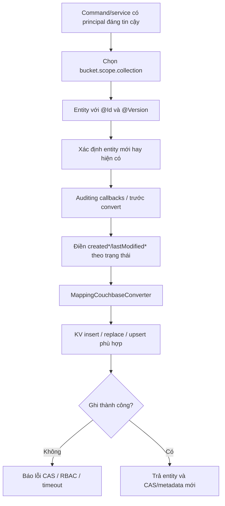

# @CreatedDate, @LastModifiedDate, @CreatedBy và @LastModifiedBy trong Spring Data Couchbase

Trong nhiều ứng dụng nghiệp vụ, một document cần trả lời được bốn câu hỏi: **được tạo khi nào**, **được sửa gần nhất khi nào**, **ai đã tạo** và **ai sửa gần nhất**. Nếu mỗi controller hoặc job tự đặt các trường này, dữ liệu dễ không thống nhất: người dùng HTTP có actor, job chạy nền để actor rỗng, lần cập nhật quên đặt thời gian, hoặc câu lệnh ghi đi vòng qua service.

**Spring Data Couchbase auditing** cho phép đánh dấu metadata bằng `@CreatedDate`, `@LastModifiedDate`, `@CreatedBy` và `@LastModifiedBy`. Khi được kích hoạt và sử dụng qua pipeline Spring Data phù hợp, framework điền những thông tin này trong quá trình lưu entity. Đây là **metadata của document hiện hành**, không tự tạo lịch sử bất biến cho mọi lần sửa và không tự xác thực quyền người dùng.

Bài thuộc chương **Vòng đời và auditing** của module `SPRING_DATA_COUCHBASE` — xây dựng tầng truy cập Couchbase bằng document mapping, repository, `CouchbaseTemplate`, SQL++, thiết kế bucket/scope/collection và lựa chọn imperative/reactive. Chúng ta sẽ đi từ cấu hình nhỏ nhất đến bảo mật actor, tính nhất quán CAS, cơ chế callback, test và các giới hạn vận hành.

## 1. Bốn annotation biểu diễn điều gì?

| Annotation | Câu hỏi được trả lời | Thời điểm thông thường |
| --- | --- | --- |
| `@CreatedDate` | Entity được tạo khi nào? | Khi entity được nhận diện là **mới**. |
| `@LastModifiedDate` | Lần lưu/cập nhật gần nhất diễn ra khi nào? | Khi entity được nhận diện là **đang cập nhật**; cũng có thể đặt khi tạo mới. |
| `@CreatedBy` | Actor nào tạo entity? | Khi entity được nhận diện là mới, nếu có nguồn auditor. |
| `@LastModifiedBy` | Actor nào thực hiện lần sửa/lưu gần nhất? | Khi cập nhật; cũng có thể đặt lúc tạo theo cấu hình. |

**Hai trường ngày** được cung cấp thời gian bởi cơ chế auditing, mặc định dựa vào thời gian hiện tại của ứng dụng. **Hai trường By** cần một nguồn *auditor* trả về actor hiện hành, ví dụ user ID đã xác thực hoặc system principal của một job.

Ví dụ chuỗi sự kiện:

```text
2026-11-25 09:00  User alice tạo order::1001
  createdAt      = 09:00
  createdBy      = alice
  lastModifiedAt = 09:00    (nếu modifyOnCreate=true)
  lastModifiedBy = alice    (nếu modifyOnCreate=true)

2026-11-25 10:15  User bob xác nhận đơn hàng
  createdAt      = 09:00
  createdBy      = alice
  lastModifiedAt = 10:15
  lastModifiedBy = bob
```

Các thời điểm ở ví dụ là minh họa và không phụ thuộc timezone hiển thị. Nên lưu thời gian dưới dạng `Instant` và định dạng ở rìa ứng dụng theo múi giờ người dùng.

### Phân biệt với audit trail

Nếu Alice → Bob → Carol cùng sửa một document, metadata cuối cùng chỉ giữ **người tạo** và **người sửa gần nhất**. Nó không tự lưu toàn bộ các bước thay đổi:

```text
createdBy = alice
lastModifiedBy = carol

Không suy ra:
  bob đã sửa trường nào?
  giá trị trước lần sửa là gì?
  ai phê duyệt thao tác?
  có bao nhiêu lần cập nhật?
```

Cần audit history đầy đủ thì thiết kế **audit event**, outbox, change-data capture hoặc cơ chế quản trị phù hợp, độc lập với bốn annotation này.

## 2. Luồng auditing trong lifecycle lưu document

Khi một repository thực hiện `save(entity)`, pipeline có thể khái quát:



Sơ đồ biểu diễn **ý nghĩa nghiệp vụ**; đây không phải lời cam kết thứ tự tuyệt đối giữa mọi application event, `EntityCallback` tùy chỉnh và auditing callback ở mọi phiên bản. Spring Data Couchbase hiện đại có `AuditingEntityCallback` tích hợp các pha trước convert và sau convert. Nếu callback khác phụ thuộc timestamp/actor được điền, phải kiểm tra `Ordered` và chạy integration test.

**Quan trọng:** auditing xảy ra trong đường mapping phù hợp của **Spring Data**, không phải trigger trên Couchbase Server. Một Java SDK client hoặc SQL++ `UPDATE` trực tiếp không biết `AuditorAware` của ứng dụng.

## 3. Entity mẫu với đủ bốn annotation

Giả sử dữ liệu nằm tại:

```text
bucket: shop
scope: commerce
collection: orders
```

Entity Java:

```java
package example.shop.persistence;

import java.time.Instant;

import org.springframework.data.annotation.CreatedBy;
import org.springframework.data.annotation.CreatedDate;
import org.springframework.data.annotation.Id;
import org.springframework.data.annotation.LastModifiedBy;
import org.springframework.data.annotation.LastModifiedDate;
import org.springframework.data.annotation.Version;
import org.springframework.data.couchbase.core.mapping.Document;
import org.springframework.data.couchbase.repository.Collection;
import org.springframework.data.couchbase.repository.Scope;

@Document
@Scope("commerce")
@Collection("orders")
public class AuditedOrder {

    @Id
    private String id;

    private String status;

    @Version
    private long version;

    @CreatedDate
    private Instant createdAt;

    @LastModifiedDate
    private Instant lastModifiedAt;

    @CreatedBy
    private String createdBy;

    @LastModifiedBy
    private String lastModifiedBy;

    public AuditedOrder() {}

    public AuditedOrder(String id, String status) {
        this.id = id;
        this.status = status;
    }

    public String getId() { return id; }
    public String getStatus() { return status; }
    public void setStatus(String status) { this.status = status; }

    public long getVersion() { return version; }
    public Instant getCreatedAt() { return createdAt; }
    public Instant getLastModifiedAt() { return lastModifiedAt; }
    public String getCreatedBy() { return createdBy; }
    public String getLastModifiedBy() { return lastModifiedBy; }
}
```

**Lưu ý các import:**

- `@CreatedBy`, `@CreatedDate`, `@LastModifiedBy`, `@LastModifiedDate`, `@Version` và `@Id` nằm trong `org.springframework.data.annotation`.
- `@Document` nằm trong `org.springframework.data.couchbase.core.mapping`.
- `@Scope` và `@Collection` của Couchbase nằm trong `org.springframework.data.couchbase.repository`. Không nhầm với `@Scope` định nghĩa lifecycle của Spring bean.

Một repository:

```java
package example.shop.persistence;

import org.springframework.data.couchbase.repository.CouchbaseRepository;

public interface AuditedOrderRepository
        extends CouchbaseRepository<AuditedOrder, String> {
}
```

Bucket `shop` đến từ cấu hình `CouchbaseClientFactory`/Spring Data; annotations chọn scope/collection **bên trong bucket**. Bài giả định scope và collection đã được provision, tài khoản có quyền đọc/ghi và Spring context đã quét repository.

### JSON lưu trữ chỉ là một cách biểu diễn

Sau khi tạo, document có thể có nội dung tương tự:

```json
{
  "_class": "example.shop.persistence.AuditedOrder",
  "status": "NEW",
  "createdAt": "2026-11-25T02:00:00Z",
  "lastModifiedAt": "2026-11-25T02:00:00Z",
  "createdBy": "user-123",
  "lastModifiedBy": "user-123"
}
```

Đây là **ví dụ khái niệm**, không phải cam kết định dạng JSON timestamp cố định. Converter, custom conversions, type mapper và phiên bản Spring Data có thể quyết định cách lưu chính xác. Document key `order::1001` và CAS/expiry là metadata riêng; `@Version` không nên bị hiểu là một bộ đếm JSON nghiệp vụ.

## 4. Vì sao @Version đặc biệt quan trọng với Couchbase?

Tài liệu chính thức Spring Data Couchbase ghi rõ **entity cần có trường `@Version` để auditing nhận diện thao tác tạo mới đúng**. Nếu thiếu trường version, một entity đã có ID trước khi lưu có thể bị framework coi là một update, làm `@CreatedDate`/`@CreatedBy` không được đặt như mong muốn.

Đây là đặc điểm dễ bỏ qua vì nhiều hệ thống tự tạo ID trước:

```java
AuditedOrder order =
    new AuditedOrder("order::1001", "NEW");

repository.save(order);
```

ID đã có **không đồng nghĩa** document đã tồn tại trong Couchbase. Metadata version/CAS giúp Spring Data phân biệt trạng thái của entity với việc chỉ kiểm tra `id != null`.

### @Version của Couchbase là CAS, không phải bộ đếm

Couchbase dùng **CAS (Compare-And-Swap)** để phát hiện ghi cạnh tranh lên một document. Trường `@Version long version` dùng metadata CAS tương ứng. Không tự thực hiện:

```java
// Không làm:
order.setVersion(order.getVersion() + 1);
```

Ngoài việc entity mẫu không có setter, việc tự tăng sẽ sai ngữ nghĩa. CAS là giá trị opaque của document, **không** được đảm bảo tăng tuần tự từ 0 lên 1, 2, 3.

### Quy tắc cho entity mới/cũ

| Tình huống | Điểm cần kiểm tra |
| --- | --- |
| Entity mới với ID được cấp sẵn | Có `@Version`; framework nhận diện lần tạo mới đúng. |
| Entity đọc từ Couchbase rồi sửa | Giữ CAS/version được đọc; save có thể dùng optimistic locking. |
| Entity được client tái tạo từ JSON mà không có version | Có thể bị coi là mới hoặc có hành vi ghi không đúng mong muốn. |
| Copy entity giữa collection khác nhau | CAS của collection nguồn không được xem là CAS của document đích. |
| SDK ghi JSON trực tiếp | Không tự tạo audit metadata của Spring Data, dù server có CAS. |

**Không dùng `@Version` làm bằng chứng authorization.** Người dùng biết ID/CAS không tự được phép cập nhật document; quyền và tenant phải được kiểm tra ở service.

## 5. Bật auditing imperative với @EnableCouchbaseAuditing

Ví dụ Spring configuration:

```java
package example.shop.config;

import org.springframework.context.annotation.Configuration;
import org.springframework.data.couchbase.repository.auditing.EnableCouchbaseAuditing;

@Configuration
@EnableCouchbaseAuditing
public class CouchbaseAuditConfig {
}
```

Annotation `@EnableCouchbaseAuditing` kích hoạt các thành phần auditing cho đường Spring Data Couchbase tương ứng. Tuy nhiên, **bật annotation không tự xác định được actor là ai**; nếu cần `@CreatedBy` và `@LastModifiedBy`, phải cung cấp `AuditorAware<T>`.

Bảng thuộc tính quan trọng:

| Thuộc tính | Công dụng | Giá trị mặc định theo Javadoc hiện đại |
| --- | --- | --- |
| `auditorAwareRef` | Tên bean `AuditorAware<?>` cung cấp actor | Chuỗi rỗng, để cấu hình tự tìm bean phù hợp. |
| `dateTimeProviderRef` | Tên bean `DateTimeProvider` dùng cho timestamp | Chuỗi rỗng, dùng nguồn thời gian mặc định/phù hợp. |
| `modifyOnCreate` | Có điền metadata last-modified ngay khi tạo mới? | `true`. |
| `setDates` | Có tự đặt các trường ngày auditing? | `true`. |

Các giá trị trên được xác nhận trong Javadoc `@EnableCouchbaseAuditing` 5.x/6.x; cần đối chiếu phiên bản dependency thực tế nếu dùng bản cũ.

### Tùy chỉnh một cách tường minh

```java
@Configuration
@EnableCouchbaseAuditing(
    auditorAwareRef = "securityAuditor",
    dateTimeProviderRef = "auditTimeProvider",
    modifyOnCreate = false,
    setDates = true
)
public class StrictAuditConfig {
}
```

Ví dụ này là **một phương án thay thế**, không đặt song song với cấu hình mặc định ở trên nếu không có lý do. Khi `modifyOnCreate=false`, trên lần tạo mới thường chỉ điền các trường created; các trường last-modified được để dành cho những lần cập nhật sau. Nếu ứng dụng muốn cả bốn field có giá trị ngay từ lần tạo, giữ `modifyOnCreate=true` (mặc định).

Không dùng `modifyOnCreate=false` chỉ vì tên nghe “chính xác” hơn. Hãy định nghĩa semantics API và báo cáo: “lần sửa gần nhất” có bao gồm thao tác tạo ban đầu hay không.

## 6. AuditorAware<String>: lấy actor từ nguồn đáng tin cậy

`AuditorAware<T>` là SPI trong Spring Data Commons:

```java
public interface AuditorAware<T> {
    Optional<T> getCurrentAuditor();
}
```

Generic type `T` phải tương thích với kiểu các trường `@CreatedBy` và `@LastModifiedBy`. Trong entity mẫu, hai field cùng kiểu `String`, nên dùng `AuditorAware<String>`.

### 6.1. Ví dụ với Spring Security

```java
package example.shop.config;

import java.util.Optional;

import org.springframework.context.annotation.Bean;
import org.springframework.context.annotation.Configuration;
import org.springframework.data.domain.AuditorAware;
import org.springframework.security.authentication.AnonymousAuthenticationToken;
import org.springframework.security.core.Authentication;
import org.springframework.security.core.context.SecurityContextHolder;

@Configuration
public class ActorConfiguration {

    @Bean("securityAuditor")
    AuditorAware<String> securityAuditor() {
        return () -> Optional.ofNullable(
                SecurityContextHolder.getContext().getAuthentication()
            )
            .filter(Authentication::isAuthenticated)
            .filter(auth ->
                !(auth instanceof AnonymousAuthenticationToken)
            )
            .map(Authentication::getName)
            .filter(name -> !name.isBlank());
    }
}
```

Code này minh họa ứng dụng Spring MVC/imperative đã cấu hình **Spring Security** đúng cách. Nó không tự thiết lập filter chain hay xác thực request. Trong hệ thống thực, `Authentication.getName()` có thể là username có thể đổi; nên cân nhắc **user ID nội bộ ổn định** nếu cần truy vết lâu dài.

### 6.2. Vì sao không lấy actor từ request body?

Cách không an toàn:

```java
// Không nên:
order.setCreatedBy(request.getCreatedBy());
order.setLastModifiedBy(request.getLastModifiedBy());
repository.save(order);
```

Client có thể tự khai `"admin"` hoặc tên user khác. Nếu các trường được điền bởi auditing từ principal đã xác thực, không cho client ghi đè chúng qua DTO.

**AuditorAware là nguồn metadata, không phải một policy engine.** Nó trả ai đang tương tác với ứng dụng; service vẫn phải kiểm tra actor này **được phép làm gì** với tenant/document.

### 6.3. Khi không có user đăng nhập

`getCurrentAuditor()` được phép trả `Optional.empty()`. Đó là lựa chọn hợp lý nếu actor không tồn tại/không xác định; không nên âm thầm gán `"admin"` cho mọi request không xác thực.

Với job nền, nên có định danh actor riêng:

```text
user:7841          // hành động của user
service:billing    // thao tác của service
job:order-repair   // migration/repair có kiểm soát
```

Chọn actor **trong ngữ cảnh job/service tin cậy** hoặc từ service identity đã xác minh, không hardcode một actor giả thành mặc định cho mọi request. Nếu auditing fields là bắt buộc cho mọi document, cần quy định xử lý khi auditor vắng mặt, kiểm thử đường job và tài khoản dịch vụ.

## 7. Có cần AuditorAware nếu chỉ theo dõi ngày giờ?

**Không.** Spring Data Commons nêu rõ: entity chỉ cần `@CreatedDate` và `@LastModifiedDate` không bắt buộc triển khai `AuditorAware`. Framework có thể dùng nguồn thời gian để điền ngày, nếu auditing đã được bật và pipeline phù hợp chạy.

Ví dụ:

```java
@CreatedDate
private Instant createdAt;

@LastModifiedDate
private Instant modifiedAt;
```

Một số ứng dụng chưa quản lý identity nhưng cần timestamp ổn định có thể bắt đầu bằng hai field này.

Tuy nhiên, **không có auditor** không có nghĩa framework sẽ tự suy từ Couchbase credential hoặc địa chỉ IP ra user. Hai field `@CreatedBy`/`@LastModifiedBy` cần nguồn actor đúng kiểu.

## 8. Tùy chỉnh thời gian bằng DateTimeProvider

Nguồn thời gian mặc định của Spring Data có thể được thay bằng bean `DateTimeProvider`:

```java
package example.shop.config;

import java.time.Clock;
import java.time.Instant;
import java.util.Optional;

import org.springframework.context.annotation.Bean;
import org.springframework.context.annotation.Configuration;
import org.springframework.data.auditing.DateTimeProvider;

@Configuration
public class AuditClockConfiguration {

    @Bean
    Clock auditClock() {
        return Clock.systemUTC();
    }

    @Bean("auditTimeProvider")
    DateTimeProvider auditTimeProvider(Clock auditClock) {
        return () -> Optional.of(Instant.now(auditClock));
    }
}
```

Đăng ký bằng:

```java
@EnableCouchbaseAuditing(
    auditorAwareRef = "securityAuditor",
    dateTimeProviderRef = "auditTimeProvider"
)
```

Đoạn annotation nằm trên một class `@Configuration`; không phải một statement Java độc lập.

### Lợi ích của Clock và DateTimeProvider

- Thống nhất thời điểm theo UTC ở tầng ứng dụng.
- Dễ thay đồng hồ bằng `Clock.fixed(...)` trong test.
- Không phụ thuộc timezone mặc định của máy chủ để tạo `Instant`.
- Tránh test kiểu `createdAt == Instant.now()` vốn có race ngay cả trong một JVM.

### Chọn kiểu property

Spring Data auditing hỗ trợ các kiểu thời gian Java phổ biến như `Instant`, một số kiểu `java.time` khác, `Date` và tùy cấu hình có thể có kiểu số epoch. Với Couchbase cần **xác minh converter của phiên bản đang sử dụng** để biết JSON lưu thực tế ở dạng nào.

Một cách nhất quán:

```java
@CreatedDate
private Instant createdAt;

@LastModifiedDate
private Instant lastModifiedAt;
```

Đối với API trả về, thường chuẩn hóa về ISO-8601/UTC và chỉ chuyển múi giờ tại ranh giới hiển thị. Không trộn chuỗi local date không timezone với `Instant` rồi so sánh như cùng một đơn vị.

## 9. Tạo mới: kỳ vọng với bốn field

Giả sử cấu hình:

```java
@EnableCouchbaseAuditing(
    auditorAwareRef = "securityAuditor",
    modifyOnCreate = true
)
```

Và `securityAuditor` trả `user-alice`. Một lệnh tạo:

```java
AuditedOrder order =
    new AuditedOrder("order::" + java.util.UUID.randomUUID(), "NEW");

AuditedOrder stored = auditedOrderRepository.save(order);
```

Với entity có `@Version`, lifecycle auditing hoạt động và time provider hợp lệ, kỳ vọng:

| Property | Sau tạo |
| --- | --- |
| `id` | ID đã chọn hoặc được generator cung cấp. |
| `createdAt` | Có thời điểm tạo. |
| `lastModifiedAt` | Có thời điểm lần lưu đầu, vì `modifyOnCreate=true`. |
| `createdBy` | `user-alice`. |
| `lastModifiedBy` | `user-alice`. |
| `version` | Giá trị CAS/version từ document sau ghi. |

Không nên assert tuyệt đối rằng `createdAt.equals(lastModifiedAt)` trong mọi hệ thống nếu provider có thể được gọi ở hai thời điểm khác nhau hoặc mapping phiên bản có cách gán khác. Trong test dùng provider thời gian cố định, có thể kỳ vọng giá trị cùng Instant nếu cấu hình được kiểm soát.

### Trường hợp modifyOnCreate=false

Nếu cấu hình:

```java
@EnableCouchbaseAuditing(modifyOnCreate = false)
```

thì `lastModifiedAt` và `lastModifiedBy` có thể chưa có giá trị lúc tạo, tùy model/kiểu property và đường auditing. Hãy chọn kiểu nullable nếu semantics cho phép không có “lần sửa gần nhất” trước khi cập nhật.

Đừng đặt `@NotNull` trên hai trường last-modified ở validation trước lưu rồi bật `modifyOnCreate=false` mà không sửa contract: lần tạo hợp lệ có thể bị chặn.

## 10. Cập nhật: giữ nguyên trường tạo, đổi trường sửa

Giả sử Bob cập nhật đơn hàng do Alice tạo:

```java
AuditedOrder order = auditedOrderRepository
    .findById(orderId)
    .orElseThrow();

order.setStatus("CONFIRMED");

AuditedOrder updated = auditedOrderRepository.save(order);
```

Bất biến nghiệp vụ thường là:

```text
updated.createdAt      == original.createdAt
updated.createdBy      == original.createdBy
updated.lastModifiedAt >= original.lastModifiedAt
updated.lastModifiedBy == "user-bob"
```

Dấu `>=` là kỳ vọng thời gian **khi đồng hồ và chính sách thời gian hợp lý**; không xem đó là guarantee của database nếu các node ứng dụng có đồng hồ lệch hoặc test dùng provider cố định. Hãy test bằng hai thời điểm do bạn kiểm soát để tránh flaky assertion.

### Tại sao không tự gán createdBy sau mỗi lần save?

Một lỗi thường thấy:

```java
// Sai ý nghĩa auditing:
order.setCreatedBy(currentUser);
order.setCreatedAt(Instant.now());
repository.save(order);
```

Nếu mọi lần update đều đè `createdBy` hoặc `createdAt`, lịch sử tạo ban đầu mất. Hãy dùng annotations/callback để phân biệt mới/cũ; với dữ liệu phải bất biến ở mức bảo mật cao, cần guard bổ sung chống việc DTO/migration tự thay metadata.

### Save không đồng nghĩa luôn có thay đổi nghiệp vụ

Một `save()` có thể xảy ra dù `status` không đổi, ví dụ batch job ghi lại toàn bộ document để chuẩn hóa schema. Tùy pipeline auditing, `lastModifiedAt` và CAS **vẫn có thể thay đổi** dù không có business transition mới.

Nếu doanh nghiệp muốn “thời điểm trạng thái đổi”, nên có field/event riêng `statusChangedAt` theo domain command, không dùng `@LastModifiedDate` cho mọi định nghĩa nghiệp vụ.

## 11. Auditing cùng Spring Data repository và CouchbaseTemplate

Hai đường imperative cơ bản:

```java
// Repository
AuditedOrder result = auditedOrderRepository.save(order);

// Template
AuditedOrder resultFromTemplate = couchbaseTemplate
    .upsertById(AuditedOrder.class)
    .inScope("commerce")
    .inCollection("orders")
    .one(otherOrder);
```

Các biến trong ví dụ là dependency đã inject; `otherOrder` là entity phù hợp. Với hai đường có entity mapping và callbacks được đăng ký đúng, auditing có thể tham gia lifecycle tương ứng.

**Không chỉ test một đường rồi suy ra mọi đường có auditing.** Nếu dự án dùng Template tự tạo, nhiều bucket hoặc tùy chỉnh converter, cần kiểm tra cơ chế callback/auditing của từng Template thực tế.

### Bucket/scope/collection không tự đổi actor

Các annotations scope/collection chỉ chọn keyspace. Ví dụ:

```text
shop.commerce.orders
shop.archive.orders_history
```

Nếu hai nơi lưu entity cùng kiểu và dùng cùng nguồn `AuditorAware`, metadata có thể giống actor hiện hành. **Định tuyến đúng keyspace và authorization phải chạy trước**, vì `AuditorAware` chỉ điền tên actor, không xác định user được phép truy cập archive hay tenant khác.

## 12. Trường hợp một actor thuộc nhiều tenant

Một user có thể quản lý hai tổ chức:

```text
user:7841
  membership tenant-acme: READ, WRITE
  membership tenant-globex: READ
```

Nếu chỉ lưu `createdBy="user:7841"`, bạn biết ai thao tác nhưng **không có đầy đủ tenant context**. Có thể bổ sung những trường domain riêng:

```java
private String tenantId;
private String createdVia;
```

Những field này cần được gán từ context tin cậy ở service sau authorization; **không** mặc định `@CreatedBy` chứa tenant hoặc quyền.

Một mẫu log an toàn:

```text
actorId    = user:7841
tenantId   = tenant-acme
operation  = CONFIRM_ORDER
documentId = order::1001
result     = SUCCESS
```

Audit log có thể ghi actor/tenant phù hợp nhưng tránh lưu token hoặc payload có dữ liệu nhạy cảm không cần thiết. Với tenant dùng scope riêng, collection name `orders` không đủ để suy tenant; auditing callback không tự chịu trách nhiệm kiểm tra membership.

## 13. Reactive auditing: cơ chế kích hoạt riêng

Với Spring Data Couchbase reactive, Javadoc cung cấp:

```java
org.springframework.data.couchbase.repository.auditing.EnableReactiveCouchbaseAuditing
```

Cấu hình:

```java
package example.shop.reactive;

import org.springframework.context.annotation.Configuration;
import org.springframework.data.couchbase.repository.auditing.EnableReactiveCouchbaseAuditing;

@Configuration
@EnableReactiveCouchbaseAuditing(
    auditorAwareRef = "reactiveSecurityAuditor",
    modifyOnCreate = true
)
public class ReactiveAuditConfiguration {
}
```

Đây là **lựa chọn cho hạ tầng reactive**, không phải thay thế tên import bằng một annotation gần giống. `@EnableReactiveCouchbaseAuditing` nhận bean `ReactiveAuditorAware<T>` thay cho `AuditorAware<T>` đồng bộ.

Với cấu hình nhiều repository/Template reactive và imperative trong một application, cần tránh đăng ký bean auditing chồng lấn không chủ đích và viết integration test cho **đúng đường truy cập**.

### 13.1. ReactiveAuditorAware<String> với Spring Security

```java
package example.shop.reactive;

import org.springframework.context.annotation.Bean;
import org.springframework.context.annotation.Configuration;
import org.springframework.data.domain.ReactiveAuditorAware;
import org.springframework.security.authentication.AnonymousAuthenticationToken;
import org.springframework.security.core.Authentication;
import org.springframework.security.core.context.ReactiveSecurityContextHolder;

import reactor.core.publisher.Mono;

@Configuration
public class ReactiveActorConfiguration {

    @Bean("reactiveSecurityAuditor")
    ReactiveAuditorAware<String> reactiveSecurityAuditor() {
        return () -> ReactiveSecurityContextHolder.getContext()
            .flatMap(context ->
                Mono.justOrEmpty(context.getAuthentication())
            )
            .filter(authentication ->
                authentication.isAuthenticated()
                && !(authentication instanceof AnonymousAuthenticationToken)
            )
            .map(Authentication::getName)
            .filter(name -> !name.isBlank());
    }
}
```

`ReactiveSecurityContextHolder` dùng Reactor context thích hợp. Không đọc `SecurityContextHolder` đồng bộ trong một reactive pipeline rồi mặc định principal sẽ được giữ đúng khi thread thay đổi.

Nếu không có security context, publisher có thể không phát actor. Khi nghiệp vụ cần actor bắt buộc, quyết định rõ xử lý empty context và service identity, thay vì tự fallback sang một tên user giả cho mọi request.

### 13.2. Subscription và callback

```java
reactor.core.publisher.Mono<AuditedOrder> saved =
    reactiveAuditedOrderRepository.save(order);
```

Đoạn này chỉ tạo publisher. Để xác minh auditing, cần subscribe/consume:

```java
reactor.test.StepVerifier
    .create(reactiveAuditedOrderRepository.save(order))
    .assertNext(savedOrder -> {
        org.junit.jupiter.api.Assertions.assertNotNull(
            savedOrder.getCreatedAt()
        );
    })
    .verifyComplete();
```

Đoạn test minh họa giả định repository, entity, actor/date provider và collection đã sẵn sàng. Vì auditing theo reactive callback, đừng coi `Mono` chưa được subscribe là bằng chứng write hoàn tất.

### 13.3. Tránh blocking và mutable ThreadLocal

Nếu actor cần tra cứu quyền/ID từ hệ thống khác, đừng gọi HTTP blocking trong `ReactiveAuditorAware`. Nên xác thực principal trong reactive security layer và lấy ID ổn định từ thông tin đã đáng tin; business authorization vẫn ở service.

Với `retry()` hoặc resubscribe, auditor có thể được hỏi lại. Không sinh một user ID ngẫu nhiên hoặc side effect như email/message trong provider auditor; chỉ trả actor phù hợp với context.

## 14. CreatedBy và LastModifiedBy có thể dùng kiểu khác String không?

Có thể. Spring Data auditing cung cấp `AuditorAware<T>`, nơi `T` tương thích với kiểu annotated property. Ví dụ:

```java
public record ActorRef(String id, String kind) {}
```

Nếu dùng:

```java
@CreatedBy
private ActorRef createdBy;

@LastModifiedBy
private ActorRef lastModifiedBy;
```

thì auditor cũng phải trả `AuditorAware<ActorRef>`, và converter của Couchbase phải hỗ trợ kiểu `ActorRef` theo cách ánh xạ mong muốn.

Một số lưu ý:

- Không lưu toàn bộ `Authentication` hoặc một object chứa password/token.
- Với user object lớn, nên lưu **ID hoặc snapshot tối thiểu**, vì thông tin user có thể thay đổi.
- Hai trường created/last-modified nên có kiểu nhất quán với auditor.
- Với multi-tenant, cân nhắc `actorId` + tenant context riêng thay vì nhét quyền hiện thời vào metadata có thể trở nên lỗi thời.

**Khuyến nghị thực tế:** dùng `String` hoặc một value object audit rõ ràng cho ID bất biến, tránh quan hệ phức tạp không cần thiết ở field auditing.

## 15. Mất security context: khi actor bị null hoặc rỗng

Các biểu hiện:

```text
createdAt      = có
lastModifiedAt = có
createdBy      = null
lastModifiedBy = null
```

Các nguyên nhân thường gặp:

1. Không có bean `AuditorAware` hoặc cấu hình `auditorAwareRef` trỏ sai.
2. Không có authentication ở background job.
3. Security context bị mất khi nhảy qua `@Async`/thread pool mà không có context propagation được cấu hình.
4. Reactive path dùng `AuditorAware` thay vì `ReactiveAuditorAware` hoặc không có Reactor security context.
5. Bean trả `Optional.empty()`/`Mono.empty()` vì không có actor hợp lệ.
6. Kiểu dữ liệu auditor không phù hợp annotated fields.

Phân biệt **lỗi thiếu actor** và **actor không có quyền**. Có actor không chứng minh được quyền ghi; thiếu actor không tự chứng minh lệnh ghi Couchbase phải thất bại nếu ứng dụng không thiết kế rule bắt buộc.

### Cách xử lý job nền

Có thể định nghĩa context job có service principal cụ thể, ví dụ `job:nightly-reconciliation`, rồi ghi audit metadata đó qua một cơ chế an toàn. Một bean `AuditorAware<String>` dùng chung toàn ứng dụng cần biết khi nào đang xử lý request người dùng và khi nào đang xử lý job đã được xác nhận; không nên fallback mù sang `"system"` cho request chưa xác thực.

Nếu audit actor là thông tin bắt buộc cho một nghiệp vụ, service có thể chủ động từ chối command khi không lấy được actor trước khi ghi; cần test đường exception và không lộ chi tiết token/principal trong log.

## 16. Auditing không sửa được dữ liệu đã ghi bằng SDK trực tiếp

Các đường ghi cần phân biệt:

| Đường truy cập | Auditing annotations có tự chạy? |
| --- | --- |
| `CouchbaseRepository.save(entity)` | Có thể, khi auditing bật và repository đi qua pipeline tương ứng. |
| `CouchbaseTemplate.insertById/upsertById(entity)` | Có thể, khi Template/callbacks được cấu hình đúng. |
| `ReactiveCouchbaseRepository.save(entity)` | Dùng reactive auditing callbacks khi cấu hình và publisher được tiêu thụ. |
| `collection.upsert(id, JsonObject)` từ Java SDK | **Không tự chạy** auditing của Spring Data. |
| SQL++ `UPDATE ... SET ...` trực tiếp | **Không** chạy callbacks entity cho từng document ở server. |
| Import/ETL/XDCR của Couchbase | **Không** chạy callback JVM của một Spring application. |
| TTL expiry do server | Không phải một Spring Data save/delete; không tự cập nhật `lastModifiedAt`. |
| SQL++ finder hoặc `findById` | Thao tác đọc; không tự “đánh dấu lần sửa gần nhất”. |

Nếu có nhiều client/ứng dụng cùng ghi collection, metadata auditing do riêng một Spring app cung cấp không thể được xem là bảo đảm toàn cục.

### Ví dụ bypass qua Java SDK

```java
var collection = cluster.bucket("shop")
    .scope("commerce")
    .collection("orders");

collection.upsert(
    "order::external",
    com.couchbase.client.java.json.JsonObject.create()
        .put("status", "NEW")
);
```

Couchbase Server ghi document và cấp CAS, nhưng nó không tự biết user nào đã đăng nhập Spring Security ở JVM khác và không tự điền `createdAt`/`createdBy`. Nếu cần các field này trong một import job, job phải có quy tắc riêng, hoặc đi qua service dùng Spring Data auditing với đầy đủ actor/context.

## 17. Các câu SQL++ tự viết có thể bỏ qua auditing

Một lệnh DML:

```sql
UPDATE `shop`.`commerce`.`orders` AS o
SET o.status = "CONFIRMED"
WHERE META(o).id = "order::1001";
```

được Query Service thực thi trên server. Nó **không tự chạy** `BeforeConvertCallback` hoặc `AuditingEntityCallback` của ứng dụng Spring.

Nếu yêu cầu `lastModifiedAt`/`lastModifiedBy` được cập nhật, tầng thực hiện DML phải quản lý metadata trong cùng statement/transaction phù hợp, ví dụ **giá trị thời gian và actor được truyền bởi server-side application đã xác thực**:

```sql
UPDATE `shop`.`commerce`.`orders` AS o
SET o.status = $newStatus,
    o.lastModifiedBy = $actorId,
    o.lastModifiedAt = $modifiedAt
WHERE META(o).id = $documentId;
```

Câu này chỉ minh họa **trách nhiệm** của đường SQL++; định dạng `lastModifiedAt` phải trùng conversion/schema của ứng dụng để Spring Data đọc được. Việc set timestamp và actor trong SQL++ không tự đảm bảo CAS/authorization hoặc toàn bộ nghiệp vụ; cần kiểm soát điều kiện update và concurrent requests.

### SQL++ query sau ghi và index consistency

Một `findById` theo KV có thể thấy document mới ngay khi một finder SQL++ theo `status` chưa thấy do chỉ mục cập nhật chậm với scan consistency mặc định. Đó không tự chứng minh auditing bỏ sót timestamp. Khi debug:

1. Đọc KV trực tiếp ở đúng collection và kiểm tra JSON.
2. Xác nhận keyspace, converter/type metadata.
3. Kiểm tra index và Query Service.
4. Chỉ dùng `REQUEST_PLUS`/consistency mạnh hơn khi test/nghiệp vụ cần, nhận thức chi phí độ trễ.

## 18. Auditing không phải TTL hay transaction

Các khái niệm dễ bị nhầm:

| Khái niệm | Chức năng | Không thay thế cho |
| --- | --- | --- |
| `@CreatedDate` | Ghi thời gian tạo do framework quan sát | TTL/expiry. |
| `@LastModifiedDate` | Ghi thời điểm lần lưu/sửa gần nhất qua pipeline | Audit trail đầy đủ. |
| `@CreatedBy` | Actor tạo ban đầu | Xác thực và phân quyền. |
| `@LastModifiedBy` | Actor cập nhật gần nhất | Event log của mọi lần thay đổi. |
| `@Version` | CAS/optimistic locking và phát hiện entity mới/cũ | Bộ đếm business revision hoặc transaction. |
| TTL/expiry | Khi nào document bị server xóa do hết hạn | `lastModifiedAt`. |
| Transaction | Bảo đảm nguyên tử cho nhóm thao tác được hỗ trợ | Gửi email/broker exactly-once. |

Ví dụ một session tạo lúc 09:00, hết hạn lúc 09:30. `createdAt=09:00` không tự làm session hết hạn; cần expiry document hoặc chính sách TTL phù hợp. Khi Couchbase xóa session do TTL, `lastModifiedAt` không tự đổi thành 09:30.

### Về transaction

Auditing có thể tham gia khi lưu entity qua API Spring Data phù hợp, nhưng **không** có nghĩa cứ có auditing là mọi lệnh save trong nhiều collection nằm trong một transaction. Với Java SDK transaction trực tiếp, Spring Data callbacks không tự chạy; nếu cần audit fields, handler phải điền chúng hoặc có một layer phù hợp.

Transaction logic có thể bị retry; tránh tạo side effect ngoài DB trong `AuditorAware`, `DateTimeProvider` hoặc lifecycle callbacks. Các provider nên lấy giá trị có thể tái tính/kiểm thử được, không gọi payment/email hay phát event nghiệp vụ.

## 19. Khi nào nên đặt @LastModifiedDate theo thay đổi nghiệp vụ?

Có hai cách diễn giải phổ biến:

1. **Persistence modification time:** “lần gần nhất document được lưu bởi pipeline đang dùng”.
2. **Business transition time:** “lần gần nhất nghiệp vụ đổi trạng thái”.

Auditing của Spring Data có xu hướng thể hiện **thời điểm lưu/cập nhật entity**. Nếu một batch job lưu lại document để cập nhật schema metadata, `lastModifiedAt` có thể đổi dù đơn hàng không có nghiệp vụ mới.

Nếu nghiệp vụ cần thêm “đã xác nhận lúc nào”, hãy dùng trường riêng:

```java
private Instant confirmedAt;
```

Đặt trong domain command khi chuyển từ `NEW` sang `CONFIRMED`, không thay thế bằng `lastModifiedAt`. Tương tự `cancelledAt`, `paidAt`, `shippedAt` là các mốc nghiệp vụ cụ thể.

**Đừng tự động gửi email “đơn hàng vừa thay đổi” chỉ vì callback auditing điền lastModifiedAt**: thao tác migration, retry hoặc save không đổi business state có thể làm notification lặp.

## 20. Actor ID ổn định và dữ liệu cá nhân

Dữ liệu `createdBy`/`lastModifiedBy` có thể được lưu lâu hơn phiên đăng nhập. Vì vậy cần quan tâm:

- **Định danh ổn định:** nếu username/email có thể đổi, cân nhắc user ID nội bộ.
- **Tối thiểu hóa:** không lưu access token, JWT, session cookie, password hash hoặc thông tin xác thực nhạy cảm trong document.
- **Quy định lưu giữ:** metadata actor có thể được xem là dữ liệu cá nhân; áp retention/ẩn danh phù hợp.
- **Quyền truy cập:** không expose tất cả audit metadata trong mọi API nếu client không cần.
- **Tenant:** lưu actor ID không chứng minh actor có membership hợp lệ tại thời điểm viết nếu authorization bị bỏ qua.
- **Service accounts:** khi job thực hiện thay mặt user, cân nhắc phân biệt `initiatedBy` (user) với `executedBy` (service) nếu cần kiểm toán chính xác.

Một `@CreatedBy String` đơn lẻ không thể mô tả hết toàn bộ chuỗi ủy quyền hoặc một luồng phê duyệt nhiều bước.

## 21. Kiểm thử auditing: tách create và update

Unit test `AuditorAware` chỉ chứng minh trả actor đúng; muốn chứng minh framework điền metadata khi lưu, cần **integration test với repository/Template thật**.

Một bộ kiểm thử gồm:

1. Chuẩn bị Couchbase test bucket, scope, collection.
2. Bật `@EnableCouchbaseAuditing`.
3. Cung cấp auditor provider test trả actor theo kịch bản.
4. Cung cấp `DateTimeProvider` có thời gian điều khiển được.
5. Tạo entity mới **với ID đã có và `@Version`**.
6. Save, assert các trường created/lastModified theo `modifyOnCreate`.
7. Đọc trực tiếp JSON bằng Couchbase SDK để đối chiếu dữ liệu đã persist.
8. Chuyển actor và thời gian test, đọc lại entity rồi update.
9. Assert `createdAt/createdBy` không đổi, `lastModifiedAt/lastModifiedBy` đổi.
10. Thử concurrent update để xác nhận CAS failure không làm metadata ghi mới bị commit.

### 21.1. Test provider có thể điều khiển

```java
import java.time.Instant;
import java.util.Optional;
import java.util.concurrent.atomic.AtomicReference;

import org.springframework.data.auditing.DateTimeProvider;
import org.springframework.data.domain.AuditorAware;

public final class AuditTestContext {

    private final AtomicReference<String> actor =
        new AtomicReference<>("alice");

    private final AtomicReference<Instant> now =
        new AtomicReference<>(
            Instant.parse("2026-11-25T02:00:00Z")
        );

    public void use(String actorId, Instant timestamp) {
        actor.set(actorId);
        now.set(timestamp);
    }

    public AuditorAware<String> auditor() {
        return () -> Optional.ofNullable(actor.get());
    }

    public DateTimeProvider dates() {
        return () -> Optional.of(now.get());
    }
}
```

Đây là **test utility**, không dùng global mutable auditor trong production. Nếu nhiều test chạy song song, mỗi test cần context riêng hoặc phải cô lập state; không chia sẻ một `AtomicReference` cho cả test suite chạy concurrent.

Ví dụ cấu hình test:

```java
@TestConfiguration
@EnableCouchbaseAuditing(
    auditorAwareRef = "testAuditor",
    dateTimeProviderRef = "testDates",
    modifyOnCreate = true
)
class AuditingTestConfiguration {

    @Bean
    AuditTestContext auditTestContext() {
        return new AuditTestContext();
    }

    @Bean("testAuditor")
    AuditorAware<String> testAuditor(AuditTestContext context) {
        return context.auditor();
    }

    @Bean("testDates")
    DateTimeProvider testDates(AuditTestContext context) {
        return context.dates();
    }
}
```

Cần import `org.springframework.boot.test.context.TestConfiguration`, `org.springframework.context.annotation.Bean`, `@EnableCouchbaseAuditing` và các interface tương ứng. Nếu production config đã bật auditing, **không đăng ký song song hai cấu hình auditing trong một ApplicationContext**; test phải thay thế/điều chỉnh cấu hình hiện có theo cơ chế phù hợp.

### 21.2. Assertion tạo và cập nhật

```java
Instant t1 = Instant.parse("2026-11-25T02:00:00Z");
Instant t2 = Instant.parse("2026-11-25T03:00:00Z");

context.use("alice", t1);

String id = "it::order::" + java.util.UUID.randomUUID();
AuditedOrder created =
    repository.save(new AuditedOrder(id, "NEW"));

assertEquals(t1, created.getCreatedAt());
assertEquals("alice", created.getCreatedBy());

context.use("bob", t2);

AuditedOrder loaded = repository.findById(id).orElseThrow();
loaded.setStatus("CONFIRMED");
AuditedOrder updated = repository.save(loaded);

assertEquals(t1, updated.getCreatedAt());
assertEquals("alice", updated.getCreatedBy());
assertEquals(t2, updated.getLastModifiedAt());
assertEquals("bob", updated.getLastModifiedBy());
```

Đoạn code là **thân test minh họa**, giả định đã inject `context` và `repository`, có static import `assertEquals` của JUnit. Khi viết test hoàn chỉnh, cần thêm Testcontainers hoặc server test đã provision, bean config, cleanup và SDK oracle. Không kết luận success chỉ vì entity trả về đúng nếu cấu hình có thể save vào nhầm scope/collection.

### 21.3. Oracle độc lập từ Couchbase SDK

Sau khi lưu qua Spring Data:

```java
var stored = sdk.bucket("shop")
    .scope("commerce")
    .collection("orders")
    .get(id)
    .contentAsObject();

assertEquals("alice", stored.getString("createdBy"));
assertEquals("bob", stored.getString("lastModifiedBy"));
```

Kiểm tra timestamp bằng cách đọc theo **định dạng thực tế converter đã cấu hình**, không hardcode rằng SDK nhất định trả ISO string. SDK bypass auditing, nhưng dùng để *đọc trực tiếp* là oracle hữu ích.

## 22. Test các trường hợp đặc biệt

| Mã | Tình huống | Assertion chủ đạo |
| --- | --- | --- |
| A01 | Tạo entity có ID trước, có `@Version` | `createdAt` và `createdBy` được điền. |
| A02 | Tạo với `modifyOnCreate=true` | `lastModifiedAt/By` được điền theo semantics cấu hình. |
| A03 | Tạo với `modifyOnCreate=false` | Created có giá trị, modified chưa có nếu không được đặt trước. |
| A04 | Update bởi actor khác | Created giữ nguyên, modified đổi. |
| A05 | Không cấu hình `AuditorAware`, chỉ dùng Date | Date được điền theo provider, không tự sinh user. |
| A06 | Auditor trả empty | Không ghi actor giả; test contract khi field bắt buộc. |
| A07 | Thiếu `@Version` | Phát hiện nhầm new/update ở create; test không nên vô tình pass. |
| A08 | Save stale entity, CAS conflict | Lệnh thất bại không commit modified metadata mới. |
| A09 | Job nền có service identity | Actor job đúng, không dùng lại user request cũ. |
| A10 | Reactive auditing | StepVerifier subscribe, actor từ Reactor context đúng. |
| A11 | SDK direct write | Không tự điền bốn field. |
| A12 | SQL++ DML | Không tự kích hoạt Spring Data auditing callback. |
| A13 | Migrate document legacy | Có kế hoạch preserved created metadata hoặc backfill rõ ràng. |
| A14 | Hai scope/collection | Auditing hoạt động ở đúng keyspace, không truy cập tenant khác. |
| A15 | Template tùy chỉnh/multi-bucket | Callback và auditor thực sự gắn với Template được dùng. |

Với các test đụng clock hoặc actor state, tránh chạy song song cùng một mutable test context.

## 23. Khó khăn khi cập nhật document legacy

Một collection đã chạy lâu có thể chứa:

```json
{
  "status": "NEW"
}
```

Document không có `createdAt`/`createdBy` vì được viết trước khi auditing được bật. Khi thêm annotations và đọc lại:

- `createdAt` có thể `null`; framework không tự biết thời điểm tạo trong quá khứ chỉ từ entity.
- `createdBy` có thể không xác định; không nên bịa ra một user cụ thể.
- Lần save kế tiếp có thể đặt modified fields, nhưng điều đó **không** tự backfill đúng creation metadata.
- Nếu version/CAS hoặc schema mapping thay đổi, cần chú ý `isNew` detection khi cập nhật.

### Kế hoạch migration an toàn

1. Kiểm kê document thiếu các trường audit.
2. Xác định nguồn dữ liệu đáng tin cậy để backfill (historical logs, event archive, import metadata).
3. Nếu không có bằng chứng, đặt giá trị `unknown`/`imported` theo policy rõ ràng thay vì tuyên bố đó là actor thực.
4. Chọn snapshot/migration script có quyền phù hợp; ghi chú rằng SDK/SQL++ trực tiếp bypass callback.
5. Kiểm soát version/CAS, TTL và timestamp format.
6. Test đọc entity cũ/mới bằng cả repository và SDK.
7. Đo số lượng document còn thiếu/không hợp lệ sau migration.

**Không dùng `@CreatedDate` mới để giả định “thời điểm document được tạo ban đầu” khi chỉ biết thời điểm migration.** Nếu cần, tách `importedAt` khỏi `createdAt` để giữ ý nghĩa dữ liệu.

## 24. Về tính nhất quán khi lưu nhiều document

Ví dụ xác nhận đơn hàng và ghi audit event:

```java
repository.save(order);
auditRepository.save(event);
```

Hai thao tác này **không tự nguyên tử**. Bốn annotation chỉ điền metadata của các entity tương ứng; chúng không đảm bảo event và đơn hàng sẽ commit cùng lúc, và không đảm bảo message ra broker.

Nếu cần audit event không thể thất lạc, cân nhắc Couchbase transaction theo API hỗ trợ, outbox hoặc workflow phục hồi được. Tránh gọi email/HTTP/broker trực tiếp trong `AuditorAware` hoặc callback, bởi transaction có thể retry và tác dụng phụ có thể lặp.

### CAS và auditing khi retry

Nếu save thất bại vì CAS:

- Đừng phát thông báo “đã sửa” chỉ vì `LastModifiedDate` đã được điền trong entity trong bộ nhớ.
- Không retry bằng cách sửa thủ công `version++`.
- Đọc lại document, kiểm tra domain rule và quyền, áp dụng lệnh nghiệp vụ rồi save lại với version mới.
- Nếu có command ID, dùng idempotency để kiểm soát retry và outbox events.

Việc nhìn thấy `updated.getLastModifiedAt()` trong JVM chưa đủ chứng minh mutation đã commit nếu luồng save chưa hoàn tất hoặc đã có exception.

## 25. Checklist triển khai production

- [ ] Entity có `@Version` để nhận diện creation và hỗ trợ optimistic locking.
- [ ] Đã bật `@EnableCouchbaseAuditing` hoặc `@EnableReactiveCouchbaseAuditing` đúng loại API.
- [ ] Hai field `@CreatedDate/@LastModifiedDate` có kiểu thời gian được converter hỗ trợ.
- [ ] Hai field `@CreatedBy/@LastModifiedBy` tương thích generic `AuditorAware<T>`.
- [ ] `auditorAwareRef` được cấu hình rõ khi có nhiều bean auditor.
- [ ] Actor lấy từ principal/service identity đáng tin cậy, không từ request body.
- [ ] `AnonymousAuthenticationToken` và context không tồn tại được xử lý có chủ đích.
- [ ] Job nền có định danh system/service rõ, không fallback sang user giả.
- [ ] Reactive path dùng `ReactiveAuditorAware<T>` và Reactor security context.
- [ ] Đã chọn semantics `modifyOnCreate` đúng với báo cáo/audit model.
- [ ] `setDates` và `dateTimeProviderRef` được kiểm soát; test clock cố định.
- [ ] Không cho client tự sửa created/modified metadata qua DTO.
- [ ] Auditing metadata không được nhầm với lịch sử bất biến hoặc audit event.
- [ ] Scope/collection/tenant authorization được thực hiện trước lệnh ghi.
- [ ] Đường `CouchbaseTemplate`, repository, multi-bucket đã có integration test.
- [ ] SDK trực tiếp/SQL++ DML/ETL có kế hoạch audit riêng nếu dùng.
- [ ] Không nhầm `createdAt` với TTL hoặc `lastModifiedAt` với business transition time.
- [ ] CAS/conflict retry không phát side effect khi chưa commit.
- [ ] Document legacy thiếu audit fields có chính sách backfill và validation.
- [ ] Test create/update dùng actor và timestamp điều khiển được, có oracle SDK độc lập.
- [ ] Không ghi token/password/thông tin nhạy cảm vào audit metadata hoặc log.
- [ ] Đã đối chiếu Javadoc với phiên bản Spring Data Couchbase thực đang dùng.

## 26. Câu hỏi vận dụng

**Câu 1.** Dùng `@CreatedDate` và `@LastModifiedDate` nhưng không có `AuditorAware`, có bắt buộc lỗi không?

**Đáp án:** Không. Hai annotation ngày có thể dùng nguồn thời gian auditing mà không cần auditor user. Hai annotation `@CreatedBy/@LastModifiedBy` mới cần nguồn actor phù hợp.

**Câu 2.** Vì sao `@Version` quan trọng với entity có ID được sinh trước?

**Đáp án:** Spring Data Couchbase dùng version/CAS để nhận diện entity mới/cũ đáng tin cậy cho auditing; chỉ có ID không đủ để xác định document đã tồn tại.

**Câu 3.** Trên lần tạo mới, `lastModifiedAt` có nên rỗng không?

**Đáp án:** Tùy contract. `modifyOnCreate=true` (mặc định) cho phép điền last-modified ngay lúc tạo; `false` dành modified cho các lần cập nhật về sau.

**Câu 4.** User đổi username nhưng `createdBy` đã lưu username cũ. Có phải Spring Data cập nhật sai không?

**Đáp án:** Không hẳn. Metadata là snapshot/định danh tại thời điểm được ghi. Nên lưu user ID ổn định nếu cần truy vết dài hạn, có policy hiển thị tên hiện tại qua hệ thống identity riêng.

**Câu 5.** Một job dùng SDK `collection.upsert(id, json)`. Vì sao `createdBy` không xuất hiện?

**Đáp án:** Direct SDK không chạy Spring Data auditing callback. Job phải tự quản lý metadata hoặc dùng một đường ghi có auditing thích hợp.

**Câu 6.** Một câu SQL++ `UPDATE` sửa trạng thái có tự cập nhật `@LastModifiedDate` không?

**Đáp án:** Không. Câu DML chạy trên Query Service; nếu cần modified metadata, đường DML phải đặt field có kiểm soát và giữ format tương thích.

**Câu 7.** `@CreatedBy` có thể thay thế kiểm tra membership tenant không?

**Đáp án:** Không. Nó ghi actor mà nguồn auditor cung cấp, không cấp quyền hoặc chứng minh người đó được sửa document thuộc tenant.

**Câu 8.** Vì sao không dùng `lastModifiedAt` làm `paidAt`?

**Đáp án:** Save cho các lý do khác cũng có thể đổi modified timestamp; mốc “đã thanh toán” là sự kiện nghiệp vụ riêng.

**Câu 9.** `ReactiveCouchbaseRepository.save(order)` tạo một `Mono`, nhưng test chưa subscribe. Có thể khẳng định auditing đã được lưu không?

**Đáp án:** Không. Cần subscribe/`StepVerifier` để thực thi pipeline và kiểm tra entity/JSON thật.

**Câu 10.** Một save đã đặt `lastModifiedBy=bob` vào entity nhưng sau đó lỗi CAS. Có thể coi Bob đã sửa thành công không?

**Đáp án:** Không. Entity trong bộ nhớ đã có metadata khác với trạng thái commit. Cần xác nhận mutation thành công, xử lý conflict rồi mới ghi nhận nghiệp vụ.

## 27. Tóm tắt

Bốn annotation auditing của Spring Data Couchbase trả lời **ai tạo/sửa** và **khi nào tạo/sửa** trong vòng đời lưu entity. Chúng hoạt động khi cấu hình auditing đã được bật, cung cấp `AuditorAware` đúng kiểu cho các trường By, và sử dụng pipeline Spring Data phù hợp.

Điểm đặc thù cần ghi nhớ là **`@Version`/CAS đóng vai trò quan trọng trong nhận diện entity mới**, `modifyOnCreate` quyết định có điền last-modified khi tạo, `DateTimeProvider` cho phép kiểm soát timestamp, và reactive cần `@EnableReactiveCouchbaseAuditing` cùng `ReactiveAuditorAware`. Auditing **không phải** authorization, TTL, transaction hoặc lịch sử sửa đổi đầy đủ; nó cũng không tự chạy cho những thao tác Java SDK/SQL++ trực tiếp. Hãy kiểm thử create/update bằng actor và clock cố định, rồi xác nhận kết quả persist tại đúng collection.

## Tài liệu tham khảo

1. [Spring Data Couchbase — Entity Modeling: Auditing](https://docs.spring.io/spring-data/couchbase/reference/6.0/couchbase/entity.html): bốn annotation, `@Version`, `AuditorAware` và ví dụ entity.
2. [Spring Data Commons — Auditing](https://docs.spring.io/spring-data/commons/reference/auditing.html): bốn annotation, thời gian, `AuditorAware` và `ReactiveAuditorAware`.
3. [Spring Data Couchbase 6.1 — EnableCouchbaseAuditing](https://docs.spring.io/spring-data/couchbase/docs/6.1.x/api/org/springframework/data/couchbase/repository/auditing/EnableCouchbaseAuditing.html): `auditorAwareRef`, `dateTimeProviderRef`, `setDates` và `modifyOnCreate`.
4. [Spring Data Couchbase 6.1 — EnableReactiveCouchbaseAuditing](https://docs.spring.io/spring-data/couchbase/docs/6.1.x/api/org/springframework/data/couchbase/repository/auditing/EnableReactiveCouchbaseAuditing.html): cấu hình auditing reactive và nguồn actor reactive.
5. [Spring Data Couchbase 6.1 — AuditingEntityCallback](https://docs.spring.io/spring-data/couchbase/docs/6.1.x/api/org/springframework/data/couchbase/core/mapping/event/AuditingEntityCallback.html): callback tích hợp auditing với các pha mapping.
6. [Spring Data Couchbase 6.1 — ReactiveAuditingEntityCallback](https://docs.spring.io/spring-data/couchbase/docs/6.1.x/api/org/springframework/data/couchbase/core/mapping/event/ReactiveAuditingEntityCallback.html): auditing trong reactive lifecycle.
7. [Spring Data Commons — Entity Callbacks](https://docs.spring.io/spring-data/commons/reference/entity-callbacks.html): thứ tự, đăng ký callback và khác biệt với application events.
8. [Spring Data Couchbase — Collection Support](https://docs.spring.io/spring-data/couchbase/reference/couchbase/collections.html): scope/collection routing và giới hạn lựa chọn keyspace.
9. [Couchbase Java SDK — KV Operations](https://docs.couchbase.com/java-sdk/current/howtos/kv-operations.html): document key, CAS, mutation và khác biệt khi dùng SDK trực tiếp.

