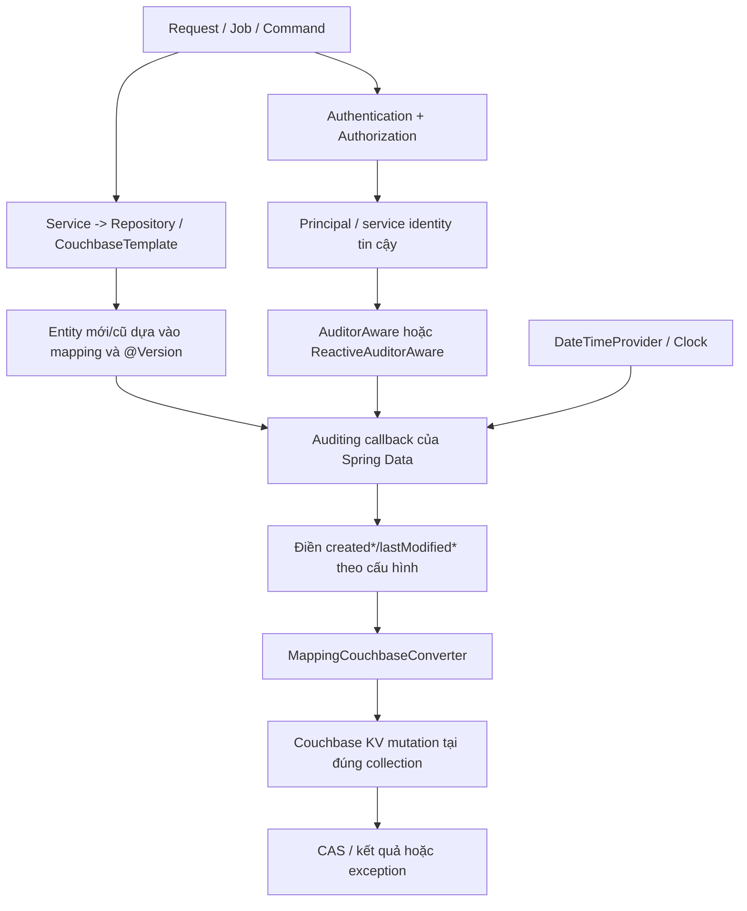

# Kích hoạt @EnableCouchbaseAuditing và cung cấp AuditorAware trong Spring Data Couchbase

**Spring Data Couchbase auditing** tự động gán metadata “ai tạo, ai sửa, được tạo lúc nào và được sửa lúc nào” lên entity khi thao tác lưu đi qua tầng ánh xạ của Spring Data. Để tính năng hoạt động, chỉ gắn `@CreatedBy` hay `@CreatedDate` lên field là **chưa đủ**: cần bật auditing bằng `@EnableCouchbaseAuditing`, bảo đảm bean `AuditorAware<T>` cung cấp actor phù hợp khi theo dõi người dùng, và kiểm tra pipeline repository/`CouchbaseTemplate` thực sự được cấu hình đúng.

Đây là bài thực hành cấu hình thuộc chương **Vòng đời và auditing** của module `SPRING_DATA_COUCHBASE`. Ví dụ sử dụng một ứng dụng quản lý đơn hàng có Spring Security, Couchbase bucket/scope/collection, repository, KV, SQL++, CAS và API reactive. Trọng tâm là **wiring, nguồn principal tin cậy, kiểm thử và các lỗi triển khai**, không chỉ định nghĩa bốn annotation.

## 1. Điều kiện để auditing hoạt động

Một đường ghi có auditing được thiết kế đúng thường thỏa mãn các điều kiện:

1. **Entity có metadata**: tối thiểu một trường gắn `@CreatedDate`, `@LastModifiedDate`, `@CreatedBy` hoặc `@LastModifiedBy`.
2. **Có cấu hình kích hoạt**: `@EnableCouchbaseAuditing` được xử lý trong Spring `ApplicationContext` cho đường imperative; reactive có annotation riêng.
3. **Có auditor phù hợp** khi cần hai trường “By”: bean `AuditorAware<T>` trả actor có kiểu tương thích với field.
4. **Có cơ chế xác định entity mới/cũ**: với Couchbase, `@Version` quan trọng để auditing nhận diện lần tạo, nhất là khi document key được cấp trước.
5. **Thao tác đi qua Spring Data mapping lifecycle**: `repository.save(entity)` hoặc đường Template tương ứng, không phải JSON upsert trực tiếp từ SDK.
6. **Đúng keyspace và quyền**: repository/Template đã chọn đúng bucket.scope.collection, user Couchbase có quyền ghi, business caller được authorization ở tầng ứng dụng.
7. **Có kiểm thử thực tế**: create/update phải đặt đúng actor, timestamp và lưu đúng metadata trong document.

Nếu một trong các điều kiện bị thiếu, bạn có thể thấy `createdAt` null, `createdBy` rỗng, metadata bị đè sai hoặc auditing chỉ chạy trên một số phương thức.

### Sơ đồ chức năng



Sơ đồ này mô tả sự phụ thuộc, **không** phải timeline chính xác của mọi callback/event ở mọi phiên bản. Auditing có thể dùng các callback trước/sau convert; không nên dựa vào tên sơ đồ để kết luận một custom listener bất đồng bộ chạy trước commit.

## 2. Chuẩn bị một entity để quan sát kết quả

Giả sử ứng dụng cấu hình bucket `shop` và cần lưu đơn hàng vào:

```text
shop.commerce.orders
```

Entity:

```java
package example.shop.order;

import java.time.Instant;

import org.springframework.data.annotation.CreatedBy;
import org.springframework.data.annotation.CreatedDate;
import org.springframework.data.annotation.Id;
import org.springframework.data.annotation.LastModifiedBy;
import org.springframework.data.annotation.LastModifiedDate;
import org.springframework.data.annotation.Version;
import org.springframework.data.couchbase.core.mapping.Document;
import org.springframework.data.couchbase.repository.Collection;
import org.springframework.data.couchbase.repository.Scope;

@Document
@Scope("commerce")
@Collection("orders")
public class OrderDocument {

    @Id
    private String id;

    private String status;

    @Version
    private long version;

    @CreatedDate
    private Instant createdAt;

    @LastModifiedDate
    private Instant lastModifiedAt;

    @CreatedBy
    private String createdBy;

    @LastModifiedBy
    private String lastModifiedBy;

    public OrderDocument() {}

    public OrderDocument(String id, String status) {
        this.id = id;
        this.status = status;
    }

    public String getId() { return id; }
    public String getStatus() { return status; }
    public void setStatus(String status) { this.status = status; }

    public long getVersion() { return version; }
    public Instant getCreatedAt() { return createdAt; }
    public Instant getLastModifiedAt() { return lastModifiedAt; }
    public String getCreatedBy() { return createdBy; }
    public String getLastModifiedBy() { return lastModifiedBy; }
}
```

Repository:

```java
package example.shop.order;

import org.springframework.data.couchbase.repository.CouchbaseRepository;

public interface OrderRepository
        extends CouchbaseRepository<OrderDocument, String> {
}
```

**Các import dễ nhầm:**

- `@CreatedDate`, `@LastModifiedDate`, `@CreatedBy`, `@LastModifiedBy`, `@Version`: `org.springframework.data.annotation`.
- `@Document`: `org.springframework.data.couchbase.core.mapping`.
- `@Scope` và `@Collection` của entity/repository: `org.springframework.data.couchbase.repository`.
- `AuditorAware`: `org.springframework.data.domain.AuditorAware`.
- `@EnableCouchbaseAuditing`: `org.springframework.data.couchbase.repository.auditing.EnableCouchbaseAuditing`.

Không nhầm `@Scope` dùng để chọn Couchbase scope với `org.springframework.context.annotation.Scope` dùng cho Spring bean.

### Vì sao có @Version?

Tài liệu Couchbase nêu rõ: **entity cần có `@Version` để lần tạo được auditing nhận diện đúng**. Một entity mới hoàn toàn có thể đã có ID do service tạo:

```java
new OrderDocument("order::1001", "NEW");
```

ID tồn tại trong object **không chứng minh** key đã tồn tại trong Couchbase. `@Version` trong Couchbase có ý nghĩa CAS (Compare-And-Swap), không phải số revision nghiệp vụ do app tự tăng.

## 3. Khởi động auditing đơn giản nhất bằng @EnableCouchbaseAuditing

Khai báo một cấu hình Spring:

```java
package example.shop.config;

import org.springframework.context.annotation.Configuration;
import org.springframework.data.couchbase.repository.auditing.EnableCouchbaseAuditing;

@Configuration
@EnableCouchbaseAuditing
public class CouchbaseAuditingConfiguration {
}
```

Annotation này yêu cầu Spring đăng ký hạ tầng auditing của Couchbase. Cấu hình phải được phát hiện bởi component scanning hoặc được import vào context của ứng dụng. Nó **không** thay thế cấu hình kết nối Couchbase, bucket, repository scan hay quyền.

Khi entity **chỉ dùng ngày** như `@CreatedDate` và `@LastModifiedDate`, Spring Data Commons cho phép auditing hoạt động **không cần bean `AuditorAware`**. Khi entity dùng `@CreatedBy` hoặc `@LastModifiedBy`, cần cấu hình nguồn actor để hai trường đó mang giá trị có ý nghĩa.

### Cấu hình nào nên nằm ở đâu?

Trong một ứng dụng Spring Boot có sẵn `spring-boot-starter-data-couchbase`, có thể đặt `@EnableCouchbaseAuditing` trên một class `@Configuration` độc lập như trên. Nếu dự án đã extends `AbstractCouchbaseConfiguration`, có thể đặt annotation trên class cấu hình đó. **Không tự tạo thêm một cấu hình `AbstractCouchbaseConfiguration` thứ hai** chỉ để bật auditing, vì có thể gây trùng hạ tầng Couchbase.

Nếu ứng dụng dùng nhiều bucket/Template tùy chỉnh, hãy kiểm tra Template/repository nào thực sự nhận các callback auditing; annotation ở một class chưa chứng minh mọi instance Template được dựng thủ công đều đi qua cùng pipeline.

## 4. AuditorAware<T> là SPI gì?

Interface từ Spring Data Commons:

```java
package org.springframework.data.domain;

public interface AuditorAware<T> {

    Optional<T> getCurrentAuditor();
}
```

`T` là kiểu của **giá trị actor lưu vào entity**, không phải kiểu `Authentication` bắt buộc của Spring Security. Với field `String createdBy` và `String lastModifiedBy`, dùng `AuditorAware<String>`.

Ví dụ triển khai tối thiểu để học hoặc chạy test:

```java
package example.shop.config;

import java.util.Optional;

import org.springframework.context.annotation.Bean;
import org.springframework.context.annotation.Configuration;
import org.springframework.data.domain.AuditorAware;

@Configuration
public class ExampleAuditorConfiguration {

    @Bean("exampleAuditor")
    AuditorAware<String> exampleAuditor() {
        return () -> Optional.of("demo-actor");
    }
}
```

Để chọn bean vừa tạo:

```java
@Configuration
@EnableCouchbaseAuditing(auditorAwareRef = "exampleAuditor")
public class ExampleAuditingActivation {
}
```

**Chỉ dùng “demo-actor” cho demo/test.** Trong production, hardcode cùng actor cho mọi người dùng sẽ làm mất giá trị kiểm toán. Không triển khai đồng thời cấu hình demo và cấu hình production nếu hai cấu hình cùng kích hoạt auditing ngoài ý muốn.

### Vì sao trả Optional<T>?

`Optional.empty()` biểu thị không có auditor. Có thể xuất hiện ở job nền, request chưa xác thực, hoặc pipeline không có security context. Đừng coi empty đồng nghĩa với một user có tên `"anonymous"` được phép ghi; đó là hai ngữ nghĩa khác nhau.

Cần quyết định theo loại nghiệp vụ:

- Đường công khai cần actor bắt buộc: từ chối command chưa xác thực **trước khi save**.
- Job nội bộ có danh tính dịch vụ: sử dụng service identity đáng tin cậy.
- Quá trình import không biết actor: lưu `unknown/imported` theo policy minh bạch nếu được chấp nhận; không bịa ra tên user cụ thể.

## 5. Cung cấp AuditorAware từ Spring Security

Đối với ứng dụng Spring MVC/imperative, principal đã xác thực thường được Spring Security đặt trong `SecurityContextHolder` của luồng request. Cấu hình:

```java
package example.shop.config;

import java.util.Optional;

import org.springframework.context.annotation.Bean;
import org.springframework.context.annotation.Configuration;
import org.springframework.data.domain.AuditorAware;
import org.springframework.security.authentication.AnonymousAuthenticationToken;
import org.springframework.security.core.Authentication;
import org.springframework.security.core.context.SecurityContextHolder;

@Configuration
public class SecurityAuditorConfiguration {

    @Bean("securityAuditor")
    AuditorAware<String> securityAuditor() {
        return () -> Optional.ofNullable(
                SecurityContextHolder.getContext()
                    .getAuthentication()
            )
            .filter(Authentication::isAuthenticated)
            .filter(auth ->
                !(auth instanceof AnonymousAuthenticationToken)
            )
            .map(Authentication::getName)
            .filter(name -> !name.isBlank());
    }
}
```

Kích hoạt:

```java
package example.shop.config;

import org.springframework.context.annotation.Configuration;
import org.springframework.data.couchbase.repository.auditing.EnableCouchbaseAuditing;

@Configuration
@EnableCouchbaseAuditing(
    auditorAwareRef = "securityAuditor"
)
public class OrderAuditActivation {
}
```

Đây là **hai class cấu hình phối hợp**: class đầu khai báo bean auditor, class sau chỉ rõ bean đó cho auditing. Bạn cũng có thể đặt bean và annotation trên cùng một class, miễn là không đăng ký hạ tầng auditing nhiều lần.

### Đọc kỹ ý nghĩa của Authentication

- `isAuthenticated()` là một dấu hiệu cần kiểm tra, nhưng một `AnonymousAuthenticationToken` có thể cũng tự nhận `isAuthenticated() == true`; vì vậy cần lọc token ẩn danh hoặc xác thực theo chính sách bảo mật.
- `getName()` có thể trả username, email hoặc principal name tùy authentication provider. Nó **không chắc là user ID bất biến**.
- Nếu domain yêu cầu định danh lâu dài, hãy lấy một ID nội bộ đã được xác thực từ một kiểu principal do ứng dụng kiểm soát, không lưu token/JWT đầy đủ vào Couchbase.
- `AuditorAware` **ghi nhận ai**, không tự phân quyền **ai được sửa document nào**.

### Ví dụ khi dùng principal riêng

Giả sử Spring Security principal là:

```java
public record ShopPrincipal(
    String userId,
    String displayName
) {}
```

Nếu authentication thực sự chứa `ShopPrincipal`, có thể lấy ID bằng kiểm tra kiểu:

```java
@Bean("stableUserAuditor")
AuditorAware<String> stableUserAuditor() {
    return () -> Optional.ofNullable(
            SecurityContextHolder.getContext()
                .getAuthentication()
        )
        .filter(Authentication::isAuthenticated)
        .filter(auth ->
            !(auth instanceof AnonymousAuthenticationToken)
        )
        .map(Authentication::getPrincipal)
        .filter(ShopPrincipal.class::isInstance)
        .map(ShopPrincipal.class::cast)
        .map(ShopPrincipal::userId);
}
```

Đây là ví dụ **phụ thuộc cấu trúc principal của ứng dụng**, không phải kiểu mặc định trong Spring Security. Cần bảo đảm bean `stableUserAuditor` được chọn thay cho `securityAuditor` nếu muốn lưu stable ID.

## 6. Đừng lấy createdBy/lastModifiedBy từ request body

Một DTO nguy hiểm:

```java
public record CreateOrderRequest(
    String status,
    String createdBy,
    String lastModifiedBy
) {}
```

Nếu service copy thẳng `createdBy` từ client, người dùng có thể tự khai `"administrator"`. Cách làm an toàn hơn:

```java
public record CreateOrderRequest(String status) {}
```

Service chịu trách nhiệm:

1. Xác thực và authorize request.
2. Kiểm tra membership và scope/tenant được phép.
3. Tạo entity nghiệp vụ.
4. Lưu qua repository/Template.
5. Để auditing lấy actor từ context tin cậy.

**Không dùng auditing làm hàng rào bảo mật.** Ngay cả khi `createdBy` là đúng tên user, service vẫn phải đảm bảo user có quyền ghi vào `shop.commerce.orders` và đúng tenant.

## 7. Cấu hình đầy đủ @EnableCouchbaseAuditing

Javadoc cho phép bốn thuộc tính chính:

| Thuộc tính | Kiểu | Mặc định | Vai trò |
| --- | --- | --- | --- |
| `auditorAwareRef` | `String` | `""` | Tên bean `AuditorAware<?>` cung cấp actor. |
| `dateTimeProviderRef` | `String` | `""` | Tên bean `DateTimeProvider` cung cấp thời gian. |
| `setDates` | `boolean` | `true` | Có tự điền ngày tạo/sửa không. |
| `modifyOnCreate` | `boolean` | `true` | Có đánh dấu last-modified ngay khi tạo mới không. |

Cấu hình tường minh:

```java
package example.shop.config;

import org.springframework.context.annotation.Configuration;
import org.springframework.data.couchbase.repository.auditing.EnableCouchbaseAuditing;

@Configuration
@EnableCouchbaseAuditing(
    auditorAwareRef = "securityAuditor",
    dateTimeProviderRef = "auditTimeProvider",
    setDates = true,
    modifyOnCreate = true
)
public class ProductionAuditingConfiguration {
}
```

Cần có hai bean tên `securityAuditor` và `auditTimeProvider`. Nếu không có bean đúng tên/kiểu, context có thể thất bại khi khởi tạo hoặc auditing không hoạt động theo kỳ vọng; không cố xử lý bằng cách bỏ qua lỗi.

### Ý nghĩa modifyOnCreate

Khi `modifyOnCreate=true`, entity mới thường có cả metadata created và last-modified. Khi `false`, bạn có thể muốn field modified chỉ có giá trị sau update đầu tiên.

| Lệnh | `modifyOnCreate=true` | `modifyOnCreate=false` |
| --- | --- | --- |
| Create | Điền created*; đồng thời điền lastModified* nếu actor/date có. | Điền created*; lastModified* thường để trống. |
| Update | Điền lastModified* mới, giữ created* cũ. | Tương tự. |

Nếu bạn đặt `@NotNull` trên `lastModifiedAt` nhưng lại chọn `modifyOnCreate=false`, hãy xem lại validation contract: một entity mới hoàn toàn hợp lệ có thể chưa có trường modified.

### setDates=false dùng khi nào?

`setDates=false` tắt việc auditing tự điền các trường ngày. Nó không đồng nghĩa Couchbase tự thay vào bằng server time; nếu cần ngày thì ứng dụng phải có cơ chế khác. Đây là tùy chọn cho hệ thống muốn **kiểm soát timestamp ở ranh giới khác**, nhưng phải thống nhất ý nghĩa với mọi đường ghi.

Không đặt `setDates=false` chỉ để “tối ưu hiệu năng” rồi để `@CreatedDate` mãi null.

## 8. DateTimeProvider và Clock cho thời gian có thể kiểm thử

Spring Data Commons dùng `DateTimeProvider` để trả một đối tượng thời gian; mặc định có `CurrentDateTimeProvider`. Bạn có thể thay bằng bean:

```java
package example.shop.config;

import java.time.Clock;
import java.time.Instant;
import java.util.Optional;

import org.springframework.context.annotation.Bean;
import org.springframework.context.annotation.Configuration;
import org.springframework.data.auditing.DateTimeProvider;

@Configuration
public class AuditTimeConfiguration {

    @Bean("auditClock")
    Clock auditClock() {
        return Clock.systemUTC();
    }

    @Bean("auditTimeProvider")
    DateTimeProvider auditTimeProvider(
            @org.springframework.beans.factory.annotation.Qualifier(
                "auditClock"
            ) Clock clock) {

        return () -> Optional.of(Instant.now(clock));
    }
}
```

Nếu muốn code gọn hơn, import `@Qualifier` ở đầu file và dùng `@Qualifier("auditClock") Clock clock`. Trong ví dụ trên, fully-qualified annotation được dùng để nhấn mạnh cách chọn bean Clock khi context có nhiều Clock.

Lợi ích của `Clock`:

- Kiểm soát thời gian theo UTC trong ứng dụng.
- Test dùng `Clock.fixed(...)` hoặc một `DateTimeProvider` điều khiển được.
- Tránh khẳng định timestamp bằng đúng `Instant.now()` ở thời điểm assert.
- Phân biệt thời điểm application ghi nhận với thời điểm Couchbase Server commit.

Không nên đổi sang `LocalDateTime.now()` rồi xem đó là UTC nếu JVM timezone không được cố định. `Instant` phù hợp để lưu thời điểm tuyệt đối; việc hiển thị múi giờ thuộc tầng API/UI.

### Vì sao không lấy ngày từ HTTP request?

Client có thể gửi timestamp giả. Với creation/modification auditing, timestamp nên đến từ nguồn do hệ thống kiểm soát. Nếu nghiệp vụ có thời điểm người dùng chọn (ví dụ `requestedDeliveryDate`), đó là field nghiệp vụ **khác** chứ không thay thế `createdAt`.

## 9. Nhiều AuditorAware bean: phải chọn rõ bằng auditorAwareRef

Ứng dụng lớn có thể có hai nguồn identity:

```text
securityAuditor   -> user ID từ Spring Security
systemJobAuditor  -> định danh job/service
```

Nếu hai bean cùng kiểu `AuditorAware<String>` xuất hiện trong context và bạn không chỉ rõ auditor, hành vi wiring có thể không rõ ràng hoặc dẫn đến lỗi/nhầm bean, tùy cấu hình. Nên chỉ rõ:

```java
@EnableCouchbaseAuditing(
    auditorAwareRef = "securityAuditor"
)
```

**Không giải quyết bằng cách dùng một bean global mutable `currentActor`.** Trong các request đồng thời, một trường singleton có thể bị thay bởi thread khác, làm user A bị gán audit user B.

### Nên dùng một bean hay nhiều bean?

Với một application xử lý cả request và job:

- Ưu tiên một chính sách xác định actor dựa trên **context tin cậy của từng loại entrypoint**.
- Với HTTP, lấy principal từ security context.
- Với job, sử dụng service/job identity đã biết và truyền trong một cơ chế context-propagation rõ ràng hoặc trong domain command khi phù hợp.
- Nếu dữ liệu audit phải phân biệt “ai khởi xướng” và “service nào thực hiện”, có thể dùng các field domain riêng `initiatedBy`, `executedBy`, không ép cả hai vào `@LastModifiedBy`.

Trong những module/kết nối tách biệt, có thể cần hai cấu hình auditor khác nhau, nhưng phải chắc chắn mỗi repository/Template đang dùng đúng hạ tầng auditing. Đừng bật nhiều cấu hình `@EnableCouchbaseAuditing` chồng lấn rồi mặc định chúng tự chọn auditor theo package của entity.

## 10. Ví dụ thực hành: tạo và cập nhật đơn hàng

Giả định `securityAuditor` trả `user-alice`, `modifyOnCreate=true`.

### Tạo mới

```java
String id = "order::" + java.util.UUID.randomUUID();
OrderDocument order = new OrderDocument(id, "NEW");

OrderDocument saved = orderRepository.save(order);
```

Kết quả kỳ vọng sau khi save thành công:

| Field | Giá trị |
| --- | --- |
| `createdBy` | `user-alice`. |
| `lastModifiedBy` | `user-alice` (vì `modifyOnCreate=true`). |
| `createdAt` | Thời điểm provider trả khi tạo. |
| `lastModifiedAt` | Thời điểm modified trên lần tạo nếu đã bật. |
| `version` | CAS/metadata của document sau save. |

### Cập nhật bởi người dùng khác

Sau đó `securityAuditor` trả `user-bob`:

```java
OrderDocument loaded = orderRepository
    .findById(id)
    .orElseThrow();

loaded.setStatus("CONFIRMED");

OrderDocument updated = orderRepository.save(loaded);
```

Các bất biến cần kiểm thử:

```text
createdBy(created)         == "user-alice"
createdBy(updated)         == "user-alice"
lastModifiedBy(updated)    == "user-bob"
createdAt(updated)         == createdAt(created)
lastModifiedAt(updated)    do auditTimeProvider của lần cập nhật trả
```

Không nên assert `lastModifiedAt(updated) > lastModifiedAt(created)` bằng đồng hồ thật và dựa vào thứ tự tuyệt đối của các máy chủ; nếu cần test chính xác, dùng provider điều khiển được với hai Instant khác nhau.

### Save thành công khác với callback đã chạy

Nếu callback đã điền `lastModifiedBy` trong object JVM nhưng mutation thất bại vì CAS, **đừng ghi nhận Bob đã cập nhật thành công**. Chỉ khi thao tác lưu hoàn tất theo API, trạng thái mới được xem là đã commit.

## 11. Cấu hình actor trong background job

Một batch job đồng bộ trạng thái đơn hàng có thể chạy không có security context HTTP:

```java
@Scheduled(cron = "0 0 2 * * *")
public void syncOrders() {
    // ...
}
```

Nếu `AuditorAware` chỉ đọc `SecurityContextHolder`, nhiều khả năng nó trả `Optional.empty()` trong job. Có một số chiến lược:

1. Đưa job qua một service command có **service principal** được xác minh và cung cấp context rõ ràng.
2. Có một tầng thực thi job tạo định danh `job:nightly-order-sync` và chuyển nó theo đường call được kiểm soát.
3. Dùng metadata riêng `executedByService` nếu không muốn trộn actor người dùng với tác nhân kỹ thuật.
4. Nếu migration không biết người tạo gốc, phân biệt `importedBy/importedAt` với `createdBy/createdAt` thực.

Tránh cách không an toàn:

```java
// Không nên: fallback thành admin cho mọi request không có identity.
return Optional.of("admin");
```

Nó khiến unauthenticated request và job hợp lệ đều có vẻ như do admin thực hiện.

### Async và task executor

Trong Spring Security imperative, `SecurityContextHolder` thường dựa vào ThreadLocal. Khi bạn chuyển sang `@Async`, executor, scheduler hoặc callback ở thread khác, context không tự nhiên được bảo toàn trong mọi cấu hình.

Có thể dùng các adapter/context propagation được Spring Security hỗ trợ, ví dụ `DelegatingSecurityContextExecutor`, với cách quản lý quyền đúng cho ứng dụng. Không lưu Authentication vào biến static/singleton rồi dùng lại cho tất cả task.

**Test bắt buộc:** hai tác vụ đồng thời với actor khác nhau không được ghi `createdBy/lastModifiedBy` của nhau.

## 12. Tách thời điểm “sửa document” và “sự kiện nghiệp vụ”

`@LastModifiedDate` thường phản ánh **lần save/cập nhật entity qua Spring Data**, không đồng nghĩa một sự kiện nghiệp vụ cụ thể.

Ví dụ:

- Đổi `status=CONFIRMED` là một business transition.
- Chạy migration để thay format field nhưng giữ nguyên status cũng có thể cập nhật `lastModifiedAt`.
- Ghi lại document không đổi giá trị trong một số đường save có thể làm CAS/auditing metadata thay đổi.
- Retry/cập nhật thất bại không được tính là business transition đã commit.

Nếu cần thời điểm xác nhận:

```java
private Instant confirmedAt;
```

hãy quản lý ở domain command. Nếu cần toàn bộ lịch sử, dùng audit event/outbox hoặc hệ thống event stream, không chỉ bốn trường hiện hành.

### Auditing không thay thế authorization

`createdBy` là thông tin actor đã được provider trả, không có nghĩa user được quyền thao tác. Service phải kiểm tra membership, ownership và quyền theo tenant trước khi chọn scope/collection hoặc gọi repository.

## 13. Reactive: phải bật annotation riêng

Spring Data Couchbase có đường reactive với:

```java
org.springframework.data.couchbase.repository.auditing.EnableReactiveCouchbaseAuditing
```

Ví dụ:

```java
package example.shop.reactive;

import org.springframework.context.annotation.Configuration;
import org.springframework.data.couchbase.repository.auditing.EnableReactiveCouchbaseAuditing;

@Configuration
@EnableReactiveCouchbaseAuditing(
    auditorAwareRef = "reactiveSecurityAuditor",
    modifyOnCreate = true
)
public class ReactiveCouchbaseAuditConfiguration {
}
```

Thay vì `AuditorAware<T>`, reactive dùng:

```java
org.springframework.data.domain.ReactiveAuditorAware<T>
```

Nó trả `Publisher<T>`; `Mono<T>` là một implementation phù hợp.

**Không chỉ thay kiểu repository thành `ReactiveCouchbaseRepository` rồi mặc định bean `AuditorAware` đồng bộ sẽ hoạt động đúng với reactive pipeline.** Cần bật đúng auditing reactive và cung cấp reactive auditor.

### Ví dụ ReactiveAuditorAware với Spring Security

```java
package example.shop.reactive;

import org.springframework.context.annotation.Bean;
import org.springframework.context.annotation.Configuration;
import org.springframework.data.domain.ReactiveAuditorAware;
import org.springframework.security.authentication.AnonymousAuthenticationToken;
import org.springframework.security.core.Authentication;
import org.springframework.security.core.context.ReactiveSecurityContextHolder;

import reactor.core.publisher.Mono;

@Configuration
public class ReactiveSecurityAuditorConfiguration {

    @Bean("reactiveSecurityAuditor")
    ReactiveAuditorAware<String> reactiveSecurityAuditor() {
        return () -> ReactiveSecurityContextHolder.getContext()
            .flatMap(context ->
                Mono.justOrEmpty(context.getAuthentication())
            )
            .filter(Authentication::isAuthenticated)
            .filter(auth ->
                !(auth instanceof AnonymousAuthenticationToken)
            )
            .map(Authentication::getName)
            .filter(name -> !name.isBlank());
    }
}
```

`Mono.justOrEmpty(...)` bảo vệ trường hợp context không có `Authentication`. `ReactiveSecurityContextHolder` dựa trên Reactor context phù hợp, không cần đoán principal từ ThreadLocal ở một thread có thể thay đổi.

Khi actor không có mặt, publisher không phát phần tử; nghiệp vụ phải quyết định có chấp nhận thao tác hoặc cần từ chối command từ trước.

### Kiểm thử bằng subscriber

```java
import reactor.test.StepVerifier;

StepVerifier.create(
        reactiveOrderRepository.save(
            new OrderDocument("order::" + java.util.UUID.randomUUID(), "NEW")
        )
    )
    .assertNext(saved -> {
        org.junit.jupiter.api.Assertions.assertNotNull(
            saved.getCreatedAt()
        );
    })
    .verifyComplete();
```

Đây là ví dụ **đặt trong một test đã chuẩn bị reactive repository, collection và auditing configuration**. `StepVerifier` cần `reactor-test` dependency. Chỉ tạo `Mono` mà không subscribe chưa chứng minh DB đã ghi xong.

## 14. Reactive context và việc mất principal

Một pipeline có thể chuyển scheduler, chạy song song hoặc xử lý request đồng thời. Đừng đặt actor vào singleton mutable:

```java
// Không an toàn với concurrent requests:
currentUser = request.userId();
repository.save(order).subscribe();
```

Nếu `currentUser` là một field dùng chung, request B có thể thay request A trước khi callback auditing thực thi.

Thiết kế đúng:

- Spring Security reactive tạo `SecurityContext` tương ứng trong Reactor context.
- `ReactiveAuditorAware` lấy identity qua `ReactiveSecurityContextHolder`.
- Dịch vụ kiểm tra authorization trước thao tác DB.
- Khi xây dựng pipeline thủ công, không mất context qua các ranh giới subscription không được quản lý.
- Nếu actor là service/job identity, truyền nó có chủ đích theo context hoặc command của hệ thống, không fallback một giá trị mutable toàn cục.

Trong test, tạo hai pipeline với principal khác nhau và xác nhận `createdBy` của từng document. Không chỉ test một luồng rồi suy ra concurrency an toàn.

## 15. SQL++ và SDK trực tiếp có đi qua auditing không?

**Không phải mọi thao tác Couchbase đều đi qua Spring Data lifecycle.**

| Đường ghi | Spring Data auditing mặc định |
| --- | --- |
| `CouchbaseRepository.save(entity)` | Có thể được áp dụng nếu auditing đã bật, entity mapping và callbacks đúng. |
| `CouchbaseTemplate.upsertById(Entity.class)...one(entity)` | Có thể được áp dụng qua entity lifecycle, cần xác minh Template tùy chỉnh. |
| `ReactiveCouchbaseRepository.save` | Qua auditing reactive khi cấu hình phù hợp và publisher được tiêu thụ. |
| Java SDK `collection.upsert(id, JsonObject)` | **Không tự chạy** `AuditorAware`/entity callback của Spring Data. |
| SQL++ `UPDATE`/`INSERT` trực tiếp | **Không tự chạy** auditing callback cho mỗi document trên server. |
| Import, ETL, XDCR | Không chạy auditing của một JVM Spring nếu không đi qua ứng dụng đó. |
| TTL/expiry tự xóa document | Không phải thao tác `save` của Spring Data, không cập nhật `lastModifiedAt`. |

Ví dụ SDK:

```java
var collection = cluster.bucket("shop")
    .scope("commerce")
    .collection("orders");

collection.upsert(
    "order::external",
    com.couchbase.client.java.json.JsonObject.create()
        .put("status", "NEW")
);
```

Couchbase Server sẽ tạo metadata CAS cho document nhưng **không biết principal đang đăng nhập ứng dụng Spring**. Nếu cần ghi audit fields cho import hoặc SDK transaction, phải có logic tương ứng ở đường ghi đó, không mặc định annotations tác động tới server.

### SQL++ UPDATE với metadata chủ động

```sql
UPDATE `shop`.`commerce`.`orders` AS o
SET o.status = $status,
    o.lastModifiedBy = $actorId,
    o.lastModifiedAt = $modifiedAt
WHERE META(o).id = $documentId;
```

Đường SQL++ này phải lấy `$actorId` và `$modifiedAt` từ nguồn tin cậy. Cần đảm bảo định dạng JSON tương thích với converter đang dùng, và thêm điều kiện bảo vệ quyền/CAS/tenant khi nghiệp vụ cần. Câu SQL++ không tự xử lý optimistic locking chỉ vì entity Java có `@Version`.

## 16. Auditing trên nhiều bucket, scope và collection

Nếu hệ thống có:

```text
shop-live.commerce.orders
shop-audit.operations.audit_events
shop-archive.history.orders
```

cần tách hai quyết định:

- **Chọn keyspace:** từ repository/Template/ClientFactory, `@Scope/@Collection`, `withScope/withCollection` hoặc fluent API.
- **Chọn actor:** từ `AuditorAware<T>`/`ReactiveAuditorAware<T>` trong Spring context.

Cùng một auditor có thể được dùng cho nhiều repository. Nhưng điều đó không xác nhận user được quyền đọc/ghi mọi collection. Nếu dùng multi-tenant routing, service phải authorize tenant và chọn đúng keyspace **trước khi lưu**.

### Template tự tạo có thể cần kiểm tra wiring

Nếu dự án tạo `CouchbaseTemplate` bổ sung cho bucket archive/audit, đừng dựa vào một integration test của repository bucket mặc định để tuyên bố auditing tự chạy trên mọi Template. Viết test độc lập cho mỗi Template/repository được sử dụng, kiểm tra trực tiếp nội dung JSON tại đúng bucket.scope.collection.

Nếu copy entity từ bucket live sang archive mà giữ metadata createdAt/createdBy, cần xác định semantics: archive có muốn lưu **người tạo ban đầu** hay **actor thực hiện archive**? Hai nghĩa khác nhau nên có thể cần field `archivedBy/archivedAt` riêng thay vì ghi đè thông tin creation.

## 17. Auditing, CAS và xử lý conflict

Khi hai user cùng cập nhật đơn hàng:

```text
Alice đọc CAS=A
Bob đọc CAS=A

Alice save -> thành công, CAS=B
Bob save với CAS=A -> OptimisticLockingFailure
```

Trong lần save thất bại của Bob, callback auditing **có thể đã điền `lastModifiedBy=bob` trên object trong bộ nhớ**. Không vì thế mà kết luận Bob đã cập nhật document thành công.

Quy tắc an toàn:

1. Bắt và phân loại lỗi optimistic locking.
2. Reload entity với CAS mới.
3. Kiểm tra lại business invariant và authorization.
4. Áp dụng command, rồi save có giới hạn retry.
5. Không tự tăng `version` như bộ đếm.
6. Không gửi email/broker chỉ vì auditor/callback đã chạy; external side effect có thể lặp hoặc xảy ra trước khi mutation commit.

Auditing không tạo một transaction nhiều document và không bảo đảm message đúng một lần. Nếu audit event là bắt buộc, dùng transaction/outbox hoặc workflow phục hồi phù hợp.

## 18. Testing: từ bean wiring đến dữ liệu thực trong Couchbase

Một bộ kiểm thử chỉ gọi `securityAuditor().getCurrentAuditor()` rồi assert `"alice"` chưa đủ. Cần xác minh:

- Spring đã đăng ký đúng hạ tầng auditing.
- `auditorAwareRef` trỏ tới bean thật, không bị nhầm bean khi context có nhiều `AuditorAware`.
- Entity có `@Version` và được nhận diện mới/cũ đúng.
- Repository/Template chạy callback của Spring Data.
- JSON được persist tại **đúng collection** chứa metadata mong đợi.
- Giá trị created giữ nguyên qua update; modified thay đổi theo actor/time.
- Không có actor giả trong job hoặc request chưa xác thực.

### 18.1. Test đơn vị AuditorAware

Ví dụ với Spring Security Test:

```java
import static org.junit.jupiter.api.Assertions.assertEquals;

import java.util.Optional;

import org.junit.jupiter.api.Test;
import org.springframework.security.authentication.UsernamePasswordAuthenticationToken;
import org.springframework.security.core.context.SecurityContextHolder;

class SecurityAuditorUnitTest {

    @Test
    void usesAuthenticatedPrincipalName() {
        try {
            var auth = new UsernamePasswordAuthenticationToken(
                "user-alice",
                "unused",
                java.util.List.of()
            );
            SecurityContextHolder.getContext()
                .setAuthentication(auth);

            var auditor = new SecurityAuditorConfiguration()
                .securityAuditor();

            assertEquals(
                Optional.of("user-alice"),
                auditor.getCurrentAuditor()
            );
        } finally {
            SecurityContextHolder.clearContext();
        }
    }
}
```

Test này kiểm tra logic Java của provider trong một thread với authentication xác định. Nó **chưa** chứng minh Spring Data repository nhận callback.

**Lưu ý:** đây là ví dụ unit test ở cùng package phù hợp hoặc có thể truy cập method bean package-private. Với kiến trúc khác package, tạo một public provider class riêng để test, hoặc dùng Spring test context thay vì gọi trực tiếp configuration method.

### 18.2. Test auditor vắng mặt

```java
@Test
void anonymousDoesNotBecomeAuditUser() {
    SecurityContextHolder.clearContext();

    var auditor = new SecurityAuditorConfiguration()
        .securityAuditor();

    org.junit.jupiter.api.Assertions.assertTrue(
        auditor.getCurrentAuditor().isEmpty()
    );
}
```

Bảo đảm test không giữ state security context từ test trước. Một test khác nên thiết lập `AnonymousAuthenticationToken` và xác nhận cũng không biến thành actor hợp lệ.

### 18.3. Test integration với actor và clock kiểm soát được

Một cách tạo provider thời gian/actor cho test:

```java
import java.time.Instant;
import java.util.Optional;
import java.util.concurrent.atomic.AtomicReference;

import org.springframework.data.auditing.DateTimeProvider;
import org.springframework.data.domain.AuditorAware;

public final class MutableAuditTestSource {

    private final AtomicReference<String> actor =
        new AtomicReference<>("alice");

    private final AtomicReference<Instant> time =
        new AtomicReference<>(
            Instant.parse("2026-11-25T02:00:00Z")
        );

    public void set(String newActor, Instant newTime) {
        actor.set(newActor);
        time.set(newTime);
    }

    public AuditorAware<String> actorProvider() {
        return () -> Optional.ofNullable(actor.get());
    }

    public DateTimeProvider timeProvider() {
        return () -> Optional.ofNullable(time.get());
    }
}
```

Cấu hình test có thể đăng ký:

```java
@TestConfiguration
@EnableCouchbaseAuditing(
    auditorAwareRef = "testAuditor",
    dateTimeProviderRef = "testClock",
    modifyOnCreate = true
)
class AuditTestBeans {

    @Bean
    MutableAuditTestSource source() {
        return new MutableAuditTestSource();
    }

    @Bean("testAuditor")
    AuditorAware<String> testAuditor(MutableAuditTestSource source) {
        return source.actorProvider();
    }

    @Bean("testClock")
    DateTimeProvider testClock(MutableAuditTestSource source) {
        return source.timeProvider();
    }
}
```

Đoạn này đặt trong môi trường test có các import tương ứng cho `@TestConfiguration`, `@Bean` và `@EnableCouchbaseAuditing`. **Không kích hoạt đồng thời cả production auditing configuration và test auditing configuration** trong cùng context nếu chúng xung đột. Hãy thay thế hoặc thiết kế test context có một cấu hình auditing rõ ràng.

Nếu test chạy song song, nguồn `AtomicReference` dùng chung có thể khiến hai test trộn actor/thời gian. Nên tạo context riêng hoặc tắt parallel cho nhóm test dùng chung state.

### 18.4. Assertion sau create/update

Giả sử có `source` và `repository` trong test context:

```java
Instant t1 = Instant.parse("2026-11-25T02:00:00Z");
Instant t2 = Instant.parse("2026-11-25T03:00:00Z");

source.set("alice", t1);

String id = "it::audit::" + java.util.UUID.randomUUID();
OrderDocument created =
    repository.save(new OrderDocument(id, "NEW"));

assertEquals(t1, created.getCreatedAt());
assertEquals("alice", created.getCreatedBy());
assertEquals("alice", created.getLastModifiedBy());

source.set("bob", t2);

OrderDocument loaded = repository.findById(id).orElseThrow();
loaded.setStatus("CONFIRMED");

OrderDocument updated = repository.save(loaded);

assertEquals(t1, updated.getCreatedAt());
assertEquals("alice", updated.getCreatedBy());
assertEquals(t2, updated.getLastModifiedAt());
assertEquals("bob", updated.getLastModifiedBy());
```

Đây là **thân test minh họa**, giả định `assertEquals` được import từ JUnit, entity dùng đúng fields, test bucket/scope/collection đã provision và Spring Data auditing đang bật. Nên dùng ID unique và cleanup để tránh document cũ làm `isNew` sai.

### 18.5. Oracle độc lập bằng Java SDK

Sau khi gọi repository, đọc JSON trực tiếp:

```java
var raw = cluster.bucket("shop")
    .scope("commerce")
    .collection("orders")
    .get(id)
    .contentAsObject();

assertEquals(
    "alice",
    raw.getString("createdBy")
);
assertEquals(
    "bob",
    raw.getString("lastModifiedBy")
);
```

SDK dùng để **đọc oracle độc lập**, tránh việc repository ghi nhầm collection rồi chính repository đó đọc nhầm nhưng test vẫn pass. Với timestamp, hãy kiểm tra định dạng lưu thực tế của converter; không tự giả định SDK luôn trả chuỗi ISO-8601 trong mọi bản Spring Data.

## 19. Kiểm thử reactive auditor đúng context

Reactive test phải đặt principal vào Reactor context hoặc sử dụng Spring Security test support phù hợp.

Ví dụ mức ý tưởng:

```java
Mono<OrderDocument> result =
    reactiveOrderRepository.save(order)
        .contextWrite(
            ReactiveSecurityContextHolder.withAuthentication(
                new UsernamePasswordAuthenticationToken(
                    "reactive-alice",
                    "unused",
                    java.util.List.of()
                )
            )
        );

StepVerifier.create(result)
    .assertNext(saved ->
        assertEquals("reactive-alice", saved.getCreatedBy())
    )
    .verifyComplete();
```

Import tương ứng:

```java
import org.springframework.security.authentication.UsernamePasswordAuthenticationToken;
import org.springframework.security.core.context.ReactiveSecurityContextHolder;
import reactor.core.publisher.Mono;
import reactor.test.StepVerifier;
```

Đây là **đoạn test trong class đã có `reactiveOrderRepository` và `order`, cấu hình reactive auditing/collection**, không phải class độc lập. Dùng `contextWrite` trên pipeline tương ứng và kiểm tra dữ liệu sau khi subscribe.

Không chỉ dùng một test không có concurrency. Một regression test giá trị cao tạo hai pipeline với principal riêng, chạy đồng thời và xác nhận từng document có actor đúng. Đặc biệt không dùng biến singleton static để lưu `currentUser` cho cả hai.

## 20. Những lỗi phổ biến khi cấu hình @EnableCouchbaseAuditing

| Triệu chứng | Nguyên nhân có thể | Cách kiểm tra/khắc phục |
| --- | --- | --- |
| `createdAt` luôn null | Chưa bật auditing, cấu hình không được scan, `setDates=false` hoặc Template bypass. | Kiểm tra context, annotation, bean wiring và đường save. |
| `createdBy` null còn `createdAt` có giá trị | Không có auditor, auditor trả empty, ref sai hoặc context vắng mặt. | Test `AuditorAware.getCurrentAuditor()` trong request/job thật. |
| `createdBy` là “anonymousUser” | Không lọc anonymous principal. | Loại `AnonymousAuthenticationToken`/áp chính sách xác thực rõ. |
| Có hai bean `AuditorAware` và wiring mơ hồ | Không chỉ rõ `auditorAwareRef`. | Đặt bean name tường minh và đối chiếu cấu hình. |
| Mỗi create bị coi là update | Entity có ID trước nhưng thiếu `@Version`. | Thêm/test `@Version` đúng version/CAS. |
| LastModified* không có khi create | `modifyOnCreate=false` hoặc auditor/date rỗng. | Xem contract và config. |
| Update làm đổi `createdBy` | DTO tự ghi audit field, logic tự gán hoặc newness detection sai. | Không cho client sửa fields này; test create/update. |
| `@Async` ghi `createdBy` rỗng | Không truyền security context qua executor. | Dùng cơ chế context propagation hoặc job identity phù hợp. |
| Reactive có date nhưng không có actor | Dùng auditor synchronous hoặc sai Reactor security context. | Bật reactive auditing và `ReactiveAuditorAware` đúng. |
| Reactive test chưa thấy mutation | Publisher chưa được subscribe. | Dùng `StepVerifier`. |
| Dữ liệu import không có audit fields | Import/SDK bỏ qua Spring Data lifecycle. | Chuẩn hóa/audit ở pipeline import hoặc migrate có kiểm soát. |
| SQL++ UPDATE không đổi lastModifiedAt | SQL++ DML bypass Java callback. | Set field có kiểm soát trong DML nếu nghiệp vụ yêu cầu. |
| Một Template có auditing, Template khác không | Multi-bucket/template wiring khác nhau. | Integration test theo từng Template và keyspace. |
| Save lỗi CAS nhưng entity có lastModifiedBy mới | Callback chạy trước mutation, nhưng commit thất bại. | Chỉ ghi nhận update sau save thành công; xử lý conflict. |
| Field ngày lệch timezone | Lưu local time hoặc format không nhất quán. | Dùng Instant/Clock và định dạng ở API/UI. |
| Dữ liệu legacy thiếu createdBy | Được ghi trước khi auditing bật hoặc từ SDK. | Có chiến lược backfill; không bịa người tạo thật. |

### Debug theo thứ tự nào?

1. Xác nhận dependency Spring Data Couchbase đã resolve, package annotation/bean đúng.
2. Xem class `@EnableCouchbaseAuditing` có nằm trong context và chỉ được kích hoạt có chủ đích.
3. Xác nhận `auditorAwareRef` trỏ đúng bean, generic type phù hợp.
4. Kiểm tra principal hiện có thật trong thread/Reactor context nơi save thực thi.
5. Kiểm tra entity có `@Version`, annotation audit, setter/property mapping cần thiết.
6. Kiểm tra method đang gọi thực sự là repository/Template mapping API, không phải SDK/SQL++ trực tiếp.
7. Kiểm tra bucket.scope.collection, RBAC và CAS exception.
8. Dùng Java SDK đọc JSON thật để đối chiếu; không chỉ nhìn object trước khi save.
9. Kiểm tra actor/time khi create và update ở hai kịch bản tách biệt.
10. Nếu vẫn sai, đối chiếu Javadoc/hook lifecycle với **version thực của ứng dụng**, không đoán theo bài blog ở phiên bản khác.

## 21. Migrate dữ liệu cũ và quy tắc backfill

Một document legacy có thể đã tồn tại mà không có metadata:

```json
{
  "status": "NEW"
}
```

Khi thêm annotation mới, framework **không tự biết** ai tạo document nhiều tháng trước hoặc timestamp chính xác trong quá khứ.

Quy trình hợp lý:

1. Kiểm kê document thiếu `createdAt/createdBy`.
2. Nếu có lịch sử tin cậy (event log/import metadata), backfill theo nguồn đó.
3. Nếu không có bằng chứng, dùng giá trị `unknown` hoặc `importedBy` có ghi chú semantics; không giả mạo user.
4. Nếu migration chạy qua SDK/SQL++, nhớ rằng auditing callback của Spring Data không được kích hoạt.
5. Kiểm tra CAS, TTL và tác dụng phụ của mutation khi backfill.
6. Test khả năng đọc cả document cũ/mới, chú ý converter và type metadata.
7. Giám sát số lượng document còn thiếu metadata sau migration.

**Không gán “thời điểm migration” thành “thời điểm document được tạo” nếu ý nghĩa nghiệp vụ đòi hỏi thời gian tạo gốc.** Có thể lưu `migratedAt` riêng.

## 22. Những câu hỏi thường gặp

**Câu 1.** Đã đặt `@CreatedBy` lên entity, vậy có cần `@EnableCouchbaseAuditing` không?

**Đáp án:** Có, phải bật và cấu hình auditing tương ứng để Spring Data xử lý annotation trong lifecycle. Annotation metadata đứng một mình không phải trigger ở Couchbase Server.

**Câu 2.** Chỉ muốn `@CreatedDate` và `@LastModifiedDate`, có bắt buộc khai báo `AuditorAware` không?

**Đáp án:** Không. AuditorAware dùng để xác định actor cho các field “By”; timestamp có thể lấy từ DateTimeProvider.

**Câu 3.** `AuditorAware<String>` trả tên user từ `Authentication.getName()`. Có luôn là user ID ổn định không?

**Đáp án:** Không. Nó phụ thuộc authentication provider. Nếu cần truy vết lâu dài, nên dùng một principal claim/user ID đã xác thực và ổn định.

**Câu 4.** Vì sao cần `@Version` nếu ID không null?

**Đáp án:** Trong Couchbase, một document mới có thể được cấp ID trước. `@Version`/CAS giúp Spring Data phân biệt entity mới/cũ cho auditing và optimistic locking.

**Câu 5.** `modifyOnCreate=false` có nghĩa không điền `createdBy` khi tạo mới?

**Đáp án:** Không. Nó liên quan việc đánh dấu last-modified khi tạo; các trường created vẫn có thể được điền nếu actor/date có.

**Câu 6.** Có thể lấy actor từ `request.getHeader("X-User")` không?

**Đáp án:** Không nên nếu header chưa được xác thực. Chỉ dùng identity từ hệ thống bảo mật/gateway đã được cấu hình tin cậy và service xác thực.

**Câu 7.** Một scheduled job không có security context, nên lấy `"admin"` làm mặc định không?

**Đáp án:** Không nên. Dùng service/job identity được quản lý có chủ đích hoặc policy missing-actor rõ ràng, tránh giả danh admin cho request chưa xác thực.

**Câu 8.** Tại sao reactive phải dùng `ReactiveAuditorAware`?

**Đáp án:** Reactive auditing lấy actor qua publisher và Reactor context. AuditorAware dựa trên thread context imperative không tự có cùng semantics.

**Câu 9.** Một SQL++ UPDATE trực tiếp có tự kích hoạt `@LastModifiedDate` không?

**Đáp án:** Không. DML chạy ở Query Service; metadata cần được cập nhật tường minh nếu đường ghi không đi qua Spring Data auditing.

**Câu 10.** `lastModifiedBy=bob` trên entity trong JVM có nghĩa Bob đã cập nhật thành công?

**Đáp án:** Không nhất thiết. Mutation có thể thất bại sau auditing callback, ví dụ CAS conflict. Chỉ dựa vào kết quả save và dữ liệu được commit.

**Câu 11.** Có nên bật `@EnableCouchbaseAuditing` ở mọi class config liên quan tới Couchbase?

**Đáp án:** Không. Nên có cấu hình auditing rõ ràng theo loại hạ tầng, tránh đăng ký chồng lấn hoặc chọn nhầm auditor.

**Câu 12.** Hai Template cùng app dùng hai bucket khác nhau có tự có actor giống nhau không?

**Đáp án:** Chúng có thể chia sẻ một nguồn auditor trong cùng context, nhưng phải test mỗi Template có callback wiring và keyspace đúng. Actor đúng không đồng nghĩa routing/authorization đúng.

## 23. Checklist đưa vào production

- [ ] Đã bật `@EnableCouchbaseAuditing` đúng vị trí trong Spring context.
- [ ] Không đăng ký trùng nhiều auditing configuration không có chủ đích.
- [ ] Entity có đúng bốn annotation auditing khi cần.
- [ ] Entity có `@Version` và không tự tăng CAS như counter.
- [ ] Hai field `@CreatedBy/@LastModifiedBy` cùng kiểu phù hợp `AuditorAware<T>`.
- [ ] Đã chọn đúng bean bằng `auditorAwareRef` nếu có nhiều auditor.
- [ ] Auditor lấy identity từ nguồn đáng tin cậy, không từ body/header chưa xác thực.
- [ ] Ẩn danh được xử lý theo policy, không giả làm admin.
- [ ] Job/background task có service identity hoặc missing-actor policy riêng.
- [ ] Async executor có context propagation đúng nếu cần principal request.
- [ ] `DateTimeProvider` và `Clock` nhất quán; test được timestamp.
- [ ] Đã quyết định `modifyOnCreate` và `setDates` theo contract nghiệp vụ.
- [ ] Client không được trực tiếp chỉnh sửa audit metadata qua API DTO.
- [ ] Authorization và tenant routing diễn ra trước repository/Template.
- [ ] Repository và từng Template multi-bucket có integration test auditing.
- [ ] Reactive dùng `@EnableReactiveCouchbaseAuditing` và `ReactiveAuditorAware<T>`.
- [ ] Reactive test có subscription và kiểm tra Reactor security context.
- [ ] SQL++ DML, SDK, ETL và migration có chính sách audit riêng.
- [ ] Có xử lý CAS conflict/retry không phát side effect trước commit.
- [ ] `lastModifiedAt` không bị nhầm với business transition time hoặc TTL.
- [ ] Không coi bốn field là audit trail bất biến đầy đủ.
- [ ] Log không chứa token, password hoặc thông tin nhạy cảm từ principal.
- [ ] Có integration test create/update với hai actor và hai thời điểm, dùng SDK oracle độc lập.

## Kết luận

**`@EnableCouchbaseAuditing` bật hạ tầng, còn `AuditorAware<T>` trả lời “ai đang thực hiện thao tác”.** Hãy đảm bảo bean auditor được chọn rõ ràng, dữ liệu identity đến từ nguồn đã xác thực, `@Version` giúp phân biệt tạo và sửa, và `DateTimeProvider` cho phép kiểm soát timestamp. Với reactive, cần annotation và auditor reactive tương ứng.

Auditing có ý nghĩa khi thao tác đi qua Spring Data mapping ở **đúng bucket.scope.collection**. Nó không tự chạy cho Java SDK hoặc SQL++ DML trực tiếp, không thay authorization/tenant policy, không sửa được CAS conflict và không tạo lịch sử thay đổi đầy đủ. Muốn vận hành đáng tin cậy, cần **kiểm thử wiring + dữ liệu đã persist thật** chứ không chỉ kiểm tra entity có annotation.

## Tài liệu tham khảo

1. [Spring Data Couchbase — Entity Modeling, Auditing](https://docs.spring.io/spring-data/couchbase/reference/6.0/couchbase/entity.html): yêu cầu `@Version`, bốn annotation và cấu hình auditing.
2. [Spring Data Couchbase — EnableCouchbaseAuditing Javadoc 6.1](https://docs.spring.io/spring-data/couchbase/docs/current/api/org/springframework/data/couchbase/repository/auditing/EnableCouchbaseAuditing.html): `auditorAwareRef`, `dateTimeProviderRef`, `setDates` và `modifyOnCreate`.
3. [Spring Data Couchbase — EnableReactiveCouchbaseAuditing Javadoc](https://docs.spring.io/spring-data/couchbase/docs/current/api/org/springframework/data/couchbase/repository/auditing/EnableReactiveCouchbaseAuditing.html): auditing reactive và `ReactiveAuditorAware`.
4. [Spring Data Commons — Auditing](https://docs.spring.io/spring-data/commons/reference/auditing.html): `AuditorAware`, `ReactiveAuditorAware`, thời gian, source principal và metadata.
5. [Spring Data Couchbase — AuditingEntityCallback Javadoc](https://docs.spring.io/spring-data/couchbase/docs/current/api/org/springframework/data/couchbase/core/mapping/event/AuditingEntityCallback.html): auditing callback trong lifecycle.
6. [Spring Data Couchbase — ReactiveAuditingEntityCallback Javadoc](https://docs.spring.io/spring-data/couchbase/docs/current/api/org/springframework/data/couchbase/core/mapping/event/ReactiveAuditingEntityCallback.html): auditing reactive ở các pha chuyển đổi.
7. [Spring Data Commons — Entity Callbacks](https://docs.spring.io/spring-data/commons/reference/entity-callbacks.html): đăng ký, thứ tự và tính chất callback.
8. [Spring Data Couchbase — Collections](https://docs.spring.io/spring-data/couchbase/reference/couchbase/collections.html): chọn scope/collection qua entity, repository và Template.
9. [Spring Security — ReactiveSecurityContextHolder](https://docs.spring.io/spring-security/site/docs/current/api/org/springframework/security/core/context/ReactiveSecurityContextHolder.html): truy cập context xác thực trong reactive pipeline.
10. [Couchbase Java SDK — KV Operations](https://docs.couchbase.com/java-sdk/current/howtos/kv-operations.html): CAS, document key và khác biệt giữa SDK với Spring Data mapping.

