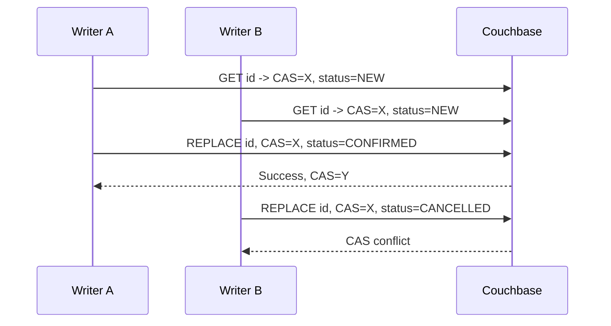
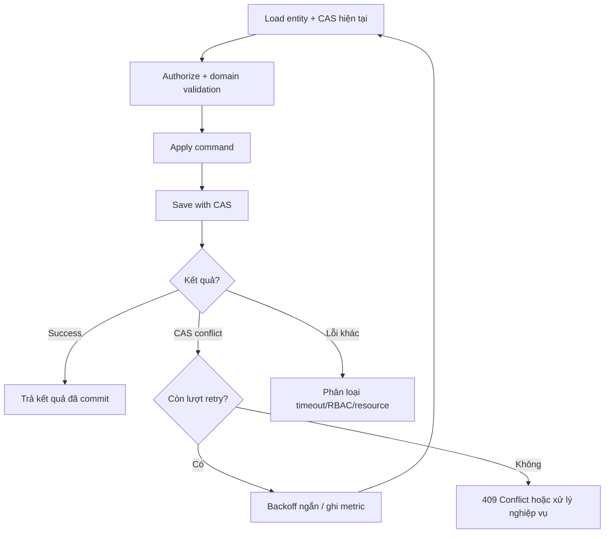

# Vai trò trường @Version khi phân biệt tạo mới và cập nhật trong Spring Data Couchbase

Một entity `OrderDocument` có ID `order::1001` **chưa chắc là document đã tồn tại** trong Couchbase. Ứng dụng có thể tự tạo khóa trước khi gọi `save()`. Nếu Spring Data chỉ xét `@Id` và thấy giá trị khác `null`, nó có thể phân loại entity là “đang cập nhật” dù thực tế đây là lần ghi đầu tiên. Hậu quả không chỉ là hành vi ghi khó đoán: cơ chế auditing có thể điền `@LastModifiedDate` nhưng không điền `@CreatedDate` hoặc `@CreatedBy` như mong đợi.

Trong **Spring Data Couchbase**, trường `@Version` giải quyết hai nhu cầu có liên quan nhưng khác nhau:

1. **Phân biệt entity mới và entity đã tồn tại trong ngữ cảnh mapping** để chọn nhánh xử lý và điền auditing metadata.
2. **Optimistic locking bằng CAS (Compare-And-Swap)** để tránh ghi đè thay đổi từ một luồng/ứng dụng khác.

Bài thuộc chương **Vòng đời và auditing** của module `SPRING_DATA_COUCHBASE`. Nội dung đi từ entity state detection, cách `@Version` tham gia create/update, tác động đến repository và `CouchbaseTemplate`, cho tới CAS conflict, SQL++, nhiều bucket/scope/collection, reactive, giao dịch và bộ kiểm thử cụ thể. Đây cũng là nền tảng để vận hành ứng dụng Couchbase có dữ liệu nhất quán mà không nhầm timestamp auditing với trạng thái đã commit.

## 1. Trước tiên: “mới” có ba nghĩa khác nhau

Khi nói một entity “mới”, có thể đang nhắc tới ba điều:

| Khái niệm | Câu hỏi | Nơi trả lời |
| --- | --- | --- |
| **Entity newness** | Spring Data *đánh giá object này* là entity chưa từng persist hay không? | `EntityInformation.isNew(...)` và metadata mapping. |
| **Key tồn tại vật lý** | Key `order::1001` có tồn tại **ở collection được chọn** không? | Couchbase KV Service, ví dụ `collection.exists(id)`. |
| **Business creation** | Đây có phải lần đầu một đơn hàng nghiệp vụ được tạo, theo yêu cầu đã được phép? | Service/domain command và business rules. |

Ba giá trị này **không tự đồng nhất**.

Ví dụ:

```text
Java:
  id      = "order::1001"
  version = 0
  status  = "NEW"

Couchbase:
  shop.commerce.orders
    key "order::1001": chưa tồn tại

Kết luận:
  Object có ID khác null, nhưng vẫn là entity mới.
```

Ngược lại, nếu key đã tồn tại nhưng ứng dụng tạo một object mới trong JVM với `version=0`, Spring Data có thể vẫn **xem object đó là mới**. Phân loại newness là **quyết định từ metadata của object**, không phải một lệnh gọi DB để xác minh sự tồn tại ở mọi lần `isNew`.

**Hệ quả bảo mật:** `@Version` không thay thế authorization. Entity có version hợp lệ không chứng minh user có quyền ghi vào tenant hoặc collection đó.

## 2. Quy tắc phát hiện entity mới của Spring Data

Spring Data Commons có một quy tắc chung: khi entity có trường đánh dấu `@Version`, framework ưu tiên dùng trường version để quyết định `isNew`; nếu không có trường version, mặc định xét ID. Trường hợp entity tự triển khai `Persistable`, `isNew()` có thể là nguồn quyết định riêng.

### 2.1. @Version kiểu primitive long

```java
@Version
private long version;
```

Với kiểu primitive `long`:

- Giá trị khởi đầu mặc định `0L` → được xem là **mới**.
- Giá trị khác `0L` → được xem là **không mới** theo kiểm tra version.

### 2.2. @Version kiểu Long

```java
@Version
private Long version;
```

Với kiểu wrapper `Long`:

- `null` → được xem là **mới**.
- Giá trị khác `null` → được xem là **không mới** theo kiểm tra version.

Vì vậy, không thể áp dụng máy móc quy tắc “version bằng 0 là mới” cho mọi kiểu. Nếu dùng wrapper mà tự khởi tạo `version=0L`, cách phát hiện trạng thái mới có thể không giống trường hợp `null`.

### 2.3. Không có @Version

Mặc định framework sẽ kiểm tra `@Id`:

- ID bằng `null` → entity được xem là **mới**.
- ID khác `null` → entity được xem là **không mới**, trừ khi dùng chiến lược newness khác.

Điều này thường gây nhầm lẫn với hệ thống Couchbase cấp sẵn document ID từ service. Tài liệu Spring Data Couchbase nhấn mạnh: **để auditing nhận diện creation đúng, entity cần có `@Version`**.

### 2.4. Bảng phân loại dễ nhớ

| `id` | `version` | Khai báo | Đánh giá newness mặc định |
| --- | --- | --- | --- |
| `null` | Không có | Chỉ `@Id` | Mới. |
| `"order::1"` | Không có | Chỉ `@Id` | Không mới. |
| `"order::1"` | `0L` | `@Version long` | **Mới**. |
| `"order::1"` | CAS khác 0 | `@Version long` | Không mới. |
| `"order::1"` | `null` | `@Version Long` | **Mới**. |
| `"order::1"` | CAS khác null | `@Version Long` | Không mới. |
| Bất kỳ | Bất kỳ | `Persistable.isNew()` được tùy chỉnh | Theo quy tắc được custom, cần test. |

Bảng này mô tả **state detection** theo Spring Data, không cam kết một lời gọi `save()` sẽ thành công nếu key thực tế đã tồn tại, quyền không đủ hoặc thao tác ghi bị xung đột.

## 3. @Version trong Couchbase không phải bộ đếm 1, 2, 3

Couchbase cấp **CAS** cho mỗi document. Mỗi lần nội dung hoặc metadata của document bị mutate, CAS có thể thay đổi. Khi đọc document bằng Java SDK, kết quả có một giá trị `cas()`. Khi cần thay document có kiểm soát, client gửi CAS đã đọc; Couchbase sẽ từ chối nếu server đang có CAS khác.

Spring Data Couchbase ánh xạ CAS vào trường `@Version` của entity khi sử dụng đường đọc/ghi được hỗ trợ. Vì vậy:

```java
@Version
private long version;
```

**không** có nghĩa version sẽ là `1` sau khi insert, `2` sau khi update. CAS là **opaque token**, không được diễn giải như bộ đếm hoặc timestamp và không được tự sửa để “đánh dấu đã tăng version”.

### So sánh trực quan

```text
Hệ dùng counter version:
  v1 -> v2 -> v3

Couchbase:
  CAS=A -> CAS=B -> CAS=C

Chỉ có thể kết luận:
  A, B, C đại diện các trạng thái document khác nhau.
Không được suy luận:
  B == A + 1
  C cho biết số lần update
  CAS tăng tuyệt đối theo thời gian như clock
```

SDK coi CAS là metadata. Trong entity Spring Data, `@Version` giúp bảo toàn và sử dụng metadata đó cho optimistic locking.

## 4. Khai báo entity mẫu có ID cấp trước và @Version

Giả sử ứng dụng có bucket `shop`, scope `commerce`, collection `orders`:

```text
shop.commerce.orders
```

Entity:

```java
package example.shop.order;

import java.time.Instant;

import org.springframework.data.annotation.CreatedBy;
import org.springframework.data.annotation.CreatedDate;
import org.springframework.data.annotation.Id;
import org.springframework.data.annotation.LastModifiedBy;
import org.springframework.data.annotation.LastModifiedDate;
import org.springframework.data.annotation.Version;
import org.springframework.data.couchbase.core.mapping.Document;
import org.springframework.data.couchbase.repository.Collection;
import org.springframework.data.couchbase.repository.Scope;

@Document
@Scope("commerce")
@Collection("orders")
public class OrderDocument {

    @Id
    private String id;

    private String status;

    @Version
    private long version;

    @CreatedDate
    private Instant createdAt;

    @LastModifiedDate
    private Instant lastModifiedAt;

    @CreatedBy
    private String createdBy;

    @LastModifiedBy
    private String lastModifiedBy;

    public OrderDocument() {}

    public OrderDocument(String id, String status) {
        this.id = id;
        this.status = status;
    }

    public String getId() { return id; }
    public String getStatus() { return status; }
    public void setStatus(String value) { this.status = value; }

    public long getVersion() { return version; }
    public Instant getCreatedAt() { return createdAt; }
    public Instant getLastModifiedAt() { return lastModifiedAt; }
    public String getCreatedBy() { return createdBy; }
    public String getLastModifiedBy() { return lastModifiedBy; }
}
```

Couchbase annotations `@Scope` và `@Collection` của ví dụ thuộc `org.springframework.data.couchbase.repository`, không phải scope bean của Spring. Document key có thể được gán trong constructor, còn `version` mặc định `0L`. Không cần một setter công khai cho version: thông thường **không cho application code tùy ý đổi CAS**.

Repository:

```java
package example.shop.order;

import org.springframework.data.couchbase.repository.CouchbaseRepository;

public interface OrderRepository
        extends CouchbaseRepository<OrderDocument, String> {
}
```

Một entity dùng `Long version` nullable cũng có thể phù hợp theo mapping/version support của release đang dùng; ví dụ bài chọn `long` vì đây là kiểu được tài liệu Spring Data Couchbase dùng để minh họa optimistic locking.

## 5. Tạo mới: có ID không đồng nghĩa đang cập nhật

Trong Couchbase, khóa thường do ứng dụng tự chọn:

```java
String id = "order::" + java.util.UUID.randomUUID();
OrderDocument order = new OrderDocument(id, "NEW");

OrderDocument saved = orderRepository.save(order);
```

Trước save:

```text
id           = "order::<uuid>"
version      = 0
createdAt    = null
lastModifiedAt = null
```

Khi `@Version` có giá trị mới hợp lệ, Spring Data có thể nhận diện entity mới, auditing áp nhánh creation và hành vi lưu được chọn theo ngữ nghĩa API. Sau khi save thành công qua pipeline phù hợp, entity được trả về có thể mang CAS mới và các trường created đã được điền.

### Phân biệt “chưa tồn tại” với “được nhận diện là mới”

Nếu key **đã tồn tại** trước khi gọi save, chỉ việc version bằng 0 không bảo đảm thao tác sẽ ghi đè thành công. Hành vi cụ thể phụ thuộc API lưu và phiên bản Spring Data; thao tác insert sẽ lỗi khi key đã tồn tại, còn upsert không có điều kiện tồn tại có ngữ nghĩa khác.

Vì vậy, không đưa quy tắc này vào code như một cơ chế kiểm tra “khóa này chưa hề có trong DB”. Với nghiệp vụ không được ghi đè document cũ, dùng **insert semantics** hoặc một transaction/guard xác định phù hợp, đồng thời xử lý trùng key rõ ràng.

## 6. Cập nhật: @Version chứa CAS được đọc từ server

Luồng cập nhật chuẩn:

```java
OrderDocument loaded = orderRepository
    .findById("order::1001")
    .orElseThrow();

long originalCas = loaded.getVersion();

loaded.setStatus("CONFIRMED");

OrderDocument saved = orderRepository.save(loaded);
```

Với entity đã load qua repository/Template được hỗ trợ:

- ID chỉ document trong **collection đang được chọn**.
- `@Version` được điền bằng CAS quan sát khi đọc.
- Save có thể sử dụng CAS đó làm điều kiện kiểm tra document **chưa bị bên khác thay đổi**.
- Nếu mutation thành công, CAS mới được trả/cập nhật theo cơ chế mapping.
- Nếu có writer khác thay đổi document trong lúc chờ, có thể gặp `OptimisticLockingFailureException` hoặc exception được chuyển đổi tương ứng.

**Không cần và không nên** gọi `loaded.setVersion(originalCas + 1)`.

### Mô hình hai writer



CAS ngăn writer B **ghi đè mù** trạng thái mới của A. Nó không tự quyết định B có quyền hủy đơn hay không; đó là domain rule cần kiểm tra lại sau khi nạp bản mới.

## 7. @Version tham gia auditing như thế nào?

Spring Data auditing có các annotation:

- `@CreatedDate`: thời điểm entity được tạo.
- `@CreatedBy`: actor tạo entity.
- `@LastModifiedDate`: thời điểm cập nhật/lưu gần nhất qua đường auditing.
- `@LastModifiedBy`: actor cập nhật gần nhất.

Framework phải biết entity đang đi qua **nhánh create hay update** để điền đúng field. Với Couchbase, tài liệu store-specific nhấn mạnh `@Version` giúp tránh nhầm creation thành update.

### Tình huống không có @Version

```java
@Document
public class IncompleteOrder {

    @Id
    private String id;

    @CreatedDate
    private Instant createdAt;

    @LastModifiedDate
    private Instant lastModifiedAt;
}
```

Nếu `id` được tạo trước khi gọi save, Spring Data có thể xem entity là **không mới** vì ID đã khác null. Khi đó auditing không chắc điền `createdAt` theo nhánh creation như mong muốn.

**Lưu ý:** ví dụ trên minh họa rủi ro **state detection**, không phải khẳng định mọi tổ hợp version/API sẽ phát cùng exception hoặc cùng mutation.

### Tình huống có @Version

```java
@Version
private long version;
```

Khi entity mới có `version=0`, auditing có dữ liệu để nhận diện creation dù ID được cấp sẵn. Khi load lại entity đã lưu, version/CAS khác sentinel mới, auditing có thể đi theo nhánh update.

Kết quả mong muốn:

| Trường | Lúc create | Lúc update |
| --- | --- | --- |
| `createdAt` | Điền từ `DateTimeProvider`. | Giữ thời điểm tạo. |
| `createdBy` | Điền từ `AuditorAware`. | Giữ actor tạo. |
| `lastModifiedAt` | Có thể điền nếu `modifyOnCreate=true`. | Điền thời điểm update. |
| `lastModifiedBy` | Có thể điền nếu `modifyOnCreate=true`. | Điền actor update. |
| `version` | Từ giá trị mới `0` sang CAS sau save. | Từ CAS đã đọc sang CAS sau mutation thành công. |

Đừng xem `createdAt` hoặc `lastModifiedAt` như bằng chứng mutation đã commit nếu một callback đã sửa object JVM nhưng lệnh KV sau đó thất bại.

## 8. Kích hoạt auditing và nguồn actor

Ví dụ tối thiểu cho imperative application:

```java
package example.shop.config;

import java.util.Optional;

import org.springframework.context.annotation.Bean;
import org.springframework.context.annotation.Configuration;
import org.springframework.data.domain.AuditorAware;
import org.springframework.data.couchbase.repository.auditing.EnableCouchbaseAuditing;

@Configuration
@EnableCouchbaseAuditing(auditorAwareRef = "orderAuditor")
public class OrderAuditConfiguration {

    @Bean("orderAuditor")
    AuditorAware<String> orderAuditor() {
        // Chỉ minh họa: production lấy actor từ security context.
        return () -> Optional.of("service:order-api");
    }
}
```

Trong sản phẩm thực tế, nguồn actor phải phản ánh principal được xác thực hoặc identity job đáng tin cậy; không ghi cố định một user thật cho mọi thao tác. Nếu chỉ cần hai trường ngày, theo Spring Data Commons có thể không cần `AuditorAware`; `DateTimeProvider` vẫn cấp timestamp.

### @Version và auditing là hai phần không thay thế nhau

- `@Version` hỗ trợ **state detection + optimistic locking**.
- `@EnableCouchbaseAuditing` kích hoạt cơ chế **điền metadata**.
- `AuditorAware<T>` cung cấp **actor**, không cấp quyền.
- `DateTimeProvider` cung cấp **thời gian**, không tạo TTL.

Chỉ thêm `@Version` mà không bật auditing **không tự điền bốn trường audit**. Chỉ bật auditing nhưng thiếu version khi ID cấp trước **không giải quyết chắc chắn bài toán newness**.

## 9. Primitive long hay wrapper Long?

Hai khai báo đều phổ biến trong kiến thức Spring Data, nhưng cần hiểu sentinel:

```java
// Mẫu thường thấy trong Couchbase:
@Version
private long version; // 0 khi entity mới

// Biến thể nullable:
@Version
private Long version; // null khi entity mới
```

### Ưu nhược điểm

| Lựa chọn | Dấu hiệu mới | Điểm cần chú ý |
| --- | --- | --- |
| Primitive `long` | `0L` | Không biểu diễn null; phù hợp ví dụ chính thức Couchbase. |
| Wrapper `Long` | `null` | Có thể làm rõ “chưa có CAS”, nhưng DTO/mapper không được tự set `0L`. |
| Không `@Version` | Xét `@Id` (mặc định) | Dễ nhầm với key được cấp trước; thiếu optimistic locking tự động. |

Nếu dự án có custom mapping, constructor binding hoặc copy entity từ JSON, cần kiểm tra cách kiểu version được khôi phục. Khi dùng `Long`, không lấy giá trị `0L` từ request làm “CAS hợp lệ” mà không hiểu newness semantics.

### Không tùy ý đổi kiểu trong schema migration

Nếu entity đã chạy production với `long version`, đổi sang `Long` cần test create, read, update, CAS conflict, auditing và serialization. CAS là metadata, nhưng thay đổi kiểu Java có thể ảnh hưởng mapping/null handling. Đừng đổi chỉ vì muốn một giá trị “dễ đọc hơn” trong API.

## 10. Version không phải thuộc tính JSON nghiệp vụ thông thường

Couchbase có:

- **Document key**: ID trong collection.
- **Document content**: payload JSON.
- **Document metadata**: CAS và expiry.

Ví dụ:

```text
key:
  order::1001

content:
  { "_class": "example.shop.order.OrderDocument",
    "status": "CONFIRMED",
    "createdBy": "user:alice" }

metadata:
  CAS = opaque token
  expiry = tùy chính sách TTL
```

Với Spring Data mapping thông thường, `@Version` liên kết với CAS, không phải một field JSON `version` cần client tự ghi và tăng.

Nếu bạn thật sự cần revision nghiệp vụ như `invoiceRevision=4` hoặc `schemaVersion=2`, hãy tạo **field riêng**, định nghĩa rõ ai được tăng và vì sao, không dùng `@Version` thay thế.

### Khi kiểm tra trực tiếp bằng Java SDK

```java
var result = cluster.bucket("shop")
    .scope("commerce")
    .collection("orders")
    .get("order::1001");

long cas = result.cas();
var body = result.contentAsObject();
```

Ở đây `cas` đến từ metadata của `GetResult`; đọc `body.getLong("version")` không phải cách chuẩn để xác nhận `@Version` của Spring Data nếu JSON không có field đó.

## 11. Phân biệt hành vi save, insert, replace và upsert

Đối với quyết định tạo hay cập nhật, tên API cũng có ý nghĩa.

| API/ý định | Khi key chưa tồn tại | Khi key đã tồn tại | Lưu ý |
| --- | --- | --- | --- |
| **Insert** | Tạo document. | Bị từ chối vì trùng key. | Dùng khi nghiệp vụ chỉ cho phép tạo mới. |
| **Replace** | Bị từ chối nếu key không tồn tại. | Thay document, có thể kiểm tra CAS. | Dùng khi nghiệp vụ đòi hỏi document đã có. |
| **Upsert** | Tạo. | Thay. | Nếu không có guard CAS, có nguy cơ ghi đè không mong muốn. |
| **Repository save(entity)** | Theo chiến lược trạng thái/phiên bản/framework. | Theo chiến lược trạng thái/phiên bản/framework. | Không đồng nhất đơn giản với API SDK upsert vô điều kiện. |

**Không suy từ tên `save()` rằng mọi trường hợp đều là upsert không điều kiện.** Spring Data Couchbase có logic mapping/version riêng; cần test hành vi theo version dependency thực tế.

Ví dụ Template fluent:

```java
// Lệnh tạo mới có ý định tường minh.
OrderDocument created = couchbaseTemplate
    .insertById(OrderDocument.class)
    .inScope("commerce")
    .inCollection("orders")
    .one(order);

// Với một API khác, upsert có ngữ nghĩa tạo hoặc thay.
OrderDocument upserted = couchbaseTemplate
    .upsertById(OrderDocument.class)
    .inScope("commerce")
    .inCollection("orders")
    .one(otherOrder);
```

Hai thao tác thuộc API entity của Spring Data, nhưng logic CAS/metadata có thể khác nhau. Nếu nghiệp vụ yêu cầu “chỉ update khi CAS đúng”, hãy dùng API/semantics bảo đảm điều đó và test bằng hai writer.

### Khi nào dùng repository.save?

Dùng thuận tiện cho entity lifecycle thông thường có ID và `@Version`. Khi bạn cần kiểm soát insert-only hoặc replace-only một cách rõ ràng, Template fluent hoặc Java SDK có thể làm ý định rõ hơn, nhưng nhớ rằng SDK trực tiếp **không chạy Spring Data auditing callbacks**.

## 12. Rủi ro khi tạo lại entity từ DTO cập nhật

Mẫu code nguy hiểm:

```java
// Client gửi {"status": "CONFIRMED"}
// Server tạo một object mới chỉ có ID và status:
OrderDocument order =
    new OrderDocument(pathId, request.status());

// version đang = 0!
orderRepository.save(order);
```

Theo state detection, entity này có thể được coi là **mới**, mặc dù command thực tế là cập nhật. Hành vi có thể:

- Chọn sai nhánh newness/auditing, khiến created fields bị điền sai.
- Thực hiện mutation không phù hợp với nghiệp vụ.
- Bị lỗi trùng document nếu thao tác insert-only được chọn.
- Không kiểm tra đúng optimistic locking do không có CAS đã đọc.

### Cách an toàn hơn: load → kiểm tra → modify → save

```java
public OrderDocument confirmOrder(String id) {
    OrderDocument existing = orderRepository
        .findById(id)
        .orElseThrow(() ->
            new IllegalArgumentException("Order not found")
        );

    if (!"NEW".equals(existing.getStatus())) {
        throw new IllegalStateException(
            "Only NEW order can be confirmed"
        );
    }

    existing.setStatus("CONFIRMED");
    return orderRepository.save(existing);
}
```

Đoạn này là phương thức bên trong một service có repository được inject; bỏ qua khai báo class để tập trung vào ý tưởng. Trước khi đọc và ghi, service phải thực hiện authentication/authorization và tenant routing phù hợp. CAS được giữ từ entity đã load, nên một writer khác cập nhật giữa hai bước có thể được phát hiện.

### Nếu client gửi If-Match/ETag

Một số API REST dùng `If-Match` để kiểm soát cập nhật từ UI:

- Token phải gắn với **đúng resource, tenant và keyspace**.
- Không cho client tự chọn một CAS rồi gán bừa vào entity.
- Có thể cần so sánh token của client với version hiện tại theo contract API.
- Sau khi đọc và kiểm tra ownership, chỉ cho mutation nếu điều kiện optimistic locking hợp lệ.

Cần thiết kế và kiểm thử protocol rõ ràng; không coi field `version` do client gửi là bằng chứng quyền truy cập.

## 13. Tại sao retry sau CAS conflict phải đọc lại?

Giả sử A và B cùng đọc đơn hàng ở trạng thái `NEW`. A xác nhận, B muốn hủy.

Nếu B bị CAS conflict, việc lặp lại `save(staleEntity)` không cập nhật CAS. Ngay cả khi bằng cách nào đó bỏ qua conflict, thao tác hủy có thể không còn hợp lệ sau khi đã xác nhận.

Chu trình đúng:



Một retry hợp lý nên:

1. Đặt giới hạn số lần và thời gian.
2. Nạp lại document, không tăng thủ công CAS.
3. Kiểm tra lại business rule và quyền.
4. Tạo mutation xác định/idempotent theo command ID nếu cần.
5. Không gửi email/payment/broker trong callback trước khi commit.
6. Phân biệt CAS conflict với timeout không rõ kết quả hoặc lỗi hạ tầng.

**Auditing side effect:** một callback có thể đã điền `lastModifiedBy` vào object stale trước khi mutation thất bại. Điều đó không chứng minh document ở server đã được Bob cập nhật.

## 14. Khi cùng ID ở nhiều collection: CAS và isNew thuộc đúng keyspace

Couchbase keyspace là:

```text
bucket.scope.collection
```

Ví dụ:

```text
shop.commerce.orders        id=order::1001  CAS=A
shop.archive.orders_history id=order::1001  CAS=B
```

Hai document là **độc lập**, dù ID giống nhau. CAS của collection current **không phải** CAS của archive.

### Lỗi thường gặp khi copy entity

```java
OrderDocument loaded = orderRepository
    .findById("order::1001")
    .orElseThrow();

// Giả sử muốn lưu sang archive, KHÔNG copy mù CAS của current.
```

Nếu mang entity với `version=A` sang archive rồi gọi save, framework có thể đánh giá nó là **không mới** và dùng CAS không tương ứng với document ở archive. Kết quả có thể là conflict, not found hoặc semantics không mong muốn, tùy đường API.

**Cách thiết kế tốt hơn:**

- Tách lệnh tạo archive document rõ ràng.
- Xác định metadata nào cần giữ (người tạo đơn gốc) và metadata nào là riêng của thao tác archive (người archive).
- Dùng kiểu entity/archive DTO riêng nếu nghiệp vụ có schema khác.
- Không tự reset CAS trên một entity đang đại diện document đã load rồi coi đó là “copy an toàn”; hãy tạo một object mới cho document đích theo chiến lược insert đã chọn và test.
- Xác minh độc lập bằng SDK theo **đúng bucket.scope.collection**.

Nếu ứng dụng multi-bucket dùng nhiều `CouchbaseClientFactory`/Template, thay `inScope` không thay bucket của Template. Đây là một rủi ro định tuyến **ngoài** phạm vi `@Version`.

## 15. Version trong SQL++ và query projection

Hai đường đọc thường gặp:

```java
// KV theo ID:
OrderDocument order = orderRepository
    .findById("order::1001")
    .orElseThrow();

// SQL++ finder theo thuộc tính:
java.util.List<OrderDocument> confirmed =
    orderRepository.findByStatus("CONFIRMED");
```

Finder `findByStatus` là ví dụ: interface repository của ứng dụng cần khai báo method đó và index/query phù hợp.

Với KV theo ID, Spring Data có thể lấy CAS từ metadata của get-result. Với SQL++, **để materialize entity đầy đủ và phục hồi `@Version`**, query sinh ra/câu query tùy chỉnh phải trả đủ thông tin Spring Data cần, gồm ID/CAS hoặc projection theo contract mapping của phiên bản.

### Đừng viết SELECT thiếu metadata rồi tin version hợp lệ

Ví dụ SQL++ dùng cho báo cáo:

```sql
SELECT o.status, o.customerId
FROM `shop`.`commerce`.`orders` AS o
WHERE o.status = "CONFIRMED";
```

Nếu cố map một kết quả chỉ có vài field này thành `OrderDocument` đầy đủ, bạn có thể không có ID/CAS/auditing fields cần thiết. Không nên `save()` lại một partial entity như thể nó đã được tải đầy đủ để cập nhật.

Nếu chỉ cần báo cáo, dùng **DTO/projection chỉ đọc**. Nếu cần read-modify-write, ưu tiên nạp entity đầy đủ bằng repository/Template theo ID với CAS hợp lệ.

### Query tùy chỉnh và mapping metadata

Spring Data Couchbase cung cấp SpEL cho query entity như `#{#n1ql.selectEntity}` và `#{#n1ql.filter}` trong một số kiểu `@Query`, giúp tạo phần query theo mapping cần thiết.

Ví dụ minh họa:

```java
import java.util.List;

import org.springframework.data.couchbase.repository.Query;
import org.springframework.data.couchbase.repository.CouchbaseRepository;

public interface OrderQueryRepository
        extends CouchbaseRepository<OrderDocument, String> {

    @Query("#{#n1ql.selectEntity} WHERE #{#n1ql.filter} " +
           "AND status = $1")
    List<OrderDocument> findByStatusCustom(String status);
}
```

Với query có `FROM` hardcode hoặc projection thủ công, phải kiểm tra SQL++ cuối cùng có đúng keyspace, type filter, ID/CAS metadata, không chỉ xem số hàng trả về.

### CAS trong SQL++

Couchbase SQL++ có thể trả metadata bằng `META(alias).cas`:

```sql
SELECT META(o).id AS documentId,
       META(o).cas AS cas,
       o.status
FROM `shop`.`commerce`.`orders` AS o
WHERE META(o).id = $documentId;
```

Đây là truy vấn minh họa để **quan sát metadata**. Nó không khẳng định field alias `cas` tự động ánh xạ thành `@Version` trong mọi phiên bản Spring Data. Với entity mapping, hãy dùng query do framework tạo hoặc đúng alias/projection mà converter yêu cầu.

## 16. Bảo đảm query SQL++ nhìn thấy bản ghi vừa tạo

KV `findById` và SQL++ finder không có cùng consistency mặc định. Một document vừa được tạo có thể được KV nhìn thấy nhưng SQL++ chưa thấy nếu secondary index đang cập nhật.

Đừng kết luận “`@Version` coi là mới sai” chỉ từ việc một finder SQL++ trả danh sách rỗng ngay sau insert.

Quy trình chẩn đoán:

1. Đọc trực tiếp key trong collection bằng Java SDK KV.
2. Kiểm tra JSON và CAS metadata.
3. Đọc qua repository `findById` theo đúng keyspace.
4. Kiểm tra query SQL++, index, type discriminator và scan consistency.
5. Với test cần read-after-write qua Query Service, cân nhắc `REQUEST_PLUS` và nhận thức chi phí chờ index.

### Index không phải ràng buộc version

Chỉ mục SQL++ có thể tăng tốc tìm theo `status`/`customerId`, nhưng nó không biến `@Version` thành unique constraint trên một field JSON. CAS thuộc thao tác mutation của **document cụ thể**, không phải khóa toàn bảng.

## 17. @Version không thay thế transaction

CAS bảo vệ **một document** khỏi lost update khi writer dùng đúng CAS. Một nghiệp vụ có thể cần cập nhật nhiều document:

```text
shop.commerce.orders
shop.inventory.stock
shop.operations.outbox_events
```

Dù từng entity có `@Version`, ba lời gọi `save()` độc lập **không tự là một transaction nguyên tử**. Nếu cần tất cả hoặc không gì, dùng API transaction được Couchbase và phiên bản Spring Data/SDK hỗ trợ, hoặc thiết kế workflow/outbox phù hợp.

### Transaction callback có thể chạy lại

Với Java SDK transaction:

- Lambda transaction có thể được thực thi lại khi gặp xung đột.
- Không gọi API thanh toán, gửi email hay broker trong lambda nếu side effect không idempotent.
- Nếu dùng SDK trực tiếp để ghi document, **Spring Data entity callbacks/auditing không tự chạy**.
- Nếu command cần audit metadata, cung cấp actor/timestamp tin cậy cho đường transaction đó.

Đừng lấy `version=0` rồi gọi `upsert` từ SDK và mong Spring Data tự điền `createdBy`; hai pipeline khác nhau.

## 18. TTL và metadata cũng tác động đến CAS

TTL/expiry là metadata thời gian sống của document trên Couchbase Server. Một mutation nội dung hoặc metadata của document có thể khiến CAS thay đổi.

Ví dụ:

- A đọc document với CAS=X.
- B thay đổi expiry hoặc cập nhật nội dung.
- A cố replace bằng CAS=X.
- Server có thể phát hiện version mismatch.

Đó là điều mong muốn của optimistic locking: thay đổi metadata có thể ảnh hưởng tính hợp lệ của CAS đã đọc. Nhưng **`@CreatedDate` không phải TTL**, và server tự xóa document khi hết hạn **không gọi** callback auditing của JVM.

Nếu document hết hạn giữa thời điểm đọc và save, kết quả có thể là not found/insert semantics khác với CAS conflict. Phải phân loại lỗi đúng, không coi mọi lỗi lưu là “người khác sửa đơn hàng”.

## 19. Khi nào nên cân nhắc Persistable?

Spring Data Commons cho phép entity thực thi `Persistable<ID>` để tùy chỉnh `isNew()`:

```java
import org.springframework.data.domain.Persistable;

public class CustomEntity implements Persistable<String> {

    @Id
    private String id;

    @org.springframework.data.annotation.Transient
    private boolean newEntity = true;

    @Override
    public String getId() {
        return id;
    }

    @Override
    public boolean isNew() {
        return newEntity;
    }

    // Constructor / persistence lifecycle cần quản lý newEntity.
}
```

Đây chỉ là **minh họa cơ chế Spring Data Commons**, không phải một entity Couchbase production hoàn chỉnh. Nếu dùng `Persistable`:

- Phải định nghĩa cách chuyển `newEntity` thành `false` sau khi load/save thành công.
- Cần hiểu cách auditing dùng state detection.
- Vẫn cần `@Version`/CAS hoặc cơ chế concurrency tương ứng khi muốn tránh lost update.
- Tránh biến thuộc tính `isNew` thành dữ liệu JSON không mong muốn; cân nhắc `@Transient` và field/property access.
- Không cho client tự quyết định `isNew` qua request DTO.
- Viết integration tests riêng cho insert, update, CAS và auditing.

Với phần lớn entity Couchbase có ID được cấp sẵn và optimistic locking, **dùng `@Version long` đúng cách đơn giản và dễ kiểm soát hơn** tự quản lý cờ newness.

## 20. Reactive repository: quy tắc không đổi, cách thực thi khác

Entity reactive có `@Version` tương tự imperative. Tuy nhiên, `ReactiveCouchbaseRepository.save(entity)` tạo publisher; thao tác thực thi khi có subscriber.

Ví dụ:

```java
import reactor.core.publisher.Mono;

Mono<OrderDocument> result =
    reactiveOrderRepository.save(
        new OrderDocument("order::" + java.util.UUID.randomUUID(), "NEW")
    );
```

Không nên chỉ tạo `Mono` rồi assert entity ban đầu có version khác 0; publisher chưa được subscribe thì chưa chứng minh write đã hoàn tất.

### Dùng StepVerifier

```java
import reactor.test.StepVerifier;

StepVerifier.create(
        reactiveOrderRepository.save(
            new OrderDocument(
                "order::" + java.util.UUID.randomUUID(),
                "NEW"
            )
        )
    )
    .assertNext(saved -> {
        org.junit.jupiter.api.Assertions.assertNotEquals(
            0L, saved.getVersion()
        );
    })
    .verifyComplete();
```

Đây là **đoạn test trong class có bean reactive repository**, không phải ví dụ tự chạy; cần Testcontainers/cluster test và cấu hình bucket/scope/collection. Sau đó nên dùng SDK đọc metadata CAS để xác minh giá trị server.

### Retry reactive

```java
reactiveOrderRepository.save(entity)
    .retry(2);
```

`retry(2)` chỉ là retry theo lỗi của Reactor, **không tự reload entity hoặc cập nhật CAS**. Nếu server báo conflict, lặp lại `save(entity)` với version cũ có thể tiếp tục thất bại. Nên thiết kế lại pipeline theo **load → domain check → mutate → save** có giới hạn attempt, đồng thời chống tác dụng phụ lặp khi resubscribe.

Reactive auditing cần `@EnableReactiveCouchbaseAuditing` và `ReactiveAuditorAware<T>` tương ứng nếu ghi created/modified actor. Không dùng `ThreadLocal` mutable làm nguồn user cho nhiều pipeline đồng thời.

## 21. Test nhanh bằng Spring Data: create → update

Một integration test tối thiểu nên kiểm tra cả state detection lẫn metadata.

Chuẩn bị:

- `OrderDocument` có `@Version long` và bốn auditing annotations.
- `@EnableCouchbaseAuditing` đã được kích hoạt.
- `AuditorAware<String>` trả actor có chủ đích.
- Bucket `shop`, scope `commerce`, collection `orders` tồn tại.
- Repository được Spring quản lý, không mock.

Ví dụ JUnit:

```java
import java.util.UUID;

import org.junit.jupiter.api.Test;
import org.springframework.beans.factory.annotation.Autowired;

import static org.junit.jupiter.api.Assertions.assertEquals;
import static org.junit.jupiter.api.Assertions.assertNotEquals;
import static org.junit.jupiter.api.Assertions.assertNotNull;

class OrderVersionIT {

    @Autowired
    OrderRepository orderRepository;

    @Test
    void assignedIdWithZeroVersionIsCreatedThenUpdated() {
        String id = "it::order::" + UUID.randomUUID();

        OrderDocument fresh = new OrderDocument(id, "NEW");

        // Giá trị primitive mặc định là dấu hiệu entity mới.
        assertEquals(0L, fresh.getVersion());

        OrderDocument created = orderRepository.save(fresh);

        assertNotEquals(0L, created.getVersion());
        assertNotNull(created.getCreatedAt());

        long firstCas = created.getVersion();

        OrderDocument loaded = orderRepository
            .findById(id)
            .orElseThrow();

        assertEquals(firstCas, loaded.getVersion());

        loaded.setStatus("CONFIRMED");
        OrderDocument updated = orderRepository.save(loaded);

        assertNotEquals(firstCas, updated.getVersion());
        assertEquals(
            created.getCreatedAt(),
            updated.getCreatedAt()
        );
    }
}
```

**Đây là khung test:** cần `@SpringBootTest`/context tương ứng, Testcontainers hoặc cluster test và dữ liệu được provision. Nếu auditing có DateTimeProvider riêng, assertions về thời gian cần nhất quán với cấu hình. Test có thể cần làm sạch key sau khi chạy nếu dùng cluster chia sẻ.

## 22. Test CAS conflict bằng hai bản đọc độc lập

Phép thử này xác minh version thực sự ngăn lost update:

```java
@Test
void staleCopyMustNotOverwriteAnotherWriter() {
    String id = "it::stale::" + UUID.randomUUID();

    orderRepository.save(new OrderDocument(id, "NEW"));

    OrderDocument writerA =
        orderRepository.findById(id).orElseThrow();

    OrderDocument writerB =
        orderRepository.findById(id).orElseThrow();

    long initialCas = writerB.getVersion();

    writerA.setStatus("CONFIRMED");
    orderRepository.save(writerA);

    writerB.setStatus("CANCELLED");

    org.junit.jupiter.api.Assertions.assertThrows(
        org.springframework.dao.OptimisticLockingFailureException.class,
        () -> orderRepository.save(writerB)
    );

    OrderDocument stored =
        orderRepository.findById(id).orElseThrow();

    assertEquals("CONFIRMED", stored.getStatus());
    assertNotEquals(initialCas, stored.getVersion());
}
```

Ví dụ này đặt trong cùng class test có repository và import JUnit; trong một số phiên bản, exception translation cụ thể có thể khác. Nếu cần hỗ trợ nhiều phiên bản, kiểm tra cause chain nhưng **không catch mọi exception rồi cho test pass**.

Thử thêm negative case: save lại một instance mới với cùng ID nhưng `version=0` và xác minh ứng dụng **không âm thầm overwrite** đơn hàng đã có theo chính sách được thiết kế.

## 23. Oracle độc lập bằng Couchbase Java SDK

Test chỉ save rồi find qua cùng repository có thể bỏ sót lỗi mapping keyspace hoặc data conversion. Nên dùng SDK đọc trực tiếp:

```java
import com.couchbase.client.java.kv.GetResult;

var collection = sdk.bucket("shop")
    .scope("commerce")
    .collection("orders");

GetResult result = collection.get(id);

long actualCas = result.cas();
var json = result.contentAsObject();

assertEquals("CONFIRMED", json.getString("status"));
assertEquals(actualCas, stored.getVersion());
```

**Lưu ý import:** `GetResult` của Couchbase Java SDK nằm trong `com.couchbase.client.java.kv`. Dùng đúng phiên bản SDK và đối chiếu `result.cas()` với trường `@Version` được Spring Data materialize từ **cùng document tại cùng keyspace**.

### Test nhiều collection

Gieo cùng ID tại hai collection:

```text
shop.commerce.orders        -> status=CURRENT, CAS=A
shop.archive.orders_history -> status=ARCHIVED, CAS=B
```

Dùng repository/Template đọc từng collection và SDK đối chiếu CAS. Không nên chỉ assert ID giống nhau; cần assert cả **status và keyspace** để phát hiện định tuyến sai.

### Test ánh xạ khi dùng SQL++

Nếu code sử dụng SQL++ finder để load entity rồi save, thêm test assertion `loaded.getVersion()` bằng CAS được SDK đọc. Với projection/DTO không có metadata, không được coi entity đó là một bản đầy đủ an toàn để update.

## 24. Test sai nhánh auditing khi bỏ @Version

Đây là phép thử có giá trị để minh họa vai trò `@Version`.

Tạo một entity test:

```java
@Document
public class OrderWithoutVersion {

    @Id
    private String id;

    @CreatedDate
    private Instant createdAt;

    @LastModifiedDate
    private Instant modifiedAt;

    // Constructor/getters/setters theo convention mapping.
}
```

Cho entity này một ID được cấp trước; so sánh với entity có `@Version` khi gọi save trong test. Tài liệu Couchbase dự báo **creation auditing** có thể sai nhánh nếu thiếu version.

Tuy nhiên, không cần cố ép một test phải chạy đến DB thành công theo một hành vi insert/update cụ thể ở mọi release. Một test giải thích newness bằng entity metadata cộng với integration test của entity chuẩn đã đủ minh họa; ở STEP 6 cần đối chiếu version cụ thể nếu muốn khẳng định exception chính xác.

**Đừng áp test này lên production bucket**, vì có thể tạo dữ liệu thiếu created audit metadata.

## 25. Test độ bền vững khi có nhiều entrypoint ghi

Trong hệ thống thật, entity có thể bị ghi bởi:

| Đường ghi | Có Spring Data newness/auditing tự động? | Kiểm thử |
| --- | --- | --- |
| `CouchbaseRepository.save(entity)` | Theo mapping/lifecycle đã cấu hình. | Create/update/CAS/audit. |
| `CouchbaseTemplate.insertById/upsertById(entity)` | Có entity mapping, nhưng cần xét semantics API. | Phân biệt insert/upsert; metadata. |
| `ReactiveCouchbaseRepository.save(entity)` | Dùng reactive pipeline. | StepVerifier + CAS SDK. |
| Java SDK `collection.upsert(id, json)` | **Không** chạy Spring Data callback/auditing. | SDK oracle và policy riêng. |
| SQL++ `UPDATE ... SET ...` | **Không** gọi EntityCallback trên từng entity. | Metadata/cas sau DML, query consistency. |
| Import/ETL/XDCR | Không tự chạy auditing JVM. | Data quality/migration test. |
| Server TTL expiry | Không phải save/delete Spring Data. | Test expiry policy. |

Điều quan trọng là `@Version` **không tự ép các client khác** phải dùng CAS của entity Java. Nếu một SDK client gọi unconditional upsert, nó có thể thay document mà không có cơ chế optimistic lock của Spring Data; CAS vẫn đổi và lần save sau đó của repository có thể phát hiện conflict.

## 26. Những lỗi thường gặp và cách chẩn đoán

| Triệu chứng | Nguyên nhân thường gặp | Hướng kiểm tra |
| --- | --- | --- |
| Entity có ID nhưng creation audit null | Thiếu `@Version`, Spring Data xem ID khác null là không mới. | Thêm/test `@Version long`, kiểm tra auditing config. |
| `version=0` trên entity mới | Đây là sentinel newness của primitive, không phải CAS từ server. | Save qua pipeline phù hợp rồi kiểm tra CAS được trả. |
| `Long version=0L` nhưng kỳ vọng isNew=true | Wrapper dùng `null` làm dấu hiệu mới theo Commons. | Khởi tạo đúng null và test. |
| Version không tăng 1, 2, 3 | CAS là opaque metadata. | So sánh bằng equality/inequality, không cộng 1. |
| Save stale bị `OptimisticLockingFailureException` | Một writer khác đã mutate document. | Reload → validate → retry có giới hạn. |
| Save từ DTO partial bị lỗi hoặc sai auditing | Dựng entity mới có ID nhưng mất CAS/version. | Load entity đầy đủ trước khi modify/save. |
| `@CreatedBy` đổi khi update | Newness sai, DTO tự ghi created fields hoặc callback tùy chỉnh. | Kiểm tra version/auditor/mapper và lifecycle. |
| Ghi sang archive bị lỗi CAS | Copy version từ collection live sang archive. | Tạo archive entity theo insert semantics, không tái sử dụng CAS. |
| SQL++ finder trả version=0 | Projection/metadata chưa đầy đủ. | Query mapping/type discriminator/META cas, dùng entity select đúng. |
| SDK upsert không điền `createdAt` | SDK bypass auditing. | Thêm audit policy cho đường SDK hoặc dùng Spring Data. |
| CAS conflict sau thay TTL | CAS thay đổi khi metadata thay đổi. | Phân loại expiry/mutation, reload CAS mới. |
| Finder SQL++ không thấy document vừa ghi | Index/scan consistency chưa bắt kịp. | Kiểm tra KV, index readiness, REQUEST_PLUS nếu cần. |
| Test save/find pass nhưng sai collection | Hai thao tác cùng nhắm sai keyspace. | SDK oracle đọc đúng bucket.scope.collection. |
| Event callback đã sửa entity nhưng DB không đổi | Mutation thất bại sau callback. | Kiểm tra kết quả commit, không chỉ trạng thái JVM. |
| Retry email lặp khi CAS conflict | Side effect đặt trong callback trước save. | Di chuyển sang outbox/worker với idempotency. |
| Transaction nhiều document không nguyên tử | Nhiều `save()` độc lập không tự tạo transaction. | Dùng API transaction thích hợp hoặc workflow/outbox. |

### Trình tự debug thực tế

1. Xác định **đúng bucket.scope.collection** và document ID.
2. Xem entity có `@Version`, dùng `long` hay `Long`.
3. In ra trạng thái version/ID tại **trước khi save**, nhưng không log dữ liệu nhạy cảm.
4. Kiểm tra source entity là object mới hay được load từ repository/Template.
5. Xác nhận auditing được bật và actor/time provider đúng.
6. Nếu có lỗi, phân loại DocumentExists/NotFound/CAS/permission/timeout.
7. Đọc trực tiếp SDK: key có tồn tại, body ra sao và CAS nào?
8. Nếu có SQL++, kiểm tra query projection, keyspace, index và consistency.
9. Với concurrent writer, kiểm tra load-update-write và retry policy.
10. Khi chỉnh code, thêm test hai writers và test create/update có auditing.

## 27. Câu hỏi vận dụng

**Câu 1.** Một entity mới có ID `"order::1001"` và `@Version long version=0`. Spring Data có thể coi entity là mới không?

**Đáp án:** Có. Với primitive version, `0` là dấu hiệu newness theo Spring Data Commons, bất kể ID đã khác null.

**Câu 2.** Một entity có `@Version Long version=0L`. Có thể suy nó mới như primitive `long=0` không?

**Đáp án:** Không nên. Với wrapper version, `null` là dấu hiệu mới theo quy tắc Commons; cần kiểm tra chính xác version và API đang dùng.

**Câu 3.** `@Version` giúp auditing thế nào?

**Đáp án:** Nó cho framework thông tin nhận diện create/update khi ID được cấp trước; thiếu version dễ khiến creation bị hiểu là update và bỏ qua created audit metadata.

**Câu 4.** CAS sau lần insert là 12 và lần update là 13 có phải quy tắc Couchbase?

**Đáp án:** Không. CAS là opaque token; giá trị chỉ được dùng để so sánh phiên bản trạng thái, không suy ra thứ tự số học.

**Câu 5.** Hai entity ở hai collection có cùng ID. Có thể chuyển CAS từ current sang archive không?

**Đáp án:** Không. CAS gắn với document tại keyspace cụ thể. Copy sang collection khác cần chiến lược create/insert riêng và kiểm tra metadata.

**Câu 6.** Service nhận request PATCH rồi tạo một entity mới chỉ có ID và status. Vì sao dễ lỗi?

**Đáp án:** Entity mới mất CAS, có thể bị xem là new dù nghiệp vụ là update; nên load bản hiện có, merge, validate và save bằng CAS.

**Câu 7.** Một save stale bị CAS conflict, có nên retry ngay object đó ba lần không?

**Đáp án:** Không. Phải reload trạng thái mới, kiểm tra lại command/domain rule, rồi retry có giới hạn.

**Câu 8.** Query SQL++ chỉ `SELECT status` có thể tạo entity update an toàn không?

**Đáp án:** Không thể mặc định. Nó có thể thiếu document ID, CAS và metadata cần để ánh xạ entity đầy đủ; dùng DTO hoặc load entity đầy đủ.

**Câu 9.** Nếu SDK upsert JSON trực tiếp, `@Version` và `@CreatedDate` của Java entity có tự hoạt động không?

**Đáp án:** Không. CAS vẫn do Couchbase quản lý ở server nhưng Spring Data callbacks/auditing không tự chạy cho SDK direct writes.

**Câu 10.** Một callback đã đặt `lastModifiedBy=bob` rồi save thất bại. Bob có được coi là người sửa document gần nhất không?

**Đáp án:** Không. Metadata trên object JVM trước commit không chứng minh DB đã nhận mutation.

**Câu 11.** Chỉ thêm `@Version` có tạo transaction nhiều document không?

**Đáp án:** Không. Nó hỗ trợ optimistic concurrency cho document tương ứng; multi-document atomicity cần transaction/workflow riêng.

**Câu 12.** Vì sao test nên so sánh CAS trong Java SDK với entity Spring Data?

**Đáp án:** Đó là oracle độc lập giúp xác nhận mapping version đúng và truy cập đúng collection, tránh test save rồi find qua cùng API bị sai routing.

## 28. Checklist code review và vận hành

- [ ] Entity Couchbase có ID được cấp trước và sử dụng auditing thì có `@Version`.
- [ ] Đã chọn rõ `long`/`Long`, hiểu sentinel newness `0`/`null`.
- [ ] Không coi `id != null` là bằng chứng document đã tồn tại.
- [ ] Không tăng `@Version` bằng tay hoặc xuất nó như business revision.
- [ ] Auditing `@CreatedDate/@CreatedBy` và `@LastModifiedDate/@LastModifiedBy` được kiểm thử tách create/update.
- [ ] `@EnableCouchbaseAuditing`/reactive auditing được bật và actor provider đáng tin cậy.
- [ ] Không bind ID, created fields và version tùy ý từ request DTO.
- [ ] Update dùng load → authorize → domain validate → modify → save.
- [ ] PATCH merge vào entity đầy đủ, không thay toàn bộ document bằng DTO partial.
- [ ] CAS conflict được phân loại và xử lý bằng reload/retry giới hạn.
- [ ] Không gửi message/email/payment trong callback có thể được gọi lại.
- [ ] Có negative test hai writer đọc cùng CAS.
- [ ] Có test duplicate-key khi create-only.
- [ ] Có test data legacy/version nullable khi migration.
- [ ] Có test SQL++ finder/projection nếu entity được load qua query thay vì KV.
- [ ] Có test metadata CAS bằng Java SDK oracle tại đúng keyspace.
- [ ] Multi-bucket/scope/collection không copy CAS giữa document đích khác nhau.
- [ ] Reactive path có subscriber/StepVerifier, không retry mù cùng version cũ.
- [ ] Java SDK direct writes và SQL++ DML có chính sách concurrency/audit riêng.
- [ ] TTL/expiry, transaction và outbox không bị nhầm với `@Version`.
- [ ] Log/metrics phân biệt duplicate key, not-found, CAS conflict và lỗi hạ tầng.
- [ ] Không QA chỉ bằng unit test giả lập repository; có integration test với Couchbase thực.
- [ ] Đối chiếu hành vi cụ thể với phiên bản Spring Data Couchbase và Spring Data Commons đã resolve.

## 29. Tóm tắt

**`@Version` trong Spring Data Couchbase vừa là tín hiệu newness vừa là vật mang CAS.** Khi một entity có document ID được cấp trước, `long version=0` giúp framework nhận diện object mới và hỗ trợ `@CreatedDate/@CreatedBy`. Sau khi persist/load qua Spring Data, version mang CAS từ server, cho phép phát hiện stale update và tránh lost update.

Điểm quan trọng là **newness của entity không đồng nhất với sự tồn tại vật lý của key**. Không dùng version để suy quyền, không tái sử dụng CAS giữa collection, không tăng CAS như bộ đếm và không tái tạo entity cập nhật từ DTO partial mà làm mất version. Hãy kiểm tra bằng các tình huống create → update → stale writer, dùng Java SDK đối chiếu CAS và JSON ở đúng bucket.scope.collection. Các đường SDK/SQL++ trực tiếp cần quy tắc auditing và concurrency riêng, còn tác dụng phụ ngoài DB phải được điều phối bằng workflow/outbox khi cần độ tin cậy.

## Tài liệu tham khảo

1. [Spring Data Couchbase — Entity Modeling: Optimistic Locking & Auditing](https://docs.spring.io/spring-data/couchbase/reference/couchbase/entity.html): `@Version long` ánh xạ CAS và yêu cầu version để creation auditing hoạt động đúng.
2. [Spring Data Commons — Entity State Detection Strategies](https://docs.spring.io/spring-data/commons/reference/is-new-state-detection.html): thứ tự ưu tiên kiểm tra `@Version`, `@Id` và `Persistable.isNew()`; primitive `0` vs wrapper `null`.
3. [Spring Data Commons — Auditing](https://docs.spring.io/spring-data/commons/reference/auditing.html): `CreatedDate/CreatedBy/LastModifiedDate/LastModifiedBy`, auditor và date provider.
4. [Spring Data Couchbase — Template & Direct Operations](https://docs.spring.io/spring-data/couchbase/reference/couchbase/template.html): `insertById`, `upsertById`, query và CAS của các thao tác.
5. [Spring Data Couchbase — Repository Reference](https://docs.spring.io/spring-data/couchbase/reference/couchbase/repository.html): repository CRUD và SQL++ finders.
6. [Couchbase Java SDK — KV Operations](https://docs.couchbase.com/java-sdk/current/howtos/kv-operations.html): `GetResult.cas()`, replace với CAS, retry conflict và expiry.
7. [Couchbase Java SDK — Concurrent Document Mutations](https://docs.couchbase.com/java-sdk/current/howtos/concurrent-document-mutations.html): optimistic locking và CAS lifecycle.
8. [Spring Data Commons — Persistable Javadoc](https://docs.spring.io/spring-data/commons/docs/current/api/org/springframework/data/domain/Persistable.html): custom `isNew()` và `getId()`.
9. [Spring Data Couchbase — Collection Support](https://docs.spring.io/spring-data/couchbase/reference/couchbase/collections.html): keyspace routing và template/repository scope selection.

