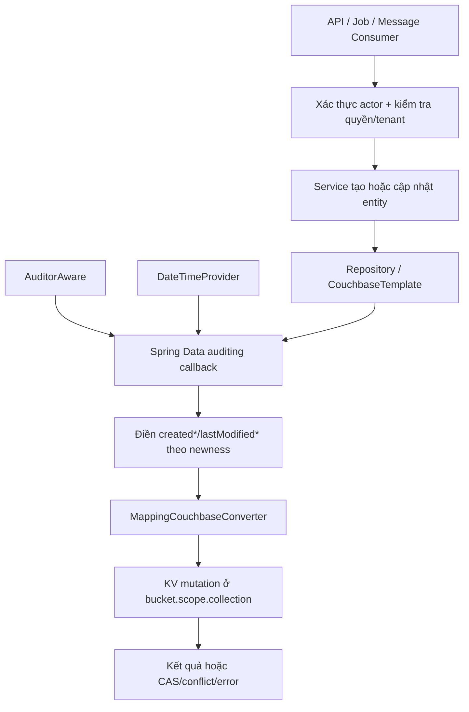
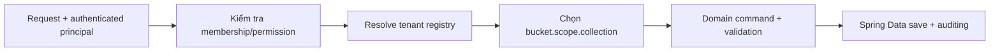

# Cấu hình thời gian và nguồn xác định người thao tác trong Spring Data Couchbase

Một document Couchbase có thể được tạo từ HTTP request, cập nhật bởi background job, sửa bởi consumer hoặc khôi phục từ dữ liệu import. Trong mỗi trường hợp, ứng dụng thường muốn lưu bốn thông tin: **thời điểm tạo**, **thời điểm cập nhật**, **người/tác nhân tạo** và **người/tác nhân cập nhật**. Việc điền đúng các trường đó không chỉ là thêm annotation: phải xác định **đồng hồ nào được tin cậy**, **identity nào được sử dụng**, **ngữ cảnh đó truyền đến callback bằng cách nào**, và **đường ghi có thực sự đi qua Spring Data auditing hay không**.

Bài thuộc chương **Vòng đời và auditing** của module `SPRING_DATA_COUCHBASE`. Trọng tâm là cấu hình thực tiễn `DateTimeProvider` và `AuditorAware`, đồng thời liên hệ với document mapping, repository, `CouchbaseTemplate`, SQL++, bucket/scope/collection, CAS, TTL, transaction và API reactive.

Một thiết kế tốt phải thỏa ba nguyên tắc:

1. **Thời gian audit do hệ thống quản lý và có ngữ nghĩa rõ**; không tin thời gian do client tự gửi làm “thời điểm server ghi nhận”.
2. **Actor audit xuất phát từ identity đã được xác thực hoặc service/job identity tin cậy**; không tự suy quyền từ tên người hoặc từ tên collection.
3. **Auditing được kiểm tra ở đường ghi thực tế**, bằng dữ liệu đã persist trong Couchbase, chứ không chỉ bằng việc bean hoặc annotation có mặt.

## 1. Phân biệt thời gian và actor đang nói đến

Một đơn hàng có thể có nhiều loại timestamp:

| Field | Câu hỏi nó trả lời | Nguồn phù hợp |
| --- | --- | --- |
| `createdAt` | Ứng dụng ghi nhận entity được tạo lúc nào? | Spring Data auditing qua `DateTimeProvider`. |
| `lastModifiedAt` | Entity được save/cập nhật qua pipeline auditing lần gần nhất lúc nào? | `DateTimeProvider` ở lần ghi. |
| `submittedAt` | Người dùng thực hiện hành vi gửi yêu cầu lúc nào? | Domain event/command; nguồn thời gian phải rõ. |
| `paidAt` | Thanh toán được hệ thống có thẩm quyền xác nhận lúc nào? | Payment workflow, không phải timestamp của mọi save. |
| `serverReceivedAt` | Edge/API nhận request lúc nào? | API/observability layer. |
| `expiresAt` hoặc expiry metadata | Document hết hạn khi nào? | TTL/expiry của Couchbase hoặc domain policy. |

Tương tự, “ai thao tác” có thể mang nhiều nghĩa:

| Field | Ý nghĩa |
| --- | --- |
| `createdBy` | Actor mà auditing quan sát khi entity được tạo. |
| `lastModifiedBy` | Actor mà auditing quan sát khi entity được cập nhật. |
| `requestedBy` | User khởi xướng business command (có thể khác service chạy). |
| `executedBy` | Service/job thực thi thay user. |
| `approvedBy` | Người phê duyệt nghiệp vụ, không tự đồng nghĩa người ghi document. |

**Không gộp mọi mốc thời gian thành `lastModifiedAt`**, và cũng không nhét cả requester, executor và approver vào một field `@LastModifiedBy`. Những trường nghiệp vụ khác nhau phải có contract riêng.

## 2. Ba lớp tạo nên auditing trong Spring Data Couchbase

Đường imperative tiêu biểu:



Các thành phần cần phân biệt:

- `@EnableCouchbaseAuditing`: đăng ký hạ tầng auditing cho Spring Data Couchbase imperative.
- `AuditorAware<T>`: cung cấp actor hiện hành cho `@CreatedBy`, `@LastModifiedBy`.
- `DateTimeProvider`: cung cấp thời gian cho `@CreatedDate`, `@LastModifiedDate`.

Trong Spring Data Couchbase hiện đại, auditing được tích hợp vào cơ chế entity callback. Sơ đồ không cam kết thứ tự tuyệt đối với mọi callback/event tùy chỉnh ở mọi release; nếu một callback khác phụ thuộc audit metadata, cần kiểm tra ordering và integration test.

**Couchbase Server không chạy Java `AuditorAware`.** Việc cấp CAS hoặc tự hết hạn document không tự điền bốn annotation trong một ứng dụng Spring đang chạy.

## 3. Entity mẫu: kiểu audit field và @Version

Giả sử bucket `shop`, scope `commerce`, collection `orders` đã tồn tại. Entity:

```java
package example.shop.persistence;

import java.time.Instant;

import org.springframework.data.annotation.CreatedBy;
import org.springframework.data.annotation.CreatedDate;
import org.springframework.data.annotation.Id;
import org.springframework.data.annotation.LastModifiedBy;
import org.springframework.data.annotation.LastModifiedDate;
import org.springframework.data.annotation.Version;
import org.springframework.data.couchbase.core.mapping.Document;
import org.springframework.data.couchbase.repository.Collection;
import org.springframework.data.couchbase.repository.Scope;

@Document
@Scope("commerce")
@Collection("orders")
public class OrderDocument {

    @Id
    private String id;

    private String status;

    @Version
    private long version;

    @CreatedDate
    private Instant createdAt;

    @LastModifiedDate
    private Instant lastModifiedAt;

    @CreatedBy
    private String createdBy;

    @LastModifiedBy
    private String lastModifiedBy;

    public OrderDocument() {}

    public OrderDocument(String id, String status) {
        this.id = id;
        this.status = status;
    }

    public String getId() { return id; }
    public String getStatus() { return status; }
    public void setStatus(String status) { this.status = status; }

    public long getVersion() { return version; }
    public Instant getCreatedAt() { return createdAt; }
    public Instant getLastModifiedAt() { return lastModifiedAt; }
    public String getCreatedBy() { return createdBy; }
    public String getLastModifiedBy() { return lastModifiedBy; }
}
```

Repository:

```java
package example.shop.persistence;

import org.springframework.data.couchbase.repository.CouchbaseRepository;

public interface OrderRepository
        extends CouchbaseRepository<OrderDocument, String> {
}
```

Bốn annotation auditing nằm trong `org.springframework.data.annotation`. `@Document` nằm trong `org.springframework.data.couchbase.core.mapping`; `@Scope` và `@Collection` của Couchbase nằm trong `org.springframework.data.couchbase.repository`.

**Tại sao có `@Version`?** Tài liệu Spring Data Couchbase nhấn mạnh entity cần `@Version` để creation auditing phân biệt một entity **mới nhưng đã có ID** với một entity đang cập nhật. Với kiểu `long`, `0L` là dấu hiệu newness; sau khi đọc/lưu, version đại diện CAS. Không tự tăng `version` như bộ đếm nghiệp vụ.

## 4. Bật auditing và cấu hình tường minh hai nguồn

Cấu hình có tên bean rõ ràng:

```java
package example.shop.config;

import org.springframework.context.annotation.Configuration;
import org.springframework.data.couchbase.repository.auditing.EnableCouchbaseAuditing;

@Configuration
@EnableCouchbaseAuditing(
    auditorAwareRef = "securityAuditActor",
    dateTimeProviderRef = "utcAuditTime",
    setDates = true,
    modifyOnCreate = true
)
public class AuditActivationConfiguration {
}
```

Bốn thuộc tính chính:

| Thuộc tính | Mặc định | Ý nghĩa |
| --- | --- | --- |
| `auditorAwareRef` | `""` | Chọn bean `AuditorAware<?>` theo tên. |
| `dateTimeProviderRef` | `""` | Chọn bean `DateTimeProvider` theo tên. |
| `setDates` | `true` | Cho auditing tự điền các trường ngày. |
| `modifyOnCreate` | `true` | Ghi cả trường last-modified khi entity mới được tạo. |

Hai bean tên `securityAuditActor` và `utcAuditTime` phải được đăng ký trước khi context sử dụng chúng. Nếu application có nhiều auditor/clock provider, chọn bằng tên tránh phụ thuộc việc framework tự suy ra bean nào được dùng.

**Không bật hai cấu hình `@EnableCouchbaseAuditing` không chủ đích** cùng context. Nếu đã có auditing ở một class `AbstractCouchbaseConfiguration`, hãy tích hợp cấu hình hoặc dùng cơ chế thay thế đúng, không tạo hạ tầng chồng lấn chỉ để thử một bean.

### Ngữ nghĩa modifyOnCreate

Với `modifyOnCreate=true`, lần tạo có thể điền cả `createdAt/by` và `lastModifiedAt/by`. Với `false`, hai trường last-modified có thể để trống đến lần cập nhật.

Đặt `modifyOnCreate=false` rồi áp `@NotNull` bắt buộc cho `lastModifiedAt` ngay trước save có thể khiến một entity mới hợp lệ bị từ chối. Phải định nghĩa contract dữ liệu và validation tương thích.

## 5. DateTimeProvider: SPI thực sự trả về gì?

Spring Data Commons định nghĩa:

```java
package org.springframework.data.auditing;

public interface DateTimeProvider {

    Optional<java.time.temporal.TemporalAccessor> getNow();
}
```

Điểm chính là **`getNow()` trả `Optional<TemporalAccessor>`**, không phải mặc định một chuỗi ISO, `LocalDateTime` hoặc một HTTP timestamp. `Instant` triển khai `TemporalAccessor`, nên có thể dùng `Instant.now(clock)`.

Nếu không cấu hình riêng, Spring Data có `CurrentDateTimeProvider` làm lựa chọn mặc định. Tùy dự án bạn có thể thay bằng một bean `DateTimeProvider` và chọn nó qua `dateTimeProviderRef`.

### Vì sao ưu tiên Instant?

`Instant` biểu diễn **một thời điểm trên trục thời gian UTC**, không mang timezone hiển thị. Nó phù hợp cho việc so sánh và lưu metadata máy chủ.

Một giá trị `LocalDateTime` như `2026-11-25T09:30:00` không nói rõ đó là giờ ở Việt Nam, Singapore hay UTC. Nếu dùng không nhất quán ở nhiều deployment, việc phân tích sự cố dễ sai vài giờ.

Chọn kiểu audit field theo converter mà phiên bản Spring Data/Couchbase hỗ trợ. Với `Instant`, vẫn phải kiểm tra **định dạng JSON thực tế** trong cluster do converter có thể ảnh hưởng cách biểu diễn ngày.

## 6. Triển khai Clock và DateTimeProvider có thể kiểm thử

Dùng một `Clock` injectable thay vì gọi rải rác `System.currentTimeMillis()` hoặc `Instant.now()` ở nhiều class.

```java
package example.shop.config;

import java.time.Clock;
import java.time.Instant;
import java.util.Optional;

import org.springframework.context.annotation.Bean;
import org.springframework.context.annotation.Configuration;
import org.springframework.data.auditing.DateTimeProvider;

@Configuration
public class AuditClockConfiguration {

    @Bean("auditClock")
    Clock auditClock() {
        return Clock.systemUTC();
    }

    @Bean("utcAuditTime")
    DateTimeProvider utcAuditTime(
            @org.springframework.beans.factory.annotation.Qualifier(
                "auditClock"
            ) Clock clock) {

        return () -> Optional.of(Instant.now(clock));
    }
}
```

`@Qualifier` ở đây được viết fully qualified để thấy rõ tên bean cần chọn. Có thể rút gọn bằng import:

```java
import org.springframework.beans.factory.annotation.Qualifier;

// Trong chữ ký phương thức @Bean:
DateTimeProvider utcAuditTime(@Qualifier("auditClock") Clock clock)
```

Dòng rút gọn là **mảnh chữ ký minh họa**, không phải method hoàn chỉnh để biên dịch độc lập.

### Clock.systemUTC() thực sự bảo đảm gì?

- Phép lấy `Instant` được biểu diễn trên trục UTC.
- Tránh phụ thuộc múi giờ mặc định của JVM khi sinh timestamp.
- Tăng khả năng kiểm thử bằng việc thay `Clock`.

Nó **không** bảo đảm các node ứng dụng có đồng hồ vật lý được đồng bộ hoàn hảo. Hai JVM cùng dùng `Clock.systemUTC()` vẫn có thể bị lệch vài trăm mili giây hoặc nhiều hơn nếu đồng hồ hệ điều hành có vấn đề.

## 7. UTC, múi giờ hiển thị và daylight saving time

Ví dụ cùng một thời điểm:

```text
Instant:
  2026-11-25T02:30:00Z

Múi giờ Asia/Ho_Chi_Minh (UTC+07):
  2026-11-25 09:30:00

Hai biểu diễn nói về cùng một thời điểm.
```

Nguyên tắc:

1. **Lưu audit timestamp như một thời điểm có thể so sánh**, ví dụ `Instant`.
2. **Hiển thị theo múi giờ của người xem** tại API/UI, không biến múi giờ hiển thị thành nguồn thời gian hệ thống.
3. Nếu cần lịch nghiệp vụ (“ngày kết sổ tại Hà Nội”, “đầu ngày ở New York”), dùng `ZoneId` và local date phù hợp tại tầng domain.
4. Tránh ép `LocalDateTime.now()` trên server thành UTC bằng cách gắn hậu tố `Z`; đó là gán nhầm timezone.
5. Với vùng có DST, cùng giờ địa phương có thể xảy ra hai lần hoặc không xảy ra. Audit timestamp cần giữ mốc tuyệt đối để không bị mơ hồ.

Ví dụ chuyển đổi chỉ để hiển thị:

```java
Instant storedAt = Instant.parse("2026-11-25T02:30:00Z");

java.time.ZonedDateTime display =
    storedAt.atZone(java.time.ZoneId.of("Asia/Ho_Chi_Minh"));
```

Không chuyển ngược `display.toLocalDateTime()` rồi lưu nó như timestamp toàn cục mà không lưu timezone/offset nếu hợp đồng cần phân biệt thời điểm tuyệt đối.

## 8. Độ chính xác của timestamp và cách kiểm thử

`Instant` có thể có phần nano giây, nhưng **độ chính xác có thể thay đổi ở các lớp**:

- Clock của hệ điều hành.
- `DateTimeProvider` trong Spring.
- Converter từ Java sang JSON.
- Các custom converters.
- Hệ thống import/ETL hoặc SQL++ DML.
- Client/API hiển thị (làm tròn giây/mili giây).

Vì vậy, có hai loại test khác nhau:

| Test | Assertion phù hợp |
| --- | --- |
| Kiểm tra callback/auditing gọi đúng DateTimeProvider với clock cố định | So sánh `Instant` chính xác khi mapping giữ độ chính xác như cấu hình. |
| Kiểm tra round-trip qua JSON có thể cắt độ chính xác | So sánh theo độ chính xác đã quy định, hoặc chuẩn hóa về millisecond/second trước so sánh. |
| Kiểm tra định dạng API | Assert ISO-8601 UTC theo serialization contract. |
| Kiểm tra thứ tự hai lần cập nhật bằng đồng hồ thực | Tránh dựa tuyệt đối vào chênh lệch mili giây; dùng controlled clock. |

Không viết test `assertEquals(Instant.now(), entity.getCreatedAt())`: hai lời gọi `now()` diễn ra ở hai thời điểm khác nhau.

### Provider cần trả thời gian ổn định theo một đơn vị kiểm thử

Một test với `Clock.fixed(...)` đơn giản:

```java
Clock fixed = Clock.fixed(
    Instant.parse("2026-11-25T02:30:00Z"),
    java.time.ZoneOffset.UTC
);

DateTimeProvider provider = () ->
    Optional.of(Instant.now(fixed));
```

Kết quả chính xác và lặp lại được. Trong production, không dùng `Clock.fixed` vì mọi document có thể nhận cùng timestamp cố định.

## 9. Clock skew: timestamp không phải CAS

Giả sử hai instance cùng ghi collection:

```text
Instance A: đồng hồ nhanh 800 ms
Instance B: đồng hồ chậm 500 ms

10:00:00.800 (A) ghi lần 1
10:00:00.300 (B) ghi lần 2 sau đó
```

Nếu mỗi instance lấy thời gian local, document sau cập nhật thứ hai có thể có `lastModifiedAt` **nhỏ hơn** lần thứ nhất dù cả hai mutation đều thành công.

**Đây không có nghĩa CAS đã quay ngược.** CAS do Couchbase cấp để phát hiện xung đột document; timestamp auditing là giá trị do ứng dụng cung cấp.

Biện pháp vận hành:

- Đồng bộ đồng hồ node/container bằng cơ chế thời gian của hạ tầng (NTP hoặc nguồn tương đương).
- Theo dõi clock offset và bất thường thời gian.
- Không dùng `lastModifiedAt` thay cho CAS trong optimistic locking.
- Khi cần thứ tự sự kiện toàn cục, thiết kế log/sequence/stream hoặc cơ chế order phù hợp thay vì chỉ so sánh timestamp.
- Định nghĩa độ chính xác và tolerance cho kiểm thử đọc sau ghi trên nhiều node.

Một CAS khác không chứng minh “lần ghi mới hơn theo timestamp” nếu hai tác vụ đang ghi metadata với clock khác nhau.

## 10. Auditing time khác Couchbase server time và expiry

Có ba “đồng hồ” cần tách:

1. **Application audit time:** giá trị `DateTimeProvider` dùng cho `@CreatedDate/@LastModifiedDate`.
2. **Couchbase server clock/metadata:** server xử lý request, CAS và expiry theo cơ chế của server.
3. **Business event time:** thời điểm một sự kiện xảy ra theo nguồn có thẩm quyền, ví dụ payment provider hoặc event producer.

Ví dụ session tạo lúc 09:00, TTL 30 phút:

```text
createdAt (audit) = 09:00
expiry / TTL      = 30 phút theo chính sách document
lastModifiedAt    = thời điểm lần lưu gần nhất
```

Không suy rằng `createdAt + 30 phút` luôn bằng expiry thực tế nếu nghiệp vụ có thao tác gia hạn, preserve expiry, collection max TTL hoặc lệch thời gian các thành phần. Tương tự, Couchbase tự xóa document khi TTL hết hạn **không kích hoạt** `DateTimeProvider` của JVM để điền `lastModifiedAt`.

### Vì sao không dùng audit timestamp làm “last accessed”?

Một lời gọi `findById` hoặc query SQL++ thông thường **không phải save**, nên auditing không tự cập nhật `lastModifiedAt` thành “thời điểm truy cập cuối cùng”. Nếu nghiệp vụ cần `lastAccessedAt`, thiết kế trường/cơ chế riêng, cân nhắc chi phí ghi và CAS.

## 11. AuditorAware<T>: nguồn xác định actor

Spring Data Commons định nghĩa:

```java
package org.springframework.data.domain;

public interface AuditorAware<T> {
    Optional<T> getCurrentAuditor();
}
```

Generic `T` tương ứng với kiểu `@CreatedBy` và `@LastModifiedBy` trên entity. Với `String`, dùng `AuditorAware<String>`.

Ví dụ code cấu hình bean (chưa gắn bảo mật để dễ hiểu):

```java
@Configuration
public class ExampleAuditorBeans {

    @Bean("securityAuditActor")
    AuditorAware<String> securityAuditActor() {
        return () -> Optional.of("demo-actor");
    }
}
```

Đây **chỉ là ví dụ thử nghiệm**; không hardcode actor trong production. `AuditorAware` là nguồn metadata: nó không xác nhận quyền truy cập Couchbase hoặc tenant. Policy authorization vẫn phải chạy trước command.

### Có thể không cần AuditorAware không?

Có, khi entity chỉ cần `@CreatedDate` và `@LastModifiedDate`. Tài liệu Spring Data Commons nêu rằng auditing chỉ thời gian không bắt buộc cung cấp `AuditorAware`. Nếu có `@CreatedBy/@LastModifiedBy` mà thiếu auditor, hai trường đó có thể không được điền như mong đợi; cần test contract.

## 12. Lấy actor từ Spring Security: không tin username do client gửi

Với đường imperative Spring MVC, một provider mẫu:

```java
package example.shop.config;

import java.util.Optional;

import org.springframework.context.annotation.Bean;
import org.springframework.context.annotation.Configuration;
import org.springframework.data.domain.AuditorAware;
import org.springframework.security.authentication.AnonymousAuthenticationToken;
import org.springframework.security.core.Authentication;
import org.springframework.security.core.context.SecurityContextHolder;

@Configuration
public class AuditActorConfiguration {

    @Bean("securityAuditActor")
    AuditorAware<String> securityAuditActor() {
        return () -> Optional.ofNullable(
                SecurityContextHolder.getContext()
                    .getAuthentication()
            )
            .filter(Authentication::isAuthenticated)
            .filter(auth ->
                !(auth instanceof AnonymousAuthenticationToken)
            )
            .map(Authentication::getName)
            .filter(name -> !name.isBlank());
    }
}
```

Điểm đáng chú ý:

- `Authentication::isAuthenticated` **không đủ một mình** để loại anonymous authentication; ví dụ trên lọc `AnonymousAuthenticationToken`.
- `getName()` không luôn là ID bất biến. Nó có thể là username/email tùy authentication provider.
- Khi không có authentication hợp lệ, provider trả `Optional.empty()`, không tự giả một actor.
- Spring Security phải được cấu hình xác thực thực sự; code trên không tự tạo filter chain hay chứng minh quyền.
- Không đưa access token, raw JWT, session cookie hoặc password vào auditing document.

### Stable subject ID thay cho username

Nếu ứng dụng có principal tự định nghĩa:

```java
public record ShopPrincipal(
    String userId,
    String displayName
) {}
```

thì có thể lưu `userId`:

```java
@Bean("stableAuditActor")
AuditorAware<String> stableAuditActor() {
    return () -> Optional.ofNullable(
            SecurityContextHolder.getContext()
                .getAuthentication()
        )
        .filter(Authentication::isAuthenticated)
        .filter(auth ->
            !(auth instanceof AnonymousAuthenticationToken)
        )
        .map(Authentication::getPrincipal)
        .filter(ShopPrincipal.class::isInstance)
        .map(ShopPrincipal.class::cast)
        .map(ShopPrincipal::userId);
}
```

Bean này chỉ làm việc nếu principal **thực sự** là `ShopPrincipal`; ứng dụng cần xây dựng/kiểm tra authentication đúng cách. Khi chọn nó, đổi `auditorAwareRef` thành `"stableAuditActor"`. Không khai báo cả hai bean mà để cấu hình auditing tự đoán actor nào cần dùng.

## 13. Actor string nên biểu diễn điều gì?

Một convention đơn giản:

```text
user:7841
service:order-api
job:daily-reconciliation
integration:warehouse-sync
```

Ưu điểm: ID ngắn, ổn định, dễ phân loại trong log. Tuy nhiên:

- Tên user là **identity**, không phải role/permission.
- Actor có thể đã bị khóa tài khoản sau thời điểm lưu.
- Nếu actor ID được tái sử dụng, audit metadata mất ý nghĩa; identity service nên tránh tái sử dụng ID.
- Không dùng actor field để quyết định query tenant hoặc quyền cập nhật.

Với hành vi thay mặt người dùng, có thể cần **hai trường** ngoài auditing:

```java
private String initiatedBy;  // user khởi xướng command
private String executedBy;   // service thi hành
```

`@LastModifiedBy` vẫn đại diện actor theo chính sách auditor của hệ thống. Không bịa ra “người đã phê duyệt” từ metadata này khi thực tế chỉ có một service account gửi mutation.

## 14. Tenant và principal: ranh giới bảo mật

Với hệ thống multi-tenant:

```text
shop.tenant_acme.orders
shop.tenant_globex.orders
```

Một user có thể có quyền ở tenant A nhưng không có ở tenant B. Lưu `createdBy="user:7841"` không tự chứng minh họ được truy cập mọi scope.

Luồng đúng:



**Không lấy scope/collection từ input người dùng mà chưa kiểm tra**, và không suy tenant chỉ từ tham số `String collection` của callback vì tên collection thường là `orders` trên nhiều scope.

Một actor có thể được dùng cho cả hai tenant hợp lệ; cần field tenant/domain ownership hoặc routing được xác thực riêng.

## 15. Batch job, scheduler và message consumer: actor lấy từ đâu?

Một job không có request HTTP:

```java
@Scheduled(cron = "0 0 2 * * *")
public void reconcile() {
    // Job khởi chạy từ scheduler, không có user session HTTP.
}
```

Nếu auditor luôn đọc `SecurityContextHolder`, job có thể nhận `Optional.empty()`. Điều đó **không** nên được sửa bằng:

```java
// Sai chính sách:
return Optional.of("admin");
```

vì mọi request không xác thực cũng có thể bị gán audit actor “admin”.

Các thiết kế nên cân nhắc:

1. **Job identity độc lập:** scheduler gọi một entrypoint đã được cấu hình service principal `job:reconcile-orders` tin cậy.
2. **Tầng command tường minh:** service nhận command và metadata actor đáng tin cậy từ envelope đã xác thực, không chấp nhận actor tùy ý từ payload public.
3. **Cơ chế context propagation riêng:** nếu ứng dụng thật sự cần dùng một auditor chung cho request và job, phải làm rõ cách set/clear context trong scope của từng job.
4. **Đường ETL/SDK direct:** nếu không dùng Spring Data mapping, job phải tự ghi metadata đúng schema, không kỳ vọng annotation Java chạy ở Couchbase Server.

### Khi job chạy “thay mặt user”

Thông điệp có thể chứa `initiatedBy=user:7841` và được xử lý bởi `service:fulfillment-worker`. Không nên đánh đồng hai identity. Lựa chọn:

- Audit `lastModifiedBy=service:fulfillment-worker` để thể hiện writer thực thi.
- Lưu riêng `initiatedBy=user:7841` từ command đã được xác thực.
- Hoặc nếu nghiệp vụ yêu cầu lastModifiedBy là người khởi xướng, policy phải được định nghĩa rõ và dữ liệu chứng minh nguồn user đáng tin.

Không dùng một trường user ID tùy ý trong message broker để giả mạo principal nếu message chưa được xác thực/ủy quyền.

## 16. Spring @Async và thread pool: tránh rò rỉ actor

Trong ứng dụng imperative, `SecurityContextHolder` thường gắn với execution context/thread. Khi gọi `@Async` hoặc executor khác, context không tự tồn tại như ở HTTP thread trong mọi cấu hình.

Rủi ro:

```text
Request A: actor=user:alice
    -> enqueue task
Request B: actor=user:bob
    -> enqueue task

Nếu task dùng global mutable currentUser:
    audit có thể ghi nhầm bob cho task của alice.
```

**Không sử dụng biến static/singleton mutable để lưu actor hiện hành.**

Nếu cần truyền security context hợp pháp sang executor, sử dụng cơ chế context propagation của Spring Security (ví dụ các wrapper `DelegatingSecurityContextExecutor` theo đúng phiên bản). Nếu job không nên kế thừa quyền của request, thay vì sao chép security context hãy dùng một service identity và authorization riêng.

### ThreadLocal tự định nghĩa có an toàn không?

Có thể dẫn đến rò rỉ danh tính giữa request khi thread được tái sử dụng nếu quên cleanup. Hạn chế dùng nó làm nguồn sự thật của auditing. Nếu không thể tránh, phải:

- Set context từ entrypoint đã được xác thực.
- Clear trong `finally`.
- Không chia sẻ mutable singleton.
- Kiểm thử đồng thời và đường lỗi.
- Có policy rõ khi context thiếu.

Trong reactive, không sử dụng ThreadLocal theo giả định cũ; dùng Reactor security context.

## 17. Reactive: cùng chính sách audit, khác cách lấy actor

Spring Data Couchbase reactive có cấu hình:

```java
import org.springframework.context.annotation.Configuration;
import org.springframework.data.couchbase.repository.auditing.EnableReactiveCouchbaseAuditing;

@Configuration
@EnableReactiveCouchbaseAuditing(
    auditorAwareRef = "reactiveAuditActor",
    dateTimeProviderRef = "utcAuditTime",
    modifyOnCreate = true,
    setDates = true
)
public class ReactiveAuditConfiguration {
}
```

Dòng reactive cần `ReactiveAuditorAware<T>`:

```java
import org.springframework.data.domain.ReactiveAuditorAware;
```

Nó trả `org.reactivestreams.Publisher<T>`, chẳng hạn `Mono<T>`. Không lấy một bean `AuditorAware<T>` đồng bộ rồi mặc định nó phục vụ đúng reactive path.

### Ví dụ ReactiveAuditorAware từ Spring Security

```java
package example.shop.config;

import org.springframework.context.annotation.Bean;
import org.springframework.context.annotation.Configuration;
import org.springframework.data.domain.ReactiveAuditorAware;
import org.springframework.security.authentication.AnonymousAuthenticationToken;
import org.springframework.security.core.Authentication;
import org.springframework.security.core.context.ReactiveSecurityContextHolder;

import reactor.core.publisher.Mono;

@Configuration
public class ReactiveActorConfiguration {

    @Bean("reactiveAuditActor")
    ReactiveAuditorAware<String> reactiveAuditActor() {
        return () -> ReactiveSecurityContextHolder.getContext()
            .flatMap(context ->
                Mono.justOrEmpty(context.getAuthentication())
            )
            .filter(Authentication::isAuthenticated)
            .filter(auth ->
                !(auth instanceof AnonymousAuthenticationToken)
            )
            .map(Authentication::getName)
            .filter(name -> !name.isBlank());
    }
}
```

`Mono.justOrEmpty(...)` xử lý trường hợp security context không có `Authentication`. Nếu không có principal hợp lệ, publisher có thể empty; application phải quyết định có cho command chạy hay từ chối trước DB.

### DateTimeProvider có phải reactive không?

`DateTimeProvider` là SPI cung cấp thời gian (đồng bộ) và được dùng thông qua thuộc tính `dateTimeProviderRef` của `@EnableReactiveCouchbaseAuditing`. Nguồn **actor** dùng `ReactiveAuditorAware` do cần truy cập Reactor context. Không biến DateTimeProvider thành một phép network I/O blocking trên event loop.

## 18. Subscription, retry và thời gian audit reactive

Một đoạn mã:

```java
Mono<OrderDocument> saved =
    reactiveOrderRepository.save(order);
```

chỉ xây dựng publisher; không kết luận write/auditing đã hoàn tất nếu chưa được consume.

Test:

```java
StepVerifier.create(
        reactiveOrderRepository.save(order)
    )
    .assertNext(savedOrder ->
        assertNotNull(savedOrder.getCreatedAt())
    )
    .verifyComplete();
```

Đoạn code là **thân test minh họa**; cần dependency `reactor-test`, static import `assertNotNull`, repository và bucket test. Muốn xác minh principal, cung cấp Spring Security Reactor context qua `contextWrite(...)` hoặc test support tương ứng.

### Retry có thể lấy audit time/actor lần nữa

```java
reactiveOrderRepository.save(order)
    .retry(2);
```

Khi upstream lỗi và publisher được resubscribe, pipeline có thể chạy lại. Không có bảo đảm cả ba attempt lấy **cùng Instant** hoặc cùng trạng thái context nếu ứng dụng thay đổi context giữa các lần.

Không dùng retry như cơ chế bảo đảm giao dịch bên ngoài. Với CAS conflict, chỉ retry cùng stale entity không tự reload CAS; cần xây lại command theo trạng thái mới và kiểm tra idempotency. Không tạo message/email trong DateTimeProvider hoặc ReactiveAuditorAware.

## 19. Thứ tự pha auditing và callback tùy chỉnh

Giả sử một `BeforeConvertCallback<OrderDocument>` muốn tính field phụ dựa trên `createdAt`:

```java
@Override
public OrderDocument onBeforeConvert(
        OrderDocument entity, String collection) {

    if (entity.getCreatedAt() != null) {
        // Dựa vào createdAt phải biết callback auditing đã chạy hay chưa.
    }

    return entity;
}
```

Trong Spring Data Couchbase hiện đại, hạ tầng auditing cũng tham gia entity callback lifecycle. Không tự khẳng định một custom callback chạy **trước** hay **sau** auditing chỉ từ tên phương thức. Cần xem `@Order`/`Ordered` của callback auditing ở phiên bản đang resolve và viết integration test cụ thể.

**Khuyến nghị:** logic normalization dữ liệu nghiệp vụ nên độc lập với timestamp auditing nếu có thể. Nếu một field có ngữ nghĩa business event time thì service/domain chủ động đặt field đó, không chờ lifecycle callback cung cấp “đúng thời điểm” một cách ngầm định.

## 20. Auditing time và các giá trị thời gian khác trong JSON

Ví dụ document có thể trông như:

```json
{
  "_class": "example.shop.persistence.OrderDocument",
  "status": "CONFIRMED",
  "createdAt": "2026-11-25T02:30:00Z",
  "lastModifiedAt": "2026-11-25T04:10:00Z",
  "createdBy": "user:alice",
  "lastModifiedBy": "user:bob"
}
```

JSON này chỉ để minh họa hình dạng. **Định dạng thật phụ thuộc converter**. Tùy phiên bản/custom conversions, timestamp có thể được biểu diễn bằng chuỗi hoặc số/đối tượng khác. Test nên đọc document bằng SDK để xác nhận schema, không tự mặc định `JsonObject.getString("createdAt")` luôn đúng trong mọi môi trường.

Couchbase metadata CAS và expiry không tự xuất hiện như hai field trong body JSON ở ví dụ trên.

### Migrate JSON cũ khi đổi time format

Một collection có thể chứa document đời cũ:

```json
{
  "createdAt": 1732450000000,
  "lastModifiedAt": "2024-11-24T11:00:00"
}
```

Nếu thay converter/time zone policy, cần kế hoạch migration. Không đổi ngẫu nhiên tất cả timestamp thành local time rồi gắn `Z`; điều đó thay đổi ý nghĩa thời gian. Nên:

1. Kiểm kê biểu diễn hiện có và các nguồn ghi.
2. Xác định time zone gốc của legacy value.
3. Xây dựng conversion có kiểm chứng và khả năng rollback.
4. Giữ riêng `migratedAt` nếu cần đánh dấu thời điểm migration.
5. Test repository/Template đọc được dữ liệu cũ mới.
6. Đối soát chênh lệch thời gian ở biên DST nếu dữ liệu nguồn dùng local timezone.

Nếu không biết timezone gốc, không bịa ra một mốc chính xác; ghi nhận mức độ tin cậy của dữ liệu.

## 21. SQL++ và Java SDK có sử dụng hai provider này không?

**Không**, nếu thao tác bypass Spring Data entity mapping. Bảng:

| Đường truy cập | DateTimeProvider/AuditorAware của Spring có tự chạy? |
| --- | --- |
| `CouchbaseRepository.save(entity)` | Có thể, khi auditing bật và đi qua lifecycle hỗ trợ. |
| `CouchbaseTemplate.upsertById(Entity.class)...one(entity)` | Có thể, nếu Template/callbacks được cấu hình đúng. |
| `ReactiveCouchbaseRepository.save(entity)` | Qua reactive auditing khi publisher được consume. |
| Java SDK `collection.upsert(id, JsonObject)` | Không tự chạy Spring Data provider. |
| SQL++ `UPDATE/INSERT/MERGE` từ Query Service | Không tự chạy callback cho từng entity Java. |
| ETL/import/XDCR từ hệ thống khác | Không tự chạy callback trong Spring JVM. |
| Document tự hết hạn do TTL | Không tự kích hoạt save auditing. |

Nếu một job dùng Java SDK direct transaction, nó phải xác định actor/timestamp từ service identity tin cậy và ghi metadata trong schema của đường đó. Không trông chờ `@CreatedDate` Java chạy trên Couchbase Server.

### SQL++ UPDATE có cập nhật audit field được không?

Có thể đặt tường minh:

```sql
UPDATE `shop`.`commerce`.`orders` AS o
USE KEYS $documentId
SET o.status = $newStatus,
    o.lastModifiedAt = $auditTime,
    o.lastModifiedBy = $auditActor;
```

Nhưng `$auditTime` phải dùng **định dạng tương thích với schema đã chọn**, và `$auditActor` phải được xác thực/truyền từ tầng service có quyền. Không dùng string user do client nhập mà chưa kiểm chứng.

Đừng suy từ câu SQL++ này rằng CAS optimistic locking của Spring Data cũng tự được áp dụng; với update cạnh tranh cần điều kiện version/transaction hoặc một quy trình phù hợp riêng.

## 22. Dữ liệu đa nguồn và chính sách actor thống nhất

Giả sử cùng collection nhận:

```text
HTTP API      -> principal = user:7841
Nightly job   -> principal = job:order-reconcile
Inventory sync-> principal = service:inventory-sync
Manual repair -> principal = admin:operator-42
```

Nên thống nhất:

- Format actor ID.
- Ai có quyền khai actor đó.
- Trường `createdBy` có được phép sửa qua migration hay không.
- Actor của job ghi “service” hay người khởi xướng.
- Có trường nguồn hành động `sourceSystem`/`commandId` riêng hay không.
- Quyền nào được dùng để ghi vào collection.
- Cách giải quyết `Optional.empty()`: từ chối, chấp nhận null, hay đặt một actor hệ thống có bằng chứng.

Nếu yêu cầu audit compliance cao, có thể cần log bất biến, event archive và retention policy. `createdBy`/`lastModifiedBy` là **snapshot metadata của document**, không cung cấp toàn bộ chuỗi thay đổi lịch sử.

## 23. Kiểm thử DateTimeProvider và AuditorAware ở mức unit

### 23.1. Test đồng hồ cố định

```java
import java.time.Clock;
import java.time.Instant;
import java.time.ZoneOffset;
import java.util.Optional;

import org.junit.jupiter.api.Test;
import org.springframework.data.auditing.DateTimeProvider;

import static org.junit.jupiter.api.Assertions.assertEquals;

class AuditClockTest {

    @Test
    void returnsControlledInstant() {
        Instant fixedAt =
            Instant.parse("2026-11-25T02:30:00Z");

        Clock clock = Clock.fixed(fixedAt, ZoneOffset.UTC);

        DateTimeProvider provider =
            () -> Optional.of(Instant.now(clock));

        assertEquals(
            Optional.of(fixedAt),
            provider.getNow()
        );
    }
}
```

Test này chứng minh **provider** đúng, chưa chứng minh entity auditing callback sử dụng bean đã chọn. Cần test integration.

### 23.2. Test auditor từ security context

```java
import java.util.List;
import java.util.Optional;

import org.junit.jupiter.api.Test;
import org.springframework.security.authentication.UsernamePasswordAuthenticationToken;
import org.springframework.security.core.context.SecurityContextHolder;

import static org.junit.jupiter.api.Assertions.assertEquals;

class SecurityAuditActorTest {

    @Test
    void authenticatedActorIsUsed() {
        try {
            var auth = new UsernamePasswordAuthenticationToken(
                "user:alice", "unused", List.of()
            );

            SecurityContextHolder.getContext()
                .setAuthentication(auth);

            var auditor = new AuditActorConfiguration()
                .securityAuditActor();

            assertEquals(
                Optional.of("user:alice"),
                auditor.getCurrentAuditor()
            );
        } finally {
            SecurityContextHolder.clearContext();
        }
    }
}
```

Đoạn code giả định test cùng package với bean method package-private, hoặc method đã được đưa vào một provider class có thể truy cập. **Dọn SecurityContext trong finally** để không làm actor của test khác bị lẫn.

Test thêm anonymous token, authentication absent và principal name blank. Không nên xác nhận “actor đúng” chỉ bằng unit test với SecurityContext giả rồi bỏ qua authorization của ứng dụng.

## 24. Integration test với clock và actor đổi được

Để chứng minh metadata thực sự persist, cần một nguồn audit điều khiển được trong **test context**, không dùng global mutable provider ở production.

Ví dụ source test:

```java
import java.time.Instant;
import java.util.Optional;
import java.util.concurrent.atomic.AtomicReference;

import org.springframework.data.auditing.DateTimeProvider;
import org.springframework.data.domain.AuditorAware;

public final class MutableAuditSource {

    private final AtomicReference<String> actor =
        new AtomicReference<>("user:alice");

    private final AtomicReference<Instant> currentTime =
        new AtomicReference<>(
            Instant.parse("2026-11-25T02:30:00Z")
        );

    public void set(String nextActor, Instant nextTime) {
        actor.set(nextActor);
        currentTime.set(nextTime);
    }

    public AuditorAware<String> auditor() {
        return () -> Optional.ofNullable(actor.get());
    }

    public DateTimeProvider timeProvider() {
        return () -> Optional.ofNullable(currentTime.get());
    }
}
```

Cấu hình integration test:

```java
import org.springframework.boot.test.context.TestConfiguration;
import org.springframework.context.annotation.Bean;
import org.springframework.data.auditing.DateTimeProvider;
import org.springframework.data.domain.AuditorAware;
import org.springframework.data.couchbase.repository.auditing.EnableCouchbaseAuditing;

@TestConfiguration
@EnableCouchbaseAuditing(
    auditorAwareRef = "testAuditActor",
    dateTimeProviderRef = "testAuditClock",
    modifyOnCreate = true
)
public class AuditingTestConfiguration {

    @Bean
    MutableAuditSource testAuditSource() {
        return new MutableAuditSource();
    }

    @Bean("testAuditActor")
    AuditorAware<String> testAuditActor(MutableAuditSource source) {
        return source.auditor();
    }

    @Bean("testAuditClock")
    DateTimeProvider testAuditClock(MutableAuditSource source) {
        return source.timeProvider();
    }
}
```

**Quan trọng:** trong test context, không đồng thời kích hoạt cấu hình auditing production và test theo cách xung đột. Hãy dùng một context dành riêng cho test, `@Import` phù hợp hoặc cơ chế override có kiểm soát. Nếu chạy các test song song dùng chung `MutableAuditSource`, giá trị actor/time có thể bị trộn; nên cô lập từng test hoặc tắt parallel.

## 25. Test create/update và kiểm tra bằng SDK oracle

Một phương thức integration test có thể gồm:

```java
Instant t1 = Instant.parse("2026-11-25T02:30:00Z");
Instant t2 = Instant.parse("2026-11-25T03:10:00Z");

source.set("user:alice", t1);

String id = "it::audit::" + java.util.UUID.randomUUID();

OrderDocument created =
    orderRepository.save(new OrderDocument(id, "NEW"));

assertEquals(t1, created.getCreatedAt());
assertEquals("user:alice", created.getCreatedBy());
assertEquals("user:alice", created.getLastModifiedBy());

source.set("user:bob", t2);

OrderDocument loaded = orderRepository.findById(id)
    .orElseThrow();
loaded.setStatus("CONFIRMED");

OrderDocument updated = orderRepository.save(loaded);

assertEquals(t1, updated.getCreatedAt());
assertEquals("user:alice", updated.getCreatedBy());
assertEquals(t2, updated.getLastModifiedAt());
assertEquals("user:bob", updated.getLastModifiedBy());
```

Đây là **thân test**, cần Spring context, Couchbase test instance, repository, SDK, `source`, static imports JUnit và fixture keyspace sẵn. Nếu converter làm tròn timestamp, chọn giá trị Instant/test assertion phù hợp độ chính xác hỗ trợ.

### Kiểm tra document đã lưu thật

```java
var content = sdkCluster.bucket("shop")
    .scope("commerce")
    .collection("orders")
    .get(id)
    .contentAsObject();

assertEquals("user:alice", content.getString("createdBy"));
assertEquals("user:bob", content.getString("lastModifiedBy"));
```

Không mặc định `content.getString("createdAt")` luôn đúng: kiểm tra định dạng JSON thực tế trước. Đọc trực tiếp bằng SDK theo **đúng bucket.scope.collection** giúp phát hiện trường hợp repository save/find cùng nhắm sai collection mà test vẫn tưởng thành công.

### Với CAS conflict

Test hai writer load cùng document; writer A save thành công, writer B save với CAS cũ bị conflict. Auditor/clock có thể đã thay object của B trong JVM, nhưng document ở server **không được nhận** audit metadata của lần ghi thất bại.

## 26. Reactive integration test với principal đúng

Trong test reactive, cung cấp authentication bằng Reactor security context:

```java
import java.util.List;

import org.springframework.security.authentication.UsernamePasswordAuthenticationToken;
import org.springframework.security.core.context.ReactiveSecurityContextHolder;

import reactor.core.publisher.Mono;
import reactor.test.StepVerifier;

var authentication = new UsernamePasswordAuthenticationToken(
    "user:reactive-alice", "unused", List.of()
);

Mono<OrderDocument> saveCommand =
    reactiveOrderRepository.save(
        new OrderDocument("it::" + java.util.UUID.randomUUID(), "NEW")
    )
    .contextWrite(
        ReactiveSecurityContextHolder.withAuthentication(authentication)
    );

StepVerifier.create(saveCommand)
    .assertNext(saved -> {
        assertEquals(
            "user:reactive-alice", saved.getCreatedBy()
        );
    })
    .verifyComplete();
```

Đây là test fragment, cần `@EnableReactiveCouchbaseAuditing`, bean `ReactiveAuditorAware<String>`, callback wiring, test cluster, JUnit static import và subscription. Không dùng một `ThreadLocal` singleton làm auditor cho reactive concurrent flows.

Test thêm hai publishers có hai principals khác nhau. Khi concurrency gây trộn identity, lỗi nằm ở thiết kế truyền context, không nên chữa bằng cách dùng toàn bộ auditor là `"system"`.

## 27. Bảng chẩn đoán dữ liệu audit sai

| Triệu chứng | Nguyên nhân khả dĩ | Cách kiểm tra |
| --- | --- | --- |
| `createdAt` null sau create | Auditing chưa bật, bean không dùng, entity thiếu `@Version` hoặc `setDates=false`. | Kiểm tra config, newness, callback và SDK JSON. |
| `createdBy` null nhưng `createdAt` có | Auditor bean thiếu/trả empty, context principal không có hoặc ref sai. | Test `AuditorAware.getCurrentAuditor()` tại entrypoint. |
| `createdBy="anonymousUser"` | Không lọc anonymous authentication. | Lọc token, bổ sung negative test. |
| Job bị gán user request khác | Mutable global identity hoặc rò rỉ ThreadLocal. | Kiểm tra context propagation và cleanup. |
| Reactive auditing thiếu actor | Dùng `AuditorAware` imperative thay vì `ReactiveAuditorAware` hoặc mất Reactor context. | Kiểm tra bean, `contextWrite` và subscription. |
| Timestamp lệch 7 giờ | Lưu/hiển thị local time như UTC hoặc client parse sai offset. | Kiểm tra `Instant`, `ZoneId` và JSON codec. |
| Timestamp sau update nhỏ hơn trước | Đồng hồ các node lệch, provider không monotonic, hoặc migration ghi time cũ. | Kiểm tra offset hệ thống, log nguồn thời gian. |
| Test timestamp thỉnh thoảng fail | Assert `Instant.now()` hai lần, rounding/precision không được kiểm soát. | Dùng fixed clock, test precision. |
| Audit time luôn giống nhau ở production | Vô tình cấu hình `Clock.fixed(...)` hoặc test bean lọt production. | Kiểm tra bean graph và profile. |
| Hai AuditorAware bean gây nhầm actor | Không dùng `auditorAwareRef` rõ ràng. | Đặt bean name, kiểm tra context và integration. |
| SQL++ UPDATE không cập nhật `lastModifiedAt` | DML server bypass Spring Data auditing. | Set metadata có kiểm soát trong DML. |
| SDK upsert chỉ có CAS mà không có `createdBy` | SDK không gọi `AuditorAware`. | Chọn ghi qua Spring Data hoặc áp policy ở SDK path. |
| `lastModifiedAt` đổi khi save không đổi business status | Auditing theo lần lưu, không theo business transition. | Tách `statusChangedAt`/business event. |
| Có actor ID nhưng user không được phép sửa | Auditor chỉ ghi nhận danh tính, không phân quyền. | Thêm authorization/tenant policy trước DB. |
| Document archive có sai created metadata | Copy object/version và audit semantics không được định nghĩa. | Thiết kế entity archive, phân biệt created gốc và archived. |
| Audit log báo “save” nhưng KV bị CAS conflict | Callback/log chạy trước mutation thành công. | Dựa vào kết quả commit, không chỉ trạng thái JVM. |

## 28. Ma trận kiểm thử trước khi triển khai

| Mã | Tình huống | Assertion chính |
| --- | --- | --- |
| T01 | Create với clock cố định và actor Alice | `createdAt=t1`, `createdBy=alice`. |
| T02 | `modifyOnCreate=true` | Last-modified được điền khi tạo. |
| T03 | `modifyOnCreate=false` | Last-modified có semantics theo policy. |
| T04 | Update bởi Bob lúc t2 | Created giữ nguyên, modified đổi. |
| T05 | Chỉ theo dõi timestamp | Không bắt buộc `AuditorAware`. |
| T06 | Anonymous request | Không giả danh actor hợp lệ. |
| T07 | Job có service identity | Actor job được gắn đúng, không lấy ngẫu nhiên user request. |
| T08 | Hai tác vụ async chạy đồng thời | Không trộn actor. |
| T09 | Reactive với hai principals | Reactor context được cô lập. |
| T10 | Test clock lệch giữa hai node | Không suy thứ tự commit từ audit timestamp. |
| T11 | Converter làm tròn timestamp | Assertions phù hợp precision đã chọn. |
| T12 | Direct SDK/SQL++ DML | Spring callbacks không tự chạy. |
| T13 | CAS conflict | Audit metadata của mutation lỗi không bị persist. |
| T14 | Tenant A vs tenant B cùng collection name | Không ghi nhầm keyspace/actor. |
| T15 | Template multi-bucket | Audit callbacks thực sự gắn với Template được dùng. |
| T16 | Legacy timestamp không có timezone | Có migration policy và test round-trip. |

Test không nên dùng shared production bucket; dùng test Couchbase instance, key unique, cleanup và quyền tối thiểu.

## 29. Checklist code review và vận hành

- [ ] Đã định nghĩa semantics cho created/modified time và actor; không trộn với business event time.
- [ ] Đã bật `@EnableCouchbaseAuditing` đúng context imperative.
- [ ] Nếu dùng reactive, đã bật `@EnableReactiveCouchbaseAuditing` và đúng auditor reactive.
- [ ] `auditorAwareRef` và `dateTimeProviderRef` chọn đúng tên bean.
- [ ] Không để đồng thời nhiều hạ tầng auditing chồng lấn ngoài ý muốn.
- [ ] Entity có `@Version` khi creation auditing cần nhận diện ID được cấp trước.
- [ ] Dùng `Instant`/kiểu thời gian được converter hỗ trợ và thống nhất UTC.
- [ ] Có `Clock` injectable; production không dùng fixed test clock.
- [ ] Đồng hồ các node được đồng bộ và có giám sát clock skew.
- [ ] Có quy ước timestamp precision, time zone hiển thị và format JSON.
- [ ] Không xem audit timestamp là CAS hay bằng chứng thứ tự tuyệt đối giữa node.
- [ ] `AuditorAware<T>` có generic type tương thích audit fields.
- [ ] Actor từ identity đã xác thực, không từ request body/header không tin cậy.
- [ ] Anonymous authentication được xử lý có chủ đích.
- [ ] User ID audit ổn định, không lưu raw token/JWT/credentials.
- [ ] Job/service account có actor riêng và chính sách truy vết rõ.
- [ ] Async thread pool có context propagation/cleanup phù hợp.
- [ ] Reactive path dùng Reactor context, không dùng singleton mutable actor.
- [ ] Tenant authorization và keyspace routing đã được kiểm tra trước save.
- [ ] `modifyOnCreate` và `setDates` phù hợp schema validation.
- [ ] Direct SDK, SQL++ DML, ETL có chính sách audit metadata riêng.
- [ ] Không nhầm auditing với TTL, transaction hoặc audit history bất biến.
- [ ] Test create/update với provider clock và actor điều khiển được.
- [ ] Test CAS failure không bị tính thành update thành công.
- [ ] Có test JSON/CAS thật bằng SDK ở đúng bucket.scope.collection.
- [ ] Có kế hoạch chuyển đổi timestamp legacy nếu thay đổi kiểu/định dạng.
- [ ] Hạn chế dữ liệu cá nhân trong audit metadata và response/log.
- [ ] Đối chiếu import/API với phiên bản Spring Data Couchbase đang resolve.

## 30. Câu hỏi vận dụng

**Câu 1.** `Clock.systemUTC()` có đảm bảo mọi node cho ra timestamp tuyệt đối theo thứ tự commit không?

**Đáp án:** Không. Nó cung cấp cách lấy `Instant` trên trục UTC, nhưng không đồng bộ chính xác đồng hồ vật lý giữa các node hay với Couchbase Server. CAS và transaction mới phục vụ các yêu cầu concurrency/consistency tương ứng.

**Câu 2.** `DateTimeProvider.getNow()` trả gì?

**Đáp án:** `Optional<TemporalAccessor>`. Có thể trả `Instant` thông qua `Optional.of(Instant.now(clock))`.

**Câu 3.** Chỉ dùng `@CreatedDate` và `@LastModifiedDate`, có cần `AuditorAware` không?

**Đáp án:** Không bắt buộc. Nguồn auditor phục vụ các trường `@CreatedBy/@LastModifiedBy`; DateTimeProvider phục vụ trường ngày.

**Câu 4.** Nếu `createdBy` trống trong scheduled job, có nên tự fallback về admin không?

**Đáp án:** Không. Hãy cấp service/job identity đáng tin cậy hoặc chọn policy thiếu actor rõ ràng. Fallback vô điều kiện có thể giả mạo actor cho request chưa xác thực.

**Câu 5.** Actor `user:7841` có được phép ghi sang tenant khác chỉ vì auditing lưu đúng ID không?

**Đáp án:** Không. Actor là metadata, authorization và tenant routing là quyết định riêng cần kiểm tra trước DB.

**Câu 6.** Vì sao một update lúc 10:00 có thể có `lastModifiedAt` nhỏ hơn update trước đó?

**Đáp án:** Clock skew, dữ liệu migration hoặc chính sách provider khác nhau. Timestamp ứng dụng không phải sequence commit. Phải kiểm tra hạ tầng thời gian và dữ liệu nguồn.

**Câu 7.** `@LastModifiedDate` có tự cập nhật khi dùng Couchbase SDK trực tiếp `collection.upsert` không?

**Đáp án:** Không. SDK bypass callback Spring Data; giá trị audit phải được điền bởi chính đường SDK hoặc service bao quanh.

**Câu 8.** Reactive auditor có thể dùng `SecurityContextHolder` imperative một cách an toàn không?

**Đáp án:** Không nên mặc định. Reactive dùng `ReactiveSecurityContextHolder` và Reactor context; thread có thể thay đổi giữa các signal.

**Câu 9.** Một report cần “thời điểm khách thanh toán”, có nên dùng `lastModifiedAt` không?

**Đáp án:** Không. Lần lưu document cuối có thể do migration/ghi chú, không phải thanh toán. Dùng `paidAt` từ workflow nghiệp vụ có thẩm quyền.

**Câu 10.** Vì sao integration test nên dùng SDK đọc JSON chứ không chỉ `repository.findById`?

**Đáp án:** Để có oracle độc lập cho định dạng và keyspace persist thật; save/find cùng bị cấu hình sai vẫn có thể tự xác nhận cho nhau.

## Kết luận

Trong Spring Data Couchbase, cấu hình **thời gian** và **nguồn xác định người thao tác** phải đi cùng nhau nhưng không thay thế nhau: `DateTimeProvider` trả thời điểm cho created/modified date, `AuditorAware<T>` hoặc `ReactiveAuditorAware<T>` trả actor cho created/modified by. `@EnableCouchbaseAuditing`/`@EnableReactiveCouchbaseAuditing` nối các thành phần này vào lifecycle entity đã được quản lý.

Một cấu hình vận hành tốt dùng `Clock` có thể kiểm thử, biểu diễn thời điểm bằng kiểu rõ múi giờ như `Instant`, giám sát clock skew, lấy actor từ principal đã xác thực hoặc service identity đáng tin, phân biệt requester/executor khi cần và không lạm dụng metadata audit làm authorization hay business event log. Cuối cùng, hãy kiểm tra trên **đúng đường ghi và đúng bucket.scope.collection** vì SDK/SQL++ DML trực tiếp không tự gọi các provider của Spring Data.

## Tài liệu tham khảo

1. [Spring Data Commons — Auditing](https://docs.spring.io/spring-data/commons/reference/auditing.html): bốn annotation, `AuditorAware`, `ReactiveAuditorAware`, các kiểu date/time và nguồn thời gian mặc định.
2. [Spring Data Commons — DateTimeProvider Javadoc](https://docs.spring.io/spring-data/commons/docs/current/api/org/springframework/data/auditing/DateTimeProvider.html): chữ ký `Optional<TemporalAccessor> getNow()`.
3. [Spring Data Couchbase — EnableCouchbaseAuditing Javadoc](https://docs.spring.io/spring-data/couchbase/docs/current/api/org/springframework/data/couchbase/repository/auditing/EnableCouchbaseAuditing.html): `auditorAwareRef`, `dateTimeProviderRef`, `setDates` và `modifyOnCreate`.
4. [Spring Data Couchbase — EnableReactiveCouchbaseAuditing Javadoc](https://docs.spring.io/spring-data/couchbase/docs/current/api/org/springframework/data/couchbase/repository/auditing/EnableReactiveCouchbaseAuditing.html): chọn reactive auditor và time provider.
5. [Spring Data Couchbase — Entity Modeling & Auditing](https://docs.spring.io/spring-data/couchbase/reference/couchbase/entity.html): `@Version` cho creation auditing, mapping và CAS.
6. [Spring Data Commons — Entity Callbacks](https://docs.spring.io/spring-data/commons/reference/entity-callbacks.html): auditing trong lifecycle callback, ordering và reactive.
7. [Spring Security — ReactiveSecurityContextHolder Javadoc](https://docs.spring.io/spring-security/site/docs/current/api/org/springframework/security/core/context/ReactiveSecurityContextHolder.html): lấy principal từ Reactor security context.
8. [Couchbase Java SDK — KV Operations](https://docs.couchbase.com/java-sdk/current/howtos/kv-operations.html): CAS, expiry metadata, get/upsert và khác biệt so với Spring Data mapping.
9. [Couchbase SQL++ — UPDATE](https://docs.couchbase.com/server/current/n1ql/n1ql-language-reference/update.html): update document qua Query Service và các giới hạn khi bypass entity callback.

