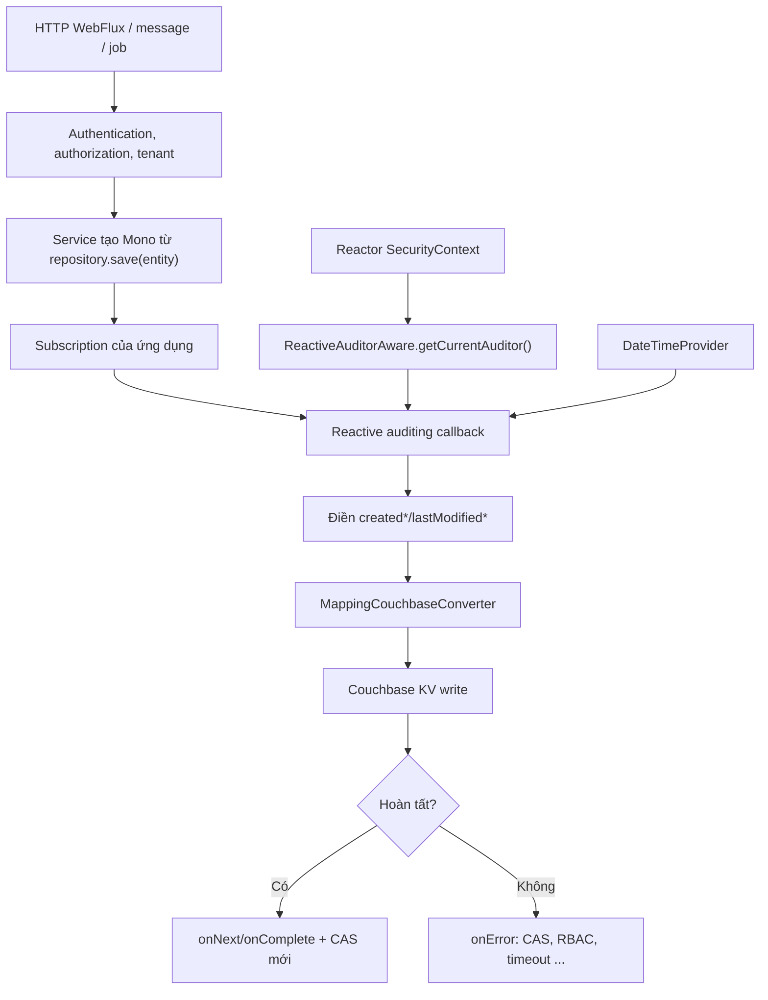

# EnableReactiveCouchbaseAuditing và ReactiveAuditorAware trong Spring Data Couchbase

Trong ứng dụng **Spring WebFlux** hoặc một worker sử dụng `ReactiveCouchbaseRepository`, metadata auditing không thể dựa vào cách lấy người dùng bằng `SecurityContextHolder` đồng bộ như một request servlet thông thường. Một luồng Reactor có thể được đăng ký (*subscribe*) về sau, chuyển scheduler và xử lý nhiều yêu cầu đồng thời. Nếu actor bị lưu trong một biến toàn cục hoặc `ThreadLocal` không được truyền đúng ngữ cảnh, document của Alice có thể bị ghi `lastModifiedBy=bob`, hoặc field auditor rỗng dù request đã xác thực.

**Spring Data Couchbase** có hai thành phần chuyên biệt để giải quyết vấn đề này:

- `@EnableReactiveCouchbaseAuditing`: kích hoạt **hạ tầng auditing reactive**.
- `ReactiveAuditorAware<T>`: cung cấp **actor hiện hành dưới dạng `Mono<T>`**, thường dựa trên Reactor/Spring Security context.

Bài thuộc chương **Vòng đời và auditing** trong module `SPRING_DATA_COUCHBASE`. Ngoài cấu hình hai thành phần trên, chúng ta sẽ kiểm tra @CreatedDate, @LastModifiedDate, @CreatedBy, @LastModifiedBy, `@Version`/CAS, `ReactiveCouchbaseTemplate`, SQL++, bucket/scope/collection, clock, retry và cách viết integration test có đối chiếu dữ liệu thực bằng Couchbase Java SDK.

## 1. Mục tiêu học tập

Sau bài, bạn có thể:

1. Phân biệt `@EnableCouchbaseAuditing` với `@EnableReactiveCouchbaseAuditing` và chỉ dùng loại phù hợp cho pipeline.
2. Cài đúng chữ ký `ReactiveAuditorAware<T>.getCurrentAuditor(): Mono<T>`.
3. Lấy user ID đáng tin từ `ReactiveSecurityContextHolder`, không dựa vào mutable singleton hoặc `ThreadLocal`.
4. Chọn đúng bean bằng `auditorAwareRef` khi ứng dụng có nhiều auditor.
5. Cấu hình `DateTimeProvider`, `modifyOnCreate` và `setDates`; hiểu quan hệ giữa creation auditing và `@Version`.
6. Kiểm thử actor khi create/update, actor vắng mặt, hai request đồng thời, resubscription và CAS conflict.
7. Giải thích giới hạn khi ghi trực tiếp qua SDK, SQL++ DML, import/ETL hoặc expiry server-side.
8. Xác minh kết quả ở đúng `bucket.scope.collection`, thay vì chỉ nhìn entity trước khi publisher hoàn tất.

## 2. Auditing reactive khác auditing imperative ở đâu?

| Tiêu chí | Imperative | Reactive |
| --- | --- | --- |
| Bật auditing | `@EnableCouchbaseAuditing` | `@EnableReactiveCouchbaseAuditing` |
| Nguồn actor | `AuditorAware<T>` | `ReactiveAuditorAware<T>` |
| Phương thức lấy actor | `Optional<T> getCurrentAuditor()` | `Mono<T> getCurrentAuditor()` |
| Security context thường dùng | `SecurityContextHolder` | `ReactiveSecurityContextHolder` |
| Đường ghi | `CouchbaseRepository`, `CouchbaseTemplate` | `ReactiveCouchbaseRepository`, `ReactiveCouchbaseTemplate` |
| Hoàn tất thao tác | Kết quả/exception khi method trả | Publisher cần subscription và phát signal |
| Callback | `BeforeConvertCallback`/`AfterConvertCallback` | `ReactiveBeforeConvertCallback`/`ReactiveAfterConvertCallback` |
| Vấn đề thường gặp | Thread-local context mất khi chuyển executor | Reactor context không được truyền vào subscription |

Sự khác biệt nằm ở **mô hình thực thi**. Reactive auditing không phải thao tác “đổi tên `AuditorAware` rồi gọi `Mono.just(...)`” nếu giá trị bên trong Mono đã được lấy từ một `ThreadLocal` không đáng tin.

### Dùng loại nào?

Nếu bạn lưu entity bằng `ReactiveCouchbaseRepository.save(...)`, hãy cấu hình auditing reactive và `ReactiveAuditorAware`. Nếu service dùng repository imperative, dùng loại imperative. Một ứng dụng có cả hai có thể cần cấu hình phù hợp cho từng đường, nhưng không nên bật nhiều cấu hình trùng lặp thiếu kiểm soát hoặc giả định một auditor của loại này tự phục vụ loại kia.

**Kiểm tra API theo version:** Javadoc `@EnableReactiveCouchbaseAuditing` ghi tính năng có từ dòng 4.2. Không sao chép cấu hình này vào một ứng dụng còn dùng Spring Data Couchbase 4.1 rồi đoán interface tồn tại; luôn đối chiếu dependency được resolve.

## 3. Mô hình luồng: principal được lấy tại subscription



Đây là sơ đồ **khái niệm** nhằm xác định những thành phần cần test, không cam kết mọi callback được gọi ở một thời điểm tuyệt đối của tất cả phiên bản. Javadoc Couchbase 6.1 mô tả `ReactiveAuditingEntityCallback` thực thi `ReactiveBeforeConvertCallback<Object>` và `ReactiveAfterConvertCallback<Object>`. Thứ tự giữa callback tùy chỉnh và auditing cần được kiểm tra bằng `Ordered` và integration test ở version sử dụng.

**Không có subscription thì chưa có bằng chứng lệnh lưu đã chạy.** Một entity có `@CreatedBy` chưa bảo đảm metadata đã được ghi nếu `save(...)` chỉ tạo ra một `Mono` mà không ai consume.

## 4. Cấu hình dependency và đối chiếu phiên bản

Với Spring Boot và Couchbase reactive, có thể dùng starter tương ứng; ví dụ Gradle:

```groovy
dependencies {
    implementation("org.springframework.boot:spring-boot-starter-data-couchbase-reactive")
    implementation("org.springframework.boot:spring-boot-starter-webflux")

    // Chỉ cần khi sử dụng các API Spring Security trong ví dụ.
    implementation("org.springframework.boot:spring-boot-starter-security")

    testImplementation("io.projectreactor:reactor-test")
    testImplementation("org.springframework.boot:spring-boot-starter-test")
}
```

Tên starter, phiên bản và phạm vi dependency cần đối chiếu với Spring Boot BOM trong dự án; bài không giả định version cụ thể đã được cài đặt ở workspace. Trong môi trường được phép chạy build, có thể xem:

```bash
./gradlew dependencyInsight \
  --dependency spring-data-couchbase \
  --configuration runtimeClasspath
```

Các lệnh này **chỉ là hướng dẫn cho người học**; trong tác vụ soạn bài không chạy Gradle, Testcontainers hay server thật.

Nếu dùng Maven, kiểm tra `mvn dependency:tree` để xác định phiên bản `spring-data-couchbase` đã resolve. Đừng dựa hoàn toàn vào một trang Javadoc “current” nếu ứng dụng đang ở dòng 4.x/5.x.

### Hai package cần phân biệt

```java
// Kích hoạt riêng cho Couchbase reactive:
import org.springframework.data.couchbase.repository.auditing.EnableReactiveCouchbaseAuditing;

// SPI auditor dùng chung thuộc Spring Data Commons:
import org.springframework.data.domain.ReactiveAuditorAware;
```

Chúng không thuộc `org.springframework.security`. Spring Security chỉ cung cấp context xác thực để auditor có thể đọc.

## 5. Entity mẫu với @CreatedDate, @LastModifiedDate và hai field By

Giả sử bucket `shop`, scope `commerce` và collection `orders` tồn tại.

```java
package example.shop.order;

import java.time.Instant;

import org.springframework.data.annotation.CreatedBy;
import org.springframework.data.annotation.CreatedDate;
import org.springframework.data.annotation.Id;
import org.springframework.data.annotation.LastModifiedBy;
import org.springframework.data.annotation.LastModifiedDate;
import org.springframework.data.annotation.Version;
import org.springframework.data.couchbase.core.mapping.Document;
import org.springframework.data.couchbase.repository.Collection;
import org.springframework.data.couchbase.repository.Scope;

@Document
@Scope("commerce")
@Collection("orders")
public class OrderDocument {

    @Id
    private String id;

    private String status;

    @Version
    private long version;

    @CreatedDate
    private Instant createdAt;

    @LastModifiedDate
    private Instant lastModifiedAt;

    @CreatedBy
    private String createdBy;

    @LastModifiedBy
    private String lastModifiedBy;

    public OrderDocument() {}

    public OrderDocument(String id, String status) {
        this.id = id;
        this.status = status;
    }

    public String getId() { return id; }

    public String getStatus() { return status; }
    public void setStatus(String value) { this.status = value; }

    public long getVersion() { return version; }
    public Instant getCreatedAt() { return createdAt; }
    public Instant getLastModifiedAt() { return lastModifiedAt; }
    public String getCreatedBy() { return createdBy; }
    public String getLastModifiedBy() { return lastModifiedBy; }
}
```

Một repository reactive:

```java
package example.shop.order;

import org.springframework.data.couchbase.repository.ReactiveCouchbaseRepository;

public interface ReactiveOrderRepository
        extends ReactiveCouchbaseRepository<OrderDocument, String> {
}
```

**Chú ý import:** `@Scope` và `@Collection` dùng để chọn keyspace của Couchbase nằm trong `org.springframework.data.couchbase.repository`; đừng dùng nhầm `org.springframework.context.annotation.Scope` của Spring bean.

### Vì sao cần @Version?

Spring Data Couchbase nhấn mạnh rằng **entity cần có `@Version` để creation auditing nhận diện đúng lần tạo**; một object mới vẫn có thể có ID do ứng dụng cấp trước. Với `@Version long`, giá trị `0L` thể hiện entity mới theo cơ chế nhận diện thông thường; khi lưu/đọc, trường này mang **CAS** của Couchbase, không phải bộ đếm nghiệp vụ tự tăng.

Nếu tạo một DTO rồi dựng lại object chỉ có ID/status nhưng làm mất CAS, việc save như một update có thể bị xem là tạo mới, dẫn đến sai nhánh auditing hoặc lỗi ghi. Dùng load → kiểm tra quyền/trạng thái → mutate → save để giữ CAS từ document hiện có.

## 6. Kích hoạt @EnableReactiveCouchbaseAuditing

Cấu hình tối giản:

```java
package example.shop.config;

import org.springframework.context.annotation.Configuration;
import org.springframework.data.couchbase.repository.auditing.EnableReactiveCouchbaseAuditing;

@Configuration
@EnableReactiveCouchbaseAuditing
public class ReactiveAuditConfiguration {
}
```

Annotation này đăng ký hạ tầng reactive auditing khi được Spring xử lý trong `ApplicationContext`. Nó **không tự tạo nguồn principal đáng tin cậy** hoặc tự cấu hình Couchbase credentials, bucket, scope/collection và SecurityWebFilterChain.

Để dùng hai field “By”, thêm một bean `ReactiveAuditorAware<String>`. Để xác định rõ bean nào được chọn, nên dùng cấu hình tường minh ở phần sau.

### Các thuộc tính annotation

Javadoc Couchbase 6.1 mô tả bốn thuộc tính:

| Thuộc tính | Mặc định | Ý nghĩa |
| --- | --- | --- |
| `auditorAwareRef` | `""` | Tên bean `ReactiveAuditorAware<?>` cấp actor. |
| `dateTimeProviderRef` | `""` | Tên bean `DateTimeProvider` cấp timestamp. |
| `setDates` | `true` | Có tự điền ngày tạo/sửa hay không. |
| `modifyOnCreate` | `true` | Có điền trường modified khi tạo entity mới hay không. |

Ví dụ đầy đủ:

```java
package example.shop.config;

import org.springframework.context.annotation.Configuration;
import org.springframework.data.couchbase.repository.auditing.EnableReactiveCouchbaseAuditing;

@Configuration
@EnableReactiveCouchbaseAuditing(
    auditorAwareRef = "securityReactiveAuditor",
    dateTimeProviderRef = "auditTimeProvider",
    modifyOnCreate = true,
    setDates = true
)
public class ProductionReactiveAuditConfiguration {
}
```

Đây là **phương án thay thế** cho cấu hình tối giản trên; không dùng đồng thời cả hai trong cùng context nếu chúng trùng đăng ký hạ tầng. Hai bean mang tên `securityReactiveAuditor` và `auditTimeProvider` cần tồn tại và có kiểu phù hợp.

## 7. ReactiveAuditorAware<T> thực sự trả gì?

Chữ ký của Spring Data Commons:

```java
package org.springframework.data.domain;

public interface ReactiveAuditorAware<T> {

    reactor.core.publisher.Mono<T> getCurrentAuditor();
}
```

`T` là kiểu actor được lưu trong field gắn `@CreatedBy` và `@LastModifiedBy`. Nếu hai field là `String`, dùng `ReactiveAuditorAware<String>`. Nếu là một value object như `ActorRef`, cần cùng kiểu và một converter phù hợp.

Khi không xác định được actor, auditor có thể trả `Mono.empty()`. **Không trả `null` thay cho `Mono`**. Reactor không cho `Mono.just(null)`; nếu nguồn identity có thể null, dùng `Mono.justOrEmpty(...)`.

### ReactiveAuditorAware không đồng nghĩa AuditorAware

```java
// Imperative:
Optional<String> getCurrentAuditor();

// Reactive:
Mono<String> getCurrentAuditor();
```

Hai interface là hai SPI riêng; dùng `AuditorAware<String>` trong một ứng dụng reactive rồi dựa vào `SecurityContextHolder` thread-local không bảo đảm current principal đúng khi pipeline chạy.

### Bean demo tối giản

```java
import org.springframework.context.annotation.Bean;
import org.springframework.context.annotation.Configuration;
import org.springframework.data.domain.ReactiveAuditorAware;
import reactor.core.publisher.Mono;

@Configuration
public class DemoReactiveAuditorBeans {

    @Bean("demoReactiveAuditor")
    ReactiveAuditorAware<String> demoReactiveAuditor() {
        return () -> Mono.just("demo-user");
    }
}
```

Đây là **ví dụ học tập**, không dùng actor hardcode cho toàn bộ production traffic. Nếu dùng cấu hình demo, đặt `auditorAwareRef="demoReactiveAuditor"`; không đồng thời khai báo demo và production config mà để auditing chọn mơ hồ.

## 8. Nguồn actor từ ReactiveSecurityContextHolder

Với Spring Security WebFlux, `SecurityContext` của request được truyền theo **Reactor Context**, không phải giả định mọi operator đều chạy trên một thread HTTP duy nhất.

Ví dụ bean production:

```java
package example.shop.config;

import org.springframework.context.annotation.Bean;
import org.springframework.context.annotation.Configuration;
import org.springframework.data.domain.ReactiveAuditorAware;
import org.springframework.security.authentication.AnonymousAuthenticationToken;
import org.springframework.security.core.Authentication;
import org.springframework.security.core.context.ReactiveSecurityContextHolder;

import reactor.core.publisher.Mono;

@Configuration
public class ReactiveSecurityAuditorConfiguration {

    @Bean("securityReactiveAuditor")
    ReactiveAuditorAware<String> securityReactiveAuditor() {
        return () -> ReactiveSecurityContextHolder.getContext()
            .flatMap(context ->
                Mono.justOrEmpty(context.getAuthentication())
            )
            .filter(Authentication::isAuthenticated)
            .filter(auth ->
                !(auth instanceof AnonymousAuthenticationToken)
            )
            .map(Authentication::getName)
            .filter(name -> !name.isBlank());
    }
}
```

Giải thích các bước:

1. `ReactiveSecurityContextHolder.getContext()` lấy `SecurityContext` theo Reactor subscriber context.
2. `flatMap(...Mono.justOrEmpty(...))` tránh phát phần tử `null` khi thiếu `Authentication`.
3. `isAuthenticated()` kiểm tra trạng thái authentication.
4. Loại `AnonymousAuthenticationToken`: token này có thể được đánh dấu authenticated nhưng không đại diện user đã đăng nhập.
5. `getName()` lấy một tên principal theo authentication provider.
6. `filter(!isBlank)` loại actor name trống.

**Không dùng trực tiếp `auth.getCredentials()`, JWT thô hoặc session token làm actor.** Những dữ liệu này nhạy cảm và có thể hết hạn. Với audit lâu dài, ưu tiên một **user ID bất biến** từ principal/JWT claim đã xác minh.

### @CreatedBy có tự xác thực người dùng không?

Không. Auditing chỉ **ghi lại actor** mà provider trả về. Authentication, authorization và tenant routing phải được đảm bảo tại security/service layer. Một user biết tên scope hoặc biết document ID **không tự có quyền sửa document đó**.

## 9. Principal name hay stable ID?

`Authentication.getName()` có thể là:

- Username (có thể đổi).
- Email (có thể đổi).
- Subject ID từ JWT (tùy cấu hình).
- Một chuỗi định danh của custom principal.

Nếu cần truy vết lâu dài, nên ghi ID ổn định như `user:7841` thay vì email đang dùng.

Ví dụ principal ứng dụng:

```java
package example.shop.security;

public record ShopPrincipal(
    String userId,
    String displayName
) {}
```

Ví dụ auditor chỉ chấp nhận principal kiểu đó:

```java
@Bean("stableReactiveAuditor")
ReactiveAuditorAware<String> stableReactiveAuditor() {
    return () -> ReactiveSecurityContextHolder.getContext()
        .flatMap(context ->
            Mono.justOrEmpty(context.getAuthentication())
        )
        .filter(Authentication::isAuthenticated)
        .filter(auth ->
            !(auth instanceof AnonymousAuthenticationToken)
        )
        .map(Authentication::getPrincipal)
        .filter(ShopPrincipal.class::isInstance)
        .map(ShopPrincipal.class::cast)
        .map(ShopPrincipal::userId)
        .filter(id -> !id.isBlank());
}
```

Đây là **một phương án tùy ứng dụng**, cần import `ShopPrincipal` và xác thực đúng kiểu principal. Spring Security không mặc định tạo `ShopPrincipal` chỉ vì bạn định nghĩa record. Nếu sử dụng auditor này, cấu hình annotation phải chọn `auditorAwareRef="stableReactiveAuditor"`.

Với JWT/opaque token, chỉ dùng claim identity đã được xác minh bởi authentication layer; không đọc raw header `X-User` hoặc request body rồi tin là user ID.

## 10. Khi thiếu security context: empty có nghĩa gì?

Có nhiều nguyên nhân khiến `ReactiveAuditorAware.getCurrentAuditor()` trả `Mono.empty()`:

1. Request không xác thực hoặc được phép đi qua endpoint anonymous.
2. Một job chạy không có HTTP SecurityContext.
3. Pipeline được subscribe ở nơi không mang Reactor context tương ứng.
4. Một publisher được tạo và subscribe thủ công làm mất context dự kiến.
5. Principal không có kiểu hoặc claim mà auditor yêu cầu.
6. Có lỗi cấu hình security filter chain hoặc test không gắn authentication.
7. Bean auditor đang được cấu hình sai tên trong `auditorAwareRef`.

Nếu actor rỗng, các trường `@CreatedBy/@LastModifiedBy` có thể không được điền. **Đừng âm thầm chuyển mọi trường hợp đó thành `"admin"` hoặc `"system"`.** Điều này sẽ làm một request chưa xác thực trông giống thao tác hệ thống hợp lệ.

### Thực thi policy “actor bắt buộc” ở đâu?

Khi một nghiệp vụ yêu cầu actor, service nên xác thực/authorize trước khi gọi repository. Không đặt trách nhiệm authorization vào auditing callback. Có thể định nghĩa một guard reactive ở service:

```java
public Mono<OrderDocument> saveForAuthenticatedUser(
        OrderDocument order) {

    return ReactiveSecurityContextHolder.getContext()
        .flatMap(context ->
            Mono.justOrEmpty(context.getAuthentication())
        )
        .filter(Authentication::isAuthenticated)
        .filter(auth ->
            !(auth instanceof AnonymousAuthenticationToken)
        )
        .switchIfEmpty(Mono.error(
            new org.springframework.security.access.AccessDeniedException(
                "Authentication required"
            )
        ))
        .flatMap(ignored ->
            reactiveOrderRepository.save(order)
        );
}
```

Đây là **phương thức minh họa trong service** có repository đã inject. Nó chỉ kiểm tra *có authentication hợp lệ*, chưa đủ kiểm tra quyền sở hữu order hoặc tenant; service thực tế phải thực hiện authorization có điều kiện theo resource.

## 11. DateTimeProvider cho reactive auditing

Mặc dù **actor** dùng `ReactiveAuditorAware<T>`, thuộc tính `dateTimeProviderRef` của `@EnableReactiveCouchbaseAuditing` chọn bean **`DateTimeProvider`** (SPI thời gian của Spring Data Commons).

Chữ ký:

```java
package org.springframework.data.auditing;

public interface DateTimeProvider {
    Optional<java.time.temporal.TemporalAccessor> getNow();
}
```

Ví dụ dùng `Instant` và `Clock`:

```java
package example.shop.config;

import java.time.Clock;
import java.time.Instant;
import java.util.Optional;

import org.springframework.context.annotation.Bean;
import org.springframework.context.annotation.Configuration;
import org.springframework.data.auditing.DateTimeProvider;

@Configuration
public class AuditClockConfiguration {

    @Bean
    Clock auditingClock() {
        return Clock.systemUTC();
    }

    @Bean("auditTimeProvider")
    DateTimeProvider auditTimeProvider(Clock auditingClock) {
        return () -> Optional.of(Instant.now(auditingClock));
    }
}
```

Đặt `dateTimeProviderRef="auditTimeProvider"` trong annotation để hạ tầng auditing chọn đúng bean.

**Không gọi network/HTTP hoặc Couchbase blocking query trong DateTimeProvider.** Nguồn thời gian nên nhanh, nhất quán và có thể kiểm thử. `Clock.systemUTC()` giúp lấy `Instant` trên trục UTC, nhưng **không** bảo đảm đồng hồ của mọi node được đồng bộ tuyệt đối. Theo dõi clock skew ở hạ tầng nếu timestamp dùng để điều tra sự cố.

### Có cần ReactiveAuditorAware khi chỉ dùng timestamp?

Không bắt buộc. Spring Data Commons cho phép auditing chỉ theo dõi `@CreatedDate/@LastModifiedDate` mà không cần nguồn actor. Nếu entity có hai field “By”, cần auditor để chúng mang giá trị có ý nghĩa.

## 12. modifyOnCreate và setDates trong trường hợp reactive

Hai thuộc tính không chỉ là cấu hình thẩm mỹ.

| Thiết lập | Khi entity mới | Khi cập nhật |
| --- | --- | --- |
| `modifyOnCreate=true` | Điền các trường created; cũng có thể điền lastModified. | Điền lastModified. |
| `modifyOnCreate=false` | Ưu tiên created; modified thường để trống. | Điền modified. |
| `setDates=true` | Auditing điền ngày nếu provider có thời gian. | Auditing điền thời gian sửa. |
| `setDates=false` | Không tự điền ngày audit. | Không tự điền ngày audit. |

Nếu production entity bắt buộc `lastModifiedAt != null` ngay từ lần tạo, phải giữ semantics phù hợp với `modifyOnCreate`. Nếu muốn hai field modified chỉ xuất hiện sau update, cho phép chúng nullable ở lần tạo.

Đừng gán `@CreatedDate` bằng timestamp do client gửi trong JSON request để “sửa” việc `setDates=false`, trừ khi đó là một yêu cầu migration được kiểm soát và ghi rõ nguồn dữ liệu.

## 13. Phân biệt newness và thời điểm commit

Một lệnh tạo:

```java
OrderDocument candidate =
    new OrderDocument("order::" + java.util.UUID.randomUUID(), "NEW");

Mono<OrderDocument> create = reactiveOrderRepository.save(candidate);
```

Trước subscription, `candidate.getVersion()` thường vẫn là `0L`. Khi publisher được consume và lệnh ghi thành công, auditing có thể điền created fields và mapping cập nhật CAS/version.

Nhưng nếu save **thất bại** vì duplicate key, CAS conflict, hết quyền ghi hoặc timeout, entity trong bộ nhớ có thể đã được callback thay đổi. Điều đó **không có nghĩa server đã commit**.

Quy tắc:

- **Newness trong Spring Data** phụ thuộc entity metadata như `@Version`.
- **Key existence trong Couchbase** phụ thuộc document thực tại collection.
- **Business creation** phụ thuộc command, quyền và idempotency.
- **Commit success** phụ thuộc kết quả ghi, không dựa vào việc auditor đã được gọi.

Không tự tăng `@Version` như `version++`. CAS là một token opaque do Couchbase cấp.

## 14. Ví dụ service reactive: đọc → xác thực nghiệp vụ → lưu

Ví dụ dùng `ReactiveOrderRepository` đã inject:

```java
package example.shop.application;

import org.springframework.stereotype.Service;
import reactor.core.publisher.Mono;

@Service
public class ConfirmOrderService {

    private final ReactiveOrderRepository orders;

    public ConfirmOrderService(ReactiveOrderRepository orders) {
        this.orders = orders;
    }

    public Mono<OrderDocument> confirm(String id) {
        return orders.findById(id)
            .switchIfEmpty(Mono.error(
                new IllegalArgumentException("Order not found")
            ))
            .flatMap(order -> {
                if (!"NEW".equals(order.getStatus())) {
                    return Mono.error(
                        new IllegalStateException(
                            "Only NEW orders can be confirmed"
                        )
                    );
                }

                order.setStatus("CONFIRMED");
                return orders.save(order);
            });
    }
}
```

Đây là một **khung nghiệp vụ tối giản**, chưa có authorization/tenant membership. Production phải xác thực principal và kiểm tra quyền với resource cụ thể **trước thao tác DB**.

Khi request đã có Reactor SecurityContext, auditor có thể lấy actor hiện hành trong pipeline save. Nếu bạn gọi `confirm(id).subscribe()` thủ công bên ngoài lifecycle request mà không chuyển context, actor có thể rỗng hoặc subscription bị tách khỏi error handling của caller. **Không tự subscribe trong service**; trả `Mono` cho tầng sở hữu request/worker.

### Khi chuyển giữa scheduler

Operator như `publishOn(...)` có thể đổi thread. Trong pipeline Reactor được quản lý đúng, **Reactor Context** là nơi lưu thông tin theo subscriber; không nên tự dựa vào `ThreadLocal` user vì một thread có thể phục vụ nhiều subscriber.

## 15. Nhiều actor trong cùng ứng dụng: request, job và consumer

Một hệ thống có thể nhận thao tác từ:

```text
HTTP request  -> user:7841
Scheduled job -> job:order-reconcile
Queue worker  -> service:fulfillment-consumer
Admin repair  -> service:manual-data-repair
```

Có ba chiến lược thường gặp.

**Chiến lược A — Actor từ authenticated principal:** dành cho HTTP/WebFlux hoặc service-to-service đã xác thực. `ReactiveSecurityContextHolder` lấy thông tin identity từ security layer.

**Chiến lược B — Actor job/service được cấp riêng:** worker được cấu hình identity và chỉ đặt nó trong một **trusted execution boundary**. Không tự fallback mọi request thiếu authentication sang cùng một service account.

**Chiến lược C — Hai trường domain riêng:** lưu `initiatedBy` (user khởi xướng) và `executedBy` (service thi hành), nếu một `@LastModifiedBy` không đủ biểu đạt chuỗi ủy quyền.

### Ví dụ actor từ Reactor Context cho **job được kiểm soát**

Một test/worker có thể dùng một key context nội bộ:

```java
public final class JobAuditContext {

    public static final String ACTOR_KEY =
        "trusted.audit.actor";

    private JobAuditContext() {}
}
```

Provider dành riêng cho **trusted job pipeline**:

```java
@Bean("jobReactiveAuditor")
ReactiveAuditorAware<String> jobReactiveAuditor() {
    return () -> Mono.deferContextual(context ->
        Mono.justOrEmpty(
            context.<String>getOrEmpty(JobAuditContext.ACTOR_KEY)
        )
    );
}
```

Trong một worker đã được xác thực và authorize:

```java
return orderRepository.save(order)
    .contextWrite(ctx ->
        ctx.put(
            JobAuditContext.ACTOR_KEY,
            "job:order-reconciliation"
        )
    );
```

**Quan trọng:** đây là **một phương án riêng cho trusted job**, không phải một cơ chế bảo mật tổng quát. Ai có quyền tạo publisher/context phải được giới hạn; nếu actor string đến từ payload public chưa xác thực thì người gửi có thể giả danh. Không bật đồng thời auditor này và security auditor rồi để hạ tầng chọn ngẫu nhiên. Có thể dùng hai application contexts/entrypoints với cấu hình riêng hoặc một policy actor thống nhất đã được kiểm soát.

## 16. Không dùng ThreadLocal hoặc mutable singleton làm auditor reactive

Anti-pattern:

```java
@Component
public class UnsafeReactiveAuditor implements ReactiveAuditorAware<String> {

    // KHÔNG AN TOÀN: dùng chung cho mọi request.
    private String currentUser;

    public void setCurrentUser(String value) {
        currentUser = value;
    }

    @Override
    public Mono<String> getCurrentAuditor() {
        return Mono.justOrEmpty(currentUser);
    }
}
```

Với hai request đồng thời, request B có thể thay `currentUser` sau khi request A tạo `Mono` nhưng trước khi auditing của A được thực thi. Hậu quả: audit actor sai, khó phát hiện qua unit test đơn luồng.

Dùng `ReactiveSecurityContextHolder` hoặc một Reactor Context key chỉ được gắn tại trusted boundary. Không dùng static mutable field để truyền actor, tenant, request ID hoặc principal.

### Không dùng block() trong auditor

Đoạn sau nên tránh:

```java
// Anti-pattern: biến reactive lookup thành blocking.
String user = remoteReactiveUserService.findUser().block();
return Mono.justOrEmpty(user);
```

Nó có thể block event loop, tăng latency và gây deadlock trong một số cách chạy. Nếu cần xác thực hoặc nạp user từ hệ thống khác, nên thực hiện ở security/service layer với timeout, error handling, phân quyền rồi truyền identity ổn định theo context. Auditor nên nhẹ, xác định và không có side effect nghiệp vụ.

## 17. Một publisher có thể được subscribe nhiều lần

Ví dụ:

```java
Mono<OrderDocument> saving = reactiveOrderRepository.save(order);

Mono<OrderDocument> first = saving;
Mono<OrderDocument> second = saving;
```

Nếu cả hai được subscribe riêng, có thể xảy ra **hai lần thực thi đường save** (tùy cách tạo publisher, retry và ngữ nghĩa API). Không nên nghĩ việc dùng cùng biến `saving` biến thao tác ghi thành một “transaction exactly once”.

Tương tự:

```java
reactiveOrderRepository.save(order)
    .retry(2);
```

`retry(2)` có thể **resubscribe** khi upstream lỗi. Một lần timeout có thể xảy ra sau khi server đã ghi nhưng client chưa nhận được kết quả; callback/auditor có thể được gọi lại trong lần thử tiếp theo.

**Hệ quả cho auditing:**

- `lastModifiedAt` có thể được tính lại ở retry khác.
- Actor có thể được lấy lại từ Reactor context.
- `@Version`/CAS của entity có thể đã cũ hoặc mutation ở server đã thành công chưa rõ kết quả.
- Không sử dụng việc auditor được gọi như bằng chứng save đã commit.
- Không gửi email, thanh toán hoặc broker message từ auditor/callback.

### Retry CAS đúng cách

Với optimistic locking conflict, quy trình đúng là **load lại → kiểm tra domain và quyền → áp dụng command → save**, không lặp mãi cùng một entity/version cũ.

Phác thảo:

```java
Mono<OrderDocument> attempt =
    Mono.defer(() ->
        orders.findById(id)
            .switchIfEmpty(Mono.error(
                new IllegalArgumentException("Order not found")
            ))
            .flatMap(current -> {
                requireCanConfirm(current); // domain guard tự định nghĩa
                current.setStatus("CONFIRMED");
                return orders.save(current);
            })
    );

return attempt.retryWhen(
    reactor.util.retry.Retry.backoff(
        2, java.time.Duration.ofMillis(50)
    ).filter(error ->
        error instanceof
            org.springframework.dao.OptimisticLockingFailureException
    )
);
```

Đoạn này là **mẫu trong service**, cần định nghĩa `requireCanConfirm` và quản lý authorization, exception translation, retry policy. Không retry mọi lỗi hạ tầng/permission/validation; không làm side effect ngoài DB trong nhánh có thể được chạy lại.

## 18. Cách kiểm tra dữ liệu auditing sau create và update

Ví dụ đầu ra mong đợi với `modifyOnCreate=true` và actor Alice:

```json
{
  "_class": "example.shop.order.OrderDocument",
  "status": "NEW",
  "createdBy": "user:alice",
  "lastModifiedBy": "user:alice",
  "createdAt": "2026-11-25T02:00:00Z",
  "lastModifiedAt": "2026-11-25T02:00:00Z"
}
```

Sau khi Bob cập nhật `status=CONFIRMED`:

```json
{
  "_class": "example.shop.order.OrderDocument",
  "status": "CONFIRMED",
  "createdBy": "user:alice",
  "lastModifiedBy": "user:bob",
  "createdAt": "2026-11-25T02:00:00Z",
  "lastModifiedAt": "2026-11-25T03:00:00Z"
}
```

JSON ở đây là **minh họa ngữ nghĩa**, không phải hợp đồng converter thời gian bắt buộc phải lưu chuỗi ISO. Custom conversions hoặc release khác có thể lưu date ở dạng số/định dạng khác. Trong test, đối chiếu representation thực tế thay vì luôn dùng `getString("createdAt")`.

**Created fields nên giữ nguyên khi update.** Nếu một mapper tự gán lại `createdBy` hoặc mất `@Version` khi dựng entity từ DTO, auditing có thể nhận diện nhầm tạo/cập nhật.

## 19. Test đơn vị ReactiveAuditorAware: có và không có principal

Giả sử bean auditor ở mục 8 được khai báo trong class `ReactiveSecurityAuditorConfiguration`.

Test có Authentication được thiết lập trong Reactor context:

```java
package example.shop.config;

import java.util.List;

import org.junit.jupiter.api.Test;
import org.springframework.security.authentication.UsernamePasswordAuthenticationToken;
import org.springframework.security.core.context.ReactiveSecurityContextHolder;
import reactor.test.StepVerifier;

class ReactiveSecurityAuditorTest {

    @Test
    void authenticatedPrincipalIsReturned() {
        var auth = new UsernamePasswordAuthenticationToken(
            "user:alice",
            "unused",
            List.of()
        );

        var auditor =
            new ReactiveSecurityAuditorConfiguration()
                .securityReactiveAuditor();

        StepVerifier.create(
            auditor.getCurrentAuditor()
                .contextWrite(
                    ReactiveSecurityContextHolder
                        .withAuthentication(auth)
                )
        )
        .expectNext("user:alice")
        .verifyComplete();
    }

    @Test
    void missingSecurityContextReturnsEmpty() {
        var auditor =
            new ReactiveSecurityAuditorConfiguration()
                .securityReactiveAuditor();

        StepVerifier.create(auditor.getCurrentAuditor())
            .verifyComplete();
    }
}
```

Trong cùng package, test có thể truy cập bean method package-private. Nếu tổ chức package khác, tạo một provider class có API test phù hợp hoặc kiểm tra thông qua Spring test context.

Dùng `UsernamePasswordAuthenticationToken` constructor **có authorities** ở ví dụ để tạo token có trạng thái authenticated cho test; không dùng constructor hai tham số nếu cần `isAuthenticated=true`.

### Test anonymous

Tạo `AnonymousAuthenticationToken` hợp lệ và gắn bằng `contextWrite(...)`; assert publisher rỗng. Điều này phát hiện việc chỉ lọc `isAuthenticated()` nhưng vô tình chấp nhận anonymous principal.

**Chú ý isolation:** nếu test framework đã gắn SecurityContext trên Reactor context, test “missing” cần chạy trong một publisher/context độc lập. Không coi một unit test xác nhận actor là đủ để chứng minh endpoint đã authorize user.

## 20. Test cấu hình auditing bằng DateTimeProvider kiểm soát được

Để không viết test phụ thuộc `Instant.now()`, tạo một clock cho test.

Ví dụ nguồn test:

```java
package example.shop.test;

import java.time.Instant;
import java.util.Optional;
import java.util.concurrent.atomic.AtomicReference;

import org.springframework.data.auditing.DateTimeProvider;

public final class MutableAuditClock {

    private final AtomicReference<Instant> now =
        new AtomicReference<>(
            Instant.parse("2026-11-25T02:00:00Z")
        );

    public void set(Instant timestamp) {
        now.set(timestamp);
    }

    public DateTimeProvider provider() {
        return () -> Optional.of(now.get());
    }
}
```

Cấu hình test riêng cho reactive auditing:

```java
import org.springframework.boot.test.context.TestConfiguration;
import org.springframework.context.annotation.Bean;
import org.springframework.data.auditing.DateTimeProvider;
import org.springframework.data.couchbase.repository.auditing.EnableReactiveCouchbaseAuditing;

@TestConfiguration
@EnableReactiveCouchbaseAuditing(
    auditorAwareRef = "securityReactiveAuditor",
    dateTimeProviderRef = "testAuditTime",
    modifyOnCreate = true
)
public class ReactiveAuditingTestConfiguration {

    @Bean
    MutableAuditClock mutableAuditClock() {
        return new MutableAuditClock();
    }

    @Bean("testAuditTime")
    DateTimeProvider testAuditTime(MutableAuditClock clock) {
        return clock.provider();
    }
}
```

Trong test context, **không kích hoạt đồng thời cấu hình auditing production và cấu hình test** nếu cả hai cùng đăng ký auditing không chủ đích. Cần thiết kế context riêng hoặc override cấu hình một cách rõ ràng. Test config ở trên dùng bean `securityReactiveAuditor` đã định nghĩa ở mục 8, vì vậy phải import/scan bean đó.

Một `MutableAuditClock` được chia sẻ giữa các test chạy parallel có thể gây trộn thời điểm; cô lập test hoặc không parallelize nhóm test này.

## 21. Integration test: Alice tạo, Bob cập nhật

Giả sử integration test có:

- Couchbase test bucket `shop`, scope `commerce`, collection `orders`.
- `ReactiveOrderRepository` từ Spring context.
- `MutableAuditClock`/`ReactiveAuditorAware<String>` đã đăng ký đúng.
- Couchbase Java SDK `Cluster` để đọc dữ liệu độc lập.
- JUnit/StepVerifier và các static assertions cần thiết.

Ví dụ khung test:

```java
import java.time.Instant;
import java.util.List;
import java.util.UUID;

import org.junit.jupiter.api.Test;
import org.springframework.beans.factory.annotation.Autowired;
import org.springframework.security.authentication.UsernamePasswordAuthenticationToken;
import org.springframework.security.core.context.ReactiveSecurityContextHolder;

import reactor.core.publisher.Mono;
import reactor.test.StepVerifier;

import static org.junit.jupiter.api.Assertions.assertEquals;
import static org.junit.jupiter.api.Assertions.assertNotNull;

class ReactiveOrderAuditingIT {

    @Autowired ReactiveOrderRepository orders;
    @Autowired MutableAuditClock clock;

    private static UsernamePasswordAuthenticationToken auth(
            String userId) {

        return new UsernamePasswordAuthenticationToken(
            userId, "unused", List.of()
        );
    }

    @Test
    void createAndUpdateUseEachSubscribersPrincipal() {
        String id = "it::audit::" + UUID.randomUUID();
        Instant t1 = Instant.parse("2026-11-25T02:00:00Z");
        Instant t2 = Instant.parse("2026-11-25T03:00:00Z");

        clock.set(t1);

        Mono<OrderDocument> insert =
            orders.save(new OrderDocument(id, "NEW"))
                .contextWrite(
                    ReactiveSecurityContextHolder.withAuthentication(
                        auth("user:alice")
                    )
                );

        StepVerifier.create(insert)
            .assertNext(created -> {
                assertNotNull(created.getCreatedAt());
                assertEquals("user:alice", created.getCreatedBy());
                assertEquals("user:alice", created.getLastModifiedBy());
                assertEquals(t1, created.getCreatedAt());
            })
            .verifyComplete();

        clock.set(t2);

        Mono<OrderDocument> update =
            orders.findById(id)
                .flatMap(current -> {
                    current.setStatus("CONFIRMED");
                    return orders.save(current);
                })
                .contextWrite(
                    ReactiveSecurityContextHolder.withAuthentication(
                        auth("user:bob")
                    )
                );

        StepVerifier.create(update)
            .assertNext(updated -> {
                assertEquals("user:alice", updated.getCreatedBy());
                assertEquals(t1, updated.getCreatedAt());
                assertEquals("user:bob", updated.getLastModifiedBy());
                assertEquals(t2, updated.getLastModifiedAt());
            })
            .verifyComplete();
    }
}
```

Đây là **khung integration test**, không phải một test chạy độc lập chỉ với đoạn code này; cần Spring Boot test context, Couchbase test server, cấu hình repository, security auditor bean, fixture, cleanup và các imports của entity/clock.

### Điều kiện để test đủ mạnh

- Gieo dữ liệu riêng mỗi test bằng ID ngẫu nhiên.
- Test cả `findById` và query/Template nếu ứng dụng thực dùng chúng.
- Khi test actor đồng thời, **không dùng cùng một mutable clock đang đổi giá trị giữa hai publisher**; dùng clock cố định hoặc định nghĩa context riêng.
- Không chỉ assert entity được phát ra bởi publisher; đối chiếu KV trên server bằng SDK.

## 22. Oracle độc lập: kiểm tra JSON tại đúng collection

Sau test create/update, dùng Java SDK ngoài reactive pipeline:

```java
var result = sdkCluster.bucket("shop")
    .scope("commerce")
    .collection("orders")
    .get(id);

var json = result.contentAsObject();

assertEquals("user:alice", json.getString("createdBy"));
assertEquals("user:bob", json.getString("lastModifiedBy"));
```

Vì đây là lệnh SDK blocking trong **một test method** sau khi StepVerifier đã hoàn tất, nó có thể được chấp nhận cho mục đích đối chiếu. Không gọi SDK blocking tương tự trong reactive `map/flatMap` của production event loop.

Trường `@Version` ánh xạ **CAS**; metadata CAS không phải một field JSON bình thường. Có thể so sánh `result.cas()` với version của entity được materialize từ Spring Data, theo đặc tả version dùng.

**Vì sao cần oracle độc lập?** Nếu cả `repository.save` và `repository.findById` cùng cấu hình nhầm sang `shop.archive.orders`, test save/find có thể vẫn pass. SDK đọc trực tiếp `shop.commerce.orders` sẽ phát hiện sai namespace.

## 23. Test concurrency: hai request không được trộn actor

Một test phản ánh giá trị lớn nhất của ReactiveAuditorAware:

```text
Publisher A:
  id=order::A
  Reactor authentication=user:alice

Publisher B:
  id=order::B
  Reactor authentication=user:bob

Cả hai chạy đồng thời:
  saved(order::A).createdBy == user:alice
  saved(order::B).createdBy == user:bob
```

Phác thảo:

```java
Mono<OrderDocument> a =
    orders.save(new OrderDocument(idA, "NEW"))
        .contextWrite(
            ReactiveSecurityContextHolder
                .withAuthentication(auth("user:alice"))
        );

Mono<OrderDocument> b =
    orders.save(new OrderDocument(idB, "NEW"))
        .contextWrite(
            ReactiveSecurityContextHolder
                .withAuthentication(auth("user:bob"))
        );

StepVerifier.create(Mono.zip(a, b))
    .assertNext(tuple -> {
        assertEquals("user:alice",
            tuple.getT1().getCreatedBy());
        assertEquals("user:bob",
            tuple.getT2().getCreatedBy());
    })
    .verifyComplete();
```

Cần đặt trong test có `orders` và `auth` đã định nghĩa. `Mono.zip` tạo subscription cho hai nhánh và có thể chạy chúng cùng thời điểm. Với test concurrency tin cậy, kiểm tra cả raw JSON và có thể tạo nhiều vòng stress theo giới hạn CI.

Không dùng một biến `currentActor` global để kết luận test an toàn; hãy assert actor từ từng subscriber context.

## 24. Kiểm thử lỗi: auditor empty, CAS conflict và callback chạy lại

Ba ca kiểm thử khác nhau:

**Ca 1: thiếu principal.** Nếu business policy yêu cầu user, service cần trả lỗi authorization trước save. Nếu cho phép actor rỗng, audit fields “By” có thể null; test kết quả đúng contract.

**Ca 2: CAS conflict.** Hai publisher đọc cùng document/CAS. Writer A save trước; writer B save stale và phải bị từ chối theo semantics optimistic locking. Không suy rằng callback đã điền `lastModifiedBy=bob` là Bob đã cập nhật thành công.

**Ca 3: retry/resubscription.** Nếu command bị retry, ReactiveAuditorAware có thể được gọi lại. Test rằng actor vẫn đến từ đúng Reactor context, normalizer/callback không gửi thông báo ngoài DB, và retry không làm business command lặp thiếu kiểm soát.

### Test CAS conflict phác thảo

```java
Mono<OrderDocument> staleAttempt =
    Mono.zip(
        orders.findById(id),
        orders.findById(id)
    )
    .flatMap(pair -> {
        OrderDocument first = pair.getT1();
        OrderDocument second = pair.getT2();

        first.setStatus("CONFIRMED");
        second.setStatus("CANCELLED");

        return orders.save(first)
            .then(orders.save(second));
    });
```

Test thật phải có fixture, actor/context, assert kiểu lỗi phù hợp phiên bản và xác nhận status cuối cùng trên server. **Không dùng một publisher hay cùng object reference cho cả hai bản đọc** nếu muốn mô phỏng hai writer; test nên xác minh CAS của hai bản đầu bằng nhau rồi một bản bị stale sau mutation của bản kia.

## 25. ReactiveCouchbaseTemplate có nhận auditing không?

Ví dụ API Template reactive:

```java
import org.springframework.data.couchbase.core.ReactiveCouchbaseTemplate;

Mono<OrderDocument> persisted =
    reactiveCouchbaseTemplate
        .upsertById(OrderDocument.class)
        .inScope("commerce")
        .inCollection("orders")
        .one(order);
```

Đây là đường mapping Spring Data nên có thể tham gia lifecycle callbacks/auditing khi Template được cấu hình đúng. **Không chỉ nhìn tên `ReactiveCouchbaseTemplate` mà kết luận mọi Template tùy chỉnh luôn dùng cùng callbacks**. Nếu dự án cấu hình nhiều bucket hoặc tự tạo converter/Template, cần integration test riêng trên đường đó.

Nên test hai đường:

| Đường | Assertion |
| --- | --- |
| `ReactiveOrderRepository.save(entity)` | created/modified actor và time đúng. |
| `ReactiveCouchbaseTemplate.upsertById(...).one(entity)` | Callback/auditing thực sự chạy trong Template cụ thể. |

Sự khác nhau giữa `insert`, `replace` và `upsert` cũng ảnh hưởng semantics newness/CAS. Không dùng upsert không điều kiện để thay thế authorization hoặc optimistic locking.

## 26. Actor không quyết định tenant hoặc collection

Một user có thể thuộc nhiều tenant:

```text
user:alice -> tenant_acme:WRITE
user:alice -> tenant_globex:READ
```

Nếu hai scope đều có collection tên `orders`:

```text
shop.tenant_acme.orders
shop.tenant_globex.orders
```

`ReactiveAuditorAware<String>` chỉ cung cấp actor `user:alice`. Nó **không trả một giấy phép toàn cục** cho cả hai scope.

Quy trình an toàn:

1. Xác thực principal từ token/session/service identity.
2. Kiểm tra membership và permission với tenant/document được yêu cầu.
3. Resolve keyspace từ registry đáng tin.
4. Chọn repository/Template phù hợp.
5. Thực hiện business validation.
6. Save qua Spring Data, để auditing điền metadata từ subscriber context.
7. Nếu cần event nghiệp vụ, dùng outbox/workflow đáng tin, không gửi trong auditor.

Không suy tenant từ tham số `collection="orders"` của callback; đó không phải full `bucket.scope.collection`, và nhiều tenant có thể dùng cùng collection name.

## 27. Những đường truy cập bypass auditing reactive

| Đường truy cập | ReactiveAuditorAware có tự chạy không? |
| --- | --- |
| `ReactiveCouchbaseRepository.save(entity)` | Có thể, nếu hạ tầng reactive auditing đã bật và publisher được consume. |
| `ReactiveCouchbaseTemplate` mapping operations | Có thể, tùy wiring Template/callback. |
| Couchbase Java SDK `collection.upsert(...)` | **Không** gọi Spring Data auditing callback. |
| Couchbase Reactive SDK `reactiveCollection.upsert(...)` trực tiếp | **Không** gọi Spring Data auditing callback. |
| SQL++ `UPDATE/INSERT/MERGE` trực tiếp | **Không** chạy callback Java cho từng document. |
| Import/ETL/XDCR | Không tự chạy Spring Data callbacks trong JVM ứng dụng. |
| TTL expiry server-side | Không phải một lần save qua Spring Data. |

Nếu một worker thực hiện SQL++:

```sql
UPDATE `shop`.`commerce`.`orders` AS o
USE KEYS $documentId
SET o.status = $newStatus,
    o.lastModifiedBy = $actorId,
    o.lastModifiedAt = $timestamp;
```

cần điền `$actorId` từ identity đã kiểm chứng và `$timestamp` theo schema converter để dữ liệu tương thích. Query Service không biết `ReactiveAuditorAware` của ứng dụng. Một SQL++ update cũng không tự áp `@Version`/CAS từ Java entity khi không có điều kiện concurrency tương ứng.

## 28. Những lỗi thường gặp và cách khắc phục

| Triệu chứng | Nguyên nhân | Hướng xử lý |
| --- | --- | --- |
| `@CreatedBy` null trong reactive save | Chưa bật reactive auditing, thiếu bean auditor hoặc context actor rỗng. | Kiểm tra `@EnableReactiveCouchbaseAuditing`, `auditorAwareRef` và subscriber context. |
| Auditing imperative hoạt động, reactive không | Chỉ dùng `@EnableCouchbaseAuditing`/`AuditorAware`. | Bật reactive annotation, đăng ký `ReactiveAuditorAware`. |
| Auditor nhận user khác khi concurrent requests | Mutable singleton hoặc ThreadLocal truyền sai. | Dùng Reactor Context/ReactiveSecurityContextHolder. |
| `Mono.just(user)` ném lỗi khi user null | Reactor cấm null element. | Dùng `Mono.justOrEmpty(...)`. |
| Anonymous user được ghi làm creator | Chỉ lọc `isAuthenticated`. | Lọc `AnonymousAuthenticationToken` và security policy. |
| Job luôn ghi `"admin"` | Fallback thiếu phân biệt trusted job/anonymous request. | Cấp service/job identity có kiểm soát. |
| `createdAt` có nhưng `createdBy` rỗng | Time provider hoạt động nhưng auditor thiếu identity. | Test actor source và principal propagation. |
| Trường created không được đặt khi ID cấp trước | Entity thiếu `@Version`, bị nhận diện là update. | Thêm/test `@Version` và creation path. |
| Last-modified chưa có khi create | `modifyOnCreate=false` hoặc thiếu actor/time. | Chọn semantics và test theo cấu hình. |
| Timestamp tất cả document giống nhau | Test fixed clock lọt production. | Kiểm tra beans/profiles. |
| Test tạo Mono nhưng không có dữ liệu | Chưa subscribe. | Dùng StepVerifier/WebFlux request để consume. |
| `block()` trong auditor gây stall | I/O blocking trên event loop. | Lấy principal sẵn có từ context, tách network I/O. |
| `retry(2)` không giải quyết CAS conflict | Retry cùng entity/version cũ. | Load lại, kiểm tra domain và save có CAS mới. |
| Callback đã điền lastModifiedBy nhưng save lỗi | Mutation sau callback thất bại. | Dựa vào result/commit, không vào object JVM. |
| Reactive Template không có auditing | Template tùy chỉnh thiếu callback wiring. | Test từng Template và repository. |
| SQL++ update không sửa audit fields | DML bypass callbacks JVM. | Set metadata có kiểm soát ở DML/transaction. |
| Audit actor đúng nhưng dữ liệu ở sai tenant | Auditor không thay thế authorization/routing. | Kiểm tra tenant membership + keyspace trước ghi. |
| Query SQL++ không thấy document mới | Index/scan consistency chưa bắt kịp. | Dùng KV kiểm tra, đánh giá REQUEST_PLUS nếu cần. |
| Metadata actor chứa email/token | Identity không được tối thiểu hóa. | Lưu ID ổn định, tránh secret/PII không cần thiết. |

## 29. Ma trận kiểm thử trước khi triển khai

| Mã | Kịch bản | Điều cần chứng minh |
| --- | --- | --- |
| R01 | Reactive auditor với authenticated principal | Phát đúng `Mono<String>` user ID. |
| R02 | Không có SecurityContext | Publisher empty hoặc service từ chối theo policy. |
| R03 | Anonymous token | Không ghi actor ẩn danh như user thật. |
| R04 | Create entity với `@Version long=0` | Created fields được điền. |
| R05 | `modifyOnCreate=true` | Last-modified fields cũng có lúc tạo. |
| R06 | `modifyOnCreate=false` | Semantics create/update đúng. |
| R07 | Update bởi Bob | Created vẫn là Alice, modified thành Bob. |
| R08 | Hai subscriber đồng thời | Không trộn actor giữa hai document. |
| R09 | `publishOn`/scheduler khác | Reactor context được giữ đúng. |
| R10 | Resubscribe/retry | Không gửi side effect và không ghi actor sai. |
| R11 | Stale CAS | Mutation lỗi không cập nhật audit metadata trên server. |
| R12 | Template custom/multi-bucket | Audit callback thực sự chạy ở Template được dùng. |
| R13 | SQL++ / reactive SDK direct | Không giả định Spring auditing tự chạy. |
| R14 | Tenant A/B cùng tên collection | Routing/authorization đúng, metadata ở đúng keyspace. |
| R15 | Job service principal | Actor job đáng tin, không fallback admin cho request. |
| R16 | DateTimeProvider clock cố định | Timestamp ổn định và đúng kiểu. |
| R17 | Legacy document thiếu audit fields | Có chiến lược migrate/compatibility. |
| R18 | SDK oracle | JSON, CAS, actor tại collection thật đúng. |

Dùng Couchbase test instance/Testcontainers trong môi trường test, ID duy nhất và cleanup phù hợp. Không dùng production bucket chỉ để chạy validation lifecycle.

## 30. Câu hỏi vận dụng

**Câu 1.** Vì sao `ReactiveAuditorAware<T>` trả `Mono<T>` thay vì `Optional<T>`?

**Đáp án:** API reactive cần cung cấp actor theo ngữ cảnh subscriber mà không block; `Mono<T>` cho phép lấy identity tại thời điểm pipeline được subscribe. `Optional<T>` là giao ước của auditor imperative.

**Câu 2.** Chỉ có `@EnableCouchbaseAuditing` có đủ để auditing qua `ReactiveCouchbaseRepository` không?

**Đáp án:** Không nên mặc định. Reactive có annotation `@EnableReactiveCouchbaseAuditing` và nguồn `ReactiveAuditorAware` riêng; phải cấu hình và test đường reactive cụ thể.

**Câu 3.** Có nên dùng `SecurityContextHolder.getContext()` trong reactive auditor không?

**Đáp án:** Không nên dựa vào ThreadLocal; dùng `ReactiveSecurityContextHolder.getContext()` và Reactor Context khi xử lý reactive pipeline.

**Câu 4.** Vì sao `isAuthenticated()` chưa đủ để xác định user thật?

**Đáp án:** Một `AnonymousAuthenticationToken` có thể được đánh dấu authenticated. Cần lọc anonymous và kiểm tra principal theo policy.

**Câu 5.** Khi không có actor hợp lệ, `getCurrentAuditor()` nên trả `null` hay `Mono.empty()`?

**Đáp án:** `Mono.empty()` hoặc lỗi theo contract. Không trả `null` publisher.

**Câu 6.** Đã cấu hình auditing reactive nhưng chỉ tạo `Mono<OrderDocument> saved = repository.save(order)`. Có chứng minh DB đã được ghi không?

**Đáp án:** Chưa. Cần subscriber/StepVerifier hoặc WebFlux runtime consume publisher và xác minh kết quả.

**Câu 7.** Hai user save đồng thời trên scheduler khác nhau, làm sao tránh trộn actor?

**Đáp án:** Lấy identity từ Reactor subscriber context (ReactiveSecurityContextHolder), không dùng biến singleton/ThreadLocal mutable.

**Câu 8.** `dateTimeProviderRef` của annotation reactive trỏ tới SPI nào?

**Đáp án:** `DateTimeProvider` của Spring Data Commons; còn `auditorAwareRef` chọn bean `ReactiveAuditorAware`.

**Câu 9.** `@Version` có ý nghĩa gì trong Couchbase reactive auditing?

**Đáp án:** Giúp phân biệt entity mới/cũ và mang CAS cho optimistic locking, đặc biệt quan trọng với ID được cấp trước. Không tăng version như bộ đếm.

**Câu 10.** Một SDK reactive client ghi JSON trực tiếp có tự chạy `ReactiveAuditorAware` không?

**Đáp án:** Không. Nó bypass Spring Data lifecycle; nguồn actor/time cần được xử lý ở đường SDK đó.

**Câu 11.** LastModifiedBy đã được đặt trong entity nhưng save thất bại CAS. Có thể coi actor đã update thành công không?

**Đáp án:** Không. Auditing callback có thể chạy trước mutation; chỉ trạng thái commit trên server xác nhận thành công.

**Câu 12.** Vì sao không dùng `createdBy` để quyết định tenant được phép truy cập?

**Đáp án:** Nó chỉ ghi actor hiện hành, không thay membership/authorization và không mang đầy đủ bucket.scope.collection.

## 31. Checklist code review

- [ ] Đã xác định phiên bản Spring Data Couchbase và Commons đang resolve.
- [ ] Bật `@EnableReactiveCouchbaseAuditing` cho đường reactive trong đúng context.
- [ ] Không có hai auditing configuration chồng lấn không chủ đích.
- [ ] Bean `ReactiveAuditorAware<T>` có generic type khớp `@CreatedBy/@LastModifiedBy`.
- [ ] `getCurrentAuditor()` trả `Mono<T>`, không trả null hoặc block.
- [ ] `auditorAwareRef` chọn đúng bean khi có nhiều auditor.
- [ ] `DateTimeProvider` được cấu hình đúng và không gọi blocking I/O.
- [ ] `modifyOnCreate` và `setDates` phù hợp contract auditing.
- [ ] Entity có `@Version` để nhận diện creation với ID được cấp trước.
- [ ] User ID lấy từ principal đã xác thực, ưu tiên ID ổn định.
- [ ] Loại anonymous authentication và actor rỗng đúng policy.
- [ ] Không lưu raw JWT, secret hoặc password trong audit metadata.
- [ ] Job/consumer có service identity hoặc initiatedBy/executedBy rõ ràng.
- [ ] Không dùng static singleton/ThreadLocal mutable làm nguồn actor reactive.
- [ ] Reactor SecurityContext được truyền vào đúng subscriber.
- [ ] Service tự thực hiện authorization/tenant scoping trước DB.
- [ ] Không tự subscribe hoặc block trong service/reactive auditor.
- [ ] Retry/CAS conflict có reload/revalidate giới hạn; không có side effect ngoài DB trong auditor.
- [ ] Repo và `ReactiveCouchbaseTemplate` tùy chỉnh đều được test callback/auditing.
- [ ] SQL++, SDK direct, ETL có chính sách audit riêng.
- [ ] Chỉ số timestamp là audit của save, không phải event history/TTL.
- [ ] Kiểm thử create/update bằng hai actor và clock điều khiển được.
- [ ] Có test anonymous, missing context và concurrent principals.
- [ ] Đọc JSON/CAS trực tiếp bằng SDK tại đúng `bucket.scope.collection`.
- [ ] Không dựa vào việc object trong JVM có audit fields để kết luận mutation đã commit.

## Kết luận

**`@EnableReactiveCouchbaseAuditing` bật hạ tầng auditing dành cho pipeline reactive; `ReactiveAuditorAware<T>` cung cấp actor dưới dạng `Mono<T>` trong ngữ cảnh subscriber.** Đây là cách đúng để giữ identity nhất quán khi Reactor chuyển scheduler hoặc nhiều yêu cầu cùng thực thi.

Cấu hình thành công phải kết hợp entity có `@Version` và bốn audit annotations, một bean auditor đáng tin được chọn bằng `auditorAwareRef`, `DateTimeProvider` phù hợp, và Spring Security Reactor context hoặc trusted job context. Auditing không thay thế authorization, CAS, TTL, transaction hay audit trail bất biến. Hãy chứng minh bằng **StepVerifier + integration test + SDK oracle tại đúng bucket.scope.collection**, đồng thời kiểm tra những đường truy cập bypass Spring Data callbacks.

## Tài liệu tham khảo

1. [Spring Data Couchbase 6.1 — EnableReactiveCouchbaseAuditing Javadoc](https://docs.spring.io/spring-data/couchbase/docs/6.1.x/api/org/springframework/data/couchbase/repository/auditing/EnableReactiveCouchbaseAuditing.html): `auditorAwareRef`, `dateTimeProviderRef`, `setDates`, `modifyOnCreate` và cấu hình reactive.
2. [Spring Data Commons — ReactiveAuditorAware Javadoc](https://docs.spring.io/spring-data/commons/docs/current/api/org/springframework/data/domain/ReactiveAuditorAware.html): chữ ký `Mono<T> getCurrentAuditor()`.
3. [Spring Data Commons — Auditing Reference](https://docs.spring.io/spring-data/commons/reference/auditing.html): bốn auditing annotations, `ReactiveAuditorAware` và ví dụ Spring Security.
4. [Spring Data Couchbase 6.1 — ReactiveAuditingEntityCallback Javadoc](https://docs.spring.io/spring-data/couchbase/docs/6.1.x/api/org/springframework/data/couchbase/core/mapping/event/ReactiveAuditingEntityCallback.html): callback auditing reactive, `ReactiveBeforeConvertCallback` và `ReactiveAfterConvertCallback`.
5. [Spring Data Couchbase — Modeling Entities](https://docs.spring.io/spring-data/couchbase/reference/couchbase/entity.html): `@Version`, CAS và yêu cầu để creation auditing nhận diện đúng.
6. [Spring Data Commons — Entity Callbacks](https://docs.spring.io/spring-data/commons/reference/entity-callbacks.html): checkpoint callbacks, thứ tự và sự khác nhau giữa imperative/reactive.
7. [Spring Security — ReactiveSecurityContextHolder Javadoc](https://docs.spring.io/spring-security/site/docs/current/api/org/springframework/security/core/context/ReactiveSecurityContextHolder.html): security context trong Reactor.
8. [Spring Data Couchbase — ReactiveCouchbaseTemplate Javadoc](https://docs.spring.io/spring-data/couchbase/docs/current/api/org/springframework/data/couchbase/core/ReactiveCouchbaseTemplate.html): reactive fluent operations và mapping/template.
9. [Project Reactor — Context Reference](https://projectreactor.io/docs/core/release/reference/advancedFeatures/context.html): ngữ cảnh per-subscriber, `contextWrite`, `deferContextual`.
10. [Couchbase Java SDK — KV Operations](https://docs.couchbase.com/java-sdk/current/howtos/kv-operations.html): CAS, KV mutation, direct SDK và cách đọc document thực tế.

