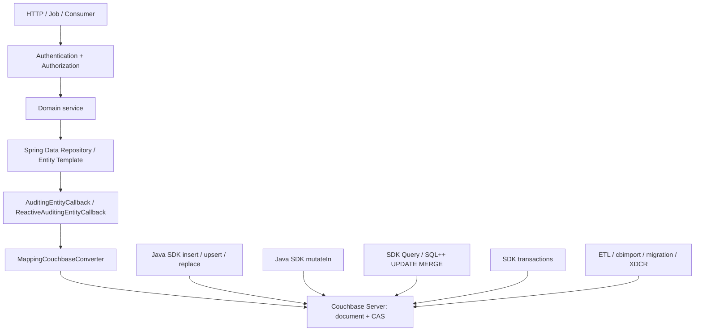
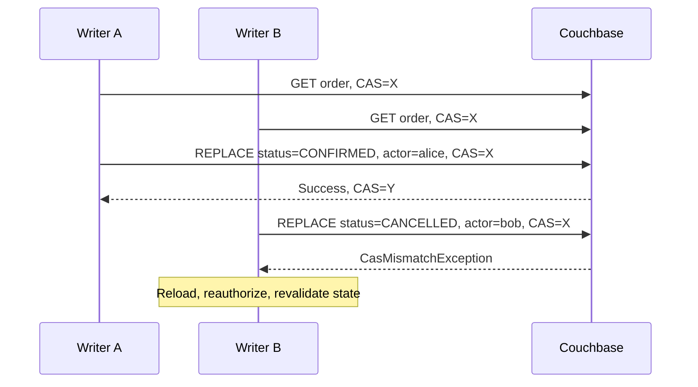

# Các đường ghi trực tiếp qua SDK hoặc truy vấn cần kiểm tra auditing trong Spring Data Couchbase

Khi một ứng dụng lưu entity qua `CouchbaseRepository.save(entity)` hoặc các thao tác entity của `CouchbaseTemplate`, Spring Data Couchbase có cơ hội chạy **entity callbacks** và điền metadata auditing. Nhưng nếu một service khác dùng **Java SDK** gọi `collection.upsert(...)`, một worker gọi `collection.mutateIn(...)`, hoặc một script chạy **SQL++ UPDATE**, Couchbase vẫn ghi dữ liệu **mà không tự chạy auditing của Spring Data**.

Đây là rủi ro trong những hệ thống có nhiều writer: order được cập nhật thành `CONFIRMED` nhưng `lastModifiedBy` vẫn là người tạo ban đầu; một import tạo document không có `createdAt`; một script sửa `status` nhưng làm mất `_class`, khiến repository query không còn tìm thấy document. **Việc metadata đã đúng ở đường HTTP không chứng minh các đường ghi khác cũng đúng.**

Bài thuộc chương **Vòng đời và auditing** của module `SPRING_DATA_COUCHBASE`. Trọng tâm là kiểm kê những đường ghi bypass lifecycle, thiết kế nguồn actor và thời gian cho KV/SQL++, giữ nguyên creation metadata, bảo vệ CAS và tenant, phân biệt transaction với sub-document atomicity, và viết kiểm thử quan sát JSON thật tại đúng bucket/scope/collection.

**Thông điệp chính:** *Auditing của Spring Data là cơ chế trong pipeline ứng dụng, không phải trigger toàn cục trên Couchbase Server.*

## 1. Bản đồ các đường ghi trong hệ thống



Các nhánh H–L **không tự đi qua E**. Ngay cả khi cùng một JVM và cùng Spring `ApplicationContext`, một lệnh `Cluster.query(...)` hoặc `Collection.replace(...)` của SDK **vẫn không gọi** callback trên entity Java.

### Ma trận trách nhiệm

| Đường ghi | Mapping entity Spring Data? | Auditing annotation tự chạy? | Chủ sở hữu audit metadata |
| --- | --- | --- | --- |
| `CouchbaseRepository.save(entity)` | Có | Có nếu auditing bật và đường callback đúng | Framework + `AuditorAware`. |
| `CouchbaseTemplate.insertById/upsertById(...).one(entity)` | Có | Có thể qua entity lifecycle; phải test Template thực | Spring Data/cấu hình Template. |
| `ReactiveCouchbaseRepository.save(entity)` | Có | Có nếu bật reactive auditing và subscribe | `ReactiveAuditorAware`. |
| Java SDK `collection.insert/upsert/replace` | Không | **Không** | SDK adapter/service. |
| Java SDK `collection.mutateIn` | Không | **Không** | SDK adapter/service. |
| SDK `cluster.query("UPDATE...")` | Không | **Không** | SQL++ command handler. |
| SQL++ qua Query Workbench/CLI | Không | **Không** | Operator/script. |
| SDK `cluster.transactions().run(...)` | Không | **Không** | Transaction handler. |
| `collection.reactive().upsert(...)` của SDK | Không | **Không** | Reactive SDK command. |
| ETL/import/XDCR/restore | Không qua Spring mapping | **Không** | Data pipeline và migration policy. |
| TTL expiry | Không phải Spring save | **Không** | Retention policy, không tự sửa audit fields. |

Phân biệt hai loại truy vấn: **SQL++ SELECT** có thể trả row để Spring Data map thành entity, còn **SQL++ UPDATE/INSERT/DELETE/MERGE** trực tiếp là thay đổi được thực hiện ở Query Service. Việc câu lệnh đi qua một bean `Cluster` do Spring quản lý cũng không biến nó thành entity lifecycle operation.

## 2. Metadata auditing khác CAS và TTL thế nào?

| Thông tin | Nguồn | Ý nghĩa |
| --- | --- | --- |
| `@CreatedDate` → `createdAt` | DateTimeProvider/Spring auditing hoặc writer manual | Thời điểm entity được tạo theo contract. |
| `@CreatedBy` → `createdBy` | AuditorAware hoặc actor đã xác thực | Ai được ghi nhận là tác nhân tạo. |
| `@LastModifiedDate` → `lastModifiedAt` | DateTimeProvider hoặc writer manual | Lần sửa/lưu gần nhất qua đường tương ứng. |
| `@LastModifiedBy` → `lastModifiedBy` | Actor từ security/job context | Ai được ghi nhận sửa gần nhất. |
| `@Version` trong Couchbase | **CAS metadata** server trả | Optimistic locking, không phải counter. |
| Expiry/TTL | Metadata/chính sách Server | Document còn sống tới khi nào. |

**CAS vẫn đổi khi SDK mutate thành công dù JSON thiếu `lastModifiedAt`.** Ngược lại, callback có thể đã điền `lastModifiedBy` trên entity JVM nhưng mutation thất bại CAS: metadata đó **chưa commit**.

Bốn audit fields là một **snapshot hiện tại**, không tự tạo log bất biến cho mọi thay đổi. Nếu cần đầy đủ lịch sử, phải dùng event/outbox/CDC được thiết kế riêng.

## 3. Entity mẫu và keyspace

Giả sử dữ liệu đặt tại:

```text
bucket: shop
scope: commerce
collection: orders

shop.commerce.orders
```

Entity Spring Data:

```java
package example.shop.order;

import java.time.Instant;
import org.springframework.data.annotation.*;
import org.springframework.data.couchbase.core.mapping.Document;
import org.springframework.data.couchbase.repository.Scope;
import org.springframework.data.couchbase.repository.Collection;

@Document
@Scope("commerce")
@Collection("orders")
public class OrderDocument {

    @Id
    private String id;

    private String tenantId;
    private String status;

    @Version
    private long version;

    @CreatedDate
    private Instant createdAt;

    @LastModifiedDate
    private Instant lastModifiedAt;

    @CreatedBy
    private String createdBy;

    @LastModifiedBy
    private String lastModifiedBy;

    public OrderDocument() {}

    public OrderDocument(
            String id, String tenantId, String status) {
        this.id = id;
        this.tenantId = tenantId;
        this.status = status;
    }

    public String getId() { return id; }
    public String getTenantId() { return tenantId; }
    public String getStatus() { return status; }
    public void setStatus(String status) {
        this.status = status;
    }

    public long getVersion() { return version; }
    public Instant getCreatedAt() { return createdAt; }
    public Instant getLastModifiedAt() {
        return lastModifiedAt;
    }
    public String getCreatedBy() { return createdBy; }
    public String getLastModifiedBy() {
        return lastModifiedBy;
    }
}
```

Repository:

```java
package example.shop.order;

import org.springframework.data.couchbase.repository.CouchbaseRepository;

public interface OrderRepository
        extends CouchbaseRepository<OrderDocument, String> {
}
```

Tại sao có `@Version`? Tài liệu Spring Data Couchbase lưu ý entity có ID được cấp sẵn cần `@Version` để **creation auditing** nhận diện lần tạo đúng. Khi đã persist, version liên kết với CAS của Couchbase. Không tăng version thủ công như `version++`.

`@Scope`/`@Collection` có import `org.springframework.data.couchbase.repository`, không phải scope bean Spring. Những annotation này chỉ có hiệu lực khi đường writer dùng mapping Spring Data tương ứng; **SDK direct tự chọn scope/collection bằng API SDK**.

## 4. Đường Spring Data chuẩn để làm mốc đối chiếu

Auditing imperative:

```java
package example.shop.config;

import org.springframework.context.annotation.Configuration;
import org.springframework.data.couchbase.repository.auditing.EnableCouchbaseAuditing;

@Configuration
@EnableCouchbaseAuditing(
    auditorAwareRef = "trustedAuditor"
)
public class OrderAuditingConfiguration {
}
```

Cần cung cấp bean `AuditorAware<String> trustedAuditor` trả actor từ principal/service identity đáng tin, và một `DateTimeProvider` khi muốn tùy chỉnh đồng hồ. Với reactive, dùng `@EnableReactiveCouchbaseAuditing` và `ReactiveAuditorAware<String>`.

Khi lưu:

```java
OrderDocument order =
    new OrderDocument("order::1001", "tenant-a", "NEW");

OrderDocument created = orderRepository.save(order);
```

Hãy kiểm tra dữ liệu được ghi bằng Java SDK **đọc trực tiếp JSON**, ghi nhận format timestamp, type discriminator và metadata CAS. Đây là **chuẩn schema** mà mọi writer khác phải giữ nếu cùng collection.

**Không tự giả định `Instant` luôn serialize thành chuỗi ISO-8601**. Custom converters hoặc bản Spring Data khác có thể chọn format khác. Nếu SDK ghi sai format, repository có thể đọc sai hoặc không materialize entity như mong đợi.

## 5. Java SDK upsert vì sao không kích hoạt callback?

Lệnh Java SDK:

```java
import com.couchbase.client.java.json.JsonObject;

var collection = cluster.bucket("shop")
    .scope("commerce")
    .collection("orders");

collection.upsert(
    "order::1001",
    JsonObject.create().put("status", "CONFIRMED")
);
```

chỉ gửi key/payload tới Data Service. Server **không** có thông tin:

- Entity class và annotations của Spring JVM.
- Bean `AuditorAware` hoặc `DateTimeProvider`.
- Principal của user HTTP.
- Custom normalizer/Bean Validation của ứng dụng.
- Quy tắc `createdBy` có được giữ nguyên không.
- Tên tenant nào caller thật sự được quyền truy cập.

Couchbase vẫn cấp CAS cho mutation. Vậy **việc ghi thành công không đồng nghĩa auditing đúng**.

### Rủi ro riêng của upsert

`upsert` có semantics **tạo nếu chưa có, thay nếu đã có**. Dùng upsert với payload chỉ có `status` có thể xóa toàn bộ `createdAt/createdBy/tenantId/_class` của document cũ. Nếu nghiệp vụ là **create-only**, dùng `insert`; nếu là update có CAS, dùng `get → replace(...)` hoặc transaction phù hợp.

## 6. Tạo mới qua SDK insert: điền audit fields chủ động

Ví dụ Java 17 / Couchbase Java SDK 3.x:

```java
package example.shop.sdk;

import java.time.Clock;
import java.time.Instant;
import java.util.Objects;

import com.couchbase.client.java.Collection;
import com.couchbase.client.java.json.JsonObject;
import com.couchbase.client.java.kv.MutationResult;

public final class DirectOrderCreator {

    private final Collection orders;
    private final Clock clock;

    public DirectOrderCreator(
            Collection orders, Clock clock) {
        this.orders = Objects.requireNonNull(orders);
        this.clock = Objects.requireNonNull(clock);
    }

    public long create(
            String documentId,
            String authorizedTenantId,
            String trustedActorId) {

        if (documentId == null || documentId.isBlank()) {
            throw new IllegalArgumentException("id required");
        }
        if (authorizedTenantId == null ||
            authorizedTenantId.isBlank()) {
            throw new IllegalArgumentException("tenant required");
        }
        if (trustedActorId == null ||
            trustedActorId.isBlank()) {
            throw new IllegalArgumentException("actor required");
        }

        String now = Instant.now(clock).toString();

        JsonObject json = JsonObject.create()
            .put("_class", "example.shop.order.OrderDocument")
            .put("tenantId", authorizedTenantId)
            .put("status", "NEW")
            .put("createdAt", now)
            .put("createdBy", trustedActorId)
            .put("lastModifiedAt", now)
            .put("lastModifiedBy", trustedActorId);

        MutationResult result =
            orders.insert(documentId, json);

        return result.cas();
    }
}
```

**Quan trọng:** `authorizedTenantId` và `trustedActorId` là giá trị do service đã **xác thực và kiểm tra quyền** cung cấp, không phải input trực tiếp từ request body. Lớp code chỉ có validation chuỗi, **không tự thực hiện authorization**.

Ví dụ dùng string ISO-8601 và `_class` dạng tên class như một **schema giả định**. Trước khi dùng production, đối chiếu schema Spring Data thực sự lưu, gồm `@Field`, custom conversions, type alias và thời gian. Không copy hằng `_class` vào nhiều writer nếu converter/type metadata đã thay.

### Vì sao insert có ích?

`insert` từ chối key trùng theo semantics KV, giúp tránh ghi đè order cũ và phá created metadata. Nhưng timeout sau insert vẫn có thể gây **ambiguous outcome**: lệnh có thể đã commit dù client chưa biết. Nên dùng command ID/idempotency và đọc lại để phân biệt retry hợp lệ với duplicate business request.

## 7. Update trực tiếp: giữ created, đổi lastModified với CAS

Một update an toàn cho entity đang tồn tại thường theo luồng:

1. Load document bằng đúng collection; lấy body và CAS.
2. Kiểm tra owner/tenant từ trusted context.
3. Kiểm tra trạng thái hiện tại phù hợp command.
4. Giữ `createdAt/createdBy`.
5. Thay `status` và hai field last-modified trong **cùng payload**.
6. Replace với CAS đã đọc.
7. Nếu CAS mismatch, load và validate lại; không retry vô hạn.

Ví dụ:

```java
package example.shop.sdk;

import java.time.Clock;
import java.time.Instant;

import com.couchbase.client.java.Collection;
import com.couchbase.client.java.json.JsonObject;
import com.couchbase.client.java.kv.GetResult;
import com.couchbase.client.java.kv.MutationResult;

import static com.couchbase.client.java.kv.ReplaceOptions.replaceOptions;

public final class DirectOrderUpdater {

    private final Collection orders;
    private final Clock clock;

    public DirectOrderUpdater(Collection orders, Clock clock) {
        this.orders = orders;
        this.clock = clock;
    }

    public long confirm(
            String id,
            String authorizedTenant,
            String trustedActorId) {

        GetResult current = orders.get(id);
        JsonObject json = current.contentAsObject();

        if (!authorizedTenant.equals(
                json.getString("tenantId"))) {
            throw new SecurityException("Tenant mismatch");
        }

        if (!"NEW".equals(json.getString("status"))) {
            throw new IllegalStateException(
                "Order must be NEW"
            );
        }

        json.put("status", "CONFIRMED");
        json.put("lastModifiedAt",
            Instant.now(clock).toString());
        json.put("lastModifiedBy", trustedActorId);

        MutationResult result = orders.replace(
            id, json, replaceOptions().cas(current.cas())
        );

        return result.cas();
    }
}
```

Ví dụ này chỉ cho thấy **KV+CAS+metadata**; ứng dụng production cần xác thực quyền trước khi gọi, kiểm tra null/format, xử lý security exceptions, phân biệt tenant ở shared collection, retry có giới hạn và kiểm soát expiry.

**Không tự đặt `createdAt=Instant.now()` trên mỗi update.** Hai creation fields phải giữ nguyên, trừ migration có chủ đích và bằng chứng nguồn gốc.

### TTL khi replace

Nếu document có expiry, phải xác minh replace có giữ expiry không. Java SDK hỗ trợ `replaceOptions().preserveExpiry(true)` ở môi trường phù hợp (Couchbase Server 7+), hoặc thiết lập expiry tường minh theo policy. Không để một thao tác auditing vô tình xóa TTL hoặc kéo dài tuổi thọ dữ liệu.

## 8. CAS conflict: auditing không được coi là commit nếu mutation lỗi

Hai writer:



Writer B có thể đã sửa `lastModifiedBy=bob` trong `JsonObject` của JVM nhưng server **không được commit** thay đổi đó. Do đó:

- Không phát thông báo “Bob đã hủy order” trước khi save thành công.
- Không cộng 1 vào CAS rồi retry.
- Không lặp mãi `replace` với CAS cũ.
- Sau conflict, reload và kiểm tra business rule lần nữa.
- Với timeout không rõ kết quả, đối soát bằng commandId/readback trước khi tạo tác dụng phụ bên ngoài.

`@Version` trên Java entity Spring Data **không ép SDK clients khác dùng CAS**. Từng writer phải lựa chọn concurrency policy.

## 9. Sub-document mutateIn: sửa status và metadata atomically

Khi chỉ cần sửa một số path, Java SDK có `mutateIn`:

```java
import java.time.Instant;
import java.util.List;

import com.couchbase.client.java.kv.MutateInSpec;
import static com.couchbase.client.java.kv.MutateInOptions.mutateInOptions;

var result = orders.mutateIn(
    "order::1001",
    List.of(
        MutateInSpec.upsert("status", "CONFIRMED"),
        MutateInSpec.upsert(
            "lastModifiedAt", Instant.now().toString()
        ),
        MutateInSpec.upsert(
            "lastModifiedBy", "service:order-worker"
        )
    ),
    mutateInOptions().cas(expectedCas)
);
```

Mảnh code nằm trong service đã có `orders`, `expectedCas` và actor xác thực; nó không tự authorize. Ở production, dùng `Clock` injectable, actor tin cậy và schema JSON nhất quán.

**Điều có thể dựa vào:**

- Các spec trong **một mutateIn** được áp dụng nguyên tử ở **một document**; nếu một spec thất bại thì toàn lệnh không áp dụng.
- `mutateInOptions().cas(...)` cho phép kiểm tra CAS khi logic cần.
- Không chạy `BeforeConvertCallback` hay `AuditorAware` của Spring Data.
- **Không** tạo transaction giữa hai document/collection.
- Việc cập nhật field khác nhau không loại bỏ yêu cầu kiểm tra state transition hoặc ownership.
- Cần quyết định `preserveExpiry`/expiry trên server và SDK hiện dùng.

Đừng đưa `createdBy` vào các spec update thông thường; làm vậy có thể thay đổi người tạo gốc.

## 10. Đừng cố bắt lệnh SDK bằng một Spring EntityCallback

Callback:

```java
@Component
public class NormalizeOrderCallback
        implements BeforeConvertCallback<OrderDocument> {

    @Override
    public OrderDocument onBeforeConvert(
            OrderDocument entity, String collection) {

        // Chuẩn hóa entity trong pipeline Spring Data.
        return entity;
    }
}
```

không nhận mọi mutation trên Couchbase Server. Đăng ký listener/callback **không làm SDK upsert hay SQL++ UPDATE tự gọi tới Spring application**.

Nếu có nhiều writer, nên:

- Tập trung **business command** qua một service/adapter được kiểm soát khi có thể.
- Dùng chung policy về audit fields, schema và normalization.
- Viết **contract tests** cho mỗi writer.
- Hạn chế đường ghi direct bằng RBAC và code review.
- Có cảnh báo đối soát document thiếu audit metadata.

## 11. AuditStamp: tách actor và thời gian khỏi thao tác ghi

Một value object nhỏ giúp kiểm soát nguồn actor/time:

```java
package example.shop.audit;

import java.time.Clock;
import java.time.Instant;
import java.util.Objects;

public record AuditStamp(
        String actorId,
        Instant timestamp
) {

    public AuditStamp {
        if (actorId == null || actorId.isBlank()) {
            throw new IllegalArgumentException(
                "Audit actor required"
            );
        }
        Objects.requireNonNull(
            timestamp, "Audit timestamp required"
        );
    }

    public static AuditStamp create(
            String trustedActorId, Clock clock) {
        return new AuditStamp(
            trustedActorId, Instant.now(clock)
        );
    }
}
```

`AuditStamp` là kiểu do ứng dụng định nghĩa, **không chứng minh actor đã được xác thực**. Caller phải lấy ID từ principal hoặc trusted job context trước khi tạo stamp.

Helper mapping:

```java
public static JsonObject withModificationAudit(
        JsonObject json, AuditStamp stamp) {

    json.put("lastModifiedAt",
        stamp.timestamp().toString());
    json.put("lastModifiedBy",
        stamp.actorId());

    return json;
}
```

Helper cần import `JsonObject` và `AuditStamp`; nó chỉ điền metadata theo schema ví dụ. Khi `MappingCouchbaseConverter` thực tế dùng format khác cho `Instant`, cần adapter serialization tương thích.

**Không đưa email/payment/queue publish vào AuditStamp hoặc normalizer**: retry mutation không nên tự lặp external side effect.

## 12. SQL++ UPDATE trực tiếp là một đường ghi khác

Câu SQL++:

```sql
UPDATE `shop`.`commerce`.`orders` AS o
USE KEYS "order::1001"
SET o.status = "CONFIRMED";
```

được **Query Service** thực thi. Nó không làm Spring Data lifecycle trên entity Java. Nếu document có `lastModifiedAt` trước đó, field này **không tự đổi** chỉ vì `status` đã thay.

### UPDATE có audit fields

```sql
UPDATE `shop`.`commerce`.`orders` AS o
USE KEYS $documentId
SET o.status = $newStatus,
    o.lastModifiedAt = $auditTimestamp,
    o.lastModifiedBy = $auditActorId
WHERE o.tenantId = $authorizedTenantId
  AND o.status = "NEW"
RETURNING META(o).id AS documentId,
          META(o).cas AS cas,
          o.status,
          o.lastModifiedAt,
          o.lastModifiedBy;
```

Ý nghĩa:

- Các giá trị `$...` phải được bind qua SDK QueryOptions, không nội suy chuỗi SQL từ input user.
- Actor và tenant phải được kiểm tra ở tầng service trước khi query.
- `WHERE` chứa tenant và trạng thái để giới hạn command, nhưng không thay authorization tổng thể.
- `RETURNING` giúp biết những document đã đổi; **0 hàng** có thể là key không tồn tại, tenant mismatch hoặc trạng thái đã đổi.
- `META(o).cas` là metadata từ server, không phải `@Version` do auditor Java điền.
- Query Service cần quyền tương ứng; `RETURNING` có thể cần thêm Query Select privilege theo RBAC.
- Không mặc định SQL++ dùng compare-and-swap giống SDK `replaceOptions().cas(...)`; nếu cần CAS chặt chẽ nên dùng KV conditional replace hoặc transaction được hỗ trợ.

## 13. SQL++ từ Java SDK: named parameters thay nối chuỗi

Ví dụ Java 17 với text block:

```java
import com.couchbase.client.java.json.JsonObject;
import com.couchbase.client.java.query.QueryResult;

import static com.couchbase.client.java.query.QueryOptions.queryOptions;

String statement = """
    UPDATE `shop`.`commerce`.`orders` AS o
    USE KEYS $documentId
    SET o.status = $newStatus,
        o.lastModifiedAt = $auditTimestamp,
        o.lastModifiedBy = $auditActorId
    WHERE o.tenantId = $authorizedTenantId
      AND o.status = "NEW"
    RETURNING META(o).id AS documentId,
              o.lastModifiedBy
    """;

JsonObject params = JsonObject.create()
    .put("documentId", orderId)
    .put("newStatus", "CONFIRMED")
    .put("auditTimestamp", stamp.timestamp().toString())
    .put("auditActorId", stamp.actorId())
    .put("authorizedTenantId", authorizedTenantId);

QueryResult result = cluster.query(
    statement,
    queryOptions().parameters(params)
);

if (result.rowsAsObject().isEmpty()) {
    throw new IllegalStateException(
        "No order satisfied the guarded update"
    );
}
```

Các biến `orderId`, `stamp`, `authorizedTenantId` và `cluster` đến từ service/context tin cậy. Mã minh họa không bao gồm cấu hình cluster, retries và error mapping.

**Quan trọng:** `cluster.query(...)` vẫn là direct SDK SQL++ DML; nó không gọi `AuditingEntityCallback` của Spring Data dù `cluster` được inject qua Spring. Truy vấn `SELECT` qua repository khác với DML qua SDK.

### Không dùng query parameters để thay identifier tùy ý

Named parameters dùng cho **giá trị**. Bucket/scope/collection identifiers trong câu SQL++ cần được resolve qua một registry/allowlist đáng tin. Đừng ghép trực tiếp tên scope do user gửi vào SQL++ string rồi nghĩ bind parameter đã bảo vệ keyspace.

## 14. INSERT, UPSERT và MERGE phải phân biệt create và update

Ví dụ SQL++:

```sql
-- Chỉ tạo nếu key chưa tồn tại:
INSERT INTO `shop`.`commerce`.`orders` (KEY, VALUE)
VALUES ($documentId, $validatedDocument);

-- Tạo hoặc thay thế nếu key tồn tại:
UPSERT INTO `shop`.`commerce`.`orders` (KEY, VALUE)
VALUES ($documentId, $validatedDocument);
```

Các lệnh DML này không tự chạy auditing. `$validatedDocument` phải mang schema, actor/time và tenant đúng.

| Trường hợp | Chính sách |
| --- | --- |
| INSERT entity mới | Đặt `createdAt/By` và nếu `modifyOnCreate=true` cả modified fields. |
| UPDATE entity hiện tại | Giữ created; thay modified cùng dữ liệu nghiệp vụ. |
| UPSERT entity hiện tại | Tránh ghi đè full JSON thiếu created/schema/tenant fields. |
| MERGE matched | Nhánh cập nhật phải preserve created metadata. |
| MERGE not matched | Nhánh insert phải thiết lập creation metadata. |
| DELETE | JSON mất; nếu cần truy vết xóa phải có tombstone/event hoặc soft delete. |

Không áp một “current actor + current time” lên **cả created và modified** trong mọi nhánh MERGE; nó sẽ làm mất người/thời điểm tạo gốc của document đã tồn tại.

## 15. Bulk UPDATE: đặc biệt nguy hiểm trong shared collection

Ví dụ job archive nhiều đơn:

```sql
UPDATE `shop`.`commerce`.`orders` AS o
SET o.status = "ARCHIVED",
    o.lastModifiedBy = $jobActor,
    o.lastModifiedAt = $jobTimestamp
WHERE o.tenantId = $authorizedTenant
  AND o.status = "CLOSED";
```

Không có `USE KEYS` nên Query Service có thể cần index phù hợp; cần kiểm tra query plan, RBAC và consistency. Trước khi chạy production:

1. Xác thực service identity và tenant được phép.
2. Ràng buộc `WHERE` theo tenant/điều kiện nghiệp vụ.
3. Kiểm tra số document dự kiến, preview SELECT ở môi trường phù hợp.
4. Có backup/rollback strategy và batch giới hạn kích thước.
5. Gắn `jobId`/`commandId`, actor và thời gian có contract.
6. Đối chiếu số hàng thay đổi và đọc sample KV.
7. Không tự đổi `createdBy/createdAt` của document cũ.
8. Theo dõi tác động tới TTL, index và traffic của hệ thống.

Một timestamp chung cho cả batch có thể là chính sách có chủ đích (“thời gian bắt đầu batch”), nhưng **không gọi đó là commit time riêng của mọi document**.

## 16. SELECT, QueryScanConsistency và việc xác minh audit

Sau KV insert, `collection.get(id)` thường đọc trạng thái mới tại active KV Service; một finder SQL++ qua secondary index có thể chưa thấy document do index cập nhật bất đồng bộ.

Ví dụ query tìm metadata thiếu:

```sql
SELECT META(o).id AS documentId,
       o.createdBy,
       o.lastModifiedBy
FROM `shop`.`commerce`.`orders` AS o
WHERE o.lastModifiedBy IS MISSING
LIMIT 100;
```

Nếu Query Service trả rỗng ngay sau write, có hai khả năng rất khác:

- Document thật có đầy đủ audit metadata.
- Index/scan consistency chưa cho phép query nhìn thấy document cần kiểm tra.

Để chẩn đoán: **đọc KV trực tiếp trước**, xác minh keyspace và JSON, sau đó kiểm tra index/query consistency. Khi nghiệp vụ yêu cầu SQL++ read-your-writes, xem xét `REQUEST_PLUS` hoặc mutation-state consistency, chấp nhận latency tăng.

**Query consistency mạnh hơn không tự thêm audit fields đang bị thiếu.**

## 17. Đường DELETE, TTL và audit trail không thể chỉ dùng bốn field

Nếu một worker gọi:

```java
orders.remove("order::1001");
```

hoặc SQL++:

```sql
DELETE FROM `shop`.`commerce`.`orders` AS o
USE KEYS $documentId;
```

document không còn để đọc metadata `lastModifiedBy`. Một Spring callback chỉ ghi “người sửa cuối” không tự tạo lịch sử xóa bất biến.

Nếu cần audit deletion, có thể thiết kế:

- **Soft delete:** `deletedAt/deletedBy` cùng trạng thái/xác thực/CAS.
- **Tombstone hoặc audit event:** lưu lý do, actor, command ID, key và timestamp.
- **Transactional outbox:** phát event đáng tin cậy sau commit nếu transaction hỗ trợ.
- **CDC/DCP:** quan sát mutation nhưng cần bổ sung actor/business context và retention.

Khi document hết hạn theo **TTL server-side**, cũng không có Spring `AuditorAware` được gọi để đặt `deletedBy="system"` hoặc `lastModifiedAt` mới. Đừng nhầm TTL với một business delete có người thao tác.

## 18. Giao dịch SDK và giới hạn auditing

Một transaction thực hiện qua Couchbase Java SDK là **transaction SDK**, không phải `repository.save(...)`. Ví dụ:

```java
cluster.transactions().run(ctx -> {
    // ctx.get(collection, id)
    // ctx.replace(existingTransactionResult, newJson)
    // ctx.insert(collection, newId, json)
});
```

Dù `ctx.replace(...)` lưu đúng document trong Couchbase, nó **không tự kích hoạt** `@CreatedDate` hay `AuditorAware` của Spring Data. Handler phải điền metadata vào JSON được gửi.

### Transaction lambda có thể chạy lại

Couchbase có thể retry transaction attempt khi có xung đột/transient error. Vì vậy:

1. Tạo/nhận **command ID** ổn định ở service, không sinh một ID mới mỗi lần lambda chạy.
2. Xác định actor từ principal hoặc service identity đã được xác thực.
3. Xác định ngữ nghĩa timestamp: thời điểm nhận command, thời điểm attempt hay commit time; **không giả vờ `Instant.now()` là commit time tuyệt đối**.
4. Đọc current document trong transaction.
5. Kiểm tra lại domain rules và ownership ở trạng thái được đọc.
6. Đặt modified fields cùng business changes.
7. Dùng `ctx.replace/insert/remove` trong transaction, không trộn một SDK KV write ngoài transaction rồi coi là cùng commit.
8. Không gọi email/payment/broker trực tiếp trong lambda có thể được chạy lại.

**Lưu ý:** transactional SDK mutations và non-transactional writes đồng thời trên cùng document cần được thiết kế theo hướng dẫn Couchbase; không dựa vào callback Spring Data làm cơ chế phối hợp.

## 19. Ví dụ SDK transaction: cập nhật order và ghi outbox

Một mô hình phục hồi được là lưu trạng thái đơn hàng và **ý định phát event** cùng transaction, sau đó worker gửi message. Ví dụ dùng Java SDK:

```java
import com.couchbase.client.java.Cluster;
import com.couchbase.client.java.Collection;
import com.couchbase.client.java.json.JsonObject;
import com.couchbase.client.java.transactions.TransactionGetResult;

import java.time.Clock;
import java.time.Instant;

Collection orders = cluster.bucket("shop")
    .scope("commerce")
    .collection("orders");

Collection outbox = cluster.bucket("shop")
    .scope("operations")
    .collection("outbox_events");

String orderId = "order::1001";
String commandId = "cmd::confirm::73ab";

// Actor phải được service xác thực trước transaction.
String actorId = "service:order-command";
String requestedAt =
    Instant.now(Clock.systemUTC()).toString();

cluster.transactions().run(ctx -> {
    TransactionGetResult current =
        ctx.get(orders, orderId);

    JsonObject order =
        current.contentAs(JsonObject.class);

    if (!"NEW".equals(order.getString("status"))) {
        throw new IllegalStateException(
            "Order is not NEW"
        );
    }

    order.put("status", "CONFIRMED");
    order.put("lastModifiedBy", actorId);
    order.put("lastModifiedAt", requestedAt);

    ctx.replace(current, order);

    JsonObject event = JsonObject.create()
        .put("eventId", "event::" + commandId)
        .put("orderId", orderId)
        .put("eventType", "ORDER_CONFIRMED")
        .put("actorId", actorId)
        .put("occurredAt", requestedAt)
        .put("deliveryState", "PENDING");

    ctx.insert(
        outbox,
        "outbox::" + commandId,
        event
    );
});
```

Đây là mẫu mô tả **ranh giới transaction**, cần cấu hình SDK transaction, quyền và collection phù hợp, domain authorization, xử lý command trùng và rollback. Nó **không** khẳng định có exactly-once delivery ra broker; worker có thể gửi thành công rồi crash trước khi đánh dấu `SENT`, vì vậy consumer cần deduplication/idempotency theo event ID.

### Vì sao không gọi auditRepository.save trong callback?

Nếu một callback Spring Data tự gọi `auditRepository.save(...)` mỗi khi lưu order, bạn đang tạo một mutation **ẩn** không mặc nhiên nguyên tử với order mutation. Nó còn có thể chạy lặp khi retry hoặc trong migration. Nếu cần audit event bền vững, hãy **chủ động** ghi event/outbox trong transaction hoặc workflow đáng tin.

### createdBy/createdAt khi chuyển collection

Nếu lưu thêm archive document sang `shop.archive.orders_history`, đừng copy CAS từ order đang sống và xem nó là CAS của archive: hai document có metadata độc lập. Cũng phải quyết định archive document cần giữ creator gốc hay có field `archivedBy/archivedAt` riêng.

## 20. SDK reactive cũng bypass ReactiveAuditorAware

Trong cùng ứng dụng WebFlux, có hai đường hoàn toàn khác:

```java
// Đường Spring Data reactive:
Mono<OrderDocument> a =
    reactiveOrderRepository.save(entity);

// Đường Couchbase SDK reactive:
Mono<MutationResult> b =
    sdkCollection.reactive().upsert(
        entity.getId(),
        JsonObject.create().put("status", "CONFIRMED")
    );
```

Đường thứ hai **không tự chạy** `ReactiveAuditingEntityCallback`/`ReactiveAuditorAware`, dù cả hai dùng Reactor `Mono`.

Một `ReactiveAuditorAware<String>` có thể đọc:

```java
return ReactiveSecurityContextHolder.getContext()
    .flatMap(ctx ->
        Mono.justOrEmpty(ctx.getAuthentication())
    )
    .filter(Authentication::isAuthenticated)
    .map(Authentication::getName);
```

Nhưng bean này chỉ tham gia hạ tầng auditing của Spring Data khi được gọi; **SDK `reactive().upsert(...)` không biết bean đó tồn tại**.

Nếu phải giữ SDK reactive, service nên:

- Lấy actor ở **trusted WebFlux/job boundary**.
- Kiểm tra quyền và tenant trong một publisher reactive được quản lý.
- Tạo JSON audit metadata theo contract thống nhất.
- Dùng reactive KV CAS/transaction cần thiết.
- Trả publisher cho caller, không tự `subscribe()` rồi bỏ qua error.
- Không `block()` trên event loop chỉ để lấy actor hoặc metadata.

### Retry/resubscription

Một `retry(2)` có thể resubscribe upstream, khiến actor/time được lấy lại và mutation thử lại. Nó **không** tự reload CAS, không tự biết timeout trước đó đã commit hay chưa, và không tạo exactly-once side effects. Với CAS conflict, thiết kế lại flow load → revalidate → save, retry có giới hạn.

## 21. Import, ETL, backup restore và XDCR

Một hệ thống có thể cập nhật Couchbase qua `cbimport`, ETL pipeline, migration script, restore hoặc XDCR. Những đường này không chạy callback của Spring Data trong một JVM khác.

### Chính sách metadata theo nguồn dữ liệu

| Dữ liệu nguồn | Cách xử lý audit fields |
| --- | --- |
| Có createdAt/By lịch sử đáng tin | Preserve hai field gốc; ghi thêm `importedAt/By` nếu cần. |
| Không biết người tạo/thời gian tạo | Đánh dấu `unknown` hoặc thông tin nguồn import theo policy, không bịa user. |
| Job thay đổi status nghiệp vụ | Gán modified fields bằng **service/job actor** đã xác thực. |
| Migration chỉ đổi schema | Cân nhắc field `migratedAt/migrationId` riêng, giữ creation history. |
| XDCR sao chép JSON và metadata | Kiểm tra semantics replication; không suy “actor nhận” là người tạo. |
| Restore snapshot | Không ghi đè createdAt bằng thời gian restore nếu ý nghĩa là creation gốc. |

Đừng suy diễn người tạo từ tài khoản Couchbase kỹ thuật mà importer dùng. Một service credential có thể đại diện hàng triệu user.

**DCP/CDC** có thể cung cấp mutation stream giúp xây audit trail, nhưng một mutation stream tự nó không chứa đầy đủ **actor nghiệp vụ** khi writer không ghi actor hoặc command correlation. Muốn một audit log bền vững cần retention, schema, dedupe, khôi phục và bảo mật riêng.

## 22. Contract tối thiểu giữa Spring Data writer và direct writer

Nếu nhiều client cùng ghi `shop.commerce.orders`, nên có tài liệu/mã kiểm thử nhất quán:

| Field | Định nghĩa | Quy tắc direct writer |
| --- | --- | --- |
| `createdAt` | Thời điểm tạo ban đầu | Đặt khi insert; không đổi khi update. |
| `createdBy` | Stable actor ID của creator | Lấy từ nguồn tin cậy; preserve khi update. |
| `lastModifiedAt` | Thời điểm modification theo policy | Đặt cùng mutation business. |
| `lastModifiedBy` | Stable actor ID của writer gần nhất | Không lấy từ payload public chưa xác thực. |
| `tenantId` | Owner/tenant | Resolve qua registry và kiểm tra ownership. |
| `_class` hoặc discriminator | Type metadata theo converter | Bảo toàn hoặc sinh đúng giá trị mapping thực tế. |
| `schemaVersion` nếu dùng | Version schema ứng dụng | Tách biệt với CAS. |
| CAS | Server metadata | Dùng SDK get-result/mutation-result, không tự tăng. |
| Expiry/TTL | Server metadata/policy | Preserve hoặc thay theo business rule rõ ràng. |
| `commandId` nếu dùng | Idempotency/correlation | Ổn định qua retry của một business command. |

Cẩn thận với tên/kiểu field: `@Field`, custom conversions hoặc `@TypeAlias` có thể khiến JSON thật **khác entity Java**. Nếu SDK writer tự ghi `createdAt` ISO string trong khi Spring Data đang lưu epoch number, cả hai có thể tạo dữ liệu không tương thích. Cần lấy **raw JSON baseline** từ repository save trong integration test.

## 23. Tenant routing, security và query identifiers

Giả sử có:

```text
shop.tenant_acme.orders
shop.tenant_globex.orders
```

Một actor `user:alice` có thể có quyền ghi Acme nhưng chỉ được đọc Globex. Auditing actor **không** tự chứng minh membership.

Quy trình direct SDK/query:

1. Authenticate principal hoặc service identity.
2. Authorize tenant và hành động với resource cụ thể.
3. Resolve bucket/scope/collection từ **allowlisted tenant registry**.
4. Chọn SDK `Collection` hoặc query context đúng.
5. Kiểm tra tenant ID trong document khi shared collection.
6. Áp domain command và metadata từ actor/clock tin cậy.
7. Dùng CAS/transaction khi cần.
8. Ghi metrics/correlation để truy vết nhưng không lộ token/PII.

Không nhận raw tên scope/collection rồi ghép vào SQL++ từ input user chưa kiểm tra; bind parameters là dành cho **giá trị**, không tự giải quyết identifier injection.

Với multi-bucket, `inScope("...")` của một Template **không thay bucket** đã được Template/ClientFactory quản lý. Tương tự, SDK `bucket("shop").scope("...")` phải nhắm đúng bucket do registry được phép.

## 24. Observability: phát hiện metadata thiếu hoặc sai

Một query kiểm kê data quality:

```sql
SELECT META(o).id AS documentId,
       o.tenantId,
       o.createdBy,
       o.lastModifiedBy
FROM `shop`.`commerce`.`orders` AS o
WHERE o.createdAt IS MISSING
   OR o.createdBy IS MISSING
   OR o.lastModifiedAt IS MISSING
   OR o.lastModifiedBy IS MISSING
LIMIT 100;
```

Điều kiện này giả định policy **cả bốn field có mặt ngay từ lần create**, chẳng hạn `modifyOnCreate=true` và actor bắt buộc. Nếu dùng `modifyOnCreate=false` hoặc cho phép actor unknown, cần sửa phép kiểm kê.

Các số đo nên có:

- Số/tỷ lệ document thiếu audit field theo tenant và nguồn writer.
- CAS conflict, duplicate key, timeout/ambiguous result.
- Số mutation SDK trực tiếp, SQL++ DML và migration.
- Độ lệch clock và timestamp bất thường.
- Số document legacy chưa backfill.
- Lượng outbox event chưa phát hoặc gửi lặp (nếu dùng).

**Lưu ý:** SQL++ query có thể chịu index lag/scan consistency. Khi xác minh một document cụ thể, dùng **KV get tại đúng collection** để tránh nhầm query chưa thấy dữ liệu với “auditing bị bỏ qua”.

## 25. Unit test chính sách actor/time mà không cần Couchbase

Giả sử dùng record `AuditStamp` ở phần trước (actor ID + Instant). Test:

```java
import java.time.Clock;
import java.time.Instant;
import java.time.ZoneOffset;

import org.junit.jupiter.api.Test;

import static org.junit.jupiter.api.Assertions.assertEquals;
import static org.junit.jupiter.api.Assertions.assertThrows;

class AuditStampTest {

    @Test
    void producesStableStampFromFixedClock() {
        Instant at =
            Instant.parse("2026-11-25T03:00:00Z");

        Clock clock = Clock.fixed(at, ZoneOffset.UTC);

        AuditStamp stamp =
            AuditStamp.create("service:order-api", clock);

        assertEquals("service:order-api", stamp.actorId());
        assertEquals(at, stamp.timestamp());
    }

    @Test
    void rejectsMissingActor() {
        assertThrows(
            IllegalArgumentException.class,
            () -> new AuditStamp(
                "", Instant.parse("2026-11-25T03:00:00Z")
            )
        );
    }
}
```

Đây là test không cần DB: chứng minh policy của stamp, **chưa** chứng minh JSON mapping, tenant/CAS hoặc callbacks. Cần integration tests cho từng đường ghi.

## 26. Integration test baseline: repository.save có auditing

Chuẩn bị test cluster và Spring context:

- Bucket `shop`, scope `commerce`, collection `orders`.
- Entity có `@Version` và bốn audit annotations.
- `@EnableCouchbaseAuditing`, auditor/time provider có thể điều khiển.
- Repository thật, không mock.
- Java SDK `Cluster` làm oracle độc lập.

Test flow:

1. Actor Alice, clock t1 → save entity mới có ID.
2. Assert `createdAt/By` được điền; nếu `modifyOnCreate=true`, cả modified fields.
3. Đọc raw JSON bằng SDK để ghi nhận **schema thật**.
4. Actor Bob, clock t2 → load entity rồi update.
5. Assert created giữ nguyên; modified đổi.
6. Đọc SDK raw và CAS.
7. Lưu baseline JSON/test fixture cho direct SDK writer.

Mảnh test:

```java
String id = "it::spring::" + java.util.UUID.randomUUID();

OrderDocument created = orderRepository.save(
    new OrderDocument(id, "tenant-acme", "NEW")
);

assertNotNull(created.getCreatedAt());
assertNotNull(created.getCreatedBy());

var raw = sdkCluster.bucket("shop")
    .scope("commerce")
    .collection("orders")
    .get(id)
    .contentAsObject();

assertEquals(created.getCreatedBy(),
    raw.getString("createdBy"));
```

Đây là phần thân test, cần app context, static JUnit imports, fixture, config và cleanup. Không hardcode `raw.getString("createdAt")` cho mọi converter nếu schema thực khác.

## 27. Negative test: SDK insert thiếu audit fields

Một regression test quan trọng là **cố ý bypass** Spring Data:

```java
String id =
    "it::sdk-no-audit::" + java.util.UUID.randomUUID();

var orders = sdkCluster.bucket("shop")
    .scope("commerce")
    .collection("orders");

orders.insert(
    id,
    JsonObject.create()
        .put("status", "NEW")
        .put("tenantId", "tenant-acme")
);

var raw = orders.get(id).contentAsObject();

assertFalse(raw.containsKey("createdBy"));
assertFalse(raw.containsKey("lastModifiedAt"));
```

Test này **chứng minh SDK direct không tự chạy auditing**, không phải production implementation. Test phải dùng key unique, test cluster riêng và cleanup.

Tiếp theo, chạy `DirectOrderCreator.create(...)` với actor/time tin cậy; assert document được insert có metadata đầy đủ theo cùng schema baseline Spring Data đã ghi.

**Không chỉ test qua `repository.findById`**: document SDK thiếu `_class` hoặc discriminator có thể không map/query giống entity, khiến test sai hướng. SDK KV raw read là oracle.

## 28. Test direct replace/mutateIn với CAS

### Test replace stale

1. Gieo document có `createdBy=alice` và modified actor ban đầu.
2. Writer A và B cùng đọc CAS=X.
3. Writer A replace status+lastModified = CONFIRMED/A → thành công.
4. Writer B replace bằng CAS=X → `CasMismatchException`.
5. Raw KV vẫn phản ánh A; created fields không bị B đổi.

Ví dụ assert:

```java
assertThrows(
    com.couchbase.client.core.error.CasMismatchException.class,
    () -> orders.replace(
        id, staleBody,
        replaceOptions().cas(staleCas)
    )
);
```

Ví dụ cần `staleBody/staleCas` từ bản đọc **trước** update của A. Exact exception theo SDK version phải được xác nhận; không catch mọi exception rồi cho pass.

### Test mutateIn atomic

Một lệnh mutateIn có ba specs: `status`, `lastModifiedAt`, `lastModifiedBy`. Assert sau success cả ba thay đổi. Nếu một spec invalid gây lỗi, assert **không có partial document mutation**. Thử CAS cũ để bảo đảm không có thay đổi metadata của writer thất bại.

**Atomic sub-document mutation không đồng nghĩa transaction nhiều document.** Test riêng khi cần cập nhật order và audit/outbox event.

## 29. Test SQL++ DML: metadata không tự cập nhật

Một test so sánh hai đường:

1. Gieo document bằng Spring Data với Alice/t1.
2. Chạy SQL++ `UPDATE ... SET status = "CONFIRMED"` không đặt metadata.
3. Đọc raw KV: status mới, lastModified vẫn là Alice/t1.
4. Chạy guarded UPDATE có `lastModifiedAt/By` bind từ Bob/t2.
5. Đọc KV: modified thành Bob/t2, created vẫn Alice/t1.
6. Nếu `RETURNING` rỗng, phân loại key/tenant/state thay vì mặc định “not found”.
7. Kiểm tra SQL++ bulk update không đổi document của tenant khác.

Test kiểu này bắt được regression khi developer chuyển từ repository.save sang raw SQL++ để “tối ưu tốc độ” mà bỏ quên audit fields.

## 30. Test SDK transaction và outbox

Gieo order NEW, chạy transaction:

- Đổi order CONFIRMED và modified metadata.
- Insert outbox event với event ID ổn định.
- Commit → cả order và event tồn tại.
- Thử exception trong lambda trước commit → không kết luận bất kỳ mutation nào đã commit.
- Thử commandId trùng sau commit → service phân biệt request lặp hợp lệ với conflict.
- Worker gửi event có thể retry; consumer phải dedupe theo event ID.

Một lệnh `orders.save(order); outbox.save(event);` **không tự tạo transaction** nếu chạy độc lập. Cần dùng đúng transaction API hỗ trợ cho cả hai document hoặc workflow phục hồi tương ứng.

## 31. Test reactive: Spring Data vs reactive SDK

| Đường | Kiểm thử |
| --- | --- |
| `ReactiveCouchbaseRepository.save(entity)` | Bật `@EnableReactiveCouchbaseAuditing`, actor từ Reactor context; dùng `StepVerifier`. |
| `ReactiveCouchbaseTemplate.upsertById(...).one(entity)` | Xác minh callback wiring của Template thực. |
| `collection.reactive().upsert(id, JsonObject)` | Negative test thiếu audit fields nếu không có adapter. |
| `cluster.reactive().query("UPDATE ...")` | DML không tự gọi Spring Data callbacks. |

Dùng hai publisher với hai principals để test isolation; không lưu current actor trong static/singleton mutable. Không tự `subscribe()` từ tầng service rồi bỏ qua result/error.

## 32. Ma trận QA theo writer

| Mã | Writer | Kỳ vọng |
| --- | --- | --- |
| W01 | Repository save/create | Created + modified theo auditing config. |
| W02 | Entity Template save | Auditing hoạt động ở Template được dùng. |
| W03 | SDK insert có AuditStamp | JSON đầy đủ, insert-only chặn key trùng. |
| W04 | SDK upsert không audit | Negative test chứng minh bypass. |
| W05 | SDK replace với CAS | Created giữ nguyên, modified thay đổi. |
| W06 | SDK stale replace | Không commit modified của writer lỗi. |
| W07 | SDK mutateIn | Business field và audit fields atomic **trong một document**. |
| W08 | SQL++ UPDATE không audit | Business field đổi, audit không tự đổi. |
| W09 | SQL++ UPDATE có parameters | Metadata đúng schema và actor. |
| W10 | SQL++ bulk UPDATE | Không sửa tenant/keyspace ngoài quyền. |
| W11 | SQL++ INSERT/UPSERT/MERGE | Nhánh create/update có semantics phù hợp. |
| W12 | DELETE / TTL | Không giả định Spring auditing tự ghi deletion actor. |
| W13 | SDK transaction/outbox | Transaction atomicity và retry logic. |
| W14 | Reactive repository | Actor từ đúng subscriber. |
| W15 | Reactive SDK direct | Không tự chạy ReactiveAuditorAware. |
| W16 | Import/ETL/restore | Không giả creator/time; có backfill policy. |
| W17 | SQL++ finder/index lag | Phân biệt index consistency với raw JSON thiếu. |
| W18 | Multi-bucket/scope | SDK oracle đọc đúng collection. |
| W19 | Custom converter/_class | SDK-created JSON tương thích Spring Data. |
| W20 | Actor không xác thực | Service từ chối hoặc có trusted job policy. |

## 33. Những lỗi vận hành và cách khắc phục

| Triệu chứng | Nguyên nhân thường gặp | Xử lý |
| --- | --- | --- |
| Order đổi status nhưng `lastModifiedBy` cũ | Raw SDK/SQL++ DML không đặt audit fields. | Adapter có actor/time cùng mutation. |
| Spring Data save có audit, job không có | Job dùng SDK trực tiếp. | Quy hoạch writer và test riêng. |
| `createdAt` mất sau SDK upsert | Upsert full JSON chỉ có một vài field. | Dùng insert/replace CAS, preserve created fields. |
| `_class` mất và repository query không thấy | Direct JSON bỏ discriminator. | Đồng nhất schema/converter và kiểm tra mapping. |
| Date parse lỗi sau SQL++ update | Timestamp format không trùng converter. | Contract JSON/time format, test round-trip. |
| Save CAS conflict nhưng notification đã gửi | Side effect chạy trước commit hoặc trong retry. | Dùng outbox/idempotency và commit-based workflow. |
| Mã SDK có CAS nhưng vẫn sai tenant | CAS không phải authorization. | Kiểm tra principal/ownership/keyspace. |
| Batch UPDATE sửa dữ liệu tenant khác | WHERE thiếu tenant hoặc keyspace chọn sai. | Allowlist keyspace, tenant predicate, negative tests. |
| SQL++ RETURNING rỗng | Key không tồn tại, tenant/state không match, điều kiện sai. | Phân loại nguyên nhân, không tự suy not-found. |
| SQL++ finder chưa thấy document mới | Index lag/scan consistency. | KV oracle, index, REQUEST_PLUS nếu cần. |
| mutateIn chỉ cập nhật status | Quên specs metadata. | Sửa business/audit trong cùng mutateIn. |
| SDK replace làm TTL biến mất | Expiry options/preserve policy chưa rõ. | Cấu hình preserveExpiry và test. |
| Transaction gửi email hai lần | Lambda retry có side effect ngoài DB. | Ghi outbox trong transaction, dispatch sau commit. |
| `lastModifiedAt` nhỏ hơn trước | Clock skew giữa writer. | Clock sync/monitor; CAS cho concurrency. |
| DCP event không có actor cuối | Writer không ghi identity/business context. | Bổ sung actor/commandId, event log có schema. |
| Metadata import ghi creator hiện tại | Nhầm thời điểm/actor import với creation gốc. | importedBy/importedAt riêng, preserve history. |
| Reactive SDK thiếu audit actor | `ReactiveAuditorAware` chỉ thuộc Spring Data pipeline. | Resolve identity tại service rồi ghi JSON manual. |
| SDK save và repository read không đồng nhất | Type alias/schema/date converter khác nhau. | Cross-path integration test và baseline JSON. |

## 34. Câu hỏi vận dụng

**Câu 1.** Một job gọi `collection.upsert(id, json)`. Spring Data đã bật `@EnableCouchbaseAuditing`, liệu `lastModifiedAt` tự đổi không?

**Đáp án:** Không. SDK KV direct bypass Spring Data callbacks.

**Câu 2.** Vì sao SDK upsert có thể làm mất `createdBy`?

**Đáp án:** Upsert có thể thay toàn bộ JSON bằng payload mới thiếu field gốc; dùng insert-only cho create, read–replace CAS và preserve created fields cho update.

**Câu 3.** CAS đã đổi có nghĩa auditor Java chạy chưa?

**Đáp án:** Không. CAS là metadata mutation do Couchbase cấp, độc lập với four audit fields do ứng dụng điền.

**Câu 4.** `mutateIn` sửa status và metadata cùng lúc có atomic không?

**Đáp án:** Có trong **một document** nếu các specs thuộc cùng lệnh; không tự atomic giữa nhiều document.

**Câu 5.** SQL++ `UPDATE ... SET status=...` có gọi `BeforeConvertCallback` không?

**Đáp án:** Không. Query Service thực thi DML trên server, không chạy callback JVM Spring.

**Câu 6.** Dùng SQL++ RETURNING không có hàng, nghĩa là document không tồn tại?

**Đáp án:** Chưa chắc. WHERE tenant/state hoặc key không match đều có thể làm không có hàng.

**Câu 7.** Vì sao không tự bind tên scope bằng `$scope` như một giá trị SQL++?

**Đáp án:** Named parameters dùng cho expressions/values, keyspace identifiers cần được resolve/allowlist riêng.

**Câu 8.** Có thể dùng SDK transaction để ghi order và outbox không?

**Đáp án:** Có, với transaction API hỗ trợ và handler tự gán audit fields; Spring Data annotations không tự chạy bên trong SDK transaction.

**Câu 9.** Transaction callback có thể retry. Có nên gửi email bên trong không?

**Đáp án:** Không nếu side effect không idempotent; dùng outbox và dispatcher sau commit.

**Câu 10.** Document hết hạn do TTL có tự cập nhật `lastModifiedBy="system"` không?

**Đáp án:** Không. Server expiry không phải Spring Data save callback.

**Câu 11.** SDK reactive dùng `Mono` có chạy `ReactiveAuditorAware` không?

**Đáp án:** Không tự động. Chỉ đường Spring Data reactive mapping có auditing được cấu hình mới gọi SPI đó.

**Câu 12.** Vì sao test cần dùng SDK raw KV thay vì chỉ `repository.findById`?

**Đáp án:** Để có oracle độc lập kiểm tra JSON/CAS tại đúng keyspace và không che lỗi router/converter chung giữa save và find.

## 35. Checklist code review

- [ ] Đã kiểm kê mọi writer: repository, Template, SDK blocking/reactive, SQL++, import, ETL, XDCR và scripts.
- [ ] Đã xác định **owner của audit policy** cho từng writer.
- [ ] Không nhầm SDK direct với entity callback của Spring Data.
- [ ] Có schema thống nhất cho created/modified fields và format thời gian.
- [ ] `createdAt/By` chỉ đặt khi tạo; update preserve giá trị gốc.
- [ ] `lastModifiedAt/By` thay cùng business mutation.
- [ ] Actor được xác thực và kiểm tra quyền; không lấy từ body/header tùy ý.
- [ ] Có job/service identity rõ ràng khi không có user HTTP.
- [ ] Có `Clock` injectable và kiểm soát clock skew.
- [ ] `@Version` được hiểu là CAS, không phải revision counter.
- [ ] SDK replace/mutateIn có CAS khi cần tránh lost update.
- [ ] CAS conflict có reload/revalidate/retry giới hạn.
- [ ] Insert-only không bị thay thành upsert không điều kiện.
- [ ] SQL++ DML bind values và allowlist keyspace identifiers.
- [ ] SQL++ bulk UPDATE có tenant predicate và giới hạn phạm vi.
- [ ] Không coi `RETURNING` 0 hàng là not-found duy nhất.
- [ ] SDK transaction sử dụng đúng ctx API, không gọi external side effects trong lambda.
- [ ] Có outbox/dedup nếu cần audit event/notification bền vững.
- [ ] SDK reactive có audit adapter riêng nếu không đi qua Spring Data.
- [ ] Type discriminator, custom converters và schemaVersion được bảo toàn.
- [ ] TTL/expiry được preserve hoặc thay theo policy.
- [ ] Migration giữ creation history, không gán creator giả.
- [ ] Có test negative chứng minh SDK/SQL++ bypass auditing.
- [ ] Có test Spring Data save làm baseline JSON.
- [ ] Có test SQL++ query/index consistency và SDK oracle.
- [ ] Có integration tests multi-tenant/multi-bucket đúng keyspace.
- [ ] Logs/metrics không lộ credentials hoặc dữ liệu nhạy cảm.

## 36. Kết luận

Các đường ghi trực tiếp **Java SDK KV**, **mutateIn**, **SQL++ DML**, **SDK transaction**, **reactive SDK**, **import/ETL/XDCR** và **TTL** có thể thay đổi dữ liệu Couchbase **mà không kích hoạt auditing của Spring Data**. Điều đó khác với lưu entity qua repository hoặc entity Template đã cấu hình auditing.

Muốn metadata đáng tin, mỗi writer phải có **chính sách actor/time, schema và quyền** rõ ràng: preserve created metadata, đổi modified metadata cùng mutation nghiệp vụ, sử dụng CAS/transaction khi cần, kiểm soát tenant và lưu ý TTL. Với SQL++ phải bind parameters, giới hạn keyspace và kiểm tra kết quả; với SDK transaction phải tránh side effect trong retry lambda. Nếu cần lịch sử bất biến hoặc gửi thông điệp đáng tin, dùng outbox/event/CDC có thiết kế độc lập.

**Cách xác minh quyết định:** kiểm thử toàn bộ các đường ghi, bao gồm cả **negative tests chứng minh callback không tự chạy**, rồi dùng Java SDK đọc JSON/CAS độc lập tại chính xác `bucket.scope.collection`.

## Tài liệu tham khảo

1. [Spring Data Couchbase — Entity Modeling & Auditing](https://docs.spring.io/spring-data/couchbase/reference/couchbase/entity.html): `@Version` và bốn annotation audit của entity.
2. [Spring Data Couchbase — AuditingEntityCallback Javadoc](https://docs.spring.io/spring-data/couchbase/docs/current/api/org/springframework/data/couchbase/core/mapping/event/AuditingEntityCallback.html): callback trước/sau convert của Spring Data.
3. [Spring Data Couchbase — Template & Direct Operations](https://docs.spring.io/spring-data/couchbase/reference/couchbase/template.html): entity Template và đường SDK trực tiếp.
4. [Spring Data Couchbase — Repositories](https://docs.spring.io/spring-data/couchbase/reference/couchbase/repository.html): repository CRUD, KV và SQL++ queries.
5. [Couchbase Java SDK — KV Operations](https://docs.couchbase.com/java-sdk/current/howtos/kv-operations.html): insert/upsert/replace, CAS và expiry.
6. [Couchbase Java SDK — Sub-Document Operations](https://docs.couchbase.com/java-sdk/current/howtos/subdocument-operations.html): mutateIn, nhiều specs nguyên tử và CAS.
7. [Couchbase SQL++ — UPDATE](https://docs.couchbase.com/server/current/n1ql/n1ql-language-reference/update.html): USE KEYS, SET, WHERE, RETURNING, RBAC.
8. [Couchbase SQL++ — INSERT](https://docs.couchbase.com/server/current/n1ql/n1ql-language-reference/insert.html): INSERT INTO ... (KEY, VALUE).
9. [Couchbase SQL++ — UPSERT](https://docs.couchbase.com/server/current/n1ql/n1ql-language-reference/upsert.html): tạo mới hoặc thay thế document.
10. [Couchbase Java SDK — Distributed ACID Transactions](https://docs.couchbase.com/java-sdk/current/howtos/distributed-acid-transactions-from-the-sdk.html): transaction API, retry và side effects.
11. [Couchbase Java SDK — Transaction Concepts](https://docs.couchbase.com/java-sdk/current/concept-docs/transactions.html): attempt, rollback, commit.
12. [Spring Data Commons — Entity Callbacks](https://docs.spring.io/spring-data/commons/reference/entity-callbacks.html): giới hạn callbacks và events.
13. [Spring Data Commons — Auditing](https://docs.spring.io/spring-data/commons/reference/auditing.html): AuditorAware, ReactiveAuditorAware và source principal.


