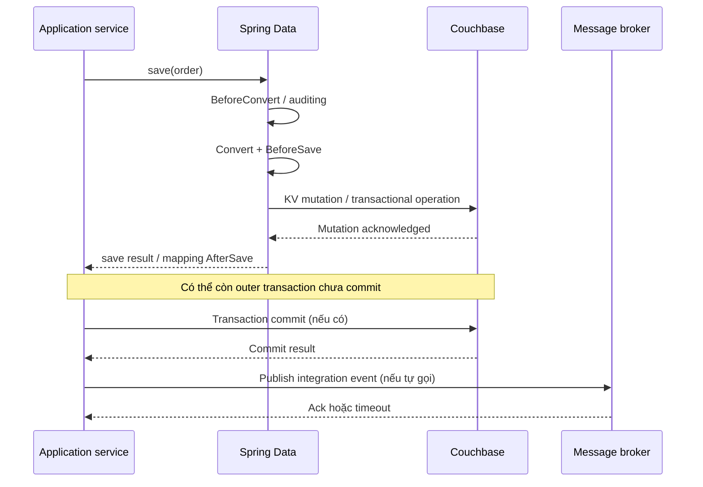
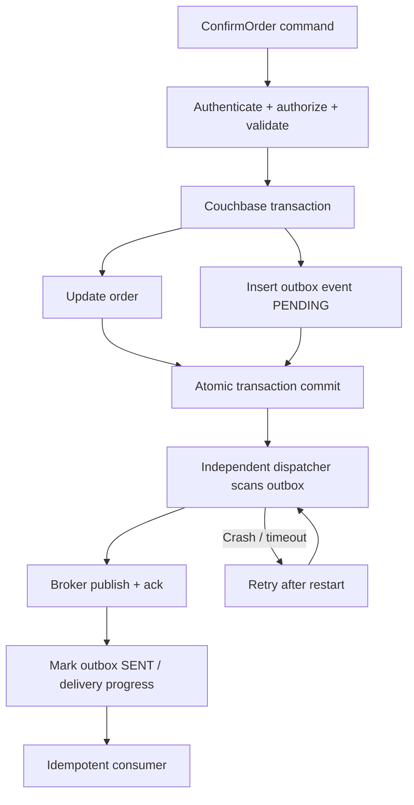
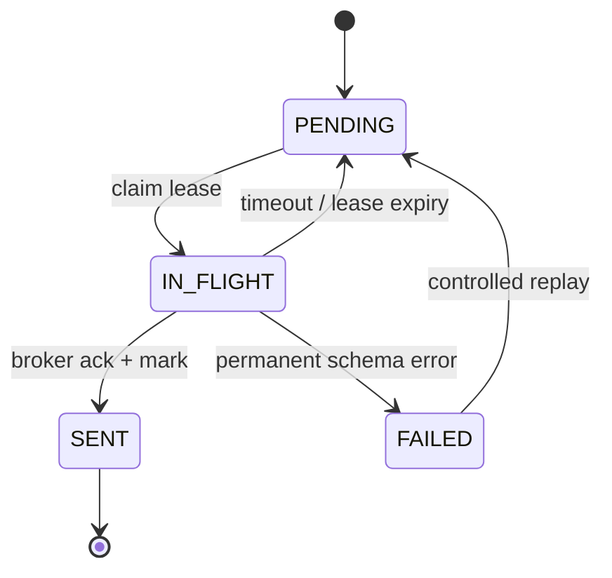

# Sự kiện nghiệp vụ, sự kiện lưu trữ và độ tin cậy sau commit trong Spring Data Couchbase

Trong ứng dụng đặt hàng, có ba phát biểu nghe gần giống nhưng mang ý nghĩa hoàn toàn khác:

- **“Đơn hàng đã được xác nhận”**: một **sự kiện nghiệp vụ** — hành động hợp lệ đã chuyển aggregate sang trạng thái mới.
- **“Spring Data vừa lưu một entity”**: một **sự kiện vòng đời lưu trữ** — framework quan sát bước xử lý entity trong pipeline persistence.
- **“Một thông điệp xác nhận đã được giao cho hệ thống khác”**: kết quả của **giao tiếp liên hệ thống** — cần cơ chế commit, retry, ack và chống xử lý trùng.

Một listener `onAfterSave(...)` chạy thành công **không đủ** để khẳng định transaction nhiều document đã commit, càng không chứng minh Kafka/RabbitMQ/webhook đã nhận message. Ngược lại, nếu Couchbase đã commit rồi process bị kill trước khi gửi thông báo, dữ liệu và message có thể lệch nhau nếu không có thiết kế phục hồi.

Bài thuộc chương **Vòng đời và auditing** của module `SPRING_DATA_COUCHBASE`. Chúng ta sẽ phân biệt **domain events**, **Spring Data Couchbase mapping events/entity callbacks**, **Spring application events**, **transaction-bound events** và **durable outbox**; liên hệ đến `CouchbaseRepository`, `CouchbaseTemplate`, bucket/scope/collection, SQL++, CAS, TTL, auditing, transaction SDK và reactive API. Mục tiêu là thiết kế hành vi **đúng sau commit** và có thể kiểm chứng khi gặp crash, timeout, retry và concurrency.

## 1. Bốn loại “sự kiện” cần gọi đúng tên

| Loại | Ví dụ | Ai phát sinh? | Nó tự bảo đảm gì? |
| --- | --- | --- | --- |
| **Domain/business event** | `OrderConfirmed`, `PaymentAuthorized` | Domain/service sau business transition | Biểu diễn một sự kiện có ý nghĩa nghiệp vụ; **chưa tự durable hoặc committed**. |
| **Persistence mapping event** | `BeforeConvertEvent`, `AfterSaveEvent` | Spring Data Couchbase | Quan sát bước trong entity lifecycle; **không phải outbox**. |
| **Application event** | `ApplicationEventPublisher.publishEvent(...)` | Spring application | Dispatch trong JVM theo cấu hình; **không phải message broker bền vững**. |
| **Integration event** | `order.confirmed.v1` gửi qua broker | Publisher/dispatcher | Tùy broker, ack, retry, dedup và consumer; **không tự atomic với Couchbase**. |

Cùng một business command có thể tạo tất cả bốn loại, nhưng không được đồng nhất chúng.

Ví dụ service xác nhận đơn hàng:

```text
Command: ConfirmOrder(orderId, actorId, commandId)
    |
    |-- kiểm tra quyền và domain rule
    |-- thay trạng thái: NEW -> CONFIRMED
    |-- lưu order vào Couchbase
    |      |-- Spring Data mapping lifecycle
    |      |-- server mutation / transaction commit
    |
    |-- ghi ý định phát OrderConfirmed vào durable outbox
    |-- dispatcher gửi message từ outbox
    |-- consumer dedupe rồi xử lý
```

Đường ghi `orders.save(order)` **không tự sinh** một `OrderConfirmed` đúng ngữ nghĩa: một save vì migration, cập nhật địa chỉ hoặc sửa metadata đều có thể chạm cùng entity mà không phải xác nhận đơn.

## 2. Các mốc thời gian trong một lệnh ghi



Sơ đồ chỉ là **khái niệm**, không áp đặt một thứ tự callback tuyệt đối cho mọi release. Với Couchbase transaction, thao tác bên trong có thể được **staged**; commit logic và unstaging diễn ra theo protocol của Couchbase. Một callback sau thao tác entity không thể được đồng nhất với mốc **commit toàn cục** của transaction.

Bốn mốc cần tách:

1. **Callback ran:** handler đã được gọi trong JVM.
2. **Mutation acknowledged:** một thao tác persistence được xác nhận theo API đó.
3. **Transaction committed:** toàn bộ nhóm transaction đạt commit point.
4. **Integration event delivered/processed:** broker ack và consumer đã xử lý theo contract.

Không nhảy từ mốc 1 thẳng sang mốc 4.

## 3. Entity, auditing và CAS mẫu

Giả sử order nằm ở:

```text
bucket: shop
scope: commerce
collection: orders

outbox:
shop.operations.outbox_events
```

Entity Java:

```java
package example.shop.order;

import java.time.Instant;

import org.springframework.data.annotation.CreatedBy;
import org.springframework.data.annotation.CreatedDate;
import org.springframework.data.annotation.Id;
import org.springframework.data.annotation.LastModifiedBy;
import org.springframework.data.annotation.LastModifiedDate;
import org.springframework.data.annotation.Version;
import org.springframework.data.couchbase.core.mapping.Document;
import org.springframework.data.couchbase.repository.Collection;
import org.springframework.data.couchbase.repository.Scope;

@Document
@Scope("commerce")
@Collection("orders")
public class OrderDocument {

    @Id
    private String id;

    private String tenantId;
    private String status;

    // Theo tài liệu transaction Couchbase: dùng @Version Long.
    @Version
    private Long version;

    @CreatedDate
    private Instant createdAt;

    @LastModifiedDate
    private Instant lastModifiedAt;

    @CreatedBy
    private String createdBy;

    @LastModifiedBy
    private String lastModifiedBy;

    public OrderDocument() {}

    public OrderDocument(
            String id, String tenantId, String status) {
        this.id = id;
        this.tenantId = tenantId;
        this.status = status;
    }

    public String getId() { return id; }
    public String getTenantId() { return tenantId; }
    public String getStatus() { return status; }
    public void setStatus(String value) { status = value; }

    public Long getVersion() { return version; }
    public Instant getCreatedAt() { return createdAt; }
    public Instant getLastModifiedAt() { return lastModifiedAt; }
    public String getCreatedBy() { return createdBy; }
    public String getLastModifiedBy() { return lastModifiedBy; }
}
```

Repository:

```java
package example.shop.order;

import org.springframework.data.couchbase.repository.CouchbaseRepository;

public interface OrderRepository
        extends CouchbaseRepository<OrderDocument, String> {
}
```

**Vì sao chọn `Long`?** Tài liệu **Spring Data Couchbase Transactions** yêu cầu entity có `@Version Long` để giữ CAS. Cơ chế state detection của Spring Data dùng `null` cho một wrapper version mới; nếu dùng primitive `long` trong ví dụ không-transaction, thường dùng `0L` làm sentinel. **Không diễn giải CAS như revision 1, 2, 3**.

Auditing có thể được bật bằng:

```java
@Configuration
@EnableCouchbaseAuditing(auditorAwareRef = "securityAuditor")
public class OrderAuditingConfiguration {
}
```

Ví dụ annotation trên giả định các import/bean tương ứng có sẵn. `@Version`, `@CreatedDate`, `@CreatedBy` không tự authorize user hay tạo business event. Auditing là metadata của save; `status=CONFIRMED` cần domain rule riêng.

## 4. Domain event phải được định nghĩa từ business transition

Một domain event nên có **ý nghĩa nghiệp vụ**, không chỉ nói “đã gọi save”.

```java
package example.shop.domain;

import java.time.Instant;

public record OrderConfirmed(
    String eventId,
    String commandId,
    String orderId,
    String tenantId,
    String actorId,
    Instant occurredAt,
    String schemaVersion
) {}
```

Các trường:

- `eventId`: định danh duy nhất phục vụ dedup.
- `commandId`: định danh command để xử lý retry/idempotency.
- `orderId`, `tenantId`: resource và partition của nghiệp vụ.
- `actorId`: danh tính đã được xác thực hoặc job/service identity đáng tin.
- `occurredAt`: thời điểm nghiệp vụ theo contract; **không tự mặc định là commit time của Couchbase**.
- `schemaVersion`: version payload event, **không phải CAS**.

Nếu client gửi `actorId` trong request body mà service tin luôn, event dễ bị giả mạo. Lấy actor từ security/trusted job context, kiểm tra quyền với tenant/document **trước** khi chuyển trạng thái.

### Quy tắc phát sinh

```java
// Trong domain service đã xác thực và load entity có CAS:
if (!"NEW".equals(order.getStatus())) {
    throw new IllegalStateException(
        "Only NEW orders may be confirmed"
    );
}

order.setStatus("CONFIRMED");

// Từ đây có thể tạo OrderConfirmed như một ý định
// nghiệp vụ, nhưng chưa được phép khẳng định đã commit.
```

Một `repository.save(order)` vì đổi tên khách hàng hoặc refresh schema **không nên mặc nhiên tạo `OrderConfirmed`**.

## 5. Persistence events của Spring Data Couchbase

Javadoc `org.springframework.data.couchbase.core.mapping.event` có các lớp:

| Hook/event | Vai trò |
| --- | --- |
| `BeforeConvertEvent<E>` | Trước khi entity được convert sang biểu diễn lưu trữ. |
| `BeforeSaveEvent<E>` | Trước bước lưu dữ liệu đã convert. |
| `AfterSaveEvent<E>` | Theo lifecycle sau thao tác lưu entity. |
| `BeforeDeleteEvent<E>` | Trước thao tác xóa qua mapping lifecycle. |
| `AfterDeleteEvent<E>` | Theo lifecycle sau thao tác xóa. |
| `BeforeConvertCallback<T>` | Callback đồng bộ trước convert. |
| `AfterConvertCallback<T>` | Callback đồng bộ sau materialize khi đọc. |
| `ReactiveBeforeConvertCallback<T>` | Callback reactive trước convert. |
| `ReactiveAfterConvertCallback<T>` | Callback reactive sau đọc/materialize. |

Đây là **sự kiện kỹ thuật liên quan đến persistence**, không tự có đủ bối cảnh: “ai đã được quyền xác nhận”, “command ID nào”, “trạng thái trước/sau” hoặc “có external side effect nào đã được giao”.

### Ví dụ listener Couchbase

```java
package example.shop.observability;

import org.springframework.stereotype.Component;
import org.springframework.data.couchbase.core.mapping.CouchbaseDocument;
import org.springframework.data.couchbase.core.mapping.event.AbstractCouchbaseEventListener;

@Component
public class OrderPersistenceLogger
        extends AbstractCouchbaseEventListener<OrderDocument> {

    @Override
    public void onAfterSave(
            OrderDocument order,
            CouchbaseDocument document) {

        // Chỉ metrics/logging kỹ thuật, không gửi email.
        // Không coi đây là durable post-commit hook.
    }
}
```

Đây là ví dụ tích hợp `AbstractCouchbaseEventListener<E>` theo chữ ký Javadoc. Class cần import `OrderDocument` đúng package trong ứng dụng. Không đặt broker publish, payment hoặc gửi webhook ở listener này nếu yêu cầu không mất/không lặp event.

**Lưu ý:** async event multicaster hoặc thứ tự callback có thể thay đổi hành vi observability/lỗi. Cần kiểm tra cấu hình Spring đang dùng; không xem tên `AfterSave` là bảo đảm transaction commit.

## 6. Vì sao AfterSave không phải AFTER_COMMIT?

Một transaction có thể ghi nhiều document:

```text
order::1001        status=CONFIRMED
stock::sku-42      reserved=-1
outbox::event-99   PENDING
```

Khi ghi `order` bên trong transaction, pipeline entity có thể đạt pha `AfterSave` trong lúc thao tác `stock` sau đó còn có thể lỗi. **Outer transaction có thể rollback**.

Một code như:

```java
@Override
public void onAfterSave(
        OrderDocument entity, CouchbaseDocument document) {

    // Nguy hiểm:
    mailSender.sendConfirmation(entity.getId());
}
```

có nhiều lỗi:

1. Transaction sau đó có thể rollback; email đã gửi không rollback.
2. Transaction có thể retry và listener chạy lại.
3. Network timeout không rõ email/broker có thực nhận không.
4. Listener có thể chạy vì một save không phải business confirmation.
5. Direct SDK hoặc SQL++ DML có thể bypass listener.
6. Nếu listener ném exception sau khi DB đã commit, caller có thể nhận lỗi dù document đã thay đổi.

**Thay thế:** tách **ý định sự kiện** ra khỏi mapping lifecycle và lưu nó bền vững, cùng transaction với thay đổi aggregate khi cần.

## 7. EntityCallback khác ApplicationEvent ra sao?

Spring Data Commons hỗ trợ `EntityCallback` — hook có khả năng tác động vào entity theo các pha xác định. Application events lại được phát qua Spring event infrastructure.

| Thuộc tính | EntityCallback | ApplicationEvent |
| --- | --- | --- |
| Mục đích | Mapping, validation/normalization, auditing | Thông báo/quan sát event trong JVM |
| Input | Entity/collection/context theo callback | Event object do publisher phát |
| Thứ tự | Có thể áp dụng `Ordered`/`@Order` | Theo event multicaster/listeners |
| Reactive | Có callback reactive trả Publisher | Spring application events không tự bảo toàn Reactor Context của mọi đường |
| Commit | Không tự bảo đảm transaction commit | `@EventListener` không tự gắn commit |
| Durability | Không | Không; phát event trong JVM không phải outbox |

Vì thế, logic đặt trong `BeforeConvertCallback` nên là xử lý dữ liệu phục vụ persistence: chuẩn hóa, mapping, audit metadata theo chính sách, kiểm tra invariant nhẹ. Không dùng callback này làm **event bus đáng tin cậy**.

### Auditing callbacks

`@CreatedDate`/`@LastModifiedDate` và `@CreatedBy`/`@LastModifiedBy` có thể được điền bởi auditing callback của Spring Data Couchbase. Một callback auditing được gọi **trước khi mutation thành công** không chứng minh document đã commit. CAS failure hoặc rollback có thể khiến object JVM có timestamp mới nhưng JSON trên server giữ giá trị cũ.

## 8. @DomainEvents của Spring Data Commons có giải quyết durability không?

Spring Data Commons có cơ chế **`@DomainEvents` và `@AfterDomainEventPublication`** trên aggregate roots được repository quản lý. Nó giúp publish domain events dưới dạng **Spring application events** khi repository thao tác trên aggregate theo những method hỗ trợ.

Ví dụ ý tưởng:

```java
@DomainEvents
java.util.Collection<Object> domainEvents() {
    return pendingDomainEvents;
}

@AfterDomainEventPublication
void clearDomainEvents() {
    pendingDomainEvents.clear();
}
```

**Giới hạn cần hiểu:**

- Tính năng phụ thuộc repository pathway/method và store/release thực tế; cần test với Couchbase đang dùng.
- Nó không tự chạy cho SDK `collection.upsert` hoặc SQL++ DML trực tiếp.
- “AfterDomainEventPublication” nói về **đã publish Spring event**, **không** có nghĩa broker ack, cũng không tự chứng minh Couchbase commit.
- Nếu event còn ở bộ nhớ JVM rồi process crash trước khi broker nhận, không có record bền vững để replay trừ khi bạn thiết kế riêng.
- Với aggregate bất biến/copy, collection events và lifecycle state cần kiểm tra; không tự cho rằng mọi `deleteById` có object để phát domain event.

Có thể dùng `@DomainEvents` cho tương tác nội bộ mức best-effort, nhưng **không lấy nó thay durable outbox** khi tích hợp liên hệ thống yêu cầu không mất sự kiện.

## 9. Spring @EventListener: thuận tiện nhưng không phải thông điệp durable

Ví dụ:

```java
@Component
public class OrderAnalyticsListener {

    @EventListener
    public void on(OrderConfirmed event) {
        // Update in-memory metrics/cache hint, best-effort.
    }
}
```

Khi một service gọi:

```java
applicationEventPublisher.publishEvent(event);
```

Spring dispatch event trong application. Với cấu hình mặc định, listener có thể chạy đồng bộ; nếu event multicaster hoặc annotation async được cấu hình khác, cách dispatch có thể khác. Trong cả hai trường hợp:

- JVM có thể crash sau save nhưng trước publish.
- Event đã publish trong JVM nhưng broker/network có thể lỗi.
- Nếu publish trước commit, consumer có thể thấy event khi DB còn chưa commit.
- Nếu publish sau commit, process có thể crash giữa hai thao tác.

**Không có một transaction ACID chung tự nhiên giữa Couchbase và broker chỉ vì cả hai đều do Spring quản lý.**

## 10. @TransactionalEventListener(AFTER_COMMIT): dùng đúng phạm vi

Spring Framework hỗ trợ:

```java
import org.springframework.context.event.EventListener;
import org.springframework.stereotype.Component;
import org.springframework.transaction.event.TransactionalEventListener;
import org.springframework.transaction.event.TransactionPhase;

@Component
public class PostCommitMetrics {

    @TransactionalEventListener(
        phase = TransactionPhase.AFTER_COMMIT
    )
    public void afterCommit(OrderConfirmed event) {
        // Best-effort metrics hoặc cache invalidation.
        // KHÔNG mặc định durable external publishing.
    }
}
```

`@TransactionalEventListener` mặc định dùng `AFTER_COMMIT`; ngoài ra có `BEFORE_COMMIT`, `AFTER_ROLLBACK`, `AFTER_COMPLETION`.

**Hai điều kiện tối quan trọng:**

1. Listener cần **transaction được Spring quản lý đang hoạt động tại lúc publish event**. Nếu không có transaction, mặc định listener **không được gọi** vì `fallbackExecution=false`.
2. Với reactive transaction, Spring Framework 6.1+ hỗ trợ transaction-bound event khi **transaction context được đưa vào event source** theo `TransactionalEventPublisher`; không đọc ThreadLocal của reactive transaction như imperative.

`fallbackExecution=true` có thể khiến listener chạy khi không có transaction, **nhưng khi đó không tồn tại mốc commit nào để bảo đảm “after commit”**.

### Không gán @Transactional lên service rồi mặc định nó dùng Couchbase

Một ứng dụng có nhiều transaction manager (SQL/RDBMS và Couchbase) có thể chọn nhầm. Cần xác định `CouchbaseTransactionManager`/transaction operator đúng phiên bản và transaction resources mà repository đang tham gia. Nếu transaction của RDBMS commit nhưng Couchbase không nằm trong đó, `AFTER_COMMIT` của transaction SQL **không chứng minh order Couchbase đã commit**.

### Cẩn trọng ghi DB từ AFTER_COMMIT

Tài liệu Spring Framework cảnh báo: sau commit, transaction resources có thể vẫn accessible, nhưng các thao tác data-access mới trong callback có thể tham gia ngữ cảnh transaction đã hoàn thành và **không commit** theo ý muốn. Nếu thật sự cần một ghi mới sau commit, dùng một transaction riêng với cấu hình phù hợp, nhưng đó vẫn không bảo đảm external delivery durable nếu process chết. **Outbox là lựa chọn đáng tin cậy hơn** cho integration events.

## 11. Spring Data Couchbase transaction khác Java SDK transaction trực tiếp

Spring Data Couchbase có tài liệu transaction hỗ trợ:

- `@Transactional` qua `CouchbaseTransactionManager` được cấu hình phù hợp.
- `CouchbaseTransactionalOperator` cho một số đường reactive.
- Các operations/repository hỗ trợ bên trong transaction lambda của Couchbase SDK.

Những cơ chế này có **ngữ nghĩa và cách tích hợp khác nhau**. Ví dụ:

```java
@Service
public class OrderTransactionalService {

    private final OrderRepository orders;

    public OrderTransactionalService(OrderRepository orders) {
        this.orders = orders;
    }

    @Transactional
    public OrderDocument updateStatus(String id) {
        OrderDocument current =
            orders.findById(id).orElseThrow();
        current.setStatus("CONFIRMED");
        return orders.save(current);
    }
}
```

Đây là **khung**; cần `@EnableTransactionManagement`, Spring-managed service proxy, Couchbase transaction manager, entity `@Version Long` và dependency đúng. Với một số phiên bản, một số method/repository không thuộc tập operations được hỗ trợ; đừng đánh đồng mọi method query với transaction.

### Spring AOP self-invocation

Khi một method cùng class gọi `this.updateStatus(...)`, transaction interceptor proxy có thể không được áp dụng. Do đó **annotation xuất hiện trong source không chứng minh một transaction đã thực sự bắt đầu**. Kiểm tra bằng integration test và transaction manager đang dùng.

### Retry transaction

Tài liệu Couchbase nhấn mạnh body của transaction có thể được **thực thi lại**. Vì vậy cần code idempotent, không gửi HTTP/email/broker bên trong body và không sinh command/event ID khác ở mỗi lần attempt.

## 12. SDK transaction không tự kích hoạt @TransactionalEventListener

Một lệnh:

```java
cluster.transactions().run(ctx -> {
    // ctx.get, ctx.replace, ctx.insert ...
});
```

dùng **transaction API của Couchbase SDK**. Nếu không có một transaction synchronization của Spring tương ứng, listener Spring `@TransactionalEventListener` **không tự được gọi** chỉ vì SDK đã commit.

Ngay cả khi thao tác Spring Data entity được hỗ trợ bên trong SDK transaction lambda, **không tự giả định** một Spring transaction manager đã được mở. Phải phân biệt transaction của SDK với transaction-bound event lifecycle của Spring.

Nếu cần xử lý chắc chắn sau commit của SDK transaction:

1. Transaction tạo **outbox document** cùng với aggregate mutation.
2. Sau commit, một worker độc lập quét outbox và phát message.
3. Worker retry, consumer dedupe và có monitoring/reconciliation.

Đừng kỳ vọng event phát trong JVM sau `transactions().run(...)` sẽ tự phục hồi nếu process chết ngay sau commit.

## 13. “Sau khi commit” vẫn có các trạng thái khác nhau

Couchbase distributed transaction có commit point và bước **unstaging** document. Tài liệu SDK phân biệt kết quả:

| Kết quả | Ý nghĩa |
| --- | --- |
| Transaction thành công, `unstagingComplete=true` | Commit point đã đạt và unstaging của các document đã hoàn tất. |
| Transaction thành công, `unstagingComplete=false` | Đã commit, nhưng cleanup/unstaging có thể tiếp tục; một số non-transactional reader chưa thấy mọi document ngay. |
| `TransactionFailedException` hoặc `TransactionExpiredException` | Không đạt commit point; protocol xử lý rollback. |
| `TransactionCommitAmbiguousException` | Client **không biết chắc** transaction đã đạt commit point hay chưa. |

**Quan trọng:** không đánh đồng “SDK trả result thành công” với “mọi non-transactional reader đã thấy hoàn toàn”, và càng không coi `TransactionCommitAmbiguousException` là chắc chắn rollback.

### Hậu quả cho event publisher

Nếu transaction commit nhưng process crash trước khi gửi broker, event chỉ an toàn nếu **outbox record cũng đã commit**. Nếu commit ambiguous, dùng **commandId/outboxId deterministic** và reconciliation thay vì retry tạo sự kiện mới không kiểm soát.

## 14. Mục tiêu tin cậy: phân biệt những bảo đảm thường bị nhầm

| Tuyên bố | Có thể suy ra chỉ từ callback/auditor không? |
| --- | --- |
| Handler đã chạy | Có thể, qua log/test trực tiếp. |
| Document đã được mutate | Không phải lúc nào cũng; cần kết quả ghi. |
| Nhiều document commit atomically | Không; phải có transaction phù hợp. |
| Broker đã nhận message | Không; cần broker ack. |
| Consumer đã thực hiện side effect | Không; cần processing ack/idempotency. |
| Event sẽ không mất khi process crash | Không; cần durable record, ví dụ outbox. |
| Event sẽ không bao giờ bị xử lý hai lần | Không; cần dedupe/idempotency end-to-end. |
| Actor trong event có quyền với tenant | Không; cần xác thực và authorization trước command. |

“Exactly once” end-to-end là một claim rất mạnh. Một giải pháp phổ biến thực tế là **atomic aggregate+outbox** cùng với **at-least-once publishing** và **idempotent consumption**. Người dùng có thể nhận message trùng về mặt transport mà business side effect vẫn được áp dụng một lần theo event ID.

## 15. Transactional outbox: nguyên tắc thiết kế

Thay vì:

```text
save order -------- OK
send broker ------- crash
=> order confirmed nhưng message mất
```

dùng:



**Điểm cốt lõi:** order và outbox ở cùng hệ transaction được hỗ trợ, nên không có trường hợp transaction thành công mà chỉ commit một trong hai.

Điều này **không** tự bảo đảm external message exactly once: worker có thể gửi rồi crash trước khi đánh dấu SENT. Vì vậy `eventId` ổn định và consumer dedupe là bắt buộc nếu side effect không được lặp.

## 16. Thiết kế outbox document

Ví dụ outbox JSON:

```json
{
  "eventId": "evt::order-confirmed::cmd-7b32",
  "commandId": "cmd-7b32",
  "aggregateType": "Order",
  "aggregateId": "order::1001",
  "tenantId": "tenant-acme",
  "eventType": "order.confirmed",
  "eventVersion": 1,
  "actorId": "user:7841",
  "occurredAt": "2026-11-25T03:00:00Z",
  "state": "PENDING",
  "attempts": 0,
  "nextAttemptAt": "2026-11-25T03:00:00Z"
}
```

Các trường quan trọng:

- `eventId` và document key ổn định qua retry của **cùng command**.
- `commandId` dùng cho idempotency nghiệp vụ và đối chiếu kết quả ambiguous.
- `aggregateId/tenantId` phục vụ partitioning và authorization của consumer.
- `eventVersion` version schema payload; không nhầm với CAS.
- `state`, `attempts`, `nextAttemptAt` cho dispatcher/backoff.
- `actorId` từ principal/service identity **đã xác thực**, không lấy từ body client.
- `occurredAt` là domain/event time theo hợp đồng; **không tự khẳng định là exact commit time**.

Một số hệ thống lưu cả payload sự kiện. Khi đó phải kiểm soát kích thước, schema version, retention, dữ liệu cá nhân, truy cập và mã hóa.

## 17. SDK transaction: ghi order và outbox cùng commit

Ví dụ Java SDK, với actor và command ID đã được service kiểm tra:

```java
import com.couchbase.client.java.Cluster;
import com.couchbase.client.java.Collection;
import com.couchbase.client.java.json.JsonObject;

import java.time.Instant;

// Giả định cluster, actorId và commandId đến từ trusted service.
Collection orders = cluster.bucket("shop")
    .scope("commerce")
    .collection("orders");

Collection outbox = cluster.bucket("shop")
    .scope("operations")
    .collection("outbox_events");

String orderId = "order::1001";
String commandId = "cmd-7b32";
String actorId = "user:7841";
Instant commandAt = Instant.parse("2026-11-25T03:00:00Z");
String eventId = "evt::order-confirmed::" + commandId;

var result = cluster.transactions().run(ctx -> {
    var loaded = ctx.get(orders, orderId);
    JsonObject body = loaded.contentAs(JsonObject.class);

    if (!"tenant-acme".equals(
            body.getString("tenantId"))) {
        throw new SecurityException("Tenant mismatch");
    }
    if (!"NEW".equals(body.getString("status"))) {
        throw new IllegalStateException("Order not NEW");
    }

    body.put("status", "CONFIRMED");
    body.put("lastModifiedBy", actorId);
    body.put("lastModifiedAt", commandAt.toString());

    ctx.replace(loaded, body);

    JsonObject event = JsonObject.create()
        .put("eventId", eventId)
        .put("commandId", commandId)
        .put("aggregateId", orderId)
        .put("tenantId", "tenant-acme")
        .put("eventType", "order.confirmed")
        .put("eventVersion", 1)
        .put("actorId", actorId)
        .put("occurredAt", commandAt.toString())
        .put("state", "PENDING")
        .put("attempts", 0);

    ctx.insert(outbox, "outbox::" + eventId, event);
});
```

Đây là **mẫu transaction**, không phải một class độc lập để chạy: cần cluster, credentials, permissions, CAS/concurrency, domain authorization và error handling. SDK trực tiếp **không chạy Spring Data auditing**; metadata modified được ghi tường minh vào JSON. Các `createdAt/createdBy` gốc vẫn được giữ.

### Idempotency và duplicate commands

Nếu client gửi cùng `commandId` hai lần, transaction sau có thể thấy trạng thái order đã `CONFIRMED` hoặc key outbox đã có. **Không tạo một `eventId` ngẫu nhiên mới ở mỗi retry**. Service phải định nghĩa: command lặp nhưng cùng kết quả có thể trả kết quả cũ; command khác trên trạng thái không hợp lệ phải bị từ chối. Có thể cần một command-result document riêng nếu cần phân biệt các trường hợp.

### Điều tuyệt đối tránh bên trong transaction

```java
cluster.transactions().run(ctx -> {
    // Không gửi email/webhook/broker ở đây!
    // Transaction lambda có thể chạy lại.
});
```

Nếu side effect chạy ở attempt bị rollback, không có cơ chế nào tự thu hồi nó khỏi hệ thống ngoài.

## 18. Outbox dispatcher: giao hàng ít nhất một lần

Một worker đọc outbox `PENDING`, gửi message và đánh dấu đã gửi:

```text
scan pending events
    -> claim event (lease token + CAS)
    -> send to broker with eventId as message key
    -> await broker ack
    -> mark SENT using lease/CAS
    -> retry on transient error/backoff
```

**Không đánh dấu SENT trước khi broker ack.** Nếu làm vậy, crash trước send tạo ra message bị mất vĩnh viễn.

Ngược lại, đánh dấu SENT **sau** ack có thể phát lại event sau crash; đây là lý do consumer phải idempotent.

### Claim với CAS khi nhiều worker

Hai dispatcher có thể cùng đọc outbox. Dùng CAS claim/lease hoặc cơ chế điều phối tương đương để chỉ một worker giữ lease ở một thời điểm. Khi lease hết hạn, worker khác có thể tiếp nhận; điều đó **không loại bỏ hoàn toàn duplicate** nếu worker đầu vẫn có network call đang xử lý.

Trong Couchbase, nên có index cho `state/nextAttemptAt` phục vụ SQL++ query; nhưng secondary index có thể lag. Tránh suy một query rỗng đồng nghĩa không còn PENDING. Có thể dùng consistency/scan phù hợp khi cần hoặc thiết kế poll/recovery không phụ thuộc một lần query.

### Retry và dead-letter

- Network timeout/5xx: retry có backoff+jitter theo policy.
- Payload invalid hoặc schema unsupported: đánh dấu FAILED/DLQ, cần vận hành xử lý.
- Broker ack không rõ: retry cùng `eventId` và dựa vào consumer dedupe.
- Poison event: không retry vô hạn khiến worker starvation.
- Có alert theo **tuổi outbox PENDING**, số attempts và tỉ lệ lỗi.



## 19. Consumer idempotency: một event có thể đến nhiều lần

Giả sử dispatcher gửi `evt::order-confirmed::cmd-7b32`; broker nhận và trả ack, nhưng dispatcher chết trước khi đánh dấu outbox `SENT`. Sau khi restart, cùng event có thể được gửi thêm lần nữa.

Consumer **không** được giả định mỗi `eventId` chỉ xuất hiện đúng một lần. Nó cần một quy tắc xử lý trùng.

### Transactional inbox/processed-event record

Nếu consumer cập nhật dữ liệu trên Couchbase, có thể dùng một transaction để **đánh dấu event đã xử lý và thay đổi business state cùng nhau**:

```text
receive(eventId, payload)
    |
    +-- kiểm tra schema/tenant/signature/authorization
    +-- trong transaction:
    |      insert processed::eventId (insert-only)
    |      update projection / inventory / invoice
    +-- commit
    |
    +-- broker ack sau commit
```

Nếu `processed::eventId` đã tồn tại, xử lý duplicate theo policy (đã xử lý thành công thì ack, không áp side effect lần nữa). **Không chỉ bắt mọi lỗi insert rồi giả định đó là duplicate**: lỗi RBAC, timeout hay transaction ambiguous cần được phân loại/đối soát.

### Với dịch vụ bên ngoài Couchbase

Nếu consumer gọi payment provider hoặc email service, Couchbase transaction **không thể tự rollback** một HTTP side effect. Cân nhắc:

- Idempotency key của provider bằng `eventId`/`commandId` ổn định.
- Lưu một state machine `NOT_STARTED → REQUESTED → CONFIRMED`.
- Reconcile provider response khi timeout ambiguous.
- Thiết kế các compensating actions nếu nghiệp vụ cho phép.

**Cam kết hợp lý:** *at-least-once transport + idempotent business effect*, không tùy tiện tuyên bố exactly once end-to-end.

## 20. Ma trận crash: dữ liệu nào còn lại?

| Thời điểm sự cố | Order | Outbox | Broker/consumer | Cách phục hồi |
| --- | --- | --- | --- | --- |
| Trước khi transaction bắt đầu | Chưa đổi | Chưa có event | Chưa nhận | Retry command với cùng ID. |
| Một thao tác trong transaction lỗi trước commit | Rollback theo protocol | Rollback theo protocol | Chưa nên được gửi | Sửa nguyên nhân, retry có kiểm soát. |
| Process chết sau khi ghi order **trong transaction**, trước commit | Không được coi là đã commit | Không được coi là đã commit | Không gửi | Transaction recovery; inspect state. |
| Transaction đạt commit point, process chết trước dispatcher | Đã commit | `PENDING` được commit | Chưa gửi | Dispatcher quét outbox khi restart. |
| Dispatcher publish thất bại trước broker ack | Đã commit | `PENDING/IN_FLIGHT` | Có thể chưa nhận | Retry/backoff. |
| Broker nhận rồi ack bị mất | Đã commit | Chưa chắc đã `SENT` | Có thể đã nhận | Retry **cùng eventId**; consumer dedupe. |
| Broker ack, worker chết trước mark SENT | Đã commit | Còn pending/lease | Message đã tới broker | Retry, có khả năng duplicate. |
| Mark SENT **trước** broker send | Đã commit | Sai trạng thái SENT | Message có thể mất | **Thiết kế sai**; tránh hoàn toàn. |
| Consumer xử lý xong, ack gửi lại broker thất bại | Đã commit | SENT hoặc đang retry | Event có thể phát lại | Consumer dedup bằng eventId. |
| Commit trả ambiguous exception | **Không rõ từ góc nhìn client** | **Không rõ** | Không gửi mù | Reconcile theo commandId/outboxId. |

Ma trận này nói đến **tác động nghiệp vụ và khả năng quan sát**, không suy rằng mọi tài nguyên non-transactional lập tức thấy tất cả document sau commit point. Couchbase còn có bước **unstaging**; xem tài liệu transaction về `unstagingComplete()`.

## 21. TransactionCommitAmbiguousException: không coi là rollback

Trong môi trường phân tán, network có thể đứt đúng lúc commit. Couchbase SDK có `TransactionCommitAmbiguousException` để báo client không đủ thông tin xác định transaction đã đạt commit point hay chưa.

Cách xử lý cần khác:

```java
try {
    var outcome = cluster.transactions().run(ctx -> {
        // update order + insert deterministic outbox event
    });

    // Transaction đạt commit point.
    // Nếu cần non-transactional visibility tuyệt đối ngay,
    // cần xem outcome.unstagingComplete().
} catch (com.couchbase.client.java.transactions.error.TransactionCommitAmbiguousException ambiguous) {
    // Không mặc định rollback!
    // Reconcile orderId, commandId và outboxId;
    // retry theo idempotency policy.
    throw ambiguous;
}
```

Tên class exception cần đối chiếu với phiên bản Couchbase Java SDK đang dùng; code minh họa mục tiêu **phân loại lỗi**, không thay transaction recovery policy.

Nếu commandId được tạo ngẫu nhiên **sau** mỗi lần retry, có thể sinh hai outbox events dù cùng một yêu cầu. Vì vậy định danh idempotency phải được tạo/tái sử dụng **ngoài** transaction attempt và giữ ổn định qua retry của cùng command.

### Sau commit, có cần đợi unstagingComplete?

Phần lớn ứng dụng không cần block cho mọi non-transactional reader thấy tất cả ngay tại commit point; transaction-aware readers sẽ theo protocol. Nếu pipeline của bạn dùng direct KV/SQL++ read để lấy outbox ngay sau commit, phải hiểu khả năng chưa thấy document trong giai đoạn unstaging và thiết kế poll/retry. Không gọi một lần read rỗng là “message đã mất”.

## 22. Spring @TransactionalEventListener vẫn có ích ở đâu?

Nó phù hợp cho **phản ứng nội bộ best-effort khi một Spring-managed transaction commit**:

- Gửi tín hiệu metrics/observability.
- Yêu cầu refresh cache mà hệ thống có thể tự rebuild.
- Phát một signal đánh thức dispatcher — **outbox vẫn là source of truth**.
- Dọn state tạm trong ứng dụng có khả năng phục hồi.

Ví dụ:

```java
@Component
public class OutboxWakeupListener {

    private final OutboxPoller poller;

    public OutboxWakeupListener(OutboxPoller poller) {
        this.poller = poller;
    }

    @TransactionalEventListener(
        phase = TransactionPhase.AFTER_COMMIT
    )
    public void on(OrderConfirmed event) {
        poller.wakeUpBestEffort();
    }
}
```

`OutboxPoller` là interface/service **do ứng dụng tự định nghĩa**; `wakeUpBestEffort()` chỉ đánh thức worker, không là đường duy nhất để dispatch event. Nếu listener không chạy, polling định kỳ vẫn phải tiếp tục.

Khi Spring transaction không tồn tại (ví dụ SDK transaction trực tiếp hoặc method không qua proxy), listener mặc định không chạy. Không bật `fallbackExecution=true` rồi gọi đó là guarantee after-commit.

## 23. Reactive: context, subscription và transaction-bound events

Reactive Spring Data Couchbase dùng publisher:

```java
Mono<OrderDocument> saved =
    reactiveOrders.save(order);
```

Đoạn trên **chưa có subscription**, nên không có bằng chứng mutation/callback/transaction đã chạy. Sử dụng `StepVerifier` trong test hoặc trả publisher về WebFlux/worker để runtime consume.

### Reactive auditing khác event publication

- `@EnableReactiveCouchbaseAuditing` và `ReactiveAuditorAware<T>` cung cấp metadata actor.
- `ReactiveBeforeConvertCallback<T>`/`ReactiveAfterConvertCallback<T>` hoạt động trong entity lifecycle reactive.
- `ReactiveSecurityContextHolder` dùng Reactor context để cung cấp identity.
- **Không** có cơ chế nào trong ba thứ trên tự bảo đảm broker publish sau commit.

### Transaction-bound listener từ Spring Framework 6.1+

Với `ReactiveTransactionManager`, transaction context nằm trong **Reactor Context**, không nằm trong thread-local của imperative listener. Spring Framework 6.1+ có `TransactionalEventPublisher` hỗ trợ đưa transaction context vào event source để transaction-bound listener sử dụng.

Không làm:

```java
return reactiveOrders.save(order)
    .doOnNext(saved -> {
        // Sai lựa chọn nếu cần durable integration event:
        broker.send("order.confirmed", saved.getId());
    });
```

`doOnNext` có thể xảy ra trước boundary commit của reactive transaction bên ngoài, có thể chạy lại khi resubscribe và không bảo đảm broker ack/durable replay.

**Khuyến nghị:** trong reactive workflow cần bảo đảm order+event cùng commit, dùng transaction operator/SDK reactive transaction được hỗ trợ và **ghi outbox trong cùng transaction**. Sau đó một worker độc lập dispatch. Test cả subscription, rollback, commit ambiguous và duplicate.

## 24. Java SDK reactive transaction: không tự có Spring event synchronization

Một reactive SDK transaction cũng có thể trả `Mono<TransactionResult>`. Không tự giả định một Spring `@TransactionalEventListener` biết được transaction context SDK. Luồng triển khai ở mức thiết kế:

```text
Reactive SDK transaction publisher
  -> transaction context GET order
  -> validate tenant and business transition
  -> transaction context REPLACE order with modified audit fields
  -> transaction context INSERT deterministic outbox event
  -> commit as one transaction when publisher is subscribed
```

Khi triển khai, dùng đúng chữ ký Couchbase Reactive Transactions theo SDK version thực và nối `Mono`/`Flux` trong lambda; không gọi `block()` từ event loop. Đây là **luồng thiết kế**, không phải đoạn Java có thể biên dịch độc lập.

### Reactor retry không làm transaction exactly once

`retryWhen(...)` có thể resubscribe toàn bộ command; nếu commandId/eventId được tạo trong một `Mono.defer(...)` bằng random ID mỗi lần, retry có thể tạo **business event khác**. Tạo định danh ở trusted command boundary và dùng lại xuyên retry. Không giữ actor trong global mutable singleton.

## 25. Lifecycle khi xóa: AfterDelete cũng không phải event “đã xóa thành công” bền vững

Spring Data Couchbase có `BeforeDeleteEvent`/`AfterDeleteEvent`. Một lệnh delete có thể:

- Được thực hiện trong transaction rồi rollback.
- Bị gọi lại do retry.
- Được thực hiện trực tiếp qua SDK/SQL++ mà không có Spring listener.
- Diễn ra vì TTL trên server mà không đi qua JVM.

Vì vậy, nếu nghiệp vụ cần thông báo `OrderCancelled` hoặc `OrderDeleted`, service phải phát sinh event theo domain rule và ghi outbox trong transaction phù hợp.

Một lựa chọn là **soft delete**:

```json
{
  "status": "DELETED",
  "deletedAt": "2026-11-25T03:30:00Z",
  "deletedBy": "user:7841"
}
```

Hai field `deletedAt/By` là **domain metadata riêng**, không tự được Spring Data Couchbase điền chỉ vì có `AfterDeleteEvent`. Với hard delete, cần tombstone/event record nếu phải giữ lịch sử.

## 26. CAS, transaction và event idempotency giải quyết ba lỗi khác nhau

| Cơ chế | Phòng ngừa lỗi gì? | Không giải quyết |
| --- | --- | --- |
| **CAS / @Version** | Lost update trên cùng document khi dùng conditional mutation. | Giao message bền vững; transaction nhiều document. |
| **Couchbase transaction** | Nhóm mutations thuộc transaction commit/rollback nguyên tử theo protocol. | Exactly-once broker delivery; external side effects. |
| **Outbox** | Không mất ý định publish khi aggregate transaction đã commit. | Consumer nhận trùng; actor authorization. |
| **Consumer dedup/inbox** | Tránh áp business effect nhiều lần cho cùng event ID. | Event chưa bao giờ được tạo/commit. |
| **Auditing @CreatedBy/@LastModifiedBy** | Ghi actor và thời gian trong entity pipeline. | Domain event history hoặc transaction commit proof. |
| **Idempotent command ID** | Kiểm soát request/transaction retry trùng nhau. | Concurrency trên document nếu thiếu CAS/transaction. |

Ví dụ A và B cùng đọc CAS=X, cùng cố confirm order:

- CAS giúp một stale writer bị từ chối.
- Transaction giúp `order + outbox` không bị commit nửa chừng.
- Cùng `commandId` ổn định giúp retry không tạo event khác.
- Consumer dedup giúp hai lần broker delivery không tạo hai email/payment actions.

Mỗi tầng cần kiểm thử độc lập.

## 27. Dùng SQL++ để tìm outbox: consistency và index

Một dispatcher có thể dùng SQL++:

```sql
SELECT META(e).id AS documentId,
       e.eventId,
       e.aggregateId,
       e.tenantId,
       e.state,
       e.nextAttemptAt
FROM `shop`.`operations`.`outbox_events` AS e
WHERE e.state = "PENDING"
  AND e.nextAttemptAt <= $cutoff
LIMIT 100;
```

Đây là query **đọc**, không tạo broker event. Cần index phù hợp với `state/nextAttemptAt` và keyspace đúng. Trong Couchbase, Query Service có secondary-index consistency khác KV; poller phải chịu được index lag.

### Claim bằng CAS trước khi gửi

```java
var get = outboxCollection.get(outboxKey);
var state = get.contentAsObject();

if (!"PENDING".equals(state.getString("state"))) {
    return; // worker khác đã claim/xử lý
}

state.put("state", "IN_FLIGHT");
state.put("leaseOwner", workerId);
state.put("leaseExpiresAt", leaseUntilIso);

outboxCollection.replace(
    outboxKey, state,
    com.couchbase.client.java.kv.ReplaceOptions
        .replaceOptions().cas(get.cas())
);
```

Đây là **phần thân method minh họa**, cần `outboxCollection`/key/workerId/leaseUntilIso và policy kiểm tra lease hợp lệ. Trong thực tế, có thể cần dùng `mutateIn`, kiểm tra state/lease sau CAS conflict, giới hạn retries và mã hóa job ownership. Không phát message khi claim chưa thành công.

**Lưu ý race:** lease timeout không ngăn một worker cũ vẫn đang chờ broker ack; duplicate vẫn có thể xuất hiện. Thiết kế idempotent delivery là bước không thể bỏ.

### Khi outbox đã SENT

Chỉ đặt TTL/retention cho `SENT` theo policy. **Đừng tự động expire PENDING chưa gửi** chỉ vì chúng lâu ngày; như vậy có thể xóa ý định phát event vĩnh viễn. Với event thất bại vĩnh viễn, chuyển DLQ hoặc lưu riêng theo retention/compliance.

## 28. Security: actor, tenant và event payload

Auditing actor `createdBy`/`lastModifiedBy` không thay thế:

- Authentication của command caller.
- Authorization để đổi order của tenant đó.
- Kiểm tra document scope/bucket/collection.
- Quyền publisher gửi event topic/queue.
- Quyền consumer thực hiện side effect.

Một message chứa:

```json
{
  "eventId": "evt::order-confirmed::cmd-7b32",
  "tenantId": "tenant-acme",
  "actorId": "user:7841",
  "aggregateId": "order::1001"
}
```

chỉ là dữ liệu. Consumer phải xác minh nguồn gửi và schema/tenant contract; **không tin actorId từ message không xác thực như một bearer token quyền**.

### Không dùng event payload làm dump toàn bộ entity

Một message có đầy đủ địa chỉ, token, thẻ thanh toán, personal data có thể gây rủi ro bảo mật và retention. Chỉ phát những field consumer cần. Sử dụng schema version và cơ chế truy xuất có quyền nếu cần thêm dữ liệu.

### Nhiều tenant cùng collection name

`shop.tenant_acme.orders` và `shop.tenant_globex.orders` có thể cùng key `order::1001`. Event ID/aggregate reference cần phân biệt tenant/keyspace theo contract. Không dùng `orderId` trần làm idempotency key toàn hệ thống nếu ID có thể trùng giữa tenants.

## 29. Observability: giám sát commit, outbox và broker

Những metric có giá trị:

| Metric | Ý nghĩa |
| --- | --- |
| `order_command_total{result}` | Số command thành công/conflict/invalid theo domain. |
| `couchbase_transaction_ambiguous_total` | Commit ambiguous cần reconcile. |
| `outbox_pending_total` | Số event chưa được dispatch. |
| `outbox_oldest_pending_age_seconds` | Độ trễ ý định event lâu nhất. |
| `outbox_publish_attempts_total{result}` | Attempts, broker acks, timeouts. |
| `outbox_duplicate_dispatch_total` | Dấu hiệu retry/lease takeover. |
| `consumer_duplicate_event_total` | Số lần event được nhận lặp. |
| `consumer_processing_lag_seconds` | Độ trễ xử lý từ event time. |
| `cas_conflict_total{operation}` | Xung đột business command. |
| `audit_event_schema_errors_total` | Lỗi format/validation không thể dispatch. |

Tag metric theo nhóm tenant/operation ở mức không tạo cardinality vô hạn. `eventId`/`orderId` nên ở structured log/trace có retention phù hợp, **không** dùng làm label metric mỗi event.

### Correlation xuyên hệ thống

Đường command nên giữ:

```text
requestId
commandId
eventId
tenantId
actorId
aggregateId
traceId
transaction attempt/result
broker message key
consumer processing state
```

Không log JWT, password, secrets hoặc toàn bộ payload chứa PII.

## 30. Integration test: callback vs commit

Mục đích của test này là **chứng minh một callback sau lưu không đủ bảo đảm transaction thành công**.

Chuẩn bị:

- Spring Data Couchbase và Couchbase test server/collection thật.
- Spring transaction manager được cấu hình đúng.
- Một listener `AbstractCouchbaseEventListener<OrderDocument>` ghi nhận sự kiện bằng test recorder in-memory.
- Một command trong transaction ghi order, sau đó cố ý làm transaction thất bại.
- SDK KV để đọc trạng thái cuối.

Assertion:

1. Một số lifecycle callback có thể được gọi trong quá trình xử lý dù transaction rollback (tùy đường/version); **không** dùng số callback làm tiêu chuẩn commit.
2. Document trên server không phản ánh mutation bị rollback.
3. Không có **durable outbox event** cho command thất bại.
4. Không có broker message được gửi từ outbox.
5. Một notification đặt trong `AfterSave` sẽ lộ lỗi nếu test inject fake broker và ghi nhận call trước rollback.

**Không hardcode kỳ vọng số lần `onAfterSave` chính xác giữa các version**: điều đó không phải hợp đồng domain. Test cần chứng minh business state và outbox cuối cùng theo transaction semantics.

## 31. Integration test: @TransactionalEventListener có transaction và không có transaction

Test hai kịch bản:

| Kịch bản | Mặc định `AFTER_COMMIT, fallbackExecution=false` |
| --- | --- |
| Publish trong Spring-managed transaction commit thành công | Listener được gọi sau commit. |
| Publish trong Spring-managed transaction rollback | `AFTER_COMMIT` không chạy. |
| Publish khi không có Spring transaction | Listener **không chạy**. |
| Publish trong SDK transaction thuần không có Spring synchronization | Không tự gắn vào mốc commit SDK. |
| Bật `fallbackExecution=true` khi không transaction | Có thể chạy theo fallback, **không phải sau một commit**. |

Đảm bảo test thực sự chạy qua Spring AOP proxy, không gọi method `@Transactional` bằng `this.method()` rồi tưởng transaction hoạt động.

Với nhiều transaction managers, xác nhận manager được chọn là Couchbase chứ không phải RDBMS khác. Một listener AFTER_COMMIT theo RDBMS **không chứng minh** Couchbase mutation commit.

## 32. Integration test: order + outbox atomicity

Với transaction SDK hoặc Spring Data Couchbase transaction API phù hợp:

1. Gieo order `NEW`.
2. Chạy transaction confirm + insert outbox với deterministic `eventId`.
3. Assert commit thành công: order `CONFIRMED` và outbox `PENDING` cùng tồn tại.
4. Chạy một transaction khác cố ý fail sau thao tác order nhưng trước outbox insert.
5. Assert order không phản ánh mutation thất bại; outbox không có event của command lỗi.
6. Đọc bằng SDK KV theo **đúng scope/collection**, không chỉ qua cùng repository.
7. Với result `unstagingComplete=false` hoặc lỗi ambiguous, theo recovery strategy/timeout thay vì assert kết quả tức thời như đơn-document KV write.

### Khung test SDK oracle

```java
String outboxKey =
    "outbox::evt::order-confirmed::cmd-test-123";

var storedOrder = sdkCluster.bucket("shop")
    .scope("commerce")
    .collection("orders")
    .get(orderId)
    .contentAsObject();

var storedEvent = sdkCluster.bucket("shop")
    .scope("operations")
    .collection("outbox_events")
    .get(outboxKey)
    .contentAsObject();

assertEquals(
    "CONFIRMED",
    storedOrder.getString("status")
);
assertEquals(
    "PENDING",
    storedEvent.getString("state")
);
```

Đoạn code là **test fragment**, cần fixture, Couchbase test instance, JUnit static imports, cấu hình transaction và cleanup. Sau commit, chú ý thời điểm unstaging khi oracle dùng non-transactional SDK read.

## 33. Failure injection test: crash sau commit trước publish

Một test có giá trị cao:

1. Transaction confirm+outbox commit.
2. Simulate process restart bằng cách **không chạy dispatcher**.
3. Verify outbox vẫn là `PENDING` trong Couchbase.
4. Khởi động dispatcher với fake broker.
5. Verify event được publish bằng `eventId` gốc và outbox chuyển `SENT` sau ack.
6. Lặp lại test với broker ack thành công rồi worker crash trước mark SENT.
7. Restart worker; có thể gửi lần nữa, nhưng consumer idempotent chỉ áp dụng business effect một lần.

Không cần kill process thật trong mỗi CI test; có thể inject fault hooks trước/sau broker ack. Với system/integration test bổ sung, có thể dùng Testcontainers + message broker thật để kiểm tra recovery hoàn chỉnh.

### Negative test: mark SENT trước send

Fake broker luôn fail. Nếu implementation đánh dấu SENT trước send, test sẽ thấy event bị mất. Test phải fail và ngăn regression.

## 34. Test CAS, duplicate commands và ambiguous commit

| Test | Điều cần chứng minh |
| --- | --- |
| Hai writer cùng CAS | Một stale writer không ghi đè kết quả đã commit. |
| Retry cùng commandId | Không sinh eventId mới cho cùng nghiệp vụ. |
| Lặp request sau commit | Trả kết quả idempotent hoặc lỗi domain rõ, không phát event thứ hai trái policy. |
| Broker ack bị mất | Retry cùng eventId; consumer dedupe. |
| Consumer crash sau business commit, trước ack | Event có thể đến lại, không áp side effect thêm lần nữa. |
| Transaction rollback | Không có order/outbox partial commit. |
| Transaction ambiguous | Reconcile bằng document/event/command IDs, không đánh đồng failed. |
| Lease CAS conflict | Chỉ worker claim thành công được send trong lease. |
| Lease expired khi send đang chạy | Duplicate delivery được chấp nhận, consumer xử lý đúng. |
| Duplicate processed record | Không bỏ qua lỗi không phải duplicate. |

**Không mock repository luôn thành công rồi gọi đó là integration test.** Những tình huống CAS và transaction recovery phải kiểm tra với Couchbase test environment hoặc có component/system test chuyên biệt.

## 35. Bảng chẩn đoán lỗi thường gặp

| Triệu chứng | Nguyên nhân khả dĩ | Cách xử lý |
| --- | --- | --- |
| Email gửi dù order rollback | Gửi trong `AfterSave` hoặc transaction lambda. | Outbox+dispatch sau commit. |
| Order CONFIRMED nhưng broker không có event | Crash giữa DB save và publish. | Atomic order+outbox, retry dispatcher. |
| Broker nhận trùng message | Ack lost, dispatcher crash trước mark SENT. | Stable eventId, idempotent consumer. |
| `@TransactionalEventListener` không chạy | Không có Spring transaction, self-invocation, sai manager. | Kiểm tra active transaction/proxy/config. |
| AFTER_COMMIT chạy nhưng message vẫn mất | Listener best-effort trong JVM, không durable. | Outbox, không phụ thuộc duy nhất listener. |
| SDK transaction commit nhưng Spring listener không chạy | SDK transaction không tự tạo Spring event synchronization. | Outbox được ghi trong SDK transaction. |
| Commit ambiguous bị xử lý như rollback | Hiểu sai exception protocol. | Reconcile theo commandId/eventId. |
| Callback chạy hai lần | Transaction retry, resubscription hoặc application config. | Callback side-effect-free/idempotent. |
| Event từ migration làm consumer hiểu nhầm business action | Mapping event bị coi là domain event. | Domain events do business transition định nghĩa. |
| Outbox PENDING tích tụ | Dispatcher lỗi, index lag, không có backoff/alert. | Metrics, index, retry/DLQ. |
| Một event được 2 worker gửi | Race/lease hết hạn, không có CAS claim. | CAS + idempotency consumer. |
| Consumer xử lý trùng payment | Thiếu idempotency key/trạng thái effect. | Provider idempotency/reconciliation. |
| Event chứa actor giả | Tin input user/header chưa xác thực. | Principal/trusted service identity + authorize. |
| Order và outbox thuộc sai tenant | Keyspace resolve sai, tenant predicate thiếu. | Registry allowlist, RBAC, negative tests. |
| SDK raw read chưa thấy committed doc | Transaction đã commit nhưng chưa unstaging xong. | Kiểm tra protocol/result; retry read khi cần. |
| SQL++ poll không thấy event mới | Secondary index consistency chưa bắt kịp. | Thiết kế poll recovery, index/consistency phù hợp. |
| Outbox event biến mất trước khi gửi | TTL gán cho PENDING hoặc cleanup sai. | Retention chỉ sau SENT, DLQ. |

## 36. Checklist code review và production readiness

- [ ] Phân biệt rõ domain event, persistence event, application event và integration message.
- [ ] Không phát broker/webhook/email từ `BeforeConvert/AfterSave/AfterDelete` nếu cần durability.
- [ ] Không coi callback chạy là bằng chứng transaction committed.
- [ ] Không coi `@TransactionalEventListener(AFTER_COMMIT)` là durable message bus.
- [ ] Test có và không có Spring-managed transaction; tránh self-invocation.
- [ ] Xác minh transaction manager đúng Couchbase khi có nhiều databases.
- [ ] Với Spring Data Couchbase transaction, entity có `@Version Long` phù hợp hướng dẫn.
- [ ] SDK transactions và Spring transactions được phân biệt rõ.
- [ ] Transaction body idempotent, không có external side effects.
- [ ] Order và outbox thuộc cùng transaction được hỗ trợ.
- [ ] Outbox eventId/commandId ổn định qua retries.
- [ ] Actor/time xuất phát từ nguồn tin cậy; phân quyền tenant/document trước command.
- [ ] Không nhầm domain occurredAt với commit timestamp tuyệt đối.
- [ ] Dispatcher chỉ mark SENT sau broker ack.
- [ ] Dispatcher có CAS claim/lease, backoff, DLQ, retry và restart recovery.
- [ ] Consumer idempotent theo eventId với processed-event state hoặc provider idempotency key.
- [ ] Đã xử lý TransactionCommitAmbiguousException như trạng thái chưa rõ.
- [ ] Đã hiểu commit point vs unstagingComplete khi dùng non-transactional readers.
- [ ] SQL++ poll có index, consistency và khả năng tự phục hồi sau index lag.
- [ ] TTL không xóa PENDING chưa xử lý.
- [ ] Không nhúng raw token/PII không cần thiết vào event/outbox.
- [ ] Event schema version khác CAS/schema version của entity.
- [ ] Có test callback vs rollback, transaction success, outbox atomicity.
- [ ] Có fault-injection sau commit/trước publish và sau ack/trước mark SENT.
- [ ] Có negative tests duplicate command, stale CAS, missing actor, wrong tenant.
- [ ] Có metrics tuổi PENDING, publish lag, failures và consumer duplicates.
- [ ] SDK KV oracle xác minh đúng `bucket.scope.collection`.
- [ ] Không gán “exactly once” nếu chỉ có at-least-once + dedup.
- [ ] Đối chiếu API và transaction protocol với Spring Data Couchbase/SDK version đang resolve.

## 37. Câu hỏi vận dụng

**Câu 1.** `AfterSaveEvent` đã được phát, có thể khẳng định outer Couchbase transaction đã commit?

**Đáp án:** Không. Nó thuộc lifecycle entity; một transaction rộng hơn có thể còn tiếp tục hoặc rollback. Không dùng callback này như durable after-commit signal.

**Câu 2.** Tại sao `OrderConfirmed` không nên được tạo cho mọi `repository.save(order)`?

**Đáp án:** Save có thể xảy ra vì migration, cập nhật địa chỉ, chuẩn hóa hoặc thao tác kỹ thuật khác; business event phải gắn với domain transition hợp lệ.

**Câu 3.** `@TransactionalEventListener(AFTER_COMMIT)` không chạy khi nào?

**Đáp án:** Mặc định khi không có Spring transaction đang hoạt động (nếu `fallbackExecution=false`), hoặc khi transaction rollback không đi vào pha AFTER_COMMIT. SDK transaction thuần không tự tạo synchronization Spring.

**Câu 4.** Dùng `fallbackExecution=true` có bảo đảm after commit khi không có transaction không?

**Đáp án:** Không. Không có transaction thì không có commit boundary để bảo đảm.

**Câu 5.** Vì sao gửi Kafka ngay sau `orders.save(order)` vẫn có thể mất event?

**Đáp án:** Process có thể chết sau DB commit nhưng trước broker publish; nếu không có outbox bền vững, không có record để replay.

**Câu 6.** Outbox giúp exactly-once broker delivery không?

**Đáp án:** Không tự bảo đảm. Worker có thể gửi rồi crash trước mark SENT, làm message được gửi lại. Cần eventId ổn định và consumer dedup.

**Câu 7.** Vì sao event ID phải ổn định qua transaction retry?

**Đáp án:** Nếu mỗi attempt sinh ID mới, cùng một business command có thể tạo nhiều events khác nhau khi kết quả trước đó chưa rõ.

**Câu 8.** Có nên gửi email trong SDK transaction lambda không?

**Đáp án:** Không. Lambda có thể chạy lại, rollback không thu hồi email. Ghi outbox trong transaction rồi dispatch sau commit.

**Câu 9.** `TransactionCommitAmbiguousException` có nghĩa transaction chắc chắn rollback?

**Đáp án:** Không. Client không biết chắc commit point đã đạt chưa; phải reconcile theo commandId, order và outbox.

**Câu 10.** `unstagingComplete=false` nói lên điều gì?

**Đáp án:** Transaction đã đạt commit point nhưng bước unstaging các document có thể chưa xong; một số non-transactional reader chưa thấy tất cả ngay.

**Câu 11.** Có thể coi `createdBy` là quyền cho consumer xử lý event không?

**Đáp án:** Không. Actor là metadata; consumer phải xác thực nguồn và kiểm tra authorization/tenant theo contract.

**Câu 12.** Vì sao test không chỉ assert listener được gọi?

**Đáp án:** Listener call không chứng minh DB commit hoặc broker delivery. Cần SDK raw read, outbox state và fault injection.

## 38. Tóm tắt

Trong Spring Data Couchbase, **sự kiện nghiệp vụ** mô tả một domain transition; **sự kiện lưu trữ/entity callbacks** mô tả những bước trong pipeline mapping; **Spring application events** truyền thông tin trong JVM; **integration events** là thông điệp tới hệ thống khác. Không được lấy `AfterSaveEvent` làm bằng chứng outer transaction đã commit hay broker đã nhận message.

`@TransactionalEventListener(AFTER_COMMIT)` chỉ gắn với Spring-managed transaction phù hợp và **không giải quyết** cửa sổ crash giữa commit và publish. Đối với workflow cần event không thất lạc, thiết kế **transactional outbox**: commit order và outbox cùng nhau, dispatcher gửi ít nhất một lần, consumer idempotent theo eventId, và reconciliation cho timeout/commit ambiguous. Dùng CAS để chống lost update, transaction để bảo vệ nhiều document, và test fault-injection để chứng minh cơ chế phục hồi.

Với reactive và SDK direct, cần kiểm tra **transaction context thực tế**, không suy từ `Mono` hoặc `@Transactional`; auditing metadata không thay thế authorization hoặc event durability. Một thiết kế được xem là tin cậy khi **khôi phục được sau crash**, **không tạo side effect trùng** và **đối chiếu được trạng thái server tại đúng bucket.scope.collection**.

## Tài liệu tham khảo

1. [Spring Data Couchbase — Mapping Event Javadoc](https://docs.spring.io/spring-data/couchbase/docs/6.1.x/api/org/springframework/data/couchbase/core/mapping/event/package-summary.html): các lớp `BeforeConvertEvent`, `BeforeSaveEvent`, `AfterSaveEvent`, `AfterDeleteEvent` và callbacks.
2. [Spring Data Couchbase — AbstractCouchbaseEventListener](https://docs.spring.io/spring-data/couchbase/docs/6.1.x/api/org/springframework/data/couchbase/core/mapping/event/AbstractCouchbaseEventListener.html): chữ ký `onAfterSave(E,CouchbaseDocument)` và các lifecycle hooks.
3. [Spring Data Commons — Entity Callbacks](https://docs.spring.io/spring-data/commons/reference/entity-callbacks.html): callbacks, ordering và phân biệt application events.
4. [Spring Data Commons — Publishing Events from Aggregate Roots](https://docs.spring.io/spring-data/commons/reference/repositories/core-domain-events.html): `@DomainEvents` và `@AfterDomainEventPublication`.
5. [Spring Framework — Transaction-bound Events](https://docs.spring.io/spring-framework/reference/data-access/transaction/event.html): `@TransactionalEventListener`, các phase, fallback và reactive transactions.
6. [Spring Framework — TransactionalEventListener Javadoc](https://docs.spring.io/spring-framework/docs/current/javadoc-api/org/springframework/transaction/event/TransactionalEventListener.html): lưu ý tài nguyên sau completion và khác biệt reactive context.
7. [Spring Data Couchbase — Couchbase Transactions](https://docs.spring.io/spring-data/couchbase/reference/couchbase/transactions.html): `CouchbaseTransactionManager`, `@Version Long`, `@Transactional` và transaction operator.
8. [Couchbase Java SDK — Transaction Concepts](https://docs.couchbase.com/java-sdk/current/concept-docs/transactions.html): commit point, retry, unstaging và rollback.
9. [Couchbase Java SDK — Transactions Error Handling](https://docs.couchbase.com/java-sdk/current/concept-docs/transactions-error-handling.html): `TransactionCommitAmbiguousException`, `unstagingComplete()` và recovery.
10. [Couchbase Java SDK — Distributed ACID Transactions](https://docs.couchbase.com/java-sdk/current/howtos/distributed-acid-transactions-from-the-sdk.html): transaction lambda và các KV operations.
11. [Couchbase Java SDK — KV Operations](https://docs.couchbase.com/java-sdk/current/howtos/kv-operations.html): CAS, mutation kết quả và direct SDK.
12. [Spring Data Commons — Auditing](https://docs.spring.io/spring-data/commons/reference/auditing.html): actor/time metadata và giới hạn auditing.
13. [Project Reactor — Context](https://projectreactor.io/docs/core/release/reference/advancedFeatures/context.html): context per subscriber trong reactive pipeline.


