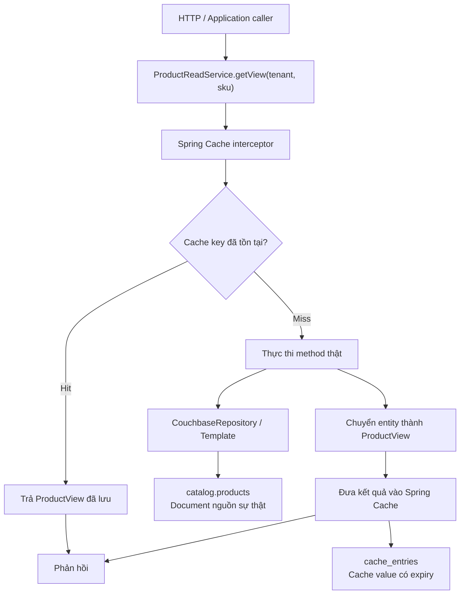
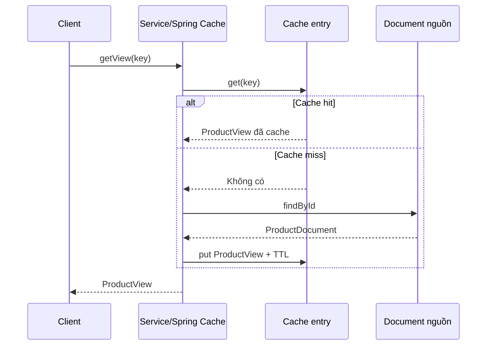

# Phân biệt lưu trữ tài liệu và Spring Cache abstraction

## Mục tiêu học tập

Sau bài học, bạn có thể:

1. Phân biệt **document persistence** trong Couchbase với **Spring Cache abstraction** ở mức phương thức, kể cả khi cùng sử dụng Couchbase Server để lưu dữ liệu.
2. Giải thích vai trò của `@Document`, `CouchbaseRepository`, `CouchbaseOperations`/`CouchbaseTemplate`, `CacheManager` và `@Cacheable` trong một kiến trúc có nguồn dữ liệu chính và bộ nhớ đệm.
3. Sử dụng `@EnableCaching`, `@Cacheable`, `@CachePut`, `@CacheEvict` cùng một cache provider được cấu hình rõ, tránh nhầm cache hit với đọc trực tiếp document nghiệp vụ.
4. Thiết kế cache key có namespace và tenant, thời gian hết hạn (TTL), invalidation sau cập nhật và chiến lược xử lý stale data.
5. Đánh giá chi phí, tính nhất quán, CAS, Query Service, secondary index, transaction và giới hạn của cache khi nhiều ứng dụng cùng truy cập dữ liệu.
6. Thực hiện một ví dụ Spring Boot với Couchbase-backed Spring Cache, đọc/ghi document nghiệp vụ và kiểm thử các trường hợp hit, miss, expiry, update, lỗi và đa instance.

**Phạm vi module:** `SPRING_DATA_COUCHBASE` xây dựng tầng truy cập Couchbase qua document mapping, repository, `CouchbaseTemplate` và SQL++. Module cũng nghiên cứu bucket/scope/collection, chỉ mục, TTL, CAS, giao dịch và lựa chọn reactive API. Trong chương **Bộ nhớ đệm**, bài học này đặt nền tảng khái niệm để không nhầm **Couchbase là database lưu document nghiệp vụ** với **Spring Cache là cơ chế tăng tốc, có thể dùng Couchbase làm nơi chứa bản sao kết quả**.

> **Nguyên tắc cốt lõi:** Việc lưu một entity bằng `repository.save(entity)` **không tự làm cho nó trở thành một cache entry**. Ngược lại, kết quả được giữ bởi `@Cacheable` **không tự trở thành dữ liệu nghiệp vụ đáng tin cậy để cập nhật, giao dịch hoặc kiểm tra CAS**.

## 1. Hai lớp có thể cùng dùng Couchbase nhưng hợp đồng khác nhau

Giả sử hệ thống bán hàng có sản phẩm `product::tenant-42::P1001`. Dữ liệu chính được lưu trong collection `catalog.products`:

```json
{
  "_class": "com.example.catalog.ProductDocument",
  "tenantId": "tenant-42",
  "sku": "P1001",
  "name": "Bàn phím cơ",
  "priceCents": 159900,
  "active": true
}
```

Document ID `product::tenant-42::P1001` nằm ở metadata của Couchbase. Trong ví dụ nhiều tenant, ID chứa tenant để hai tenant có cùng SKU không trùng document key. Dữ liệu trong document này là **nguồn sự thật** (*source of truth*) của nghiệp vụ: cập nhật sản phẩm, kiểm tra phiên bản, ghi audit và những quy tắc retention phải dựa trên mô hình persistence.

Trang danh mục lại chỉ cần trả một đối tượng nhỏ:

```json
{
  "sku": "P1001",
  "displayName": "Bàn phím cơ",
  "priceCents": 159900
}
```

Kết quả đọc này có thể **được tính từ entity** rồi lưu tạm qua Spring Cache. Nếu sử dụng `CouchbaseCacheManager`, bản sao cache cũng có thể được lưu trong Couchbase, nhưng thuộc **namespace và vòng đời khác** với document sản phẩm.

| Tiêu chí | Lưu trữ document nghiệp vụ | Spring Cache abstraction |
| --- | --- | --- |
| Hợp đồng | Đọc/ghi trạng thái nghiệp vụ của document | Giữ và tái sử dụng **kết quả gọi phương thức** |
| API điển hình | `repository.save/findById`, `operations.insertById/findByQuery` | `@Cacheable`, `@CachePut`, `@CacheEvict`, `CacheManager` |
| Khóa | Document ID trong bucket/scope/collection | Cache name + key sinh từ tham số/method |
| Tính đúng dữ liệu | Phải bảo toàn invariant, CAS, transaction, retention | Có thể bị miss, stale, evict hoặc hết hạn; phải tải lại được |
| Nguồn dữ liệu | **Nguồn sự thật** hoặc bản ghi domain đã được xác định rõ | **Bản sao/tính toán lại được** từ nguồn sự thật |
| TTL | Theo chính sách vòng đời dữ liệu nghiệp vụ | Theo thời gian được phép sử dụng kết quả cache |
| Khi mất dữ liệu | Có thể là sự cố nghiệp vụ nghiêm trọng | Thường phải có khả năng tính/lấy lại từ source |
| Tính nhất quán | Được xác định bởi KV/CAS/transaction/SQL++ consistency | Phụ thuộc TTL, invalidation, race và cache provider |
| Provider | Couchbase Server qua SDK/Spring Data | Có thể là Couchbase, Redis, Caffeine, cache in-memory… |

**Lưu ý:** Couchbase có thể tự lưu những document với TTL để dùng như cache theo nghĩa ứng dụng. Nhưng **chỉ khi đi qua giao diện Spring `Cache`/`CacheManager` hoặc các annotation cache đã được cấu hình**, dữ liệu mới thuộc phạm vi Spring Cache abstraction. Hai khái niệm có thể dùng cùng công nghệ lưu trữ mà không phải cùng một lớp lập trình.

### Hình dung kiến trúc



Sơ đồ mô tả **cache-aside qua interceptor** ở mức khái niệm. Khi hit, body của method gắn `@Cacheable` có thể không chạy; khi miss, method đọc nguồn dữ liệu, tính kết quả rồi provider lưu kết quả theo key.

## 2. Lưu trữ document: đọc/ghi bằng Spring Data Couchbase

### 2.1. Entity là hợp đồng lưu trữ, không phải cache entry

Ví dụ entity sản phẩm:

```java
package com.example.catalog;

import org.springframework.data.annotation.Id;
import org.springframework.data.annotation.Version;
import org.springframework.data.couchbase.core.mapping.Collection;
import org.springframework.data.couchbase.core.mapping.Document;
import org.springframework.data.couchbase.core.mapping.Field;
import org.springframework.data.couchbase.core.mapping.Scope;

@Document
@Scope("catalog")
@Collection("products")
public class ProductDocument {

    @Id
    private String id;

    @Field
    private String tenantId;

    @Field
    private String sku;

    @Field
    private String name;

    @Field
    private long priceCents;

    @Field
    private boolean active;

    @Version
    private Long version;

    public ProductDocument() {}

    public ProductDocument(
            String id, String tenantId, String sku,
            String name, long priceCents, boolean active) {
        this.id = id;
        this.tenantId = tenantId;
        this.sku = sku;
        this.name = name;
        this.priceCents = priceCents;
        this.active = active;
    }

    public String getId() { return id; }
    public void setId(String value) { id = value; }

    public String getTenantId() { return tenantId; }
    public void setTenantId(String value) { tenantId = value; }

    public String getSku() { return sku; }
    public void setSku(String value) { sku = value; }

    public String getName() { return name; }
    public void setName(String value) { name = value; }

    public long getPriceCents() { return priceCents; }
    public void setPriceCents(long value) { priceCents = value; }

    public boolean isActive() { return active; }
    public void setActive(boolean value) { active = value; }

    public Long getVersion() { return version; }
}
```

- `@Document` đánh dấu entity ánh xạ sang Couchbase document.
- `@Scope` và `@Collection` xác định vị trí mặc định bên trong bucket được cấu hình.
- `@Id` map document key, không đòi JSON chứa field `id` thông thường.
- `@Version` giữ CAS metadata để cơ chế optimistic locking của Spring Data nhận biết xung đột khi ghi được hỗ trợ.
- Các property khác là **dữ liệu nguồn** mà nghiệp vụ có thể xác thực và cập nhật.

Ví dụ repository:

```java
package com.example.catalog;

import org.springframework.data.couchbase.repository.CouchbaseRepository;

public interface ProductRepository
        extends CouchbaseRepository<ProductDocument, String> {
}
```

Đọc theo ID:

```java
ProductDocument product = repository
        .findById("product::tenant-42::P1001")
        .orElseThrow();
```

Lệnh này đi đến KV document nguồn, dù ứng dụng có bật `@EnableCaching` hay không. **Không có cơ chế tự động tạo cache chỉ nhờ khai báo `@Document` hoặc kế thừa `CouchbaseRepository`.**

### 2.2. Template vẫn có thể dùng TTL mà không phải Spring Cache

Giả sử một token chỉ được lưu 15 phút:

```java
CheckoutToken stored = operations
        .insertById(CheckoutToken.class)
        .withExpiry(java.time.Duration.ofMinutes(15))
        .one(token);
```

`CheckoutToken` ở ví dụ là entity riêng, `token` là instance hợp lệ và `operations` là `CouchbaseOperations` đã inject. Tùy chọn `withExpiry` đặt TTL **trên document được ghi**. Điều đó **không** đồng nghĩa method nào đó đã được cache thông qua Spring Cache.

Tương tự, `@Document(expiry = 900)` là chính sách vòng đời của entity được mapping. Hai cách đặt expiry cùng sử dụng khả năng hết hạn của Couchbase Server nhưng phục vụ **hợp đồng khác nhau** với TTL của cache entry.

### 2.3. Document ID không phải cache key

Trong collection `catalog.products`, document có ID `product::tenant-42::P1001`. Một cache có tên `productById` và key `tenant-42:P1001` có thể tạo khóa lưu vật lý kèm prefix cache name, ví dụ dạng:

```text
productById::tenant-42:P1001
```

Đây chỉ là hình dung; chi tiết prefix/serialization phụ thuộc `CouchbaseCacheConfiguration` và converter của cache provider. Không dựa vào format đó làm API lâu dài hoặc tự sửa trực tiếp cache document qua repository sản phẩm.

Dùng cache collection riêng (ví dụ `cache_entries`) giúp quan sát, phân quyền và quản lý vòng đời rõ ràng hơn so với trộn cache entry với document nghiệp vụ trong một collection.

## 3. Spring Cache abstraction hoạt động ở mức phương thức

Spring Framework cung cấp `org.springframework.cache.Cache` và `CacheManager` cùng các annotation. Nó **không quy định provider phải lưu ở đâu**; provider có thể nằm trong JVM, Redis, Couchbase hoặc nơi khác.

### 3.1. @Cacheable: có cache thì không chạy body

```java
@Cacheable(cacheNames = "productById",
           key = "#tenantId + ':' + #sku")
public ProductView getView(String tenantId, String sku) {
    // Đọc nguồn dữ liệu, map và trả kết quả.
}
```

Khi interceptor được kích hoạt bởi Spring proxy:

1. Tạo key từ tham số.
2. Hỏi cache `productById`.
3. **Hit:** trả giá trị đã lưu; method body không được thực thi.
4. **Miss:** gọi method body, rồi lưu kết quả nếu cấu hình cho phép.

Điều này **không** có nghĩa giá trị cache luôn mới nhất so với document nguồn. Một bản ghi đã bị sửa có thể còn trong cache nếu chưa hết TTL hoặc chưa được evict.

### 3.2. @CachePut: method vẫn chạy và cập nhật cache

```java
@CachePut(cacheNames = "productById",
          key = "#tenantId + ':' + #sku")
public ProductView rebuildView(String tenantId, String sku) {
    return loadFromSourceAndMap(tenantId, sku);
}
```

`@CachePut` **luôn thực thi method** rồi đặt kết quả vào cache khi kết thúc thành công. Nó **không tự gọi `repository.save`** và không tự persist document nguồn. Vì vậy, nếu `rebuildView` chỉ tạo DTO từ tính toán, nó chỉ làm mới cache result.

### 3.3. @CacheEvict: xóa bản sao cache, không xóa entity

```java
@CacheEvict(cacheNames = "productById",
            key = "#tenantId + ':' + #sku")
public void invalidateView(String tenantId, String sku) {
    // Chỉ minh họa trigger eviction.
}
```

Evict cache key **không xóa** `product::tenant-42::P1001` khỏi `catalog.products`. Muốn xóa document sản phẩm, phải có lệnh nghiệp vụ riêng như `repository.deleteById(...)` hoặc `operations.removeById(...)` kèm kiểm tra quyền và điều kiện nghiệp vụ.

Mặc định `@CacheEvict` thực hiện sau khi method kết thúc bình thường. Có option `beforeInvocation = true`, nhưng xóa trước khi biết mutation có thành công hay không thường không giải quyết được vấn đề nhất quán. Chọn thời điểm evict dựa trên giao dịch và cache manager.

### 3.4. Bảng quyết định annotation

| Annotation/API | Thực thi body method? | Thay đổi dữ liệu nào? | Có bảo đảm DB commit không? |
| --- | --- | --- | --- |
| `@Cacheable` | **Không** nếu cache hit | Cache miss có thể ghi cache result | Không |
| `@CachePut` | **Có** | Ghi/ghi đè cache result | Không |
| `@CacheEvict` | **Có** (trừ logic gọi khác) | Xóa cache entry theo key hoặc allEntries nếu cấu hình | Không |
| `@Caching` | Theo các annotation thành phần | Kết hợp nhiều hành động cache | Không |
| `CacheManager.getCache(...).evict(key)` | Không liên quan body method | Evict trực tiếp qua provider | Không |
| `repository.save(entity)` | Lời gọi CRUD bình thường | Document nghiệp vụ | Chỉ theo contract database/transaction |

## 4. Bật Spring Cache và chọn provider thật sự

Muốn sử dụng annotation cache, cần bật cache infrastructure bằng `@EnableCaching`, đồng thời chọn một `CacheManager` phù hợp.

### 4.1. Spring Boot tự cấu hình Couchbase-backed cache

Với dự án có Spring Cache và Spring Data Couchbase thích hợp, Spring Boot có thể auto-configure `CouchbaseCacheManager`. Ví dụ cấu hình:

```java
import org.springframework.cache.annotation.EnableCaching;
import org.springframework.context.annotation.Configuration;

@Configuration(proxyBeanMethods = false)
@EnableCaching
public class CacheSupportConfig {
}
```

```yaml
spring:
  couchbase:
    connection-string: couchbase://localhost
    username: app_user
    password: ${COUCHBASE_PASSWORD}
  data:
    couchbase:
      bucket-name: appdata
  cache:
    type: couchbase
    cache-names: productById,catalogSummary
    couchbase:
      expiration: 5m
```

Với Spring Boot phiên bản hỗ trợ các property trên, `spring.cache.type: couchbase` giúp xác định rõ provider; `spring.cache.cache-names` khai báo tên cache, còn `spring.cache.couchbase.expiration` đặt thời gian hết hạn mặc định cho cache entries.

**Cần chú ý:**

- Phải có dependency cần thiết cho Spring Cache (ví dụ `spring-boot-starter-cache`) cùng Spring Data Couchbase.
- Nếu ứng dụng có nhiều provider hoặc `CacheManager` riêng, kiểm tra bean thực tế được Spring sử dụng. Chỉ vì datasource là Couchbase **không có nghĩa mọi annotation cache luôn ghi vào Couchbase**.
- Những property/auto-configuration cụ thể có thể thay đổi giữa các nhánh Spring Boot; đối chiếu đúng phiên bản dự án.
- Tạo trước bucket/scope/collection tương ứng và cấp quyền. Không đưa password thật vào source code.

### 4.2. Cấu hình bằng CouchbaseCacheManager rõ từng cache

Khi muốn kiểm soát TTL và collection cho từng cache, có thể khai báo bean thủ công:

```java
package com.example.catalog;

import java.time.Duration;

import org.springframework.context.annotation.Bean;
import org.springframework.context.annotation.Configuration;
import org.springframework.cache.annotation.EnableCaching;
import org.springframework.data.couchbase.core.CouchbaseOperations;
import org.springframework.data.couchbase.cache.CouchbaseCacheManager;
import org.springframework.data.couchbase.cache.CouchbaseCacheConfiguration;

@Configuration(proxyBeanMethods = false)
@EnableCaching
public class CatalogCacheConfig {

    @Bean
    public CouchbaseCacheManager cacheManager(
            CouchbaseOperations operations) {

        var factory = operations.getCouchbaseClientFactory();

        CouchbaseCacheConfiguration productCache =
                CouchbaseCacheConfiguration.defaultCacheConfig()
                        .collection("cache_entries")
                        .entryExpiry(Duration.ofMinutes(5))
                        .disableCachingNullValues();

        CouchbaseCacheConfiguration summaryCache =
                CouchbaseCacheConfiguration.defaultCacheConfig()
                        .collection("cache_entries")
                        .entryExpiry(Duration.ofSeconds(30))
                        .disableCachingNullValues();

        return CouchbaseCacheManager.builder(factory)
                .withCacheConfiguration("productById", productCache)
                .withCacheConfiguration("catalogSummary", summaryCache)
                .transactionAware()
                .build();
    }
}
```

**Chọn một phương án:** Đây là cấu hình bean **thay thế** auto-configuration mặc định của Boot, không phải bước bắt buộc chạy thêm bên cạnh một `CouchbaseCacheManager` đã do framework tạo. Với bean tự khai báo, đảm bảo không còn hai cache manager cùng tên hoặc cấu hình trái nhau.

- `CouchbaseCacheConfiguration.entryExpiry(Duration)` điều khiển **TTL của cache entry**.
- `collection("cache_entries")` chọn collection cho cache trong phạm vi bucket/scope mà client factory quản lý. Nó không chuyển entity `@Collection("products")` sang cache collection.
- `disableCachingNullValues()` ngăn lưu null; cần xác minh contract của các method cache có thể trả null.
- `transactionAware()` đồng bộ thao tác **put/evict** với transaction Spring phù hợp, nhưng **không biến cache read thành snapshot transaction hoặc làm write DB và cache có một commit nguyên tử xuyên hai cơ chế**.
- Tên các method được minh họa theo Javadoc Spring Data Couchbase hiện đại; kiểm tra dependency version trước khi chạy code production.

**Điều kiện cấu hình collection:** Factory thường gắn với một bucket và scope. Nếu cache nằm trong scope khác với nguồn dữ liệu, hãy sử dụng một factory/template với scope được chọn đúng hoặc hạ tầng writer tương ứng. Đừng cho rằng `collection("cache_entries")` tự chọn scope mới.

### 4.3. Lựa chọn provider là một quyết định kiến trúc

Có thể dùng Couchbase để lưu cả dữ liệu nguồn và cache, nhưng khi đó mỗi cache hit vẫn cần **một lượt KV đến Couchbase**; nó không giống cache trong RAM của chính JVM.

Couchbase-backed Spring Cache hữu ích khi:

- Cần một cache dùng chung giữa nhiều application instance.
- Kết quả gốc rất tốn chi phí (ví dụ nhiều SQL++ query, tổng hợp dữ liệu hoặc gọi API ngoài).
- Đã có cluster Couchbase được vận hành tốt và chấp nhận tải cache bổ sung.

Cache trong bộ nhớ như Caffeine có thể có latency thấp hơn ở cùng instance, nhưng dữ liệu cache không tự chia sẻ giữa các instance. Trong hệ thống có cả L1 và L2, việc invalidation càng cần thiết kế rõ. Không chọn cache provider chỉ vì database đang dùng cùng công nghệ.

## 5. Ví dụ đầy đủ: entity nguồn và DTO trong cache

Ví dụ tiếp tục dùng `ProductDocument` và `ProductRepository`. Ta định nghĩa **read model** dùng để hiển thị, không phải entity để ghi lại database:

```java
package com.example.catalog;

public record ProductView(
        String sku,
        String displayName,
        long priceCents) {
}
```

### 5.1. Service đọc: kết quả được cache, không phải entity nguồn

```java
package com.example.catalog;

import java.util.NoSuchElementException;

import org.springframework.cache.annotation.Cacheable;
import org.springframework.stereotype.Service;

@Service
public class ProductReadService {

    private final ProductRepository repository;

    public ProductReadService(ProductRepository repository) {
        this.repository = repository;
    }

    @Cacheable(
            cacheNames = "productById",
            key = "#tenantId + ':' + #sku",
            unless = "#result == null")
    public ProductView getView(String tenantId, String sku) {
        ProductDocument doc = repository
                .findById("product::" + tenantId + "::" + sku)
                .orElseThrow(() -> new NoSuchElementException(
                        "Không tìm thấy sản phẩm " + sku));

        if (!tenantId.equals(doc.getTenantId())) {
            throw new SecurityException(
                    "Không có quyền xem sản phẩm");
        }

        if (!doc.isActive()) {
            throw new NoSuchElementException(
                    "Sản phẩm chưa được công bố");
        }

        return new ProductView(
                doc.getSku(),
                doc.getName(),
                doc.getPriceCents());
    }
}
```

Giải thích:

1. Lần đầu gọi `getView("tenant-42", "P1001")` sẽ miss; method đọc product document nguồn rồi tạo `ProductView`.
2. Spring Cache lưu kết quả dựa trên cache name và key đã chọn.
3. Những lần gọi sau có thể trả `ProductView` từ cache, **không chạy lại repository.findById**.
4. Mã `unless = "#result == null"` ngăn cache kết quả null; ví dụ này ném exception nếu không tìm thấy nên không lưu kết quả thiếu dữ liệu.
5. `ProductView` không chứa CAS, metadata document hoặc trường internal. Không dùng nó để thay thế `ProductDocument` trong luồng cập nhật.

**Hạn chế cần xử lý trước production:** Với nhiều tenant, cấu trúc key phải được thiết kế để không va chạm hoặc cho phép một caller suy ra dữ liệu tenant khác. Ví dụ string nối bằng dấu hai chấm chỉ phù hợp khi `tenantId` và `sku` được validate có định dạng ổn định. Đối với đầu vào tùy ý, dùng `KeyGenerator` canonical hoặc encoding không nhập nhằng. Authorization phải diễn ra **trước khi chấp nhận trả giá trị cache**; cache hit bỏ qua method body, nên không chỉ đặt kiểm tra phân quyền bên trong body như ví dụ giản lược. Controller/filter/security layer phải xác thực tenant và quyền trước khi gọi method, hoặc thiết kế key và authorization wrapper tách riêng.

### 5.2. Service ghi: thay entity nguồn trước, rồi vô hiệu hóa cache

```java
package com.example.catalog;

import java.util.NoSuchElementException;

import org.springframework.cache.annotation.CacheEvict;
import org.springframework.stereotype.Service;
import org.springframework.transaction.annotation.Transactional;

@Service
public class ProductWriteService {

    private final ProductRepository repository;

    public ProductWriteService(ProductRepository repository) {
        this.repository = repository;
    }

    @Transactional
    @CacheEvict(
            cacheNames = "productById",
            key = "#tenantId + ':' + #sku")
    public void updatePrice(
            String tenantId, String sku, long newPriceCents) {

        if (newPriceCents < 0) {
            throw new IllegalArgumentException(
                    "Giá sản phẩm không hợp lệ");
        }

        ProductDocument doc = repository
                .findById("product::" + tenantId + "::" + sku)
                .orElseThrow(() -> new NoSuchElementException(
                        "Không tìm thấy sản phẩm"));

        if (!tenantId.equals(doc.getTenantId())) {
            throw new SecurityException(
                    "Không được sửa sản phẩm khác tenant");
        }

        doc.setPriceCents(newPriceCents);
        repository.save(doc);
    }
}
```

Điểm phân biệt:

- `repository.save(doc)` là bước **persist document nguồn** và có thể dùng optimistic locking từ `@Version`.
- `@CacheEvict` chỉ vô hiệu hóa một bản sao `productById` theo key; nó **không** lưu document và không xóa document nguồn.
- Nếu muốn chính sách “evict sau commit”, cần **Spring transaction manager phù hợp đã được cấu hình**, đồng thời cache manager hỗ trợ đồng bộ transaction (chẳng hạn `transactionAware()`). Nếu không, annotation cache và transaction có thể chạy ở thời điểm khác nhau.
- Dù evict sau commit, vẫn có race với những lượt cache miss đang tải dữ liệu cũ và có thể put giá trị stale. Cần đo mức rủi ro, chọn TTL/versioning hoặc giải pháp điều phối khác với nghiệp vụ yêu cầu nhất quán chặt.
- Luồng cập nhật từ **service khác** hay trực tiếp từ SDK không tự kích hoạt annotation trên `ProductWriteService`. Mọi đường ghi cần chia sẻ một chiến lược invalidation.

Không lấy dữ liệu giá/tồn kho còn ở cache như một điều kiện duy nhất để chấp nhận thanh toán. Giá trị nghiệp vụ cần tính đúng phải được xác thực từ nguồn sự thật khi commit.

### 5.3. Một đường dùng @CachePut thay vì evict

Trong vài tình huống, service đã tạo ra kết quả DTO mới chính xác và muốn đưa kết quả đó vào cache:

```java
@CachePut(cacheNames = "productById",
          key = "#tenantId + ':' + #sku")
public ProductView rebuildProductView(String tenantId, String sku) {
    // Method thực sự chạy và đọc nguồn dữ liệu.
    return readFromSourceAndMap(tenantId, sku);
}
```

Mã là phác thảo method trong một service đã có `readFromSourceAndMap`, không phải ví dụ class Java độc lập. `@CachePut` cập nhật giá trị cache, nhưng không commit thay đổi document. Chỉ dùng khi chắc giá trị trả về đủ mới, cache key đúng và transaction đã ở trạng thái cho phép công bố kết quả.

## 6. Khóa cache: đúng tenant, đúng tham số, đúng version

Cache lookup là một phép so sánh key. Nếu key thiếu dữ liệu quyết định nội dung kết quả, bạn có thể đưa sai giá trị tới caller khác.

Ví dụ một sản phẩm có giá khác theo `tenantId` và loại tiền tệ `currency`:

```java
// SAI: chưa đưa tenant và currency vào cache key.
@Cacheable(cacheNames = "priceQuote", key = "#sku")
public PriceQuote quote(String tenantId, String sku, String currency) {
    // ...
}

// ĐÚNG VỀ Ý TƯỞNG: key mô tả đầy đủ đầu vào ảnh hưởng kết quả.
@Cacheable(cacheNames = "priceQuote",
           key = "#tenantId + ':' + #sku + ':' + #currency")
public PriceQuote quote(String tenantId, String sku, String currency) {
    // ...
}
```

*Hai method trùng chữ ký chỉ để so sánh phương án sai/đúng; không đặt cạnh nhau trong một class.*

Thiết kế key thực tế cần tính đến:

- **Tenant:** loại trừ khả năng cache hit chéo tenant; xác thực tenant trước khi đọc cache.
- **Tham số ảnh hưởng kết quả:** locale, currency, quyền người dùng, feature flags, version dữ liệu.
- **Namespace/cache name:** tránh đè cache giữa phương thức và môi trường.
- **Phân biệt loại dữ liệu:** `productById` không thể dùng chung một schema kết quả với `catalogSummary`.
- **Độ dài key:** key dài hoặc mang thông tin nhạy cảm có thể làm tăng bộ nhớ và gây lộ thông tin qua log/metrics.
- **Serialization/converter:** key/object tùy chỉnh phải có mapping ổn định, không phụ thuộc `toString()` có thể thay đổi.

**Quan trọng:** Một giá trị cache được đưa ra **trước khi vào method body** ở cache hit. Nếu phân quyền đặt duy nhất trong body thì lời gọi hit có thể bỏ qua kiểm tra đó. Hãy đặt xác thực, tenant isolation và cache-key policy ở ranh giới không bị interceptor bỏ qua.

## 7. TTL của document nguồn và TTL cache entry không phải một

Couchbase hỗ trợ expiry ở metadata document. Nhưng TTL của hai loại dữ liệu thường có mục đích khác nhau:

| Thuộc tính | Document nguồn trong `catalog.products` | Cache entry trong `cache_entries` |
| --- | --- | --- |
| Ai quyết định? | Chính sách retention/lifecycle nghiệp vụ | Chính sách staleness/performance của cache |
| Ví dụ | Không tự hết hạn với sản phẩm đang kinh doanh | Hết hạn sau 5 phút |
| Thiết lập điển hình | `@Document(expiry)`, `withExpiry(Duration)`, SDK expiry | `CouchbaseCacheConfiguration.entryExpiry(Duration)` hoặc Boot property |
| Sau khi hết hạn | Document nghiệp vụ không còn hợp lệ; có thể ảnh hưởng chức năng | Cache miss và tải/tính lại từ nguồn |
| Khi gọi `@CacheEvict` | Không tác động | Xóa cache entry tương ứng |
| Khi `repository.deleteById` | Xóa document nguồn | Cache **có thể vẫn còn** nếu không evict |

### 7.1. Stale data trong thời gian TTL

Dữ liệu nguồn chuyển từ giá 159900 sang 149900 lúc 10:01. Cache entry đã được tạo lúc 10:00 với TTL 5 phút. Nếu không evict, lần đọc lúc 10:02 có thể vẫn trả 159900 đến khi cache entry hết hạn.

**TTL là giới hạn xấp xỉ về thời gian tồn tại của bản sao, không phải cam kết nhận ngay mutation mới.** Tần suất thay đổi và mức độ rủi ro khi stale phải quyết định giá trị TTL.

Nếu một cache entry bị xóa hoặc hết hạn, điều đó không làm document nguồn biến mất, trừ khi bạn cấu hình các document vào cùng keyspace và vô tình làm trùng key — đây chính là lý do cần tách namespace/collection và kiểm tra quyền.

### 7.2. Cache mất, ứng dụng phải tải lại được

Khi cả collection `cache_entries` bị dọn, các entry hết TTL hoặc provider gặp sự cố, tính đúng của nghiệp vụ không được phụ thuộc vào cache. Ứng dụng có thể chậm hơn hoặc tạm thời lỗi do thiết kế fail-open/fail-closed, nhưng **không** được mất nguồn dữ liệu chính.

Nếu cache chứa thông tin không thể tái tạo (mã thanh toán duy nhất, event audit bắt buộc), thì đó không còn là một cache theo nghĩa bản sao có thể bỏ. Hãy lưu nó trong collection/document nghiệp vụ có chính sách durability, CAS và backup phù hợp.

## 8. Cache-aside, invalidation và các race quan trọng

Đọc qua Spring Cache thường gần với *cache-aside*: hit dùng bản sao, miss truy vấn nguồn và ghi bản sao.



### 8.1. Ghi nguồn nhưng quên evict

```text
T1: cache(productById, P1001) = 159900
T2: update Couchbase document P1001 = 149900
T3: getView(P1001) hit cache, trả 159900
```

Đó là stale cache bình thường khi không invalidation. Spring Cache **không tự theo dõi mọi mutation vào Couchbase** từ repository, SDK, SQL++ hay hệ thống khác.

Giải pháp: thống nhất đường ghi qua service thực hiện evict, hoặc dùng event/outbox/CDC để thông báo invalidation khi thay đổi phát sinh ngoài ứng dụng; giữ TTL phù hợp để hạn chế thời gian stale khi miss thông báo.

### 8.2. Evict trước commit hoặc trước khi ghi xong

Nếu xóa cache sớm, một request đọc đồng thời có thể miss và tải **giá trị cũ** từ database trước khi transaction commit, rồi đặt lại vào cache. Sau khi DB commit, cache vẫn chứa bản cũ.

Dùng cơ chế evict sau commit (khi framework hỗ trợ và transaction context phù hợp) giúp giảm rủi ro đó, nhưng chưa loại bỏ mọi race.

### 8.3. In-flight cache miss có thể ghi stale sau eviction

```text
A: Cache miss, bắt đầu đọc giá cũ 159900
B: Update DB thành 149900, sau đó evict cache
A: Hoàn tất đọc bản cũ, put 159900 vào cache
C: Cache hit nhận 159900 dù eviction đã chạy
```

Đây là lý do cơ chế cache-aside + evict không tạo linearizability. Với dữ liệu có yêu cầu nhất quán mạnh:

- Có thể tránh cache cho dữ liệu quan trọng lúc commit.
- Dùng versioned key hoặc version trong payload và xác minh phiên bản với nguồn khi cần.
- Xây cơ chế invalidation/reload theo sự kiện hoặc một chiến lược đồng bộ chuyên biệt.
- Giảm TTL và chấp nhận staleness có giới hạn nếu nghiệp vụ cho phép.

Không đưa ra lời hứa “update + evict bảo đảm mọi request ngay sau commit thấy giá mới” nếu chưa có thiết kế nhất quán tương ứng.

### 8.4. Cache stampede và sync=true

Khi một entry phổ biến hết TTL, nhiều request có thể cùng miss và cùng truy vấn SQL++ tốn chi phí. `@Cacheable(sync = true)` yêu cầu đồng bộ việc tính giá trị cho một key trong phạm vi provider hỗ trợ, nhưng **không mặc định tạo distributed lock xuyên nhiều JVM hoặc nhiều instance**.

Nếu cần chống stampede trên cụm, kiểm tra khả năng provider, giới hạn concurrency, jitter TTL, prewarm hoặc thiết kế single-flight có phạm vi rõ ràng.

## 9. CAS, transaction và scan consistency giải quyết việc gì?

Bài toán cache thường làm lẫn các bảo đảm của Couchbase:

| Cơ chế | Nó bảo đảm điều gì? | Nó không bảo đảm |
| --- | --- | --- |
| CAS / `@Version` | Phát hiện xung đột khi cập nhật **một document nguồn** theo phiên bản | Cache result tự biến mất khi CAS đổi |
| Couchbase Transactions | Atomicity của nhóm mutation tham gia giao dịch phù hợp | Cache entry thuộc Spring Cache tự tham gia mọi transaction nghiệp vụ |
| Durability | Mức xác nhận replication/persistence cho mutation | Cache luôn mới và có đúng key |
| TTL/expiry | Vòng đời của document/entry | Mọi reader thấy giá trị mới ngay khi source đổi |
| SQL++ `REQUEST_PLUS` | Query index theo kịp mutation theo mức yêu cầu | Cache hit tự bỏ qua bản sao stale |
| `@CacheEvict` | Bỏ cache entry theo key | Thay đổi document nghiệp vụ, bảo vệ CAS |

### 9.1. @Version/CAS không tự xóa cache

Nếu hai worker cùng cập nhật `ProductDocument`, Spring Data có thể từ chối mutation khi CAS cũ. Đây là cơ chế bảo vệ source. Nếu một mutation khác đã thành công, cache vẫn có thể chứa kết quả cũ cho đến khi bị evict hoặc hết hạn.

CAS và cache invalidation phải được xem là **hai trách nhiệm riêng**. Với dữ liệu về số dư, hạn mức, giá thanh toán hay tồn kho, xác thực tại transaction từ nguồn sự thật là bắt buộc; cache chủ yếu phục vụ màn hình, gợi ý hoặc dữ liệu chấp nhận stale.

### 9.2. REQUEST_PLUS chỉ ảnh hưởng truy vấn nguồn trên cache miss

Giả sử source từ SQL++:

```java
var products = operations
        .findByQuery(ProductDocument.class)
        .withConsistency(
                com.couchbase.client.java.query.QueryScanConsistency.REQUEST_PLUS)
        .matching(query)
        .all();
```

`REQUEST_PLUS` có thể khiến query chờ secondary index theo kịp mutation, nhưng **chỉ khi method thật sự chạy**. Nếu Spring Cache hit, query này bị bỏ qua; cache cũ vẫn trả về. Cả `REQUEST_PLUS` lẫn `MAJORITY` không phải giải pháp tự động cho stale cache.

### 9.3. Transaction-aware cache không phải một giao dịch thống nhất

`CouchbaseCacheManager.builder(factory).transactionAware()` cho phép phối hợp việc put/evict với transaction Spring đang hoạt động theo contract của provider. Dù cache entry cũng lưu trong Couchbase:

- Không suy ra một `cache.put` là mutation nằm trong cùng Couchbase transaction context với `repository.save`.
- Vẫn có thể có lỗi khi thao tác cache được thực thi sau commit.
- Một tiến trình khác sửa nguồn hoặc ghi lại cache đồng thời có thể làm stale.
- Nếu dữ liệu nguồn và cache bắt buộc atomic, cần thiết kế phù hợp và kiểm chứng bằng integration test; trong nhiều trường hợp không cache những quyết định quan trọng là cách đơn giản hơn.

## 10. Cache name, collection và chỉ mục: vận hành tách biệt

Couchbase có cấu trúc **bucket → scope → collection → document ID**. Spring Cache có cấu trúc logic **cache name → cache key → cached value**. Khi dùng `CouchbaseCacheManager`, provider ánh xạ cấu trúc thứ hai vào Couchbase keyspace.

Một cách tổ chức:

```text
Bucket: appdata
├── Scope: catalog
│   ├── Collection: products          # Document nghiệp vụ
│   └── Collection: cache_entries     # Kết quả Spring Cache
└── Scope: commerce
    └── Collection: orders            # Document nghiệp vụ khác
```

Nên tách collection cache khi phù hợp để:

- Tránh va chạm document ID và schema giữa hai loại dữ liệu.
- Cấp RBAC riêng, giám sát TTL/throughput khác nhau.
- Dễ quản lý dữ liệu tạm mà không đụng document nghiệp vụ.
- Tách chính sách backup/retention và migration.

### 10.1. Tên cache không tự tạo collection

`@Cacheable(cacheNames = "productById")` không có nghĩa Couchbase sẽ tự tạo collection `productById`. Với `CouchbaseCacheConfiguration.collection("cache_entries")`, cache name là namespace logic, còn collection thật là `cache_entries`. Collection phải có trước và user cần quyền.

Nếu không chỉ định collection, provider dùng collection mặc định theo cấu hình factory/provider. Trong ứng dụng nhiều bucket/scope, xác minh keyspace thực tế trước khi chạy.

### 10.2. Xóa từng key khác với clear cả cache

Với cập nhật một sản phẩm, evict **một key** thường an toàn hơn xóa toàn bộ `productById`. Việc clear/invalidate tất cả entry có thể thực thi truy vấn/duyệt key và đòi index thích hợp; tài liệu Spring Data Couchbase ghi rõ có trường hợp cần primary index để hỗ trợ `cache.clear()`/`cache.invalidate()`.

Không cho phép một API khách hàng tùy ý thực thi `cache.clear()`. Việc xóa tất cả entry có thể gây cache stampede và tăng tải query/DB đột biến.

### 10.3. Cache entry cũng tiêu thụ tài nguyên cluster

Nếu cùng cluster vừa lưu source vừa cache, cache write/evict/expiry gây thêm KV traffic, memory, replication, compaction, disk và có thể ảnh hưởng workload SQL++. Vì thế:

- Đo tỷ lệ hit đủ cao trước khi tăng TTL.
- Đánh giá kích thước cached value và số lượng cache key.
- Không lưu nguyên entity lớn nếu consumer chỉ cần DTO nhỏ.
- Giám sát áp lực memory/quota và thời gian expiry cleanup.
- Với cache in-memory L1, đo tỷ lệ cache hit ở từng instance và chính sách invalidation riêng.

## 11. Null, lỗi và cache entry không tồn tại

Một lần cache miss có thể phát sinh từ nhiều lý do:

- Chưa từng được tạo.
- Entry đã hết TTL.
- Entry bị `@CacheEvict` hoặc `Cache.evict` xóa.
- Provider không đọc được hoặc có lỗi kết nối.
- Key hoặc cache name khác với lần ghi.

Không được biến mọi lỗi cache thành “không có document nguồn”; provider exception và cache miss là hai trường hợp khác nhau.

### 11.1. Có nên cache null/404?

Cache kết quả không tồn tại (*negative caching*) có thể giúp giảm tải khi cùng một ID không tồn tại được yêu cầu liên tục. Nhưng nguy cơ:

- Product vừa được tạo có thể vẫn trả 404 nếu negative cache chưa hết hạn.
- Giá trị null không tự chứa lý do not found hoặc not authorized.
- Cache key phải tách tenant và quyền; tuyệt đối không cache kết quả 403/401 để reuse tùy tiện.

Nếu cần negative caching, dùng cache riêng với TTL ngắn, giá trị biểu diễn trạng thái rõ ràng và invalidation khi tạo document. Trong ví dụ cơ bản, `disableCachingNullValues()` và `unless = "#result == null"` giúp tránh lưu null.

### 11.2. Cache lỗi thì ứng dụng làm gì?

Spring Cache có hook `CacheErrorHandler` ở hạ tầng để điều khiển việc xử lý một số lỗi cache get/put/evict. Quyết định “fail open” (bỏ qua lỗi cache, đọc nguồn) hay “fail closed” phải dựa vào nghiệp vụ.

- Với trang danh mục không quan trọng về trạng thái cực mới, có thể chấp nhận đọc nguồn khi cache lỗi.
- Với thao tác sửa giá, nếu cache eviction thất bại thì cần ghi nhận, retry có kiểm soát và/hoặc cảnh báo, vì các reader có thể thấy dữ liệu stale.
- Không âm thầm bỏ lỗi cache update/evict mà không có khả năng quan sát và phục hồi.
- Đừng để retry cache vô hạn khiến deadline HTTP bị vượt hoặc tạo tải lớn lên cluster.

## 12. Spring AOP: vì sao annotation đôi khi không chạy?

Cache annotations được áp dụng thông qua Spring proxy/interceptor trong cấu hình thông dụng. Lời gọi **bên ngoài đi qua proxy** mới kích hoạt advice; gọi method có annotation từ method khác trong **cùng instance** có thể bỏ qua cache.

```java
@Service
public class CatalogFacade {

    public ProductView getAndLog(String tenantId, String sku) {
        // Nếu đây là lời gọi this.getView(...) cùng bean,
        // @Cacheable trên getView có thể bị bypass.
        return getView(tenantId, sku);
    }

    @Cacheable("productById")
    public ProductView getView(String tenantId, String sku) {
        // ...
    }
}
```

Giải pháp phổ biến: đặt `@Cacheable` trên một bean service riêng và gọi bean đó qua dependency injection từ facade. Không tự giải quyết bằng cách gọi proxy nội bộ thiếu kiểm soát.

Cũng cần lưu ý:

- Method phải được Spring quản lý và được proxy/advice phù hợp.
- Annotation ở private method không nên được kỳ vọng hoạt động như public service method.
- `@EnableCaching` cần được bật ở application context tương ứng.
- Nếu có nhiều `CacheManager`, chỉ định provider/cache manager đúng khi cần.
- Với Kotlin/final class hoặc method, proxy strategy và cấu hình plugin có thể ảnh hưởng; phải kiểm thử.
- Khi method trả `Mono`/`Flux`, semantics caching cho reactive type tùy phiên bản Spring Framework và provider. Không mặc định `@Cacheable` trên publisher luôn cache **giá trị sau subscription** hoặc đúng như method đồng bộ; cần đối chiếu tài liệu reactive caching cụ thể và kiểm thử.

## 13. Hiệu năng: khi nào cache bằng Couchbase thực sự đáng giá?

Nếu nguồn dữ liệu là một document đã biết ID, `repository.findById(id)` là **một lượt KV tới Couchbase**. Nếu cache cũng nằm trong Couchbase, cache hit có thể là **một lượt KV tới cùng cluster**. Vì thế, với dữ liệu nhỏ và đọc KV nhanh, lợi ích có thể thấp, thậm chí tăng chi phí và độ phức tạp do serialize/evict.

Couchbase-backed Spring Cache thường có ý nghĩa hơn khi cache:

- Kết quả tổng hợp từ nhiều document hoặc nhiều SQL++ query tốn CPU.
- Kết quả của API ngoài có latency cao.
- Dữ liệu cấu hình/read model được truy cập rất thường xuyên, thay đổi ít và có thể chia sẻ giữa nhiều app instance.
- Một response DTO đã qua nhiều bước chuyển đổi, lọc quyền và phép tính phức tạp.

**Không nên cache mù**:

- Giá thanh toán cuối cùng, số dư/tồn kho lúc commit hoặc điều kiện kiểm tra CAS.
- Dữ liệu rất nhạy cảm khi chưa có cơ chế phân quyền và key isolation.
- Kết quả thay đổi liên tục khiến hit rate thấp và invalidation quá nhiều.
- Giá trị không thể tái tạo mà việc eviction/expiry đồng nghĩa mất dữ liệu thật.

### 13.1. Chỉ số nên đo

| Chỉ số | Ý nghĩa |
| --- | --- |
| Cache hit ratio và miss ratio theo cache name | Bao nhiêu lượt đọc tránh được method body |
| Latency hit/miss p50, p95, p99 | Lợi ích thực tế so với đọc nguồn |
| Số lượt `@CacheEvict` và tỷ lệ lỗi eviction | Độ tin cậy của invalidation |
| TTL và tuổi dữ liệu quan sát được | Giới hạn stale theo nghiệp vụ |
| Kích thước cache value và số lượng key | Chi phí tài nguyên trong Couchbase |
| Query latency/index load khi miss | Đường truy cập nguồn có tối ưu không |
| Retry/cache stampede | Khả năng dồn tải khi entry hết hạn |
| DB/CAS conflict và transaction timeout | Tính đúng dữ liệu nguồn khi cập nhật |

Một thí nghiệm tốt đo cả **có cache** và **không cache**, với cùng workload và nhiều application instance nếu sản phẩm triển khai dạng cluster. Không dùng một benchmark giả định để kết luận cho mọi hệ thống.

## 14. Bài thực hành có tiêu chí kiểm chứng

Chuẩn bị môi trường Couchbase thử nghiệm với bucket `appdata`, scope `catalog`, collection `products` và `cache_entries`; cấu hình Spring Data Couchbase, Spring Cache và `CouchbaseCacheManager`. Chỉ dùng dữ liệu test.

1. **Nguồn sự thật:** Insert `product::tenant-42::P1001` với giá `159900` bằng repository. Xác minh key và JSON trong `catalog.products`, không có entry cache tương ứng trước khi đọc.
2. **Kích hoạt cache:** Tạo `@EnableCaching` và cấu hình cache `productById` TTL 5 phút, chỉ định collection `cache_entries`; xác nhận bean `CacheManager` thực tế là Couchbase-backed.
3. **Miss → hit:** Gọi `ProductReadService.getView("tenant-42", "P1001")` hai lần qua bean Spring. Ghi nhận lần đầu chạy method/repository, lần thứ hai không chạy body.
4. **Cache không phải persistence:** Gọi `CacheManager.getCache("productById").evict(key)` và xác minh document `product::tenant-42::P1001` vẫn tồn tại.
5. **Thay đổi nguồn:** Cập nhật giá bằng repository qua một đường **chưa evict**; quan sát bản sao vẫn cũ cho đến TTL. Sau đó dùng service có `@CacheEvict` và xác nhận lần đọc tiếp theo tải lại giá.
6. **TTL khác nhau:** Đặt TTL cache 10 giây trong môi trường thử, giữ document nguồn không hết hạn. Sau TTL, xác nhận cache miss nhưng document nguồn vẫn đọc được.
7. **Tenant:** Thêm sản phẩm tenant khác có cùng SKU hoặc dữ liệu thử theo thiết kế keyspace; kiểm tra key, authorization và không bao giờ trả bản cache của tenant A cho tenant B.
8. **Giao dịch:** Cố tình gây rollback trong mutation có `@Transactional`. So sánh eviction với cache manager `transactionAware()`; không khẳng định atomicity tuyệt đối.
9. **Race:** Dựng hai luồng cache miss và update; quan sát khả năng một read cũ repopulate cache sau eviction, rồi đánh giá giải pháp.
10. **Multi-instance:** Chạy hai instance trỏ đến cùng Couchbase cache collection. Xác nhận cache entry có thể được dùng chung và invalidation đúng key ảnh hưởng những lần đọc sau.
11. **AOP:** Thử self-invocation trong cùng bean và gọi qua bean Spring khác; xác minh sự khác biệt của `@Cacheable`.
12. **Hiệu năng:** Đo tốc độ đọc thẳng KV, cache hit trong Couchbase và cache miss với SQL++ aggregate. Chỉ kết luận dựa trên số đo thực tế.
13. **An toàn vận hành:** Thử `cache.clear()` trong collection thử nghiệm; kiểm tra quyền/index theo phiên bản và đối chiếu với phương án evict từng key.

### Câu hỏi tự kiểm tra

- Vì sao `@Document` và `CouchbaseRepository` không đồng nghĩa method đã được `@Cacheable`?
- `@CacheEvict` có xóa document nghiệp vụ trong `catalog.products` không?
- Cùng dùng Couchbase để chứa source và cache có bảo đảm cache hit nhanh hơn `findById` không?
- `@CachePut` khác `repository.save` như thế nào?
- TTL cache entry và TTL của entity nguồn do ai thiết lập, hậu quả khi mỗi loại hết hạn là gì?
- Tại sao `@Version`/CAS và `REQUEST_PLUS` không tự làm mới Spring Cache?
- Cache hit có chạy validation trong method body không? Phân quyền nên được bảo vệ tại đâu?
- Nếu update thành công nhưng evict thất bại, hệ thống cần quan sát và xử lý ra sao?
- `transactionAware()` giải quyết vấn đề thời điểm nào, và **không** giải quyết race nào?
- Khi một cache entry bị nhiều instance cùng miss, `@Cacheable(sync = true)` có phải distributed lock không?
- Vì sao nên ưu tiên cache DTO đọc thay vì dùng projected entity để lưu ngược vào nguồn?

## 15. Lỗi dễ gặp và cách sửa

| Sai lầm | Hậu quả | Hướng sửa |
| --- | --- | --- |
| Coi mọi document có expiry là Spring Cache | Không thấy vai trò interceptor/method key | Phân biệt API persistence và CacheManager |
| Nghĩ `save(entity)` tự evict các method cache | Đọc bản sao cũ sau update | Chiến lược invalidation chung cho mọi đường ghi |
| Gọi `@CacheEvict` để xóa document nguồn | Document nguồn vẫn tồn tại | Dùng repository/Template cho deletion nghiệp vụ |
| Cache key chỉ chứa SKU nhưng kết quả theo tenant | Rò dữ liệu chéo tenant | Key canonical + authorization trước cache |
| Kiểm tra quyền duy nhất trong body `@Cacheable` | Cache hit có thể bỏ qua kiểm tra | Đặt guard ở proxy/filter hoặc wrapper không bị skip |
| Cache cả entity đầy đủ rồi dùng để update | CAS stale hoặc write thiếu field | Cache DTO đọc; đọc source có CAS cho mutation |
| Có Couchbase starter rồi tưởng provider đã là Couchbase | App có thể dùng provider khác | Kiểm tra `CacheManager` thực tế, cấu hình rõ provider |
| Dùng cache và source chung collection/ID tùy tiện | Va chạm key hoặc xóa nhầm | Namespace và collection riêng khi thích hợp |
| TTL quá dài cho dữ liệu thay đổi thường xuyên | Stale data | TTL theo SLA + invalidation |
| TTL quá ngắn cho query đắt | Miss/stampede, tải lớn | Đo hit rate, prewarm, điều phối concurrency |
| Evict trước khi DB commit | Reader tải lại bản cũ | Transaction-aware eviction và kiểm thử race |
| Tin `transactionAware()` bảo đảm atomic cache/DB | Vẫn có stale hoặc lỗi sau commit | Thiết kế mức nhất quán; không cache dữ liệu critical |
| Nghĩ `REQUEST_PLUS` cũng áp dụng khi cache hit | Cache vẫn stale | Invalidation/TTL độc lập với scan consistency |
| Gọi annotated method qua `this` | Cache advice có thể bị bỏ qua | Gọi qua bean Spring/proxy |
| Bắt cache error rồi im lặng mọi trường hợp | Khó phát hiện stale và lỗi eviction | Log/metric/retry theo chính sách |
| `cache.clear()` trên dữ liệu thật để sửa một key | Tăng tải/khả năng lỗi phạm vi lớn | Evict đúng key; kiểm tra index và quyền |

## Tài liệu tham khảo chính thức

- [Spring Framework — Cache Abstraction](https://docs.spring.io/spring-framework/reference/integration/cache.html).
- [Spring Boot — Caching và Couchbase provider](https://docs.spring.io/spring-boot/reference/io/caching.html).
- [Spring Data Couchbase — Caching](https://docs.spring.io/spring-data/couchbase/reference/couchbase/caching.html).
- [Javadoc — CouchbaseCacheManager](https://docs.spring.io/spring-data/couchbase/reference/api/java/org/springframework/data/couchbase/cache/CouchbaseCacheManager.html).
- [Javadoc — CouchbaseCacheManagerBuilder](https://docs.spring.io/spring-data/couchbase/reference/api/java/org/springframework/data/couchbase/cache/CouchbaseCacheManager.CouchbaseCacheManagerBuilder.html).
- [Javadoc — CouchbaseCacheConfiguration: collection, entryExpiry, null values](https://docs.spring.io/spring-data/couchbase/reference/api/java/org/springframework/data/couchbase/cache/CouchbaseCacheConfiguration.html).
- [Spring Data Couchbase — Template & direct operations](https://docs.spring.io/spring-data/couchbase/reference/couchbase/template.html).
- [Couchbase Java SDK — Document expiration và KV operations](https://docs.couchbase.com/java-sdk/current/howtos/kv-operations.html).

> **Phạm vi kiểm chứng:** Bài minh họa khái niệm và API phổ biến của Spring Data Couchbase/Spring Boot hiện đại. Kiểm tra các property cấu hình, cú pháp builder, hành vi cache với null, transaction synchronization và reactive caching theo đúng phiên bản dependency của dự án. Bước viết Knowledge (STEP 4) chưa thay thế Content QA chuyên môn (STEP 6) hoặc kiểm thử tích hợp dưới tải thực tế.
