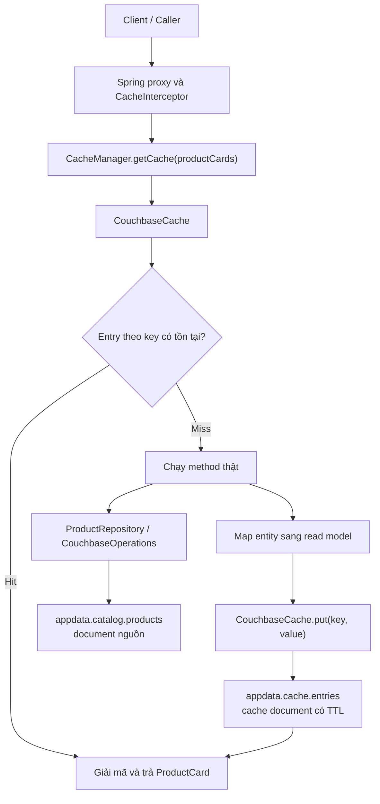
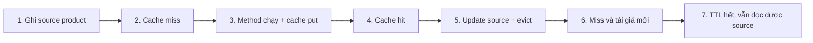

# CouchbaseCacheManager và kích hoạt @EnableCaching

## Mục tiêu học tập

Sau bài học, bạn có thể:

1. Giải thích vai trò của **Spring Cache abstraction**, `CacheManager`, `Cache` và `CouchbaseCacheManager`; phân biệt cache kết quả phương thức với lưu trữ document nghiệp vụ bằng Spring Data Couchbase.
2. Bật cache bằng `@EnableCaching`, bổ sung dependency và xác nhận application context thực sự sử dụng Couchbase làm cache provider.
3. Cấu hình `CouchbaseCacheManager` theo **hai phương án thay thế**: Spring Boot auto-configuration và bean thủ công dựa trên `CouchbaseClientFactory`.
4. Thiết lập cache name, TTL riêng từng cache, collection lưu entry, chính sách null, key prefix và tên cache được phép tạo.
5. Viết `@Cacheable`, `@CachePut`, `@CacheEvict`; chọn cache key đúng tenant và điều phối invalidation khi dữ liệu nguồn thay đổi.
6. Hiểu giới hạn của cache hit, proxy/self-invocation, scan consistency, CAS, transaction synchronization, cache stampede và lỗi provider.
7. Kiểm thử một luồng **miss → load → put → hit → evict → reload**, theo dõi metric và nhận diện những trường hợp không nên cache.

**Bối cảnh:** Module `SPRING_DATA_COUCHBASE` hướng đến xây dựng tầng truy cập Couchbase bằng document mapping, repository, `CouchbaseTemplate` và SQL++. Dữ liệu nằm trong bucket/scope/collection, được bảo vệ tùy trường hợp bằng TTL, CAS, transaction và API reactive. Chương **Bộ nhớ đệm** nghiên cứu cách tận dụng Couchbase làm backend cho Spring Cache mà không đánh đồng bộ nhớ đệm với dữ liệu nguồn cần được lưu giữ và cập nhật nhất quán.

> **Phân biệt ngay:** `@EnableCaching` kích hoạt cơ sở hạ tầng chặn lời gọi phương thức của Spring; `CouchbaseCacheManager` quyết định **nơi cache entry được lưu**. Chỉ có một trong hai thì chưa đủ để hình thành luồng cache hoạt động đúng như mong muốn.

## 1. Kiến trúc: Spring Cache abstraction và backend Couchbase

Spring Cache làm việc ở mức **method invocation**. Với một method có `@Cacheable`, Spring tạo cache key từ các tham số, tìm kết quả trong cache được chỉ định; nếu có kết quả, method có thể không chạy. Khi thiếu kết quả, method chạy và giá trị trả về có thể được lưu vào cache.



Cấu trúc phân biệt hai vai trò lưu trữ:

| Thành phần | Công việc | Ai sở hữu vòng đời? |
| --- | --- | --- |
| `@EnableCaching` | Bật cơ chế xử lý annotation cache | Spring application context |
| `@Cacheable`, `@CachePut`, `@CacheEvict` | Khai báo chính sách tại method | Service/kiến trúc ứng dụng |
| `CacheInterceptor`/proxy | Chặn lời gọi qua proxy, tạo key và gọi cache | Spring Framework |
| `CacheManager` | Quản lý các cache logic theo tên | Spring bean |
| `CouchbaseCacheManager` | Triển khai `CacheManager` dùng Couchbase | Spring Data Couchbase |
| `CouchbaseCacheConfiguration` | TTL, collection, key prefix, null policy, transcoder | Cấu hình cache ở startup |
| `CouchbaseClientFactory` | Cung cấp cluster/bucket/scope do Spring quản lý | Spring Data/Couchbase SDK |
| `ProductRepository` | Đọc/ghi document nghiệp vụ | Tầng persistence |
| `Cache`/cache entry | Bản sao kết quả có thể loại bỏ và nạp lại | Cache provider, theo TTL/invalidation |

**Điểm quan trọng:** Một cache hit trên Couchbase-backed cache vẫn có thể gửi **KV request tới Couchbase**; nó không mặc nhiên nhanh hơn đọc một document bằng `findById` từ cùng cluster. Cache chỉ có lợi thực sự nếu nó tránh được công việc nguồn tốn hơn (query SQL++, tổng hợp, gọi API bên ngoài, chuyển đổi phức tạp) hoặc giúp dùng chung kết quả giữa nhiều instance.

### 1.1. Không nhầm document nguồn với cache entry

Một document sản phẩm có thể nằm trong:

```text
Bucket appdata
├── Scope catalog
│   └── Collection products
│       └── product::tenant-42::P1001
└── Scope cache
    └── Collection entries
        └── (key do CouchbaseCacheManager tạo)
```

Document nguồn có thể cần lưu lâu dài, CAS và quy tắc nghiệp vụ. Cache entry có TTL ngắn, có thể bị evict và được tạo lại từ document nguồn. Cả hai dùng Couchbase nhưng không có cùng hợp đồng dữ liệu.

## 2. Dependency, kết nối và những điều kiện phải có

Một dự án Spring Boot dùng Spring Data Couchbase và Spring Cache cần dependency tương ứng. Ví dụ Gradle:

```groovy
dependencies {
    implementation 'org.springframework.boot:spring-boot-starter-data-couchbase'
    implementation 'org.springframework.boot:spring-boot-starter-cache'
    implementation 'org.springframework.boot:spring-boot-starter-web'
}
```

Mã ví dụ giả định ứng dụng Java hiện đại và Spring Boot quản lý phiên bản dependency. `spring-boot-starter-web` chỉ cần nếu muốn cung cấp REST endpoint; bản thân cache không đòi Spring MVC.

Để backend Couchbase làm việc được, phải có:

1. Couchbase Server và endpoint phù hợp.
2. Bucket, scope, collection dành cho cache và nguồn dữ liệu, đã được tạo/migration đúng môi trường.
3. Tài khoản ứng dụng có quyền KV cần thiết với collection tương ứng; thêm quyền index/query nếu nghiệp vụ hoặc thao tác clear cần dùng.
4. Cấu hình Spring Boot để tạo `CouchbaseClientFactory`/Template theo bucket đang sử dụng.
5. `@EnableCaching` trong Spring application context và `CacheManager` thực sự được cấu hình.

Ví dụ phần kết nối chung:

```yaml
spring:
  couchbase:
    connection-string: couchbase://localhost
    username: app_user
    password: ${COUCHBASE_PASSWORD}
  data:
    couchbase:
      bucket-name: appdata
```

Mật khẩu phải được cấp bằng secret/biến môi trường thật. Không commit mật khẩu vào mã nguồn và không gán cho mọi ứng dụng role cluster admin chỉ để đọc/ghi cache entry.

### 2.1. Bật annotation bằng @EnableCaching

```java
package com.example.catalog;

import org.springframework.cache.annotation.EnableCaching;
import org.springframework.context.annotation.Configuration;

@Configuration(proxyBeanMethods = false)
@EnableCaching
public class CacheEnablementConfig {
}
```

Có thể đặt `@EnableCaching` lên class `@SpringBootApplication` hoặc một `@Configuration` được Spring quét. Chỉ khai báo một lần ở context phù hợp thường là đủ.

**Lưu ý:** `@EnableCaching` không bắt buộc provider là Couchbase. Nếu chỉ có SimpleCacheManager hoặc ConcurrentMapCacheManager, cache có thể nằm trong JVM dù database của ứng dụng là Couchbase. Phải xác minh manager cụ thể và keyspace thực tế.

## 3. Phương án A: Spring Boot tự tạo CouchbaseCacheManager

Khi Spring Data Couchbase và caching support tồn tại, Spring Boot có thể tự cấu hình `CouchbaseCacheManager` nếu ứng dụng chưa tự khai báo `CacheManager` xung đột.

Cấu hình minh họa:

```yaml
spring:
  couchbase:
    connection-string: couchbase://localhost
    username: app_user
    password: ${COUCHBASE_PASSWORD}
  data:
    couchbase:
      bucket-name: appdata
  cache:
    type: couchbase
    cache-names: productCards,categorySummary
    couchbase:
      expiration: 5m
```

Ý nghĩa:

- `spring.cache.type: couchbase` chọn provider khi điều kiện tự cấu hình được đáp ứng; nếu dependency hoặc kết nối thiếu, cấu hình này không tạo ra cluster hoạt động một cách thần kỳ.
- `spring.cache.cache-names` khai báo những cache logic cần khởi tạo khi startup.
- `spring.cache.couchbase.expiration: 5m` đặt TTL mặc định cho entry theo Spring Boot.
- `spring.data.couchbase.bucket-name` chọn bucket để Spring Data kết nối theo cấu hình, **không** quyết định một collection cache chuyên biệt.

Nếu cần một TTL chung cho tất cả cache, cấu hình trên thường là điểm khởi đầu đơn giản. Khi cần TTL/collection riêng theo từng cache, dùng Boot builder customizer **hoặc** tự khai báo một `CacheManager` thay thế, như phần kế tiếp.

### 3.1. Giới hạn của tự cấu hình

Spring Boot hỗ trợ một bean customizer cho Couchbase cache builder, tên thường gặp là `CouchbaseCacheManagerBuilderCustomizer`. Package của interface này thay đổi giữa các thế hệ Spring Boot (ví dụ nhánh 3.x so với 4.x), vì vậy khi viết code phải tra đúng dependency. Cơ chế customizer có thể đặt `withCacheConfiguration("productCards", ...)` theo TTL riêng mà vẫn sử dụng manager do Boot tạo.

Nếu đã tự khai báo `@Bean CouchbaseCacheManager cacheManager(...)`, Boot thường **không** còn tạo manager mặc định cùng loại; một số customizer chỉ chạy trên đường auto-configuration nên không được kỳ vọng tự áp dụng lên bean thủ công. **Không trộn hai chiến lược cấu hình mà không xác định bean thực tế.**

### 3.2. Xác minh manager thay vì suy đoán

Một cách đơn giản là inspect bean trong Spring context:

```java
import org.springframework.cache.CacheManager;
import org.springframework.stereotype.Component;

@Component
public class CacheDiagnostics {

    private final CacheManager cacheManager;

    public CacheDiagnostics(CacheManager cacheManager) {
        this.cacheManager = cacheManager;
    }

    public String providerClass() {
        return cacheManager.getClass().getName();
    }
}
```

Kiểm tra provider class trong test/startup diagnostics, không mở một endpoint public để lộ thông tin hạ tầng nội bộ. Nếu có nhiều `CacheManager`, sử dụng `@Qualifier` hoặc `cacheManager` attribute trong annotation theo thiết kế, tránh mặc định chọn nhầm provider.

## 4. Phương án B: tự cấu hình CouchbaseCacheManager bằng client factory

Khi cần lưu cache trong collection riêng `appdata.cache.entries`, TTL và null policy theo cache name, cấu hình thủ công giúp ý định được biểu diễn rõ.

### 4.1. Tạo bean với TTL riêng và collection cache

```java
package com.example.catalog;

import java.time.Duration;

import org.springframework.cache.annotation.EnableCaching;
import org.springframework.context.annotation.Bean;
import org.springframework.context.annotation.Configuration;
import org.springframework.data.couchbase.cache.CouchbaseCacheConfiguration;
import org.springframework.data.couchbase.cache.CouchbaseCacheManager;
import org.springframework.data.couchbase.core.CouchbaseOperations;

@Configuration(proxyBeanMethods = false)
@EnableCaching
public class CatalogCacheConfiguration {

    @Bean
    public CouchbaseCacheManager cacheManager(
            CouchbaseOperations operations) {

        var cacheFactory = operations
                .getCouchbaseClientFactory()
                .withScope("cache");

        CouchbaseCacheConfiguration base =
                CouchbaseCacheConfiguration.defaultCacheConfig()
                        .collection("entries")
                        .disableCachingNullValues();

        return CouchbaseCacheManager.builder(cacheFactory)
                .cacheDefaults(base.entryExpiry(
                        Duration.ofMinutes(5)))
                .withCacheConfiguration(
                        "productCards",
                        base.entryExpiry(Duration.ofMinutes(10)))
                .withCacheConfiguration(
                        "categorySummary",
                        base.entryExpiry(Duration.ofSeconds(30)))
                .disableCreateOnMissingCache()
                .transactionAware()
                .build();
    }
}
```

Đây là **phương án thay thế** tự cấu hình ở phần 3, không phải đoạn code cần bật cùng lúc một bean `cacheManager` khác.

Phân tích:

1. `operations.getCouchbaseClientFactory()` lấy client factory được Spring Data quản lý, tránh tạo `Cluster.connect()` mới.
2. `withScope("cache")` chọn **scope cache** trong bucket của factory; không đổi bucket.
3. `CouchbaseCacheConfiguration.defaultCacheConfig().collection("entries")` chọn collection chứa cache entry.
4. `entryExpiry(Duration)` đặt TTL của cache entry. Product cards được giữ tối đa 10 phút, category summary 30 giây.
5. `cacheDefaults(…)` là chính sách cho cache động nếu cho phép tạo. Trong ví dụ có `disableCreateOnMissingCache()` nên tên cache chưa khai báo sẽ không được tự tạo.
6. `withCacheConfiguration(…)` đăng ký cấu hình cho từng cache name.
7. `transactionAware()` yêu cầu Spring Cache đồng bộ những cache put/evict thích hợp với transaction Spring đang hoạt động, **không** tạo giao dịch nguyên tử xuyên cache và document nghiệp vụ.

Những tên phương thức trên thuộc Javadoc `CouchbaseCacheManager.CouchbaseCacheManagerBuilder` và `CouchbaseCacheConfiguration` của các nhánh Spring Data Couchbase hiện đại; đối chiếu phiên bản thư viện đang dùng trước khi áp dụng.

### 4.2. Vì sao nên tách scope/collection?

Khi để cache trong collection riêng, ứng dụng có thể:

- Cấp RBAC phù hợp và quan sát lưu lượng cache tách khỏi document nguồn.
- Xóa các cache entry có chính sách rõ mà không vô tình xóa dữ liệu nghiệp vụ.
- Thiết kế TTL và retention cho cache khác với dữ liệu nguồn.
- Theo dõi quota, disk/memory và backup/compaction theo mục tiêu vận hành.

Tuy nhiên, **scope và collection không tự được tạo bởi `@Cacheable`**. Phải có `appdata.cache.entries` trước khi chạy; user Couchbase của ứng dụng cần quyền truy cập vào đó.

### 4.3. Cache prefix, key và tên cache

`CouchbaseCacheConfiguration` có các tùy chọn `prefixCacheNameWith(…)` hoặc `computePrefixWith(…)` để xây prefix cho cache key. Hai cache logic có thể có cùng key đầu vào mà không va chạm khi provider prefix bằng cache name.

Ví dụ minh họa **không phải cam kết về wire format của mọi phiên bản**:

```text
Tên cache: productCards
Key nghiệp vụ: tenant-42::P1001
Khóa vật lý có thể có dạng: productCards::tenant-42::P1001

Tên cache: categorySummary
Key nghiệp vụ: tenant-42::keyboards
Khóa vật lý có thể có dạng: categorySummary::tenant-42::keyboards
```

Không lưu document nguồn với key trùng không gian tên của cache. Không tự chỉnh cache document bằng repository sản phẩm, vì định dạng giá trị và transcoder của provider không nhất thiết giống entity mapping thông thường.

### 4.4. Null values và transcoder

`disableCachingNullValues()` ngăn việc cache kết quả null. Theo Javadoc, nếu gọi `Cache.put(key, null)` khi đã tắt cache null, operation có thể báo lỗi và entry cũ vẫn còn. Đây không phải lệnh evict.

Nếu dữ liệu trả về là record, POJO, map hoặc kiểu đặc biệt, phải xác nhận transcoder mặc định có thể mã hóa và đọc lại kiểu đó. `valueTranscoder(…)` cho phép thay transcoder khi cần. Việc Spring Data có converter cho entity **không bảo đảm** mọi kiểu Java tùy ý trong cache tự serialize/deserialize đúng.

**Gợi ý:** Cache một DTO nhỏ, ổn định, dễ chuyển đổi và có schema/version rõ ràng; tránh đưa cả entity mutable có `@Version` vào cache rồi dùng kết quả cache cho thao tác ghi.

## 5. Định nghĩa nguồn dữ liệu và read model

Ví dụ thực hành dùng document sản phẩm ở `appdata.catalog.products`. ID bao gồm tenant để cùng SKU không va chạm giữa khách hàng.

```java
package com.example.catalog;

import org.springframework.data.annotation.Id;
import org.springframework.data.annotation.Version;
import org.springframework.data.couchbase.core.mapping.Collection;
import org.springframework.data.couchbase.core.mapping.Document;
import org.springframework.data.couchbase.core.mapping.Field;
import org.springframework.data.couchbase.core.mapping.Scope;

@Document
@Scope("catalog")
@Collection("products")
public class ProductDocument {

    @Id
    private String id;

    @Field
    private String tenantId;

    @Field
    private String sku;

    @Field
    private String displayName;

    @Field
    private long priceCents;

    @Version
    private Long version;

    public ProductDocument() {}

    public ProductDocument(String id, String tenantId,
                           String sku, String displayName,
                           long priceCents) {
        this.id = id;
        this.tenantId = tenantId;
        this.sku = sku;
        this.displayName = displayName;
        this.priceCents = priceCents;
    }

    public String getId() { return id; }
    public void setId(String value) { id = value; }

    public String getTenantId() { return tenantId; }
    public void setTenantId(String value) { tenantId = value; }

    public String getSku() { return sku; }
    public void setSku(String value) { sku = value; }

    public String getDisplayName() { return displayName; }
    public void setDisplayName(String value) { displayName = value; }

    public long getPriceCents() { return priceCents; }
    public void setPriceCents(long value) { priceCents = value; }

    public Long getVersion() { return version; }
}
```

Repository nguồn:

```java
package com.example.catalog;

import org.springframework.data.couchbase.repository.CouchbaseRepository;

public interface ProductRepository
        extends CouchbaseRepository<ProductDocument, String> {
}
```

Read model trả về từ cache:

```java
package com.example.catalog;

public record ProductCard(
        String sku,
        String displayName,
        long priceCents) {
}
```

`ProductCard` không có `@Document` vì nó là **DTO để hiển thị**, không phải dữ liệu cần persist. Khi người dùng mua hàng, service giao dịch phải đọc và xác minh giá từ nguồn sự thật thay vì tin vào `ProductCard` cached.

### 5.1. Xây document key nhất quán

Trong ví dụ, document ID là:

```text
product::tenant-42::P1001
```

Có thể dùng helper:

```java
public final class ProductIds {

    private ProductIds() {}

    public static String id(String tenantId, String sku) {
        if (tenantId == null || tenantId.isBlank()
                || sku == null || sku.isBlank()) {
            throw new IllegalArgumentException(
                    "tenantId/sku không được rỗng");
        }
        return "product::" + tenantId + "::" + sku;
    }
}
```

Đây là ví dụ cho dữ liệu thử nghiệm đã kiểm soát format. Production nên validate/canonicalize tenant ID và SKU để không có ký tự phân tách gây nhập nhằng, hoặc dùng cơ chế mã hóa key nhất quán.

## 6. @Cacheable: khi miss mới đọc document nguồn

Service đọc sản phẩm:

```java
package com.example.catalog;

import java.util.NoSuchElementException;

import org.springframework.cache.annotation.Cacheable;
import org.springframework.stereotype.Service;

@Service
public class ProductCardReader {

    private final ProductRepository repository;

    public ProductCardReader(ProductRepository repository) {
        this.repository = repository;
    }

    @Cacheable(
            cacheNames = "productCards",
            key = "#p0 + '::' + #p1",
            unless = "#result == null")
    public ProductCard getCard(String tenantId, String sku) {
        ProductDocument document = repository
                .findById(ProductIds.id(tenantId, sku))
                .orElseThrow(() -> new NoSuchElementException(
                        "Không tìm thấy sản phẩm"));

        if (!tenantId.equals(document.getTenantId())) {
            throw new SecurityException("Sai tenant");
        }

        return new ProductCard(
                document.getSku(),
                document.getDisplayName(),
                document.getPriceCents());
    }
}
```

Giải thích luồng:

1. Caller gọi `reader.getCard("tenant-42", "P1001")` **qua Spring bean/proxy**.
2. Spring Cache tạo key từ hai tham số theo SpEL `#p0` và `#p1`.
3. Cache `productCards` được chọn từ `CouchbaseCacheManager`.
4. **Hit:** provider trả `ProductCard` đã cache; body `getCard` không chạy.
5. **Miss:** repository đọc document nguồn, ánh xạ DTO rồi Spring Cache ghi entry với TTL đã cấu hình.

Dùng `#p0` và `#p1` tránh phụ thuộc vào việc Java parameter names có được giữ khi compile. Không mặc định hai tham số là đủ cho mọi hệ thống; nếu kết quả phụ thuộc locale, currency, quyền đọc hoặc feature flag thì phải đưa những yếu tố đó vào cache key hoặc điều phối cache ở tầng khác.

### 6.1. Phân quyền trước khi cache hit

Trong method trên có kiểm tra tenant sau khi đọc nguồn. **Cache hit có thể bỏ qua toàn bộ body**, nên nếu authorization chỉ nằm bên trong method `@Cacheable` thì lời gọi hit không đi qua kiểm tra đó.

Kiến trúc an toàn cần có guard trước khi gọi bean cache. Ví dụ facade:

```java
package com.example.catalog;

import org.springframework.stereotype.Service;

@Service
public class CatalogAccessFacade {

    private final ProductCardReader reader;

    public CatalogAccessFacade(ProductCardReader reader) {
        this.reader = reader;
    }

    public ProductCard readForTenant(
            String authenticatedTenant,
            boolean canReadCatalog,
            String sku) {

        if (authenticatedTenant == null
                || authenticatedTenant.isBlank()
                || !canReadCatalog) {
            throw new SecurityException("Không được phép");
        }

        return reader.getCard(authenticatedTenant, sku);
    }
}
```

Trong ứng dụng thật, `authenticatedTenant` và quyền phải do security context server-side cung cấp, không tin giá trị Boolean hoặc tenant từ HTTP client. Facade chỉ minh họa ranh giới: **authorization chạy trước** khi gọi method có thể trả cache hit.

### 6.2. Cache key không phải document ID

`ProductIds.id("tenant-42", "P1001")` trả `product::tenant-42::P1001` để đọc entity. Cache key của `getCard` lại là `tenant-42::P1001`, sau đó cache manager có thể bổ sung cache name prefix. Hai key phục vụ hai namespace/hợp đồng khác nhau.

Không lấy key từ HTTP một cách tùy tiện và không tạo key dài chứa token/PII. Nếu input có thể chứa ký tự `::`, dùng canonical key encoder hoặc `KeyGenerator` riêng, đồng thời thống nhất giữa put và evict.

## 7. @CacheEvict: cập nhật dữ liệu nguồn và bỏ bản sao

Cache không tự phát hiện mọi lệnh `repository.save` hoặc `operations.upsertById`. Để tránh stale result, cần invalidation khi document thay đổi.

```java
package com.example.catalog;

import java.util.NoSuchElementException;

import org.springframework.cache.annotation.CacheEvict;
import org.springframework.stereotype.Service;

@Service
public class ProductPriceWriter {

    private final ProductRepository repository;

    public ProductPriceWriter(ProductRepository repository) {
        this.repository = repository;
    }

    @CacheEvict(
            cacheNames = "productCards",
            key = "#p0 + '::' + #p1")
    public void updatePrice(
            String tenantId,
            String sku,
            long newPriceCents) {

        if (newPriceCents < 0) {
            throw new IllegalArgumentException(
                    "Giá không thể âm");
        }

        ProductDocument document = repository
                .findById(ProductIds.id(tenantId, sku))
                .orElseThrow(NoSuchElementException::new);

        if (!tenantId.equals(document.getTenantId())) {
            throw new SecurityException("Sai tenant");
        }

        document.setPriceCents(newPriceCents);
        repository.save(document);
    }
}
```

**Hai thao tác có hợp đồng khác nhau:**

- `repository.save(document)` thay đổi document nguồn; với `@Version`, optimistic locking có thể phát hiện xung đột CAS.
- `@CacheEvict` xóa entry của cache `productCards` theo key. Nó không xóa document nguồn.
- Mặc định `@CacheEvict` thực hiện sau method invocation thành công. Nếu `save` ném lỗi, eviction sau invocation thường không chạy.
- Nếu transaction đang hoạt động và commit xảy ra **sau** thời điểm eviction, có thể có cửa sổ race; xem transaction synchronization ở phần 10.

Ví dụ này không bao gồm `@Transactional` vì cập nhật một document đơn lẻ không tự động đòi giao dịch nhiều document. Nếu nghiệp vụ cập nhật nhiều document, bổ sung transaction manager/ràng buộc theo đúng cấu hình Spring Data Couchbase và xem xét invalidation theo kết quả commit.

### 7.1. @CachePut khi muốn thay vì xóa

`@CachePut` luôn chạy method rồi ghi cache result:

```java
@CachePut(
        cacheNames = "productCards",
        key = "#p0 + '::' + #p1")
public ProductCard rebuild(
        String tenantId,
        String sku) {

    ProductDocument document = repository
            .findById(ProductIds.id(tenantId, sku))
            .orElseThrow();

    return new ProductCard(
            document.getSku(),
            document.getDisplayName(),
            document.getPriceCents());
}
```

*Đây là method minh họa trong một service có field `repository` đã inject.*

Không nhầm `@CachePut` với `repository.save`. Nó **cập nhật cache**, không tự persist document nguồn. Chỉ dùng khi có dữ liệu nguồn đủ mới để tạo DTO đúng và khi transaction/invalidation đã được giải quyết.

### 7.2. Khi nhiều cache phụ thuộc cùng một document

Ví dụ cập nhật giá ảnh hưởng đến `productCards` và `categorySummary`:

```java
@Caching(evict = {
    @CacheEvict(
        cacheNames = "productCards",
        key = "#p0 + '::' + #p1"),
    @CacheEvict(
        cacheNames = "categorySummary",
        key = "#p0 + '::' + #p2")
})
public void updatePriceAndInvalidate(
        String tenantId, String sku, String category) {
    // Mutation nguồn có validation và CAS ở đây.
}
```

Lưu ý `@Caching` cần import `org.springframework.cache.annotation.Caching`; key của `categorySummary` gồm tenant + category, không phải SKU. Nếu category thực của product được lưu trong database, đừng tin một chuỗi category do client gửi. Hãy lấy và kiểm tra từ source hoặc mô hình index dependency rõ ràng.

## 8. CacheManager API và quản lý tên cache

Bên cạnh annotation, application service hoặc admin job có thể thao tác qua `CacheManager`:

```java
import org.springframework.cache.Cache;
import org.springframework.cache.CacheManager;

public void evictOne(CacheManager cacheManager,
                     String tenantId,
                     String sku) {

    Cache cache = cacheManager.getCache("productCards");

    if (cache == null) {
        throw new IllegalStateException(
                "Cache productCards chưa được cấu hình");
    }

    cache.evict(tenantId + "::" + sku);
}
```

Với cấu hình `disableCreateOnMissingCache()`, `cacheManager.getCache("wrongName")` có thể trả null thay vì tạo cache mới. Chính sách này giúp phát hiện typo ở tên cache trước khi phần mềm chạy lâu với một cache không mong muốn.

### 8.1. Evict, clear và invalidate

| Operation | Phạm vi | Rủi ro |
| --- | --- | --- |
| `Cache.evict(key)` | Một cache key | Nếu key sinh khác annotation, entry cũ vẫn tồn tại |
| `Cache.clear()` | Toàn bộ entry thuộc cache | Có thể nặng, gây stampede; Couchbase cần index/phạm vi phù hợp |
| `Cache.invalidate()` | Làm vô hiệu hóa theo contract provider | Cần đánh giá tính sẵn có/tính năng theo phiên bản |
| `@CacheEvict(allEntries = true)` | Tất cả entry của cache được nêu | Không nên dùng cho update một document thông thường |

Tài liệu Spring Data Couchbase lưu ý việc dùng `clear()` hoặc `invalidate()` có thể yêu cầu primary index trên bucket/keyspace để tìm các cache entry. Chỉ tạo index phù hợp qua quy trình quản trị và đo tác động; không tự tạo unrestricted primary index trong production chỉ để xóa cache theo cảm tính.

## 9. TTL: cache entry hết hạn, dữ liệu nguồn vẫn còn

TTL của cache entry được điều khiển bằng `spring.cache.couchbase.expiration` hoặc `CouchbaseCacheConfiguration.entryExpiry(Duration)`. Nó không tự áp dụng làm TTL của document `ProductDocument`.

Ví dụ thời gian:

```text
12:00  ProductDocument.priceCents = 159900
12:01  @Cacheable miss -> put ProductCard(159900), TTL 10 phút
12:02  Admin cập nhật ProductDocument.priceCents = 149900
12:03  Nếu không evict: @Cacheable có thể hit 159900
12:04  Nếu evict thành công: lần đọc sau miss, tải 149900
12:11  Nếu không evict: entry ban đầu hết TTL, lần đọc sau tải mới
```

**TTL là chính sách staleness và hiệu năng**, không phải điều kiện duy nhất để quyết định đúng giá thanh toán, số dư hay tồn kho. Trong luồng commit nghiệp vụ, đọc/kiểm tra nguồn dữ liệu và dùng CAS/transaction phù hợp.

### 9.1. Duration.ZERO có phải vô hạn?

Theo Javadoc hiện đại của `CouchbaseCacheConfiguration.entryExpiry`, `Duration.ZERO` biểu diễn entry không hết hạn. Tuy nhiên, chính sách `maxExpiry` của bucket/collection và cấu hình Couchbase Server có thể ảnh hưởng expiry thực tế. Không chọn cache vô hạn nếu không có invalidation mạnh và khả năng quản lý schema cache entry.

### 9.2. TTL không giải quyết cache stampede

Khi một cache hot key hết hạn, nhiều request cùng lúc có thể miss và chạy lại query nguồn. Các biện pháp có thể cân nhắc:

- TTL phù hợp với chi phí nạp lại và dữ liệu stale có thể chấp nhận.
- Prewarm khi startup hoặc trước một đợt truy cập lớn.
- Giới hạn concurrency của những tác vụ tái tạo expensive result.
- Chọn cơ chế single-flight hoặc distributed coordination nếu cần; không mặc định `@Cacheable(sync = true)` là khóa phân tán giữa mọi instance.

Với Couchbase-backed cache, cache miss có thể tạo thêm traffic tới **chính Couchbase** để đọc nguồn, vì thế đừng bỏ qua khả năng tăng tải khi nhiều entry cùng hết hạn.

## 10. transactionAware() và tính nhất quán: bảo đảm đến đâu?

`CouchbaseCacheManager.builder(factory).transactionAware()` áp dụng transaction-awareness cho cache operations. Theo contract Spring, cache put/evict có thể được đồng bộ với transaction Spring hiện tại, thay vì thực thi quá sớm khi giao dịch chưa commit.

### 10.1. Ví dụ ranh giới cần chú ý

```text
Service @Transactional
  1. Đọc ProductDocument và kiểm tra quyền
  2. Thay đổi giá, lưu document nguồn
  3. Đánh dấu cần evict productCards[key]
  4. Transaction commit thành công
  5. Cache evict theo cơ chế synchronization (khi áp dụng)
```

Nếu transaction rollback, eviction/put được trì hoãn theo cơ chế đó có thể không chạy. Nhưng điều này **không** biến document nguồn và cache thành một distributed transaction:

- Cache write/evict sau commit vẫn có thể lỗi.
- Một request cache miss đang chạy có thể ghi lại giá trị cũ sau lần evict.
- Một mutation bên ngoài ứng dụng không chạy annotation cache của service.
- `Cache.get` thông thường không cung cấp snapshot cùng thời điểm với transaction nghiệp vụ.

### 10.2. Không đánh đồng @Transactional và transaction-aware cache

Có ba điều kiện độc lập:

1. Spring transaction manager phù hợp với thao tác persistence đã được cấu hình và đang có transaction thực.
2. Cache manager được cấu hình transaction-aware nếu muốn đồng bộ put/evict.
3. Những lời gọi được thực hiện qua Spring bean/proxy, tránh self-invocation làm advice không chạy.

Không chỉ thêm `@Transactional` lên một method rồi tuyên bố mọi mutation và cache operation cùng commit nguyên tử. Nếu dữ liệu cực nhạy với stale result, thường nên **không dùng cache** ở đường quyết định giao dịch.

### 10.3. Cache stale vẫn có thể tái xuất hiện sau eviction

```text
A: cache miss -> bắt đầu tải giá cũ 159900
B: cập nhật nguồn thành 149900 -> evict cache
A: hoàn tất tải bản cũ -> put 159900 vào cache
C: cache hit -> 159900
```

Đây là race có thể xảy ra ngay cả khi chính sách “evict sau commit” hợp lý. Khi yêu cầu mạnh hơn, cân nhắc versioned cache key, invalidation theo sự kiện, dữ liệu phiên bản rõ ràng, hoặc bỏ cache ở phần critical. Không hứa cache-aside + evict có linearizability tuyệt đối.

## 11. Spring AOP: vì sao @Cacheable đôi lúc không hoạt động?

Trong cấu hình Spring proxy thông thường, annotation chỉ được áp dụng khi lời gọi đi **qua proxy**. Self-invocation không đi qua proxy:

```java
@Service
public class IncorrectCatalogService {

    public ProductCard facade(String tenantId, String sku) {
        return getCard(tenantId, sku); // this.getCard -> bỏ qua proxy
    }

    @Cacheable(cacheNames = "productCards")
    public ProductCard getCard(String tenantId, String sku) {
        // Có thể chạy mỗi lần nếu được gọi nội bộ như trên.
        return loadFromSource(tenantId, sku);
    }
}
```

Đây là phác thảo về bẫy self-invocation; `loadFromSource` là helper chưa trình bày. Cách sửa rõ ràng nhất là tách `ProductCardReader` thành bean riêng và để facade gọi bean đó qua dependency injection như phần 6.

Các điểm khác cần kiểm tra:

- Class có được Spring scan/khởi tạo như bean hay không?
- `@EnableCaching` nằm trong context đúng chưa?
- Method có thể được proxy (ví dụ public, không bị ràng buộc final không phù hợp) hay không?
- Có nhiều `CacheManager`, `CacheResolver` hay custom advice gây chọn sai provider không?
- Cache name từ annotation có đúng cấu hình không, đặc biệt khi đã `disableCreateOnMissingCache()`?
- SpEL key có phụ thuộc tên tham số mà build không giữ hay không?
- Cache entry có bị hết TTL quá nhanh nên lần nào cũng miss không?

### 11.1. @Cacheable(sync = true) có giới hạn

`sync = true` yêu cầu provider phối hợp việc tính lại giá trị cho một key, nếu khả năng được hỗ trợ; không nên suy luận đây là distributed lock xuyên các JVM/process. Nó cũng có những giới hạn khi kết hợp điều kiện/annotation khác. Đọc contract của Spring Framework và cache provider theo phiên bản thực tế, kiểm thử với nhiều instance nếu workload có stampede.

### 11.2. Reactive method phải kiểm tra theo phiên bản

Trong các bản Spring Framework hiện đại, annotation caching có thể có ngữ nghĩa riêng khi method trả `Mono`/`Flux` hoặc `CompletableFuture`, phụ thuộc cơ chế cache bất đồng bộ và provider. Đừng mặc định nó cache **giá trị sau subscription** giống một method blocking trong tất cả bản Spring Data Couchbase.

Với WebFlux, nếu phải xử lý cache trong pipeline reactive, lựa chọn `ReactiveCouchbaseOperations` hoặc SDK reactive cùng chính sách cache riêng; tránh `block()` trên event loop. Kiểm thử trường hợp lỗi, cancel, subscribe lặp và version compatibility trước khi triển khai.

## 12. Cache key và an ninh đa tenant

Trong ví dụ `ProductCardReader.getCard(tenantId, sku)`, cache key là:

```text
tenant-42::P1001
```

Nó phải được tạo từ **tenant đã xác thực ở server**, không phải một chuỗi user tự khai có thể bỏ qua authorization. Mỗi cache result phải tương ứng với đủ các tham số tác động đến nội dung/khả năng xem:

| Dữ liệu ảnh hưởng kết quả | Có cần trong key hoặc ranh giới phân quyền? |
| --- | --- |
| Tenant | Có: tách dữ liệu khách hàng |
| SKU / document ID | Có: xác định sản phẩm |
| Currency, locale | Có nếu làm thay đổi giá hoặc định dạng |
| Permission/visibility | Phải kiểm tra trước cache hit; có thể tách cache theo vai trò nếu payload khác |
| Feature flags/version | Có nếu làm thay đổi result |
| Thời gian hoặc rule được cập nhật liên tục | Cân nhắc TTL và invalidation, không chỉ key |

Nếu key không phân biệt tenant, người dùng tenant B có thể nhận cache result của tenant A dù source query ban đầu đã kiểm tra đúng tenant. Đặc biệt, kiểm tra trong method `@Cacheable` có thể không chạy khi hit: security boundary nên ở facade, web security hoặc cache resolver có bảo đảm rõ.

**RBAC:** User Couchbase của cache manager chỉ nên có quyền cần thiết ở keyspace cache và nguồn tương ứng. Không cho HTTP caller quyền chỉ định raw scope/collection để đọc cache trực tiếp.

## 13. Lỗi, failure policy và quan sát vận hành

Tình huống thực tế cần xử lý:

| Triệu chứng | Nguyên nhân khả dĩ | Hướng điều tra |
| --- | --- | --- |
| Không có cache hit dù đã thêm `@Cacheable` | Chưa `@EnableCaching`, self-invocation, sai bean | Kiểm tra proxy/advice, bean scan và invocation path |
| Cache không được tạo | `disableCreateOnMissingCache` hoặc typo tên | Soát `getCacheNames()`, tên trong annotation |
| Entry không còn sau vài giây | TTL quá ngắn, maxExpiry, evict | Kiểm tra cấu hình TTL/expiry thực tế |
| App sử dụng in-memory cache thay vì Couchbase | Boot chọn provider khác | Kiểm tra `CacheManager` bean thực tế |
| Không tìm thấy collection | Scope/collection chưa tạo hoặc factory sai scope | Xác minh keyspace và RBAC |
| Khi cache miss phát sinh SQL++ timeout | Query nguồn thiếu index hoặc quá tải | Đo query plan, p95/p99, retry policy |
| Entry stale sau thay đổi nguồn | Đường ghi không evict; race miss/put | Kiểm tra mọi writer, outbox/invalidation |
| Eviction không chạy sau transaction | Annotation self-invocation, synchronization/manager sai | Kiểm tra proxy và transaction manager |
| Lỗi khi lưu null | `disableCachingNullValues` | Trả non-null DTO hoặc chỉ cache kết quả hợp lệ |
| Cached DTO không đọc lại được | Transcoder/schema đổi | Kiểm tra serialization, TTL, versioned key |
| Hit ratio thấp nhưng tải cache cao | Workload không phù hợp, key quá phân mảnh | Đánh giá lợi ích so với đọc KV trực tiếp |
| Hot key hết TTL gây query spike | Cache stampede | Prewarm, jitter, giới hạn đồng thời |
| `cache.clear()` lỗi hoặc rất chậm | Index/permission/scan rộng | Ưu tiên evict đúng key, kiểm tra plan |
| Cache hit trả dữ liệu tenant khác | Key thiếu tenant hoặc auth nằm trong body | Dừng trả cache, sửa key và authorization, kiểm tra dữ liệu đã lộ |

### 13.1. Nếu cache provider không khả dụng?

Cache không nên là nơi duy nhất lưu dữ liệu không thể tái tạo. Nhưng chọn xử lý lỗi cần dựa vào nhu cầu:

- Với màn hình danh mục có thể tải từ source, có thể **fail open** khi cache get lỗi: bỏ qua cache và đọc nguồn, đồng thời ghi metric/alert.
- Với thao tác đã cập nhật nguồn mà eviction lỗi, phải quan sát và có kế hoạch retry/đối soát vì reader có thể thấy stale.
- Với dữ liệu rủi ro cao (giá commit, hạn mức, số dư), không nên dựa vào fail-open cache để ra quyết định; kiểm tra trực tiếp source.

Spring cung cấp `CacheErrorHandler` để điều khiển một số lỗi get/put/evict. Cấu hình cho phù hợp; không nuốt lỗi eviction một cách thầm lặng và không retry vô hạn.

### 13.2. Chỉ số đo thành công

Theo dõi ít nhất:

1. Cache hit/miss ratio theo cache name.
2. Latency hit/miss, mức chênh so với không cache.
3. Thời gian tải nguồn (KV và SQL++), query count giảm được.
4. TTL, số cache entries, kích thước serialized value.
5. Số lần evict, lỗi evict, tỉ lệ stale do regression.
6. Lỗi provider, retry, timeout, độ trễ khi cache stampede.
7. Mức sử dụng memory/disk và KV throughput trên Couchbase.
8. Số request bỏ qua kiểm tra quyền trong kiểm thử bảo mật (mong muốn luôn bằng 0).

Couchbase-backed cache có thể dùng cùng cluster với nguồn, nên cache traffic cũng tiêu thụ tài nguyên của cụm. Đo với workload thực tế và môi trường nhiều instance, không chỉ benchmark một request đơn lẻ.

## 14. Kiểm thử: chứng minh annotation và provider thực sự hoạt động

### 14.1. Chuẩn bị dữ liệu kiểm thử

Tạo bucket `appdata`, hai scope `catalog` và `cache`, collection `catalog.products` cùng `cache.entries`. Khởi tạo sản phẩm:

```json
{
  "tenantId": "tenant-42",
  "sku": "P1001",
  "displayName": "Bàn phím cơ",
  "priceCents": 159900
}
```

Document key của sản phẩm: `product::tenant-42::P1001`. Không khởi tạo cache entry bằng cách tự ghi JSON tùy ý vào cache collection; để cache manager tạo định dạng hợp lệ từ method.

### 14.2. Kịch bản kiểm thử end-to-end



Các tiêu chí kiểm tra:

| Test | Bước | Kết quả mong đợi |
| --- | --- | --- |
| Provider | Inject `CacheManager` và xem class | Là `CouchbaseCacheManager` đúng cấu hình |
| Cache name | Gọi `getCache("productCards")` và tên sai | Tên đúng có cache, tên sai trả null khi disabled dynamic |
| Miss | Lần đầu gọi bean `reader.getCard(...)` | Method thực thi, đọc document nguồn |
| Hit | Gọi cùng tham số lần hai | Trả DTO từ cache, không đọc source |
| Isolation | Gọi khác tenant cùng SKU | Không trả DTO từ tenant khác |
| Evict | Gọi bean `writer.updatePrice(...)` | Document đổi giá, key cache bị evict |
| Reload | Gọi lại `reader.getCard(...)` | Trả giá mới từ nguồn và put lại |
| TTL | Đợi TTL ngắn trong test | Cache miss lại, document nguồn không hết hạn |
| Failure | Mô phỏng provider unavailable | Theo fail-open/fail-closed policy đã thiết kế |
| AOP | Thử gọi method nội bộ bằng `this` | Advice không áp dụng theo proxy thông thường |
| Concurrency | Hai request miss cùng key | Thấy được giới hạn sync/stampede |
| Transaction | Rollback và commit có eviction | Đúng transaction synchronization; không giả định atomic tuyệt đối |

### 14.3. Một test kiểm tra cache name và provider

Ví dụ test Spring Boot khi đã có cluster test kết nối:

```java
package com.example.catalog;

import static org.assertj.core.api.Assertions.assertThat;

import org.junit.jupiter.api.Test;
import org.springframework.beans.factory.annotation.Autowired;
import org.springframework.boot.test.context.SpringBootTest;
import org.springframework.cache.CacheManager;
import org.springframework.data.couchbase.cache.CouchbaseCacheManager;

@SpringBootTest
class CacheConfigurationTest {

    @Autowired
    private CacheManager cacheManager;

    @Test
    void usesCouchbaseCacheManager() {
        assertThat(cacheManager)
                .isInstanceOf(CouchbaseCacheManager.class);

        assertThat(cacheManager.getCache("productCards"))
                .isNotNull();

        // Chỉ đúng với cấu hình thủ công đã disable dynamic caches.
        assertThat(cacheManager.getCache("unknownCache"))
                .isNull();
    }
}
```

Chạy test này với **phương án B** và dữ liệu/hạ tầng thử nghiệm phù hợp. Phương án A có thể cho phép tạo cache động, nên không áp dụng assertion cuối như một quy tắc chung.

### 14.4. Đo hit/miss bằng source call count

Trong integration test, có thể gắn spy vào `ProductRepository`, gọi `ProductCardReader.getCard` qua Spring bean hai lần và kiểm tra source read chỉ chạy một lần trước khi evict. Tên annotation tạo spy khác nhau giữa các nhánh Spring Boot/Spring Framework; chọn cách phù hợp dependency đang dùng.

Không gọi `new ProductCardReader(repository)` trong test cache proxy: một object tạo bằng `new` không được Spring cache interceptor bao quanh. Không gọi `getCard` từ cùng bean qua `this` rồi kết luận caching hỏng.

## 15. Những sai lầm thường gặp

**Sai lầm 1 — Có Couchbase rồi nghĩ cache tự bật.** Spring Data Couchbase không tự áp dụng `@Cacheable` cho mọi repository method; phải có `@EnableCaching` và `CacheManager` phù hợp.

**Sai lầm 2 — Thêm @EnableCaching nhưng không xác minh provider.** Ứng dụng có thể đang dùng in-memory cache khác, đặc biệt khi nhiều dependency cache cùng tồn tại.

**Sai lầm 3 — Tạo CouchbaseCacheManager thủ công nhưng vẫn nghĩ Boot customizer mặc nhiên chạy.** Chọn một đường cấu hình và xác minh bean.

**Sai lầm 4 — Dùng annotation @CacheEvict để xóa document nguồn.** Eviction chỉ thay cache; repository/Template mới làm mutation nghiệp vụ.

**Sai lầm 5 — Đặt kiểm tra phân quyền duy nhất trong body @Cacheable.** Cache hit có thể bỏ qua body; kiểm tra trước khi gọi bean cache và thiết kế key tách tenant.

**Sai lầm 6 — Cache key thiếu locale, currency hoặc quyền.** Một key có thể trả DTO của context khác. Xác định mọi tham số ảnh hưởng kết quả.

**Sai lầm 7 — Để TTL cache trùng với retention của document nguồn.** Cache có thể hết hạn mà nguồn vẫn tồn tại; đó là hai chính sách khác nhau.

**Sai lầm 8 — Gọi cache.clear() để xóa một key.** Có thể đòi index/scan, tạo stampede và gây tải lớn; dùng evict đúng key.

**Sai lầm 9 — Ghi source bằng SDK hoặc một service khác nhưng không evict.** Spring Cache không tự theo dõi mọi mutation; cần invalidation thống nhất.

**Sai lầm 10 — Tin transactionAware làm cache và DB atomic tuyệt đối.** Nó chủ yếu đồng bộ thời điểm cache put/evict với transaction Spring; vẫn có lỗi sau commit và stale race.

**Sai lầm 11 — Dùng @Cacheable trên method tự gọi trong cùng bean.** Self-invocation bỏ qua proxy thông thường.

**Sai lầm 12 — Dùng cache DTO để quyết định giá cuối cùng trong thanh toán.** Đường commit phải xác nhận dữ liệu nguồn và quy tắc concurrency.

**Sai lầm 13 — Chọn Couchbase cache cho mọi KV read.** Khi source đã là một lần KV rẻ, cache hit thêm tầng có thể không có lợi. Chỉ triển khai sau khi đo.

**Sai lầm 14 — Bỏ qua serialization và schema của giá trị cache.** DTO thay đổi giữa các bản deploy có thể không đọc được entry cũ; version key/schema hoặc TTL/migration phù hợp.

## 16. Bài thực hành tổng hợp

Dùng môi trường thử nghiệm cô lập với bucket `appdata`, scope `catalog`/`cache` và collection `products`/`entries`. Không chạy thao tác clear/TTL ngắn trên dữ liệu production.

1. **Dependencies:** Bổ sung Spring Data Couchbase và Spring Cache vào dự án; bật `@EnableCaching`.
2. **Auto-config:** Cấu hình `spring.cache.type=couchbase`, hai cache name và TTL mặc định. Kiểm tra manager thực tế.
3. **Manual config:** Thử phương án thủ công thay auto-config để chọn scope `cache`, collection `entries`, TTL riêng và disable dynamic caches.
4. **Source:** Tạo entity `ProductDocument` và repository; insert `product::tenant-42::P1001`.
5. **Cacheable:** Gọi `ProductCardReader.getCard` hai lần qua Spring bean, kiểm tra hit/miss và source call count.
6. **Key isolation:** Thêm tenant thứ hai cùng SKU; thử đổi tenant, locale/currency nếu DTO phụ thuộc. Kiểm tra không có dữ liệu chéo tenant.
7. **Eviction:** Cập nhật giá qua `ProductPriceWriter`; xem cache key bị evict và lần đọc sau lấy giá mới.
8. **CachePut:** Tạo method làm mới read model và thử khác biệt giữa put, evict và save entity.
9. **TTL:** Đặt `entryExpiry(Duration.ofSeconds(5))` trên cache test; xác minh cache hết hạn nhưng document nguồn không mất.
10. **AOP:** Gọi nội bộ `this.getCard` rồi gọi từ bean ngoài; quan sát proxy interception.
11. **Transactions:** Thử rollback/commit trên môi trường có Couchbase transaction manager; quan sát put/evict với manager transaction-aware, giải thích giới hạn.
12. **Failure:** Mô phỏng cache backend unavailable. Thiết kế cách phân biệt cache miss và provider error, ghi metric và quyết định fail-open/fail-closed.
13. **Stampede:** Cho nhiều request miss cùng lúc ở cache hot key; ghi nhận tải lên query nguồn, giới hạn concurrency.
14. **Clear:** Trên cache collection thử nghiệm, tìm hiểu yêu cầu index và mức độ ảnh hưởng của `clear()` so với `evict(key)`.
15. **Hiệu năng:** So sánh p95 cho đọc trực tiếp KV, cache hit Couchbase và cache miss với SQL++ aggregate. Kết luận dựa trên số đo.

### Câu hỏi tự kiểm tra

- `@EnableCaching` có tự tạo cache backend Couchbase không? Điều kiện nào để Boot chọn `CouchbaseCacheManager`?
- Vai trò khác nhau của `CacheManager` và `CouchbaseCacheConfiguration` là gì?
- Vì sao nên dùng `CouchbaseClientFactory` do Spring quản lý thay vì tự `Cluster.connect()` cho mỗi request?
- `cacheDefaults` và `withCacheConfiguration` dùng khi nào? `disableCreateOnMissingCache` làm gì?
- Vì sao cache name không nhất thiết trùng collection thật của Couchbase?
- Nếu `ProductCardReader.getCard` cache hit, kiểm tra quyền bên trong method có chạy không?
- `@CachePut` có gọi `repository.save` không? `@CacheEvict` có xóa document nguồn không?
- TTL của cache entry khác expiry của document nguồn như thế nào?
- `transactionAware()` ngăn những race nào và không ngăn được race nào?
- Khi cache hit trên Couchbase nhưng nguồn cũng là một lần KV, cache luôn nhanh hơn không?
- Vì sao test cache phải gọi bean Spring thay vì `new` object trực tiếp?
- Đối với ứng dụng WebFlux, điều gì cần kiểm tra khi áp dụng cache annotation cho `Mono`/`Flux`?

## Tài liệu tham khảo chính thức

- [Spring Data Couchbase — Caching](https://docs.spring.io/spring-data/couchbase/reference/couchbase/caching.html).
- [Spring Data Couchbase — CouchbaseCacheManager Javadoc](https://docs.spring.io/spring-data/couchbase/reference/api/java/org/springframework/data/couchbase/cache/CouchbaseCacheManager.html).
- [Spring Data Couchbase — CouchbaseCacheManagerBuilder Javadoc](https://docs.spring.io/spring-data/couchbase/reference/api/java/org/springframework/data/couchbase/cache/CouchbaseCacheManager.CouchbaseCacheManagerBuilder.html).
- [Spring Data Couchbase — CouchbaseCacheConfiguration Javadoc](https://docs.spring.io/spring-data/couchbase/reference/api/java/org/springframework/data/couchbase/cache/CouchbaseCacheConfiguration.html).
- [Spring Boot — Caching, Couchbase provider và cache properties](https://docs.spring.io/spring-boot/reference/io/caching.html).
- [Spring Framework — Declarative Annotation-based Caching](https://docs.spring.io/spring-framework/reference/integration/cache/annotations.html).
- [Spring Framework — Cache Abstraction](https://docs.spring.io/spring-framework/reference/integration/cache.html).
- [Spring Data Couchbase — Entity Mapping](https://docs.spring.io/spring-data/couchbase/reference/couchbase/entity.html).
- [Couchbase Java SDK — KV Operations và expiry](https://docs.couchbase.com/java-sdk/current/howtos/kv-operations.html).

> **Lưu ý phiên bản và phạm vi:** Code là ví dụ cho các API Spring Data Couchbase/Spring Boot hiện đại. Các package builder customizer, reactive cache semantics, property auto-configuration và transaction integration phụ thuộc phiên bản dependency; cần đối chiếu và kiểm thử tích hợp. Nội dung này hoàn thành bước viết bài Knowledge (STEP 4), không thay thế kiểm tra chuyên môn ở STEP 6 hoặc benchmark trên môi trường production.
