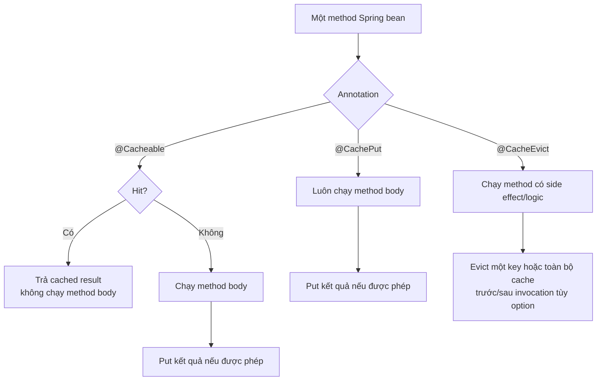
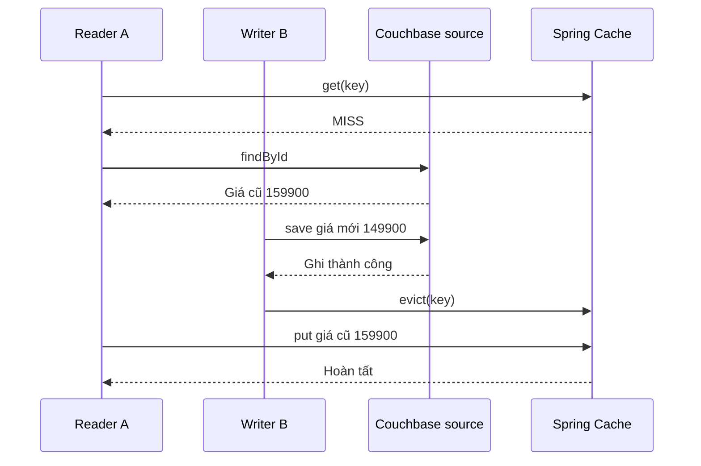

# @Cacheable, @CachePut và @CacheEvict

## Mục tiêu học tập

Sau bài này, bạn có thể:

1. Phân biệt chính xác tác dụng của `@Cacheable`, `@CachePut`, `@CacheEvict` đối với **việc thực thi phương thức**, **giá trị cache** và **document nghiệp vụ**.
2. Viết biểu thức `key` theo Spring Expression Language (SpEL), phân biệt `condition` với `unless`, và hiểu lúc nào `#result` khả dụng.
3. Dùng `beforeInvocation`, `allEntries`, `@Caching` và `@CacheConfig` đúng phạm vi; không vô tình vô hiệu hóa toàn bộ cache khi chỉ sửa một document.
4. Tổ chức luồng **đọc cache → tải nguồn → tạo DTO → lưu cache**, cập nhật nguồn kèm evict, hoặc tính lại DTO bằng put.
5. Bảo đảm cache key phản ánh tenant và các đầu vào ảnh hưởng kết quả, đồng thời đặt authorization tại ranh giới vẫn chạy khi cache hit.
6. Giải thích TTL, CAS, transaction synchronization, self-invocation, cache stampede và consistency của Couchbase ảnh hưởng thế nào đến kết quả cache.
7. Viết kiểm thử chứng minh hit/miss, put/evict, thời điểm xóa, lỗi, cache stale và hành vi giữa nhiều application instance.

**Bối cảnh:** Module `SPRING_DATA_COUCHBASE` dạy cách xây dựng tầng truy cập Couchbase bằng document mapping, repository, `CouchbaseTemplate` và truy vấn SQL++, gắn với thiết kế bucket/scope/collection, chỉ mục, TTL, CAS, giao dịch và lựa chọn API reactive. Bài thuộc chương **Bộ nhớ đệm**, tập trung vào ba annotation **điều phối cache ở mức phương thức**; không được nhầm chúng với lệnh CRUD của Couchbase.

> **Câu chốt:** `@Cacheable` quyết định **có cần chạy phương thức hay không**; `@CachePut` **chạy phương thức và lưu kết quả mới**; `@CacheEvict` **xóa bản sao trong cache**. Cả ba không tự ghi/xóa document nguồn khi bạn chưa viết thao tác repository/Template tương ứng.

## 1. Bài toán: một sản phẩm, ba đường truy cập

Giả sử hệ thống bán hàng có nguồn dữ liệu sản phẩm trong bucket `appdata`, scope `catalog`, collection `products`. Document ID của tenant `tenant-42` với SKU `P1001` là:

```text
appdata.catalog.products
└── product::tenant-42::P1001
```

Document nguồn:

```json
{
  "_class": "com.example.catalog.ProductDocument",
  "tenantId": "tenant-42",
  "sku": "P1001",
  "name": "Bàn phím cơ",
  "priceCents": 159900,
  "active": true
}
```

Trang danh mục chỉ cần read model `ProductCard(sku, name, priceCents)`. Nếu mỗi request đều phải làm phép tổng hợp SQL++, gọi dịch vụ ngoài, xử lý giá hiển thị hoặc tìm nhiều document, có thể đáng cache DTO này.

Ba luồng nghiệp vụ:

- **Xem sản phẩm:** Ưu tiên trả `ProductCard` cache nếu còn; nếu miss mới đọc document nguồn và tạo DTO → `@Cacheable`.
- **Chủ động nạp lại sản phẩm:** Phải đọc nguồn và tạo lại DTO dù cache đã có → `@CachePut`.
- **Sửa giá sản phẩm:** Ghi document nguồn, sau đó bỏ bản sao cũ để lần đọc sau tải lại → `@CacheEvict`.



## 2. Bảng ngữ nghĩa của ba annotation

| Đặc tính | `@Cacheable` | `@CachePut` | `@CacheEvict` |
| --- | --- | --- | --- |
| Lần cache hit có chạy method body? | **Không**, khi điều kiện cache cho phép | **Có**, không dùng cache hit để bỏ qua method | **Có**, method là trigger cho eviction |
| Lần cache miss | Chạy method, có thể put kết quả | Chạy method, có thể put kết quả | Không cần dữ liệu cache để chạy method |
| Thao tác cache chính | Get, rồi put nếu miss | Put kết quả trả về | Evict key hoặc toàn cache |
| Có cần method trả giá trị? | Có, để cache result | Có, để ghi result | Có thể trả `void` |
| `condition` | Đánh giá **trước** invocation | Đánh giá theo ngữ cảnh annotation, có thể dùng result | Điều kiện cho việc evict |
| `unless` | Chặn put **sau** khi method trả kết quả | Chặn put kết quả | Không có thuộc tính `unless` |
| `beforeInvocation` | Không hỗ trợ | Không hỗ trợ | Có: mặc định `false` |
| `allEntries` | Không hỗ trợ | Không hỗ trợ | Có: mặc định `false` |
| Tác động trực tiếp tới document nguồn? | Không | Không | Không |
| Khi method ném exception | Thường không put kết quả | Không put kết quả không tồn tại | Sau invocation mặc định **không evict** nếu ném lỗi |

**Tách hai loại dữ liệu:** `repository.save(product)` thay document nghiệp vụ; `Cache.put(key, card)` ghi bản sao `ProductCard`. Dù cache backend cũng là Couchbase Server, đây vẫn là hai hợp đồng độc lập.

### 2.1. Cache-aside không đồng nghĩa durable write

Dữ liệu nguồn chịu chính sách kinh doanh, CAS, durability và transaction phù hợp. Cache entry có thể bị evict, hết TTL hoặc xóa toàn bộ để tái tạo. Không lưu dữ liệu duy nhất như lệnh thanh toán, biên bản audit bắt buộc hoặc idempotency key chỉ trong cache có TTL ngắn.

### 2.2. Cùng một method có nên vừa @Cacheable vừa @CachePut?

**Thông thường không.** `@Cacheable` có thể bỏ qua method khi hit; `@CachePut` yêu cầu method chạy để cập nhật cache. Spring Framework khuyến cáo không kết hợp cả hai trên cùng một method, trừ trường hợp điều kiện loại trừ nhau thật rõ ràng. Tách một method **đọc có cache** và một method **làm mới bắt buộc** sẽ dễ hiểu hơn.

## 3. Thiết lập tối thiểu cho Spring Data Couchbase và Spring Cache

Spring Boot có thể cấu hình `CouchbaseCacheManager` nếu có dependency tương thích và `CacheManager` không bị bean khác chiếm ưu tiên. Cần bật cache infrastructure riêng bằng `@EnableCaching`.

Ví dụ Gradle:

```groovy
dependencies {
    implementation 'org.springframework.boot:spring-boot-starter-data-couchbase'
    implementation 'org.springframework.boot:spring-boot-starter-cache'
    implementation 'org.springframework.boot:spring-boot-starter-web'
}
```

`spring-boot-starter-web` chỉ dành cho ví dụ REST; một background service dùng cache không nhất thiết có HTTP controller.

### 3.1. Kích hoạt @EnableCaching

```java
package com.example.catalog;

import org.springframework.cache.annotation.EnableCaching;
import org.springframework.context.annotation.Configuration;

@Configuration(proxyBeanMethods = false)
@EnableCaching
public class CacheInfrastructureConfiguration {
}
```

Bean này phải nằm trong Spring application context đã quét các service sử dụng cache annotation. `@EnableCaching` không tự quyết định provider là Couchbase, Redis, Caffeine hay in-memory.

### 3.2. Chọn Couchbase backend và TTL mặc định qua Spring Boot

```yaml
spring:
  couchbase:
    connection-string: couchbase://localhost
    username: app_user
    password: ${COUCHBASE_PASSWORD}
  data:
    couchbase:
      bucket-name: appdata
  cache:
    type: couchbase
    cache-names: productCards,categorySummary
    couchbase:
      expiration: 5m
```

- `spring.cache.type: couchbase` chọn provider khi Spring Boot có đủ điều kiện auto-configuration.
- `spring.cache.cache-names` là các **cache name logic**, không có nghĩa Couchbase tự tạo collection tương ứng.
- `spring.cache.couchbase.expiration` thiết lập expiry cho entry của Spring Cache; đây không phải TTL của entity `ProductDocument`.
- Cần Couchbase account đủ quyền, bucket/scope/collection tồn tại và cấu hình đúng phiên bản Spring Boot.
- Không ghi mật khẩu thật vào source; môi trường production lấy từ secret manager hoặc biến môi trường.

Với nhu cầu chọn collection cache khác với nơi lưu document nguồn, có thể khai báo `CouchbaseCacheManager` thủ công và dùng factory đã được Spring quản lý:

```java
import java.time.Duration;

import org.springframework.context.annotation.Bean;
import org.springframework.context.annotation.Configuration;
import org.springframework.data.couchbase.cache.CouchbaseCacheConfiguration;
import org.springframework.data.couchbase.cache.CouchbaseCacheManager;
import org.springframework.data.couchbase.core.CouchbaseOperations;

@Configuration(proxyBeanMethods = false)
public class CouchbaseCacheBackendConfiguration {

    @Bean
    CouchbaseCacheManager cacheManager(
            CouchbaseOperations operations) {

        var scopedFactory = operations
                .getCouchbaseClientFactory()
                .withScope("cache");

        var config = CouchbaseCacheConfiguration
                .defaultCacheConfig()
                .collection("entries")
                .entryExpiry(Duration.ofMinutes(5))
                .disableCachingNullValues();

        return CouchbaseCacheManager.builder(scopedFactory)
                .withCacheConfiguration("productCards", config)
                .withCacheConfiguration(
                        "categorySummary",
                        config.entryExpiry(Duration.ofSeconds(30)))
                .transactionAware()
                .build();
    }
}
```

**Chọn một trong hai đường cấu hình:** Khi khai báo bean `CacheManager` thủ công, thường không cần yêu cầu Boot tạo thêm bean `cacheManager` thứ hai. Tên builder/API có thể khác theo phiên bản; đối chiếu Javadoc của dependency đã khóa trước khi triển khai. Hai cache có thể dùng cùng collection `appdata.cache.entries` nhưng key được phân biệt bằng cache name/prefix của provider.

Tài liệu Spring Data Couchbase lưu ý một số thao tác như `cache.clear()`/`cache.invalidate()` có thể đòi index trên keyspace. Chỉ cấu hình index cần thiết qua quy trình vận hành, không thêm primary index không giới hạn cho mọi collection production.

## 4. Entity nguồn và DTO được cache

Ví dụ dùng document nguồn `appdata.catalog.products`:

```java
package com.example.catalog;

import org.springframework.data.annotation.Id;
import org.springframework.data.annotation.Version;
import org.springframework.data.couchbase.core.mapping.Collection;
import org.springframework.data.couchbase.core.mapping.Document;
import org.springframework.data.couchbase.core.mapping.Field;
import org.springframework.data.couchbase.core.mapping.Scope;

@Document
@Scope("catalog")
@Collection("products")
public class ProductDocument {

    @Id
    private String id;

    @Field
    private String tenantId;

    @Field
    private String sku;

    @Field
    private String name;

    @Field
    private long priceCents;

    @Field
    private String categoryId;

    @Field
    private boolean active;

    @Version
    private Long version;

    public ProductDocument() {}

    public ProductDocument(
            String id, String tenantId, String sku,
            String name, long priceCents,
            String categoryId, boolean active) {
        this.id = id;
        this.tenantId = tenantId;
        this.sku = sku;
        this.name = name;
        this.priceCents = priceCents;
        this.categoryId = categoryId;
        this.active = active;
    }

    public String getId() { return id; }
    public void setId(String value) { id = value; }

    public String getTenantId() { return tenantId; }
    public void setTenantId(String value) { tenantId = value; }

    public String getSku() { return sku; }
    public void setSku(String value) { sku = value; }

    public String getName() { return name; }
    public void setName(String value) { name = value; }

    public long getPriceCents() { return priceCents; }
    public void setPriceCents(long value) { priceCents = value; }

    public String getCategoryId() { return categoryId; }
    public void setCategoryId(String value) { categoryId = value; }

    public boolean isActive() { return active; }
    public void setActive(boolean value) { active = value; }

    public Long getVersion() { return version; }
}
```

Repository nguồn:

```java
package com.example.catalog;

import org.springframework.data.couchbase.repository.CouchbaseRepository;

public interface ProductRepository
        extends CouchbaseRepository<ProductDocument, String> {
}
```

DTO dùng để hiển thị:

```java
package com.example.catalog;

public record ProductCard(
        String sku,
        String name,
        long priceCents) {
}
```

Phân biệt ba loại khóa:

| Khóa | Ví dụ | Vai trò |
| --- | --- | --- |
| Document ID | `product::tenant-42::P1001` | KV key ở collection `catalog.products` |
| Cache name | `productCards` | Namespace logic trong `CacheManager` |
| Cache key | `tenant-42::P1001` | Kết quả gọi method của tenant/SKU này |

Provider có thể thêm prefix như `productCards::` vào key vật lý. Không lấy format key vật lý làm hợp đồng công khai và không tự ghi đè cache document bằng `repository.save(ProductDocument)`.

### 4.1. Helper định danh dữ liệu nguồn

```java
package com.example.catalog;

public final class ProductIds {

    private ProductIds() {}

    public static String documentId(String tenantId, String sku) {
        if (tenantId == null || tenantId.isBlank()
                || sku == null || sku.isBlank()) {
            throw new IllegalArgumentException(
                    "tenantId và sku không được rỗng");
        }
        return "product::" + tenantId + "::" + sku;
    }
}
```

Hệ thống thực cần validate/canonicalize tenant ID và SKU để không có va chạm do ký tự phân tách. Hãy lấy tenant từ security context đã xác thực, không nhận raw tenant tùy ý từ client.

## 5. @Cacheable: đọc cache trước, method chạy khi miss

Đây là nơi nên đặt caching của một **read model có thể tái tạo**:

```java
package com.example.catalog;

import java.util.NoSuchElementException;

import org.springframework.cache.annotation.Cacheable;
import org.springframework.stereotype.Service;

@Service
public class ProductCardReader {

    private final ProductRepository repository;

    public ProductCardReader(ProductRepository repository) {
        this.repository = repository;
    }

    @Cacheable(
            cacheNames = "productCards",
            key = "#p0 + '::' + #p1",
            condition = "#p0 != null && !#p0.isBlank()",
            unless = "#result == null")
    public ProductCard getCard(String tenantId, String sku) {
        ProductDocument doc = repository
                .findById(ProductIds.documentId(tenantId, sku))
                .orElseThrow(() -> new NoSuchElementException(
                        "Không tìm thấy sản phẩm"));

        if (!tenantId.equals(doc.getTenantId())) {
            throw new SecurityException("Sai tenant");
        }

        if (!doc.isActive()) {
            throw new NoSuchElementException(
                    "Sản phẩm chưa được công bố");
        }

        return new ProductCard(
                doc.getSku(),
                doc.getName(),
                doc.getPriceCents());
    }
}
```

Lần đầu gọi `getCard("tenant-42", "P1001")` qua Spring proxy:

1. Tạo key `tenant-42::P1001`.
2. Kiểm tra cache `productCards` trong `CacheManager`.
3. Nếu miss, method thật truy cập repository, map entity thành `ProductCard`.
4. Spring có thể đưa `ProductCard` vào cache.
5. Cùng key ở lần gọi sau: **cache hit có thể bỏ qua toàn bộ body của method**, kể cả phép đọc repository.

Mã `unless = "#result == null"` hữu ích nếu service có thể trả null. Trong ví dụ này method ném exception khi không tìm thấy, nên không cache lỗi. Exception không nên được gộp thành một DTO “sản phẩm không tồn tại” có TTL dài mà không có chủ đích negative caching.

**Cảnh báo bảo mật:** Kiểm tra `tenantId` bên trong body của method có cache chỉ chạy khi miss. Nếu cache hit, body không chạy. Phải xác thực người gọi và tenant **trước khi gọi bean này**, ví dụ qua HTTP security filter hoặc facade được Spring quản lý. Key phân tenant giúp tách giá trị, nhưng không thay thế authorization.

### 5.1. Tình huống hit/miss và hành vi thực tế

| Lần gọi | Cache trước đó | Method body chạy? | Kết quả |
| --- | --- | --- | --- |
| `getCard(A, P1)` lần đầu | Không có key A/P1 | Có | Đọc source rồi put |
| `getCard(A, P1)` lần hai | Key A/P1 còn hạn | Không | Trả cached `ProductCard` |
| `getCard(B, P1)` | Chỉ có key A/P1 | Có | Đọc source của tenant B |
| `getCard(A, P2)` | Chỉ có key A/P1 | Có | Đọc source của SKU khác |
| `getCard(A, P1)` sau evict | Key đã bị xóa | Có | Đọc lại source |
| `getCard(A, P1)` sau TTL | Key đã hết hạn | Có | Đọc lại source |
| Cache backend lỗi | Không phải một cache miss bình thường | Phụ thuộc `CacheErrorHandler` | Theo fail-open/fail-closed được thiết kế |

### 5.2. condition khác unless ở thời điểm nào?

Cả hai biểu thức đều dùng SpEL nhưng ngữ nghĩa khác nhau:

```java
@Cacheable(
    cacheNames = "productCards",
    key = "#p0 + '::' + #p1",
    condition = "#p0 != 'internal-test'",
    unless = "#result == null || #result.priceCents() <= 0")
public ProductCard getCard(String tenantId, String sku) {
    // Load từ source.
}
```

- `condition` được xét **trước khi gọi method**. Nếu false, lời gọi không dùng cache cho invocation này; body chạy như bình thường.
- `unless` được xét **sau khi method trả kết quả**. Nếu true, kết quả không được put vào cache. Nó không ngăn cache hit đã trả sớm.
- `#result` chỉ khả dụng ở những biểu thức hỗ trợ kết quả của method, như `unless` của `@Cacheable`; không dùng `#result` trong `condition` trước invocation của `@Cacheable`.
- Với `Optional<ProductCard>`, Spring Cache có quy tắc unwrap cho `#result`; nên dùng safe navigation khi trường hợp không có giá trị có thể xuất hiện.

Ví dụ trên là phác thảo điều kiện cache, không đặt cạnh class `ProductCardReader` thành method trùng chữ ký trong cùng class. Với record `ProductCard`, biểu thức `#result.priceCents()` truy cập accessor công khai.

### 5.3. default key và explicit key

Nếu không đặt `key`, Spring dùng `SimpleKeyGenerator`:

- Không tham số → `SimpleKey.EMPTY`.
- Một tham số → chính tham số đó.
- Nhiều tham số → `SimpleKey` chứa các tham số.

Cách này thường hợp lý với immutable input có `equals/hashCode` đúng. Nhưng khi kết quả phụ thuộc tenant, locale, currency, feature flag, quyền, thời điểm hoặc version, hãy xét kỹ những giá trị nào phải có trong key.

SpEL `#p0` và `#p1` không phụ thuộc compiler có giữ tên tham số Java hay không; `#tenantId` và `#sku` phụ thuộc metadata parameter names hoặc cấu hình hỗ trợ. Với key phức tạp, triển khai bean `KeyGenerator` được kiểm thử và sử dụng `keyGenerator = "..."`. **Không đặt đồng thời `key` và `keyGenerator`** trên cùng cache operation.

## 6. @CachePut: luôn chạy phương thức, rồi put kết quả

`@CachePut` phù hợp để **làm mới cache từ nguồn đã được xác định là hợp lệ**. Khác `@Cacheable`, một cache hit cũ không làm method bị bỏ qua.

```java
package com.example.catalog;

import java.util.NoSuchElementException;

import org.springframework.cache.annotation.CachePut;
import org.springframework.stereotype.Service;

@Service
public class ProductCardRefresher {

    private final ProductRepository repository;

    public ProductCardRefresher(ProductRepository repository) {
        this.repository = repository;
    }

    @CachePut(
            cacheNames = "productCards",
            key = "#p0 + '::' + #p1",
            unless = "#result == null")
    public ProductCard refresh(String tenantId, String sku) {
        ProductDocument doc = repository
                .findById(ProductIds.documentId(tenantId, sku))
                .orElseThrow(NoSuchElementException::new);

        if (!tenantId.equals(doc.getTenantId())) {
            throw new SecurityException("Sai tenant");
        }

        return new ProductCard(
                doc.getSku(),
                doc.getName(),
                doc.getPriceCents());
    }
}
```

Khi `refresh("tenant-42", "P1001")` chạy:

1. **Không hỏi cache có hit hay không để quyết định bỏ qua method**.
2. Truy vấn document nguồn theo ID.
3. Tạo `ProductCard`.
4. Put kết quả vào `productCards[tenant-42::P1001]` khi đủ điều kiện.

Nếu method ném exception trước khi có kết quả, Spring không có giá trị mới để put. Nếu read model trả null mà cấu hình cache đã `disableCachingNullValues()`, dùng `unless` hoặc hợp đồng không-null để tránh thao tác put null không hợp lệ.

**Không nhầm `@CachePut` với ghi database:** `refresh` không hề gọi `repository.save`. Nó chỉ cập nhật **cache result**. Nếu cần thay đổi giá sản phẩm, phải có một command service ghi document nguồn qua repository/Template và tuân thủ CAS/transaction.

### 6.1. Có thể dùng @CachePut trên method ghi nguồn không?

Có, nếu method thực sự:

1. Thực thi mutation nguồn hợp lệ.
2. Trả về **chính kiểu dữ liệu cache** theo key đã thống nhất.
3. Chỉ publish cache result khi transaction/commit có trạng thái cho phép.

Ví dụ ý tưởng:

```java
@CachePut(cacheNames = "productCards",
          key = "#p0 + '::' + #p1")
public ProductCard updatePriceAndReturnCard(
        String tenantId, String sku, long newPriceCents) {
    // Đọc entity có CAS, kiểm tra quyền/trạng thái.
    // repository.save(...) để ghi dữ liệu nguồn.
    // Trả ProductCard ứng với dữ liệu đã được commit/được phép công bố.
    return updatedCard;
}
```

Đây là **pseudo-code**: `updatedCard` tượng trưng cho kết quả nghiệp vụ, không phải biến đã khai báo trong đoạn độc lập. Ở production, đặc biệt khi có transaction, cache put trước commit có thể làm lộ giá trị chưa commit hoặc giá trị của một transaction sau đó rollback. Cần transaction-aware manager hoặc thiết kế invalidation/refresh sau commit đúng contract, không mặc định annotation tự giải quyết atomicity.

### 6.2. Dùng #result trong key của @CachePut

Một method tạo DTO có thể cần cache key từ kết quả (ví dụ ID do server cấp). `@CachePut` cho phép dùng `#result` ở những vị trí SpEL phù hợp:

```java
@CachePut(
    cacheNames = "productCards",
    key = "#result.tenantId() + '::' + #result.sku()",
    unless = "#result == null")
public TenantProductCard recalculate(String requestId) {
    // Trả DTO đã có tenantId và sku được xác thực.
    return calculateSourceReadModel(requestId);
}
```

`TenantProductCard` ở đây là DTO giả định có accessor `tenantId()`/`sku()`; `calculateSourceReadModel` là helper do ứng dụng định nghĩa. Chỉ dùng kiểu cấu hình này khi kết quả có key ổn định, khác null và bảo đảm quyền truy cập.

**Đừng dùng `#result` làm cách xác định key cho `@Cacheable` trước lúc cache lookup**, vì kết quả chưa tồn tại ở thời điểm đó.

## 7. @CacheEvict: loại bỏ một bản sao sau thay đổi nguồn

Một giá trị cache cũ phải được xóa khi dữ liệu nguồn thay đổi và chính sách stale không cho phép tiếp tục dùng.

```java
package com.example.catalog;

import java.util.NoSuchElementException;

import org.springframework.cache.annotation.CacheEvict;
import org.springframework.stereotype.Service;

@Service
public class ProductPriceWriter {

    private final ProductRepository repository;

    public ProductPriceWriter(ProductRepository repository) {
        this.repository = repository;
    }

    @CacheEvict(
            cacheNames = "productCards",
            key = "#p0 + '::' + #p1")
    public void updatePrice(
            String tenantId, String sku, long newPriceCents) {

        if (newPriceCents < 0) {
            throw new IllegalArgumentException(
                    "Giá không thể âm");
        }

        ProductDocument current = repository
                .findById(ProductIds.documentId(tenantId, sku))
                .orElseThrow(NoSuchElementException::new);

        if (!tenantId.equals(current.getTenantId())) {
            throw new SecurityException("Sai tenant");
        }

        current.setPriceCents(newPriceCents);
        repository.save(current);
    }
}
```

Khi gọi **qua Spring bean proxy**, method thực hiện thao tác lưu nguồn. Với `beforeInvocation=false` (mặc định), eviction xảy ra sau khi method hoàn tất bình thường.

- Nếu `repository.save` thất bại và method ném exception, eviction sau invocation thường không được thực hiện.
- Nếu save thành công nhưng evict thất bại, source đã đổi mà cache có thể còn stale. Cần log, metric, retry/đối soát theo SLA.
- Nếu một tiến trình khác (SDK, job, dịch vụ thứ hai) sửa cùng source mà không đi qua service này, annotation không tự nhận biết thay đổi.
- Nếu use case có transaction nhiều document, kết thúc method **không đồng nghĩa commit đã thành công**; hãy xem phần transaction synchronization.

### 7.1. beforeInvocation: trước và sau khác nhau thế nào?

```java
// Mặc định: evict sau khi method thành công.
@CacheEvict(cacheNames = "productCards",
            key = "#p0 + '::' + #p1")
public void updatePrice(String tenantId, String sku, long price) {
    // Mutation nguồn.
}

// Ngoại lệ: evict trước khi method chạy, kể cả method sau đó lỗi.
@CacheEvict(cacheNames = "productCards",
            key = "#p0 + '::' + #p1",
            beforeInvocation = true)
public void forceInvalidateBeforeRefresh(
        String tenantId, String sku) {
    // Thao tác khác, kết quả không quyết định việc evict.
}
```

*Hai method ở ví dụ trên là hai tình huống riêng; không đặt annotation trước khi sửa giá rồi mặc định coi dữ liệu luôn nhất quán.*

| Trường hợp | Mặc định `beforeInvocation=false` | `beforeInvocation=true` |
| --- | --- | --- |
| Method thành công | Evict sau method | Evict trước method |
| Method ném lỗi | **Không evict** theo contract after invocation | **Đã evict** trước khi lỗi xảy ra |
| Dữ liệu nguồn vẫn chưa commit | Có thể đã kết thúc method, chưa commit | Có nguy cơ reader tải lại dữ liệu cũ sớm hơn |
| Công dụng thường gặp | Thay đổi nguồn thành công rồi bỏ cache | Bắt buộc làm rỗng cache trước một thao tác độc lập với kết quả |

Evict trước method đôi khi hợp lý cho tác vụ “reset cache rồi tải dữ liệu” nhưng có thể làm cache miss tải lại **giá trị cũ** trước khi transaction commit. Nó không phải phương án mặc định cho cập nhật dữ liệu nguồn.

### 7.2. allEntries: xóa cả cache, không chỉ một key

```java
@CacheEvict(cacheNames = "categorySummary",
            allEntries = true)
public void invalidateAllCategorySummaries() {
    // Tác vụ quản trị có kiểm soát.
}
```

`allEntries=true` yêu cầu evict toàn bộ cache name được chỉ định. Khi đó `key` không còn ý nghĩa. Đây là thao tác phạm vi lớn, có thể làm giảm hit ratio và gây cache stampede.

Với Couchbase-backed cache, `clear()/invalidate()` có thể cần index phù hợp để tìm/xóa entries. Không cho phép client public tự gọi eviction toàn cache vì một document thay đổi; ưu tiên key chính xác hoặc nhóm dependency được thiết kế rõ.

## 8. @Caching và @CacheConfig: khi nhiều vùng cache liên quan

### 8.1. @Caching cho nhiều evict có key khác nhau

Một thay đổi giá có thể ảnh hưởng cả card của sản phẩm lẫn summary của category. Có thể kết hợp hai eviction:

```java
import org.springframework.cache.annotation.CacheEvict;
import org.springframework.cache.annotation.Caching;

@Caching(evict = {
    @CacheEvict(
        cacheNames = "productCards",
        key = "#p0 + '::' + #p1"),
    @CacheEvict(
        cacheNames = "categorySummary",
        key = "#p0 + '::' + #p2")
})
public void updateAndInvalidate(
        String tenantId,
        String sku,
        String categoryId,
        long priceCents) {
    // Validation, authorization, đọc source và kiểm tra categoryId.
    // Thực hiện cập nhật giá qua repository.save(...).
}
```

**Quan trọng:** Category ID phải được lấy/xác minh từ document nguồn, không tin một chuỗi client tùy ý. Nếu sản phẩm được chuyển category, có thể cần evict cả **category cũ và mới**. Đặt logic đó ở tầng nghiệp vụ hoặc dùng event/outbox có danh sách những key cần invalidate, thay vì dựa vào tham số sai.

Có thể kết hợp nhiều `@CachePut` hoặc `@CacheEvict` qua `@Caching`. Tuy nhiên, không đặt `@Cacheable` và `@CachePut` cho cùng một lời gọi một cách máy móc; hợp đồng bỏ qua method khi hit xung đột với việc luôn chạy để put.

### 8.2. @CacheConfig chia sẻ cấu hình class-level

```java
import org.springframework.cache.annotation.CacheConfig;
import org.springframework.cache.annotation.Cacheable;
import org.springframework.stereotype.Service;

@Service
@CacheConfig(cacheNames = "productCards")
public class ProductCardReadAdapter {

    @Cacheable(key = "#p0 + '::' + #p1")
    public ProductCard get(String tenantId, String sku) {
        // Đọc source và chuyển thành ProductCard.
        return loadAndMap(tenantId, sku);
    }
}
```

`@CacheConfig` cho phép chia sẻ cache name, key generator, cache manager hoặc cache resolver ở mức class. Nó **không tự bật caching cho mọi method**: mỗi method cần annotation tương ứng.

*Ví dụ class trên là phác thảo, `loadAndMap` là helper do ứng dụng định nghĩa; trong bài thực hành đầy đủ dùng class `ProductCardReader` từ phần 5.*

### 8.3. Không trùng key giữa các vùng cache

`productCards[tenant-42::P1001]` và `categorySummary[tenant-42::keyboards]` là hai cache khác nhau; provider phải prefix cache name hoặc quản lý keyspace riêng phù hợp. Không lưu nguyên entity nguồn trực tiếp vào cache entry rồi gọi nó là read model: converter, schema, metadata và nhu cầu update của entity khác với payload DTO.

## 9. Key consistency: một quy ước cho đọc, put và evict

Vì ba annotation tác động các thời điểm khác nhau, cách sinh key phải **chính xác như nhau**:

```text
@Cacheable productCards -> key = tenantId :: sku
@CachePut  productCards -> key = tenantId :: sku
@CacheEvict productCards -> key = tenantId :: sku
```

Nếu reader dùng `tenant-42::P1001` nhưng writer evict `P1001`, eviction **không xóa** entry reader đang dùng.

Các điểm cần kiểm tra:

1. **Tenant từ security context:** cùng SKU giữa hai tenant phải có key tách biệt.
2. **Tất cả input làm thay đổi result:** locale, currency, role, feature flags, version.
3. **Canonicalization:** tránh nhập nhằng khi key chứa dấu phân tách hoặc ký tự Unicode.
4. **Namespace:** cache name/prefix phân biệt `productCards` với `categorySummary`.
5. **Không đưa bí mật vào key:** token, mật khẩu, địa chỉ riêng tư không nên có trong key/log.
6. **Không dựa vào object mutable:** default key từ một object bị thay đổi hash/equals có thể không tra lại được.
7. **Quy trình migration:** nếu format key hoặc DTO đổi giữa bản deploy, xem xét versioned namespace và TTL để tránh đọc entry cũ không giải mã được.

### 9.1. KeyGenerator cho nhiều method và ít trùng lặp

Khi nhiều service cùng sử dụng quy tắc, có thể tạo bean `KeyGenerator`. Ví dụ đơn giản chỉ minh họa cách khai báo:

```java
import org.springframework.cache.interceptor.KeyGenerator;
import org.springframework.context.annotation.Bean;
import org.springframework.context.annotation.Configuration;

@Configuration(proxyBeanMethods = false)
public class CatalogKeyConfiguration {

    @Bean("productCardKey")
    KeyGenerator productCardKey() {
        return (target, method, args) -> {
            if (args.length < 2
                    || !(args[0] instanceof String)
                    || !(args[1] instanceof String)) {
                throw new IllegalArgumentException(
                        "Cần tenantId và sku dạng String");
            }
            String tenant = (String) args[0];
            String sku = (String) args[1];

            if (tenant.isBlank() || sku.isBlank()) {
                throw new IllegalArgumentException(
                        "tenantId/sku rỗng");
            }
            return tenant + "::" + sku;
        };
    }
}
```

Dùng:

```java
@Cacheable(cacheNames = "productCards",
           keyGenerator = "productCardKey")
public ProductCard getCard(String tenantId, String sku) {
    // ...
    return card;
}
```

Đây là ví dụ về **cách chia sẻ key generation**; trong ứng dụng thật cần thêm canonicalization và bảo vệ ký tự phân tách. `key` và `keyGenerator` là hai phương án loại trừ nhau; trên một annotation không dùng cả hai.

## 10. TTL, expiry và thời gian chấp nhận dữ liệu cũ

Cache entry có thể hết hạn độc lập với document nguồn. Với Couchbase-backed Spring Cache, `CouchbaseCacheConfiguration.entryExpiry(Duration)` quy định TTL của cache entry.

```text
12:00:00 ProductDocument.priceCents = 159900
12:00:10 @Cacheable miss -> ProductCard(159900), TTL 5 phút
12:01:00 Admin sửa giá nguồn thành 149900
12:01:01 Nếu không evict, cache hit có thể trả 159900
12:01:02 Sau evict, lượt miss tiếp theo đọc giá mới
12:05:10 Nếu không evict, cache entry cũ hết TTL
```

Một vài hệ quả:

- TTL 5 phút là giới hạn cache entry tồn tại **từ lúc put**, không bảo đảm mọi client thấy mutation nguồn trong 5 phút theo một snapshot chính xác.
- Nếu source thay đổi trong lúc cache miss đang chạy, stale entry vẫn có thể được put trở lại sau một eviction.
- TTL của `@Document(expiry)`/`withExpiry` trên entity nguồn khác với TTL cache entry.
- `Duration.ZERO` trên cấu hình expiry cache có thể có ý nghĩa không hết hạn theo Javadoc, nhưng quy tắc `maxExpiry` của bucket/collection vẫn cần kiểm tra.
- Không dùng cache chứa thông tin quyết định giá cuối cùng, số dư hoặc tồn kho tại commit nếu nghiệp vụ đòi dữ liệu mới nhất.

### 10.1. Vì sao dùng Couchbase cache có thể không tăng tốc KV read đơn giản?

Nếu source chỉ cần `findById` một document nhỏ bằng KV, cache hit trên chính Couchbase cũng là KV request tới một entry khác. Cache có thêm chi phí tuần tự hóa và invalidation.

Couchbase-backed cache thường có lợi hơn cho **read model tổng hợp**, truy vấn SQL++ đắt, dữ liệu được chia sẻ giữa nhiều app instance hoặc lời gọi dịch vụ ngoài. Đo p50/p95/p99 và hit ratio trước khi quyết định cache cả một CRUD endpoint.

## 11. Vấn đề cạnh tranh: update, evict và cache miss đồng thời

Giả sử cache-aside:



Kết quả: một cache miss đang chạy đã nạp bản cũ **sau khi writer evict**, làm cache stale trở lại.

**Điều này có thể xảy ra ngay cả khi đã chọn eviction sau commit.** `@Cacheable` và `@CacheEvict` không tạo tính tuyến tính (*linearizability*) xuyên các lượt đọc/ghi độc lập. Các lựa chọn để giảm rủi ro:

- Cache DTO chấp nhận stale trong khoảng thời gian định trước.
- Giảm TTL, dùng invalidation theo event sau mutation và quan sát lỗi delivery.
- Gắn version của source vào payload/key, xác minh version nếu use case yêu cầu.
- Dùng single-flight/locking ở mức phù hợp khi tải source quá lớn.
- **Không cache** những dữ liệu phải được xác minh mới nhất tại thời điểm quyết định nghiệp vụ.

### 11.1. @Cacheable(sync = true) có giải quyết tất cả?

`@Cacheable(sync = true)` yêu cầu provider phối hợp việc tính lại một key, phù hợp khi nhiều luồng cùng miss trong một phạm vi được hỗ trợ. Nhưng nó **không mặc nhiên là distributed lock** giữa nhiều JVM/instance hay một transaction với nguồn Couchbase.

Nó còn có giới hạn kết hợp với cache names, `unless` và những annotation khác theo hợp đồng Spring Framework. Ví dụ:

```java
@Cacheable(cacheNames = "categorySummary",
           key = "#p0 + '::' + #p1",
           sync = true)
public CategorySummary loadSummary(
        String tenantId, String categoryId) {
    // Query SQL++ tốn chi phí, chuyển thành CategorySummary.
    return calculateSummary(tenantId, categoryId);
}
```

`CategorySummary`/`calculateSummary` là read model/helper giả định. Nếu cần chống stampede **xuyên nhiều instance**, phải kiểm tra khả năng của cache provider, đo thực tế và thiết kế điều phối riêng. Không dùng đồng thời `sync=true` và `unless` trong cấu hình không được hỗ trợ.

## 12. Transaction-aware cache và thời điểm commit

Một method ghi nhiều document có thể dùng Couchbase Transactions. Khi đó thời điểm method kết thúc không đồng nghĩa transaction đã commit. Có thể cấu hình cache manager transaction-aware:

```java
return CouchbaseCacheManager.builder(scopedFactory)
        .withCacheConfiguration("productCards", config)
        .transactionAware()
        .build();
```

Ý nghĩa: những thao tác put/evict thích hợp có thể được Spring Cache đồng bộ với transaction Spring đang hoạt động, thường thực thi khi commit thành công, thay vì làm quá sớm.

**Nhưng đây không phải một distributed transaction thống nhất giữa source và cache**. Vẫn có các trường hợp:

- Evict sau commit thất bại, trong khi source đã đổi.
- Cache miss cũ put giá trị stale trở lại sau eviction.
- Một writer khác sửa document ngoài đường annotation.
- Cache provider chưa hỗ trợ một option hoặc transaction manager thực tế không có transaction đang hoạt động.
- HTTP timeout khiến caller chưa chắc mutation/commit đã hoàn tất.

### 12.1. Minh họa ranh giới có transaction

```java
import org.springframework.cache.annotation.CacheEvict;
import org.springframework.transaction.annotation.Transactional;

@Transactional
@CacheEvict(cacheNames = "productCards",
            key = "#p0 + '::' + #p1")
public void updateProductAndAudit(
        String tenantId, String sku, long price) {
    // Trong một Spring-managed transaction Couchbase đã cấu hình:
    //   1) Đọc/sửa ProductDocument bằng operations/repository được hỗ trợ.
    //   2) Insert AuditDocument, cùng transaction context.
    //   3) Trả về/throw; manager chịu trách nhiệm commit/rollback.
}
```

Đây là phác thảo boundary. Cần cấu hình `CouchbaseTransactionManager`/transaction support phù hợp và xác minh **mọi mutation** thực sự tham gia transaction. Không gọi raw `collection.upsert` ngoài transaction context rồi tưởng `@Transactional` bao phủ nó.

**Quan trọng với Spring AOP:** Nếu một method `@Transactional` hoặc `@CacheEvict` được gọi qua `this.method(...)` trong cùng bean, proxy advice có thể bị bỏ qua. Nên thiết kế boundary rõ ở public service bean, được caller khác gọi qua proxy.

## 13. Spring AOP, self-invocation và annotation không chạy

Caching trong chế độ Spring proxy thông thường hoạt động khi caller đi qua bean proxy. Ví dụ:

```java
@Service
public class IncorrectService {

    public ProductCard outer(String tenantId, String sku) {
        // Self-invocation: bỏ qua caching advice ở getCard.
        return getCard(tenantId, sku);
    }

    @Cacheable(cacheNames = "productCards",
               key = "#p0 + '::' + #p1")
    public ProductCard getCard(String tenantId, String sku) {
        return loadAndMap(tenantId, sku);
    }
}
```

`loadAndMap` là helper giả định. Nếu gọi `outer` trên bean, `this.getCard` có thể chạy method body mọi lần. Cách sửa phổ biến là đưa reader vào **bean riêng** `ProductCardReader` và gọi bean đó từ facade qua dependency injection.

Những điều cần kiểm tra khi cache không hoạt động:

1. Có `@EnableCaching` trong context đang dùng không?
2. Bean có được Spring tạo, hay bị `new` trực tiếp?
3. Invocation có đi qua Spring proxy không?
4. Annotation ở public method có thể được advice không? Có vấn đề final/non-public không?
5. Cache name đúng với `CacheManager` đã cấu hình không?
6. `condition` có đang false, hoặc `unless` có chặn put không?
7. Key có ổn định giữa các lần gọi không?
8. TTL có quá ngắn khiến mọi lần đều miss không?
9. Có nhiều cache manager hoặc cache resolver được chọn nhầm không?
10. Khi dùng reactive API, đã kiểm tra phiên bản framework và cache provider chưa?

## 14. Reactive caching và giới hạn hành vi

Module `SPRING_DATA_COUCHBASE` có thể dùng `ReactiveCouchbaseOperations`/repository reactive. Đọc trực tiếp entity có dạng:

```java
import reactor.core.publisher.Mono;

public Mono<ProductDocument> loadSourceReactive(String id) {
    return reactiveOperations.findById(ProductDocument.class)
            .one(id);
}
```

`reactiveOperations` được giả định là bean `ReactiveCouchbaseOperations` đã inject.

Với Spring Framework hiện đại, annotation caching có hỗ trợ cho những method trả `CompletableFuture`/`Mono`/`Flux` trong các điều kiện nhất định. Tuy nhiên:

- Phải kiểm chứng sự tương thích của cache provider với cơ chế async/reactive caching ở **phiên bản cụ thể**.
- Không mặc định cache một `Flux` giống hệt cache một DTO đơn lẻ; một số tích hợp thu thập toàn bộ stream và việc này có thể tốn bộ nhớ.
- Cache hit có thể không thực thi pipeline nguồn, nên validation/authorization trong pipeline cũng có thể bị bỏ qua. Đặt guard ở ranh giới không bị cache hit skip.
- `Mono.timeout(…)`/cancellation không có nghĩa Couchbase mutation đã gửi bị rollback.
- Không gọi `block()` trên WebFlux event loop để ép kết quả cache thành blocking.
- Không tự `subscribe()` trong service rồi trả publisher khiến thao tác chạy nhiều lần.

Nếu provider chưa hỗ trợ kiểu reactive đáp ứng mục tiêu, có thể tách caching thành adapter rõ ràng ở tầng ứng dụng, hoặc chỉ cache kết quả synchronous read model thật sự phù hợp.

## 15. Null values, Optional và negative caching

Một phương thức có thể trả `Optional<ProductCard>` hoặc null khi không có nguồn:

```java
@Cacheable(cacheNames = "productCards",
           key = "#p0 + '::' + #p1",
           unless = "#result == null")
public java.util.Optional<ProductCard> findOptional(
        String tenantId, String sku) {
    // Trả Optional.empty() khi không tìm thấy.
    return findFromSource(tenantId, sku);
}
```

Trong Spring Cache, `Optional` được xử lý theo contract đặc biệt: `#result` thường tương ứng giá trị bên trong, không phải wrapper. Khi empty, `#result` có thể là null. `unless="#result == null"` vì vậy giúp tránh lưu kết quả thiếu dữ liệu.

**Negative caching** (cache 404/không tồn tại) có thể giảm tải trước một ID bị tra cứu liên tục, nhưng cũng có rủi ro document vừa được tạo vẫn bị xem là không tồn tại trong thời gian cache âm còn hạn. Nếu cần negative caching:

- Dùng kiểu kết quả thể hiện trạng thái rõ ràng và TTL ngắn.
- Evict khi tạo document thành công.
- Không cache kết quả unauthorized (401/403) để reuse chéo người dùng.
- Đảm bảo key tách tenant/permission và validation diễn ra ngoài cache hit.
- Không nhầm `Cache.put(key, null)` với `Cache.evict(key)`.

Nếu cache config đặt `disableCachingNullValues()`, nỗ lực put null có thể báo lỗi thay vì xóa entry cũ; hãy xác minh hành vi theo provider/Javadoc.

## 16. Xử lý lỗi và khả năng quan sát

Spring Cache có thể phát sinh lỗi ở ba loại thao tác: **get**, **put**, **evict**. Hãy thiết kế failure policy khác nhau theo mục tiêu:

| Lỗi | Tác động | Cách xử lý nên cân nhắc |
| --- | --- | --- |
| Cache GET timeout | Không lấy được bản sao; source có thể vẫn đọc được | Fail open sang source nếu nghiệp vụ cho phép, có metric |
| Cache PUT thất bại sau source read | Request có thể vẫn trả DTO đúng nhưng lượt sau miss | Log/metric, không làm mất dữ liệu nguồn |
| Cache EVICT thất bại sau source update | Có nguy cơ tiếp tục đọc cache stale | Cảnh báo, retry/đối soát, TTL giới hạn, có thể fail closed |
| Sai cache name/key | Evict nhầm hoặc miss liên tục | Kiểm thử tương thích key giữa reader/writer |
| DTO cache không giải mã được sau deploy | Schema/transcoder thay đổi | Versioned cache name/key, TTL hoặc migration |
| Query nguồn thiếu index | Miss biến thành SQL++ scan chậm | Tối ưu index, tránh che bằng timeout dài |
| CAS conflict khi cập nhật nguồn | Writer dùng entity/version cũ | Đọc lại nguồn, kiểm tra rule, retry giới hạn hoặc 409 |
| Evict all quá rộng | Nhiều request cùng miss, tăng tải nguồn | Ưu tiên evict một key hoặc invalidation theo nhóm |
| Cache hit chéo tenant | Rò dữ liệu | Ngăn phục vụ, khắc phục auth/key, kiểm tra sự cố bảo mật |

Có thể dùng `CacheErrorHandler` để xử lý lỗi cache ở tầng Spring; không bắt mọi exception thành `null` rồi nhầm lỗi cache với không có sản phẩm.

Các chỉ số nên giám sát: hit/miss theo cache name, cache get/put/evict latency, số eviction thất bại, TTL, tuổi dữ liệu, tỷ lệ stale được phát hiện, dung lượng entry, tỷ lệ query nguồn khi miss, p95/p99 của endpoint và khối lượng KV trên Couchbase.

### 16.1. Cache không phải nguồn sự thật cho quyết định quan trọng

Các quyết định như “còn đủ tồn kho không?”, “giá cuối cùng được thanh toán?”, “có thể hoàn tiền?” phải xác thực qua document nguồn và cơ chế CAS/transaction phù hợp. `@Cacheable` không tự áp dụng optimistic locking, durability hay scan consistency cho một cache hit.

## 17. Kiểm thử tích hợp và tiêu chí nghiệm thu

Chỉ cần một bài test với mock `ProductRepository` chưa đủ để khẳng định Couchbase-backed cache hoạt động. Nên kiểm thử **Spring proxy**, **CacheManager thật**, **collection thật** và **nguồn Couchbase** trong môi trường cô lập.

### 17.1. Kịch bản end-to-end

Chuẩn bị:

```text
Bucket: appdata
Scope: catalog, Collection: products
Scope: cache,   Collection: entries

Nguồn:
ID = product::tenant-42::P1001
priceCents = 159900
```

| Test | Thao tác | Kết quả mong đợi |
| --- | --- | --- |
| Kích hoạt | Kiểm tra `@EnableCaching` và class `CacheManager` | Provider đúng Couchbase |
| Miss | Gọi `ProductCardReader.getCard(A,P1)` lần đầu qua bean | Nạp nguồn và cache result |
| Hit | Gọi lần hai cùng tham số | Không chạy lại body/source read |
| Khác tenant | Gọi `getCard(B,P1)` | Không nhận dữ liệu A |
| CachePut | Gọi `ProductCardRefresher.refresh(A,P1)` | Method vẫn đọc nguồn, cache entry được thay |
| CacheEvict | Cập nhật qua `ProductPriceWriter.updatePrice(A,P1,...)` | Source đổi, key card bị evict |
| Reload | Gọi getCard sau eviction | Nạp giá mới |
| Thất bại update | Gây `OptimisticLockingFailureException`/validation error | Không evict theo default after invocation |
| beforeInvocation | Chạy method cố ý ném lỗi trên cache thử | Eviction đã diễn ra trước lỗi |
| allEntries | Chỉ chạy trên collection cache thử | Mọi entry cache name bị loại, có thể cần index |
| TTL | Đặt TTL cache ngắn và để source không hết hạn | Cache miss sau TTL; source còn |
| Self-invocation | Gọi method annotated từ `this` | Advice có thể bị bypass |
| Multi-instance | Hai app dùng chung cache keyspace | Entry chia sẻ, nhưng vẫn kiểm soát version/authorization |
| In-flight stale | Điều khiển lịch đọc cũ và evict đồng thời | Quan sát được race put stale sau evict |

### 17.2. Test xác nhận CacheManager được chọn

```java
import static org.assertj.core.api.Assertions.assertThat;

import org.junit.jupiter.api.Test;
import org.springframework.beans.factory.annotation.Autowired;
import org.springframework.boot.test.context.SpringBootTest;
import org.springframework.cache.CacheManager;
import org.springframework.data.couchbase.cache.CouchbaseCacheManager;

@SpringBootTest
class ProductCacheConfigurationTest {

    @Autowired
    CacheManager cacheManager;

    @Test
    void usesCouchbaseCacheManager() {
        assertThat(cacheManager)
                .isInstanceOf(CouchbaseCacheManager.class);

        assertThat(cacheManager.getCache("productCards"))
                .isNotNull();
    }
}
```

Test này cần Spring context có Couchbase connection phù hợp. Nếu cần dùng Testcontainers hoặc cụm test, chuẩn bị hạ tầng và dữ liệu trước; không chạy kiểm thử xóa toàn cache trên production.

### 17.3. Test đo invocation count qua bean

Có thể dùng spy trên repository hoặc một counter test-only trong body method:

```java
// Pseudo-code cho kiểm thử: caller dùng bean Spring, không new service.
var first = reader.getCard("tenant-42", "P1001");
var second = reader.getCard("tenant-42", "P1001");

assert first.equals(second);
// Xác minh repository chỉ được gọi 1 lần (với cache miss rồi hit).
// Gọi refresher.refresh(...): repository được gọi thêm lần nữa.
// Gọi writer.updatePrice(...), rồi reader.getCard(...):
// xác minh cache miss mới, giá trả về đã đổi.
```

Không tự `new ProductCardReader(repository)` rồi kết luận caching không chạy. Đó là object không qua Spring proxy.

## 18. Checklist cho triển khai production

- [ ] Chọn rõ nguồn sự thật và DTO có thể tái tạo; không dùng cache làm kho duy nhất cho dữ liệu nghiệp vụ.
- [ ] `@EnableCaching` được bật và đã xác minh `CacheManager` thật sự là Couchbase.
- [ ] Có keyspace cache riêng hoặc quy tắc namespace/prefix an toàn; collection đã được tạo và cấp RBAC tối thiểu.
- [ ] Mọi cache key bao gồm tenant từ context đã xác thực và các tham số ảnh hưởng result.
- [ ] Authorization diễn ra **trước** cache hit, không chỉ trong body method `@Cacheable`.
- [ ] `@Cacheable` dùng để đọc; `@CachePut` dùng khi thật sự phải làm mới; `@CacheEvict` dùng để xóa entry khi source đổi.
- [ ] Reader, refresher và writer dùng **cùng** cách tạo cache key; được kiểm thử bằng dữ liệu thật.
- [ ] `condition`/`unless` được đặt đúng thời điểm; không dùng `#result` trong chỗ chưa có kết quả.
- [ ] Eviction sau invocation là mặc định; `beforeInvocation=true` chỉ dùng có chủ đích.
- [ ] `allEntries=true` có phạm vi được duyệt; index/quyền/chi phí của clear đã được kiểm tra.
- [ ] TTL cache khác TTL document nguồn; định nghĩa thời gian stale được phép theo use case.
- [ ] Cache put/evict và transaction commit có hợp đồng rõ; không tuyên bố atomicity khi chưa có.
- [ ] Các writer bên ngoài service (SDK/batch/ứng dụng khác) có chính sách invalidation.
- [ ] Không dùng `sync=true` như distributed lock mặc định; đã kiểm thử stampede giữa nhiều instance.
- [ ] Có metric hit/miss, stale, cache provider lỗi, latency và phương án recovery sau schema change.

## 19. Bài thực hành

Chỉ sử dụng bucket/scope/collection thử nghiệm. Bắt đầu bằng `ProductDocument`/`ProductCard` và service ở các phần trên.

1. **Bật cache:** Bổ sung dependency, `@EnableCaching` và Couchbase-backed cache manager. Xác minh cache `productCards` có TTL 30 giây trong môi trường test.
2. **Miss/hit:** Insert `product::tenant-42::P1001`, gọi reader hai lần qua Spring bean. Chứng minh lần hai không đọc nguồn.
3. **condition:** Thêm `condition` để bỏ qua cache cho tenant test nội bộ. Kiểm tra cả lookup và put đều không diễn ra trong trường hợp condition false.
4. **unless:** Không cache ProductCard có giá bằng 0. Gọi lại method để thấy dữ liệu được tải mỗi lần; xem xét nghiệp vụ có cần cache kết quả này không.
5. **CachePut:** Thay đổi nguồn qua đường test rồi gọi refresher; xác minh method chạy dù key đã có và entry nhận giá mới.
6. **CacheEvict:** Cập nhật giá bằng writer; xác minh document nguồn vẫn tồn tại, entry cache bị xóa và lượt đọc tiếp theo thấy giá mới.
7. **Exception:** Làm `updatePrice` ném lỗi trước save; xác minh after-invocation eviction mặc định không xảy ra. Dùng một method thử `beforeInvocation=true` để so sánh.
8. **allEntries:** Với cache test, clear toàn bộ `productCards`; so sánh latency/ảnh hưởng với evict một key. Không làm trên môi trường production.
9. **Nhiều cache:** Tạo `categorySummary` và dùng `@Caching` để evict những read model thực sự phụ thuộc sản phẩm được sửa.
10. **Key:** Kiểm tra hai tenant có cùng SKU, locale/currency khác nhau, và ký tự phân tách trong SKU. Xây key generator chuẩn hóa nếu cần.
11. **Proxy:** Gọi method `@Cacheable` qua `this` và qua bean riêng. Giải thích kết quả khác nhau.
12. **Transaction:** Mô phỏng ghi nguồn rồi rollback với transaction manager Couchbase; so sánh cache manager transaction-aware và không transaction-aware.
13. **Concurrency:** Điều khiển hai request A/B như ví dụ phần 11, ghi nhận cache stale repopulation. Chọn một chiến lược giảm rủi ro.
14. **TTL:** Đợi cache entry hết hạn, xác minh entity nguồn vẫn tồn tại. Điều chỉnh TTL sao cho hit rate/độ stale đạt yêu cầu.
15. **Vận hành:** Ghi các metric hit/miss, cache get/put/evict error, p95/p99; so sánh API có và không có cache trên cùng workload.

### Câu hỏi tự kiểm tra

1. Khi `@Cacheable` hit, method body có chạy không? Điều gì xảy ra với authorization nằm trong body?
2. `@CachePut` có bắt buộc ghi document nguồn không? Nếu không, ai chịu trách nhiệm?
3. `@CacheEvict` có xóa document nguồn hay chỉ cache entry? Nếu source update thất bại, eviction mặc định có chạy không?
4. `condition` và `unless` khác nhau ở thời điểm đánh giá và khả năng dùng `#result` thế nào?
5. Vì sao `@Cacheable` và `@CachePut` không nên đặt chung một method trong use case thông thường?
6. Nếu reader dùng cache key `tenant::sku` còn evict dùng `sku`, điều gì xảy ra?
7. `beforeInvocation=true` nguy hiểm thế nào khi transaction source chưa commit?
8. `allEntries=true` có cần key không, và vì sao phải chú ý index/kích thước cache trên Couchbase?
9. `@CacheConfig` khác `@Caching` ở vai trò nào?
10. `transactionAware()` có làm source và cache atomic tuyệt đối không?
11. Vì sao `REQUEST_PLUS` hoặc CAS của document nguồn không tự làm mới một cache hit?
12. `@Cacheable(sync=true)` có phải distributed lock giữa mọi app instance không?
13. Nếu DTO trong cache thay đổi giữa hai phiên bản deploy, ứng dụng phải chuẩn bị biện pháp gì?
14. Trong ứng dụng WebFlux, điều gì phải kiểm chứng trước khi cache `Mono`/`Flux` bằng annotation?

## Tài liệu tham khảo chính thức

- [Spring Framework — Declarative annotation-based caching](https://docs.spring.io/spring-framework/reference/integration/cache/annotations.html).
- [Spring Framework — Cache abstraction](https://docs.spring.io/spring-framework/reference/integration/cache.html).
- [Spring Data Couchbase — Caching](https://docs.spring.io/spring-data/couchbase/reference/couchbase/caching.html).
- [Spring Data Couchbase — CouchbaseCacheManager Javadoc](https://docs.spring.io/spring-data/couchbase/reference/api/java/org/springframework/data/couchbase/cache/CouchbaseCacheManager.html).
- [Spring Data Couchbase — CouchbaseCacheConfiguration Javadoc](https://docs.spring.io/spring-data/couchbase/reference/api/java/org/springframework/data/couchbase/cache/CouchbaseCacheConfiguration.html).
- [Spring Boot — Caching](https://docs.spring.io/spring-boot/reference/io/caching.html).
- [Spring Data Couchbase — Template operations](https://docs.spring.io/spring-data/couchbase/reference/couchbase/template.html).
- [Couchbase Java SDK — KV operations và expiry](https://docs.couchbase.com/java-sdk/current/howtos/kv-operations.html).

> **Giới hạn và phiên bản:** Bài mô tả hợp đồng annotation Spring Cache và cách Couchbase lưu cache entry qua `CouchbaseCacheManager`. Cú pháp builder, cấu hình Boot, hỗ trợ cache reactive và thứ tự transaction advice có thể phụ thuộc phiên bản; phải đối chiếu dependency đang dùng và kiểm thử tích hợp. Đây là kết quả biên soạn STEP 4, chưa thay thế vòng QA chuyên môn STEP 6 hay kiểm thử tải trong production.
