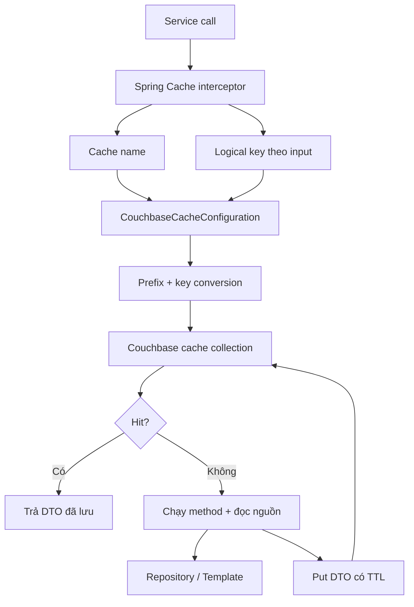
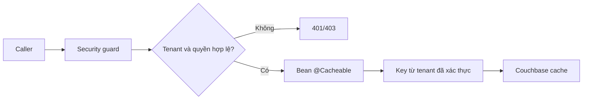

# Thiết kế cache key, tên cache và tránh va chạm

## Mục tiêu học tập

Sau bài này, bạn có thể:

1. Phân biệt **document ID nghiệp vụ**, **cache name**, **logical cache key** và **physical document ID** mà Couchbase dùng để lưu cache entry.
2. Hiểu cách Spring Cache sinh key mặc định bằng `SimpleKeyGenerator`, khi nào dùng SpEL `key` hoặc `KeyGenerator` riêng.
3. Đặt tên cache ổn định theo read model, loại giá trị và schema version; tránh các vùng cache không tương thích cùng dùng một tên.
4. Tạo key phân biệt tenant, SKU, locale, currency, quyền và các chiều ảnh hưởng kết quả; phát hiện collision do dấu phân tách, canonicalization hoặc cách chuyển object sang String.
5. Cấu hình prefix bằng `CouchbaseCacheConfiguration`, scope/collection bằng `CouchbaseClientFactory`, và tính cả giới hạn document ID theo **byte UTF-8**.
6. Dùng cùng quy tắc key cho `@Cacheable`, `@CachePut`, `@CacheEvict` và `Cache.evict(key)` để invalidation không bỏ sót.
7. Kiểm thử nhiều tenant, rolling deployment, cache stale, transaction, authorization và quan sát vận hành.

**Ngữ cảnh:** Module `SPRING_DATA_COUCHBASE` xây dựng tầng truy cập Couchbase bằng Spring Data document mapping, repository, `CouchbaseTemplate` và SQL++. Người học cũng cần hiểu bucket/scope/collection, chỉ mục, TTL, CAS, giao dịch và reactive API. Trong chương **Bộ nhớ đệm**, một lỗi cache key có thể trả nhầm thông tin giữa hai tenant ngay cả khi truy vấn nguồn chính xác. Chủ đề này tập trung vào **danh tính của kết quả được cache**, không đánh đồng cache entry với document nguồn.

> **Nguyên tắc cốt lõi:** Hai lời gọi được phép chia sẻ một key khi và chỉ khi chúng có thể nhận **cùng một giá trị và cùng quyền xem giá trị đó**. Khác tenant hoặc khác một thuộc tính ảnh hưởng kết quả thì cache identity cũng phải khác.

## 1. Bốn loại định danh cần phân biệt

Giả sử ứng dụng có bucket `appdata`, scope `catalog`, collection `products` lưu sản phẩm của tenant `tenant-42` với SKU `P1001`. Một read model nhỏ `ProductCard` được cache trong scope `cache`, collection `entries`.

```text
Document nghiệp vụ:
  keyspace: appdata.catalog.products
  ID:       product::tenant-42::P1001

Spring Cache:
  cache name:  catalog.product-card.v2
  logical key: v2.t.<tenant-encoded>.s.<sku-encoded>

Couchbase cache entry:
  keyspace: appdata.cache.entries
  physical ID có thể là:
  prod:catalog:catalog.product-card.v2::v2.t.<...>.s.<...>
```

| Thuật ngữ | Do đâu quyết định? | Vai trò |
| --- | --- | --- |
| Document ID nguồn | Thiết kế domain/persistence | Truy cập document bằng `findById` hoặc KV SDK |
| Cache name | Kiến trúc read model, annotation | Phân vùng logic và chính sách cache |
| Logical key | `SimpleKeyGenerator`, SpEL hoặc `KeyGenerator` | Xác định kết quả của một invocation |
| Prefix và physical ID | `CouchbaseCacheConfiguration` + key converter | Phân biệt entry trong collection Couchbase |
| Bucket, scope, collection | Cấu hình Couchbase client factory | Không gian lưu trữ vật lý, RBAC và TTL |

Cache name không phải collection. `catalog.product-card.v2` có thể lưu entry ở collection `cache.entries` cùng một cache khác, nếu prefix tách chúng. `Cache.evict(key)` nhận **logical key** chứ không nhận document ID nguồn hoặc physical ID đã prefix.



## 2. Collision khác stale cache ở đâu?

**Collision** là hai lời gọi có ý nghĩa khác nhau nhưng bị gán cùng cache identity. **Stale** là entry đã đúng key nhưng giá trị của nó không còn mới so với dữ liệu nguồn.

| Hiện tượng | Ví dụ | Phải sửa gì? |
| --- | --- | --- |
| Collision giữa tenant | Cache key chỉ là SKU, tenant A/B cùng `P1` | Tenant phải có trong identity và được xác thực |
| Collision do locale | Tên sản phẩm tiếng Việt và tiếng Anh cùng key | Thêm locale vào key hoặc tách cache |
| Collision do currency | Giá VND và USD dùng cùng key | Thêm mã currency/price list |
| Collision do schema | Method trả card và detail dùng cùng cache name + key | Cache name riêng theo loại read model |
| Collision qua prefix | Hai cache dùng cùng collection nhưng prefix trùng | Prefix phân biệt cache name |
| Collision qua hash | Hai String có `hashCode` bằng nhau | Không dùng `hashCode()` làm key duy nhất |
| Stale đúng key | Giá nguồn đổi, cache vẫn còn TTL | Evict, TTL, versioning hoặc bỏ cache |
| Race stale | Reader miss ghi bản cũ sau writer evict | Chiến lược consistency/invalidation bổ sung |

### 2.1. Va chạm do nối chuỗi không thoát ký tự

```text
tenant = "a:b", sku = "P1"   -> "a:b:P1"
tenant = "a",   sku = "b:P1" -> "a:b:P1"

Hai cặp đầu vào khác nhau nhưng cùng key.
```

Nếu domain bảo đảm tenant ID và SKU không chứa dấu phân tách, phép nối `tenant + ":" + sku` có thể chấp nhận. Nếu không có bảo đảm đó, phải dùng encoding có ranh giới rõ, ví dụ Base64 URL-safe cho **từng** thành phần, hoặc length-prefix.

### 2.2. Va chạm do hashCode

```java
String left = "FB";
String right = "Ea";

System.out.println(left.equals(right));    // false
System.out.println(left.hashCode() == right.hashCode()); // true
```

`String.hashCode()` không bảo đảm ánh xạ duy nhất. Không dùng `key="#p0.hashCode()"`. Nếu cần digest để rút ngắn ID, dùng SHA-256 hoặc HMAC-SHA-256 với canonical input, phân tích rủi ro collision và bảo vệ dữ liệu nhạy cảm.

### 2.3. Va chạm ngữ nghĩa giữa hai method

```java
// KHÔNG NÊN: hai DTO khác schema cùng cache name và key.
@Cacheable(cacheNames = "products", key = "#p0")
public ProductCard card(String sku) { /* ... */ }

@Cacheable(cacheNames = "products", key = "#p0")
public ProductDetail detail(String sku) { /* ... */ }
```

Khi một method đã put value, method còn lại có thể nhận nhầm kiểu hoặc dữ liệu không đủ trường. Vấn đề không được giải quyết bằng CAS của document nguồn. Tách cache name theo read model hoặc namespace/type một cách rõ ràng.

## 3. Quy tắc đặt tên cache

Một format dễ quản lý là:

```text
<domain>.<read-model>.<version>

catalog.product-card.v2
catalog.product-detail.v3
catalog.category-summary.v1
pricing.public-quote.v4
```

Cache name nên thể hiện **contract của value**. Đừng đặt theo controller method dễ đổi tên, cũng đừng tạo tên động cho mỗi user/request.

Các câu hỏi trước khi đặt tên:

1. Value được serialize có cùng schema cho mọi caller không?
2. Cache tồn tại giữa bao nhiêu ứng dụng/instance và deployment?
3. Khi schema hoặc policy đổi, cách cô lập entry cũ như thế nào?
4. Tên cache này chứa read model có TTL, bảo mật và invalidation nào?
5. Có vùng cache khác chung collection có thể tạo cùng physical ID không?

Dùng constants để không viết sai tên:

```java
package com.example.catalog.cache;

public final class CacheNames {
    public static final String PRODUCT_CARD =
            "catalog.product-card.v2";
    public static final String PRODUCT_DETAIL =
            "catalog.product-detail.v3";
    public static final String CATEGORY_SUMMARY =
            "catalog.category-summary.v1";

    private CacheNames() {}
}
```

Các giá trị `public static final String` này có thể dùng trong annotation và trong `CouchbaseCacheManager.withCacheConfiguration(…)`.

### 3.1. Cache name khác environment

Nếu production và staging cùng dùng một cluster/keyspace thì một prefix như `prod:catalog:` có thể tránh trùng ID với `stg:catalog:`. Nhưng đây chỉ là namespace **kỹ thuật**, không phải hàng rào bảo mật. Với dữ liệu nhạy cảm, ưu tiên cô lập bằng bucket/collection, tài khoản và RBAC phù hợp.

### 3.2. Tại sao không tạo tên cache theo tenant?

```java
// Thiết kế khó quản lý:
String cacheName = "productCards-" + tenantId;
```

Cách này tạo tập cache name có thể tăng không giới hạn, phức tạp hóa TTL, metric, cấu hình và cleanup. Thông thường chọn một cache name cố định cho read model và đặt tenant trong **logical key**. Chỉ tách keyspace vật lý theo tenant khi kiến trúc isolation đã chủ động quyết định.

### 3.3. Version theo schema

Ví dụ `ProductCardV1(String sku, String title)` khác `ProductCardV2(String sku, String title, long priceCents)`. Nếu hai version cùng cache name/key, reader mới có thể nhận payload cũ thiếu giá hoặc lỗi deserialize. Dùng `catalog.product-card.v1` và `catalog.product-card.v2` để tránh payload conflict khi rolling deployment.

## 4. SimpleKeyGenerator mặc định của Spring

Nếu annotation không chỉ định `key` hay `keyGenerator`, Spring Cache dùng `SimpleKeyGenerator`.

| Tham số | Logical key được tạo |
| --- | --- |
| Không có | `SimpleKey.EMPTY` |
| Một tham số | Chính tham số đó |
| Nhiều tham số | `SimpleKey` bao gồm các tham số |

Ví dụ:

```java
@Cacheable(cacheNames = CacheNames.PRODUCT_CARD)
public ProductCard getCard(String tenantId, String sku) {
    // ...
}
```

Logical key mặc định chứa cả tenant và SKU trong một `SimpleKey`. Nó là object Java có ngữ nghĩa equals/hashCode; Couchbase-backed cache còn phải chuyển object đó thành String/bytes để lưu ID vật lý.

**Chú ý:** `SimpleKeyGenerator` hiện đại không chỉ lấy tổng hash của các tham số. Tuy nhiên, custom key object, mutable input và converter tùy ý có thể làm mất tính ổn định.

### 4.1. Khi default key có thể sai?

- Method lấy tenant từ security context, trong khi tham số chỉ có SKU → cache không phân biệt tenant.
- Method có tham số `traceId`, `requestId` không ảnh hưởng result → key bị phân mảnh, hit rate thấp.
- Tham số phức tạp/mutable có `equals/hashCode` không ổn định.
- Method dùng chung cache name với một method khác có cùng input nhưng trả kiểu khác.
- Có thêm currency, locale, permission hoặc feature flag ảnh hưởng result nhưng không có trong tham số.
- Provider chuyển một key object sang String bằng custom converter không nhất quán giữa các phiên bản.

### 4.2. Không coi toString là serialization ổn định

`someObject.toString()` có thể chứa tên class, identity hash code, thứ tự field hoặc representation bị thay đổi khi deploy. Không dùng nó như ID bền vững trong một distributed cache trừ khi domain contract đã kiểm thử và ổn định.

Nếu dùng custom converter của `CouchbaseCacheConfiguration`, phải bảo đảm không có hai key Java khác nhau cùng được chuyển thành một physical String; kiểm thử việc conversion giống nhau ở mọi instance và qua nhiều lần deploy.

## 5. SpEL key: đơn giản, tường minh, có giới hạn

Các annotation hỗ trợ SpEL để xác định key:

```java
@Cacheable(cacheNames = CacheNames.PRODUCT_CARD,
           key = "#p0 + ':' + #p1")
public ProductCard getCard(String tenantId, String sku) {
    return loadProductCard(tenantId, sku);
}
```

Đây chỉ là ví dụ với **đầu vào đã được validate không có dấu phân tách**. Nếu tenant/SKU có thể chứa `:`, ví dụ này có collision phần 2.

Spring hỗ trợ:

```text
#p0, #a0, #root.args[0]  → tham số thứ nhất
#p1, #a1, #root.args[1]  → tham số thứ hai
#tenantId, #sku           → tên tham số khi metadata sẵn có
#root.methodName          → tên method
#root.targetClass         → class được proxy
```

`#p0`/`#p1` không phụ thuộc vào việc compiler có giữ parameter names; tên `#tenantId` có thể cần metadata từ `-parameters` hoặc cấu hình tương ứng.

Không đặt đồng thời `key` và `keyGenerator` trên cùng annotation: chúng là hai cách chỉ định loại trừ nhau.

### 5.1. Chọn đúng những chiều ảnh hưởng kết quả

| Dữ liệu | Nếu ảnh hưởng result | Quyết định key |
| --- | --- | --- |
| Tenant đã xác thực | Giá/danh mục/quyền khác | Luôn phân biệt tenant |
| SKU | Định danh sản phẩm | Bắt buộc |
| Currency/price list | Giá trị tiền khác | Có |
| Locale | Tên và định dạng khác | Có |
| Permission/visibility | Trường trả về khác | Tách read model/cache hoặc chiều quyền |
| Time bucket | Giá/quota theo ngày | Key theo bucket đã định nghĩa rõ timezone |
| Filter/sort/page | Danh sách khác nội dung hoặc thứ tự | Mã hóa đủ điều kiện, sort, page/cursor |
| Feature flag/schema version | Format hay logic tính khác | Có hoặc tách cache name |
| Request ID / trace ID | Chỉ phục vụ tracing | Thường không |
| Input chứa PII/secret | Có ảnh hưởng result | Dùng định danh an toàn; không log/raw key |

Nếu một method có `locale` nhưng luôn trả cùng một mã số bất kể ngôn ngữ, locale có thể không cần trong key. Ngược lại, nếu tên hiển thị thay đổi theo locale thì phải đưa vào key.

### 5.2. condition/unless không chữa thiếu key

`@Cacheable(condition=…)` quyết định dùng cache trước method, `unless=…` quyết định có put kết quả sau method. Chúng không tự thêm tenant/currency vào key. Một key sai vẫn sai dù `unless="#result == null"` đã đúng.

## 6. KeyGenerator có ranh giới rõ ràng

Với hệ thống nhiều service dùng chung key, nên tạo một utility encode thành phần và một `KeyGenerator` bean. Mục tiêu: đầu vào khác nhau về mặt danh tính không thể có cùng key do phép nối mơ hồ.

### 6.1. Chọn format logical key

```text
v2.t.<base64url(tenant UTF-8)>.s.<base64url(sku UTF-8)>
```

Base64 URL-safe không padding chỉ dùng chữ/số/`-`/`_`, **không có dấu chấm**. Vì vậy dùng dấu chấm làm ranh giới tách các segment sẽ không nhập nhằng. Đây là encoding, **không phải mã hóa bảo mật**: ai có key có thể decode lại tenant/SKU.

### 6.2. Utility duy nhất cho tất cả cách truy cập

```java
package com.example.catalog.cache;

import java.nio.charset.StandardCharsets;
import java.util.Base64;

public final class ProductCacheKeys {

    private ProductCacheKeys() {}

    public static String forProduct(String tenantId, String sku) {
        return "v2.t." + encode(tenantId)
                + ".s." + encode(sku);
    }

    private static String encode(String component) {
        if (component == null || component.isBlank()) {
            throw new IllegalArgumentException(
                    "Cache key component không được rỗng");
        }
        return Base64.getUrlEncoder()
                .withoutPadding()
                .encodeToString(
                        component.getBytes(StandardCharsets.UTF_8));
    }
}
```

Với đầu vào là các Java String hợp lệ, cách tạo key này tách rõ mỗi thành phần. Nó **không** tự hiểu SKU `P1001` và `p1001` có giống nhau không; canonicalization là quy tắc nghiệp vụ riêng ở phần 9.

### 6.3. Đăng ký bean KeyGenerator

```java
package com.example.catalog.cache;

import org.springframework.cache.interceptor.KeyGenerator;
import org.springframework.context.annotation.Bean;
import org.springframework.context.annotation.Configuration;

@Configuration(proxyBeanMethods = false)
public class ProductCacheKeyConfiguration {

    @Bean("productCacheKey")
    public KeyGenerator productCacheKey() {
        return (target, method, args) -> {
            if (args.length < 2
                    || !(args[0] instanceof String tenant)
                    || !(args[1] instanceof String sku)) {
                throw new IllegalArgumentException(
                        "Hai tham số đầu phải là tenantId và sku");
            }
            return ProductCacheKeys.forProduct(tenant, sku);
        };
    }
}
```

**Hợp đồng:** Mọi method dùng generator này có hai tham số đầu lần lượt là `tenantId` và `sku`. Nếu method `changePrice(tenantId,sku,newPrice)` có tham số thứ ba để ghi, nó không được đưa vào key sản phẩm.

Đừng dùng generator này cho query theo `(tenantId, sku, locale, currency)` nếu locale/currency làm thay đổi DTO. Khi đó cần generator nhận đủ chiều hoặc cache name riêng.

### 6.4. Dùng cùng key cho đọc, làm mới và xóa

```java
import org.springframework.cache.annotation.Cacheable;
import org.springframework.cache.annotation.CachePut;
import org.springframework.cache.annotation.CacheEvict;

@Cacheable(
    cacheNames = CacheNames.PRODUCT_CARD,
    keyGenerator = "productCacheKey")
public ProductCard getCard(String tenantId, String sku) {
    return loadProductCardFromSource(tenantId, sku);
}

@CachePut(
    cacheNames = CacheNames.PRODUCT_CARD,
    keyGenerator = "productCacheKey")
public ProductCard refreshCard(String tenantId, String sku) {
    return loadProductCardFromSource(tenantId, sku);
}

@CacheEvict(
    cacheNames = CacheNames.PRODUCT_CARD,
    keyGenerator = "productCacheKey")
public void changePrice(String tenantId, String sku,
                        long newPriceCents) {
    // Kiểm tra quyền, đọc entity có CAS, cập nhật source.
}
```

Các method trên là các **mẫu method nằm trong Spring service** đã inject repository và khai báo helper `loadProductCardFromSource`. Cần gọi chúng qua Spring proxy. `@Cacheable` có thể bỏ qua body khi hit; `@CachePut` luôn chạy body; `@CacheEvict` mặc định thực hiện sau khi method hoàn thành bình thường.

### 6.5. Evict thủ công phải gọi utility, không dùng ID nguồn

```java
import org.springframework.cache.Cache;
import org.springframework.cache.CacheManager;

public void invalidate(CacheManager manager,
                       String tenantId, String sku) {

    Cache cache = manager.getCache(CacheNames.PRODUCT_CARD);
    if (cache == null) {
        throw new IllegalStateException(
                "Cache chưa được cấu hình");
    }

    cache.evict(ProductCacheKeys.forProduct(tenantId, sku));
}
```

`Cache.evict(key)` **không tự gọi KeyGenerator của annotation**. Nếu truyền `"P1001"`, `"product::tenant-42::P1001"` hoặc physical ID đã prefix, nó không khớp logical key của reader.

## 7. Tiền tố cache key trong CouchbaseCacheConfiguration

Couchbase-backed Spring Cache cần chuyển logical key thành physical document ID. `CouchbaseCacheConfiguration` có `prefixCacheNameWith(String)` và `computePrefixWith(CacheKeyPrefix)` để tạo tiền tố.

Ví dụ dùng cache entries trong bucket `appdata`, scope `cache`, collection `entries`, khác với source ở `appdata.catalog.products`:

```java
package com.example.catalog.cache;

import java.time.Duration;

import org.springframework.cache.annotation.EnableCaching;
import org.springframework.context.annotation.Bean;
import org.springframework.context.annotation.Configuration;
import org.springframework.data.couchbase.cache.CouchbaseCacheConfiguration;
import org.springframework.data.couchbase.cache.CouchbaseCacheManager;
import org.springframework.data.couchbase.core.CouchbaseOperations;

@Configuration(proxyBeanMethods = false)
@EnableCaching
public class CacheBackendConfiguration {

    @Bean
    public CouchbaseCacheManager cacheManager(
            CouchbaseOperations operations) {

        var factory = operations
                .getCouchbaseClientFactory()
                .withScope("cache");

        var config = CouchbaseCacheConfiguration.defaultCacheConfig()
                .collection("entries")
                .entryExpiry(Duration.ofMinutes(5))
                .prefixCacheNameWith("prod:catalog:")
                .disableCachingNullValues();

        return CouchbaseCacheManager.builder(factory)
                .withCacheConfiguration(CacheNames.PRODUCT_CARD, config)
                .disableCreateOnMissingCache()
                .transactionAware()
                .build();
    }
}
```

Đây là **một cấu hình thủ công** thay vì bean do Spring Boot auto-configure. Không tạo thêm một `CacheManager` trùng mà không xác định cách Spring chọn bean. `withScope("cache")` chỉ chọn scope trong bucket của factory, không đổi bucket. Scope/collection phải tồn tại và account phải có RBAC phù hợp.

### 7.1. Prefix mặc định gồm cache name

Theo `CacheKeyPrefix.simple()`, prefix mặc định có dạng:

```text
<cacheName>::
```

Khi dùng `prefixCacheNameWith("prod:catalog:")`, prefix có dạng:

```text
prod:catalog:catalog.product-card.v2::
```

Và physical key dự kiến:

```text
prod:catalog:catalog.product-card.v2::v2.t.<...>.s.<...>
```

Format minh họa phụ thuộc phiên bản/cách chuyển key của provider. Caller dùng `Cache.get/put/evict` phải truyền **logical key**, không tự thêm prefix.

### 7.2. computePrefixWith cho policy tùy biến

```java
var config = CouchbaseCacheConfiguration.defaultCacheConfig()
        .collection("entries")
        .computePrefixWith(
                cacheName -> "prod:catalog:" + cacheName + "::");
```

`computePrefixWith` nhận cache name và trả prefix. Nó không biết tenant/SKU của invocation, vì vậy tenant thuộc logical key. Nếu hai cache khác nhau ở cùng collection mà prefix cố tình bỏ cache name, nguy cơ physical collision tăng lên.

### 7.3. Tách collection và prefix là hai cơ chế khác nhau

- `collection("entries")` chọn collection vật lý của cache trong scope được cấu hình.
- `prefixCacheNameWith(…)` quyết định namespace trong **document ID của collection đó**.
- `cacheNames` xác định loại read model logic.
- `KeyGenerator` quyết định danh tính invocation bên trong cache name.

Các lớp này bổ sung cho nhau. Tách collection không làm hai tenant của cùng cache tự có key khác; prefix không thay RBAC của collection.

## 8. Chọn key theo tenant, locale, currency và quyền

Một sản phẩm có thể có nhiều bản hiển thị tùy tenant, ngôn ngữ, đơn vị tiền và role. Không có một tập tham số key cố định cho mọi domain.

```text
getCard(tenant, sku)
getLocalizedCard(tenant, sku, locale)
getQuote(tenant, sku, currency, priceList)
getStockView(tenant, sku, warehouse)
getPage(tenant, filter, sort, page, size)
```

### 8.1. Tenant phải đến từ security context

Nếu controller nhận `tenantId` do client gửi rồi gọi method cache mà không xác thực, người dùng có thể tra trúng key của tenant khác. `@Cacheable` có thể trả từ cache **mà không chạy body**, nên kiểm tra tenant chỉ nằm trong method body là không đủ.



### 8.2. Cùng tenant có thể khác quyền

Nếu nhân viên nội bộ được xem giá nhập còn khách chỉ được xem giá bán, không dùng chung `ProductCard` chứa dữ liệu nội bộ dưới một cache name public. Tách read model/cache name hoặc thêm security scope cần thiết vào identity, nhưng trong mọi trường hợp vẫn **xác thực trước cache hit**.

### 8.3. Các list query cần key đầy đủ

Một danh sách sản phẩm theo filter/sort/page khác với single SKU lookup. Key phải chứa đủ:

- Filter values, điều kiện tenant/visibility và rule version.
- Sort field, direction và tie-breaker nếu ảnh hưởng thứ tự.
- Page number/size hoặc cursor.
- Locale/currency khi hiển thị khác.
- Schema/read model version.

Nếu filter là một **set**, có thể sort/canonicalize để không tạo nhiều key tương đương vì thứ tự truyền tham số. Nếu thứ tự filter thực sự có nghĩa, phải giữ nó. Không cache một danh sách unbounded rồi trả nhầm page/cursor chỉ vì key chỉ có tenant.

## 9. Canonicalization: hai input nào được coi là tương đương?

Encoding không hiểu quy tắc nghiệp vụ. Hai String khác byte có thể đại diện cùng một mã theo business rule hoặc là hai mã hoàn toàn khác nhau.

Các câu hỏi cần quyết định **trước** khi xây key:

1. SKU có phân biệt hoa/thường không?
2. Dấu cách đầu/cuối có hợp lệ hay cần loại bỏ?
3. Hai chuỗi Unicode tương đương về mặt hiển thị có được coi là cùng identifier không?
4. Currency đã chuẩn ISO 4217 uppercase chưa?
5. Locale đã được chuyển về `Locale.toLanguageTag()` chưa?
6. Filter set có được sắp thứ tự canonical hay thứ tự có nghĩa?
7. Đối với ngày/giờ, có timezone và độ chính xác cố định không?
8. Giá trị null, rỗng và default có thực sự tương đương theo nghiệp vụ không?

### 9.1. Chuẩn hóa có chủ đích, không tự ép mọi thứ về chữ thường

Nếu domain định nghĩa SKU không phân biệt chữ hoa:

```java
import java.util.Locale;

public static String canonicalSku(String sku) {
    if (sku == null || sku.isBlank()) {
        throw new IllegalArgumentException("SKU rỗng");
    }
    return sku.trim().toUpperCase(Locale.ROOT);
}
```

Sau đó truyền SKU canonical vào `ProductCacheKeys.forProduct(…)`. Nhưng nếu SKU phân biệt hoa/thường, `p1001` và `P1001` phải là hai key khác nhau; ép uppercase sẽ **tạo collision**.

Unicode normalization cũng phải là quyết định của domain. Ví dụ `Normalizer.normalize(text, Normalizer.Form.NFC)` phù hợp với một số identifier có quy tắc Unicode rõ, nhưng không được làm biến đổi tùy tiện các ID mà database xem là riêng biệt.

### 9.2. Currency và locale

```java
import java.util.Currency;
import java.util.Locale;

String currency =
        Currency.getInstance("vnd".toUpperCase(Locale.ROOT))
                .getCurrencyCode();

String localeTag =
        Locale.forLanguageTag("vi-VN").toLanguageTag();
```

Một method trả `ProductCard` gồm tên dịch và giá chuyển đổi cần key chứa hai thành phần này nếu result thực sự thay đổi. Trong luồng thanh toán, giá cached không được dùng thay dữ liệu nguồn được kiểm tra bằng CAS/transaction.

### 9.3. Tách identity khỏi representation

Có thể có hai DTO trình bày khác nhau nhưng cùng source document:

```text
ProductDocument (source) -> ProductCardViVn
                         -> ProductCardEnUs
                         -> InternalCostView
```

Khi representation khác nghĩa, một trong hai cách:

- Dùng cache name tách biệt, ví dụ `catalog.product-card-i18n.v2` và `catalog.internal-cost.v1`.
- Dùng cùng read model nhưng key chứa locale/visibility đủ để phân biệt.

Với dữ liệu phân quyền, tách cache name/read model thường dễ audit hơn một key rất phức tạp chứa mọi role.

## 10. Giới hạn key theo UTF-8 bytes, không phải độ dài Java String

Couchbase document ID có giới hạn kích thước theo byte UTF-8. Tài liệu Couchbase Java SDK hiện hành nêu mức **246 byte** cho document ID. Cần đối chiếu phiên bản Server/SDK cụ thể khi triển khai.

Khi dùng cache provider, physical ID gồm:

```text
<environment/domain prefix>
+ <cache name>
+ "::"
+ <logical key đã convert>
```

Nếu utility tạo logical key dài 200 byte nhưng prefix/cache name chiếm 60 byte, physical ID có thể vượt giới hạn. Unicode cũng có thể dùng nhiều byte cho một ký tự; `String.length()` đo UTF-16 code units, không đo UTF-8 bytes.

### 10.1. Kiểm tra kích thước physical ID dự kiến

```java
import java.nio.charset.StandardCharsets;

String logicalKey =
        ProductCacheKeys.forProduct(tenantId, sku);

String physicalIdEstimate =
        "prod:catalog:" + CacheNames.PRODUCT_CARD
                + "::" + logicalKey;

int bytes = physicalIdEstimate
        .getBytes(StandardCharsets.UTF_8).length;

if (bytes > 246) {
    throw new IllegalArgumentException(
            "Cache key vượt giới hạn UTF-8: " + bytes);
}
```

Đoạn code này kiểm tra một **ước tính theo prefix đang cấu hình**, không phải lấy physical ID trực tiếp từ implementation. Nếu thay `computePrefixWith`, conversion service hoặc naming strategy, cập nhật test. Nên có test thực tế với cache provider cho các key dài và Unicode.

### 10.2. Nếu key có thể dài, xử lý bằng digest có version

Với tìm kiếm theo filter nhiều trường, query string dài hoặc tập ID lớn, có thể canonicalize các điều kiện rồi tạo digest ổn định:

```text
Input canonical:
  tenant=tenant-42
  filter=...
  sort=...
  page=...
  schema=v3

Logical key:
  v3.sha256.<base64url(SHA256(canonical-input))>
```

Một đoạn Java minh họa:

```java
import java.nio.charset.StandardCharsets;
import java.security.MessageDigest;
import java.security.NoSuchAlgorithmException;
import java.util.Base64;

public static String sha256Key(String canonicalInput) {
    if (canonicalInput == null) {
        throw new IllegalArgumentException("Input null");
    }
    try {
        byte[] digest = MessageDigest.getInstance("SHA-256")
                .digest(canonicalInput.getBytes(
                        StandardCharsets.UTF_8));
        return "v3.sha256."
                + Base64.getUrlEncoder().withoutPadding()
                        .encodeToString(digest);
    } catch (NoSuchAlgorithmException e) {
        throw new IllegalStateException(
                "Runtime không hỗ trợ SHA-256", e);
    }
}
```

**Cảnh báo:** Hàm băm không tự tạo canonical input. Nếu input ghép bằng dấu phân tách mơ hồ, hai bộ tham số vẫn có thể tạo cùng canonical string rồi cùng digest. Hãy encode từng trường, dùng length-prefix hoặc serialization canonical có schema xác định.

SHA-256 có rủi ro collision cực nhỏ nhưng không phải phép ánh xạ tuyệt đối một-một; đánh giá hậu quả nếu xảy ra và cơ chế đối soát khi nghiệp vụ rất nhạy cảm. Không thay bằng `String.hashCode()`.

### 10.3. Bảo mật của key: Base64 và SHA-256 không phải encryption

- Base64 URL-safe có thể decode. Không coi nó là nơi che giấu email, số điện thoại, token, mật khẩu.
- SHA-256 trần vẫn có thể bị dò lại nếu đầu vào có không gian nhỏ/đoán được.
- Khi muốn key ổn định mà khó tiết lộ định danh nhạy cảm, cân nhắc HMAC-SHA-256 với secret được quản lý phù hợp và chiến lược rotation.
- Hash/HMAC **không thay thế authentication, authorization hoặc RBAC** trước cache hit.
- Đừng đưa raw cache key vào metric label: nó gây cardinality cao và có thể làm lộ dữ liệu. Log cache name, operation, nhóm lỗi và request ID an toàn thay vì value/key riêng tư.

## 11. Versioning và rolling deployment không gây conflict schema

Một vùng cache có thể tồn tại sau khi ứng dụng đã deploy phiên bản mới. Nếu thay DTO, conversion hoặc canonicalization nhưng giữ nguyên tên/key, entry cũ có thể:

- Deserialization thất bại.
- Chứa thiếu trường nhưng được coi là hợp lệ.
- Mang meaning cũ của `priceCents`, trạng thái hoặc permission.
- Được writer v1 put trở lại sau khi service v2 đã evict.

### 11.1. Version cache name theo read-model schema

```text
V1: catalog.product-card.v1
V2: catalog.product-card.v2
```

Với prefix có cache name, hai value có thể cùng tồn tại trong collection `entries` mà không đè physical ID. Cho phép reader v1/v2 coexist tạm thời trong rolling deployment. TTL hoặc quy trình cleanup dọn bản cũ.

### 11.2. Version key khi đổi semantic identity

Giả sử v2 key chỉ gồm tenant và SKU, còn v3 cần currency:

```text
v2.t.<tenant>.s.<sku>
v3.t.<tenant>.s.<sku>.c.<currency>
```

Nếu value schema thay đổi mạnh, version cả cache name và logical key để không dùng entry cũ sai nghĩa. Nếu chỉ code refactor không làm đổi data contract, không cần tăng version vô nghĩa làm giảm hit rate toàn hệ thống.

### 11.3. Quy trình rollout có kiểm soát

1. Định nghĩa read model v2, cache name, logical key, TTL, prefix và quyền truy cập.
2. Xác định tất cả reader, writer, admin job, event consumer dùng vùng cache cũ.
3. Deploy code mới dùng namespace v2; không tự parse entry v1 như v2.
4. Trong thời gian v1/v2 cùng hoạt động, invalidation từ source mutation phải xử lý những phiên bản còn reader, hoặc có SLA stale đã chấp nhận.
5. Theo dõi hit/miss, lỗi deserialize, stale và cache traffic khi v2 warm up.
6. Khi v1 không còn reader, để TTL dọn entry cũ hoặc cleanup có quy trình.
7. Không xóa collection chứa nhiều vùng cache chỉ vì muốn dọn một cache version.

### 11.4. Nhiều service chia sẻ cache

Nếu service A/B cùng dùng `catalog.product-card.v2`, chúng phải thống nhất:

- Tên cache và nơi lưu.
- Key normalization, encoding, version, converter, prefix.
- Value schema/transcoder và cách xử lý cache null.
- TTL và những mutation nguồn dẫn đến eviction.
- Mọi giả định về tenant, quyền và business meaning.

Cùng tên cache nhưng một service trả **giá niêm yết** còn service kia trả **giá sau ưu đãi** là collision ngữ nghĩa ngay cả khi code encode key không có lỗi.

## 12. Invalidation phải dùng đúng logical key

Reader, refresher, writer phải cùng hợp đồng key. Một lỗi phổ biến:

```java
// Reader: key có tenant và SKU được encode.
@Cacheable(
    cacheNames = CacheNames.PRODUCT_CARD,
    keyGenerator = "productCacheKey")
public ProductCard getCard(String tenantId, String sku) {
    return loadProductCardFromSource(tenantId, sku);
}

// Writer SAI: chỉ evict theo SKU nguyên bản.
@CacheEvict(
    cacheNames = CacheNames.PRODUCT_CARD,
    key = "#p1")
public void changePrice(
        String tenantId, String sku, long newPriceCents) {
    // ...
}
```

Document nguồn đã cập nhật nhưng cache entry do reader tạo ở key `v2.t.…s.…` không bị xóa, vì writer evict `"P1001"`. Cách đúng là dùng cùng `keyGenerator="productCacheKey"` hoặc utility `ProductCacheKeys.forProduct(…)` như phần 6.

**Các đường cập nhật khác cũng phải được tính:**

- Repository `save/delete` của service chính.
- Batch import hoặc job cleanup.
- Couchbase Java SDK mutation trực tiếp.
- Message consumer xử lý giá từ hệ thống khác.
- Công cụ quản trị sản phẩm.
- Service thứ hai dùng chung bucket nhưng không dùng Spring Cache annotations của ứng dụng hiện tại.

Spring Cache không tự theo dõi mọi mutation của Couchbase. Nếu update phát sinh bên ngoài app, có thể dùng event/outbox/invalidation consumer, có retry và idempotency. TTL là lớp giảm thiểu chứ không thay event delivery.

### 12.1. Một source ảnh hưởng nhiều read model

Khi giá sản phẩm đổi, không chỉ product card bị ảnh hưởng mà category summary hoặc danh sách phân trang có thể cũng stale:

```java
import org.springframework.cache.annotation.CacheEvict;
import org.springframework.cache.annotation.Caching;

@Caching(evict = {
    @CacheEvict(
        cacheNames = CacheNames.PRODUCT_CARD,
        keyGenerator = "productCacheKey"),
    @CacheEvict(
        cacheNames = CacheNames.CATEGORY_SUMMARY,
        key = "#p0 + '::' + #p3")
})
public void updatePriceAndInvalidate(
        String tenantId, String sku, long newPriceCents,
        String categoryId) {
    // Validation, tenant authorization và repository.save(...).
}
```

Đây là ví dụ cho một category summary có key `tenant::category`. Trong dự án thật, category ID phải được xác thực từ dữ liệu nguồn, và khi sản phẩm chuyển category cần evict cả category cũ và mới. Không tin category do client tự gửi để quyết định key xóa.

### 12.2. Evict programmatic không tự gọi KeyGenerator

`Cache.evict(…)` nhận logical key trực tiếp. Nếu một job cần evict mà không đi qua method annotation, nó phải gọi đúng utility `ProductCacheKeys.forProduct(tenant, sku)`, **không** truyền physical ID đã prefix hoặc document ID nguồn.

## 13. Cache hit, authorization và giới hạn của tính nhất quán

`@Cacheable` có thể trả value mà **không chạy method body**. Nếu validation/authorization chỉ nằm trong body, cache hit có thể bỏ qua nó. Dù cache key chứa tenant, người dùng vẫn có thể thử đọc key của tenant khác nếu đầu vào không được xác thực.

Ví dụ ranh giới:

```java
import org.springframework.stereotype.Service;

@Service
public class AuthorizedCatalogFacade {

    private final ProductCardReader reader;

    public AuthorizedCatalogFacade(ProductCardReader reader) {
        this.reader = reader;
    }

    public ProductCard readForTenant(
            String authenticatedTenant,
            boolean hasCatalogReadPermission,
            String sku) {

        if (!hasCatalogReadPermission
                || authenticatedTenant == null
                || authenticatedTenant.isBlank()) {
            throw new SecurityException("Không có quyền");
        }

        return reader.getCard(authenticatedTenant, sku);
    }
}
```

`authenticatedTenant` và quyền phải đến từ **security context server-side**, không từ Boolean hoặc tenant ID do client tùy ý cung cấp. `reader` là Spring bean riêng để đi qua cache proxy; không tự `new` hoặc self-invoke khi muốn annotation hoạt động.

### 13.1. CAS không bảo đảm cache luôn mới

`@Version`/CAS bảo vệ optimistic locking khi sửa document nguồn; không xóa cache entry. SQL++ `REQUEST_PLUS` giúp query theo index theo kịp mutation khi query chạy, nhưng một cache hit có thể bỏ qua hoàn toàn query đó.

### 13.2. Key đúng vẫn có thể stale do race

```text
A: Cache miss, bắt đầu đọc source giá 159900
B: Update source thành 149900, sau đó evict đúng key
A: Đọc cũ hoàn tất, put 159900 sau eviction
C: Cache hit nhận lại 159900
```

Đây là stale repopulation, **không phải key collision**. TTL ngắn, invalidation theo event, versioned key hoặc hạn chế cache ở thao tác quan trọng có thể giảm rủi ro. `@Cacheable(sync = true)` không mặc nhiên là distributed lock giữa mọi JVM.

### 13.3. Transaction-aware cache chưa phải atomic DB/cache

`CouchbaseCacheManager.builder(factory).transactionAware()` cho phép đồng bộ cache put/evict với transaction Spring phù hợp; nhưng nó không tự biến source mutation và cache entry thành một transaction commit nguyên tử. Eviction sau commit có thể lỗi và reader có thể repopulate bản cũ. Đường commit nghiệp vụ phải đọc dữ liệu nguồn theo CAS/transaction thích hợp nếu cần nhất quán mạnh.

## 14. Test tránh va chạm key

Nên viết unit test cho **key identity** trước khi chạy integration test Couchbase.

### 14.1. Unit test cho key utility

```java
package com.example.catalog.cache;

import static org.junit.jupiter.api.Assertions.*;

import org.junit.jupiter.api.Test;

class ProductCacheKeysTest {

    @Test
    void equalInputsProduceEqualKeys() {
        assertEquals(
                ProductCacheKeys.forProduct("tenant-42", "P1001"),
                ProductCacheKeys.forProduct("tenant-42", "P1001"));
    }

    @Test
    void tenantsDoNotShareKeys() {
        assertNotEquals(
                ProductCacheKeys.forProduct("tenant-A", "P1001"),
                ProductCacheKeys.forProduct("tenant-B", "P1001"));
    }

    @Test
    void delimiterCannotCauseCollision() {
        assertNotEquals(
                ProductCacheKeys.forProduct("a:b", "P1"),
                ProductCacheKeys.forProduct("a", "b:P1"));
    }

    @Test
    void rejectsInvalidSegments() {
        assertThrows(IllegalArgumentException.class,
                () -> ProductCacheKeys.forProduct(null, "P1001"));

        assertThrows(IllegalArgumentException.class,
                () -> ProductCacheKeys.forProduct("tenant", " "));
    }

    @Test
    void caseIsDistinctWithoutDomainCanonicalization() {
        assertNotEquals(
                ProductCacheKeys.forProduct("tenant", "P1001"),
                ProductCacheKeys.forProduct("tenant", "p1001"));
    }
}
```

Nếu domain quyết định SKU case-insensitive, canonicalize trước và đổi test để chứng minh hai biến thể tạo **cùng** key theo hợp đồng. Không lẫn mục tiêu tránh collision với việc từ chối gom các giá trị thực sự tương đương.

### 14.2. Test prefix vật lý

```java
import static org.junit.jupiter.api.Assertions.assertEquals;

import org.junit.jupiter.api.Test;
import org.springframework.data.couchbase.cache.CouchbaseCacheConfiguration;

class CachePrefixTest {

    @Test
    void prefixIncludesCacheName() {
        var config = CouchbaseCacheConfiguration.defaultCacheConfig()
                .prefixCacheNameWith("prod:catalog:");

        assertEquals(
                "prod:catalog:catalog.product-card.v2::",
                config.getKeyPrefixFor(CacheNames.PRODUCT_CARD));
    }
}
```

Test này xác minh contract của configuration, **chưa** thay thế test thực sự ghi physical key trong collection. Nếu dùng custom `computePrefixWith`/converter, kiểm thử lại.

### 14.3. Test End-to-end trên Spring proxy và Couchbase

| Kịch bản | Điều cần xác nhận |
| --- | --- |
| Cache name được cấu hình | `CacheManager.getCache(CacheNames.PRODUCT_CARD)` không null |
| Cache name typo | Với `disableCreateOnMissingCache()`, cache không bị tự tạo |
| Miss → hit | Reader chạy repository ở miss, không chạy lại body khi hit |
| Tenant A/B cùng SKU | Hai key độc lập, không lộ DTO tenant khác |
| Input chứa dấu `:` | Hai cặp nhập nhằng theo nối chuỗi cũ vẫn khác key |
| Reader/refresh/writer | Dùng cùng logical key dù method signature khác |
| Programmatic eviction | Utility key xóa đúng entry do annotation ghi |
| Schema v1/v2 | Không deserialize payload cũ vào DTO mới |
| TTL | Cache entry hết hạn nhưng document nguồn còn |
| Unicode/độ dài | Physical ID không vượt giới hạn UTF-8 |
| Cache hit unauthorized | Guard từ chối **trước** proxy cache |
| External writer | Có invalidation hoặc SLA stale đã được xác định |
| Race miss/update | Có thể tái hiện stale repopulation và có phương án giảm thiểu |
| Multi-instance | Cùng tên/prefix/converter giữa các pod trong rollout |
| Cache clear | Không xóa nhầm namespace khác hoặc document nguồn |

Không gọi `new ProductCardReader(...)` trong test cache annotation rồi kết luận Spring Cache không hoạt động; test phải gọi qua bean Spring được proxy. Những thao tác xóa tất cả cache entry chỉ được chạy trong collection thử nghiệm và cần kiểm tra index/quyền theo phiên bản provider.

## 15. Vận hành và giám sát key contract

Một format key giống như một giao thức giữa mọi instance đọc/ghi cache. Nên có một **cache contract** trong code/review với:

- Cache name, schema/version và kiểu DTO.
- Bộ input quyết định danh tính và quy tắc canonicalization.
- Key generator/encoder và prefix vật lý.
- Bucket/scope/collection, TTL, quyền truy cập.
- Các đường invalidation và cách recovery khi evict thất bại.
- Giới hạn key length, chính sách digest và thông tin nào không được lộ trong key.
- Kế hoạch versioning/migration giữa các bản deploy.
- Mức stale được chấp nhận và những nghiệp vụ không được dùng cache làm nguồn quyết định.

### 15.1. Metric hữu ích

| Metric | Mục đích |
| --- | --- |
| Hit/miss theo cache name | Nhận ra key phân mảnh hoặc cache không mang lợi ích |
| Evict/put error | Phát hiện invalidation thất bại |
| Deserialization error | Phát hiện version/schema không tương thích |
| Key-too-long và conversion error | Phát hiện physical ID không hợp lệ |
| TTL và tuổi dữ liệu | Đánh giá thời gian stale |
| Query source khi miss | Đánh giá tác động khi cache cold/stampede |
| Latency p95/p99 | So sánh có/không cache trên cùng workload |
| Metric theo schema version | Theo dõi tiến độ rolling migration |
| Security test cross-tenant | Bảo đảm không trả dữ liệu tenant khác |

Không tạo metric label từ từng SKU, tenant ID hoặc raw cache key. Điều đó làm tăng cardinality mạnh và có thể lộ thông tin riêng tư.

### 15.2. Cache hit trên Couchbase cũng có chi phí

Nếu nguồn là một lệnh KV `findById` nhanh, cache hit trong cùng Couchbase cluster vẫn cần một KV operation khác, thêm phí deserialize và quản lý invalidation. Cache thường mang lại giá trị rõ hơn khi tránh được truy vấn SQL++ nặng, phép tổng hợp nhiều nguồn hoặc gọi dịch vụ bên ngoài. Đo trước khi đặt cache ở mọi CRUD endpoint.

## 16. Lỗi thường gặp và cách sửa

| Lỗi | Hậu quả | Cách sửa |
| --- | --- | --- |
| Key chỉ là SKU | Cache hit chéo tenant | Tenant xác thực vào key |
| Nối chuỗi bằng dấu phân tách chưa escape | Hai cặp input sinh cùng key | Validate hoặc encode từng segment |
| Dùng `hashCode()` làm key | Hash collision | Identity thực hoặc digest đáng tin cậy |
| Hai DTO khác kiểu cùng cache name | Deserialize sai, thiếu trường | Tách cache theo read model/schema |
| Dùng object mutable/toString không ổn định | Miss/evict sai sau mutation/deploy | Canonical key và converter ổn định |
| Bỏ currency/locale khỏi key | Trả giá/bản dịch sai | Thêm dimension ảnh hưởng kết quả |
| Đưa traceId vào key | Hit rate thấp | Không đưa input không ảnh hưởng result |
| Case-folding SKU không đúng domain | Nhập hai SKU thành một | Canonicalization theo luật nghiệp vụ |
| Prefix bỏ cache name ở cùng collection | Physical collision giữa các cache | Prefix phân biệt hoặc collection riêng |
| Đổi schema không đổi cache name/version | Đọc payload cũ sai | Versioned name/key, rollout |
| Evict bằng document ID nguồn | Không xóa entry annotated | Dùng logical key utility |
| Reader và writer dùng key khác nhau | Stale sau source update | KeyGenerator dùng chung |
| Coi Base64 là bí mật | Dễ decode tenant/identifier | Không đưa secret; HMAC nếu phù hợp |
| Key dài hơn limit UTF-8 | KV lỗi khi cache get/put | Tính cả prefix, digest hoặc giới hạn input |
| Kiểm tra quyền chỉ trong body cacheable | Hit bỏ qua authorization | Guard trước cache proxy |
| Coi prefix là security boundary | Có thể rò môi trường | RBAC, bucket/scope/collection riêng |
| Coi `REQUEST_PLUS` làm cache hit mới | Cache vẫn stale | TTL/evict/versioning riêng |
| Clear toàn cache để xóa một entry | Stampede và tác động rộng | Evict đúng key, có quy trình |

## 17. Bài thực hành

Chỉ dùng môi trường thử nghiệm với bucket `appdata`, scope `catalog` và `cache`, collection `products` và `entries`.

1. **Phân loại:** Vẽ document ID nguồn, cache name, logical key, physical ID và bucket/scope/collection; giải thích tầng nào quyết định collision.
2. **Tên cache:** Tạo constants cho `product-card.v2`, `product-detail.v3` và `category-summary.v1`. Chứng minh hai DTO không cần dùng chung cache name.
3. **Default key:** Dùng `SimpleKeyGenerator` cho 0/1/nhiều tham số, quan sát vai trò `SimpleKey` và việc converter xử lý key.
4. **Va chạm delimiter:** So sánh `("a:b","P1")` với `("a","b:P1")` ở key nối thô, sau đó chứng minh key encoder không collision.
5. **Generator:** Tạo `productCacheKey`; dùng với `@Cacheable`, `@CachePut`, `@CacheEvict` và chữ ký writer có `newPriceCents`.
6. **Manual eviction:** Dùng `Cache.evict(ProductCacheKeys.forProduct(tenant,sku))`; xác nhận không dùng ID nguồn hoặc physical ID.
7. **Prefix:** Cấu hình `prefixCacheNameWith` và `computePrefixWith` trong hai test riêng, kiểm tra `getKeyPrefixFor` và collection.
8. **Tenant:** Thêm hai sản phẩm cùng SKU ở hai tenant; đảm bảo cache hit không trả sai DTO.
9. **Security:** Chuyển guard tenant/permission ra facade trước bean có `@Cacheable`; thử caller không đủ quyền với key đang hit.
10. **Locale/currency:** Tạo DTO phụ thuộc ngôn ngữ và giá tiền, thiết kế key có đủ dimension, test không dùng chung kết quả không tương đương.
11. **Canonicalization:** Quyết định SKU case-sensitive hay không; test khoảng trắng, Unicode và chữ hoa/thường theo contract.
12. **Key length:** Sinh logical key dài, tính số byte của physical ID và chọn reject/digest theo chính sách.
13. **Schema version:** Giữ cache name v1 và v2 cùng tồn tại; thử rolling deployment và cách cleanup v1 an toàn.
14. **External writer:** Cập nhật document nguồn bằng SDK/batch, thiết kế event evict đúng key.
15. **Race:** Mô phỏng reader miss, writer update/evict, reader put bản cũ; đề xuất SLA stale hoặc giải pháp versioning/invalidation.
16. **Vận hành:** Đo hit/miss, lỗi conversion, cache get/put/evict, p95/p99 và kích thước entry; không ghi raw key chứa PII.

### Câu hỏi tự kiểm tra

- Document ID nguồn khác cache name, logical key và physical cache document ID ra sao?
- Vì sao hai DTO khác schema không nên dùng cùng cache name + key?
- `SimpleKeyGenerator` sinh gì cho không/một/nhiều tham số?
- Vì sao `"FB".hashCode() == "Ea".hashCode()` không làm hai String giống nhau?
- Tại sao key nối `tenant + ":" + sku` có thể collision?
- `KeyGenerator` và SpEL `key` được dùng cùng lúc trên một annotation không?
- Khi writer có tham số `newPriceCents`, vì sao tham số đó không cần nằm trong key danh tính sản phẩm?
- `Cache.evict(key)` có tự chạy annotation KeyGenerator không?
- Tên cache có phải tên collection Couchbase không?
- `prefixCacheNameWith` khác `withScope` và `collection` ở đâu?
- Vì sao cache hit có thể bỏ qua authorization trong method body?
- Base64, SHA-256 và HMAC khác nhau thế nào về ẩn thông tin key?
- Vì sao phải tính giới hạn document ID theo UTF-8 bytes gồm cả prefix?
- Khi rolling deployment đổi DTO hoặc key format, phải làm gì để không đọc nhầm entry cũ?
- CAS, `REQUEST_PLUS` và transaction-aware cache có tự loại bỏ stale repopulation không?

## Tài liệu tham khảo chính thức

- [Spring Framework — Declarative Annotation-based Caching](https://docs.spring.io/spring-framework/reference/integration/cache/annotations.html).
- [Spring Framework — Cache Abstraction](https://docs.spring.io/spring-framework/reference/integration/cache.html).
- [Spring Data Couchbase — Caching](https://docs.spring.io/spring-data/couchbase/reference/couchbase/caching.html).
- [Spring Data Couchbase — CouchbaseCacheConfiguration Javadoc](https://docs.spring.io/spring-data/couchbase/reference/api/java/org/springframework/data/couchbase/cache/CouchbaseCacheConfiguration.html).
- [Spring Data Couchbase — CacheKeyPrefix Javadoc](https://docs.spring.io/spring-data/couchbase/reference/api/java/org/springframework/data/couchbase/cache/CacheKeyPrefix.html).
- [Spring Data Couchbase — CouchbaseCacheManager Builder Javadoc](https://docs.spring.io/spring-data/couchbase/reference/api/java/org/springframework/data/couchbase/cache/CouchbaseCacheManager.CouchbaseCacheManagerBuilder.html).
- [Spring Boot — Caching](https://docs.spring.io/spring-boot/reference/io/caching.html).
- [Couchbase Java SDK — Document IDs and UTF-8 limits](https://docs.couchbase.com/java-sdk/current/concept-docs/documents.html).
- [Couchbase Java SDK — Key/Value operations](https://docs.couchbase.com/java-sdk/current/howtos/kv-operations.html).

> **Lưu ý phiên bản:** Các ví dụ diễn đạt API phổ biến của Spring Framework, Spring Data Couchbase và Couchbase Java SDK hiện đại. Trước khi triển khai, kiểm tra đúng Javadoc của dependency đã khóa, key converter/prefix vật lý, giới hạn document ID, cache serialization và behavior transaction. Tài liệu này hoàn thành bước viết bài **STEP 4**, chưa thay thế Content QA chuyên môn ở **STEP 6** hoặc integration/security test trên môi trường đại diện.
