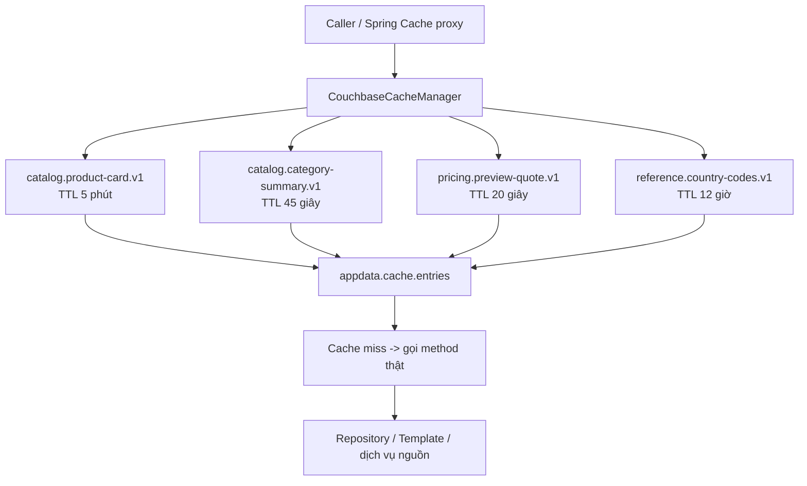
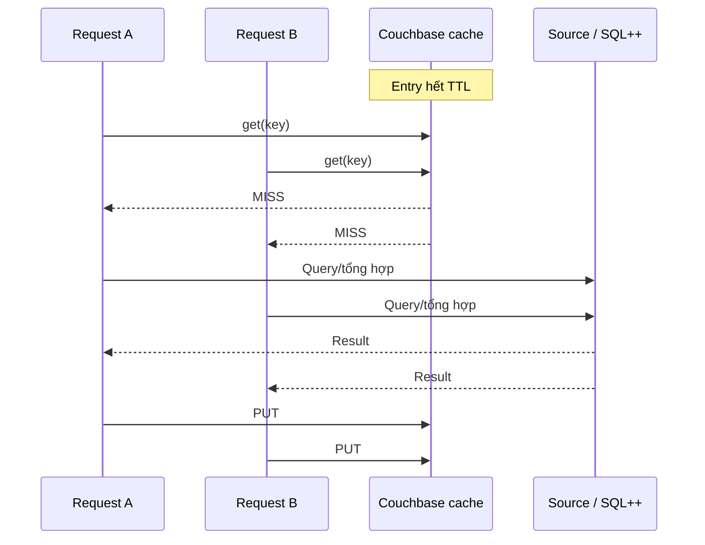

# Cấu hình thời hạn riêng cho từng cache

## Mục tiêu học tập

Sau bài học, bạn có thể:

1. Giải thích **time to live (TTL)** của Spring Cache entry, phân biệt với TTL của Couchbase document nghiệp vụ, thời gian sống của Java object và timeout một lệnh KV/SQL++.
2. Thiết kế thời hạn khác nhau cho các read model: dữ liệu ít thay đổi, bảng danh mục, báo cáo tổng hợp và báo giá tham khảo.
3. Cấu hình `CouchbaseCacheManager` với `CouchbaseCacheConfiguration.entryExpiry(Duration)` cho **từng cache name**, đồng thời đặt cache mặc định bằng `cacheDefaults(…)` khi có cache động.
4. Chọn một trong hai đường cấu hình: **Spring Boot auto-configuration + `CouchbaseCacheManagerBuilderCustomizer`** hoặc **một bean `CouchbaseCacheManager` tự khai báo**.
5. Hiểu `Duration.ZERO`, `maxExpiry` cấp bucket/collection, hành vi TTL tính từ lúc ghi, khác biệt fixed TTL với sliding expiration.
6. Kết hợp TTL với `@Cacheable`, `@CachePut`, `@CacheEvict`, transaction-aware eviction và chính sách bảo mật tenant mà không nhầm TTL với cam kết nhất quán.
7. Kiểm thử TTL theo cache, xác minh cache miss sau expiry, nhận diện cache stampede, cache stale, những lỗi cấu hình và các chỉ số vận hành cần theo dõi.

**Bối cảnh module:** `SPRING_DATA_COUCHBASE` hướng dẫn xây dựng tầng truy cập Couchbase bằng document mapping, repository, `CouchbaseTemplate` và truy vấn SQL++, gồm thiết kế bucket/scope/collection, chỉ mục, TTL, CAS, giao dịch và lựa chọn API reactive. Trong chương **Bộ nhớ đệm**, chúng ta dùng Spring Cache abstraction để lưu **bản sao kết quả phương thức** trên Couchbase. Thời hạn của bản sao này là chính sách riêng, không được đồng nhất với retention của document nguồn.

> **Nguyên tắc:** Thời hạn cache phải phụ thuộc vào **khả năng chấp nhận dữ liệu cũ, chi phí nạp lại và khả năng invalidation** của từng loại kết quả. Đặt toàn bộ cache bằng một TTL duy nhất vì dễ cấu hình thường không phải là lựa chọn tốt.

## 1. Vì sao mỗi cache cần thời hạn khác nhau?

Hệ thống thương mại điện tử có bốn read model:

| Cache name | Dữ liệu | Ví dụ TTL ban đầu | Lý do |
| --- | --- | --- | --- |
| `catalog.product-card.v1` | Tên, ảnh, mô tả ngắn, giá niêm yết để hiển thị | 5 phút | Thay đổi có kiểm soát; có thể evict khi cập nhật |
| `catalog.category-summary.v1` | Số sản phẩm, thống kê danh mục từ SQL++ | 45 giây | Tổng hợp tốn chi phí nhưng thay đổi thường xuyên |
| `pricing.preview-quote.v1` | Báo giá **tham khảo** cho giao diện | 20 giây | Cần giảm cửa sổ dữ liệu cũ; không dùng để quyết định tiền phải thanh toán |
| `reference.country-codes.v1` | Danh sách mã quốc gia từ nguồn chuẩn hóa | 12 giờ | Thay đổi hiếm; có cơ chế cập nhật/invalidate khi version nguồn thay đổi |

Các giá trị trên là **giả định để thực hành**, không phải chuẩn chung cho mọi sản phẩm. TTL chỉ nên được chốt sau khi có SLA về độ mới, tần suất update, khả năng phản ứng với thay đổi, chi phí truy vấn và đo hit/miss thực tế.

**Đặc biệt:** Dù `pricing.preview-quote.v1` chỉ giữ 20 giây, không được dùng kết quả cache như nguồn xác nhận giá cuối cùng khi checkout. Luồng thanh toán phải kiểm tra giá/khuyến mại từ dữ liệu nguồn ở thời điểm quyết định, kèm CAS hoặc transaction nếu cần.

### 1.1. Sơ đồ nhiều cache với TTL riêng



**Một `CacheManager` có thể quản lý nhiều cache với các `CouchbaseCacheConfiguration` khác nhau.** Cache name phân biệt vùng cache logic; chúng có thể dùng cùng bucket/scope/collection vật lý nếu cấu hình prefix/key tránh va chạm, hoặc tách collection khi mục tiêu vận hành đòi hỏi.

## 2. TTL cache entry, expiry document và timeout là ba khái niệm

| Khái niệm | Được đặt ở đâu? | Đơn vị và ý nghĩa | Khi hết hạn |
| --- | --- | --- | --- |
| **Spring Cache entry TTL** | `CouchbaseCacheConfiguration.entryExpiry(Duration)` | Thời gian giữ **bản sao kết quả phương thức** | Cache miss; method có thể chạy lại |
| **Document nghiệp vụ expiry** | `@Document(expiry…)`, `withExpiry(…)`, SDK `expiry(…)` | Vòng đời của **dữ liệu nguồn** | Document không còn phục vụ truy cập như trước |
| **KV/SQL++ timeout** | SDK timeout, Template/SDK query options, request deadline | Thời gian caller chờ một operation | Caller nhận timeout; mutation có thể có outcome chưa chắc chắn |
| **Transaction lifetime** | Spring transaction manager/Couchbase Transactions | Khoảng điều phối nhiều mutation | Commit/rollback hoặc ambiguous outcome |
| **Cache key version** | Quy ước name/key | Phiên bản schema hay thuật toán cache | Không phải một đồng hồ TTL |

Ví dụ:

```text
Source:
  appdata.catalog.products
  product::tenant-42::P1001
  -> không đặt expiry cho sản phẩm đang kinh doanh

Cache:
  appdata.cache.entries
  catalog.product-card.v1::tenant-42::P1001
  -> TTL = 5 phút

Request:
  GET /catalog/products/P1001
  -> HTTP request deadline = 2 giây
```

Sau 5 phút, chỉ **cache entry** hết hạn; document sản phẩm không mất. Request timeout 2 giây không làm entry tự hết hạn sau 2 giây. Và khi cache đã hết hạn, nguồn dữ liệu vẫn có thể còn hoặc đã bị sửa/xóa tùy nghiệp vụ.

### 2.1. Cache entry thật sự được lưu dưới dạng Couchbase document

`CouchbaseCacheManager` dùng backend Couchbase để lưu entry. Expiry được thực thi theo cơ chế document expiration của Couchbase Server; đó không phải một `ScheduledExecutor` Java quét toàn bộ cache sau từng giây. Thời điểm một entry không còn được trả về phụ thuộc vào TTL và cơ chế expiration của server; không nên hứa chính xác tới từng millisecond.

### 2.2. TTL không phải cơ chế bảo vệ CAS hoặc transaction

- `@Version`/CAS bảo vệ ghi đè document nguồn theo phiên bản; không tự làm mới cache.
- Durability của KV mutation quyết định mức xác nhận ghi; không làm stale cache biến mất.
- SQL++ `REQUEST_PLUS` có thể yêu cầu query chờ index bắt kịp mutation, nhưng **không chạy** nếu `@Cacheable` đã hit.
- Transaction đảm bảo những mutation tham gia đúng context được điều phối theo contract; nó không tự biến mọi cache entry thành snapshot cùng transaction.

Chính sách expiry phải kết hợp với invalidation và xác minh dữ liệu nguồn trong những use case cần nhất quán mạnh.

## 3. Spring Cache với Couchbase cần những thành phần nào?

Để áp dụng TTL theo cache name, phải có **Spring Cache infrastructure** và **Couchbase provider** thật sự được dùng.

Ví dụ Gradle:

```groovy
dependencies {
    implementation 'org.springframework.boot:spring-boot-starter-data-couchbase'
    implementation 'org.springframework.boot:spring-boot-starter-cache'
    implementation 'org.springframework.boot:spring-boot-starter-web'
}
```

`spring-boot-starter-web` chỉ dùng nếu muốn minh họa REST. Cache hoạt động trong service/background job mà không cần MVC.

Bật cache:

```java
package com.example.catalog;

import org.springframework.cache.annotation.EnableCaching;
import org.springframework.context.annotation.Configuration;

@Configuration(proxyBeanMethods = false)
@EnableCaching
public class CacheEnablementConfiguration {
}
```

Cấu hình kết nối nền:

```yaml
spring:
  couchbase:
    connection-string: couchbase://localhost
    username: app_user
    password: ${COUCHBASE_PASSWORD}
  data:
    couchbase:
      bucket-name: appdata
```

Các điều kiện triển khai:

1. Couchbase Server có bucket `appdata`; scope `catalog`/`cache` và collection `products`/`entries` được tạo theo quy trình migration/quản trị.
2. Tài khoản có quyền KV thích hợp trong các collection; query SQL++ của nguồn có secondary index phù hợp.
3. `@EnableCaching` nằm trong application context quét các Spring service được cache.
4. `CacheManager` thực tế là `CouchbaseCacheManager`, không vô tình là in-memory `ConcurrentMapCacheManager`.
5. DTO cache có transcoder/serialization phù hợp với dependency version và phải có thể tái tạo từ nguồn.
6. Không hardcode password thật trong mã nguồn; dùng secret/biến môi trường. Không tạo `Cluster.connect()` mới theo từng request.

### 3.1. Bật annotation khác với chọn backend

`@EnableCaching` cho phép Spring proxy xử lý `@Cacheable`/`@CachePut`/`@CacheEvict`. Annotation này **không bắt buộc backend là Couchbase**. Nếu nhiều thư viện cache cùng có trên classpath, provider hoặc manager mà Boot chọn có thể khác dự kiến.

Mọi thử nghiệm TTL cần xác minh `CacheManager` được dùng trước, nếu không `@Cacheable` có thể hit từ cache in-memory **không có TTL như bạn đang thiết kế**.

## 4. Phương án A: Spring Boot auto-configuration và TTL mặc định

Spring Boot hỗ trợ `spring.cache.couchbase.expiration` để thiết lập **thời hạn mặc định** cho Couchbase cache manager. Ví dụ:

```yaml
spring:
  cache:
    type: couchbase
    cache-names: catalog.product-card.v1,catalog.category-summary.v1,pricing.preview-quote.v1,reference.country-codes.v1
    couchbase:
      expiration: 5m
```

Ý nghĩa:

- `spring.cache.type: couchbase` ép chọn Couchbase khi điều kiện auto-configuration được đáp ứng.
- `spring.cache.cache-names` khai báo các cache name logic sẽ được khởi tạo.
- `spring.cache.couchbase.expiration: 5m` là **mặc định chung**, không cho phép khai báo mỗi cache một giá trị chỉ bằng cách đặt các tên như `spring.cache.couchbase.productCards.expiration`.
- Cấu hình này không tự tạo bucket/scope/collection; các keyspace vật lý phải tồn tại.

Với bốn cache có TTL khác nhau, không dừng ở YAML chung. Hãy khai báo **builder customizer** hoặc **một CacheManager thủ công**, như hai cách tiếp theo.

### 4.1. Điều gì xảy ra nếu không override?

Nếu tất cả cache name đều dùng chung TTL mặc định 5 phút, báo giá tham khảo cũng có thể tồn tại 5 phút thay vì 20 giây, trong khi country code bị reload quá thường xuyên. Điều đó có thể tăng staleness hoặc tải nguồn.

Trước khi thiết kế per-cache expiry, xác định cache name thống nhất với annotation; một tên sai chính tả có thể khiến policy TTL đặc thù không áp dụng đúng.

## 5. Phương án A mở rộng: CouchbaseCacheManagerBuilderCustomizer

Spring Boot chính thức hướng dẫn dùng `CouchbaseCacheManagerBuilderCustomizer` để đặt expiry khác nhau cho từng cache, **vẫn giữ CacheManager do Boot tạo**.

### 5.1. Ví dụ dành cho Spring Boot 3.x

```java
package com.example.catalog;

import java.time.Duration;

import org.springframework.boot.autoconfigure.cache.CouchbaseCacheManagerBuilderCustomizer;
import org.springframework.context.annotation.Bean;
import org.springframework.context.annotation.Configuration;
import org.springframework.data.couchbase.cache.CouchbaseCacheConfiguration;

@Configuration(proxyBeanMethods = false)
public class CacheTtlCustomizerConfiguration {

    @Bean
    public CouchbaseCacheManagerBuilderCustomizer catalogCacheTtls() {
        return builder -> {
            CouchbaseCacheConfiguration defaults =
                    CouchbaseCacheConfiguration.defaultCacheConfig()
                            .disableCachingNullValues();

            builder
                    .withCacheConfiguration(
                            "catalog.product-card.v1",
                            defaults.entryExpiry(Duration.ofMinutes(5)))
                    .withCacheConfiguration(
                            "catalog.category-summary.v1",
                            defaults.entryExpiry(Duration.ofSeconds(45)))
                    .withCacheConfiguration(
                            "pricing.preview-quote.v1",
                            defaults.entryExpiry(Duration.ofSeconds(20)))
                    .withCacheConfiguration(
                            "reference.country-codes.v1",
                            defaults.entryExpiry(Duration.ofHours(12)));
        };
    }
}
```

Ví dụ phân biệt bốn chính sách. Nó không tự bật caching; ứng dụng vẫn cần `@EnableCaching`, kết nối Couchbase, Spring Cache và các cache name hợp lệ.

**Lưu ý về import:** Trên Spring Boot 3.x, interface customizer nằm trong `org.springframework.boot.autoconfigure.cache`. Trên Spring Boot 4.x, tài liệu sử dụng `org.springframework.boot.cache.autoconfigure.CouchbaseCacheManagerBuilderCustomizer`. Phần thân cấu hình tương tự nhưng package phải theo **phiên bản dependency dự án**, không copy nhầm import.

### 5.2. Vì sao dùng defaultCacheConfig nhiều lần vẫn hợp lý?

`CouchbaseCacheConfiguration.entryExpiry(…)` trả về một **configuration mới**. Gọi:

```java
CouchbaseCacheConfiguration defaults =
        CouchbaseCacheConfiguration.defaultCacheConfig();

CouchbaseCacheConfiguration shortLived =
        defaults.entryExpiry(Duration.ofSeconds(20));

CouchbaseCacheConfiguration longerLived =
        defaults.entryExpiry(Duration.ofMinutes(5));
```

không sửa `defaults` thành 20 giây rồi 5 phút. Cơ chế copy immutable giúp tạo cấu hình theo cache name mà không trộn TTL giữa các cache.

### 5.3. Đừng trộn auto-config và bean thủ công thiếu kiểm soát

Nếu ứng dụng đã tự khai báo `@Bean CouchbaseCacheManager cacheManager(…)`, Spring Boot có thể **không tạo CacheManager mặc định** nữa. Khi đó customizer dùng cho đường auto-configuration không nhất thiết được gọi.

Hãy chọn rõ:

- **Cách A:** Boot tạo manager, thêm `CouchbaseCacheManagerBuilderCustomizer` để đặt per-cache TTL.
- **Cách B:** Tự tạo đúng **một** `CouchbaseCacheManager` và đặt `withCacheConfiguration` trên builder.

Không khai báo hai manager cùng ý nghĩa rồi suy đoán annotation tự chọn đúng. Với nhiều manager chủ động, dùng `cacheManager`/`@Qualifier` hoặc `CachingConfigurer` theo contract.

## 6. Phương án B: CouchbaseCacheManager thủ công với cacheDefaults và per-cache

Khi cần kiểm soát cả collection chứa cache, prefix, null policy, default TTL và transaction-awareness, cấu hình bean thủ công thuận tiện hơn.

### 6.1. Mẫu cấu hình đầy đủ

```java
package com.example.catalog;

import java.time.Duration;

import org.springframework.context.annotation.Bean;
import org.springframework.context.annotation.Configuration;
import org.springframework.data.couchbase.cache.CouchbaseCacheConfiguration;
import org.springframework.data.couchbase.cache.CouchbaseCacheManager;
import org.springframework.data.couchbase.core.CouchbaseOperations;

@Configuration(proxyBeanMethods = false)
public class ExplicitCouchbaseCacheConfiguration {

    @Bean
    public CouchbaseCacheManager cacheManager(
            CouchbaseOperations operations) {

        var factory = operations
                .getCouchbaseClientFactory()
                .withScope("cache");

        CouchbaseCacheConfiguration base =
                CouchbaseCacheConfiguration.defaultCacheConfig()
                        .collection("entries")
                        .prefixCacheNameWith("app:catalog:")
                        .disableCachingNullValues();

        return CouchbaseCacheManager.builder(factory)
                // Default cho cache mới nếu cho phép tạo động.
                .cacheDefaults(
                        base.entryExpiry(Duration.ofMinutes(3)))
                // Các cache được khai báo rõ theo business policy.
                .withCacheConfiguration(
                        "catalog.product-card.v1",
                        base.entryExpiry(Duration.ofMinutes(5)))
                .withCacheConfiguration(
                        "catalog.category-summary.v1",
                        base.entryExpiry(Duration.ofSeconds(45)))
                .withCacheConfiguration(
                        "pricing.preview-quote.v1",
                        base.entryExpiry(Duration.ofSeconds(20)))
                .withCacheConfiguration(
                        "reference.country-codes.v1",
                        base.entryExpiry(Duration.ofHours(12)))
                .disableCreateOnMissingCache()
                .transactionAware()
                .build();
    }
}
```

**Chỉ dùng phương án này thay cho bean tự cấu hình**, không phải thêm song song vào phần 5 mà không kiểm soát bean.

Phân tích từng lựa chọn:

1. `operations.getCouchbaseClientFactory()` tái sử dụng SDK client do Spring quản lý.
2. `withScope("cache")` chuyển **scope** trong bucket của factory; không đổi bucket.
3. `collection("entries")` lưu cache entries trong collection riêng, không phải `catalog.products`.
4. `prefixCacheNameWith("app:catalog:")` thêm namespace vật lý; prefix thực tế còn chứa cache name theo contract của provider.
5. `cacheDefaults(…)` dành cho cache được tạo dựa trên default khi manager cho phép; không thay các cấu hình được chỉ định bằng `withCacheConfiguration`.
6. `withCacheConfiguration(name, config)` xác định TTL cho một **cache name**.
7. `disableCreateOnMissingCache()` khiến tên cache không được khai báo không tự xuất hiện với default ngoài ý muốn; hữu ích để phát hiện typo.
8. `transactionAware()` đồng bộ những cache put/evict thích hợp với transaction Spring; nó **không** làm document nguồn và cache entry cùng commit nguyên tử.

### 6.2. Cache defaults vs cấu hình tường minh

| Tên cache | Cấu hình được chọn | TTL |
| --- | --- | --- |
| `catalog.product-card.v1` | `withCacheConfiguration` | 5 phút |
| `catalog.category-summary.v1` | `withCacheConfiguration` | 45 giây |
| `pricing.preview-quote.v1` | `withCacheConfiguration` | 20 giây |
| `reference.country-codes.v1` | `withCacheConfiguration` | 12 giờ |
| `unknownCache` | Không cho tạo vì đã `disableCreateOnMissingCache` | Không có cache |
| Cache động hợp lệ nếu **bỏ** disable | `cacheDefaults` | 3 phút |

Cấu hình default có ích khi ứng dụng cố ý cho phép cache dynamic. Với hệ thống production muốn TTL được review, **tập cache name cố định** thường dễ vận hành hơn vì tên sai không lặng lẽ được tạo với TTL sai.

### 6.3. Cùng collection không có nghĩa cùng thời hạn

Bốn cache nói trên có thể cùng nằm trong `appdata.cache.entries`, nhưng mỗi entry được ghi với expiry theo cấu hình cache tương ứng. Collection có thể có `maxExpiry` cấp server; hãy xác minh nó không mâu thuẫn với TTL mong muốn ở phần sau.

### 6.4. Mô hình key prefix an toàn

Nếu logical key là `tenant-42::P1001`, tên cache `catalog.product-card.v1` và prefix `app:catalog:`, physical key thường được xây theo dạng:

```text
app:catalog:catalog.product-card.v1::tenant-42::P1001
```

Không tự truyền physical key vào `Cache.get/put/evict`; chúng nhận **logical key**, provider tự thêm prefix. Cache name không đồng nghĩa tên collection Couchbase và không tự tạo collection mới.

## 7. Duration.ZERO, giá trị âm và thời hạn rất dài

`CouchbaseCacheConfiguration.entryExpiry(Duration)` nhận `Duration`. Theo Javadoc Spring Data Couchbase, **`Duration.ZERO` biểu diễn cache không hết hạn theo cấu hình này**.

```java
CouchbaseCacheConfiguration eternal =
        CouchbaseCacheConfiguration.defaultCacheConfig()
                .entryExpiry(Duration.ZERO);
```

Đây không phải lời khuyên bật cache vô hạn cho mọi dữ liệu.

| Expiry cấu hình | Ý nghĩa dự kiến | Điều cần xem xét |
| --- | --- | --- |
| `Duration.ofSeconds(20)` | Entry có thời gian sống ngắn | Hit rate, lượng truy cập nguồn khi hết hạn |
| `Duration.ofMinutes(5)` | Cache danh mục ngắn/trung bình | Invalidation sau cập nhật |
| `Duration.ofHours(12)` | Dữ liệu ít thay đổi | Thay đổi schema, quyền và sự kiện refresh |
| `Duration.ZERO` | Không hết hạn theo chính sách cache entry | Cần eviction, versioning, kiểm soát dung lượng và server maxExpiry |
| Duration âm | Không phải TTL hợp lệ để dựa vào | Validate và từ chối trong cấu hình ứng dụng |
| Duration cực dài | Tăng nguy cơ dữ liệu cũ và dung lượng | Giới hạn SDK/server, retention policy, rolling deployment |

Không tự kết luận `Duration.ZERO` luôn giữ entry vĩnh viễn **trong mọi bucket/collection**: Couchbase có chính sách `maxExpiry` ở cấp bucket/collection và có quy tắc override/inherit phụ thuộc cấu hình server. Hãy kiểm tra thời gian hết hạn hiệu lực thay vì chỉ đọc Java configuration.

### 7.1. maxExpiry ở bucket và collection

Couchbase Server hỗ trợ `maxExpiry` cho bucket/collection, giúp đặt giới hạn tuổi document. Tùy phiên bản và cách cấu hình, collection có thể kế thừa bucket, đặt giới hạn riêng hoặc không cho expiry theo tùy chọn hỗ trợ.

Ví dụ ý tưởng:

```text
Ứng dụng muốn:
  reference.country-codes.v1 → TTL 12 giờ

Server cache collection lại giới hạn:
  maxExpiry = 1 giờ

Kết quả:
  Không thể mặc định khẳng định entry sống đủ 12 giờ.
  Cần kiểm tra expiry thực tế và cấu hình server.
```

Nếu cần một cache giữ 12 giờ và một cache giữ 20 giây, collection policy phải tương thích với các thời hạn đó. Có thể dùng collection khác nhau khi retention/giới hạn vận hành không tương thích.

**Đừng tự sửa maxExpiry production chỉ để “sửa” test:** Đây là cấu hình có thể tác động nhiều document đang dùng chung keyspace. Thay đổi cần được review, có quan sát và kế hoạch rollback.

### 7.2. Long TTL và ranh giới Duration của SDK

Couchbase Java SDK hiện đại cho phép đặt expiry dưới dạng `Duration` trong giới hạn được tài liệu hóa; với thời điểm quá xa, SDK có thể yêu cầu dùng `Instant`. Đối với Spring Cache, `entryExpiry(Duration)` là API cấu hình TTL của provider; không có lý do thực tế để đặt TTL vài chục năm cho cache kết quả phương thức.

Nếu mục tiêu là dữ liệu bắt buộc tồn tại lâu dài, hãy lưu thành document nghiệp vụ có retention và backup, **đừng coi cache eternal là database thay thế**.

## 8. TTL tính từ lúc PUT, không phải “mỗi lần đọc lại thêm TTL”

Với cách cấu hình `entryExpiry(Duration)` thông thường, thời hạn được áp khi cache entry **được ghi**. Một cache hit không nên được mặc định hiểu là thao tác tự gia hạn thời gian sống.

Ví dụ TTL 5 phút:

```text
10:00:00  @Cacheable miss -> method chạy -> cache PUT, expiry ~10:05
10:01:00  @Cacheable hit  -> trả DTO, không ghi lại entry
10:03:00  @Cacheable hit  -> trả DTO, không ghi lại entry
10:05:00  Entry hết TTL (thời điểm server đánh giá expiry)
10:05:01  @Cacheable miss -> method chạy -> PUT entry mới, expiry ~10:10
```

Đây là **fixed TTL / expire-after-write** ở mức khái niệm. **Time-to-idle (TTI) / sliding expiration** là chính sách khác: mỗi lần đọc làm mới expiry. Không gọi cùng tên hai chính sách.

### 8.1. @CachePut làm mới entry và có thể đặt lại expiry

```java
@CachePut(cacheNames = "catalog.product-card.v1",
          key = "#p0 + '::' + #p1")
public ProductCard reloadCard(String tenantId, String sku) {
    return loadCardFromSource(tenantId, sku);
}
```

`@CachePut` luôn thực thi method, sau đó ghi cache result. Khi ghi lại entry, expiry của entry được áp theo cấu hình cache name. Vì thế việc thường xuyên `@CachePut` có thể liên tục làm mới thời điểm hết hạn; không được suy ra một cache được nạp lúc 10:00 vẫn nhất định biến mất lúc 10:05 nếu nó đã được PUT lại lúc 10:03.

### 8.2. TTI/sliding expiration không phải mặc định của entryExpiry

Để thực sự có sliding TTL, cần API/provider hỗ trợ thao tác “read and touch” hoặc một chiến lược get/touch có kiểm soát. Couchbase SDK có các primitive về expiry như `getAndTouch`, nhưng điều đó **không có nghĩa** Spring Cache annotation tự gọi chúng khi hit.

Nếu cần session timeout kéo dài theo lần hoạt động cuối, hãy xem xét công cụ session management chuyên biệt và chính sách bảo mật riêng; đừng biến `CouchbaseCacheManager.entryExpiry` thành một giả định về session TTL nếu chưa có contract TTI và kiểm thử.

### 8.3. Không trộn TTL với request timeout

`timeout(Duration.ofSeconds(2))` trong SDK xác định caller chờ một operation bao lâu. `entryExpiry(Duration.ofSeconds(20))` xác định entry cache sống bao lâu. Nếu KV ghi entry timeout, nó **không** đồng nghĩa entry đã được ghi và tồn tại đúng 20 giây hay chắc chắn chưa được ghi.

Một request timeout có thể có outcome chưa rõ; cần log/metric và idempotency nếu operation/side effect quan trọng.

## 9. Ví dụ Java: bốn cache có chính sách expiry riêng

Giả sử dữ liệu sản phẩm được lưu ở `appdata.catalog.products`. Document ID có dạng `product::tenant-42::P1001`; application service cần một số read model để hiển thị.

### 9.1. Entity nguồn có CAS, không phải cache entry

```java
package com.example.catalog;

import org.springframework.data.annotation.Id;
import org.springframework.data.annotation.Version;
import org.springframework.data.couchbase.core.mapping.Collection;
import org.springframework.data.couchbase.core.mapping.Document;
import org.springframework.data.couchbase.core.mapping.Field;
import org.springframework.data.couchbase.core.mapping.Scope;

@Document
@Scope("catalog")
@Collection("products")
public class ProductDocument {

    @Id
    private String id;

    @Field
    private String tenantId;

    @Field
    private String sku;

    @Field
    private String categoryId;

    @Field
    private String title;

    @Field
    private long priceCents;

    @Version
    private Long version;

    public ProductDocument() {}

    public String getId() { return id; }
    public void setId(String value) { id = value; }

    public String getTenantId() { return tenantId; }
    public void setTenantId(String value) { tenantId = value; }

    public String getSku() { return sku; }
    public void setSku(String value) { sku = value; }

    public String getCategoryId() { return categoryId; }
    public void setCategoryId(String value) { categoryId = value; }

    public String getTitle() { return title; }
    public void setTitle(String value) { title = value; }

    public long getPriceCents() { return priceCents; }
    public void setPriceCents(long value) { priceCents = value; }

    public Long getVersion() { return version; }
}
```

Repository:

```java
package com.example.catalog;

import org.springframework.data.couchbase.repository.CouchbaseRepository;

public interface ProductRepository
        extends CouchbaseRepository<ProductDocument, String> {
}
```

Các DTO đọc:

```java
package com.example.catalog;

public record ProductCard(
        String sku, String title, long priceCents) {}

public record CategorySummary(
        String categoryId, long productCount) {}

public record PricePreview(
        String sku, long amountCents, String currency) {}
```

*Các public record trên cần nằm trong các file `.java` riêng trong dự án; đoạn ghép chỉ để giới thiệu kiểu dữ liệu. `ProductDocument` là dữ liệu nguồn, DTO cache có thể được tái tạo sau miss.*

### 9.2. Service @Cacheable theo từng cache name

```java
package com.example.catalog;

import java.util.List;
import java.util.NoSuchElementException;

import org.springframework.cache.annotation.Cacheable;
import org.springframework.data.couchbase.core.CouchbaseOperations;
import org.springframework.data.couchbase.core.query.Query;
import org.springframework.data.couchbase.core.query.QueryCriteria;
import org.springframework.stereotype.Service;

@Service
public class CatalogReadModels {

    private final ProductRepository products;
    private final CouchbaseOperations operations;

    public CatalogReadModels(
            ProductRepository products,
            CouchbaseOperations operations) {
        this.products = products;
        this.operations = operations;
    }

    @Cacheable(
            cacheNames = "catalog.product-card.v1",
            key = "#p0 + '::' + #p1",
            unless = "#result == null")
    public ProductCard card(String tenantId, String sku) {
        ProductDocument doc = loadProduct(tenantId, sku);
        return new ProductCard(
                doc.getSku(), doc.getTitle(), doc.getPriceCents());
    }

    @Cacheable(
            cacheNames = "pricing.preview-quote.v1",
            key = "#p0 + '::' + #p1")
    public PricePreview previewPrice(String tenantId, String sku) {
        ProductDocument doc = loadProduct(tenantId, sku);
        // VND cố định trong ví dụ; nếu currency là input,
        // bắt buộc đưa currency vào key.
        return new PricePreview(
                doc.getSku(), doc.getPriceCents(), "VND");
    }

    @Cacheable(
            cacheNames = "catalog.category-summary.v1",
            key = "#p0 + '::' + #p1")
    public CategorySummary categorySummary(
            String tenantId, String categoryId) {

        Query query = Query.query(
                QueryCriteria.where("tenantId").is(tenantId)
                        .and("categoryId").is(categoryId));

        long count = operations
                .findByQuery(ProductDocument.class)
                .matching(query)
                .count();

        return new CategorySummary(categoryId, count);
    }

    @Cacheable(cacheNames = "reference.country-codes.v1")
    public List<String> countryCodes() {
        // Trong thực tế nguồn có thể là service/danh mục riêng;
        // không đưa vào cache dữ liệu không thể tái tạo.
        return List.of("VN", "SG", "TH");
    }

    private ProductDocument loadProduct(
            String tenantId, String sku) {

        if (tenantId == null || tenantId.isBlank()
                || sku == null || sku.isBlank()) {
            throw new IllegalArgumentException(
                    "tenantId và sku phải hợp lệ");
        }

        String id = "product::" + tenantId + "::" + sku;

        ProductDocument doc = products.findById(id)
                .orElseThrow(() -> new NoSuchElementException(
                        "Không tìm thấy sản phẩm"));

        if (!tenantId.equals(doc.getTenantId())) {
            throw new SecurityException("Sai tenant");
        }
        return doc;
    }
}
```

**Ranh giới của ví dụ:** Kiểm tra tenant trong `loadProduct` chỉ chạy **khi method thực sự chạy**. Một cache hit của `@Cacheable` bỏ qua method body. Production phải xác thực tenant và quyền đọc ở **filter/facade bên ngoài Spring cache proxy**, dùng tenant từ security context server-side, không tin chuỗi client gửi.

Với `categorySummary`, SQL++ có thể cần secondary index:

```sql
CREATE INDEX `idx_catalog_tenant_category`
ON `appdata`.`catalog`.`products`(tenantId, categoryId);
```

Index này phục vụ truy vấn nguồn khi cache miss; một cache hit không chạy SQL++. Với query thực tế, dùng `EXPLAIN` và kiểm tra khả năng index bao phủ, số document được scan và độ trễ.

### 9.3. Quan sát bốn cache với cùng input

```text
card("tenant-42","P1001")
  -> catalog.product-card.v1, TTL ~5 phút

previewPrice("tenant-42","P1001")
  -> pricing.preview-quote.v1, TTL ~20 giây

categorySummary("tenant-42","keyboards")
  -> catalog.category-summary.v1, TTL ~45 giây

countryCodes()
  -> reference.country-codes.v1, TTL ~12 giờ
```

Mỗi cache name có policy độc lập dù backend có thể cùng dùng `appdata.cache.entries`. Khi `previewPrice` hết TTL ở giây 20, `card` có thể vẫn hit vì expiry của nó dài hơn. Phải kiểm tra business rule để biết việc này có phù hợp: một trang có thể hiển thị hai read model cùng thời điểm khác nhau.

## 10. Invalidation: TTL không thay việc xóa cache sau source update

TTL chủ yếu hạn chế **thời gian tồn tại** của bản sao; không tự phát hiện document nguồn vừa thay đổi. Nếu nhân viên sửa giá lúc 10:01 nhưng `catalog.product-card.v1` còn TTL tới 10:05, cache vẫn có thể trả giá cũ.

Tại đường ghi nguồn, có thể kết hợp `@CacheEvict` cho những cache phụ thuộc:

```java
package com.example.catalog;

import java.util.NoSuchElementException;

import org.springframework.cache.annotation.CacheEvict;
import org.springframework.cache.annotation.Caching;
import org.springframework.stereotype.Service;

@Service
public class ProductPriceWriter {

    private final ProductRepository products;

    public ProductPriceWriter(ProductRepository products) {
        this.products = products;
    }

    @Caching(evict = {
        @CacheEvict(
                cacheNames = "catalog.product-card.v1",
                key = "#p0 + '::' + #p1"),
        @CacheEvict(
                cacheNames = "pricing.preview-quote.v1",
                key = "#p0 + '::' + #p1")
    })
    public void changePrice(
            String tenantId, String sku, long priceCents) {

        if (priceCents < 0) {
            throw new IllegalArgumentException(
                    "Giá không được âm");
        }

        ProductDocument doc = products
                .findById("product::" + tenantId + "::" + sku)
                .orElseThrow(NoSuchElementException::new);

        if (!tenantId.equals(doc.getTenantId())) {
            throw new SecurityException("Sai tenant");
        }

        doc.setPriceCents(priceCents);
        products.save(doc);
    }
}
```

Với `@CacheEvict` mặc định, eviction diễn ra sau method hoàn tất bình thường; nếu `save` ném exception, việc evict sau invocation thường không chạy. Lưu ý:

- Cache card và preview quote có TTL khác nhau nhưng cùng phụ thuộc giá của source, vì vậy **cả hai** cần invalidation khi sửa giá.
- `categorySummary` ở ví dụ đếm sản phẩm theo category; thay giá **không** làm thay đổi số lượng nên không cần evict nó chỉ vì giá thay đổi. Nếu summary cộng tổng giá, khi đó có dependency và cần evict.
- `reference.country-codes` không phụ thuộc sản phẩm nên không cần evict khi sửa giá.
- Tất cả con đường ghi khác (batch/SDK/service thứ hai) cũng cần chính sách invalidation hoặc chấp nhận stale theo SLA.
- Chỉ có `@Version`/CAS trên document nguồn không đủ để xóa cache entry.

### 10.1. Transaction-aware eviction giúp đúng thời điểm hơn, không atomic tuyệt đối

Nếu một workflow cập nhật nhiều document trong Couchbase Transactions, cần transaction manager/context chính xác. `CouchbaseCacheManager.builder(factory).transactionAware()` hỗ trợ đồng bộ cache put/evict với transaction Spring đang hoạt động theo contract của provider.

Nhưng:

1. Cache evict sau commit vẫn có thể lỗi.
2. Một cache miss đang tải bản cũ có thể put stale value **sau** eviction.
3. Một external writer không gọi annotation của application service.
4. Một `@Transactional` không bảo đảm một lệnh SDK raw ngoài transaction context tự tham gia transaction.

Vì thế, cache-aside + TTL + eviction không tạo cam kết mọi request đọc được giá mới ngay khi source commit. Những quyết định tài chính/khóa tồn kho phải dùng source theo consistency nghiệp vụ.

### 10.2. @CachePut không phải lệnh gia hạn expiry nguồn

```java
@CachePut(
        cacheNames = "catalog.product-card.v1",
        key = "#p0 + '::' + #p1")
public ProductCard refreshCard(String tenantId, String sku) {
    // Luôn đọc nguồn và trả DTO mới để cache ghi lại.
    return loadCardFromSource(tenantId, sku);
}
```

`@CachePut` có thể reset expiry của **cache entry** vì nó thực hiện put; nó **không** gia hạn expiry của `ProductDocument` và không tự gọi `repository.save`. Đây là method minh họa bên trong một Spring service đã có helper phù hợp.

## 11. Dữ liệu không tồn tại, negative caching và TTL ngắn

Không phải mọi kết quả đều nên cache theo cùng policy:

- Một `ProductCard` hợp lệ có thể cache 5 phút.
- “Không tìm thấy sản phẩm” có thể thay đổi khi sản phẩm được tạo sau đó.
- “Không có quyền” có thể thay đổi theo permission và **không** nên được cache dùng chung giữa caller.
- Một exception do Couchbase timeout không được coi là kết quả nghiệp vụ “sản phẩm không tồn tại”.

Một phương thức `@Cacheable` trả null, hoặc `Optional.empty()` theo Spring Cache handling, có thể được cache nếu policy/provider cho phép. Nếu không muốn negative caching:

```java
@Cacheable(
        cacheNames = "catalog.product-card.v1",
        key = "#p0 + '::' + #p1",
        unless = "#result == null")
public ProductCard findCardOrNull(String tenantId, String sku) {
    // Trả null khi document thật sự không tồn tại.
    return findFromSource(tenantId, sku);
}
```

*Đây là method phác thảo của service; helper `findFromSource` cần được triển khai.*

Với `CouchbaseCacheConfiguration.disableCachingNullValues()`, lời gọi `Cache.put(key, null)` có thể bị từ chối thay vì được hiểu là eviction; không dùng null như tín hiệu xóa entry.

### 11.1. Nếu cần negative caching, nên dùng vùng riêng

Ví dụ có thể dùng `catalog.product-not-found.v1` với TTL 5 giây và một kiểu kết quả rõ (không phải response 403/401). Khi tạo sản phẩm thành công, evict key âm tương ứng.

Tuy nhiên, negative cache có thể gây false 404 trong TTL nếu source vừa được tạo. Định nghĩa business SLA rõ trước khi triển khai. Đặc biệt, nếu key chỉ chứa SKU mà không có tenant, negative result có thể che giấu dữ liệu của tenant khác.

**Per-cache TTL không có nghĩa per-entry TTL động.** Nếu các loại kết quả cần TTL khác nhau, cách dễ kiểm soát là dùng cache name khác nhau. Đừng mặc định `@Cacheable` có thuộc tính `ttl` cho từng invocation.

## 12. Khi thật sự cần TTL theo từng entry hoặc theo kết quả

`entryExpiry(Duration)` là cấu hình cho **một cache**, không phải một expression đánh giá mỗi khi kết quả phương thức khác nhau.

Ví dụ chính sách:

```text
Catalog card thường:        5 phút
Catalog card khuyến mãi:   10 giây
Product not-found:          5 giây
Country code:              12 giờ
```

Nếu tất cả dùng cùng cache name, static expiry không biểu diễn được bốn thời hạn đó. Có thể:

1. Tách chúng thành những cache name có policy khác nhau.
2. Với nghiệp vụ thật sự cần expiry dựa trên response, thiết kế adapter/cache writer riêng và kiểm chứng với SDK, không giả định `CouchbaseCacheManager` tự suy diễn dynamic expiry.
3. Với session/security token, sử dụng cơ chế session/token storage được thiết kế dành riêng cho security thay vì chèn logic thời hạn tùy ý vào cache read model.
4. Với dữ liệu bắt buộc tồn tại và không thể tái tạo, dùng document nguồn có retention/backup/audit phù hợp, không dùng cache như kho chính.

### 12.1. Không nhầm static TTL với TTL jitter

TTL jitter nghĩa là thay đổi nhẹ expiry giữa các entry để tránh nhiều hot key cùng hết hạn một lúc. Cấu hình static `entryExpiry(Duration.ofMinutes(5))` **không tự thêm jitter** theo từng entry. Muốn jitter thực sự, cần cơ chế được provider/adapter hỗ trợ và phải kiểm thử để không phá SLA về dữ liệu cũ.

Nếu không có hỗ trợ, giải pháp đơn giản hơn có thể là prewarm, giới hạn concurrency hoặc stagger việc tạo cache entries trong quá trình vận hành.

## 13. Cache stampede và chọn TTL theo chi phí nạp lại

TTL ngắn có thể giảm stale nhưng tăng số lần cache miss. Nếu entry rất phổ biến, nhiều request cùng miss gây nhiều truy vấn SQL++ hoặc KV tới chính Couchbase cluster.



Nếu có hàng nghìn request cùng thời điểm, cache miss có thể làm nguồn quá tải. Cân nhắc:

- TTL theo tần suất update và chi phí nạp lại của **từng cache name**.
- `@Cacheable(sync = true)` khi provider hỗ trợ, nhưng không mặc định đó là distributed lock giữa mọi JVM/instance.
- Prewarm những key quan trọng trước một đợt tải lớn.
- Giới hạn concurrent source calls và dùng backpressure với reactive pipeline.
- Jitter TTL khi thực sự có provider hỗ trợ, không chỉ ghi chú trong code.
- Sử dụng cache tầng local L1 và shared L2 nếu workload có lợi, nhưng phải xử lý invalidation hai tầng.
- Đo p95/p99 và số query nguồn trong thời điểm entry đồng loạt hết hạn.

### 13.1. Khi TTL dài có thể gây hại hơn giúp ích

Một cache category summary TTL 1 giờ có thể giảm query SQL++ mạnh, nhưng làm thống kê trên UI chậm cập nhật quá lâu. Một cache country code TTL 12 giờ thường hợp lý hơn vì thay đổi hiếm. Không chọn TTL dài chỉ để đạt hit ratio cao.

**Cân bằng:** giảm TTL khi giá trị biến động, tăng TTL cho dữ liệu ổn định; kết hợp eviction khi có sự kiện sửa nguồn. TTL còn phụ thuộc số lượng key, serialized value, memory quota và latency của backend.

## 14. Xác minh cấu hình: getExpiry và cache name

Trước khi chờ expiry thực tế, có thể test cấu hình Java bằng JUnit:

```java
package com.example.catalog;

import static org.junit.jupiter.api.Assertions.assertEquals;

import java.time.Duration;

import org.junit.jupiter.api.Test;
import org.springframework.data.couchbase.cache.CouchbaseCacheConfiguration;

class CacheTtlPolicyTest {

    @Test
    void productAndQuoteHaveDifferentExpiry() {
        CouchbaseCacheConfiguration base =
                CouchbaseCacheConfiguration.defaultCacheConfig();

        var cards = base.entryExpiry(Duration.ofMinutes(5));
        var quote = base.entryExpiry(Duration.ofSeconds(20));

        assertEquals(Duration.ofMinutes(5), cards.getExpiry());
        assertEquals(Duration.ofSeconds(20), quote.getExpiry());
    }

    @Test
    void zeroMeansEternalInCacheConfiguration() {
        var config = CouchbaseCacheConfiguration
                .defaultCacheConfig()
                .entryExpiry(Duration.ZERO);

        assertEquals(Duration.ZERO, config.getExpiry());
    }
}
```

Test này kiểm tra **policy ở Java object**; nó không chứng minh Spring đang chọn đúng CacheManager, entry đã được ghi đúng keyspace hoặc server không có `maxExpiry` khác.

### 14.1. Integration test với CacheManager thật

Kịch bản:

1. Tạo cluster thử nghiệm hoặc dùng Couchbase Testcontainers với version tương thích.
2. Dùng đúng bean Spring `CacheManager` mà application dùng.
3. Ở test profile, đặt cache TTL ngắn: `fastProbe = 2 giây`, `slowProbe = 30 giây`.
4. Ghi hai entry qua `Cache.put`, đọc chúng ngay sau khi ghi để xác nhận hit.
5. Poll sau mốc expiry ngắn cho đến khi fast key miss.
6. Xác minh slow key vẫn hit và document nguồn không bị xóa.
7. Poll hoặc kiểm tra expiry metadata để xác nhận server áp dụng policy như mong đợi.

Ví dụ phác thảo một integration test đã được cấu hình TTL theo cache:

```java
import static org.assertj.core.api.Assertions.assertThat;

import org.junit.jupiter.api.Test;
import org.springframework.beans.factory.annotation.Autowired;
import org.springframework.boot.test.context.SpringBootTest;
import org.springframework.cache.Cache;
import org.springframework.cache.CacheManager;
import org.springframework.data.couchbase.cache.CouchbaseCacheManager;

@SpringBootTest
class CacheTtlIntegrationTest {

    @Autowired
    CacheManager cacheManager;

    @Test
    void bothCachesArePresent() {
        assertThat(cacheManager)
                .isInstanceOf(CouchbaseCacheManager.class);

        Cache fast = cacheManager.getCache("pricing.preview-quote.v1");
        Cache slow = cacheManager.getCache("catalog.product-card.v1");

        assertThat(fast).isNotNull();
        assertThat(slow).isNotNull();
    }
}
```

Test này chỉ xác nhận provider/cache names. Muốn đo expiry, nên dùng **test-specific TTL 1–2 giây** và công cụ chờ có polling/time budget, không dùng giả định rằng một `Thread.sleep(1000)` đúng một giây là đủ để server ngay lập tức dọn entry.

### 14.2. Kiểm thử expiry theo polling thay vì sleep cố định

Với thư viện Awaitility trong test scope (ví dụ Gradle `testImplementation 'org.awaitility:awaitility'`), có thể kiểm tra một entry thử với TTL 2 giây:

```java
import static org.awaitility.Awaitility.await;
import static org.assertj.core.api.Assertions.assertThat;

import java.time.Duration;

import org.springframework.cache.Cache;

// Giả sử đây là body một @Test trên manager có "fastProbe" TTL 2s.
Cache fastProbe = cacheManager.getCache("fastProbe");
assertThat(fastProbe).isNotNull();

String key = "ttl-probe-key";
fastProbe.put(key, "value");

assertThat(fastProbe.get(key)).isNotNull();

await()
        .atMost(Duration.ofSeconds(15))
        .pollInterval(Duration.ofMillis(250))
        .until(() -> fastProbe.get(key) == null);
```

*Chỉ chạy trên cache test được cấu hình TTL 2 giây. Một cache production 20 giây không phù hợp để test bằng kỳ vọng 2 giây.*

Polling giảm độ mong manh của test trước sự khác biệt scheduler/clock/rounding, nhưng còn phải kiểm tra trạng thái của cache chậm và nguồn. Một test pass khi entry biến mất vẫn chưa chứng minh latency của endpoint hoặc staleness SLA ngoài production.

### 14.3. Kiểm tra expiry metadata bằng SDK khi cần

Java SDK có thể lấy expiry timestamp của document:

```java
import java.time.Instant;
import java.util.Optional;

import com.couchbase.client.java.kv.GetOptions;
import com.couchbase.client.java.kv.GetResult;

// collection là SDK handle đến đúng scope/collection cache.
// physicalId phải là document key thật do provider tạo.
GetResult result = collection.get(
        physicalId, GetOptions.getOptions().withExpiry(true));

Optional<Instant> expiry = result.expiryTime();
long cas = result.cas();
```

Đây là cách **diagnostic** cấp thấp. Phải biết chính xác cache entry physical ID theo prefix/key converter của phiên bản triển khai; không truyền logical key trực tiếp khi provider đã thêm prefix. Nếu entry đã hết hạn trước khi đọc, SDK có thể báo document not found — đó cũng là kết quả có thể chấp nhận với một test expiry.

Không sửa content JSON/binary của cache entry bằng SDK nếu chưa hiểu transcoder, vì có thể làm Spring Cache không đọc lại được.

## 15. TTL, collection maxExpiry, thay đổi policy và rollout

### 15.1. Thay đổi cấu hình không đồng nghĩa mọi entry cũ đổi TTL ngay

Giả sử version A đang lưu `catalog.product-card.v1` với TTL 10 phút. Bạn deploy version B đổi policy còn 2 phút. **Những entry đã được ghi trước deploy có thể vẫn giữ expiry đã đặt tại thời điểm ghi**, không tự được viết lại chỉ vì bean Java mới có cấu hình khác.

Việc đọc cache hit ở bản B không chắc reset expiry. Khi cần áp dụng policy mới ngay lập tức:

- Dùng cache name/schema version mới (ví dụ `catalog.product-card.v2`) để không phục vụ entry cũ.
- Hoặc evict/clear có chọn lọc theo quy trình và quyền/index thích hợp; tránh xóa toàn cache bừa bãi.
- Chờ TTL cũ hết hạn nếu SLA chấp nhận được.
- Ghi lại cache bằng `@CachePut`/refresh có kiểm soát khi dữ liệu source đã được xác minh.

### 15.2. Khi nhiều instance dùng TTL khác nhau

Hai pod cùng chia sẻ cache name/keyspace nhưng pod A ghi TTL 5 phút, pod B ghi TTL 30 giây:

```text
Pod A: Cache PUT -> expiry sau 5 phút
Pod B: Cache PUT -> expiry sau 30 giây
Pod A: Cache GET -> có thể hit entry vừa do B ghi
```

Expiry thực tế của entry phụ thuộc lần put nào đã xảy ra và policy của writer đó, không phải riêng policy của reader đang gọi. Vì vậy **TTL theo cache name là một contract cần đồng bộ giữa mọi instance**. Rolling deployment phải có chiến lược tránh việc writer cũ/new cùng ghi khác policy khi thay đổi có ảnh hưởng lớn.

### 15.3. Cache name/version và value schema

Nếu DTO thay đổi schema, tên cache nên phản ánh version mới để tránh deserialization nhầm giữa các bản deploy. TTL dài làm entry cũ còn tồn tại lâu hơn, vì thế phải kết hợp schema version, prefix và cleanup.

### 15.4. Collection policy và hiệu năng

Cache entry ở cùng collection chịu workload KV, memory, replication/compaction và policy `maxExpiry` của collection. Nếu cache nhiều entry 12 giờ quá lớn, cluster có thể tăng áp lực bộ nhớ/disk dù hit rate tốt. Đo kích thước entry, số lượng key, tỷ lệ evict và tài nguyên cluster, không tối ưu chỉ mỗi số giây TTL.

## 16. Những lỗi phổ biến và cách xử lý

| Sai lầm | Hậu quả | Hướng sửa |
| --- | --- | --- |
| Chỉ đặt `spring.cache.couchbase.expiration` rồi tưởng mỗi cache TTL khác nhau | Mọi cache dùng mặc định nếu không override | Dùng builder customizer hoặc manual manager |
| Quên `@EnableCaching` | Annotation không được áp dụng | Bật caching trong Spring context |
| CacheManager thực tế là in-memory provider | Không có TTL Couchbase đã thiết kế | Xác minh bean và `spring.cache.type` |
| Nhầm cache name với collection | Truy cập sai keyspace | Phân biệt cache logic và bucket/scope/collection |
| Dùng `cacheDefaults` và `disableCreateOnMissingCache` nhưng nghĩ tên lạ nhận default | Tên chưa khai báo trả null/báo lỗi | Đăng ký rõ `withCacheConfiguration` |
| Tưởng `Duration.ZERO` nghĩa cache miss ngay lập tức | Entry không hết hạn theo Java config | Dùng TTL dương nhỏ nếu cần short-lived |
| Chọn TTL dài hơn `maxExpiry` của server | Entry có thể hết hạn sớm hơn dự kiến | Kiểm tra policy hiệu lực bucket/collection |
| Dùng TTL cache để xóa document nguồn | Nguồn vẫn tồn tại, hoặc nhầm retention | Thiết kế document expiry riêng |
| Tưởng cache GET luôn gia hạn TTL | Entry hết dù truy cập liên tục | Phân biệt fixed TTL và TTI; kiểm thử |
| Dùng `@CachePut` quá thường xuyên | Entry liên tục được ghi và reset TTL | Chỉ refresh khi có chủ đích |
| Dùng TTL ngắn cho SQL++ aggregate đắt | Cache stampede và tăng tải source | Giới hạn concurrency, prewarm hoặc điều chỉnh TTL |
| TTL dài nhưng thiếu invalidation | Stale data sau update | Evict theo dependency, event/outbox khi cần |
| Nghĩ `transactionAware` bảo đảm cache/source atomic tuyệt đối | Race/stale hoặc evict lỗi sau commit | Đối soát, metric và consistency design |
| Đặt quyền xem chỉ trong body `@Cacheable` | Cache hit có thể bỏ qua authorization | Guard trước cache proxy |
| Dùng cache cho giá cuối cùng lúc checkout | Quyết định dựa trên dữ liệu cũ | Xác minh trực tiếp nguồn khi commit |
| Đổi TTL một pod nhưng không đổi pod khác | Mỗi writer đặt expiry khác nhau | Đồng bộ policy và rollout |
| Test TTL bằng sleep đúng mốc | Flaky do network/clock/expiry granularity | Poll có timeout, test profile ngắn hạn |
| Null bị cache hoặc put null lỗi | 404 stale hoặc provider exception | Rõ negative cache policy và `unless` |
| Gọi `cache.clear()` trên production để sửa một key | Stampede và chi phí query/scan lớn | Evict đúng key hoặc versioned cache |
| Nhầm per-cache với per-entry dynamic TTL | Không đáp ứng SLA theo từng result | Tách cache names hoặc adapter cấp thấp |

## 17. Checklist vận hành TTL theo cache

- [ ] Xác định **nguồn sự thật**, loại DTO có thể tái tạo và những dữ liệu không được cache.
- [ ] Cache name phản ánh read model/schema; reader, writer và admin job dùng cùng tên.
- [ ] TTL của từng cache có lý do theo SLA freshness và chi phí source, không chọn tùy ý.
- [ ] Có một đường cấu hình rõ: Boot auto-config + customizer **hoặc** manual `CouchbaseCacheManager`.
- [ ] `@EnableCaching` hoạt động; bean `CacheManager` đã được xác minh.
- [ ] `withCacheConfiguration(name, …)` khớp chính xác cache name trong annotation.
- [ ] Default TTL, dynamic cache policy và `disableCreateOnMissingCache` được hiểu rõ.
- [ ] Bucket/scope/collection và `maxExpiry` server phù hợp với TTL từng cache.
- [ ] `Duration.ZERO` chỉ được dùng nếu có retention/invalidation/cleanup được review.
- [ ] Cache key phân biệt tenant và các input ảnh hưởng giá trị; authorization chạy trước hit.
- [ ] Mọi đường sửa source có eviction hoặc SLA stale được chấp nhận.
- [ ] Transaction synchronization có cấu hình đúng và không được hiểu là atomic tuyệt đối.
- [ ] Stale repopulation, stampede, TTL jitter và multi-instance được đánh giá bằng test.
- [ ] Rolling deployment có kế hoạch khi đổi TTL, cache name, key hoặc DTO schema.
- [ ] Có metric hit/miss, tuổi entry, get/put/evict error, query source, p95/p99 và cluster load.
- [ ] Không log raw key/value chứa dữ liệu nhạy cảm; RBAC cache collection theo quyền tối thiểu.

## 18. Bài thực hành tổng hợp

Chuẩn bị môi trường Couchbase thử nghiệm với bucket `appdata`, scope `catalog` (collection `products`), scope `cache` (collection `entries`), user đủ quyền. Không chạy thao tác clear trên dữ liệu production.

1. **Bốn TTL:** Chọn thời hạn cho `product-card`, `category-summary`, `preview-quote`, `country-codes` và giải thích lý do theo SLA.
2. **Auto-configuration:** Bật `@EnableCaching`, đặt `spring.cache.type=couchbase`, `spring.cache.cache-names` và TTL chung 5 phút; xác minh manager thực.
3. **Customizer:** Trên Spring Boot đúng version, tạo `CouchbaseCacheManagerBuilderCustomizer` với TTL 5 phút/45 giây/20 giây/12 giờ. Kiểm tra từng tên cache và policy.
4. **Manual manager:** Thay cấu hình auto bằng bean thủ công chọn `cache.entries`, prefix `app:catalog:`, TTL per-cache, default 3 phút và disable dynamic names. Không tạo hai manager xung đột.
5. **Cache hit/miss:** Gọi bean `CatalogReadModels.card("tenant-42","P1001")` hai lần; xác minh lần hit không đọc lại repository.
6. **Tách TTL:** Trong test profile thay TTL thành 2 giây và 30 giây, ghi hai key; poll xác nhận key ngắn hết trước key dài.
7. **Nguồn vẫn tồn tại:** Sau cache expiry, đọc `ProductDocument` trực tiếp theo ID và chứng minh document chưa bị xóa.
8. **Expiry metadata:** Lấy physical cache ID đúng prefix, đọc `GetResult.expiryTime()` bằng SDK ở môi trường test.
9. **maxExpiry:** Dùng cấu hình server test để chứng minh collection policy có thể ảnh hưởng expiry mong muốn; không thay đổi production.
10. **Eternal:** Thử `Duration.ZERO` trên cache thử, giải thích vì sao vẫn cần invalidation và schema version.
11. **Put reset TTL:** Ghi entry rồi dùng `@CachePut` làm mới trước khi hết hạn; quan sát thời hạn thay đổi theo lần put.
12. **Không có sliding:** Gọi `@Cacheable` hit nhiều lần và kiểm tra entry vẫn hết theo fixed TTL; không suy diễn TTI.
13. **Source update:** Dùng writer thay giá, evict card và preview quote; chứng minh category summary không nhất thiết cần xóa khi chỉ giá đổi.
14. **Stale race:** Dàn dựng cache miss đọc bản cũ, source update/evict rồi miss put stale; đánh giá TTL và chiến lược versioning.
15. **Multi-instance:** Cho hai instance trỏ cùng cache collection nhưng TTL khác nhau, quan sát entry; đề xuất kế hoạch rollout đồng bộ.
16. **Null/404:** So sánh không cache null với negative cache riêng TTL ngắn; kiểm tra sản phẩm mới tạo không bị 404 stale quá lâu.
17. **Stampede:** Nhiều request cùng miss cache category summary; đo query count/latency, thử giới hạn concurrency.
18. **Observability:** Thu thập hit/miss, expiry policy, TTL mismatch, get/put/evict latency và cluster resource trước/sau triển khai.

### Câu hỏi tự kiểm tra

- `spring.cache.couchbase.expiration` và `withCacheConfiguration(name, …)` khác nhau thế nào?
- `cacheDefaults(…)` ảnh hưởng cache nào khi đã bật `disableCreateOnMissingCache()`?
- Vì sao `@EnableCaching` không bảo đảm backend là Couchbase?
- Tại sao TTL của `catalog.product-card.v1` có thể dài hơn TTL `pricing.preview-quote.v1`?
- `entryExpiry(Duration.ZERO)` nghĩa là gì, và `maxExpiry` có thể ảnh hưởng nó ra sao?
- Cache hit có tự gia hạn TTL của document trên Couchbase không?
- `@CachePut` có tự ghi document nghiệp vụ hoặc thực hiện eviction không?
- TTL 20 giây có đủ để bảo đảm giá checkout luôn chính xác không?
- Vì sao `@Version`, durability hoặc SQL++ `REQUEST_PLUS` không trực tiếp làm cache hit mới hơn?
- Dữ liệu nguồn được sửa bởi external writer có tự kích hoạt `@CacheEvict` không?
- Trong rolling deployment, vì sao hai pod cùng cache name nhưng đặt TTL khác nhau có thể gây hành vi khó dự đoán?
- Tại sao test TTL nên poll với thời hạn dự phòng thay vì `sleep` đúng bằng thời gian TTL?
- Khi cần TTL khác theo từng kết quả, tại sao static `entryExpiry` không đủ?
- Chọn cache theo TTL dựa vào độ mới, hit ratio và chi phí load nguồn ra sao?

## Tài liệu tham khảo chính thức

- [Spring Data Couchbase — Caching](https://docs.spring.io/spring-data/couchbase/reference/couchbase/caching.html).
- [Spring Data Couchbase Javadoc — CouchbaseCacheConfiguration.entryExpiry](https://docs.spring.io/spring-data/couchbase/reference/api/java/org/springframework/data/couchbase/cache/CouchbaseCacheConfiguration.html).
- [Spring Data Couchbase Javadoc — CouchbaseCacheManager và Builder](https://docs.spring.io/spring-data/couchbase/reference/api/java/org/springframework/data/couchbase/cache/CouchbaseCacheManager.CouchbaseCacheManagerBuilder.html).
- [Spring Boot — Caching, Couchbase provider và cache customizer](https://docs.spring.io/spring-boot/reference/io/caching.html).
- [Spring Boot 3.x — Caching](https://docs.spring.io/spring-boot/3.4/reference/io/caching.html).
- [Spring Framework — Cache Annotation](https://docs.spring.io/spring-framework/reference/integration/cache/annotations.html).
- [Couchbase Java SDK — KV operations và document expiration](https://docs.couchbase.com/java-sdk/current/howtos/kv-operations.html).
- [Couchbase — Durability, consistency và maxExpiry](https://docs.couchbase.com/java-sdk/current/concept-docs/data-durability-acid-transactions.html).
- [Couchbase Server — Expiration](https://docs.couchbase.com/server/current/learn/data/expiration.html).

> **Lưu ý phiên bản:** Cần đối chiếu đúng Spring Boot, Spring Data Couchbase, Couchbase Java SDK và Couchbase Server trong dự án, đặc biệt package của `CouchbaseCacheManagerBuilderCustomizer` (Boot 3.x/4.x), `entryExpiry`, cache key conversion, `maxExpiry`, transaction synchronization và reactive caching. Đây là bài biên soạn Knowledge ở **STEP 4**; kiểm thử tích hợp trên cluster đại diện và vòng **Content QA STEP 6** là các bước tiếp theo, không được coi là đã hoàn thành ở đây.
