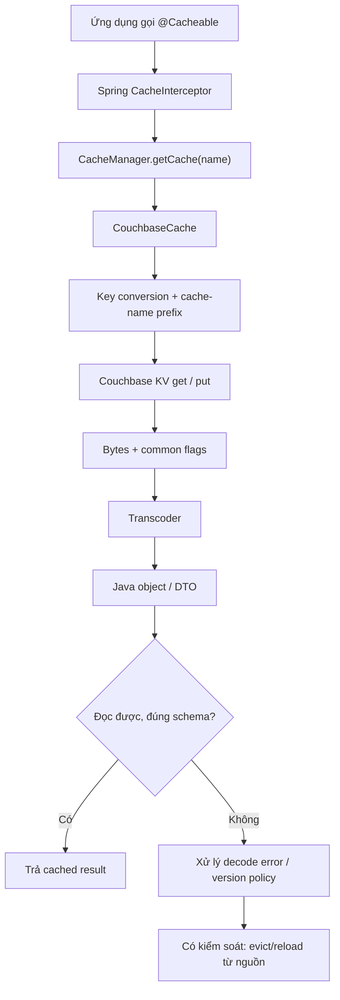
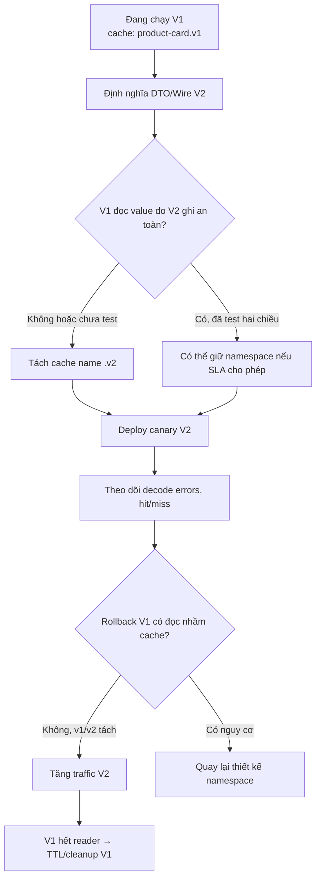

# Định dạng giá trị cache và tương thích giữa phiên bản ứng dụng

## Mục tiêu học tập

Sau bài học, bạn có thể:

1. Phân biệt **logical cache key**, **physical document ID**, **cache value**, **serialized bytes** và cờ định dạng mà Couchbase Java SDK lưu/trả về.
2. Giải thích chuỗi **Spring Cache interceptor → CouchbaseCacheManager → CouchbaseCacheConfiguration → Transcoder/Serializer → Couchbase KV**; biết điểm khác biệt với Spring Data entity converter.
3. Chọn read model DTO phù hợp để cache; tránh lưu entity có CAS, object mutable, object chứa secret hoặc Java type khó giải mã khi ứng dụng nâng cấp.
4. Nhận biết các thay đổi tương thích và không tương thích của JSON: thêm/xóa/đổi tên field, thay kiểu, `enum`, thời gian, tiền tệ, collection/generic và class package.
5. Dùng `CouchbaseCacheConfiguration.valueTranscoder(…)` có chủ đích, nhất quán giữa các instance; hiểu phạm vi JSON/nhị phân và rủi ro của Java native serialization.
6. Thiết kế **schema version** cho cache name, payload và key; lập kế hoạch rolling/blue-green deployment, invalidation, TTL và fallback khi không thể đọc cache entry cũ.
7. Kiểm thử round-trip với serializer thật, đọc chéo phiên bản cũ/mới, multi-instance, lỗi deserialization, security và thống kê vận hành.

**Bối cảnh:** Module `SPRING_DATA_COUCHBASE` dạy document mapping, repository, `CouchbaseTemplate` và SQL++, cùng thiết kế bucket/scope/collection, chỉ mục, TTL, CAS, transaction và API reactive. Trong chương **Bộ nhớ đệm**, ta dùng Spring Cache abstraction để lưu **kết quả tính toán/đọc dữ liệu** trên Couchbase. Khi ứng dụng thay đổi, dữ liệu cache có thể sống lâu hơn một process, nên **định dạng giá trị cache là một hợp đồng giữa các phiên bản**, không phải chi tiết nội bộ của class Java hiện tại.

> **Nguyên tắc cốt lõi:** Một cache hit chỉ có ích khi entry **đúng danh tính, đọc/giải mã được, đúng quyền truy cập và còn có giá trị nghiệp vụ**. Cache entry không phải nguồn sự thật: khi schema không tương thích, cách an toàn thường là dùng cache name/version mới và tái tạo từ nguồn, thay vì ép dữ liệu cũ thành object sai kiểu.

## 1. Cache entry có cả định danh và giá trị

Giả sử một dịch vụ danh mục lưu sản phẩm nguồn:

```text
Bucket: appdata
Scope: catalog
Collection: products
Source ID: product::tenant-42::P1001
```

Method `getCard("tenant-42", "P1001")` trả về DTO:

```java
public record ProductCardV1(
        String sku,
        String title,
        long priceCents) {
}
```

Spring Cache sử dụng:

```java
@Cacheable(
    cacheNames = "catalog.product-card.v1",
    key = "#p0 + '::' + #p1")
public ProductCardV1 getCard(
        String tenantId, String sku) {
    // Đọc nguồn, map sang DTO.
    return loadFromSource(tenantId, sku);
}
```

Couchbase-backed cache có thể đặt bản sao trong `appdata.cache.entries`. Entry này có:

| Thành phần | Ví dụ | Ai quyết định? |
| --- | --- | --- |
| Cache name | `catalog.product-card.v1` | Kiến trúc read model |
| Logical key | `tenant-42::P1001` | SpEL/`KeyGenerator` |
| Physical ID | `catalog.product-card.v1::tenant-42::P1001` | Cache provider, prefix và key conversion |
| Value object | `ProductCardV1` | Application service |
| Encoded bytes | JSON hoặc định dạng nhị phân | `Transcoder`/serializer được chọn |
| Common flags | Đánh dấu JSON/binary/non-JSON | SDK transcoder |
| Expiry | Ví dụ 5 phút | Cache configuration + Couchbase expiry policy |
| Source CAS | CAS ở document `catalog.products` | Couchbase source document, **không tự đi kèm cache entry** |

**Không đánh đồng:** `@Document`/`@Field`/`@Version` là metadata dùng khi Spring Data ánh xạ **entity nguồn**. Spring Cache value không mặc nhiên được mapping bằng đúng converter của repository. Ngay cả khi cả hai cùng nằm trong một Couchbase cluster, chúng có thể dùng các serialization pipeline khác nhau.

### 1.1. Một cache hit không nhất thiết là một JSON object dễ xem

Couchbase Server có thể lưu giá trị JSON và cả non-JSON/binary. Trình quản trị database có thể hiển thị một số giá trị JSON ở giao diện, nhưng điều đó không bảo đảm mọi cache entry đọc được như document JSON hay có cùng layout với `ProductDocument`.

Đặc biệt, dữ liệu được ghi với custom `Transcoder` có thể mang cờ định dạng khác. Không đọc một cache entry bằng SDK raw rồi tùy tiện `contentAs(ProductDocument.class)`, hoặc sửa JSON của cache entry bằng repository nghiệp vụ.

### 1.2. Sơ đồ encoding và decoding



Cần tách **cache miss** (không có entry) khỏi **deserialization failure** (entry tồn tại nhưng không đọc thành object mong muốn). Trường hợp thứ hai là lỗi compatibility hoặc dữ liệu, không nên được âm thầm giả dạng 404 nghiệp vụ.

## 2. Key conversion khác value transcoding

`CouchbaseCacheConfiguration` có hai nhóm tùy chọn riêng:

| Nhóm | API / thành phần | Trách nhiệm |
| --- | --- | --- |
| **Key** | `getConversionService()`, default converters, `prefixCacheNameWith(…)`, `computePrefixWith(…)` | Tạo physical document ID từ logical key và cache name |
| **Value** | `getValueTranscoder()`, `valueTranscoder(Transcoder)` | Mã hóa/giải mã **value bytes và format flags** |
| **Keyspace** | `collection("entries")`, factory scope | Địa chỉ collection chứa cache entry |
| **Expiry** | `entryExpiry(Duration)` | Thời hạn tồn tại của cache entry |
| **Null** | `disableCachingNullValues()` | Có cho cache null hay không |

Javadoc Spring Data Couchbase nêu default key converters cho `String` và `SimpleKey`. Nhưng converter cho key **không phải** serializer của DTO. Đổi format key có thể tạo miss hàng loạt; đổi value transcoder có thể tạo lỗi decode ngay với **cùng key**.

### 2.1. Spring Data entity converter không phải cache transcoder

Một entity có mapping:

```java
@Document
@Scope("catalog")
@Collection("products")
public class ProductDocument {

    @Id
    private String id;

    @Field("display_name")
    private String displayName;

    @Version
    private Long version;
}
```

Khi lưu bằng repository/Template, Spring Data dùng mapping cho `display_name`, ID và CAS. Nhưng khi service cache một `ProductCardV1`, phải xác nhận cache transcoder/serializer **thực sự** ghi tên trường nào; không suy đoán annotation `@Field("display_name")` trên entity nguồn sẽ điều khiển JSON của DTO cache.

Ngược lại, `@JsonProperty("title")` trên DTO (khi dùng Jackson) ảnh hưởng Jackson JSON serialization; nó không tự đổi schema document nguồn hay CAS.

### 2.2. Generic types cần kiểm thử riêng

Một method có thể trả:

```java
List<ProductCardV1>
Map<String, ProductCardV1>
Optional<ProductCardV1>
Page<ProductCardV1>
```

Khi biên dịch, Java type erasure làm mất một số thông tin generic ở runtime. Một serializer có thể đọc lại `List<Map>` thay vì `List<ProductCardV1>` nếu không có type metadata hoặc target type đủ rõ. Đừng nghĩ `List<ProductCardV1>` tự được round-trip chính xác chỉ vì cache put không báo lỗi.

Ưu tiên một **wrapper DTO có type ổn định**, ví dụ `ProductCardPageV2` chứa danh sách và thông tin paging, thay vì cache nguyên đối tượng framework `PageImpl` với những field nội bộ có thể khác giữa phiên bản.

## 3. Transcoder/serializer của Couchbase Java SDK

Couchbase Java SDK dùng `Transcoder` để chuyển object thành `byte[]` và common flags khi gửi KV, và để dựng object khi nhận lại. Với JSON, transcoder thường gọi `JsonSerializer` bên dưới.

Các loại phổ biến trong SDK:

| Kiểu | Mục đích | Chú ý |
| --- | --- | --- |
| `JsonTranscoder` | JSON object/string/number và POJO | Phụ thuộc JSON serializer, Jackson config, kiểu đích khi decode |
| `RawJsonTranscoder` | Byte hoặc String đã là JSON hợp lệ | Không tự map POJO; caller chịu trách nhiệm nội dung JSON |
| `RawStringTranscoder` | Giá trị chuỗi dạng non-JSON | Không tương đương JSON string (JSON có dấu ngoặc kép) |
| `RawBinaryTranscoder` | Dữ liệu binary thô | Không thể tùy tiện query field bằng SQL++ |
| `SerializableTranscoder` | Java object triển khai `Serializable` | Nhạy với Java class, `serialVersionUID` và rủi ro deserialization |

SDK thường có default transcoder JSON ở `ClusterEnvironment`. Tuy nhiên, `CouchbaseCacheConfiguration.valueTranscoder(…)` có thể override cho **cache cụ thể**; khi không override, hành vi thực tế phụ thuộc writer/SDK environment của phiên bản đang chạy.

**Không kết luận tất cả cache entry đều JSON hoặc mặc định luôn Java serialization.** Kiểm tra `getValueTranscoder()`, SDK environment, cách writer gọi transcoder và một integration test ghi–đọc thực. Tài liệu SDK phân biệt rõ `JsonTranscoder` với `SerializableTranscoder`; hai wire format không thể trao đổi tùy tiện.

### 3.1. Vì sao thay transcoder gây lỗi cho entry cũ?

Giả sử phiên bản A ghi cache bằng Java binary serialization, phiên bản B đổi sang JSON transcoder nhưng giữ **cùng cache name và logical key**:

```text
A: cache[key] = Java-serialized bytes + binary flags
B: cache[key] -> JSON decode bằng serializer mới
                   |
                   +-> format mismatch / decode exception
```

Dù DTO Java trông giống nhau, cách ghi byte đã thay. Cách an toàn là tách cache name/prefix hoặc có dual-reader rõ ràng được kiểm thử. Không thay transcoder cùng keyspace trong rolling deployment mà không có chiến lược migration.

### 3.2. Không dùng Java native serialization làm hợp đồng công khai lâu dài

Java object serialization có những ràng buộc về class name, `serialVersionUID`, classpath, kiểu trường và tương thích JVM. Nếu dữ liệu serialized bytes bị thao túng, deserialization còn có thể gây rủi ro bảo mật.

Trong một distributed cache chia sẻ giữa nhiều dịch vụ/ngôn ngữ, JSON có schema rõ hoặc định dạng schema-first thường dễ quản lý hơn. Nếu kế thừa cache binary cũ, cần quyền truy cập chặt, TTL ngắn, và kế hoạch bỏ dần; tránh deserialize bytes không đáng tin.

## 4. Spring Boot và CouchbaseCacheManager: thiết lập value contract

Bật Spring Cache và Spring Data Couchbase:

```groovy
dependencies {
    implementation 'org.springframework.boot:spring-boot-starter-data-couchbase'
    implementation 'org.springframework.boot:spring-boot-starter-cache'
    implementation 'org.springframework.boot:spring-boot-starter-web'
}
```

`spring-boot-starter-web` chỉ dành cho ví dụ REST. Spring Cache dùng được trong service không có HTTP.

Cấu hình kết nối:

```yaml
spring:
  couchbase:
    connection-string: couchbase://localhost
    username: app_user
    password: ${COUCHBASE_PASSWORD}
  data:
    couchbase:
      bucket-name: appdata
  cache:
    type: couchbase
    cache-names: catalog.product-card.v2
    couchbase:
      expiration: 5m
```

Bật interception:

```java
package com.example.catalog;

import org.springframework.cache.annotation.EnableCaching;
import org.springframework.context.annotation.Configuration;

@Configuration(proxyBeanMethods = false)
@EnableCaching
public class CacheEnablementConfiguration {
}
```

Spring Boot có thể auto-configure `CouchbaseCacheManager` khi dependency và cấu hình Couchbase phù hợp. Đừng kết luận provider đang là Couchbase chỉ vì có Couchbase database; hãy kiểm tra bean `CacheManager` thực tế và path gọi đi qua Spring proxy.

### 4.1. Khai báo CacheManager thủ công với valueTranscoder

Khi muốn cố định contract JSON qua custom Jackson serializer, có thể cấu hình trên **cache configuration**:

```java
package com.example.catalog.cache;

import java.time.Duration;

import com.couchbase.client.java.codec.JacksonJsonSerializer;
import com.couchbase.client.java.codec.JsonTranscoder;
import com.couchbase.client.java.json.JsonValueModule;
import com.fasterxml.jackson.databind.DeserializationFeature;
import com.fasterxml.jackson.databind.ObjectMapper;
import org.springframework.context.annotation.Bean;
import org.springframework.context.annotation.Configuration;
import org.springframework.data.couchbase.cache.CouchbaseCacheConfiguration;
import org.springframework.data.couchbase.cache.CouchbaseCacheManager;
import org.springframework.data.couchbase.core.CouchbaseOperations;

@Configuration(proxyBeanMethods = false)
public class CatalogCacheValueConfiguration {

    @Bean
    CouchbaseCacheManager cacheManager(
            CouchbaseOperations operations) {

        ObjectMapper mapper = new ObjectMapper()
                .registerModule(new JsonValueModule())
                .configure(
                        DeserializationFeature.FAIL_ON_UNKNOWN_PROPERTIES,
                        false);

        var jsonTranscoder = JsonTranscoder.create(
                JacksonJsonSerializer.create(mapper));

        var cacheFactory = operations
                .getCouchbaseClientFactory()
                .withScope("cache");

        var cardConfig = CouchbaseCacheConfiguration
                .defaultCacheConfig()
                .collection("entries")
                .entryExpiry(Duration.ofMinutes(5))
                .prefixCacheNameWith("app:catalog:")
                .disableCachingNullValues()
                .valueTranscoder(jsonTranscoder);

        return CouchbaseCacheManager.builder(cacheFactory)
                .withCacheConfiguration(
                        "catalog.product-card.v2", cardConfig)
                .disableCreateOnMissingCache()
                .transactionAware()
                .build();
    }
}
```

**Phạm vi:** Ví dụ dùng Couchbase Java SDK có `JsonTranscoder.create(JsonSerializer)` và `JacksonJsonSerializer.create(ObjectMapper)`, với Jackson 2 hiện diện. Nếu dự án dùng Jackson 3/Spring Boot nhánh mới, cần lựa chọn serializer tương ứng theo SDK; không copy mù import Jackson 2.

Các lưu ý quan trọng:

1. `valueTranscoder(jsonTranscoder)` ảnh hưởng **encoding và decoding cache value** của cache name này. Nó không thay converter của entity repository.
2. `FAIL_ON_UNKNOWN_PROPERTIES=false` giúp reader v1 bỏ qua field bổ sung từ v2; nó **không** tự giải quyết rename, thay kiểu hay trường bắt buộc bị thiếu.
3. Mapper dùng cho SDK trong cache config không nhất thiết là `ObjectMapper` của Spring MVC; không mặc nhiên có `JavaTimeModule` hay các module riêng. Khi DTO dùng `Instant`/`LocalDateTime`, thêm module và test tương ứng.
4. Không thay cả cache key prefix, value transcoder và DTO schema cùng lúc mà không có rollout/version plan.
5. Scope `cache` và collection `entries` phải tồn tại; tài khoản cần RBAC phù hợp. `withScope` không đổi bucket.
6. Đây là **đường khai báo CacheManager thủ công**, thay thế việc Boot tạo một bean manager tương đương. Nếu dùng builder customizer của Boot, áp dụng cùng chính sách tại đó và kiểm tra đúng version.

### 4.2. Kiểm tra cấu hình trước khi ghi dữ liệu thật

```java
var config = CouchbaseCacheConfiguration.defaultCacheConfig()
        .collection("entries")
        .valueTranscoder(jsonTranscoder);

assert config.getValueTranscoder() == jsonTranscoder;
assert "entries".equals(config.getCollectionName());
```

Đoạn trên là kiểm tra cấu hình Java; nó **chưa** chứng minh một `ProductCardV2` sẽ được decode đúng bởi cache reader. Cần unit test serializer và integration test cache manager thực ở phần sau.

### 4.3. Key transcoder và value transcoder không hoán đổi

Việc chọn `JsonTranscoder` cho cache value không thay `SimpleKeyGenerator` hay tiền tố `cacheName::`. Khi cache miss do đổi key, bạn phải sửa key contract. Khi key không đổi nhưng lỗi decode, bạn cần sửa value contract/version. Hai lỗi có triệu chứng khác nhau và không nên che bằng một `catch (Exception) { return null; }`.

## 5. Model hóa DTO cache: đơn giản, bất biến, ít phụ thuộc framework

Một nguồn nghiệp vụ ví dụ:

```java
package com.example.catalog;

import org.springframework.data.annotation.Id;
import org.springframework.data.annotation.Version;
import org.springframework.data.couchbase.core.mapping.Collection;
import org.springframework.data.couchbase.core.mapping.Document;
import org.springframework.data.couchbase.core.mapping.Field;
import org.springframework.data.couchbase.core.mapping.Scope;

@Document
@Scope("catalog")
@Collection("products")
public class ProductDocument {

    @Id
    private String id;

    @Field
    private String tenantId;

    @Field
    private String sku;

    @Field
    private String title;

    @Field
    private long priceCents;

    @Field
    private String currency;

    @Field
    private boolean published;

    @Version
    private Long version;

    public ProductDocument() {}

    public String getId() { return id; }
    public void setId(String value) { id = value; }

    public String getTenantId() { return tenantId; }
    public void setTenantId(String value) { tenantId = value; }

    public String getSku() { return sku; }
    public void setSku(String value) { sku = value; }

    public String getTitle() { return title; }
    public void setTitle(String value) { title = value; }

    public long getPriceCents() { return priceCents; }
    public void setPriceCents(long value) { priceCents = value; }

    public String getCurrency() { return currency; }
    public void setCurrency(String value) { currency = value; }

    public boolean isPublished() { return published; }
    public void setPublished(boolean value) { published = value; }

    public Long getVersion() { return version; }
}
```

Repository:

```java
package com.example.catalog;

import org.springframework.data.couchbase.repository.CouchbaseRepository;

public interface ProductRepository
        extends CouchbaseRepository<ProductDocument, String> {
}
```

Read DTO cho cache version 2:

```java
package com.example.catalog.cache;

import com.fasterxml.jackson.annotation.JsonIgnoreProperties;
import com.fasterxml.jackson.annotation.JsonProperty;

@JsonIgnoreProperties(ignoreUnknown = true)
public record ProductCardV2(
        @JsonProperty("sku") String sku,
        @JsonProperty("title") String title,
        @JsonProperty("price_cents") long priceCents,
        @JsonProperty("currency") String currency) {
}
```

DTO không chứa `@Id`/`@Version` vì không phải entity nguồn. Với Java 17+ và Jackson bản hỗ trợ record, DTO immutable có schema rõ. Dùng tên JSON `price_cents` cố định giúp đổi tên property Java có chủ đích mà không vô tình thay wire field.

**Đừng cache nguyên `ProductDocument` mutable rồi dùng nó cho lệnh `save`:** khi entry có TTL hoặc bị cache hit từ nhiều phiên bản, CAS `@Version` có thể stale và dữ liệu còn thiếu field đã thêm. Luồng mutation phải đọc source mới với CAS/transaction phù hợp.

### 5.1. @Cacheable cache DTO, không cache “nguồn sự thật”

```java
package com.example.catalog;

import java.util.NoSuchElementException;

import com.example.catalog.cache.ProductCardV2;
import org.springframework.cache.annotation.Cacheable;
import org.springframework.stereotype.Service;

@Service
public class ProductCardReader {

    private final ProductRepository repository;

    public ProductCardReader(ProductRepository repository) {
        this.repository = repository;
    }

    @Cacheable(
            cacheNames = "catalog.product-card.v2",
            key = "#p0 + '::' + #p1",
            unless = "#result == null")
    public ProductCardV2 readCard(
            String tenantId, String sku) {

        ProductDocument doc = repository
                .findById("product::" + tenantId + "::" + sku)
                .orElseThrow(() -> new NoSuchElementException(
                        "Không tìm thấy sản phẩm"));

        if (!tenantId.equals(doc.getTenantId())) {
            throw new SecurityException("Sai tenant");
        }

        if (!doc.isPublished()) {
            throw new NoSuchElementException(
                    "Sản phẩm chưa công bố");
        }

        return new ProductCardV2(
                doc.getSku(),
                doc.getTitle(),
                doc.getPriceCents(),
                doc.getCurrency());
    }
}
```

Cần lưu ý:

- Cache hit có thể **không chạy method body**, kể cả kiểm tra tenant/published. Phải có authorization guard trước cache proxy và chính sách invalidation khi trạng thái published thay đổi.
- Key ví dụ `tenantId + "::" + sku` chỉ an toàn khi hai thành phần được validate không gây va chạm dấu phân tách; production nên dùng key encoder canonical.
- `ProductCardV2` là read model có thể tái tạo; nếu decode cache lỗi, đường phục hồi phải dùng source document, không sửa trực tiếp document nguồn từ cache.
- Phương thức có `@Cacheable` phải được gọi qua Spring bean/proxy, không self-invoke.

## 6. Quy tắc tương thích dữ liệu: không chỉ là Java class name

Xét cache value JSON v1:

```json
{
  "sku": "P1001",
  "title": "Bàn phím cơ",
  "price_cents": 159900
}
```

Phiên bản v2 thêm currency:

```json
{
  "sku": "P1001",
  "title": "Bàn phím cơ",
  "price_cents": 159900,
  "currency": "VND"
}
```

Bảng hướng dẫn đọc chéo:

| Thay đổi từ V1 sang V2 | Reader V1 đọc V2? | Reader V2 đọc V1? | Phân tích |
| --- | --- | --- | --- |
| Thêm optional field `subtitle` | Có thể, nếu bỏ qua unknown | Có thể, nếu optional/default | Chỉ sau khi test serializer |
| Thêm field `currency` bắt buộc | V1 có thể bỏ qua | **Không an toàn** nếu V1 thiếu currency | Cần default có ý nghĩa hoặc cache v2 riêng |
| Đổi `price_cents` thành `price` | Có thể mất dữ liệu | Có thể lấy 0/null sai | Tách version hoặc bridge converter |
| Đổi đơn vị cents → major | Cả hai có thể đọc number | **Sai nghiệp vụ** dù decode thành công | Version bắt buộc; không chỉ test syntax |
| `long` sang `String` | Tùy coercion serializer | Tùy coercion serializer | Không dựa coercion ngầm |
| Thêm giá trị enum mới | V1 có thể ném exception | V2 có thể đọc | Dùng fallback rõ nếu business cho phép |
| Đổi tên package Java | JSON thuần có thể không ảnh hưởng | Binary Java serialization có thể vỡ | Không lưu class name như wire contract trừ khi cần |
| Đổi `List<ProductCard>` thành `Map<String, …>` | Không tương thích | Không tương thích | Đổi schema/cache name |
| Đổi JSON transcoder sang binary transcoder | Lỗi format/flags | Lỗi format/flags | Tách namespace hoặc migration |

**Tương thích là hai chiều:** Đường deploy có instance cũ và mới cùng tồn tại. Không chỉ hỏi “code mới đọc cache cũ được không?” mà còn hỏi “code cũ có đọc entry mới do code mới ghi được không?”.

### 6.1. Unknown field khác missing required field

`@JsonIgnoreProperties(ignoreUnknown = true)` chỉ xử lý trường **thừa** khi reader gặp. Nó không thể tự tạo ra `currency="VND"` đúng nếu payload thiếu trường bắt buộc.

Với Java record:

```java
public record ProductCardV2(
        String sku, String title,
        long priceCents, String currency) {}
```

Tùy Jackson config, khi field `priceCents` thiếu, một primitive `long` có thể mang giá trị mặc định 0. Điều này nguy hiểm: **decode thành công nhưng giá sai**. Nên validate invariant sau decode hoặc dùng immutable DTO có validation, explicit required fields, versioned cache name; tránh đối xử “giá 0” như dữ liệu hợp lệ khi wire field bị mất.

### 6.2. Thay tên Java field cần giữ wire key ổn định

Khi refactor property `priceCents` thành `amountInMinorUnits`, giữ JSON property tương ứng bằng `@JsonProperty("price_cents")` nếu schema vẫn đúng nghĩa. Nhưng nếu business semantics thực sự đổi, dù wire key còn như cũ vẫn cần version/schema mới.

**Độ ổn định của tên field ≠ độ ổn định của ý nghĩa field.**

### 6.3. Tiền tệ, số thực, thời gian và múi giờ

- Tiền: dùng số nguyên `priceCents` hoặc minor units kèm `currency`. Không đổi sang `double` tùy ý rồi mất độ chính xác.
- Thời gian: chọn timestamp ISO-8601/epoch rõ timezone và độ chính xác; không lưu `LocalDateTime` không timezone rồi giả định mọi node hiểu giống nhau.
- Enum: cân nhắc unknown/fallback; không gắn mọi nghiệp vụ vào ordinal như `status=2` nếu thứ tự enum có thể đổi.
- Decimal: nếu dùng `BigDecimal`, kiểm tra biểu diễn string/number, scale/rounding và so sánh semantics ở hai serializer.
- Boolean/nullable: phân biệt false với “field không tồn tại”, tránh default silent.
- Collections: thứ tự list có ý nghĩa hay không? Loại key/element trong Map có được serializer hỗ trợ không?

Tất cả điều này cần kiểm thử **byte/value round-trip với đúng serializer**, không chỉ unit test getter Java.

## 7. Schema version nằm ở đâu và dùng thế nào?

Có ba lớp version với phạm vi khác nhau:

1. **Cache name version:** `catalog.product-card.v1` → `catalog.product-card.v2`. Đây là cách dễ nhất để cô lập các entry không tương thích khi chạy hai bản ứng dụng.
2. **Logical key version:** ví dụ `v2.t.<tenant>.s.<sku>`. Cần khi thay thuật toán canonicalization hoặc các chiều ảnh hưởng result.
3. **Payload schema version:** một field dữ liệu như `"schemaVersion": 2` hoặc envelope riêng. Giúp reader phát hiện/validate format khi một adapter có logic đọc nhiều schema.

Không nhất thiết mọi thay đổi đều cần đổi cả ba. Thường:

| Thay đổi | Cache name | Logical key | Payload version |
| --- | --- | --- | --- |
| Thêm optional field backward/forward compatible đã test | Có thể giữ | Giữ | Tăng nếu quy ước yêu cầu |
| Đổi DTO không tương thích | **Tăng** | Có thể giữ | **Tăng** |
| Đổi tenant canonicalization | Thường tăng để isolation | **Tăng** | Tùy |
| Đổi TTL từ 5m sang 2m, schema giữ nguyên | Có thể giữ | Giữ | Không nhất thiết |
| Đổi JSON ↔ binary transcoder | **Tăng** | Có thể giữ | **Tăng** nếu dùng envelope |
| Thay currency minor units thành major units | **Tăng** | Xem xét | **Tăng** |
| Đổi Java package nhưng JSON wire schema ổn định | Có thể giữ nếu test đầy đủ | Giữ | Tùy |

**Khuyến nghị mặc định:** Khi có nghi ngờ khả năng tương thích, tăng **cache name version** để reader cũ và mới không đọc nhầm dữ liệu nhau. Tái tạo cache từ nguồn là chi phí có thể kiểm soát; mất tính đúng của giá/tenant là chi phí khó chấp nhận.

### 7.1. Envelope tự mô tả cho read model dùng chung

Nếu nhiều ứng dụng cần đọc cùng cache hoặc một serializer có logic migration, có thể tạo một envelope với schema version và source metadata rõ nghĩa:

```json
{
  "schemaVersion": 2,
  "tenantId": "tenant-42",
  "sku": "P1001",
  "cachedAtEpochMillis": 1795587600000,
  "sourceRevision": "opaque-revision-token",
  "value": {
    "title": "Bàn phím cơ",
    "price_cents": 159900,
    "currency": "VND"
  }
}
```

Đây là **một wire schema minh họa**. `sourceRevision` là token theo domain; nếu lấy từ Couchbase CAS, không được xem số CAS như timestamp hoặc một counter phiên bản đơn điệu. Dùng CAS để so khớp điều kiện ghi/đọc theo contract, không sắp xếp nó như revision tuần tự.

Một model Java tương ứng có thể là:

```java
package com.example.catalog.cache;

import com.fasterxml.jackson.annotation.JsonIgnoreProperties;
import com.fasterxml.jackson.annotation.JsonProperty;

@JsonIgnoreProperties(ignoreUnknown = true)
public record CachedProductCardV2(
        int schemaVersion,
        String tenantId,
        String sku,
        long cachedAtEpochMillis,
        String sourceRevision,
        ProductCardPayloadV2 value) {
}

@JsonIgnoreProperties(ignoreUnknown = true)
record ProductCardPayloadV2(
        String title,
        @JsonProperty("price_cents") long priceCents,
        String currency) {
}
```

**Chú ý Java:** Trong ví dụ cùng package, `CachedProductCardV2` là public record và `ProductCardPayloadV2` package-private; khi áp dụng thật nên đặt các type public vào file riêng và bảo đảm Jackson có thể dùng record constructors theo version. Model này **không tự thay đổi Spring Cache writer**: muốn lưu envelope, method `@Cacheable` phải trả envelope, hoặc adapter chuyển DTO sang envelope trước khi `Cache.put`.

### 7.2. Validator ở boundary đọc cache

Chỉ kiểm tra JSON decode thành công chưa đủ. Nên validate:

- `schemaVersion` thuộc những version reader đã hỗ trợ.
- `tenantId` và `sku` trong payload **khớp** danh tính đã xác thực và key yêu cầu.
- `value` khác null, giá là giá trị hợp lệ, currency thuộc danh sách được phép.
- `cachedAtEpochMillis` không nằm bất thường trong tương lai hoặc quá cũ so với policy.
- Nếu source revision bắt buộc mới nhất, xác minh với source (chấp nhận chi phí đọc source) hoặc cơ chế invalidation có bảo đảm phù hợp.

Ví dụ validator thuần Java:

```java
public final class ProductCardValidator {

    private ProductCardValidator() {}

    public static CachedProductCardV2 requireValid(
            CachedProductCardV2 cached,
            String tenantId,
            String sku) {

        if (cached == null || cached.schemaVersion() != 2) {
            throw new IllegalArgumentException(
                    "Schema cache không được hỗ trợ");
        }
        if (!tenantId.equals(cached.tenantId())
                || !sku.equals(cached.sku())) {
            throw new SecurityException(
                    "Định danh cache khác request");
        }
        if (cached.value() == null
                || cached.value().priceCents() < 0
                || cached.value().currency() == null
                || cached.value().currency().isBlank()) {
            throw new IllegalArgumentException(
                    "Payload cache không hợp lệ");
        }
        return cached;
    }
}
```

*Validator này dành cho một adapter chủ động nhận `CachedProductCardV2`, không phải tính năng `@Cacheable` mặc định tự gọi. Với số tiền bằng 0 hợp lệ hay không, cần thêm quy tắc nghiệp vụ. Định dạng cache value không tự bảo vệ authorization; identity/permission vẫn phải được xác nhận trước khi cache hit.*

### 7.3. Payload version không tự động khiến Spring Cache decode nhiều bản

Nếu transcoder luôn decode vào `ProductCardV2.class` nhưng bytes là format v1 không tương thích, quá trình giải mã có thể thất bại **trước khi** application nhìn thấy field `schemaVersion`. Muốn dual-reader thật sự, cần adapter đọc representation trung gian như `JsonObject`/tree hoặc raw bytes, phân nhánh schema, rồi convert thành DTO phù hợp. Việc này phức tạp hơn một `@Cacheable` thông thường.

Vì vậy, **tách cache name khi breaking change** thường đáng tin và dễ kiểm thử hơn cố làm một cache tự hiểu mọi payload đời trước.

## 8. Nullable, Optional, collections và những kiểu dễ gây bất ngờ

### 8.1. Null không đồng nghĩa cache miss

Spring Cache phân biệt **không có entry** với **có entry chứa null** theo khả năng của provider. Spring Data Couchbase có tùy chọn:

```java
CouchbaseCacheConfiguration config =
        CouchbaseCacheConfiguration.defaultCacheConfig()
                .disableCachingNullValues();
```

Javadoc nêu rõ: khi disable caching null, gọi `Cache.put(key, null)` có thể báo lỗi; nó **không** xóa entry cũ. Muốn xóa, dùng `Cache.evict(key)`.

Trong annotation:

```java
@Cacheable(
    cacheNames = "catalog.product-card.v2",
    key = "#p0 + '::' + #p1",
    unless = "#result == null")
public ProductCardV2 findCardOrNull(
        String tenantId, String sku) {
    // Nếu không có nguồn thì trả null.
    return findFromSourceOrNull(tenantId, sku);
}
```

`findFromSourceOrNull` là helper giả định. Nếu nghiệp vụ luôn ném exception 404 khi không tìm thấy, method không có result để cache. Đừng biến một timeout Couchbase thành null rồi lưu cache như “sản phẩm không tồn tại”.

### 8.2. Optional và giá trị đã unwrap

Spring Cache xử lý `Optional<T>` theo contract riêng; với `@Cacheable`, `#result` trong `unless` thường là **nội dung** của Optional, không phải wrapper khi có dữ liệu. `Optional.empty()` có thể được coi như null cho mục đích cache.

```java
@Cacheable(
    cacheNames = "catalog.product-card.v2",
    key = "#p0 + '::' + #p1",
    unless = "#result == null")
public java.util.Optional<ProductCardV2> findCard(
        String tenantId, String sku) {
    return lookupSource(tenantId, sku);
}
```

*`lookupSource` do ứng dụng định nghĩa.* Kiểm thử thực tế nên xác nhận:

1. Cache miss và source có data → Optional có giá trị.
2. Cache hit và source có data → vẫn trả đúng Optional theo contract method.
3. Source không có data → không cache null/empty nếu policy yêu cầu.
4. Cache value serializer không làm `Optional` biến thành một POJO lạ hoặc `LinkedHashMap`.

### 8.3. Không cache trực tiếp object framework phức tạp khi không cần

Những kiểu như `PageImpl<ProductDocument>`, `ResponseEntity<?>`, `Flux<T>`, `InputStream`, domain object có lazy reference hoặc resource handle có vòng đời riêng thường không phải cache payload tốt.

Hướng an toàn:

```java
public record ProductCardPageV2(
        int schemaVersion,
        int page,
        int size,
        long total,
        java.util.List<ProductCardV2> items) {
}
```

Đây là DTO độc lập với implementation Spring Data paging. Nếu chỉ cần `Slice` không có total, không cache trường total giả. Việc chọn DTO giảm rủi ro version framework làm đổi serializable fields và giữ hợp đồng cache nhỏ.

### 8.4. Tránh cache mutable object có reference được chia sẻ trong JVM

Với cache in-memory, một caller có thể sửa object đang cache nếu cache trả reference. Với Couchbase-backed cache, mỗi lượt có thể deserialize thành instance mới, nhưng không nên dựa vào điều đó làm đảm bảo mọi provider. DTO immutable/record và defensive copies vẫn là lựa chọn tốt.

## 9. Quy trình rolling deployment khi dữ liệu cache sống dài hơn một process

Bài toán thực tế: bản A đang chạy, bản B thêm field và đổi JSON mapping. Cả hai có thể cùng phục vụ trong vài phút hoặc vài giờ, nhưng dùng chung Couchbase cache collection.



### 9.1. Ma trận đọc chéo A/B

| Writer → Reader | V1 reader | V2 reader |
| --- | --- | --- |
| **V1 writer** | Baseline phải PASS | Kiểm thử v1 payload dưới decoder v2 |
| **V2 writer** | Kiểm thử v2 payload dưới decoder v1 | Baseline phải PASS |

Với breaking change, thường hai ô chéo không đều PASS. Đó là lý do cần version namespace, không nên cố giữ một key/cache name chung chỉ để giảm cache cold start.

### 9.2. Ví dụ rollout theo cache name versioned

```text
Bản A:
  @Cacheable("catalog.product-card.v1")
  key: tenant-42::P1001
  value: ProductCardV1

Bản B:
  @Cacheable("catalog.product-card.v2")
  key: tenant-42::P1001
  value: ProductCardV2

Cùng collection "cache.entries", prefix có cache name.
Kết quả: hai physical entry tách biệt.
```

Chi phí: trong lúc rollout, cache lưu hai bản sao, hit ratio mới thấp hơn ban đầu và tải nguồn có thể tăng. Lợi ích: không phải giải mã payload lẫn nhau. Hãy đo khả năng chịu tải khi cold cache và prewarm key quan trọng nếu phù hợp.

### 9.3. Rollback phải được thiết kế từ đầu

Nếu B triển khai thất bại và chuyển traffic lại A, A phải tiếp tục đọc cache v1 hoặc có khả năng nạp lại từ source. Nếu B đã overwrite cache v1 bằng format nhị phân/JSON không tương thích, rollback A có thể tiếp tục lỗi dù code A không thay đổi.

**Điều kiện rollback an toàn:** Không có writer mới được phép ghi payload không tương thích vào namespace cũ vẫn có reader.

### 9.4. Dual-write/dual-read: chỉ khi có lý do rõ

Đôi khi một service cần cung cấp cả v1/v2 cho nhiều consumer. Có thể chủ động ghi hai cache name hoặc dual-read từ namespace cũ để warm up namespace mới, nhưng điều này có thêm phức tạp:

- Hai entry có thể mang snapshot khác nhau.
- Invalidating source update phải xóa cả v1/v2.
- Dual-write chưa tạo transaction nguyên tử giữa hai cache entries.
- Cần giới hạn thời gian chạy dual-read/dual-write.
- Không tạo vòng lặp “đọc cache cũ → convert → ghi v2” khi v1 thiếu field bắt buộc; trong trường hợp đó phải lấy source.

**Không đặt `@Cacheable` và `@CachePut` mâu thuẫn trên cùng method** chỉ để cố dual-write. Nên dùng orchestration/service riêng có test, hoặc giữ cache mới ở chế độ miss→load source.

## 10. Migration: thêm field, đổi tên, đổi định dạng

Có ba chiến lược chính:

| Chiến lược | Khi dùng | Ưu/nhược |
| --- | --- | --- |
| **Versioned cache name + cold refill** | Mặc định cho breaking changes | Dễ đúng, không cần migrate entry, có tải source |
| **Backward-compatible reader** | Thêm optional field hoặc đổi nhỏ | Giữ hit ratio; phải test hai chiều và validate |
| **Adapter migrate-on-read** | Cache rất đắt để tái tạo, data schema có thể transform tin cậy | Phức tạp, lỗi dữ liệu khó xử lý, cần metrics |

### 10.1. Thêm field optional

V1:

```json
{"sku":"P1001","title":"Bàn phím cơ"}
```

V2:

```json
{"sku":"P1001","title":"Bàn phím cơ","subtitle":null}
```

Nếu reader v1 bỏ qua field lạ và reader v2 cho phép thiếu `subtitle`, hai version có thể tương thích. Nhưng điều này **phụ thuộc mapper/serializer**; phải test bằng bytes của đúng writer.

### 10.2. Đổi tên field: dùng bridge chỉ khi tương đương

V1:

```json
{"sku":"P1001","displayName":"Bàn phím cơ"}
```

V2:

```json
{"sku":"P1001","title":"Bàn phím cơ"}
```

Một adapter có thể thử `title`, nếu thiếu thì đọc `displayName` trong giai đoạn migration. Tuy nhiên, nếu cả hai cùng tồn tại mà khác giá trị, phải có quy tắc ưu tiên và log metric; không âm thầm chọn tùy ý.

Với một cache có thể tái tạo từ source, giải pháp tách namespace v2 thường đơn giản hơn viết migration adapter phức tạp.

### 10.3. Đổi format JSON sang binary

Nếu quyết định chuyển sang binary vì kích thước hoặc tốc độ, phải version cache namespace; không ghi binary bytes lên cùng physical key vẫn có JSON reader. Đánh giá chi phí vận hành như khả năng debug, observability, tương thích giữa ngôn ngữ và nâng cấp thư viện.

### 10.4. Đổi Jackson 2 sang Jackson 3

Một ứng dụng có thể nâng Spring Boot/SDK và chuyển phiên bản Jackson. Đừng đánh đồng tên Java class của serializer với JSON wire contract. Hai serializer khác nhau có thể ghi **JSON tương đương** nếu cùng quy tắc, nhưng cũng có thể thay:

- Record constructor/deserialization.
- Enum representation.
- Java Time module và timezone.
- Unknown fields/required null policy.
- Number precision, polymorphic metadata.
- Naming strategy và custom annotations.

Lập bộ **golden JSON fixtures** v1/v2 và kiểm tra đọc chéo trước khi rollout; khi không chắc, dùng cache name version mới.

## 11. Lỗi giải mã cache: có nên coi là miss?

Một lỗi decode từ cache **khác với không có entry** và khác với một exception đọc nguồn. Quy trình an toàn:

1. Ghi nhận cache name, schema version dự kiến, loại lỗi và request ID an toàn; không log raw value nếu nhạy cảm.
2. Xác định đó là lỗi deserialization, không phải lỗi quyền hoặc lỗi nghiệp vụ.
3. Chỉ với read model **có thể tái tạo**, cân nhắc evict entry lỗi rồi đọc lại source; giới hạn concurrency/retry.
4. Nếu source cũng không khả dụng, trả lỗi phù hợp hoặc fallback đã được phê duyệt; không trả DTO đoán mò.
5. Không nuốt lỗi cache `put/evict` không giới hạn: evict thất bại sau source update có thể để lại stale value.
6. Theo dõi metric để phát hiện storm do rolling deployment nhiều node cùng đọc cache cũ.

### 11.1. Spring CacheErrorHandler

Spring có `CacheErrorHandler` để xử lý lỗi trong get/put/evict/clear của cache interception. Chính sách có thể khác nhau theo operation:

| Cache operation | Policy thường cần cân nhắc |
| --- | --- |
| `get` lỗi trong read-only, có thể tải lại | Có thể fail-open sang method, ghi metric |
| `put` lỗi sau method đã trả DTO đúng | Có thể ghi metric và cho request trả result đúng |
| `evict` lỗi sau mutation source | Cần cảnh báo/retry/invalidation phục hồi; không âm thầm bỏ qua |
| `clear` lỗi | Không giả định toàn bộ cache đã được xóa; đối soát phạm vi |
| `get` lỗi với dữ liệu nhạy cảm | Không tự bỏ qua kiểm tra quyền; phải fail theo security policy |

**Thận trọng:** Không phải mọi lỗi decode đều chắc chắn được bọc như cache GET error đúng chỗ trong mọi framework/provider. Một exception có thể xảy ra khi interceptor ép kiểu kết quả hoặc khi consumer dùng value. Cần integration test với phiên bản đang chạy trước khi tuyên bố fail-open là hoàn chỉnh.

### 11.2. Phân biệt retry từ cache lỗi với retry ghi nguồn

Nếu cache get không đọc được nhưng source read thành công, việc tái tạo DTO là tương đối đơn giản. Nhưng nếu một mutation nguồn có timeout, không thể tự retry ghi chỉ vì cache có lỗi: transaction/CAS/idempotency là bài toán riêng.

Đừng dùng một `catch (RuntimeException e) { return null; }` chung cho cache và repository; làm vậy che lỗi infrastructure thành “không có sản phẩm”.

## 12. Bảo mật serialization và cache multi-tenant

Giá trị cache có thể chứa dữ liệu từ nhiều tenant và nhiều mức quyền khác nhau. Một số rủi ro:

1. **Key thiếu tenant** hoặc tenant lấy từ raw input, khiến cache hit chéo người dùng.
2. **Validation/authorization chỉ nằm trong body `@Cacheable`**, bị bỏ qua khi hit.
3. DTO cache giữ các trường nhạy cảm không cần cho response (giá nhập, email cá nhân, token, role nội bộ).
4. Serialized bytes lưu kiểu dữ liệu quá tin cậy vào class metadata của payload.
5. Sử dụng Java native object deserialization trên dữ liệu có thể bị thay thế/tamper.
6. Bật Jackson polymorphic default typing thiếu kiểm soát cho mọi subtype; tăng attack surface.
7. Log toàn bộ payload hoặc physical cache key có PII; thay đổi code/mapping khiến trường không còn được redacted.

### 12.1. Không dùng default typing thiếu kiểm soát

Với JSON, việc cho phép payload tự khai báo class cần deserialize có thể gây nguy cơ khi cache entry bị thao túng. Nên dùng DTO cụ thể và allowlist subtype/schema được code xác định, không bật polymorphic default typing cho mọi kiểu theo dữ liệu do client cung cấp.

Couchbase KV flags cho biết **định dạng dữ liệu**, không phải một chữ ký bảo đảm dữ liệu đáng tin hoặc hợp lệ theo business. RBAC ở collection cache và các guard trước cache hit vẫn là lớp bảo vệ thiết yếu.

### 12.2. Cách ly key và value theo tenant

Một cache key nên được xây từ tenant đã được xác thực và những input ảnh hưởng result. Nếu payload có `tenantId`, adapter có thể đối chiếu thêm khi nhận về; nhưng Spring annotation không tự gọi validator payload trừ khi bạn thiết kế explicit layer.

**Key tách tenant là cần thiết, nhưng không đủ thay thế authorization.** Đặt guard trong HTTP filter/authorized facade/service **trước bean `@Cacheable`**.

### 12.3. Minimize cache payload

- Chỉ cache field UI/query cần dùng.
- Không chứa mật khẩu, access token, khóa mã hóa, số thẻ, hay bí mật từ nguồn.
- Dữ liệu PII chỉ cache khi có mục đích, TTL, RBAC và quy trình xóa rõ ràng.
- Không dựa vào `Base64` của logical key như một hình thức encryption.
- Với cache entry bị rò, có thể cần rotate namespace, invalidate và xử lý sự cố theo quy định, không chỉ đợi TTL.

## 13. TTL, CAS và consistency: schema đúng không có nghĩa value mới

Định dạng value có version đúng mà không được invalidation vẫn có thể stale.

```text
10:00  Source price=159900
10:01  Cache ProductCardV2(price=159900), TTL=5 phút
10:02  Writer dùng CAS cập nhật source price=149900
10:03  Reader hit cache V2 -> vẫn trả 159900 nếu chưa evict
```

Các cơ chế có phạm vi khác nhau:

| Cơ chế | Bảo đảm | Không bảo đảm |
| --- | --- | --- |
| Value schema version | Đọc đúng cấu trúc/ý nghĩa version | Cache mới nhất so với source |
| Cache name/key version | Tách namespace khi breaking change | Không có stale do source update |
| Cache TTL | Entry hết hạn sau khoảng thời gian được cấu hình | Đọc sau update lập tức có giá mới |
| `@CacheEvict` | Xóa cache key theo chính sách | Atomicity tuyệt đối với source |
| Source `@Version`/CAS | Phát hiện mutation dựa trên CAS cũ | Tự evict các cache liên quan |
| SQL++ `REQUEST_PLUS` | Query nguồn có thể chờ index đạt mức nhất quán được yêu cầu | Không refresh cache hit |
| Transaction-aware cache | Hoãn put/evict theo transaction Spring phù hợp | Đóng gói cache và source thành một transaction duy nhất |

Một race thường gặp: reader cache miss bắt đầu đọc giá cũ; writer cập nhật source rồi evict; reader sau đó put giá cũ vào cache. **Key đúng và schema đúng vẫn stale.** Vì vậy, schema version không thay thế TTL/invalidation/chiến lược consistency của use case.

### 13.1. Cẩn thận với sourceRevision và CAS

Nếu cache envelope chứa CAS của source, bạn có thể so sánh CAS hiện tại bằng một KV read để phát hiện mismatch; nhưng việc này tốn thêm lượt truy cập và giảm lợi ích cache. Không giả định CAS là đồng hồ hay số tuần tự có thể so lớn/nhỏ để quyết định version mới hơn.

Nếu cần thứ tự version nghiệp vụ, hãy thiết kế một field version/domain sequence được cập nhật đúng transaction, hoặc dùng event sequence có contract rõ. Đừng tự suy diễn tính đơn điệu từ token CAS.

## 14. Hiệu năng và khả năng vận hành của value format

Format ảnh hưởng hơn mỗi khả năng decode:

| Tiêu chí | JSON | Binary/native |
| --- | --- | --- |
| Khả năng debug | Thường dễ kiểm tra nội dung JSON | Có thể cần tooling/decoder riêng |
| Tương thích đa ngôn ngữ | Tương đối thuận lợi nếu schema rõ | Phụ thuộc format và thư viện |
| Size | Thường lớn hơn một số binary schema-first | Có thể nhỏ, nhưng đo thực tế |
| CPU serialization | Phụ thuộc Jackson modules/config | Phụ thuộc codec, có thể nhẹ hoặc nặng hơn |
| Schema evolution | Có thể linh hoạt với optional field, cần validator | Phụ thuộc định dạng; Java serialization khá ràng buộc |
| Security | Cần tránh unsafe polymorphism, PII | Cần tránh unsafe deserialization và raw payload |
| SQL++ introspection | Khả thi với JSON khi có quyền/index phù hợp | Không thể query field như JSON |
| Rolling upgrade | Có thể quản lý bằng named fields/schema version | Cần version wire format và thư viện |

**Đừng chọn binary chỉ vì đoán nó nhanh hơn.** Benchmark trên payload thật: bytes trên network, encode/decode latency, p95/p99, memory, throughput KV, khả năng nạp lại từ nguồn và công cụ vận hành.

Cache result có thể được truy cập nhiều lần nhưng source document chỉ được đọc một lần theo KV; nếu cả cache và source nằm cùng Couchbase cluster, cache hit vẫn tốn KV. Cache có ích rõ nhất khi nó loại bỏ query SQL++/aggregate/remote call đắt, không phải vì JSON đã đổi sang binary.

### 14.1. Kích thước và giới hạn

Couchbase có giới hạn kích thước document/value và document ID. Không cache một response cực lớn, unbounded `List<ProductDocument>` hoặc toàn bộ `PageImpl` nếu chỉ cần vài field.

- Đặt limit/pagination và cache DTO gọn.
- Xem xét nén nếu payload lớn, nhưng compression gây CPU cost và cần version codec rõ.
- Theo dõi bytes/entry và tổng số entries theo cache name.
- Không log nguyên serialized body để debug trong production.
- Với stream/reactive type, tránh serialize resource handle hoặc publisher chưa được subscribe; cache giá trị đã materialize theo contract của Spring version/provider.

## 15. Kiểm thử format và compatibility

Chất lượng cache cần được xác minh theo **nhiều tầng**:

1. **Serializer unit test:** Java object → bytes/JSON → object; kiểm tra field và invariant.
2. **Cross-version fixture:** reader v1 đọc payload do writer v2 tạo và ngược lại khi contract yêu cầu.
3. **Spring Cache integration test:** CacheManager thật với đúng transcoder, keyspace và TTL; put/get đúng type.
4. **Annotation/proxy test:** Gọi `@Cacheable` qua Spring bean hai lần, xác nhận hit trả DTO đúng.
5. **Rolling deployment test:** Hai app version dùng cùng cluster nhưng namespace tách/không tách theo thiết kế.
6. **Failure test:** Entry có format sai, unknown field, thiếu currency, incompatible enum, timeout.
7. **Security test:** Cache hit của tenant khác không được trả dữ liệu; payload không chứa secret.
8. **Performance test:** Đo serialization time, value bytes, source query reduction và resource cluster.

### 15.1. Unit test Jackson JSON round-trip

```java
package com.example.catalog.cache;

import static org.assertj.core.api.Assertions.assertThat;

import com.fasterxml.jackson.databind.DeserializationFeature;
import com.fasterxml.jackson.databind.ObjectMapper;
import org.junit.jupiter.api.Test;

class CacheValueJsonTest {

    private final ObjectMapper mapper =
            new ObjectMapper().configure(
                    DeserializationFeature.FAIL_ON_UNKNOWN_PROPERTIES,
                    false);

    @Test
    void productCardV2RoundTrips() throws Exception {
        ProductCardV2 original = new ProductCardV2(
                "P1001", "Bàn phím cơ", 159900, "VND");

        byte[] json = mapper.writeValueAsBytes(original);
        ProductCardV2 restored =
                mapper.readValue(json, ProductCardV2.class);

        assertThat(restored).isEqualTo(original);
    }

    @Test
    void missingCurrencyMustBeRejectedByDomainValidation()
            throws Exception {

        String v1Json =
                "{\"sku\":\"P1001\",\"title\":\"Bàn phím cơ\","
                + "\"price_cents\":159900}";

        ProductCardV2 decoded =
                mapper.readValue(v1Json, ProductCardV2.class);

        // Decode thành công không có nghĩa dữ liệu hợp lệ!
        assertThat(decoded.currency()).isNull();
    }
}
```

Trong test thứ hai, assertion nhấn mạnh **vấn đề cần xử lý**: nếu v2 yêu cầu currency, không được trả payload đó ra API. Có thể thêm validator hoặc tách cache namespace. Bản thân test này không nên bị hiểu là “v1 tương thích hoàn toàn với v2”.

### 15.2. Golden fixtures hai phiên bản

Lưu các mẫu JSON vào **test resources của dự án thật** (không phải yêu cầu tạo file mới trong bài STEP 4 này):

```text
fixtures/cache/product-card-v1.json
fixtures/cache/product-card-v2.json
fixtures/cache/product-card-v2-missing-currency.json
fixtures/cache/product-card-v2-extra-field.json
```

Cho mỗi fixture, test:

- Deserialize với object reader tương ứng.
- Validate schema version và field bắt buộc.
- Encode → decode giữ nguyên semantics (currency và minor units).
- Reader cũ gặp field mới xử lý theo contract, không đoán.
- Không chấp nhận payload chưa khai báo class/type không nằm trong allowlist.

Tài liệu fixture phải đi kèm version của codec/Jackson khi thay đổi dependency, vì sự tương thích thực tế là của **byte-level representation**, không chỉ record fields.

### 15.3. Integration test cache value qua CacheManager thật

```java
package com.example.catalog.cache;

import static org.assertj.core.api.Assertions.assertThat;

import org.junit.jupiter.api.Test;
import org.springframework.beans.factory.annotation.Autowired;
import org.springframework.boot.test.context.SpringBootTest;
import org.springframework.cache.Cache;
import org.springframework.cache.CacheManager;
import org.springframework.data.couchbase.cache.CouchbaseCacheManager;

@SpringBootTest
class CouchbaseCacheValueIntegrationTest {

    @Autowired
    CacheManager cacheManager;

    @Test
    void cacheRoundTripUsesExpectedTypeAndFields() {
        assertThat(cacheManager)
                .isInstanceOf(CouchbaseCacheManager.class);

        Cache cache = cacheManager.getCache(
                "catalog.product-card.v2");
        assertThat(cache).isNotNull();

        String key = "test-tenant::test-sku";
        ProductCardV2 expected = new ProductCardV2(
                "test-sku", "Bàn phím", 125000, "VND");

        cache.put(key, expected);

        ProductCardV2 actual =
                cache.get(key, ProductCardV2.class);

        assertThat(actual).isEqualTo(expected);
        cache.evict(key);
    }
}
```

Chạy trên một Couchbase **test cluster**, với collection và transcoder đúng như production. Test có thể phát hiện provider decode sang `Map` thay vì `ProductCardV2`. Nếu test thất bại, không sửa bằng ép kiểu mù; phải điều chỉnh codec/value contract hoặc adapter có type information rõ ràng.

Test `Cache.get(key, Class<T>)` còn chưa thay thế test **annotation hit** vì cache interceptor có thể dùng cách truy cập không typed giống hệt. Cần gọi `ProductCardReader.readCard` qua Spring bean và kiểm tra kết quả lần hit có đúng class và các trường không.

### 15.4. Kiểm thử lỗi format có kiểm soát

Trong môi trường thử nghiệm, có thể cố ý ghi một entry không tương thích vào **cache collection riêng** rồi thử cache get:

```text
1. Bằng SDK/test helper, ghi bytes/JSON không đúng contract.
2. Truy cập cache qua Spring CacheManager.
3. Ghi nhận exception type và xử lý lỗi của CacheErrorHandler.
4. Nếu fail-open được phép, xác minh method nguồn chạy và tạo DTO hợp lệ.
5. Xác minh entry lỗi được evict/không tồn tại lâu; không retry vô hạn.
```

**Không làm thử nghiệm làm hỏng cache trên production.** Với raw SDK, phải nhớ physical key đã được prefix và codec flags có thể khác; đây là bài kiểm thử fault injection, không phải hướng dẫn ghi cache entry thủ công cho nghiệp vụ bình thường.

### 15.5. Matrix deploy nên chạy trong CI hoặc canary

| Phép thử | Mục tiêu |
| --- | --- |
| Writer A → Reader A | Baseline A |
| Writer A → Reader B | B có đọc được giá trị cũ không? |
| Writer B → Reader A | A có chịu được value mới khi rollback không? |
| Writer B → Reader B | Baseline B |
| B cùng cluster nhưng cache name v2 | Đảm bảo không đọc v1 nhầm |
| A/B khác mapper, cùng JSON schema | Kiểm tra bytes/đối tượng giống semantics |
| A/B khác transcoder | Phát hiện lỗi flags/format; bắt buộc namespace tách |
| Hỏng cache value | Nạp lại từ nguồn được khi policy cho phép |
| Two-tenant keys | Không trả value tenant khác |
| TTL/migration | Entry v1 được cleanup hoặc hết hạn, không xóa source |

## 16. Observability và quy trình xử lý sự cố

Theo dõi ít nhất:

| Metric/event | Mục đích |
| --- | --- |
| `cache_get_total{cache_name, outcome=hit/miss/error}` | Phân biệt miss và decode error |
| `cache_decode_error_total{cache_name, expected_schema}` | Phát hiện schema/wire format mismatch |
| `cache_put_error_total`, `cache_evict_error_total` | Phát hiện lỗi ghi/xóa |
| `cache_value_bytes` histogram | Theo dõi kích thước và growth |
| `cache_entry_age_seconds` khi có metadata hợp lệ | Theo dõi stale/lifecycle |
| `cache_hit_ratio` theo app version | Canary/rollout và cache warmup |
| `source_load_total` khi cache miss | Đánh giá tải nguồn sau migration |
| `cache_codec_version` theo deployment | Kiểm tra consistency giữa instance |
| p95/p99 encode/decode/get/put | Tìm bottleneck performance |
| Security regression cross-tenant | Không có cache hit vượt quyền |

Đừng tạo metric label bằng raw SKU/tenant/user ID; cardinality có thể bùng nổ và làm lộ dữ liệu. Log loại lỗi, tên cache, schema, app version và request correlation ID an toàn, không log payload JSON nhạy cảm.

### 16.1. Một playbook khi tăng đột biến decode errors

1. Kiểm tra thay đổi deploy gần nhất: DTO, package name, Jackson, `Transcoder`, cache name/prefix.
2. Kiểm tra cache name/keyspace đang được cả A/B dùng và xem có phiên bản writer trộn lẫn.
3. So sánh một fixture lỗi trên cluster test với serializer/decoder của reader (không copy PII production vào debug môi trường công khai).
4. Nếu breaking change: chuyển reader/writer mới sang namespace v2, hạn chế đọc value cũ.
5. Đảm bảo nguồn vẫn đọc được và backend đủ capacity cho cold cache.
6. Invalidate entry lỗi có chọn lọc hoặc chờ TTL; `cache.clear()` cần cân nhắc index/quyền/stampede.
7. Khi ổn định, thêm regression test và rule review để tránh lặp lại.

### 16.2. Fail-open có chi phí

Nếu mọi cache get gặp decode error rồi service tải lại nguồn, cluster có thể bị stampede đúng lúc deploy. Cần rate limit/controlled concurrency, TTL, backpressure và kế hoạch rollback. Đừng vô hiệu hóa mọi error logging để dashboard “xanh” khi compatibility thật ra đã hỏng.

## 17. Checklist thiết kế cache value contract

- [ ] Read model cache là DTO có thể tái tạo; source vẫn lưu bằng repository/Template riêng.
- [ ] Cache name chứa schema version khi value format thay đổi không tương thích.
- [ ] Logical key phân biệt tenant/locale/currency/permission khi cần, không va chạm dấu phân tách.
- [ ] Physical prefix, collection và value transcoder được quản lý từ một cấu hình chung.
- [ ] Đã xác minh actual `CouchbaseCacheConfiguration.getValueTranscoder()` và codec trên SDK environment, không đoán.
- [ ] DTO không chứa resource handle, password, access token, thông tin riêng tư không cần thiết.
- [ ] JSON field names và semantics được định nghĩa rõ; số tiền là minor units + currency.
- [ ] Field mới/đổi tên/đổi kiểu và unknown/required/null handling có bảng compatibility.
- [ ] Có golden fixtures và round-trip test serializer của phiên bản đang dùng.
- [ ] Có test `CacheManager.put/get` thật và test annotation hit qua Spring proxy.
- [ ] Generic list/page/Optional có test riêng nếu được cache.
- [ ] Có validation schema và tenant ở ranh giới phù hợp; auth chạy trước cache hit.
- [ ] Transcoder mới không ghi đè namespace cũ khi reader cũ còn hoạt động.
- [ ] Rolling deployment/rollback được kiểm tra hai chiều; versioned cache name được ưu tiên khi breaking change.
- [ ] TTL và invalidation cho các phiên bản coexist được xác định; không dùng `@Version`/CAS như cache refresh tự động.
- [ ] Cache decode error được phân biệt cache miss, có metrics, fail-open/fail-closed policy.
- [ ] Có kế hoạch cold cache capacity, canary, rollback và cleanup v1.
- [ ] Đã đo payload bytes, p95/p99 serialization và cluster load.

## 18. Bài thực hành

Chuẩn bị môi trường test độc lập với bucket `appdata`, source `catalog.products`, cache `cache.entries` và Spring Boot có `@EnableCaching`, `CouchbaseCacheManager`. Không chạy fault injection hay `cache.clear()` trên dữ liệu production.

1. **Pipeline:** Vẽ riêng key conversion, value transcoder, JSON serializer, Couchbase KV flags, TTL và source document mapping.
2. **Nguồn:** Tạo `ProductDocument` với `@Id`, `@Version` và repository; xác minh document key và field nguồn khác cache value DTO.
3. **Cache value v1:** Tạo `ProductCardV1`, cache bằng `@Cacheable`; kiểm tra hit/miss và typed result.
4. **Cache value v2:** Thêm field `currency`; xây `ProductCardV2` với `@JsonProperty("price_cents")`.
5. **Serializer:** Dùng custom Jackson2 `ObjectMapper`/`JacksonJsonSerializer` trong `JsonTranscoder` với cache config riêng; xác minh serializer và decoder thực.
6. **Round-trip:** Tạo test JSON bytes ↔ DTO cho price, currency, Unicode title, null/unknown properties và Java Time (nếu dùng).
7. **Breaking change:** Đổi `price_cents` thành `price` nhưng giữ cache name để quan sát lỗi; sau đó sửa bằng v2 namespace.
8. **Semantic break:** Đổi đơn vị tiền mà giữ JSON number hợp lệ; kiểm tra validator phát hiện lỗi nghiệp vụ không thể nhận biết chỉ bằng decode.
9. **Generics:** Cache `List<ProductCardV2>` và `ProductCardPageV2`, kiểm tra không bị trả `List<Map>` ngoài dự kiến.
10. **Null/Optional:** Kiểm tra cache null disabled và `Optional.empty()`; không gộp provider error thành 404.
11. **Rolling A/B:** Ghi cache bằng version A, đọc bằng B và ngược lại; ghi rõ PASS/FAIL cho hai ô chéo.
12. **Versioned name:** Cùng source SKU, V1 và V2 dùng cache name khác nhưng cùng collection; chứng minh không overwrite physical entry.
13. **Rollback:** Khi tắt B và quay lại A, xác minh A không phải đọc payload V2 không tương thích.
14. **Decode fault:** Ghi một entry lỗi ở cache collection thử nghiệm, đo error handler/fallback, xóa entry lỗi và nạp lại từ source.
15. **Security:** Dùng hai tenant cùng SKU, thử cache hit với caller không đủ quyền; đảm bảo guard chạy trước proxy.
16. **TTL:** Đặt TTL cache ngắn, quan sát v1 entry hết hạn mà source document vẫn tồn tại.
17. **Performance:** Đo JSON encode/decode, payload bytes, cache hit p95/p99 và source load khi version migration gây cold cache.
18. **Vận hành:** Viết playbook cho decode storm, canary rollback, namespace migration và cleanup cache cũ.

### Câu hỏi tự kiểm tra

- Cache key conversion khác value transcoding ở đối tượng nào?
- Vì sao document nguồn có `@Field`/`@Version` không đồng nghĩa DTO cache được serialize bằng converter đó?
- Common flags giúp SDK nhận biết điều gì? Chúng có bảo đảm JSON an toàn về schema hoặc quyền không?
- Dùng `JsonTranscoder`, `RawBinaryTranscoder` và `SerializableTranscoder` khác nhau ra sao?
- `valueTranscoder(…)` có sửa JSON của `ProductDocument` trong repository không?
- Vì sao `@JsonIgnoreProperties(ignoreUnknown=true)` không sửa được trường `currency` bị thiếu?
- Tại sao một decoder có thể đọc được `price_cents` nhưng vẫn trả sai giá khi business đổi đơn vị?
- Khi thêm field bắt buộc, tại sao phải test cả Writer V1 → Reader V2 và Writer V2 → Reader V1?
- Với breaking change, vì sao cache name v2 thường đơn giản hơn dual-read/dual-write?
- `Cache.get(key, Class<T>)` pass có đủ chứng minh `@Cacheable` hit trả đúng class không?
- `Optional.empty()`/null cache khác cache miss và cache get error như thế nào?
- Khi đổi Jackson2/Jackson3, cần kiểm tra những yếu tố gì ngoài class name?
- Cache hit có chạy authorization đặt trong method body không?
- Source CAS thay đổi có tự evict một cache entry JSON đúng schema không?
- Vì sao không nên cache `PageImpl<ProductDocument>` hoặc serialized Java object làm wire contract giữa nhiều service?
- Nếu một canary làm tăng decode errors và source load, thứ tự các bước rollback/migration nên như thế nào?

## Tài liệu tham khảo chính thức

- [Spring Data Couchbase — Caching](https://docs.spring.io/spring-data/couchbase/reference/couchbase/caching.html).
- [Spring Data Couchbase — CouchbaseCacheConfiguration Javadoc (getValueTranscoder/valueTranscoder)](https://docs.spring.io/spring-data/couchbase/reference/api/java/org/springframework/data/couchbase/cache/CouchbaseCacheConfiguration.html).
- [Spring Data Couchbase — CouchbaseCacheWriter Javadoc](https://docs.spring.io/spring-data/couchbase/reference/api/java/org/springframework/data/couchbase/cache/CouchbaseCacheWriter.html).
- [Spring Data Couchbase — CouchbaseCacheManager Builder Javadoc](https://docs.spring.io/spring-data/couchbase/reference/api/java/org/springframework/data/couchbase/cache/CouchbaseCacheManager.CouchbaseCacheManagerBuilder.html).
- [Spring Framework — Cache Abstraction](https://docs.spring.io/spring-framework/reference/integration/cache.html).
- [Spring Framework — Annotation-based Caching](https://docs.spring.io/spring-framework/reference/integration/cache/annotations.html).
- [Spring Boot — Caching and Couchbase Cache Provider](https://docs.spring.io/spring-boot/reference/io/caching.html).
- [Couchbase Java SDK — Transcoders and Non-JSON Documents](https://docs.couchbase.com/java-sdk/current/howtos/transcoders-nonjson.html).
- [Couchbase Java SDK — Working with JSON](https://docs.couchbase.com/java-sdk/current/howtos/json.html).
- [Couchbase Java SDK — JsonTranscoder Javadoc](https://docs.couchbase.com/sdk-api/couchbase-java-client/com/couchbase/client/java/codec/JsonTranscoder.html).
- [Couchbase Java SDK — JacksonJsonSerializer Javadoc](https://docs.couchbase.com/sdk-api/couchbase-java-client/com/couchbase/client/java/codec/JacksonJsonSerializer.html).
- [Couchbase Java SDK — SerializableTranscoder Javadoc](https://docs.couchbase.com/sdk-api/couchbase-java-client/com/couchbase/client/java/codec/SerializableTranscoder.html).

> **Lưu ý về phiên bản và phạm vi:** Mã minh họa dùng các API Spring Data Couchbase, Spring Cache và Couchbase Java SDK hiện đại; cách chọn transcoder mặc định, target type khi đọc cache, hỗ trợ Jackson 2/3, behavior null/Optional và cách Spring Cache interceptor lấy value có thể khác theo dependency version. Trước khi dùng production, đối chiếu Javadoc của phiên bản đang khóa và thực thi unit/integration tests trên cluster đại diện. Bài này hoàn thành bước biên soạn Knowledge **STEP 4**; chưa thay thế đánh giá chuyên môn **Content QA STEP 6**, kiểm thử bảo mật hoặc kiểm thử khả năng tương thích trong rollout thực tế.
