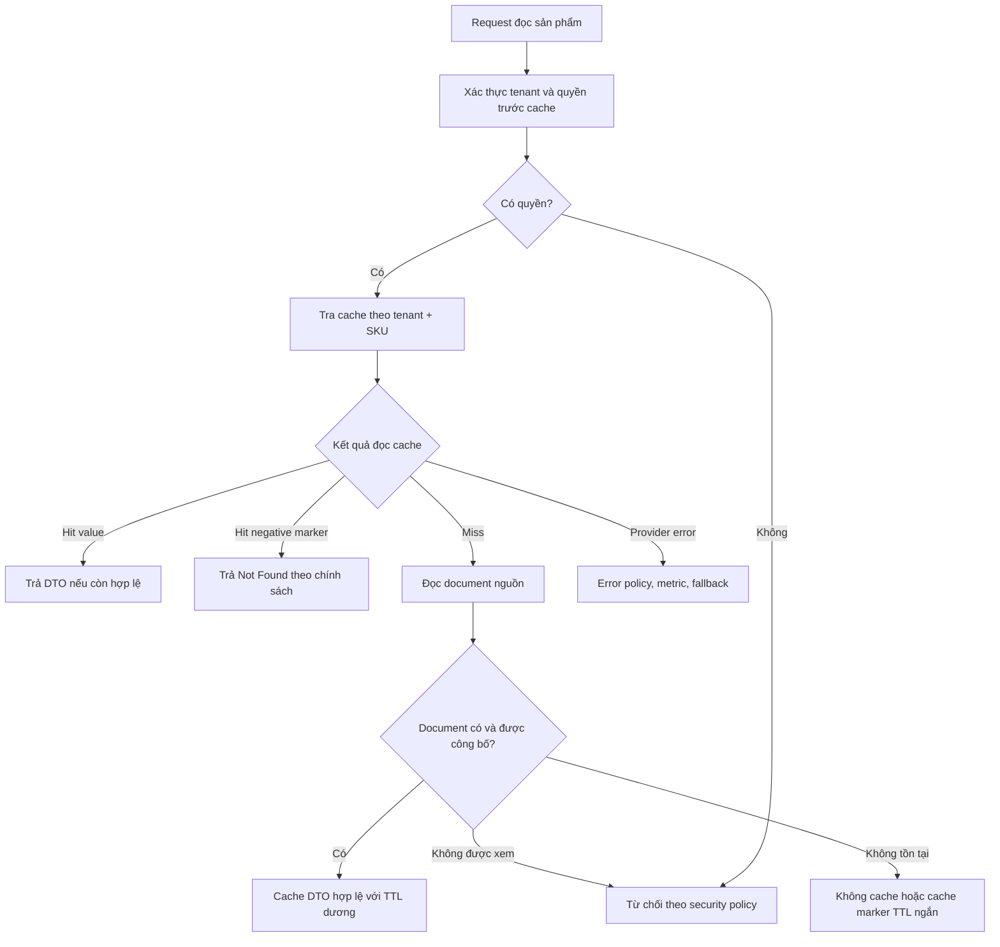
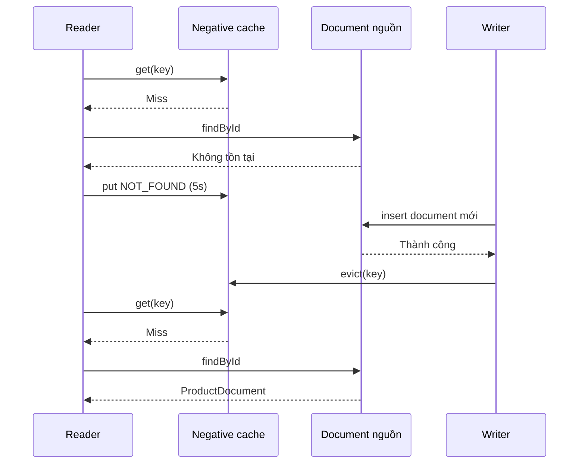

# Dữ liệu null, kết quả không tồn tại và chính sách lưu đệm

## Mục tiêu học tập

Sau bài học, bạn có thể:

1. Phân biệt **cache miss**, **cached null**, kết quả **document không tồn tại**, kết quả **không được phép truy cập**, **lỗi cache/provider** và **cache entry đã cũ**.
2. Hiểu hợp đồng của Spring `Cache.get(key)`, `Cache.ValueWrapper`, `Cache.get(key, Class<T>)`, `Optional.empty()` và ngữ nghĩa `#result` trong `@Cacheable(unless = …)`.
3. Biết cách sử dụng `CouchbaseCacheConfiguration.disableCachingNullValues()` mà không nhầm `Cache.put(key, null)` với thao tác xóa cache.
4. Chọn khi nào **không lưu kết quả rỗng**, khi nào **negative caching** có lợi, và cách tách TTL cho kết quả dương/âm để giảm stale 404.
5. Thiết kế một cache chứa **read model được tái tạo từ document nguồn** bằng Spring Data Couchbase, có key phân biệt tenant và ranh giới authorization chạy trước cache hit.
6. Duy trì tính đúng khi tạo/cập nhật/xóa document, thay đổi trạng thái hiển thị, invalidation, transaction, CAS, SQL++ scan consistency và lỗi nhà cung cấp cache.
7. Viết unit/integration test cho null/miss, Optional, not-found, TTL, create-after-miss, 403/404, provider error và nhiều ứng dụng dùng chung một cache.

**Phạm vi module:** `SPRING_DATA_COUCHBASE` xây dựng tầng truy cập Couchbase qua document mapping, repository, `CouchbaseTemplate` và SQL++; đồng thời nghiên cứu bucket/scope/collection, chỉ mục, TTL, CAS, giao dịch và lựa chọn API reactive. Trong chương **Bộ nhớ đệm**, ta dùng Spring Cache abstraction để giữ **bản sao kết quả phương thức**. Bài học này xác định **chính sách lưu hay không lưu các kết quả không có giá trị**; chính sách đó khác hoàn toàn việc document nguồn tồn tại hay đã bị xóa.

> **Quy tắc ưu tiên:** Không biến `null` thành một kiểu lỗi chung. Đặc biệt, **“không tồn tại” ≠ “không có quyền” ≠ “backend lỗi”**. Negative caching chỉ nên áp dụng cho một kết quả âm nghiệp vụ **đã được xác minh**, với khóa đúng và TTL ngắn có thể chấp nhận.

## 1. Sáu tình huống có vẻ giống “không có dữ liệu”

Giả sử API đọc sản phẩm `P1001` của `tenant-42`, nguồn ở `appdata.catalog.products` và cache ở `appdata.cache.entries`.

| Tình huống | Cache có entry? | Nguồn/ý nghĩa | Hành vi cần cân nhắc |
| --- | --- | --- | --- |
| **Cache miss** | Không có entry tương ứng | Chưa biết source có hay không | Chạy method, truy vấn nguồn |
| **Cached null** | Có entry biểu diễn `null`, nếu provider cho phép | Đã lưu một lần trả về `null` | Trả null mà có thể **không chạy method** |
| **Not found** | Có thể chưa cache | Tra đúng document ID nhưng không tồn tại | Trả `Optional.empty()`/404 theo contract |
| **Forbidden** | Có thể có entry của người khác | Caller không được xem tài nguyên | 403/404 theo security policy, **không dùng negative cache chia sẻ** |
| **Provider failure** | Không xác định; không đọc được | Timeout, mất quyền, decode error | Log/metric, fail-open hoặc fail-closed có kiểm soát |
| **Stale result** | Có entry nhưng đã lỗi thời về nghiệp vụ | Nguồn đã tạo/sửa/xóa trong khi cache chưa invalidated | TTL, evict, versioning, đối soát |

**Lưu ý:** Cache miss chỉ trả lời câu hỏi “cache có chứa mapping cho key này không?”, không nói bất cứ điều gì về sự tồn tại của document. Lỗi đọc cache cũng không nên bị chuyển thành “cache miss” một cách im lặng nếu không có failure policy và metric.

### 1.1. Sơ đồ quyết định khi đọc



Hai lưu ý trong sơ đồ:

- “Hit negative marker” chỉ tồn tại khi ứng dụng **chủ động** thiết kế negative caching. Nó không tự sinh ra từ mọi `@Cacheable` ném exception.
- Nếu tài nguyên tồn tại nhưng chưa công bố, quyết định hiển thị 404 hay 403 tùy security policy. Không nhầm trạng thái này với “không hề có document” rồi lưu marker âm sai phạm vi.

## 2. Spring Cache phân biệt cache miss với cached null thế nào?

Giao diện `org.springframework.cache.Cache` định nghĩa:

```java
Cache.ValueWrapper wrapper = cache.get(key);
```

Theo hợp đồng Spring Cache:

- `wrapper == null`: **không có mapping** cho key, tức cache miss.
- `wrapper != null && wrapper.get() != null`: **cache hit có value**.
- `wrapper != null && wrapper.get() == null`: **cache hit đã lưu null**, nếu provider và cấu hình hỗ trợ null.

Một ví dụ kiểm tra ba trạng thái:

```java
import org.springframework.cache.Cache;

public final class CacheProbe {

    public static String inspect(Cache cache, Object key) {
        Cache.ValueWrapper wrapper = cache.get(key);

        if (wrapper == null) {
            return "MISS";
        }

        if (wrapper.get() == null) {
            return "HIT_CACHED_NULL";
        }

        return "HIT_VALUE";
    }
}
```

Điểm quan trọng nằm ở **ValueWrapper**: nếu dùng overload trả trực tiếp giá trị typed:

```java
ProductCard value = cache.get(key, ProductCard.class);
```

thì `value == null` có thể tương ứng **miss** hoặc **cached null**. Overload này không giúp phân biệt hai tình huống; dùng `get(key)` khi bài toán thực sự cần kiểm tra mapping có tồn tại.

### 2.1. Bảng kết quả theo API

| Trạng thái cache | `cache.get(key)` | `cache.get(key, T.class)` |
| --- | --- | --- |
| Không có entry | `null` wrapper | `null` |
| Entry chứa null và provider hỗ trợ | Wrapper khác null, `get()==null` | `null` |
| Entry chứa value hợp lệ | Wrapper khác null, `get()==value` | Value đã cast/kiểm tra kiểu |
| Entry tồn tại nhưng sai kiểu | Provider-dependent wrapper/error | Có thể báo mismatch/type error |
| Provider timeout/decode lỗi | Exception theo contract/provider | Exception, không phải miss |

**Không mặc định:** Tất cả cache provider đều hỗ trợ storing null giống nhau. Với Couchbase-backed Spring Cache, phải kiểm tra policy và transcoder thực tế, đặc biệt nếu đã tắt caching null.

### 2.2. Vì sao “lưu null” không phải “không lưu”?

Giả sử method `findCard` lần đầu trả `null` và cache manager cho phép lưu null:

```text
T1: cache miss, method trả null
T2: cache lưu sentinel/biểu diễn cached null
T3: cùng key được gọi lần nữa
T4: Spring thấy cache hit và có thể trả null ngay
    -> method không đọc nguồn lần thứ hai
```

Điều đó là **negative caching dạng null**, nhưng nó thiếu lý do tại sao không có dữ liệu. Source có thể vừa được tạo sau T1, caller vẫn thấy null đến khi TTL hết hoặc evict thành công.

Nếu yêu cầu mỗi lượt “không thấy sản phẩm” phải kiểm tra lại nguồn, nên **không cache null** bằng cấu hình/annotation phù hợp.

## 3. Optional.empty(): wrapper của Java không phải một value cache tùy ý

Spring Cache hỗ trợ `Optional<T>` như kiểu trả về ở method có annotation.

Theo Spring Framework:

- Với `Optional.of(product)`, Spring có thể cache **giá trị bên trong**.
- Với `Optional.empty()`, nếu cache null được cho phép và không bị `unless` veto, Spring có thể cache một giá trị tương đương `null`.
- Trong SpEL dùng cho `@Cacheable(unless=…)`, `#result` tham chiếu đến **giá trị nghiệp vụ đã unwrap**, không phải chính `Optional`; khi empty thì `#result == null`.

Ví dụ:

```java
@Cacheable(
        cacheNames = "catalog.product-card.v1",
        key = "#p0 + '::' + #p1",
        unless = "#result == null")
public java.util.Optional<ProductCard> findCard(
        String tenantId, String sku) {
    return loadOptionalFromSource(tenantId, sku);
}
```

*Đây là method minh họa nằm trong Spring bean có helper `loadOptionalFromSource`. Trên cache hit, Spring tái dựng wrapper trả về theo contract mà version/framework hỗ trợ; cần kiểm thử khi dùng custom provider/transcoder.*

Với `unless = "#result == null"`:

1. Source trả `Optional.of(card)` → `#result` là `card` → có thể cache.
2. Source trả `Optional.empty()` → `#result` là null → **không put**.
3. Nếu cache hit dương → method body bị bỏ qua.
4. Nếu source tiếp tục không tồn tại → những lượt tiếp theo vẫn gọi method, không tạo negative entry.

### 3.1. Dùng safe navigation với điều kiện dựa trên result

```java
@Cacheable(
    cacheNames = "catalog.product-card.v1",
    key = "#p0 + '::' + #p1",
    unless = "#result == null || !#result.active()")
public java.util.Optional<ProductCard> findCard(
        String tenantId, String sku) {
    // ...
}
```

`ProductCard.active()` là accessor của một record đã khai báo trong ứng dụng. Đối với `Optional.empty()`, phần đầu biểu thức xử lý null trước; nếu dùng property phức tạp, có thể viết safe navigation `#result?.active()` trong những SpEL version phù hợp.

**Không viết** `unless="#result.isEmpty()"` trên `Optional<T>` rồi giả định `#result` luôn là Optional wrapper. Với Spring Cache, kết quả thường đã unwrap thành `T` hoặc null.

### 3.2. Exception không tự trở thành cached not-found

```java
@Cacheable(cacheNames = "catalog.product-card.v1")
public ProductCard requireCard(String sku) {
    throw new java.util.NoSuchElementException(
            "Không tìm thấy sản phẩm");
}
```

Một invocation ném exception trước khi trả về **không tạo ra kết quả thành công để cache** qua `@Cacheable` thông thường. Spring Cache không mặc nhiên cache exception này như một negative marker.

**Nếu muốn cache not-found**, cần explicit value/result model hoặc logic cache đặc biệt, đồng thời phân biệt 404 do nguồn không có với 403/security và 500/infrastructure.

## 4. condition, unless và disableCachingNullValues có vai trò riêng

Ba cơ chế này xử lý những phạm vi khác nhau:

| Cơ chế | Áp dụng khi nào | Nó làm gì? | Không làm gì? |
| --- | --- | --- | --- |
| `@Cacheable(condition="…")` | **Trước** method invocation | Cho phép hoặc bỏ qua caching cho invocation | Không kiểm tra result chưa tồn tại |
| `@Cacheable(unless="…")` | **Sau** method trả kết quả | Veto việc **put** result | Không thay đổi một cache hit đã trả sớm |
| `CouchbaseCacheConfiguration.disableCachingNullValues()` | **Ở provider/cache config** | Từ chối lưu null | Không xóa entry cũ khi có lệnh put null |
| `@CacheEvict`/`Cache.evict` | Theo eviction policy | Xóa một entry | Không xóa document nguồn |
| `entryExpiry(Duration)` | Lúc cache entry được ghi | Đặt TTL cho cache entry | Không cam kết result mới nhất khi source đổi |

### 4.1. condition không biết result

```java
@Cacheable(
    cacheNames = "catalog.product-card.v1",
    key = "#p0 + '::' + #p1",
    condition = "#p0 != 'internal-test'",
    unless = "#result == null")
public ProductCard getCard(String tenantId, String sku) {
    return readFromSource(tenantId, sku);
}
```

- `condition` xét tenant đầu vào trước khi dùng cache. False → method chạy mà không dùng cache cho invocation đó.
- `unless` kiểm tra kết quả sau method. Null → không lưu.
- `#result` chưa có trong `condition` của `@Cacheable`; không dùng expression yêu cầu result ở vị trí này.

Đây là ví dụ điều kiện kỹ thuật, **không phải security authorization**. Lời gọi cache hit có thể bỏ qua body, nên phân quyền phải được kiểm tra ở ranh giới trước cache proxy.

### 4.2. Tắt cache null trong CouchbaseCacheConfiguration

Javadoc Spring Data Couchbase định nghĩa:

```java
CouchbaseCacheConfiguration config =
        CouchbaseCacheConfiguration.defaultCacheConfig()
                .disableCachingNullValues();
```

Quan trọng: khi đã tắt null caching, thao tác `Cache.put(key, null)` **có thể ném lỗi**; nó **không ghi null mới, không xóa key và không thay giá trị cũ**. Đây là behavior được ghi chú trực tiếp trong Javadoc. Vì thế:

```java
// SAI: tưởng put null có nghĩa là xóa entry.
cache.put(key, null);

// ĐÚNG: xóa entry một cách tường minh.
cache.evict(key);
```

Đặc biệt khi `@CachePut` trên method có thể trả null, hãy khai báo `unless="#result == null"` hoặc bảo đảm method không trả null. Nếu không, provider tắt cache null có thể báo lỗi sau invocation.

### 4.3. Tương tác giữa @Cacheable và cấu hình tắt null

Mô hình hợp lý cho **chỉ cache kết quả dương**:

```java
@Cacheable(
        cacheNames = "catalog.product-card.v1",
        key = "#p0 + '::' + #p1",
        unless = "#result == null")
public ProductCard lookupCardOrNull(
        String tenantId, String sku) {
    return lookupNullableFromSource(tenantId, sku);
}
```

Đồng thời `CouchbaseCacheConfiguration.disableCachingNullValues()` ngăn một đường ghi cache trực tiếp khác lưu null. Hai lớp có mục đích bổ sung:

- `unless` diễn đạt **policy của method**: null không phải kết quả đáng lưu.
- `disableCachingNullValues` diễn đạt **policy của provider**: mọi thao tác put null phải bị từ chối.
- Nếu cache name có nhiều method dùng chung, cần kiểm tra chúng đồng nhất contract; null từ method A không nên được diễn giải khác bởi method B.

**Không mặc định:** Việc `unless` đã viết đúng cho một method khiến mọi code khác gọi `cache.put(key,null)` đều an toàn; provider vẫn có thể ném lỗi nếu null caching bị tắt.

## 5. Chọn chiến lược: không cache null, cached null hay explicit negative marker

Ba chiến lược thường gặp:

| Chiến lược | Cache value khi không có source | Ưu điểm | Chi phí/rủi ro |
| --- | --- | --- | --- |
| **Không lưu kết quả âm** | Không có entry | Mỗi lần tìm lại nguồn, giảm stale 404 | Tốn KV/query với ID hay bị hỏi nhưng không tồn tại |
| **Cache null** | Sentinel/null nếu provider cho phép | Đơn giản với `Optional.empty()` | Không thể hiện lý do; dễ nhầm null, phụ thuộc null serialization/provider |
| **Explicit negative marker** | `NOT_FOUND` hoặc typed outcome rõ | Có thể tách TTL, metric, invalidation | Phải quản lý key/name, tránh cache sai lỗi và stale |
| **Cache kết quả lỗi** | Không khuyến nghị mặc định | Ít tình huống hợp lý | Dễ biến 403/500 thành 404, che infrastructure failure |

### 5.1. Khi nào KHÔNG nên negative cache?

- Dữ liệu mới được tạo thường xuyên, ngay sau create phải đọc thấy ngay.
- Nguồn bị eventual consistency ở đường tra cứu và “không thấy” chưa chắc “không tồn tại”.
- Tài nguyên có quyền xem phức tạp; 404 có thể chỉ là cách che giấu sự tồn tại.
- Lỗi timeout/service unavailable có thể bị nhầm với not found.
- Không có cơ chế invalidation khi tài nguyên được tạo.
- Có yêu cầu mạnh về tính đúng/sự mới nhất ở thời điểm transaction, không chịu được stale 404.

### 5.2. Khi nào negative caching hữu ích?

- Nhiều request lặp lại một ID sai hoặc một SKU không tồn tại, gây tốn KV/query.
- Nguồn đã được tra theo **document ID đáng tin cậy** và trả “không tìm thấy” rõ ràng.
- Thời gian tồn tại marker âm rất ngắn (ví dụ 3–10 giây), được định nghĩa bởi SLA và lượng truy cập.
- Có cơ chế evict marker khi create/restore và giám sát tỷ lệ negative hit.
- Không cache kết quả authorization hoặc infrastructure failure.

**Ví dụ policy (chỉ mang tính minh họa):**

| Read model | Cache name | TTL đề xuất để thử nghiệm | Điều kiện được lưu |
| --- | --- | --- | --- |
| ProductCard dương | `catalog.product-card.v1` | 2 phút | Document tồn tại, được xem, DTO hợp lệ |
| Negative not found | `catalog.product-not-found.v1` | 5 giây | Chỉ khi lookup nguồn xác nhận document không tồn tại |
| Product detail dương | `catalog.product-detail.v1` | 60 giây | Document tồn tại, đã xác thực quyền |
| Unauthorized response | Không tạo cache dùng chung | Không áp dụng | Security được kiểm tra trước cache hit |
| Provider timeout/error | Không cache thành not-found | Không áp dụng | Log/metric/fallback có kiểm soát |

TTL không phải con số chuẩn của Spring Data Couchbase; nó là quyết định nghiệp vụ. Cache negative theo 5 giây có thể vẫn tạo stale 404 trong 5 giây nếu tài nguyên được tạo nhưng invalidation bị bỏ sót.

## 6. Thiết lập CouchbaseCacheManager với hai TTL và null policy

Spring Cache annotation cần được bật bằng `@EnableCaching`. Backend là Couchbase khi Spring Boot/cấu hình thực sự chọn `CouchbaseCacheManager`.

Ví dụ Gradle:

```groovy
dependencies {
    implementation 'org.springframework.boot:spring-boot-starter-data-couchbase'
    implementation 'org.springframework.boot:spring-boot-starter-cache'
    implementation 'org.springframework.boot:spring-boot-starter-web'
}
```

`spring-boot-starter-web` chỉ cần nếu viết REST API; cache vẫn dùng được trong service không có MVC.

Cấu hình kết nối:

```yaml
spring:
  couchbase:
    connection-string: couchbase://localhost
    username: app_user
    password: ${COUCHBASE_PASSWORD}
  data:
    couchbase:
      bucket-name: appdata
```

Đừng commit password thật; cung cấp qua biến môi trường/secret manager. Tạo trước bucket `appdata`, scope `catalog` và `cache`, collection `products` và `entries` theo quy trình môi trường.

### 6.1. Bean cache manager thủ công

Ví dụ cho cache dương và âm với **tên cache khác nhau**:

```java
package com.example.catalog.cache;

import java.time.Duration;

import org.springframework.cache.annotation.EnableCaching;
import org.springframework.context.annotation.Bean;
import org.springframework.context.annotation.Configuration;
import org.springframework.data.couchbase.cache.CouchbaseCacheConfiguration;
import org.springframework.data.couchbase.cache.CouchbaseCacheManager;
import org.springframework.data.couchbase.core.CouchbaseOperations;

@Configuration(proxyBeanMethods = false)
@EnableCaching
public class ProductCacheConfiguration {

    public static final String POSITIVE =
            "catalog.product-card.v1";
    public static final String NEGATIVE =
            "catalog.product-not-found.v1";

    @Bean
    public CouchbaseCacheManager cacheManager(
            CouchbaseOperations operations) {

        var factory = operations
                .getCouchbaseClientFactory()
                .withScope("cache");

        var base = CouchbaseCacheConfiguration
                .defaultCacheConfig()
                .collection("entries")
                .prefixCacheNameWith("app:catalog:")
                .disableCachingNullValues();

        return CouchbaseCacheManager.builder(factory)
                .withCacheConfiguration(
                        POSITIVE,
                        base.entryExpiry(Duration.ofMinutes(2)))
                .withCacheConfiguration(
                        NEGATIVE,
                        base.entryExpiry(Duration.ofSeconds(5)))
                .disableCreateOnMissingCache()
                .transactionAware()
                .build();
    }
}
```

Điểm chính:

1. `@EnableCaching` kích hoạt cache interceptor cho annotation; không tự làm một provider bất kỳ trở thành Couchbase.
2. `CouchbaseOperations.getCouchbaseClientFactory().withScope("cache")` tái sử dụng factory do Spring quản lý và chọn scope cache.
3. `collection("entries")` dùng collection riêng cho cache; source entity vẫn thuộc `catalog.products`.
4. `POSITIVE` và `NEGATIVE` là **hai cache name**, có expiry khác nhau và prefix phân biệt key vật lý.
5. `disableCachingNullValues()` tránh lưu null; negative cache dùng **marker khác null**.
6. `disableCreateOnMissingCache()` giúp phát hiện typo, không tự tạo vùng cache chưa duyệt.
7. `transactionAware()` có thể hoãn put/evict phù hợp với transaction Spring; nó không tạo atomic commit cho source/cache.

**Đây là cấu hình thủ công thay thế auto-configuration mặc định** của Spring Boot. Không tạo hai cache managers trùng nhau rồi tin annotation sẽ chọn đúng. API builder và tên package cần đối chiếu Spring Data Couchbase version dự án; cách cấu hình cụ thể có thể thay đổi giữa các thế hệ.

### 6.2. Default null caching policy phải được xác minh

Không nên suy luận cấu hình mặc định của mọi provider/version. Javadoc `CouchbaseCacheConfiguration.getAllowCacheNullValues()` cho phép kiểm tra policy của đối tượng cấu hình. Ví dụ unit test:

```java
import static org.assertj.core.api.Assertions.assertThat;

import org.junit.jupiter.api.Test;
import org.springframework.data.couchbase.cache.CouchbaseCacheConfiguration;

class NullPolicyConfigurationTest {

    @Test
    void explicitConfigurationDisablesNullCaching() {
        var config = CouchbaseCacheConfiguration
                .defaultCacheConfig()
                .disableCachingNullValues();

        assertThat(config.getAllowCacheNullValues()).isFalse();
    }
}
```

Test này chỉ kiểm tra policy object, chưa xác minh behavior thực tế của cache entry trên Couchbase. Cần integration test với `CacheManager` và transcoder theo phiên bản đang dùng.

### 6.3. Nếu dùng Spring Boot auto-configuration

Spring Boot có thể tự cấu hình `CouchbaseCacheManager` khi Couchbase và Spring Cache đã được cấu hình. Các property như `spring.cache.type=couchbase`, `spring.cache.cache-names` và `spring.cache.couchbase.expiration` đặt provider/cache names/default expiry.

Tuy nhiên, một TTL chung **không diễn đạt được** positive cache 2 phút và negative cache 5 giây. Dùng `CouchbaseCacheManagerBuilderCustomizer` đúng package Spring Boot version hoặc bean thủ công như phần 6.1. Kiểm tra `CacheManager` đang dùng trước khi đánh giá behavior null/not found.

## 7. Entity nguồn và contract tìm kiếm theo document ID

Negative caching chỉ đáng tin nếu “không tồn tại” được suy ra từ một nguồn đúng ngữ nghĩa. Ví dụ `ProductDocument` được lưu với ID có tenant:

```java
package com.example.catalog;

import org.springframework.data.annotation.Id;
import org.springframework.data.annotation.Version;
import org.springframework.data.couchbase.core.mapping.Collection;
import org.springframework.data.couchbase.core.mapping.Document;
import org.springframework.data.couchbase.core.mapping.Field;
import org.springframework.data.couchbase.core.mapping.Scope;

@Document
@Scope("catalog")
@Collection("products")
public class ProductDocument {

    @Id
    private String id;

    @Field
    private String tenantId;

    @Field
    private String sku;

    @Field
    private String title;

    @Field
    private long priceCents;

    @Field
    private boolean published;

    @Version
    private Long version;

    public ProductDocument() {}

    public String getId() { return id; }
    public void setId(String value) { id = value; }

    public String getTenantId() { return tenantId; }
    public void setTenantId(String value) { tenantId = value; }

    public String getSku() { return sku; }
    public void setSku(String value) { sku = value; }

    public String getTitle() { return title; }
    public void setTitle(String value) { title = value; }

    public long getPriceCents() { return priceCents; }
    public void setPriceCents(long value) { priceCents = value; }

    public boolean isPublished() { return published; }
    public void setPublished(boolean value) { published = value; }

    public Long getVersion() { return version; }
}
```

Repository:

```java
package com.example.catalog;

import org.springframework.data.couchbase.repository.CouchbaseRepository;

public interface ProductRepository
        extends CouchbaseRepository<ProductDocument, String> {
}
```

DTO cache dương, không phải entity:

```java
package com.example.catalog;

public record ProductCard(
        String sku,
        String title,
        long priceCents) {
}
```

Khóa nguồn có dạng:

```text
Bucket: appdata
Scope: catalog
Collection: products
Document ID: product::tenant-42::P1001
```

Lưu ý document ID khác logical cache key. Cùng SKU ở hai tenant phải dùng **hai ID nguồn khác nhau** nếu source nằm chung collection. Mọi người dùng phải được kiểm tra quyền trước cache lookup; Couchbase RBAC và filter trong repository không bảo vệ một method body bị `@Cacheable` bỏ qua khi hit.

### 7.1. Helper tạo document ID có kiểm soát

```java
package com.example.catalog;

public final class ProductIds {

    private ProductIds() {}

    public static String id(String tenantId, String sku) {
        if (tenantId == null || tenantId.isBlank()
                || sku == null || sku.isBlank()) {
            throw new IllegalArgumentException(
                    "tenantId và sku phải hợp lệ");
        }
        // Ví dụ với format định danh đã được domain validate.
        return "product::" + tenantId + "::" + sku;
    }

    public static String cacheKey(String tenantId, String sku) {
        // Cùng tenant/SKU cho cả positive, negative và invalidation.
        return tenantId + "::" + sku;
    }
}
```

Trong production, validate rằng `tenantId` và `sku` không chứa ký tự phân tách gây collision, hoặc dùng encoder theo từng segment (Base64 URL-safe/length-prefixed). Ví dụ này chỉ dành cho dữ liệu domain có format đã được kiểm soát.

## 8. Phương án A: chỉ cache kết quả dương với @Cacheable

Trường hợp đơn giản và dễ đúng nhất: method đọc source trả `Optional<ProductCard>`, khi không có document thì **không lưu** kết quả âm.

```java
package com.example.catalog;

import java.util.Optional;

import org.springframework.cache.annotation.Cacheable;
import org.springframework.stereotype.Service;

@Service
public class ProductCardReader {

    private final ProductRepository repository;

    public ProductCardReader(ProductRepository repository) {
        this.repository = repository;
    }

    @Cacheable(
            cacheNames = "catalog.product-card.v1",
            key = "#p0 + '::' + #p1",
            unless = "#result == null")
    public Optional<ProductCard> find(
            String tenantId, String sku) {

        Optional<ProductDocument> source =
                repository.findById(ProductIds.id(tenantId, sku));

        if (source.isEmpty()) {
            return Optional.empty();
        }

        ProductDocument doc = source.get();

        if (!tenantId.equals(doc.getTenantId())) {
            throw new SecurityException("Sai tenant");
        }

        if (!doc.isPublished()) {
            return Optional.empty();
        }

        return Optional.of(new ProductCard(
                doc.getSku(), doc.getTitle(), doc.getPriceCents()));
    }
}
```

**Ý nghĩa:**

- Với document có và đã công bố, annotation có thể cache `ProductCard`, sau đó Spring trả đúng kiểu `Optional<ProductCard>` theo hợp đồng method.
- Với `Optional.empty()`, `#result == null` nên `unless` chặn put; mỗi lời gọi miss vẫn có cơ hội kiểm tra trạng thái mới.
- Nếu repository ném lỗi kết nối, method không trả được result để `@Cacheable` lưu; lỗi cần được xử lý riêng, **không** chuyển thành not-found vô cớ.
- Chỉ cần một cache name cho kết quả dương, chưa cần negative cache.

**Cảnh báo quyền truy cập:** Method ở trên vẫn kiểm tra tenant trong body để phòng vệ khi cache miss. Nhưng khi cache hit, body có thể không chạy. Caller phải qua facade/security filter xác thực tenant và quyền đọc **trước khi gọi Spring bean `ProductCardReader`**.

### 8.1. Chuỗi hit/miss không negative cache

```text
T0: find(tenant-42, P1001) -> miss -> source không có -> Optional.empty()
    -> không put cache

T1: find(tenant-42, P1001) -> vẫn miss -> đọc source lại

T2: source tạo product::tenant-42::P1001

T3: find(tenant-42, P1001) -> miss -> source có -> put DTO

T4: find(tenant-42, P1001) -> hit DTO -> không đọc source
```

Ưu điểm: không có stale 404 do cached null sau khi sản phẩm được tạo. Đổi lại, ID không tồn tại bị truy vấn nguồn nhiều lần. Nếu đây là hot negative key và đủ điều kiện, xem phương án B với negative marker.

### 8.2. “Không công bố” không nhất thiết tương đương “không tồn tại”

Ví dụ `doc.isPublished()==false` trả `Optional.empty()` để giao diện public hiển thị 404. Nhưng vì trạng thái có thể đổi và phân quyền có thể khác theo caller, không nên tự lưu negative marker lâu cho trường hợp này. Nếu ứng dụng có admin role xem draft, cần tách read model/cache name và kiểm tra quyền trước hit.

## 9. Phương án B: negative caching bằng marker và TTL riêng

Khi nhiều request cùng tra một mã không tồn tại, có thể dùng **negative caching** để giảm số lần đọc nguồn. Thay vì lưu `null` trong cache dương, hãy tạo hai cache riêng:

- `catalog.product-card.v1`: lưu `ProductCard` hợp lệ, TTL **2 phút**.
- `catalog.product-not-found.v1`: lưu marker khác null `"NOT_FOUND"` khi document **thật sự không tồn tại**, TTL **5 giây**.

Đây là chính sách thử nghiệm, không phải TTL chuẩn. Hai cache dùng cùng logical key nhưng có cache name/prefix vật lý khác nên không ghi đè nhau.

### 9.1. Kiểm tra quyền trước mọi lần cache lookup

Để mô tả ranh giới bảo mật, application có thể định nghĩa một contract kiểm soát quyền:

```java
package com.example.catalog;

public interface CatalogAuthorization {

    /**
     * Kiểm tra caller đã xác thực có quyền đọc catalog
     * của tenant cụ thể hay không.
     *
     * Ném exception security khi không có quyền.
     */
    void requireReadAccess(String authenticatedTenantId);
}
```

Đây **không phải implementation cho phép mọi người truy cập**. Dự án phải triển khai từ security context đáng tin của server. Giá trị tenant không được lấy tùy ý từ HTTP body rồi gọi là “authenticated”.

### 9.2. Service đọc hai cache

```java
package com.example.catalog;

import java.util.Optional;

import org.springframework.cache.Cache;
import org.springframework.cache.CacheManager;
import org.springframework.stereotype.Service;

@Service
public class ProductLookupService {

    private static final String POSITIVE =
            "catalog.product-card.v1";
    private static final String NEGATIVE =
            "catalog.product-not-found.v1";

    private static final String NOT_FOUND = "NOT_FOUND";

    private final CatalogAuthorization authorization;
    private final ProductRepository repository;
    private final CacheManager cacheManager;

    public ProductLookupService(
            CatalogAuthorization authorization,
            ProductRepository repository,
            CacheManager cacheManager) {
        this.authorization = authorization;
        this.repository = repository;
        this.cacheManager = cacheManager;
    }

    public Optional<ProductCard> find(
            String authenticatedTenantId, String sku) {

        // Việc kiểm tra quyền chạy TRƯỚC mọi cache hit.
        authorization.requireReadAccess(authenticatedTenantId);

        String key = ProductIds.cacheKey(
                authenticatedTenantId, sku);

        Cache positive = requireCache(POSITIVE);
        Cache negative = requireCache(NEGATIVE);

        // Hai cache đều không cho lưu null, nên typed-get
        // ở đây không cần phân biệt cached null với miss.
        ProductCard cached = positive.get(key, ProductCard.class);
        if (cached != null) {
            return Optional.of(cached);
        }

        String marker = negative.get(key, String.class);
        if (NOT_FOUND.equals(marker)) {
            return Optional.empty();
        }
        if (marker != null) {
            throw new IllegalStateException(
                    "Negative cache chứa marker không hợp lệ");
        }

        Optional<ProductDocument> source = repository.findById(
                ProductIds.id(authenticatedTenantId, sku));

        if (source.isEmpty()) {
            negative.put(key, NOT_FOUND);
            return Optional.empty();
        }

        ProductDocument doc = source.get();

        if (!authenticatedTenantId.equals(doc.getTenantId())) {
            throw new SecurityException("Sai tenant");
        }

        if (!doc.isPublished()) {
            // Không coi chưa xuất bản là không có document.
            return Optional.empty();
        }

        ProductCard result = new ProductCard(
                doc.getSku(),
                doc.getTitle(),
                doc.getPriceCents());

        // Hai lệnh cache này KHÔNG atomic với nhau.
        negative.evict(key);
        positive.put(key, result);

        return Optional.of(result);
    }

    private Cache requireCache(String name) {
        Cache cache = cacheManager.getCache(name);
        if (cache == null) {
            throw new IllegalStateException(
                    "Cache chưa được cấu hình: " + name);
        }
        return cache;
    }
}
```

Luồng này chỉ ghi `NOT_FOUND` khi `repository.findById` thực sự trả `Optional.empty()`. Nó không ghi marker khi bị chặn quyền, không được công bố, hoặc repository/SDK ném exception.

**Cần kiểm chứng:** `Cache.get(key, ProductCard.class)` phải đọc lại đúng `ProductCard` với transcoder đã cấu hình. Nếu provider trả `Map` hoặc báo mismatch, xử lý value serialization/type contract bằng integration test; không ép kiểu bừa. Khi gọi `CacheManager` trực tiếp, error policy của annotation interceptor cũng không mặc nhiên được áp dụng.

### 9.3. Tại sao hai cache tốt hơn một nullable cache?

| Đặc tính | Một cache cho null và ProductCard | Hai cache dương/âm có marker |
| --- | --- | --- |
| Phân biệt hit âm và miss | Cần `ValueWrapper`/provider hỗ trợ null | Marker có tên rõ |
| TTL dương/âm khác nhau | Khó với expiry cố định theo cache name | Dễ: 2 phút và 5 giây |
| Metric not-found hit | Phải phân loại value/null | Theo cache name riêng |
| Null serialization | Phụ thuộc sentinel/transcoder | Không cần lưu null |
| Invalidation khi create | Evict key trong cache chung | Evict negative key, đồng thời xử lý positive |
| Rủi ro stale 404 | Có | Vẫn có, nhưng TTL âm ngắn hơn |

Tách hai cache **không bảo đảm atomicity** và không giải quyết mọi race. Nó chủ yếu làm **policy rõ hơn và dễ kiểm thử**.

### 9.4. Chống negative-cache pollution

Khi attacker hoặc bot thử rất nhiều SKU ngẫu nhiên, negative cache có thể tạo hàng trăm nghìn key dù mỗi key chỉ giữ 5 giây. Hãy validate cú pháp SKU, giới hạn chiều dài input, rate-limit theo principal, đo số key mới/giây và dung lượng collection. Không cho một request không xác thực tạo không giới hạn cache entry.

## 10. Tạo mới, cập nhật và xóa document phải invalidation đúng vùng cache

### 10.1. Create sau khi đã cache NOT_FOUND



Nếu writer không evict vì ghi nguồn qua SDK/batch/service khác, negative marker có thể tiếp tục che tài nguyên mới tạo cho đến hết TTL.

### 10.2. Command service evict cả hai cache sau mutation thành công

```java
package com.example.catalog;

import org.springframework.cache.annotation.CacheEvict;
import org.springframework.cache.annotation.Caching;
import org.springframework.data.couchbase.core.CouchbaseOperations;
import org.springframework.stereotype.Service;

@Service
public class ProductCommandService {

    private final CouchbaseOperations operations;

    public ProductCommandService(CouchbaseOperations operations) {
        this.operations = operations;
    }

    @Caching(evict = {
        @CacheEvict(
            cacheNames = "catalog.product-card.v1",
            key = "#p0 + '::' + #p1"),
        @CacheEvict(
            cacheNames = "catalog.product-not-found.v1",
            key = "#p0 + '::' + #p1")
    })
    public ProductDocument create(
            String tenantId, String sku,
            String title, long priceCents) {

        if (priceCents < 0) {
            throw new IllegalArgumentException("Giá âm");
        }

        ProductDocument doc = new ProductDocument();
        doc.setId(ProductIds.id(tenantId, sku));
        doc.setTenantId(tenantId);
        doc.setSku(sku);
        doc.setTitle(title);
        doc.setPriceCents(priceCents);
        doc.setPublished(true);

        // Insert-only để không đè document đã có.
        return operations
                .insertById(ProductDocument.class)
                .one(doc);
    }
}
```

Ví dụ chưa bao gồm toàn bộ kiểm tra **quyền ghi, validation và idempotency**; production bắt buộc bổ sung chúng. Method có `@Caching` phải được gọi qua Spring bean proxy. `@CacheEvict` mặc định xóa sau khi method hoàn tất bình thường, không phải lệnh xóa source document.

### 10.3. Ma trận mutation

| Thao tác nguồn | Positive cache | Negative cache | Lý do |
| --- | --- | --- | --- |
| Create / restore | Evict key tương ứng | **Evict** | Tránh stale 404 |
| Update title/price | **Evict** | Evict nếu dùng policy thống nhất | Tránh DTO dương cũ |
| Delete | **Evict** | Có thể để miss mới sinh marker | Không còn trả DTO sau delete |
| Publish document nháp | Evict | Evict nếu có | Tránh che sản phẩm vừa công bố |
| Unpublish | **Evict** | Không mặc định coi là hard not-found | Visibility thay đổi |
| External SDK/batch | Phải có thông báo/TTL | Phải có thông báo/TTL | Annotation local không tự kích hoạt |

Nếu sản phẩm chưa công bố nhưng admin có quyền đọc bản nháp, không được cache một 404 “không có document” rồi chia sẻ sang admin. 404 đôi khi chỉ là cách API che giấu sự tồn tại theo quyền.

### 10.4. Transaction-aware eviction có giới hạn

`CouchbaseCacheManager.builder(factory).transactionAware()` có thể đồng bộ cache put/evict với Spring transaction phù hợp. Nhưng source mutation và cache eviction **không tự trở thành một commit nguyên tử**: eviction sau commit vẫn có thể lỗi; một reader cũ vẫn có thể put marker sau eviction. Phải test transaction manager và cache integration thực của dự án.

## 11. HTTP 404, 403, 401, 503 và kết quả danh sách rỗng

| Kết quả | Diễn giải | Có cache như NOT_FOUND không? |
| --- | --- | --- |
| 404 do KV source thực sự không có ID | Not-found nghiệp vụ đã xác minh | Có thể, TTL ngắn |
| 404 do che giấu tồn tại theo security policy | Caller không được phép biết | **Không** dùng chung marker |
| 403 do thiếu quyền | Authorization failure | Không |
| 401 do chưa xác thực | Authentication failure | Không |
| 409 do CAS conflict | Optimistic locking | Không |
| 429 do quá nhiều request | Rate limiting | Không |
| 500/503 do Couchbase timeout/connection | Infrastructure failure | Không |
| 200 với `List.of()` rỗng | Giá trị hợp lệ của truy vấn danh sách | Có thể cache theo SLA, không phải null |

Một list rỗng **khác null**, nên `disableCachingNullValues()` không tự chặn `List.of()`. Nếu không muốn cache empty list:

```java
@Cacheable(
    cacheNames = "catalog.category-products.v1",
    key = "#p0 + '::' + #p1",
    unless = "#result == null || #result.isEmpty()")
public java.util.List<ProductCard> listProducts(
        String tenantId, String categoryId) {
    return queryCategoryFromSource(tenantId, categoryId);
}
```

`queryCategoryFromSource` là helper do service triển khai. Với danh sách, cache key phải chứa đủ tenant/filter/sort/page nếu result phụ thuộc các chiều đó.

## 12. SQL++ và eventual index có thể làm negative cache sai

KV `repository.findById(documentId)` tra đúng document ID. Ngược lại, query SQL++ theo secondary index có thể phụ thuộc scan consistency và thời gian index cập nhật sau mutation.

```sql
SELECT META(p).id AS id, p.*
FROM `appdata`.`catalog`.`products` AS p
WHERE p.tenantId = $tenantId
  AND p.sku = $sku;
```

Nếu query chạy trước khi index bắt kịp source vừa tạo, kết quả có thể **rỗng tạm thời**, nhưng document KV thực tế đã tồn tại. Cache một negative marker từ kết quả đó sẽ biến index lag thành stale 404 trong TTL.

Trong một use case read-after-write có yêu cầu mạnh, cân nhắc KV theo ID hoặc SQL++ consistency như `REQUEST_PLUS`:

```java
var matches = operations
        .findByQuery(ProductDocument.class)
        .withConsistency(
            com.couchbase.client.java.query
                .QueryScanConsistency.REQUEST_PLUS)
        .matching(query)
        .all();
```

`operations`/`query` là biến được tạo trong service. `REQUEST_PLUS` có thể tăng latency vì chờ index; cần secondary index đúng và đo query plan. Nó **không refresh một negative cache hit** vì khi hit, method/query bị bỏ qua.

Không bật negative caching để che một query plan không tối ưu hoặc query consistency không đáp ứng nghiệp vụ.

## 13. Stale NOT_FOUND và những race cần hiểu

Tình huống thường gặp:

```text
T0: Nguồn chưa có P1001.
T1: Lookup miss rồi put NOT_FOUND với TTL 5 giây.
T2: Writer tạo P1001 thành công.
T3: Writer evict negative marker.
T4: Lookup mới miss marker và đọc được P1001.
```

Nếu writer ngoài ứng dụng không thực hiện T3, caller có thể tiếp tục thấy 404 cho đến khi marker hết hạn.

### 13.1. Negative marker tái xuất hiện sau eviction

```text
A: Lookup miss, bắt đầu đọc nguồn lúc P1001 chưa có.
B: Insert P1001 thành công, evict negative key.
A: Đọc cũ hoàn tất, put NOT_FOUND sau eviction.
C: Negative cache hit, tạm trả 404 dù source đã có.
```

Đây là **stale repopulation**, không phải key collision. Cache-aside + evict không tạo linearizability tuyệt đối. Khi nghiệp vụ yêu cầu “vừa tạo phải đọc thấy ngay”, cách an toàn nhất thường là **không negative cache đường đọc đó** hoặc sử dụng read-your-writes/source bypass được thiết kế và kiểm thử.

### 13.2. TTL âm không phải bảo đảm không stale

TTL 5 giây chỉ giới hạn vòng đời marker kể từ lần put theo Couchbase cache policy và expiry thực tế, không bảo đảm một create mới luôn hiển thị ngay. Cân nhắc bucket/collection `maxExpiry`, clock/expiry behavior, update paths, concurrency và SLA.

### 13.3. CAS và transaction không tự xóa marker

Source `@Version`/CAS bảo vệ mutation có phiên bản cũ; nó không tự phát sự kiện cache eviction. `REQUEST_PLUS` chỉ ảnh hưởng query nguồn khi chạy. Nếu cache đã trả `NOT_FOUND`, cả CAS lẫn consistency của SQL++ không được áp dụng trong lần đọc ấy.

## 14. Cache provider failure không phải not-found

Couchbase có thể timeout, mất quyền KV, lỗi decode value hoặc mất kết nối. Những lỗi này khác với `repository.findById(...).isEmpty()`.

| Lỗi | Hành vi cần cân nhắc |
| --- | --- |
| Cache GET lỗi | Có thể fail-open sang source nếu business cho phép; ghi metric |
| Cache PUT lỗi sau read đúng | Theo policy, vẫn có thể trả DTO đúng và ghi nhận lỗi |
| Cache EVICT lỗi sau mutation nguồn | Alert/retry/đối soát vì cache stale có thể tồn tại |
| Cache decode error | Version/serializer issue, không phải cache miss thường |
| Source KV/SQL++ timeout | Không cache `NOT_FOUND`; trả lỗi hoặc retry có deadline |
| Security exception | Từ chối theo policy; không cache âm |
| CAS conflict | 409/optimistic locking policy, không cache âm |

Spring có `CacheErrorHandler` để điều phối lỗi trong cache interceptor. Tuy nhiên, **API programmatic `CacheManager.getCache(...).get/put` không mặc nhiên được bọc bằng cùng interceptor error handler**. Một adapter riêng cần thực hiện policy fail-open/closed, metric, retry giới hạn và phân biệt provider error với miss.

Không bắt mọi `RuntimeException` rồi trả `Optional.empty()`; đó là cách biến lỗi hạ tầng, lỗi mapping và lỗi phân quyền thành 404 giả.

## 15. Null sentinel, value transcoder và đổi phiên bản

Spring Cache có thể biểu diễn cached null bằng sentinel nội bộ. Couchbase-backed provider còn chuyển value sang bytes bằng transcoder. Khi bật/tắt caching null hoặc thay `CouchbaseCacheConfiguration.valueTranscoder(…)`, phải kiểm thử cách ghi/đọc sentinel và giá trị DTO.

Dùng marker `"NOT_FOUND"` khác null có thể dễ audit hơn, nhưng marker cũng là một **wire contract**: nếu thay schema hoặc format, version cache name như `catalog.product-not-found.v2` để tránh reader mới hiểu sai value cũ.

Chuyển từ “cho lưu null” sang `disableCachingNullValues()` không bảo đảm mọi entry null đã tồn tại trước deploy tự biến mất. Có thể:

- Đổi cache name/version mới.
- Evict có chọn lọc nếu biết key.
- Chờ TTL cũ hết hạn khi SLA chấp nhận.
- Kiểm thử rolling deployment có reader/writer phiên bản khác nhau.

Không tự gọi `cache.clear()` trong production chỉ để sửa một key mà chưa đánh giá index/quyền và nguy cơ cache stampede.

## 16. Reactive API: Mono.empty() không đơn giản là null

Với `ReactiveCouchbaseOperations`:

```java
import reactor.core.publisher.Mono;

public Mono<ProductDocument> findDocumentReactive(String id) {
    return reactiveOperations
            .findById(ProductDocument.class)
            .one(id);
}
```

`reactiveOperations` được inject vào class dịch vụ. Một `Mono.empty()` là **publisher hoàn tất không phát giá trị**, khác Java `null`. Spring Framework đời mới có semantics riêng khi cache `Mono`/`Flux`, phụ thuộc version và provider:

- Không mặc định `unless="#result == null"` xử lý `Mono.empty()` giống `Optional.empty()` với mọi cấu hình.
- Không dùng `onErrorResume(error -> Mono.empty())` cho mọi lỗi: nó có thể biến backend timeout thành “không tồn tại” và negative-cache sai.
- Không `block()` trên WebFlux event loop để ép caching kiểu blocking.
- Reactive cache adapter cần test cancellation, subscribe nhiều lần, empty publisher, error signal, timeout và concurrency.

Nếu cần negative caching reactive, ưu tiên một outcome typed (FOUND/NOT_FOUND) hoặc adapter hỗ trợ async/reactive rõ ràng, cùng test phiên bản cụ thể.

## 17. Kiểm thử null, negative marker và thay đổi dữ liệu nguồn

### 17.1. Spring Cache interface test với in-memory provider

Test này chỉ chứng minh semantics của `Cache.ValueWrapper`, **không** thay thế Couchbase test:

```java
import static org.junit.jupiter.api.Assertions.*;

import org.junit.jupiter.api.Test;
import org.springframework.cache.Cache;
import org.springframework.cache.concurrent.ConcurrentMapCache;

class NullCacheContractTest {

    @Test
    void distinguishesMissFromCachedNull() {
        Cache cache = new ConcurrentMapCache("test");

        assertNull(cache.get("missing"));

        cache.put("cached-null", null);

        Cache.ValueWrapper wrapper = cache.get("cached-null");
        assertNotNull(wrapper);
        assertNull(wrapper.get());

        // Typed-get không phân biệt null hit và miss.
        assertNull(cache.get("cached-null", String.class));
        assertNull(cache.get("missing", String.class));
    }
}
```

### 17.2. Integration test null-disabled với CouchbaseCacheManager

```java
import static org.assertj.core.api.Assertions.*;

import org.junit.jupiter.api.Test;
import org.springframework.beans.factory.annotation.Autowired;
import org.springframework.boot.test.context.SpringBootTest;
import org.springframework.cache.Cache;
import org.springframework.cache.CacheManager;
import org.springframework.data.couchbase.cache.CouchbaseCacheManager;

@SpringBootTest
class CouchbaseNullCacheIntegrationTest {

    @Autowired CacheManager manager;

    @Test
    void putNullCannotBeUsedToEvictAnExistingEntry() {
        assertThat(manager)
                .isInstanceOf(CouchbaseCacheManager.class);

        Cache cache = manager.getCache(
                "catalog.product-not-found.v1");
        assertThat(cache).isNotNull();

        String key = "test-tenant::test-sku";
        cache.put(key, "NOT_FOUND");

        assertThatThrownBy(() -> cache.put(key, null))
                .isInstanceOf(RuntimeException.class);

        assertThat(cache.get(key, String.class))
                .isEqualTo("NOT_FOUND");

        cache.evict(key);
    }
}
```

Test phụ thuộc cấu hình null-disabled ở phần 6, chạy trong cache collection test. Exception subtype có thể khác giữa provider; kiểm tra behavior cốt lõi là **put null không xóa/ghi đè entry cũ**.

### 17.3. Ma trận integration test quan trọng

| Bài test | Kỳ vọng |
| --- | --- |
| Source trả `Optional.empty()`, `unless="#result == null"` | Không put; lần sau đọc nguồn lại |
| Source trả `Optional.of(card)` | Put dương; lần sau cache hit |
| Null disabled và gọi `put(key,null)` | Báo lỗi; giá trị cache cũ không bị xóa |
| Negative lookup lần đầu | Đọc nguồn, put marker |
| Negative lookup lần hai | Hit marker, không đọc nguồn |
| Create sản phẩm sau negative hit | Evict marker, lần sau đọc sản phẩm mới |
| External writer không evict | Có cửa sổ stale 404 tới TTL |
| Same SKU khác tenant | Hai cache keys khác và không lộ dữ liệu |
| Unauthorized caller khi cache đã hit | Guard từ chối trước cache |
| Repository timeout | Không put marker `NOT_FOUND` |
| Cache GET timeout | Theo fail-open/closed policy; metric khác cache miss |
| Unpublish sản phẩm | Evict card dương; không tự lưu 404 toàn cục |
| SQL++ index lag | Không tự cache empty query như hard not-found |
| Read miss/insert/evict race | Có thể tái hiện stale marker repopulation |
| Schema/codec version đổi | Không nhầm decode error với 404 |

### 17.4. Test TTL theo polling, không dựa ngủ đúng số giây

Trong test profile, đặt negative TTL = 2 giây. Với thư viện Awaitility:

```java
import static org.awaitility.Awaitility.await;
import static org.assertj.core.api.Assertions.assertThat;

import java.time.Duration;
import org.springframework.cache.Cache;

// Snippet bên trong @Test, cache negative TTL 2s.
Cache negative = cacheManager.getCache(
        "catalog.product-not-found.v1");
assertThat(negative).isNotNull();

String key = "ttl-test-tenant::P1";
negative.put(key, "NOT_FOUND");

assertThat(negative.get(key)).isNotNull();

await()
        .atMost(Duration.ofSeconds(15))
        .pollInterval(Duration.ofMillis(250))
        .until(() -> negative.get(key) == null);
```

Lệnh này không tự tạo cấu hình TTL 2 giây: test profile phải làm việc đó trước. Poll giúp test ít flaky hơn khi server xử lý expiry theo độ hạt thời gian khác nhau.

### 17.5. Không quên Spring proxy

Để test `@Cacheable` hoặc `@CacheEvict`, gọi service qua bean Spring. Tự `new ProductCardReader(repository)` hoặc gọi method annotated qua `this.method()` trong cùng bean sẽ không đi qua proxy cache theo cấu hình thông thường.

## 18. Vận hành, quan sát và bảo mật

| Metric | Mục đích |
| --- | --- |
| `positive_cache_hit_total` | Xem hiệu quả cache dương |
| `negative_cache_hit_total` | Negative caching có giảm source read không |
| `cache_miss_total` | Phân biệt miss với lỗi |
| `cache_provider_error_total` | Không gộp timeout/decode error thành not-found |
| `not_found_from_source_total` | Tần suất thiếu document thật |
| `negative_key_count`/bytes | Phát hiện key pollution |
| `negative_eviction_error_total` | Theo dõi stale 404 sau create |
| `stale_404_incidents` | Đánh giá SLA và race |
| `source_kv_query_count` | Đo tải nguồn trước/sau cache |
| p95/p99 của hit/miss | So sánh lợi ích cache với đọc KV trực tiếp |

Không gắn raw tenant/SKU/cache key làm metric label. Xác thực quyền trước cache, bảo vệ RBAC của collection và không log marker/payload chứa PII. Negative cache không được trở thành oracle để caller đoán tài nguyên tồn tại ở tenant khác.

### 18.1. Một cache hit không nhất thiết tiết kiệm nhiều chi phí

Nếu source là một lần KV `findById` nhanh và cache cũng nằm ở Couchbase, cache hit dương/âm vẫn là một lần KV tới cùng cluster. Negative cache chỉ đáng duy trì khi giảm đáng kể chi phí nguồn/query hoặc tải khi lookup lặp lại. Đo p95/p99, hit ratio, key cardinality và chi phí invalidation trước khi quyết định.

### 18.2. Không hứa tính nhất quán mạnh bằng TTL

TTL ngắn giảm độ dài cửa sổ stale, không loại bỏ concurrency race. Nếu nghiệp vụ bắt buộc đọc sản phẩm mới ngay sau create hoặc xác minh dữ liệu thanh toán tại commit, dùng source read theo consistency/CAS/transaction phù hợp, không dựa riêng vào kết quả cache.

## 19. Checklist trước triển khai

- [ ] Phân biệt miss, cached null, not-found thật, forbidden, provider error và stale.
- [ ] Biết vì sao `Cache.get(key)` cần `ValueWrapper` khi muốn tách miss/null hit.
- [ ] Có test `Optional.empty()` và `#result` đã unwrap trong `unless`.
- [ ] `disableCachingNullValues()` đã được kiểm chứng, không dùng `put(null)` thay `evict`.
- [ ] Negative cache (nếu có) chỉ giữ marker cho document thật sự không tồn tại.
- [ ] Positive/negative TTL có lý do và SLA rõ, không mặc định mọi cache cùng thời hạn.
- [ ] Key chứa tenant đã xác thực, source document ID và cache key được tạo nhất quán.
- [ ] Authorization xảy ra trước positive/negative hit, không chỉ trong method body.
- [ ] Mọi đường create/update/delete/publish/restore có invalidation đúng.
- [ ] External writer, transaction và in-flight read race đã được đánh giá.
- [ ] Không cache timeout, 401/403, CAS conflict thành một 404 chung.
- [ ] Negative caching từ SQL++ xem xét index lag và scan consistency.
- [ ] Null sentinel/transcoder/schema version có integration test.
- [ ] Provider error có metric và fail-open/closed policy theo operation.
- [ ] Key cardinality và negative-cache pollution được giới hạn.
- [ ] Có test CouchbaseCacheManager thật, Spring proxy, TTL và nhiều tenant.

## 20. Bài thực hành

Chỉ dùng Couchbase cluster/keyspace thử nghiệm.

1. Phân biệt bằng bảng sáu trạng thái của phần 1; viết lý do không thể map tất cả về `Optional.empty()`.
2. Dùng `ConcurrentMapCache` kiểm tra `Cache.get(key)` và `Cache.get(key,T.class)` với cached null.
3. Dùng `@Cacheable(unless="#result == null")` cho `Optional<ProductCard>`; kiểm tra empty không được cache.
4. Cấu hình positive cache 2 phút và negative cache 5 giây qua `CouchbaseCacheManager`.
5. Bật `disableCachingNullValues()`, thử `put(key,null)` và xác minh giá trị cũ không bị xóa.
6. Tạo source document và gọi reader hai lần để chứng minh positive hit.
7. Tra SKU không tồn tại hai lần; kiểm tra negative marker và số lần gọi repository.
8. Create sản phẩm sau negative hit, evict marker và xác nhận lần đọc sau thấy sản phẩm mới.
9. Mô phỏng external writer không evict; đo stale 404 tới khi marker hết TTL.
10. Kiểm tra hai tenant cùng SKU, có positive và negative keys không trùng.
11. Cho caller không đủ quyền gọi một key đang cache hit; xác minh guard vẫn chạy.
12. Mô phỏng repository timeout; không tạo marker âm và không trả 404 giả.
13. So sánh KV document ID với SQL++ query khi index chưa bắt kịp mutation.
14. Cập nhật/publish/unpublish source; xác định cache nào phải evict.
15. Dựng race reader miss / writer create / evict / reader put marker cũ.
16. Dùng Awaitility kiểm tra TTL 2 giây của cache thử nghiệm và source còn tồn tại.
17. Thử schema marker/DTO cũ khi đổi serializer; không nuốt lỗi thành not-found.
18. Đo positive/negative hit ratio, cache provider errors, source call count và key cardinality.
19. Thử việc nhiều instance cùng dùng negative cache; xác minh TTL/key format thống nhất.
20. Quyết định giữ hay bỏ negative caching dựa trên SLA, tải và mức stale thực tế.

### Câu hỏi tự kiểm tra

- `Cache.get(key)==null` khác `Cache.get(key).get()==null` ở đâu?
- `Cache.get(key,T.class)` có phân biệt miss và cached null không?
- Với `Optional.empty()`, `#result` trong `@Cacheable(unless=…)` là gì?
- Vì sao `@Cacheable` ném `NoSuchElementException` không tự cache exception?
- `condition` và `unless` khác ở thời điểm và trách nhiệm nào?
- `disableCachingNullValues()` làm gì khi `put(key,null)` mà key đang có value?
- Khi nào nên không negative-cache một kết quả rỗng?
- Tại sao marker âm cần TTL ngắn và invalidation sau create?
- 404 do không có document khác 404 do che giấu tài nguyên theo security ra sao?
- `List.of()` rỗng có phải cached null không?
- SQL++ index lag có thể làm negative caching sai thế nào?
- Source CAS và `REQUEST_PLUS` có tự làm marker âm biến mất không?
- Một reader cache miss có thể put `NOT_FOUND` sau writer evict không?
- Lỗi đọc cache và lỗi đọc source cần fail-open/closed khác nhau ra sao?
- Vì sao âm/dương cache dùng cùng cluster nhưng không phải lúc nào cũng tăng tốc?

## Tài liệu tham khảo chính thức

- [Spring Framework — Cache Abstraction](https://docs.spring.io/spring-framework/reference/integration/cache.html).
- [Spring Framework — Annotation-based Caching và Optional](https://docs.spring.io/spring-framework/reference/integration/cache/annotations.html).
- [Spring Framework — Cache API: ValueWrapper, typed get](https://docs.spring.io/spring-framework/docs/current/javadoc-api/org/springframework/cache/Cache.html).
- [Spring Framework — Cacheable: condition/unless](https://docs.spring.io/spring-framework/docs/current/javadoc-api/org/springframework/cache/annotation/Cacheable.html).
- [Spring Data Couchbase — Caching](https://docs.spring.io/spring-data/couchbase/reference/couchbase/caching.html).
- [Spring Data Couchbase — CouchbaseCacheConfiguration Javadoc](https://docs.spring.io/spring-data/couchbase/reference/api/java/org/springframework/data/couchbase/cache/CouchbaseCacheConfiguration.html).
- [Spring Data Couchbase — CouchbaseCacheManager Builder Javadoc](https://docs.spring.io/spring-data/couchbase/reference/api/java/org/springframework/data/couchbase/cache/CouchbaseCacheManager.CouchbaseCacheManagerBuilder.html).
- [Spring Boot — Caching và Couchbase Provider](https://docs.spring.io/spring-boot/reference/io/caching.html).
- [Couchbase Java SDK — Key/Value Operations](https://docs.couchbase.com/java-sdk/current/howtos/kv-operations.html).
- [Couchbase Java SDK — SQL++ Query](https://docs.couchbase.com/java-sdk/current/howtos/n1ql-queries-with-sdk.html).

> **Lưu ý phạm vi và phiên bản:** Bài trình bày Spring Cache và Spring Data Couchbase theo API hiện đại. Cần kiểm chứng behavior null sentinel/Optional, transcoder, CacheErrorHandler, transaction và reactive API theo phiên bản dependency đang dùng. Các code sample chưa được compile hoặc chạy integration test trong STEP 4. Nội dung hoàn thành bước soạn Knowledge **STEP 4**, chưa thay thế **Content QA STEP 6**, kiểm thử bảo mật hoặc kiểm thử tải trên cluster đại diện.
