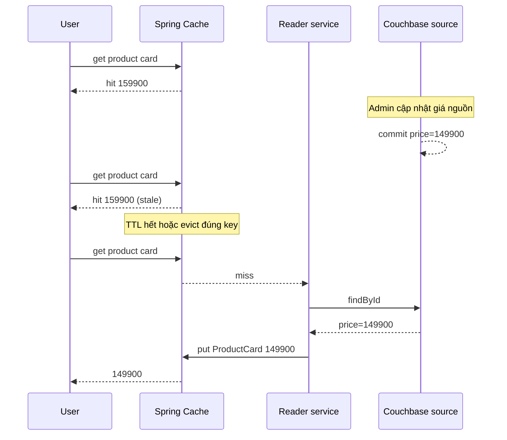
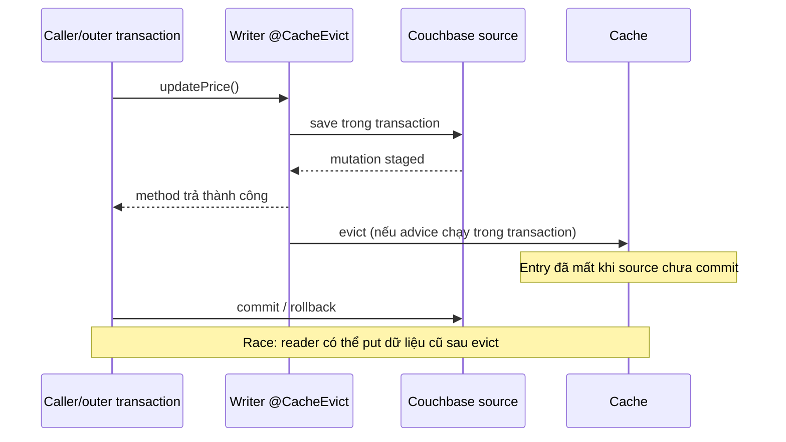
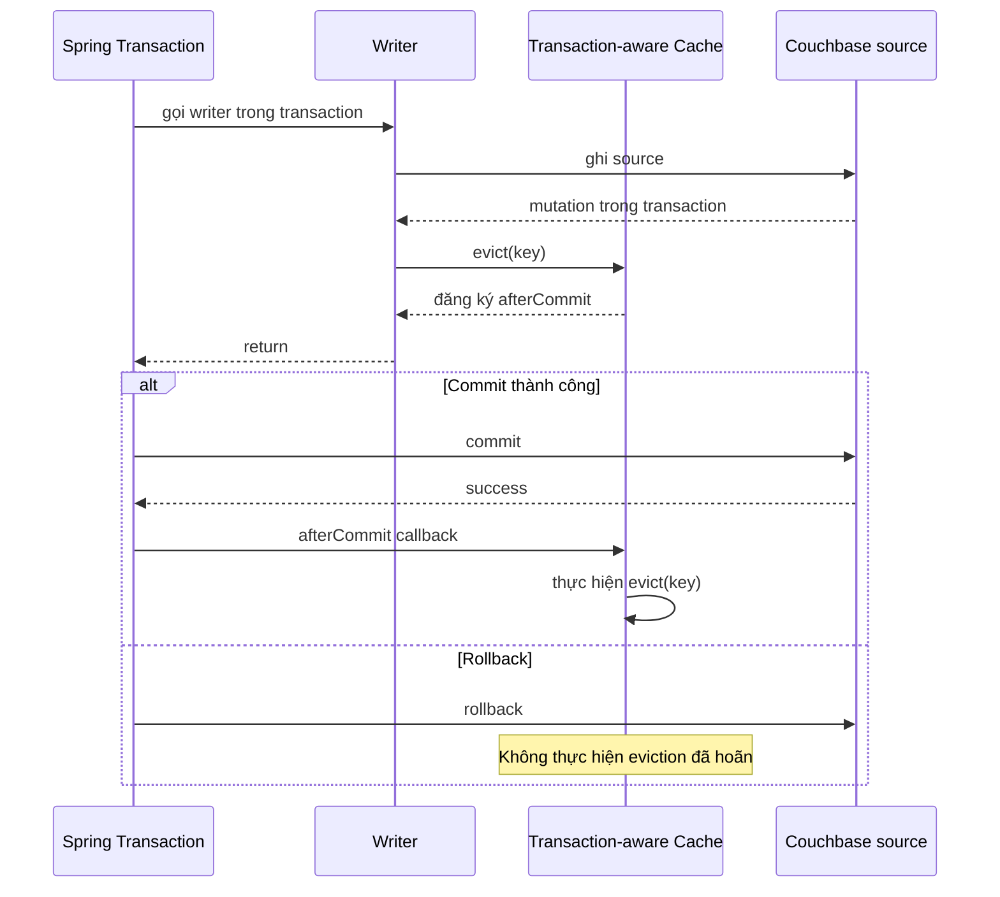
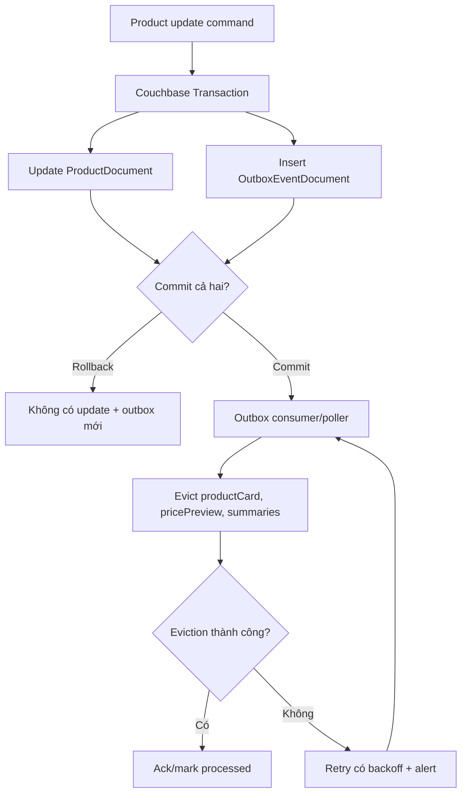
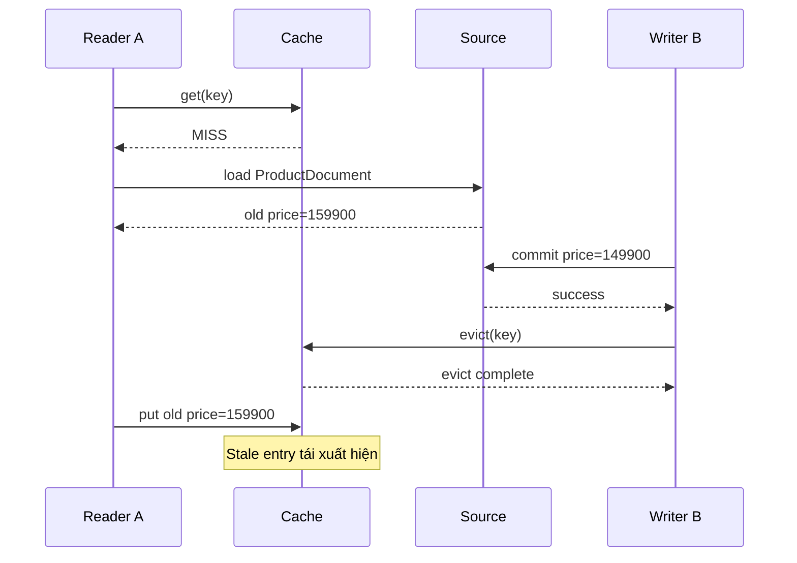

# Vô hiệu hóa cache sau cập nhật và ranh giới giao dịch

## Mục tiêu học tập

Sau bài học, bạn có thể:

1. Giải thích vì sao **ghi dữ liệu nguồn thành công** không đồng nghĩa **cache đã được làm mới**, và xác định những cache key nào phải invalidation sau từng loại mutation.
2. Phân biệt `@CacheEvict` mặc định **sau method**, `beforeInvocation=true` **trước method**, và eviction thực sự diễn ra **sau transaction commit** khi sử dụng transaction-aware cache phù hợp.
3. Kết hợp `@CacheEvict`, `@Caching`, `@CachePut`, `Cache.evict(key)` và `CouchbaseCacheManager.transactionAware()` đúng phạm vi; tránh xóa toàn cache khi chỉ một document thay đổi.
4. Thiết kế command service dùng repository/`CouchbaseTemplate` và `@Version`/CAS, đồng thời giữ **cache identity** nhất quán giữa reader, writer và consumer.
5. Hiểu ranh giới Spring AOP, self-invocation, advice ordering, transaction propagation, rollback và các trường hợp một exception xảy ra **sau khi document nguồn đã ghi**.
6. Phân tích failure matrix **source commit / cache eviction**, đọc cũ trong transaction, in-flight cache miss tái tạo stale entry, các writer ngoài ứng dụng và vấn đề nhiều instance.
7. Chọn giải pháp invalidation phù hợp: annotation đơn giản cho một KV mutation, transaction-aware caching, after-commit event hoặc **transactional outbox** cho hệ thống phân tán.
8. Viết kiểm thử commit/rollback, hit/miss, evict đúng key, evict failure, create/delete, transaction synchronization, race và giám sát vận hành.

**Bối cảnh:** Module `SPRING_DATA_COUCHBASE` hướng dẫn xây dựng tầng truy cập Couchbase bằng document mapping, repository, `CouchbaseTemplate` và SQL++, gồm thiết kế bucket/scope/collection, chỉ mục, TTL, CAS, giao dịch và lựa chọn API reactive. Trong chương **Bộ nhớ đệm**, Spring Cache có thể lưu kết quả đọc của các method trên Couchbase, nhưng **không tự biết mọi thay đổi của document nguồn**. Chủ đề này tập trung vào **thời điểm và phạm vi vô hiệu hóa bản sao**, nhất là khi thay đổi nguồn diễn ra trong giao dịch.

> **Nguyên tắc:** Chỉ cho một bản sao cũ tiếp tục được phục vụ khi **business SLA chấp nhận stale**. Nếu yêu cầu đọc đúng ngay sau một commit, `@CacheEvict` và TTL không mặc nhiên bảo đảm điều đó; phải phân tích concurrency, transaction boundary và cả các đường ghi nguồn ngoài ứng dụng.

## 1. Bài toán: thay giá nguồn nhưng trang web vẫn hiển thị giá cũ

Nguồn sản phẩm nằm tại:

```text
Bucket: appdata
Scope: catalog
Collection: products

Document ID: product::tenant-42::P1001
ProductDocument.priceCents = 159900
```

Read model `ProductCard` được cache:

```text
Cache name: catalog.product-card.v1
Logical key: tenant-42::P1001
Cache value: ProductCard("P1001", "Bàn phím", 159900)
TTL: 5 phút
```

Admin thay giá còn 149900 và ghi nguồn bằng `repository.save(product)`. Nếu không invalidation, lần đọc `@Cacheable` sau đó có thể hit bản cũ:



Không chỉ có một vùng cache: một mutation giá có thể ảnh hưởng `productCard`, `pricePreview`, `categoryPriceSummary`, một trang kết quả tìm kiếm và những báo cáo tổng hợp. **Chọn key cần evict là một bài toán dependency**, không chỉ thêm annotation vào mọi method ghi.

### 1.1. Nguồn sự thật và cache có trách nhiệm khác nhau

| Khía cạnh | Document nguồn trong Couchbase | Spring Cache entry trên Couchbase |
| --- | --- | --- |
| Ý nghĩa | Trạng thái nghiệp vụ được quản lý bằng repository/Template | Bản sao của kết quả đọc/tính toán |
| Định danh | Document ID, scope và collection | Cache name, logical key và prefix/keyspace |
| Ghi | `save`, `insertById`, `replaceById` hoặc SDK đúng contract | `Cache.put`, `@CachePut`, `@Cacheable` khi miss |
| Xóa | `repository.deleteById`, `removeById` | `Cache.evict`, `@CacheEvict`, TTL |
| Concurrency | CAS/`@Version`, Couchbase Transactions khi phù hợp | Không mặc nhiên atomic với mutation nguồn |
| Độ mới | Tùy read/write consistency của source | Phụ thuộc TTL, invalidation và các race |
| Khi mất | Dữ liệu nghiệp vụ có thể bị mất | Read model thường có thể tái tạo |

Cache entry có thể nằm ở `appdata.cache.entries`; source document ở `appdata.catalog.products`. Cùng cluster không khiến chúng tự tham gia một commit.

## 2. Hợp đồng của @CacheEvict và những lựa chọn có ảnh hưởng đến tính đúng

`@CacheEvict` đánh dấu một method là tác nhân loại bỏ cache entry khi lời gọi đi qua Spring caching interceptor.

| Thuộc tính | Giá trị thông dụng | Ý nghĩa |
| --- | --- | --- |
| `cacheNames` | `"catalog.product-card.v1"` | Vùng cache logic phải invalidation |
| `key` | `"#p0 + '::' + #p1"` | Logical key cần xóa |
| `keyGenerator` | `"productCacheKey"` | Sinh key qua bean dùng chung; loại trừ với `key` |
| `condition` | SpEL boolean | Chỉ evict khi condition true |
| `allEntries` | `false` | Khi true, xóa **toàn bộ cache name** |
| `beforeInvocation` | `false` | Mặc định evict **sau khi method thành công** |
| `cacheManager` / `cacheResolver` | Tên bean cụ thể | Chọn backend khi có nhiều vùng/provider |

**Không có thuộc tính `unless` trên `@CacheEvict`.** Eviction có `condition`, nhưng không dùng `unless` như `@Cacheable`/`@CachePut`.

### 2.1. Mặc định: eviction sau khi method trả bình thường

```java
@CacheEvict(
        cacheNames = "catalog.product-card.v1",
        key = "#p0 + '::' + #p1")
public void changePrice(String tenantId, String sku, long priceCents) {
    // Validate, đọc source, repository.save(...)
}
```

Điểm quan trọng:

- `@CacheEvict` **không ghi document nguồn**. Body method phải tự mutation qua repository/Template.
- Nếu method ném exception, eviction sau invocation mặc định thường **không chạy**.
- Nếu body trả bình thường nhưng transaction bên ngoài **chưa commit**, thời điểm eviction có thể chưa đúng.
- Nếu source đã ghi thành công nhưng phần code phía sau ném exception, eviction mặc định có thể **không chạy**, dù nguồn đã thay đổi.
- Nếu cache eviction lỗi sau khi method/source hoàn thành, **nguồn có thể đã cập nhật** nhưng cache cũ vẫn tồn tại.
- Lời gọi phải đi qua Spring bean proxy; self-invocation có thể bỏ qua caching advice.

### 2.2. beforeInvocation=true: xóa trước, kể cả method lỗi

```java
@CacheEvict(
        cacheNames = "catalog.product-card.v1",
        key = "#p0 + '::' + #p1",
        beforeInvocation = true)
public void resetBeforeRebuild(String tenantId, String sku) {
    // Một tác vụ đã quyết định cache phải bị reset
    // không phụ thuộc kết quả phần logic phía sau.
}
```

Với cấu hình không transaction-aware hoặc không có transaction đang hoạt động, eviction có thể diễn ra ngay **trước method**, kể cả method sau đó throw. Điều này phù hợp khi eviction là **mục đích chính của thao tác**, không cần chờ một mutation nguồn thành công.

**Không chọn beforeInvocation=true cho đường cập nhật giá mặc định:** Reader khác có thể miss sau eviction, tải giá cũ **trước source commit**, rồi put bản cũ trở lại; hoặc update rollback trong khi cache đã bị xóa. Khi dùng transaction-aware cache, một lệnh `evict` có thể được hoãn tới after-commit, do đó “beforeInvocation” của annotation **không đồng nghĩa KV eviction vật lý đã xảy ra trước method**. Phải phân biệt thời điểm advice **yêu cầu** eviction và thời điểm provider **thực thi**.

### 2.3. allEntries=true chỉ dành cho invalidation phạm vi rộng

```java
@CacheEvict(
        cacheNames = "catalog.category-summary.v1",
        allEntries = true)
public void invalidateAllCategorySummaries() {
    // Tác vụ quản trị có kiểm soát.
}
```

Với `allEntries=true`, không kết hợp `key` vì key riêng không có ý nghĩa. Cơ chế `Cache.clear()` có thể cần scan/query/index thích hợp trên Couchbase cache keyspace, gây tải cao, tăng miss đồng loạt và cache stampede. Không clear toàn cache mỗi lần một sản phẩm thay giá.

### 2.4. @CachePut khác @CacheEvict

| Tình huống | Nên cân nhắc | Lưu ý |
| --- | --- | --- |
| Ghi source rồi muốn lần đọc kế tiếp nạp DTO mới | `@CacheEvict` | Đơn giản; đổi thành cache miss |
| Có sẵn DTO mới đã được xác minh, muốn ghi bản mới vào cache | `@CachePut` | Method luôn chạy, phải trả **đúng kiểu/value** và key |
| Có nhiều read model phụ thuộc source | `@Caching(evict={…})` hoặc invalidation orchestrator | Đúng mọi key phụ thuộc |
| Tác vụ bảo trì toàn vùng cache | `allEntries=true` / `Cache.clear()` | Quy trình vận hành, giới hạn phạm vi |
| Writer nằm ngoài ứng dụng Spring | Event/outbox/invalidation consumer | Annotation local không tự chạy |

`@CachePut` không phải lệnh cập nhật source và có thể public hóa dữ liệu **trước commit** nếu dùng sai ranh giới; khi không chắc DTO mới đã đúng và được commit, ưu tiên evict để lượt đọc tiếp theo nạp nguồn.

## 3. Thiết kế cache key và dependency trước khi viết annotation

Một lỗi phổ biến là reader cache theo `tenant::sku` nhưng writer evict chỉ theo `sku`. Annotation hợp lệ nhưng entry không bị xóa.

Ví dụ quy ước:

```text
ProductCard key: tenantId + "::" + sku
PricePreview key: tenantId + "::" + sku
CategorySummary key: tenantId + "::" + categoryId
SearchResultPage key: tenantId + filter + sort + cursor + schemaVersion
```

Đây là các định danh **khác nhau**. Không thể chỉ evict product card rồi coi mọi category/SQL++ summary tự mới. Với filter/sort/page, một mutation có thể ảnh hưởng nhiều page khác nhau và cần chiến lược dependency hoặc versioned cache key.

### 3.1. Dùng KeyGenerator chia sẻ hợp đồng giữa reader và writer

Khi có nguy cơ collision từ dấu phân tách hoặc nhiều method khác chữ ký, thay vì copy SpEL, tạo utility duy nhất:

```java
package com.example.catalog.cache;

import java.nio.charset.StandardCharsets;
import java.util.Base64;

public final class ProductCacheKeys {

    private ProductCacheKeys() {}

    public static String product(String tenantId, String sku) {
        return "v1.t." + encode(tenantId) +
                ".s." + encode(sku);
    }

    private static String encode(String s) {
        if (s == null || s.isBlank()) {
            throw new IllegalArgumentException(
                    "tenantId/sku không được rỗng");
        }
        return Base64.getUrlEncoder().withoutPadding()
                .encodeToString(
                        s.getBytes(StandardCharsets.UTF_8));
    }
}
```

```java
package com.example.catalog.cache;

import org.springframework.cache.interceptor.KeyGenerator;
import org.springframework.context.annotation.Bean;
import org.springframework.context.annotation.Configuration;

@Configuration(proxyBeanMethods = false)
public class ProductKeyConfiguration {

    @Bean("productCacheKey")
    KeyGenerator productCacheKey() {
        return (target, method, args) -> {
            if (args.length < 2
                    || !(args[0] instanceof String tenant)
                    || !(args[1] instanceof String sku)) {
                throw new IllegalArgumentException(
                        "Cần tenantId và sku ở hai tham số đầu");
            }
            return ProductCacheKeys.product(tenant, sku);
        };
    }
}
```

Các method đọc và ghi đều phải có hai tham số đầu `(tenantId, sku)`. Tham số thứ ba như `newPriceCents` không ảnh hưởng danh tính cache của sản phẩm. Nếu một method thêm currency/locale làm khác result, **generator này chưa đủ**; tạo rule mới.

Base64 URL-safe giúp tách segment, **không mã hóa bí mật**. Tenant phải lấy từ security context đáng tin, và authorization phải chạy **trước cache hit** vì `@Cacheable` có thể bỏ qua method body.

### 3.2. Bảng dependency theo mutation

| Mutation nguồn | `product-card` | `price-preview` | `category-summary` | `search-results` |
| --- | --- | --- | --- | --- |
| Đổi giá | Thường evict | Evict | Nếu summary dùng giá thì evict | Nếu sort/filter hoặc view có giá thì ảnh hưởng |
| Đổi title | Evict | Có thể không cần | Nếu summary dùng title thì ảnh hưởng | Search text/sort có thể ảnh hưởng |
| Đổi category | Evict | Tùy | Evict **category cũ và mới** | Có thể ảnh hưởng nhiều page |
| Create | Có thể evict stale negative | Có thể evict | Evict category chứa sản phẩm | Invalidate những query liên quan |
| Delete | Evict | Evict | Evict category chứa sản phẩm | Invalidate query có thể chứa ID |
| Publish/unpublish | Evict public read model | Theo visibility | Đổi số lượng visible | Ảnh hưởng result list |

“Evict tất cả” không phải thiết kế dependency. Hãy liệt kê read model nào thực sự phụ thuộc từng field, xác minh key cần evict từ **nguồn sự thật** (ví dụ category cũ/new), rồi chọn TTL/fanout theo SLA.

### 3.3. @Caching cho hai cache có cùng danh tính key

```java
import org.springframework.cache.annotation.CacheEvict;
import org.springframework.cache.annotation.Caching;

@Caching(evict = {
    @CacheEvict(
        cacheNames = "catalog.product-card.v1",
        keyGenerator = "productCacheKey"),
    @CacheEvict(
        cacheNames = "pricing.preview-quote.v1",
        keyGenerator = "productCacheKey")
})
public void changePrice(
        String tenantId, String sku, long newPriceCents) {
    // Source update trước eviction mặc định.
}
```

Đây là snippet đại diện cho public method của Spring bean được quản lý. Hai cache name khác nhau có thể có TTL khác nhau; cache entries vẫn phải evict theo **cùng logical key** đã dùng lúc put. Không tin categoryId do client tùy ý gửi để invalidation category summary; đọc old/new category từ document nguồn.

## 4. Spring Data Couchbase: entity nguồn, repository và DTO cache

Trong ví dụ, source được lưu tại `appdata.catalog.products`:

```java
package com.example.catalog;

import org.springframework.data.annotation.Id;
import org.springframework.data.annotation.Version;
import org.springframework.data.couchbase.core.mapping.Collection;
import org.springframework.data.couchbase.core.mapping.Document;
import org.springframework.data.couchbase.core.mapping.Field;
import org.springframework.data.couchbase.core.mapping.Scope;

@Document
@Scope("catalog")
@Collection("products")
public class ProductDocument {

    @Id
    private String id;

    @Field
    private String tenantId;

    @Field
    private String sku;

    @Field
    private String title;

    @Field
    private String categoryId;

    @Field
    private long priceCents;

    @Field
    private boolean published;

    @Version
    private Long version;

    public ProductDocument() {}

    public String getId() { return id; }
    public void setId(String v) { id = v; }

    public String getTenantId() { return tenantId; }
    public void setTenantId(String v) { tenantId = v; }

    public String getSku() { return sku; }
    public void setSku(String v) { sku = v; }

    public String getTitle() { return title; }
    public void setTitle(String v) { title = v; }

    public String getCategoryId() { return categoryId; }
    public void setCategoryId(String v) { categoryId = v; }

    public long getPriceCents() { return priceCents; }
    public void setPriceCents(long v) { priceCents = v; }

    public boolean isPublished() { return published; }
    public void setPublished(boolean v) { published = v; }

    public Long getVersion() { return version; }
}
```

Repository nguồn:

```java
package com.example.catalog;

import org.springframework.data.couchbase.repository.CouchbaseRepository;

public interface ProductRepository
        extends CouchbaseRepository<ProductDocument, String> {
}
```

DTO chỉ chứa những trường UI cần, không phải entity chứa CAS:

```java
package com.example.catalog;

public record ProductCard(
        String sku,
        String title,
        long priceCents) {
}
```

Document ID:

```text
product::<tenantId>::<sku>
```

Lưu ý dấu phân tách trong source ID cũng cần format canonical/escaping nếu tenant/SKU có thể chứa `::`. Không để Couchbase cache overwrite source collection bằng cùng physical ID.

### 4.1. Helper tạo ID nguồn

```java
package com.example.catalog;

public final class ProductIds {

    private ProductIds() {}

    public static String sourceId(String tenantId, String sku) {
        if (tenantId == null || tenantId.isBlank()
                || sku == null || sku.isBlank()) {
            throw new IllegalArgumentException(
                    "tenantId và sku không được rỗng");
        }
        // Chỉ dùng khi domain đã validate format để không va chạm.
        return "product::" + tenantId + "::" + sku;
    }
}
```

Trong production nên dùng canonical ID format có validation/encoding an toàn tương đương với key cache; tránh rò tenant ID trong logs hoặc metric labels.

## 5. Reader có @Cacheable: nguồn đúng nhưng cached result có thể cũ

```java
package com.example.catalog;

import java.util.NoSuchElementException;

import org.springframework.cache.annotation.Cacheable;
import org.springframework.stereotype.Service;

@Service
public class ProductCardReader {

    private final ProductRepository repository;

    public ProductCardReader(ProductRepository repository) {
        this.repository = repository;
    }

    @Cacheable(
        cacheNames = "catalog.product-card.v1",
        keyGenerator = "productCacheKey",
        unless = "#result == null")
    public ProductCard card(String tenantId, String sku) {

        ProductDocument doc = repository
                .findById(ProductIds.sourceId(tenantId, sku))
                .orElseThrow(NoSuchElementException::new);

        if (!tenantId.equals(doc.getTenantId())) {
            throw new SecurityException("Sai tenant");
        }

        if (!doc.isPublished()) {
            throw new NoSuchElementException(
                    "Sản phẩm chưa công bố");
        }

        return new ProductCard(
                doc.getSku(),
                doc.getTitle(),
                doc.getPriceCents());
    }
}
```

Mỗi lần cache miss, method đọc source, map thành DTO và có thể lưu entry. Khi cache hit, **body không chạy**, nên:

- Không có kiểm tra `published` mới nhất.
- Không có repository query mới và không có SQL++ scan consistency.
- Không có CAS check mới.
- Không có kiểm tra quyền nằm **chỉ trong body**.

Phải xác thực tenant/permission tại ranh giới khác **trước cache lookup** (security filter/authorized facade). Cập nhật `published=false` phải evict cache dương, không để một card public được trả cho caller không còn quyền xem.

## 6. Writer đơn document: @CacheEvict sau save thành công

Với một document KV, Spring Data repository lưu qua CAS khi entity có `@Version`; đây là optimistic locking của **nguồn**, không phải khóa cache.

```java
package com.example.catalog;

import java.util.NoSuchElementException;

import org.springframework.cache.annotation.CacheEvict;
import org.springframework.stereotype.Service;

@Service
public class ProductPriceWriter {

    private final ProductRepository repository;

    public ProductPriceWriter(ProductRepository repository) {
        this.repository = repository;
    }

    @CacheEvict(
        cacheNames = "catalog.product-card.v1",
        keyGenerator = "productCacheKey")
    public void changePrice(
            String tenantId, String sku, long newPriceCents) {

        if (newPriceCents < 0) {
            throw new IllegalArgumentException(
                    "priceCents không được âm");
        }

        ProductDocument doc = repository
                .findById(ProductIds.sourceId(tenantId, sku))
                .orElseThrow(NoSuchElementException::new);

        if (!tenantId.equals(doc.getTenantId())) {
            throw new SecurityException("Sai tenant");
        }

        doc.setPriceCents(newPriceCents);
        repository.save(doc);
    }
}
```

Giả sử method được gọi **qua Spring proxy**, không có transaction bao quanh ngoài ý muốn:

1. Method nhận tenant/SKU/price; ứng dụng **phải** kiểm tra quyền ghi ở facade/command boundary.
2. Repository đọc source theo ID, entity có `@Version` lưu CAS.
3. `save` thành công → body return bình thường.
4. Spring Cache advice yêu cầu `evict` đúng `catalog.product-card.v1[productCacheKey(tenant,sku)]`.
5. Lần `@Cacheable` sau có thể miss và tải giá mới.

**Giới hạn:** Ngay cả ở single-document case, đây không phải thao tác nguyên tử giữa source và cache. Một eviction timeout sau `save` có thể để cache stale. Một read miss khác có thể đang tải bản cũ và put lại sau eviction.

### 6.1. CAS conflict có liên quan gì đến eviction?

Giả sử hai admin cùng đọc document version cũ:

```text
A: read version=CAS-1; đổi giá 149900
B: read version=CAS-1; đổi giá 139900
A: save thành công -> CAS-2
B: save thất bại do CAS mismatch
```

Nếu method B ném `OptimisticLockingFailureException` thì `@CacheEvict` sau invocation mặc định không yêu cầu eviction cho B. A mới là writer có mutation thành công và phải invalidation.

**Không retry mù:** Nếu lỗi CAS, cần đọc lại, kiểm tra business rule/authorization và retry giới hạn hoặc trả conflict. Nếu ứng dụng nuốt exception CAS rồi return như thành công, cache advice sẽ tin method đã thành công và có thể evict dù nguồn không thay đổi.

### 6.2. Source ghi thành công nhưng method sau đó throw

```java
@CacheEvict(cacheNames = "catalog.product-card.v1",
            keyGenerator = "productCacheKey")
public void problematicUpdate(String tenantId, String sku,
                              long newPriceCents) {
    // repository.save(doc);  // đã ghi thành công
    // sendNotification();    // ném lỗi
    // @CacheEvict sau method KHÔNG chạy vì method throw.
}
```

Đây là một lỗi thiết kế phổ biến ở **mutation không có transaction thực sự**: nguồn có thể đã được ghi, nhưng cache không bị evict do lỗi ở bước khác. Cách khắc phục:

- Không trộn nhiệm vụ phụ dễ lỗi vào sau mutation nguồn trong cùng non-transactional method.
- Đưa audit/outbox vào transaction đúng context nếu phải atomic với mutation.
- Dùng event/outbox cho việc thông báo bên ngoài.
- Đặt trách nhiệm invalidation tại commit/transaction boundary phù hợp; có retry/alert khi cache invalidation thất bại.

## 7. Ba thời điểm khác nhau: method return, commit và cache eviction vật lý

Đừng đánh đồng:

- **Method return:** Method Java kết thúc bình thường; annotation caching có thể thực hiện after-invocation advice.
- **Transaction commit:** Spring transaction manager/Couchbase Transactions đã xác nhận commit thành công theo contract.
- **Physical eviction:** Cache provider thực sự gửi/hoàn thành thao tác xóa entry ở Couchbase cache collection.

Một method có thể return **trước khi transaction bao ngoài commit**. Một cache eviction có thể được **lên lịch** sau commit rồi thất bại khi chạy thực tế. Ba sự kiện cần trace/metric riêng nếu nghiệp vụ quan trọng.

### 7.1. Minh họa không có transaction-aware cache



Đây là một **timeline có thể xảy ra**, không phải thứ tự advice cố định của mọi dự án. Thứ tự `@Transactional` và `@CacheEvict` trên cùng method phụ thuộc proxy/advice ordering và cách transaction boundary được tổ chức. Vì vậy, phải xác minh transaction có đang active khi cache advice gọi `evict` hay không.

### 7.2. Minh họa cache transaction-aware



Cũng cần phân biệt **yêu cầu evict đã được hoãn** với **thao tác evict chắc chắn thành công**. Spring transaction-aware decorator không biến cache thành một participant trong Couchbase transaction đã ghi nguồn.

## 8. Cấu hình CouchbaseCacheManager.transactionAware()

Có thể tạo một `CouchbaseCacheManager` dùng scope/collection riêng cho cache và bật transaction-awareness:

```groovy
dependencies {
    implementation 'org.springframework.boot:spring-boot-starter-data-couchbase'
    implementation 'org.springframework.boot:spring-boot-starter-cache'
}
```

```yaml
spring:
  couchbase:
    connection-string: couchbase://localhost
    username: app_user
    password: ${COUCHBASE_PASSWORD}
  data:
    couchbase:
      bucket-name: appdata
```

```java
package com.example.catalog.cache;

import java.time.Duration;

import org.springframework.cache.annotation.EnableCaching;
import org.springframework.context.annotation.Bean;
import org.springframework.context.annotation.Configuration;
import org.springframework.data.couchbase.cache.CouchbaseCacheConfiguration;
import org.springframework.data.couchbase.cache.CouchbaseCacheManager;
import org.springframework.data.couchbase.core.CouchbaseOperations;

@Configuration(proxyBeanMethods = false)
@EnableCaching
public class CatalogCacheConfiguration {

    @Bean
    CouchbaseCacheManager cacheManager(CouchbaseOperations ops) {

        var factory = ops.getCouchbaseClientFactory()
                .withScope("cache");

        var defaults = CouchbaseCacheConfiguration
                .defaultCacheConfig()
                .collection("entries")
                .prefixCacheNameWith("app:catalog:")
                .entryExpiry(Duration.ofMinutes(5))
                .disableCachingNullValues();

        return CouchbaseCacheManager.builder(factory)
                .withCacheConfiguration(
                        "catalog.product-card.v1", defaults)
                .withCacheConfiguration(
                        "pricing.preview-quote.v1",
                        defaults.entryExpiry(Duration.ofSeconds(30)))
                .disableCreateOnMissingCache()
                .transactionAware()
                .build();
    }
}
```

**Ý nghĩa:** `transactionAware()` yêu cầu những cache put/evict operation thích hợp đồng bộ với Spring-managed transaction **đang hoạt động**. Trong transaction bình thường, `put`, `evict` và `clear` có thể được thực thi ở phase **afterCommit**. Nếu không có transaction hoạt động, chúng chạy ngay như thường lệ.

Các điều kiện:

1. `@EnableCaching` chỉ bật annotation interception, **không tự bật transaction management**.
2. Couchbase transaction manager phù hợp phải được cấu hình và transaction thật sự active.
3. Các source operations phải **tham gia đúng transaction context**; không giả định raw SDK call ngoài context được quản lý chỉ vì có `@Transactional`.
4. Đây là **một bean CacheManager tự khai báo**. Nếu Spring Boot đang auto-configure cache, không thêm hai bean manager cạnh tranh mà chưa chọn đúng bean.
5. Scope/collection `cache.entries` cần tồn tại và account có RBAC phù hợp.
6. `transactionAware()` không đồng nghĩa `@CacheEvict` luôn diễn ra sau commit nếu method được gọi **ngoài** transaction; khi không có transaction, evict vẫn chạy ngay.

### 8.1. Chính xác thao tác nào được hoãn?

Theo `TransactionAwareCacheDecorator` của Spring Framework:

| Cache operation | Trong Spring-managed transaction | Ngoài transaction |
| --- | --- | --- |
| `Cache.put(key,value)` | Có thể hoãn đến afterCommit | Thực hiện ngay |
| `Cache.evict(key)` | Có thể hoãn đến afterCommit | Thực hiện ngay |
| `Cache.clear()` | Có thể hoãn đến afterCommit | Thực hiện ngay |
| `Cache.get(key)` | Vẫn đọc cache theo trạng thái provider | Vẫn đọc cache |
| `Cache.putIfAbsent(key,value)` | Thao tác cần tính tức thời, không hoãn giống `put` | Thực hiện theo provider |
| `Cache.evictIfPresent(key)` | Có thể thực hiện tức thời, không hoãn giống `evict` | Thực hiện theo provider |
| `Cache.invalidate()` | Thao tác dọn cache tức thời theo contract | Thực hiện theo provider |

**Hệ quả quan trọng:** Trong transaction vừa yêu cầu `cache.evict(key)` nhưng chưa commit, một lời gọi `cache.get(key)` cùng transaction vẫn có thể thấy **value cũ**. Transaction-aware cache không cung cấp một transactional view riêng cho reader trong cùng transaction.

Không mặc định `putIfAbsent`, `evictIfPresent` và `invalidate` có cùng semantics hoãn như `put`/`evict`/`clear`. Đọc API/Javadoc của đúng Spring Framework và cache provider khi sử dụng các thao tác tức thời, nhất là trong code ở phase afterCommit.

### 8.2. Không có transaction thì afterCommit không tồn tại

Nếu service gọi `@CacheEvict` mà không có `@Transactional` và không nằm trong transaction của caller, `transactionAware()` **không làm phát sinh transaction tự động**. Lệnh evict thực thi ngay tại invocation caching advice; đây có thể là lựa chọn phù hợp cho mutation KV một document không cần transaction nhiều tài liệu.

### 8.3. transactionAware không khắc phục lỗi eviction sau commit

Bốn khả năng:

| Source transaction | Eviction afterCommit | Kết quả |
| --- | --- | --- |
| Commit thành công | Evict thành công | Cache miss mới có thể tải source mới |
| Commit thành công | Evict thất bại | Source mới, cache cũ có thể stale |
| Rollback | Evict đã được hoãn | Không thực hiện eviction được đăng ký đúng cách |
| Transaction không thực sự active | Evict không được hoãn | Có thể evict trước outer commit mong muốn |

**Không có atomicity nguồn + cache.** Nếu yêu cầu có thể phục hồi sau crash giữa commit và eviction, cần durable invalidation mechanism như transactional outbox.

## 9. @Transactional: mutation nguồn nhiều document và rollback

Một thay đổi có thể phải cập nhật sản phẩm và tạo một audit document trong **cùng Couchbase transaction**. Lúc này “method không throw” chưa đủ để nói source đã commit nếu nó được gọi trong transaction bên ngoài.

### 9.1. Cấu hình Spring-managed Couchbase transaction

Spring Data Couchbase hỗ trợ `@Transactional`, `CouchbaseTransactionManager` và operator tương ứng đối với những Template/repository operations được tích hợp. Cần xác minh dependency và server version, transaction manager bean, Spring transaction management và cách mỗi operation tham gia transaction.

Những điều kiện đáng nhớ:

- Các entity dùng trong Couchbase Transactions theo tài liệu Spring Data Couchbase cần có `@Version Long` để lưu CAS.
- Repository/Template phải tham gia đúng transaction context; **raw SDK mutation không tự tham gia** chỉ vì method có `@Transactional`.
- Couchbase Transactions dùng cơ chế riêng; không đồng nghĩa một JPA/Hibernate transaction hoặc một JDBC transaction.
- Spring Data Couchbase có những giới hạn về rollback attribute/isolation so với Spring Transactions tổng quát (ví dụ tài liệu version nhất định nêu `rollbackFor`/`noRollbackFor` không được áp dụng như kỳ vọng). Hãy kiểm tra đúng phiên bản và kiểm thử commit/rollback.
- Không tự kết luận mọi thao tác truy vấn SQL++/SDK/remote HTTP call được bao phủ bởi cùng Couchbase transaction.

### 9.2. Audit document ví dụ

```java
package com.example.catalog;

import org.springframework.data.annotation.Id;
import org.springframework.data.annotation.Version;
import org.springframework.data.couchbase.core.mapping.Collection;
import org.springframework.data.couchbase.core.mapping.Document;
import org.springframework.data.couchbase.core.mapping.Field;
import org.springframework.data.couchbase.core.mapping.Scope;

@Document
@Scope("catalog")
@Collection("price_audits")
public class PriceAuditDocument {

    @Id
    private String id;

    @Field
    private String tenantId;

    @Field
    private String sku;

    @Field
    private long previousPriceCents;

    @Field
    private long newPriceCents;

    @Version
    private Long version;

    public PriceAuditDocument() {}

    public PriceAuditDocument(
            String id, String tenantId, String sku,
            long previousPriceCents, long newPriceCents) {
        this.id = id;
        this.tenantId = tenantId;
        this.sku = sku;
        this.previousPriceCents = previousPriceCents;
        this.newPriceCents = newPriceCents;
    }

    public String getId() { return id; }
    public void setId(String v) { id = v; }

    public String getTenantId() { return tenantId; }
    public void setTenantId(String v) { tenantId = v; }

    public String getSku() { return sku; }
    public void setSku(String v) { sku = v; }

    public long getPreviousPriceCents() {
        return previousPriceCents;
    }
    public void setPreviousPriceCents(long v) {
        previousPriceCents = v;
    }

    public long getNewPriceCents() { return newPriceCents; }
    public void setNewPriceCents(long v) { newPriceCents = v; }

    public Long getVersion() { return version; }
}
```

Collection `appdata.catalog.price_audits` phải được tạo riêng trước khi test. Hãy cấp quyền phù hợp và định nghĩa retention/audit policy; đừng xem cache entry TTL như audit record.

### 9.3. Service transaction + cache eviction

```java
package com.example.catalog;

import java.util.NoSuchElementException;
import java.util.UUID;

import org.springframework.cache.annotation.CacheEvict;
import org.springframework.data.couchbase.core.CouchbaseOperations;
import org.springframework.stereotype.Service;
import org.springframework.transaction.annotation.Transactional;

@Service
public class TransactionalPriceWriter {

    private final ProductRepository products;
    private final CouchbaseOperations operations;

    public TransactionalPriceWriter(
            ProductRepository products,
            CouchbaseOperations operations) {
        this.products = products;
        this.operations = operations;
    }

    @Transactional
    @CacheEvict(
        cacheNames = "catalog.product-card.v1",
        keyGenerator = "productCacheKey")
    public void updateWithAudit(
            String tenantId, String sku, long newPriceCents) {

        if (newPriceCents < 0) {
            throw new IllegalArgumentException("Giá không hợp lệ");
        }

        ProductDocument doc = products
                .findById(ProductIds.sourceId(tenantId, sku))
                .orElseThrow(NoSuchElementException::new);

        if (!tenantId.equals(doc.getTenantId())) {
            throw new SecurityException("Sai tenant");
        }

        long oldPrice = doc.getPriceCents();
        doc.setPriceCents(newPriceCents);
        products.save(doc);

        PriceAuditDocument audit = new PriceAuditDocument(
                "price-audit::" + UUID.randomUUID(),
                tenantId, sku, oldPrice, newPriceCents);

        operations.insertById(PriceAuditDocument.class)
                .one(audit);
    }
}
```

Trong hệ thống thật, phải kiểm tra quyền ghi từ security context, validate currency/rule về giá, định nghĩa idempotency của API và đảm bảo cả `products.save` lẫn `operations.insertById` **thực sự tham gia cùng Couchbase transaction**. Không trộn lệnh SDK raw ngoài transaction với thao tác Template rồi tin rollback sẽ undo cả hai.

**Ranh giới advice:** Nếu cache advice chạy **trong** transaction, cache manager `transactionAware()` giúp hoãn eviction đến afterCommit. Nếu cache advice chạy **ngoài** transaction advice, nó có thể evict ngay sau khi transaction advice hoàn thành (tức sau commit). Đây là hai cách đạt thời điểm hợp lý nhưng không thể suy ra thứ tự mà không kiểm thử. Nếu method được gọi từ **transaction cha** vẫn mở, việc evict khi method con return mà chưa commit cha là nguy hiểm khi cache không transaction-aware.

### 9.4. Rollback

Giả sử insert audit thất bại sau khi products.save đã tham gia Couchbase transaction:

- Transaction manager phải đánh dấu rollback phù hợp.
- Source price không được coi đã commit chỉ vì `products.save` không throw ngay.
- Eviction đã đăng ký qua transaction-aware cache phải **không chạy** khi rollback.
- Nếu cache đã bị evict quá sớm (manager không transaction-aware hoặc advice không ở đúng transaction), cache có thể miss và tải lại dữ liệu cũ.
- Ngược lại, nếu mutation nguồn đã **bị thực thi ngoài transaction**, rollback không thể giả định đảo ngược nó; khi đó cache có thể stale do code sai ranh giới.

Không viết unit test chỉ mock repository rồi kết luận transaction thật hoạt động. Cần integration test trên Couchbase test cluster với các operations đã hỗ trợ.

## 10. Vì sao kết hợp @Transactional và @CacheEvict trên cùng method vẫn cần kiểm thử?

Spring giao dịch và Spring Cache thông thường đều dùng advice/proxy. Ngoài vấn đề thứ tự, còn nhiều yếu tố:

### 10.1. Self-invocation và object không được Spring quản lý

```java
@Service
public class BrokenUpdateFacade {

    public void outer(String tenant, String sku, long price) {
        // this.changePrice(...) bỏ qua proxy advice ở changePrice.
        changePrice(tenant, sku, price);
    }

    @Transactional
    @CacheEvict(
        cacheNames = "catalog.product-card.v1",
        key = "#p0 + '::' + #p1")
    public void changePrice(String tenant, String sku, long price) {
        // Mutation nguồn.
    }
}
```

Trong proxy mode thông thường, gọi annotated method qua `this` có thể **bỏ qua cả transaction lẫn caching**. Đưa command vào Spring bean riêng và inject bean đó vào facade; xác minh caller có đi qua bean proxy thật.

### 10.2. Method return trước transaction cha commit

```text
OuterService @Transactional begin
  ├── gọi InnerWriter.changePrice(...) có @CacheEvict
  ├── InnerWriter return OK
  ├── code outer còn xử lý
  └── outer commit HOẶC rollback
```

Nếu chỉ tin “inner return OK” thì eviction có thể xảy ra trước quyết định của outer. Cache manager transaction-aware chỉ hoãn khi cache operation được thực hiện **trong một Spring-managed transaction/synchronization còn active**.

### 10.3. REQUIRES_NEW và transaction lồng nhau

Khi method con dùng `Propagation.REQUIRES_NEW`, transaction con có thể commit độc lập với transaction cha. Nếu outer rollback sau inner commit, mutation con **không tự bị rollback**. Cache invalidation phải khớp transaction **thực sự sở hữu mutation**.

Không tuyên bố “chỉ evict sau transaction lớn nhất” hoặc “chỉ evict sau inner return” cho mọi topology. Bài test phải bao phủ propagation được dùng. Trong một số version Spring Data Couchbase, các dạng transaction propagation/isolation không được hỗ trợ đầy đủ; đọc tài liệu đúng version.

### 10.4. Khi nào @CacheEvict trước invocation được phép?

`beforeInvocation=true` có thể hữu ích cho hành động “invalidate cache bất kể tác vụ kế tiếp có thành công không”. Nó không phải công cụ để “bảo đảm xóa trước commit”. Nếu transaction-aware decorator hoãn `evict`, eviction vật lý vẫn có thể tới afterCommit.

### 10.5. @CacheEvict(condition=…) phải dựa vào dữ liệu đủ tin cậy

Ví dụ:

```java
@CacheEvict(
    cacheNames = "catalog.product-card.v1",
    keyGenerator = "productCacheKey",
    condition = "#p2 > 0")
public void changePrice(String tenantId, String sku,
                        long newPriceCents) {
    // ...
}
```

Điều kiện này **không phải policy tốt** nếu giá 0 là hợp lệ: ghi price=0 sẽ không evict và entry cũ vẫn tồn tại. Chỉ dùng condition khi có cơ sở chắc chắn rằng mutation không ảnh hưởng cache. Nếu dependency phụ thuộc **source field cũ** thay vì một tham số đầu vào, hãy kiểm tra source và quyết định invalidation theo kết quả nghiệp vụ, không đoán bằng `#p2`.

## 11. Thao tác immediate và listener sau commit: tránh hoãn hai lần

Spring Framework transaction-aware cache decorator đồng bộ `put/evict/clear` với afterCommit. Nhưng đôi khi ứng dụng đã chủ động điều phối sự kiện sau commit bằng `@TransactionalEventListener(phase=AFTER_COMMIT)`.

**Không vô thức phối hợp cả hai như hai lớp hoãn độc lập.** Trong after-commit callback, transaction resource/synchronization có thể chưa được dọn hoàn toàn; nếu bạn gọi lại một phương thức `evict` trên decorator transaction-aware rồi nó đăng ký một afterCommit callback mới, hành vi có thể không như dự kiến. Phải test lifecycle hoặc dùng đường evict tức thời/adapter chạy ngoài transaction context.

### 11.1. Sự kiện sau commit trong cùng process

Ví dụ event chỉ chứa thông tin để invalidation:

```java
package com.example.catalog.cache;

public record ProductChanged(
        String tenantId,
        String sku) {
}
```

Một component khác có thể phát sự kiện khi source mutation đang ở transaction:

```java
import org.springframework.context.ApplicationEventPublisher;

// Inject publisher vào command service.
publisher.publishEvent(new ProductChanged(tenantId, sku));
```

Listener:

```java
package com.example.catalog.cache;

import org.springframework.cache.Cache;
import org.springframework.cache.CacheManager;
import org.springframework.stereotype.Component;
import org.springframework.transaction.event.TransactionPhase;
import org.springframework.transaction.event.TransactionalEventListener;

@Component
public class ProductCacheInvalidationListener {

    private final CacheManager cacheManager;

    public ProductCacheInvalidationListener(
            CacheManager cacheManager) {
        this.cacheManager = cacheManager;
    }

    @TransactionalEventListener(
        phase = TransactionPhase.AFTER_COMMIT)
    public void onCommitted(ProductChanged event) {

        Cache cache = cacheManager.getCache(
                "catalog.product-card.v1");
        if (cache == null) {
            throw new IllegalStateException(
                    "Cache chưa được cấu hình");
        }

        String key = ProductCacheKeys.product(
                event.tenantId(), event.sku());

        // Immediate operation theo Spring Cache contract,
        // cần test đúng provider và callback context.
        cache.evictIfPresent(key);
    }
}
```

**Đây là lựa chọn khác với việc dùng `@CacheEvict` trên cùng mutation.** Không vừa đặt annotation evict vừa publish listener evict cho cùng key mà không có lý do (dù eviction thường idempotent, tăng chi phí và có thể nhiễu metric).

Giới hạn:

- `@TransactionalEventListener` với `fallbackExecution=false` mặc định chỉ chạy khi có transaction phù hợp. Nếu publish ngoài transaction, listener có thể **không chạy**.
- Nó là callback trong process; JVM crash sau commit nhưng trước listener có thể khiến event mất.
- Exception của listener sau commit **không làm nguồn trở về trạng thái trước commit**.
- `cache.evictIfPresent` là lệnh immediate theo Spring Cache contract, không phải lệnh evict bị hoãn như `evict`; cần xác minh implementation của Couchbase provider và metrics khi thao tác lỗi.
- Với after-commit callback, **không** giả định có thể mở rộng mutation vào transaction đã commit bằng lệnh repository mới; khi cần mutation mới phải tạo transaction mới có kiểm soát.
- Event listener này không gửi thông báo tới các instance khác bằng bản thân Spring `ApplicationEventPublisher`; nếu cùng dùng shared Couchbase cache, một eviction thành công được các instance nhìn thấy qua backend, nhưng cách phát/lưu event vẫn là local.

### 11.2. Khi nào không cần listener?

Với một service Spring-managed, `@CacheEvict` và cache manager transaction-aware đã được kiểm thử có thể là lựa chọn đơn giản hơn. Chỉ dùng listener khi cần tách concern sau commit rõ ràng hoặc muốn gửi thông báo tới những subsystem khác.

Khi event bắt buộc không được thất lạc, chuyển sang **durable outbox**, không xem `@TransactionalEventListener` như message broker có persistence.

## 12. Transactional outbox: phục hồi khi commit xong nhưng eviction thất bại

Một vấn đề không thể giải quyết chỉ bằng `transactionAware()`:

```text
1. Source transaction commit thành công.
2. Process crash, hoặc cache backend timeout.
3. Cache chưa evict; entry stale còn đến TTL.
4. Không có lịch sử bền vững về nhu cầu invalidation.
```

**Transactional outbox** lưu một record “cần invalidation” **cùng transaction với source mutation**. Một worker/consumer sau commit xử lý record theo at-least-once delivery.

### 12.1. Luồng chuẩn



**Điều kiện bắt buộc:** Source update và outbox insert phải tham gia **cùng một Couchbase transaction được hỗ trợ**. Nếu bạn cập nhật source bằng raw SDK ngoài transaction còn outbox insert bằng Template trong transaction, outbox không bảo vệ tính nhất quán như mong đợi.

### 12.2. Một schema outbox minh họa

```json
{
  "eventId": "evt-4cc1a1",
  "eventType": "PRODUCT_PRICE_CHANGED",
  "aggregateId": "product::tenant-42::P1001",
  "tenantId": "tenant-42",
  "sku": "P1001",
  "oldCategoryId": "keyboards",
  "newCategoryId": "keyboards",
  "occurredAt": "2026-11-25T10:00:00Z",
  "status": "PENDING",
  "attempts": 0
}
```

Đây là schema mô phỏng. `eventId` phải đủ duy nhất; event cần status/lease/attempt metadata theo thiết kế worker. Nếu cần chính sách thứ tự, bổ sung version/sequence có nghĩa nghiệp vụ. **CAS của Couchbase không phải một đồng hồ có thể sắp xếp tăng dần**; không dùng so sánh số CAS để suy ra thứ tự tuyệt đối giữa các event.

### 12.3. Consumer nên idempotent

Eviction của cùng một key có thể lặp lại nhiều lần mà không gây lỗi nghiệp vụ nghiêm trọng: evict một key đã mất thường không hại. Thiết kế consumer:

1. Nhận event từ outbox/broker với ID duy nhất.
2. Xác định chính xác cache name và logical key của những read model bị ảnh hưởng.
3. Evict; ghi metric kết quả/latency.
4. Chỉ ack/mark event processed sau khi policy xử lý thành công.
5. Khi timeout/unknown outcome, retry an toàn với backoff và giới hạn concurrency.
6. Nếu nhiều lần lỗi, đưa vào backlog/dead-letter có alert và công cụ replay.
7. Chống trùng event, quản lý ordering khi cần, không xóa một cache vùng rộng thay vì key cụ thể.

Việc **ack** một event không được dựa vào suy đoán cache evict đã thành công chỉ vì SDK request được gửi; cần theo contract trả về của provider và SLO.

### 12.4. Outbox không hoàn toàn loại bỏ stale cache

Ngay cả với durable event, vẫn có latency từ commit đến consumer evict. Một reader đang miss có thể put bản cũ sau consumer evict. Nếu phải đạt tính đúng mạnh, cần thêm **version fencing**, đọc source ở quyết định quan trọng, hoặc không cache đường đọc này.

Outbox tăng độ tin cậy **về khả năng thực hiện invalidation cuối cùng**, không phải phép màu bảo đảm linearizability.

## 13. Cạnh tranh đọc/ghi: stale repopulation sau eviction

Một race cơ bản:



**Điểm mấu chốt:** Evict đúng key, sau commit, không có nghĩa mọi request tiếp theo chắc chắn thấy giá mới nếu có request miss cũ đang chạy.

### 13.1. Các lớp giảm thiểu

| Biện pháp | Giúp gì? | Không bảo đảm |
| --- | --- | --- |
| TTL ngắn | Giới hạn tuổi entry stale | Không loại bỏ race |
| Evict afterCommit | Giảm reader nạp source cũ trước commit | Không chặn in-flight read từ trước |
| Outbox + retry | Phục hồi khi evict lỗi/crash | Evict event vẫn có độ trễ |
| Versioned cache key | Tách snapshot/source revision khi có version đủ tin cậy | Phải lấy đúng version và invalidation strategy |
| CAS/`@Version` | Bảo vệ writer nguồn | Không khóa cache reader |
| `@Cacheable(sync=true)` | Hạn chế stampede theo khả năng provider | Không phải distributed lock mặc định xuyên các pod |
| Read-your-writes bypass | Caller vừa mutation có thể đọc nguồn | Không áp dụng tự động cho mọi caller |
| Bỏ cache tại quyết định quan trọng | Tránh phụ thuộc stale view | Có thêm chi phí đọc nguồn |

**Không hứa:** “Có `transactionAware()` thì không thể stale cache.” Nó chỉ điều phối một phần thời điểm thao tác cache so với commit, không đồng bộ các request cache miss độc lập.

### 13.2. @CachePut cũng có race thứ tự ghi

Giả sử A cập nhật giá 149900 và B cập nhật 139900. Nếu cả hai code cùng `@CachePut` DTO trả về nhưng cache put xảy ra **không cùng thứ tự với commit nguồn**, put của A có thể đến sau put của B, làm cache chứa 149900 dù nguồn đang 139900.

Cân nhắc:

- Evict thay vì put để buộc lần đọc sau tải nguồn.
- Đặt source revision/version trong payload và có logic version fencing phù hợp.
- Nếu phải write-through, dùng cơ chế ordering/compare-and-set trên cache entry được thiết kế và kiểm thử; không giả định SDK CAS của source tự bảo vệ cache entry khác.
- Với giá cuối cùng hoặc tồn kho, đọc nguồn ngay tại thời điểm quyết định.

### 13.3. Evict allEntries không giải quyết race một cách miễn phí

Clear toàn cache có thể giảm một số stale entry đã tồn tại, nhưng một request cũ vẫn có thể put lại sau clear. Nó còn làm nhiều key đồng loạt miss, khiến SQL++ tổng hợp/remote dependency bị stampede. Khi thay đổi có phạm vi xác định, ưu tiên evict chính xác key và theo dõi delivery.

## 14. Failure matrix: source và cache có thể thành công/thất bại độc lập

Một request có thể gặp exception từ cache **sau khi nguồn đã commit**. Nếu không phân biệt được, client retry mutation có thể gây duplicate side effects.

| Source | Eviction | Hệ quả và cách xử lý |
| --- | --- | --- |
| Chưa thay đổi | Không cần evict | Baseline |
| Commit thành công | Evict thành công | Lần đọc mới có thể miss và nạp nguồn mới |
| Commit thành công | Evict thất bại | Cache có thể stale; cần retry/event/metric/TTL |
| Commit thành công | Không gọi evict do writer ngoài app | Thêm event/outbox hoặc giới hạn stale |
| Rollback | Evict đã hoãn | Không evict đúng theo transaction-aware contract |
| Rollback | Evict quá sớm | Có miss không cần thiết, có thể tái cache nguồn cũ |
| Commit outcome ambiguous | Eviction không rõ | Xác minh idempotency/source trạng thái; không retry mù |
| Commit + evict thành công | Reader cũ put lại bản cũ | Stale repopulation; thêm version fencing/TTL |
| Một cache evict được, cache khác lỗi | Read models lệch nhau | Retry riêng theo cache name/key |
| Cache timeout sau mutation | Không biết physical eviction hoàn tất không | Theo dõi và đối soát, không coi rollback nguồn |

### 14.1. Exception sau commit không rollback được document nguồn

Khi commit đã thành công, một exception phát sinh từ eviction sau commit **không** khiến transaction nguồn bị đảo ngược. Cần phân biệt trong logs/traces:

```text
source_commit_outcome  = SUCCESS | ROLLBACK | AMBIGUOUS
cache_evict_outcome    = SUCCESS | FAILURE | NOT_ATTEMPTED
outbox_event_status    = PENDING | PROCESSED | RETRY
```

Nếu client thấy lỗi sau commit rồi retry mutation, idempotency và xác minh outcome nguồn là bắt buộc, đặc biệt với những side effect không được thực hiện hai lần.

### 14.2. Không đánh đồng timeout source với timeout cache

- **KV mutation timeout:** Mutation có thể đã được áp dụng; kiểm tra outcome bằng idempotency/CAS/status.
- **Cache eviction timeout:** Source có thể đã commit; cache cũ có thể tồn tại.
- **SQL++ timeout sau miss:** Không có result hợp lệ để put cache; không chuyển thành not-found.
- **Transaction commit timeout:** Có thể ambiguous; cần cơ chế verify/reconcile.
- **Evict sau commit lỗi:** Không tự tuyên bố source rollback hoặc “chưa cập nhật”.

Một `catch (RuntimeException e) { return Optional.empty(); }` chung là lỗi nghiêm trọng vì che sự cố hạ tầng thành 404 giả.

## 15. Kiểm thử transaction-aware caching đúng phạm vi

Phải tách hai lớp kiểm tra: (1) Spring Cache có thật sự hoãn operation đến afterCommit/không chạy khi rollback; (2) mutation nguồn và audit có thật sự nằm trong Couchbase transaction.

### 15.1. Xác minh CacheManager thật

```java
import static org.assertj.core.api.Assertions.assertThat;

import org.junit.jupiter.api.Test;
import org.springframework.beans.factory.annotation.Autowired;
import org.springframework.boot.test.context.SpringBootTest;
import org.springframework.cache.CacheManager;
import org.springframework.data.couchbase.cache.CouchbaseCacheManager;

@SpringBootTest
class CacheProviderConfigurationTest {

    @Autowired
    CacheManager cacheManager;

    @Test
    void usesCouchbaseCacheManager() {
        assertThat(cacheManager)
                .isInstanceOf(CouchbaseCacheManager.class);
        assertThat(cacheManager.getCache(
                "catalog.product-card.v1"))
                .isNotNull();
    }
}
```

Chỉ xác minh class manager chưa chứng minh có bật `transactionAware()`, đúng scope/collection/TTL và transaction synchronization thực. Kiểm tra thêm các điều kiện đó trong test tiếp theo.

### 15.2. TransactionTemplate: commit và rollback

Test sau cần Spring context có `PlatformTransactionManager` phù hợp với Couchbase và một CacheManager đã bật transaction-awareness. **Không annotate chính test method bằng `@Transactional`** nếu nó được Spring Test rollback mặc định; để `TransactionTemplate` sở hữu commit.

```java
package com.example.catalog.cache;

import static org.assertj.core.api.Assertions.assertThat;

import org.junit.jupiter.api.BeforeEach;
import org.junit.jupiter.api.Test;
import org.springframework.beans.factory.annotation.Autowired;
import org.springframework.boot.test.context.SpringBootTest;
import org.springframework.cache.Cache;
import org.springframework.cache.CacheManager;
import org.springframework.transaction.PlatformTransactionManager;
import org.springframework.transaction.support.TransactionTemplate;

@SpringBootTest
class CacheEvictionTransactionTest {

    @Autowired CacheManager cacheManager;
    @Autowired PlatformTransactionManager transactionManager;

    private Cache cache;
    private TransactionTemplate tx;

    private final String key =
            ProductCacheKeys.product("test-tenant", "P1");

    @BeforeEach
    void prepare() {
        cache = cacheManager.getCache("catalog.product-card.v1");
        assertThat(cache).isNotNull();
        tx = new TransactionTemplate(transactionManager);
        cache.evict(key);
    }

    @Test
    void evictIsDeferredUntilCommit() {
        cache.put(key, new ProductCard("P1", "Old", 159900));

        tx.executeWithoutResult(status -> {
            cache.evict(key);
            // Eviction đã đăng ký nhưng chưa chạy vật lý.
            assertThat(cache.get(key)).isNotNull();
        });

        // TransactionTemplate đã commit.
        assertThat(cache.get(key)).isNull();
    }

    @Test
    void evictIsDiscardedOnRollback() {
        cache.put(key, new ProductCard("P1", "Old", 159900));

        tx.executeWithoutResult(status -> {
            cache.evict(key);
            status.setRollbackOnly();
        });

        assertThat(cache.get(key)).isNotNull();
    }
}
```

**Điều kiện:** Cache DTO được serialize/deserialize bằng transcoder thực; manager có `transactionAware()`; test keyspace tách production; transaction synchronization active trong callback. Với manager không transaction-aware, assertion “trong transaction vẫn hit” thường không đúng.

### 15.3. Integration test nguồn/audit có rollback thực

Dùng entity `ProductDocument`, `PriceAuditDocument` và `TransactionalPriceWriter` ở phần 9:

1. Tạo product giá cũ và nạp card cache.
2. Cố tình làm audit insert trong transaction thất bại sau product save.
3. Xác minh product price và audit **không commit**, entry cache cũ vẫn được giữ khi rollback.
4. Chạy command thành công, kiểm tra giá/audit commit theo cùng transaction.
5. Xác minh eviction xảy ra sau commit rồi reader miss và tải giá mới.

Cần fault injection vào **operation thật sự tham gia transaction**, không dùng raw SDK call ngoài transaction rồi giả định rollback bao phủ nó.

### 15.4. Outer transaction và advice order

Kịch bản:

```text
OuterService @Transactional:
  - gọi InnerWriter (có @CacheEvict)
  - InnerWriter return thành công
  - OuterService ném RuntimeException
  - Outer transaction rollback
```

Kỳ vọng khi cấu hình phù hợp: source rollback, cache eviction đã hoãn **không** chạy. Nếu cache bị xóa trước rollback, xem lại bean proxy, transaction synchronization, transaction manager, advice order và `REQUIRES_NEW`.

### 15.5. Immediate operation có contract riêng

Test `Cache.evictIfPresent` và `Cache.invalidate` độc lập. Chúng không có semantics hoãn giống `Cache.evict`/`Cache.clear` trong Spring transaction-aware decorator. Nếu hệ thống cần defer, không thay thao tác bằng API immediate mà không có lý do và kiểm thử.

## 16. Ma trận kiểm thử nghiệp vụ, nhiều cache và nhiều instance

| Bài test | Kết quả cần xác nhận |
| --- | --- |
| Reader lần đầu/lần hai | Miss → hit, source chỉ được gọi khi miss |
| Writer đổi giá | Source mới, cache card cũ được evict |
| Hai tenant cùng SKU | Evict A không xóa/lộ kết quả của B |
| CAS conflict | Writer thất bại không bị báo thành công |
| Method throw trước save | After-invocation evict mặc định không chạy |
| Source save xong, thông báo throw | Phát hiện source đã đổi nhưng cache chưa evict |
| `@Caching` hai cache | Product card/price preview đúng key, kể cả một cache evict lỗi |
| Move category | Evict cả category cũ và mới |
| Outer transaction rollback | Cache eviction được hoãn không thực thi |
| Transaction commit | Cache evict sau commit |
| `@CachePut` hai writer | Phát hiện out-of-order put làm stale |
| Reader miss trước writer commit | Phát hiện stale repopulation sau evict |
| External SDK/batch update | Annotation local không tự chạy; event/TTL chịu trách nhiệm |
| Hai pod cùng cache keyspace | Pod B thấy thay đổi từ pod A qua backend |
| Outbox crash/replay | Không mất event, consumer idempotent |
| Đổi schema/cache name | Writer/reader v1/v2 không đọc nhầm DTO |

### 16.1. Test annotation qua Spring bean

```java
@Autowired ProductCardReader reader;
@Autowired ProductPriceWriter writer;

// Pseudo-code: nguồn và quyền đã được setup.
var first = reader.card("tenant-42", "P1001");
var hit = reader.card("tenant-42", "P1001");

writer.changePrice("tenant-42", "P1001", 149900);

var reloaded = reader.card("tenant-42", "P1001");

// Kiểm tra giá, cache miss lần cuối, repository invocation count.
```

Lời gọi qua bean proxy là bắt buộc. `new ProductCardReader(repository)` hoặc `this.annotatedMethod()` trong cùng class có thể bỏ qua cache advice và transaction advice.

### 16.2. Test race có điều khiển

Dùng latch/barrier, không dựa vào `Thread.sleep`:

```text
A: cache miss, đọc source giá 159900, tạm dừng trước cache put
B: update giá 149900, commit và evict đúng key
A: tiếp tục, put DTO cũ 159900 vào cache
C: cache hit nhận 159900 -> stale
```

Test này minh họa **giới hạn** cache-aside, không phải yêu cầu các annotation tự giải quyết race. Nếu stale không thể chấp nhận, thêm version fencing hoặc bypass cache cho use case đó và kiểm thử giải pháp mới.

### 16.3. Test external writer

Sửa một document bằng Couchbase Java SDK/batch từ process khác. Cache advice trong Spring writer **không tự chạy**. Xác minh event/outbox/invalidation consumer xử lý được, hoặc ghi nhận stale window tới TTL theo SLA đã duyệt.

## 17. Read models từ SQL++: index, category cũ/mới và query cache

Một `category-summary` có thể được tạo từ SQL++:

```sql
SELECT p.categoryId, COUNT(*) AS total
FROM `appdata`.`catalog`.`products` AS p
WHERE p.tenantId = $tenantId AND p.published = TRUE
GROUP BY p.categoryId;
```

Query source cần secondary index phù hợp, có `EXPLAIN` và query consistency đáp ứng nghiệp vụ. Khi `categoryId` chuyển `keyboards → accessories`, phải invalidation cả:

```text
categorySummary[tenant-42::keyboards]
categorySummary[tenant-42::accessories]
```

Nếu chỉ xóa cache của category mới, category cũ vẫn có thể đếm dư một item. Nên lưu old/new category từ document nguồn vào command outcome hoặc outbox event, không tin giá trị old category do client gửi.

**`REQUEST_PLUS` không tự refresh cache hit**: query SQL++ chỉ được thực thi khi method cacheable thật sự chạy. Tương tự, CAS bảo vệ source mutation, không tự evict một cache summary.

### 17.1. Danh sách phân trang/sort/filter

Một thay đổi title/price/published có thể khiến sản phẩm thay đổi vị trí trên nhiều page của query-result cache. Không phải lúc nào cũng xác định được một key cần evict. Cân nhắc:

- TTL ngắn cho các query volatile.
- Versioned query cache namespace với domain revision token rõ contract.
- Dependency index nếu tập query/filter hữu hạn.
- Event/outbox consumer tính những query key liên quan.
- Không cache loại query mà invalidation vượt quá lợi ích.

Không dùng `allEntries=true` cho toàn bộ query cache mỗi khi một sản phẩm đổi, trừ khi phạm vi và chi phí đã được phê duyệt.

## 18. Vận hành và xử lý sự cố sau commit

| Metric/event | Mục đích |
| --- | --- |
| `source_update_total{outcome}` | Phân biệt success/conflict/timeout |
| `transaction_commit_total{outcome}` | Commit/rollback/ambiguous |
| `cache_evict_total{cache_name,outcome}` | Biết key nào được yêu cầu xóa và lỗi |
| `cache_evict_after_commit_delay_ms` | Lag sau commit đến eviction |
| `cache_get_total{cache_name,outcome}` | Hit/miss/error |
| `cache_stale_detected_total` | Phát hiện cached DTO khác nguồn |
| `outbox_pending_count` | Số event đang tồn |
| `outbox_oldest_pending_age_seconds` | Độ trễ backlog |
| `outbox_retry_total{reason}` | Cảnh báo provider bị lỗi |
| `source_load_after_miss_total` | Tải nguồn sau invalidation |
| p95/p99 get/put/evict và source read | Đo hiệu năng và regression |
| `cas_conflict_total` | Ghi đồng thời/retry |
| `security_denied_total` | Tách lỗi quyền khỏi cache lỗi |

Không đặt raw SKU, tenant, user ID hoặc cache key đầy đủ vào metric labels. Theo dõi cache name, version, operation, outcome và correlation ID an toàn.

### 18.1. Playbook: nguồn đã đổi, cache vẫn cũ

1. Xác minh source document bằng KV read trong đúng bucket/scope/collection/tenant.
2. Xác định commit outcome, tránh chỉ dựa vào HTTP status.
3. Kiểm tra cache name/key/prefix/TTL của reader đã hit.
4. Xác minh writer đi qua Spring proxy hay SDK/batch external.
5. Kiểm tra `transactionAware()`, active transaction, advice order và outer transaction.
6. Tìm cache eviction error, outbox pending event hoặc consumer backlog.
7. Nếu key sai, sửa shared generator và thêm regression test.
8. Nếu eviction lỗi, retry/replay event với backoff và idempotency.
9. Nếu race, tái tạo timeline read miss/commit/evict/put; không chỉ clear rồi tuyên bố sửa xong.
10. Nếu dữ liệu nhạy/thời điểm quan trọng, tạm bypass cache theo runbook.

### 18.2. Không clear toàn vùng cache tùy tiện

Một `Cache.clear()` trên Couchbase có thể cần index, RBAC phù hợp và gây tải cho collection. Việc xóa tất cả entry còn khiến source phải nhận nhiều query SQL++ đồng thời. Ưu tiên `Cache.evict(key)` cho mutation có phạm vi xác định.

## 19. Checklist production

- [ ] Đã xác định source-of-truth, read model và SLA stale cho từng cache.
- [ ] Reader/writer/consumer dùng cùng key generator, cache name, tenant isolation.
- [ ] Authorization chạy trước cache hit; không chỉ trong body `@Cacheable`.
- [ ] Mọi source mutation đã liệt kê affected cache keys và read-model dependencies.
- [ ] `@CacheEvict` được gọi qua Spring bean proxy; không self-invoke.
- [ ] Eviction mặc định after-invocation được hiểu là **chưa chắc after-commit**.
- [ ] Không dùng `beforeInvocation=true` cho mutation khi chưa đánh giá race/rollback.
- [ ] `allEntries=true` chỉ dùng có chủ đích và kiểm tra tải/index/quyền.
- [ ] `@CachePut` chỉ ghi đúng DTO sau outcome nguồn có thể công bố.
- [ ] CAS conflict được xử lý; không retry không giới hạn.
- [ ] Các mutation nhiều document dùng đúng Couchbase transaction context.
- [ ] Cache manager là Couchbase thật, có `transactionAware()` nếu cần.
- [ ] Test afterCommit, rollback, outer transaction, transaction propagation và advice order.
- [ ] Không nhầm `Cache.evictIfPresent` với evict deferred.
- [ ] Không phối hợp afterCommit listener + transaction-aware decorator thiếu test.
- [ ] Có recovery khi source commit nhưng cache eviction lỗi.
- [ ] Nếu invalidation phải bền vững, có outbox/consumer idempotent/retry/alert.
- [ ] External writers, multi-instance, stale repopulation đã được kiểm thử.
- [ ] Source consistency (CAS/SQL++ `REQUEST_PLUS`) không bị coi là cache invalidation.
- [ ] Không dùng cached price/stock làm dữ liệu duy nhất ở điểm quyết định thanh toán.
- [ ] Có metrics hit/miss, evict error, outbox lag, p95/p99 và runbook.

## 20. Bài thực hành tổng hợp

Dùng Couchbase test cluster riêng với `appdata.catalog.products`, `appdata.catalog.price_audits` và `appdata.cache.entries`; không chạy clear/fault injection trên production.

1. Tạo reader `@Cacheable` và chứng minh miss → hit.
2. Tạo writer `@CacheEvict` mặc định, cập nhật giá và đọc mới.
3. Thử hai tenant cùng SKU và kiểm tra eviction không ảnh hưởng tenant khác.
4. Cho hai writer cùng source CAS version, kiểm tra optimistic locking conflict.
5. Giả lập source save thành công rồi notification throw ở method không transaction: phát hiện cache stale.
6. So sánh `beforeInvocation=true` và false khi method lỗi.
7. Thử `allEntries=true` trong keyspace test và đo chi phí so với evict một key.
8. Dùng `@Caching` evict card và preview, xác minh key của hai cache.
9. Thêm audit document, chạy `@Transactional` và kiểm tra commit/rollback thật.
10. Dùng `TransactionTemplate` kiểm tra evict deferred/rollback.
11. Gọi writer trong outer transaction rồi rollback; kiểm tra cache.
12. Trong version hỗ trợ, test `REQUIRES_NEW` và hiểu transaction nào commit thật.
13. Tạo tình huống self-invocation bỏ qua cache/transaction advice rồi sửa bằng bean riêng.
14. Thử `@TransactionalEventListener(AFTER_COMMIT)`; phân biệt callback local với durable event.
15. Tạo outbox event cùng source mutation; mô phỏng consumer crash, replay và idempotent eviction.
16. Mô phỏng cache evict của một trong hai cache lỗi, retry có metric.
17. Điều phối reader miss/commit/evict/read put để tái hiện stale repopulation.
18. So sánh `@CachePut` với evict khi hai writer put lệch thứ tự.
19. Dùng SDK/batch ngoài app để sửa source; xác minh không có automatic local annotation eviction.
20. Tạo summary theo category từ SQL++, evict cả old/new khi chuyển category.
21. Cấu hình `REQUEST_PLUS` cho query miss, giải thích vì sao cache hit không chạy query.
22. Tạo product sau negative NOT_FOUND hit, evict marker để tránh stale 404.
23. Đo metric source commit, cache evict, outbox backlog và p95/p99.
24. Viết bảng mutation → affected cache → policy → retry/alert cho một use case thật.

### Câu hỏi tự kiểm tra

1. `@CacheEvict` mặc định chạy sau method hay sau transaction commit?
2. `beforeInvocation=true` có luôn xóa vật lý ngay khi cache manager transaction-aware không?
3. `Cache.evict` khác `Cache.evictIfPresent` ở khả năng trì hoãn thế nào?
4. Vì sao key giữa reader và writer phải tuyệt đối nhất quán?
5. Khi đổi category, tại sao cần evict cả old/new category keys?
6. `@CachePut` có thể làm cache stale vì out-of-order write ra sao?
7. `@Transactional` và `@CacheEvict` trên cùng method chịu rủi ro advice order nào?
8. Self-invocation có thể làm mất những advice nào?
9. Nếu outer rollback sau inner return, cache nên ra sao?
10. `REQUIRES_NEW` commit và outer rollback có ý nghĩa gì với invalidation?
11. Source commit xong eviction lỗi có rollback source được không?
12. `transactionAware()` có làm source/cache atomic tuyệt đối không?
13. `@TransactionalEventListener(AFTER_COMMIT)` có bền vững nếu process crash không?
14. Outbox có ưu thế gì so với callback local? Vì sao consumer cần idempotent?
15. Vì sao outbox vẫn có thể gặp stale repopulation?
16. Source `@Version`/CAS có tự xóa cache entry không?
17. SQL++ `REQUEST_PLUS` có chạy khi `@Cacheable` đã hit không?
18. Vì sao test commit/rollback cần transaction manager/Couchbase thật?
19. Nên giám sát metric nào để phân biệt commit thất bại và evict thất bại?
20. Khi nào nên bỏ cache thay vì cố bảo đảm invalidation phức tạp?

## Tài liệu tham khảo chính thức

- [Spring Framework — Declarative Annotation-based Caching](https://docs.spring.io/spring-framework/reference/integration/cache/annotations.html).
- [Spring Framework — Cache Abstraction](https://docs.spring.io/spring-framework/reference/integration/cache.html).
- [Spring Framework — TransactionAwareCacheDecorator](https://docs.spring.io/spring-framework/docs/current/javadoc-api/org/springframework/cache/transaction/TransactionAwareCacheDecorator.html).
- [Spring Framework — Cache API](https://docs.spring.io/spring-framework/docs/current/javadoc-api/org/springframework/cache/Cache.html).
- [Spring Framework — Transaction-bound Events](https://docs.spring.io/spring-framework/reference/data-access/transaction/event.html).
- [Spring Framework — Declarative Transaction Management](https://docs.spring.io/spring-framework/reference/data-access/transaction/declarative.html).
- [Spring Data Couchbase — Caching](https://docs.spring.io/spring-data/couchbase/reference/couchbase/caching.html).
- [Spring Data Couchbase — CouchbaseCacheManager Builder](https://docs.spring.io/spring-data/couchbase/reference/api/java/org/springframework/data/couchbase/cache/CouchbaseCacheManager.CouchbaseCacheManagerBuilder.html).
- [Spring Data Couchbase — Couchbase Transactions](https://docs.spring.io/spring-data/couchbase/reference/couchbase/transactions.html).
- [Spring Data Couchbase — Template operations](https://docs.spring.io/spring-data/couchbase/reference/couchbase/template.html).
- [Spring Data Couchbase — Repositories](https://docs.spring.io/spring-data/couchbase/reference/couchbase/repository.html).
- [Couchbase Java SDK — Distributed Transactions](https://docs.couchbase.com/java-sdk/current/howtos/distributed-acid-transactions-from-the-sdk.html).
- [Couchbase Java SDK — KV operations/CAS](https://docs.couchbase.com/java-sdk/current/howtos/kv-operations.html).
- [Couchbase Java SDK — SQL++ Query](https://docs.couchbase.com/java-sdk/current/howtos/n1ql-queries-with-sdk.html).

> **Giới hạn:** Cú pháp và behavior phụ thuộc Spring Framework, Spring Boot, Spring Data Couchbase và Couchbase Java SDK/Server version; cần xác minh transaction manager, propagation/rollback attributes, advice ordering, cache immediate/deferred operations và reactive context trên dependency được khóa. Các snippet trong bài chưa được compile/integration test ở STEP 4. Hoàn tất biên soạn Knowledge **STEP 4** chưa thay thế **Content QA STEP 6**, kiểm thử transaction/concurrency và security review trong production.
