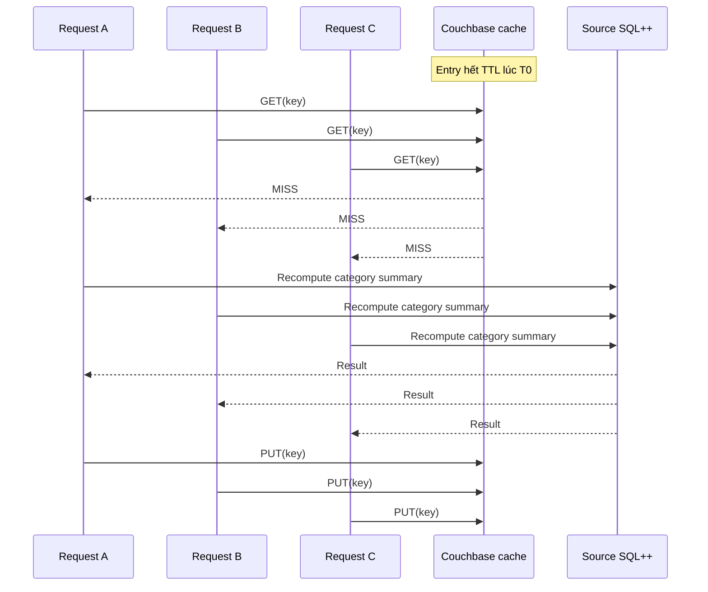
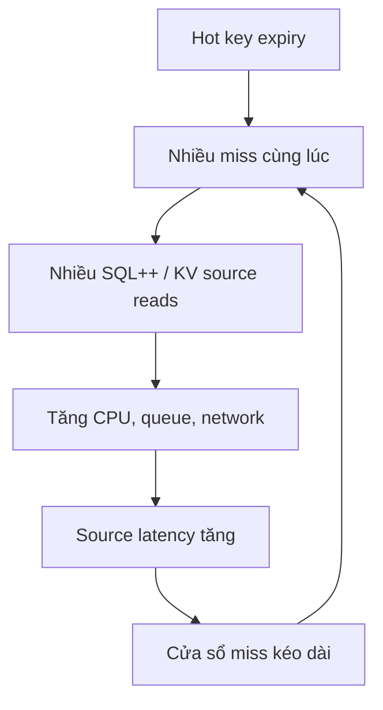
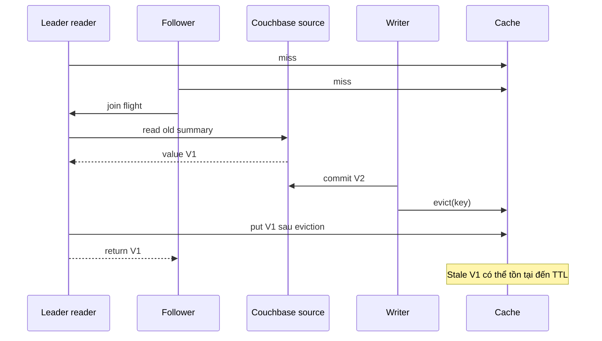

# Nhiều yêu cầu cùng nạp một khóa và nguy cơ cache stampede

## Mục tiêu học tập

Sau bài học này, bạn có thể:

1. Phân biệt **cache hit**, **cache miss**, **cold start**, **hot key**, **cache stampede** và **thundering herd**; nhận diện thời điểm nhiều request cùng nạp một key.
2. Mô tả chính xác hành vi `@Cacheable` mặc định và `@Cacheable(sync = true)` trong Spring Cache, gồm các hạn chế của thuộc tính `sync` và vai trò của implementation `Cache.get(key, Callable)`.
3. Giải thích vì sao Spring Data Couchbase hỗ trợ cache trên Couchbase **không tự đồng nghĩa** có distributed single-flight giữa nhiều JVM, pod hay vùng triển khai.
4. Đo tải thực tế khi hàng trăm request miss cùng một key, nhất là khi cache và dữ liệu nguồn đều đặt trong Couchbase.
5. Thiết kế cache key, TTL, eviction, negative-cache policy, prewarming và giới hạn số truy vấn nguồn để giảm stampede nhưng vẫn bảo vệ tính đúng của dữ liệu.
6. Viết một **single-flight theo key trong một JVM** với `ConcurrentHashMap` và `CompletableFuture`; hiểu cách re-check cache, xử lý lỗi, cleanup và giới hạn phạm vi của nó.
7. Phân tích lựa chọn **distributed lease** bằng Couchbase KV insert-only, TTL, CAS và fencing; biết khi nào không nên đưa giải pháp khóa phân tán vào cache đơn giản.
8. Kiểm thử concurrency, nhiều pod, timeout, error, rolling deployment, transaction, reactive backpressure và metric vận hành.

**Phạm vi module:** `SPRING_DATA_COUCHBASE` xây dựng tầng truy cập Couchbase bằng document mapping, repository, `CouchbaseTemplate` và truy vấn SQL++; đồng thời học bucket/scope/collection, chỉ mục, TTL, CAS, giao dịch và API reactive. Trong chương **Bộ nhớ đệm**, Spring Cache có thể lưu các read model trên Couchbase. Nhưng khi một entry chưa có hoặc vừa hết hạn, **nhiều request độc lập có thể cùng tải lại kết quả từ nguồn**. Bài học này tập trung vào cạnh tranh khi **cache miss**, không đánh đồng nó với CAS conflict lúc ghi document nguồn.

> **Kết luận cần nhớ:** Cache không tự giảm số lần nạp nguồn khi nhiều request cùng thấy **cùng một miss**. Muốn giảm stampede phải xét **cache provider hỗ trợ gì, phạm vi khóa đến đâu, khi leader lỗi thì sao và ứng dụng có bao nhiêu instance**. Chỉ tăng TTL hoặc thêm `sync = true` mà chưa kiểm thử provider là chưa đủ.

## 1. Tình huống mở đầu: một key hot hết hạn cùng lúc

Ứng dụng thương mại điện tử có:

```text
Bucket nguồn:  appdata
Scope nguồn:   catalog
Collection:    products

Bucket cache:  appdata
Scope cache:   cache
Collection:    entries

Cache name:    catalog.category-summary.v1
Logical key:   tenant-42::keyboards
TTL:           45 giây
```

`CategorySummary` là read model được tính bằng SQL++ trên nhiều document: số sản phẩm đang hiển thị, tổng giá tham khảo, v.v. Mỗi lần tính có thể tốn hàng trăm millisecond tùy index, dataset và tải thực tế.

Giả sử key đang hot, rồi hết TTL:



Cả ba request có thể tính cùng một giá trị. Với 100 hoặc 1.000 request đồng thời, cache vốn để giảm tải có thể khiến backend chịu một đỉnh truy vấn đúng lúc entry hết hạn.

### 1.1. Những định nghĩa quan trọng

| Thuật ngữ | Ý nghĩa trong ví dụ |
| --- | --- |
| **Cache hit** | Có entry hợp lệ cho key, trả value mà không gọi method nguồn |
| **Cache miss** | Không có entry hoặc entry đã expiry; phải dùng fallback/load |
| **Cold start** | Application/namespace mới chưa có cache entries, nhiều key miss |
| **Hot key** | Một logical key được hỏi rất thường xuyên |
| **Cache stampede** | Nhiều request cùng recompute một hoặc vài entry bị miss |
| **Thundering herd** | Nhiều tác vụ/clients đồng loạt thức dậy hoặc chờ một sự kiện, tạo đỉnh tải |
| **Single-flight** | Chỉ một tác vụ trong **phạm vi điều phối xác định** load cho một key; các request khác chia sẻ kết quả |
| **Distributed single-flight** | Điều phối xuyên nhiều JVM/pod/process; cần cơ chế chia sẻ trạng thái/khóa và xử lý lease |
| **Cache avalanche** | Nhiều key cùng hết TTL hoặc bị xóa đồng loạt, khiến tỷ lệ miss tăng rộng |
| **Stale repopulation** | Một reader cũ put value cũ **sau khi** writer đã commit và evict |

Cache stampede và stale repopulation có thể cùng xuất hiện, nhưng giải pháp không giống nhau. Single-flight giảm số lượng **loader**, không tự bảo đảm read model vừa load là phiên bản mới nhất so với source.

### 1.2. Cache entry khác document nghiệp vụ

Ví dụ document nguồn có ID `product::tenant-42::P1001`, còn cache summary có logical key `tenant-42::keyboards`. Cache name và key không phải tên collection hay document ID nguồn. Evict cache không xóa source; TTL cache cũng không làm mất sản phẩm.

Một ứng dụng dùng Couchbase làm **cả cache lẫn nguồn** vẫn có thể gặp stampede: cache GET là KV operation, còn miss có thể kích hoạt SQL++ scan/aggregate rất đắt trên cùng cluster. Đây là lý do cần đo tải từ nguồn, không chỉ hit ratio.

## 2. Stampede xảy ra vào những thời điểm nào?

### 2.1. Hết TTL của một hot key

Nhiều request thấy entry hết hạn gần như cùng lúc, trước khi loader đầu tiên hoàn thành và PUT. Đây là trường hợp phổ biến nhất.

### 2.2. Deployment mới với cache name/version mới

Khi đổi `catalog.category-summary.v1` sang `v2` để thay schema, namespace mới chưa có entry. Tất cả request trên các pod bản mới có thể đồng thời miss, kể cả khi cache v1 đang warm.

### 2.3. Xóa hoặc invalidation sau mutation

`@CacheEvict` loại bỏ entry sau cập nhật nguồn. Nếu ngay sau đó có traffic cao, nhiều reader tranh nạp lại cùng key. Cách evict đúng giảm stale nhưng vẫn có thể tạo **invalidation-induced stampede**.

### 2.4. Cache backend mất khả dụng

Khi Couchbase cache collection mất kết nối hoặc bị timeout, ứng dụng có thể fail-open để đọc nguồn. Nếu rất nhiều request fail-open cùng lúc, kết quả giống stampede dù cache entry **chưa chắc đã miss**.

### 2.5. Nhiều key cùng TTL hoặc clear toàn cache

Một batch prewarm tạo 20.000 entry cùng thời điểm, tất cả TTL 10 phút → chúng có thể cùng expiry sau 10 phút. Tương tự, `Cache.clear()` hoặc rollout sai cache prefix có thể tạo cold cache đồng loạt.

### 2.6. Negative miss lặp lại

Nếu một SKU không tồn tại bị request liên tục và policy không cache `null`/`Optional.empty()`, mọi request đều vào source. Negative caching TTL rất ngắn có thể giảm tải, nhưng stale 404/security và cardinality cần đánh giá.

### 2.7. Nhiều instance trong cùng hệ thống

Mỗi pod có thể có lock local của riêng nó. Với 8 pod, “mỗi pod chỉ load một lần” vẫn có thể là **8 SQL++ queries** cho cùng key. Muốn giảm sâu hơn cần kiểm tra cluster-wide coordination hoặc giảm tải từ upstream.

## 3. Ước lượng số lần nạp trùng trước khi tối ưu

Một phép ước lượng đơn giản theo Little's law:

\[
N \approx \lambda \times L
\]

Trong đó:

- `N`: số request có thể đang cùng chờ/nạp.
- `λ`: số request mỗi giây **cho cùng hot key** trong cửa sổ miss.
- `L`: thời gian load source tính bằng giây.

Giả sử có **250 request/giây** tới một key và source cần **0,8 giây** để tạo summary. Khi entry hết hạn, có thể có khoảng:

\[
250 \times 0{,}8 = 200
\]

request chồng lên nhau trong một cửa sổ tải nguồn, nếu không có điều phối/throttling. Con số là ước tính để hiểu **quy mô bùng phát**, không phải lời khẳng định đúng 200 SQL++ queries mọi lúc; scheduling, queue, limits và cache PUT đầu tiên ảnh hưởng kết quả thực.

### 3.1. Tại sao latency còn có thể tự khuếch đại?



Nếu source chậm hơn vì tải, khoảng thời gian các request đều thấy miss kéo dài, khiến số loader cùng chạy càng nhiều. Đây là vòng phản hồi dương có thể dẫn đến timeout dây chuyền.

### 3.2. Đo những số nào?

Trước khi quyết định lock hay TTL:

1. Request/giây theo **cache name và nhóm hot key**, không dùng raw key làm metric label.
2. Cache hit/miss/error tách biệt; không gộp provider error thành miss.
3. Source load count cho mỗi cache miss và thời gian load p50/p95/p99.
4. Active inflight load theo instance và tổng số request chờ.
5. Cache put completion latency, số lỗi put/evict và TTL còn lại.
6. CPU/Query Service latency/index scan, KV latency, SDK pending operations trên Couchbase.
7. Tỷ lệ timeout, fallback, retries và độ trễ người dùng cuối.

Nên đo **tỷ số source loads / logical cache misses** ở các test concurrency để biết một key bị load trùng mấy lần, nhưng cần thống nhất định nghĩa metric vì một request có thể miss rồi vào flight và nhận kết quả chung.

## 4. Spring Cache mặc định không khóa khi nhiều thread miss

Spring Cache hỗ trợ `@Cacheable`. Ở chế độ thông thường `sync = false`:

```java
@Cacheable(
        cacheNames = "catalog.category-summary.v1",
        key = "#p0 + '::' + #p1")
public CategorySummary categorySummary(
        String tenantId, String categoryId) {
    return computeSummaryFromSource(tenantId, categoryId);
}
```

Với hai request gần đồng thời:

```text
Thread A: Cache GET -> miss
Thread B: Cache GET -> miss
Thread A: gọi computeSummaryFromSource()
Thread B: gọi computeSummaryFromSource()
Thread A: cache PUT
Thread B: cache PUT
```

Spring Cache abstraction **mặc định không khóa** từng key để ngăn hai method cùng tính. `@Cacheable` giúp các lượt **sau khi cache có entry** tránh gọi method, nhưng không hứa tối đa một loader cho cửa sổ miss.

### 4.1. Vì sao một key đúng vẫn có stampede?

Key chứa tenant/category/locale đúng giúp cache **không trộn** kết quả. Nó không điều phối concurrency. Việc bảo đảm một request tạo ra đúng key giải quyết collision; stampede là vấn đề **nhiều request cùng tìm đúng key nhưng đều miss**.

### 4.2. @CachePut và @CacheEvict không giải quyết stampede

- `@CachePut` luôn chạy method và sau đó put cache; nhiều request vẫn có thể recompute.
- `@CacheEvict` xóa entry theo event/update nhưng có thể khiến request kế tiếp cùng miss.
- `@Caching` chỉ nhóm nhiều annotation operations; không tạo single-flight.
- `transactionAware()` hoãn một số put/evict tới afterCommit khi transaction hoạt động; không tự khóa source loader trên nhiều request.
- Source `@Version`/CAS bảo vệ optimistic locking lúc ghi, không ngăn nhiều SQL++ reads.

## 5. @Cacheable(sync = true): có ích nhưng không phải khóa phân tán mặc định

Spring có `sync = true`:

```java
@Cacheable(
        cacheNames = "catalog.category-summary.v1",
        key = "#p0 + '::' + #p1",
        sync = true)
public CategorySummary categorySummary(
        String tenantId, String categoryId) {
    return computeSummaryFromSource(tenantId, categoryId);
}
```

Theo tài liệu Spring Framework, `sync = true` yêu cầu cache provider thực hiện **combined cache lookup + value loader** qua API như `Cache.get(key, Callable<T>)` để cố gắng chỉ một thread tính value trong một phạm vi đồng bộ.

**Điểm quan trọng: Đây là một *hint*.** Provider có thể hỗ trợ đồng bộ theo key, chỉ đồng bộ cục bộ hoặc không bảo đảm đồng bộ như bạn kỳ vọng. Không khẳng định “CouchbaseCacheManager có `get(key, Callable)` nên chắc chắn lock phân tán”.

### 5.1. Hạn chế được ghi rõ trên @Cacheable.sync

Khi bật `sync = true`:

1. **Không hỗ trợ `unless()`.** Không viết `sync=true, unless="#result == null"`.
2. **Chỉ được chỉ định một cache name.** Không dùng nhiều cache trong cùng annotation.
3. **Không kết hợp những cache-related operations khác** trên cùng method, theo hạn chế của Spring.
4. Đồng bộ thực tế phụ thuộc **cache provider implementation**, không do annotation tự tạo.
5. Với async/reactive return type, provider còn phải hỗ trợ API phù hợp và có ràng buộc Reactor Context (xem phần 16).

Ví dụ **không hợp lệ**:

```java
// KHÔNG ĐÚNG: sync=true không kết hợp với unless.
@Cacheable(cacheNames = "catalog.category-summary.v1",
           key = "#p0 + '::' + #p1",
           sync = true,
           unless = "#result == null")
public CategorySummary wrong(String tenantId, String categoryId) {
    return computeSummaryFromSource(tenantId, categoryId);
}
```

Nếu bạn cần loại bỏ null/negative caching, có thể đặt policy ở tầng cache provider, đổi method để luôn trả typed outcome không null, hoặc thiết kế flow riêng. Không bỏ `unless` trong im lặng mà không đánh giá business semantics.

### 5.2. CouchbaseCache.get(key, Callable): có API không đồng nghĩa bảo đảm single-flight

Javadoc Spring Data Couchbase có overload `CouchbaseCache.get(Object, Callable<T>)`: nếu cache miss, loader được gọi rồi result có thể được lưu. Nhưng Javadoc **không tự chứng minh** provider giữ một distributed lock hoặc thực thi *exactly once* khi 20 JVM cùng miss.

Tại test cluster phải kiểm tra ít nhất:

- 20–100 thread **trong một JVM** cùng gọi đúng key: source method được gọi mấy lần?
- 2–8 JVM/pod cùng gọi đúng key: số lần load thực tế của cả cụm?
- Khi loader ném exception: các waiter nhận lỗi gì? Bao lâu được phép thử lại?
- Khi cache GET hoặc PUT timeout: caller nhận lỗi/fallback gì? Có nhiều loader phát sinh không?
- Khi entry TTL hết đúng lúc: có bao nhiêu concurrent loads?

Không dựa vào `synchronized` trên một bean Spring như khóa cluster-wide; các pod không chia sẻ monitor Java.

### 5.3. Khi nào sync=true là bước tối ưu phù hợp?

- Load một key có chi phí cao và ứng dụng chủ yếu một JVM/instance.
- Cache provider được test chứng minh giảm loaders trong **phạm vi kỳ vọng**.
- Method chỉ một cache, không cần `unless` và không phối hợp annotation khác.
- Loader không mang side effect không-idempotent; kết quả có thể tái tạo.
- Thời gian chờ follower và timeout được tính vào SLO.

Nếu provider không đảm bảo như yêu cầu, dùng local single-flight rõ ràng (phần 9), bulkhead, prewarm hoặc cơ chế distributed coordination có kiểm soát (phần 11).

## 6. Cấu hình Spring Cache trên Couchbase để tái hiện stampede

Ví dụ ứng dụng Java 17+, Spring Boot, Spring Data Couchbase:

```groovy
dependencies {
    implementation 'org.springframework.boot:spring-boot-starter-data-couchbase'
    implementation 'org.springframework.boot:spring-boot-starter-cache'
    implementation 'org.springframework.boot:spring-boot-starter-web'
}
```

`spring-boot-starter-web` chỉ dùng cho API demo, không bắt buộc nếu đây là background service.

```yaml
spring:
  couchbase:
    connection-string: couchbase://localhost
    username: app_user
    password: ${COUCHBASE_PASSWORD}
  data:
    couchbase:
      bucket-name: appdata
```

Bật caching và cấu hình cache summary trên collection riêng:

```java
package com.example.catalog.cache;

import java.time.Duration;

import org.springframework.cache.annotation.EnableCaching;
import org.springframework.context.annotation.Bean;
import org.springframework.context.annotation.Configuration;
import org.springframework.data.couchbase.cache.CouchbaseCacheConfiguration;
import org.springframework.data.couchbase.cache.CouchbaseCacheManager;
import org.springframework.data.couchbase.core.CouchbaseOperations;

@Configuration(proxyBeanMethods = false)
@EnableCaching
public class SummaryCacheConfiguration {

    public static final String SUMMARY =
            "catalog.category-summary.v1";

    @Bean
    public CouchbaseCacheManager cacheManager(
            CouchbaseOperations operations) {

        var factory = operations
                .getCouchbaseClientFactory()
                .withScope("cache");

        var config = CouchbaseCacheConfiguration
                .defaultCacheConfig()
                .collection("entries")
                .entryExpiry(Duration.ofSeconds(45))
                .prefixCacheNameWith("app:catalog:")
                .disableCachingNullValues();

        return CouchbaseCacheManager.builder(factory)
                .withCacheConfiguration(SUMMARY, config)
                .disableCreateOnMissingCache()
                .build();
    }
}
```

Các điều kiện:

- Bucket `appdata`, scope `cache` và collection `entries` phải tồn tại; account cần RBAC KV phù hợp.
- Source có thể nằm trong `appdata.catalog.products`, nhưng cache **không** được ghi vào collection source trừ khi kiến trúc chủ động cho phép.
- `entryExpiry` ở đây áp dụng cho cache **entry**, không đổi expiry document nguồn.
- `disableCreateOnMissingCache()` giúp phát hiện typo cache name; nếu ứng dụng tạo cache động, phải lựa chọn lại policy.
- Đây là bean manager **thủ công**. Không khai báo thêm manager Boot trùng mục đích mà chưa chọn đúng bean.
- Cấu hình này **chưa tạo distributed single-flight**; nó chỉ thiết lập backend, keyspace và TTL.

### 6.1. Xác minh đúng provider trước khi đo

Nếu `CacheManager` thực tế là `ConcurrentMapCacheManager` hoặc `CaffeineCacheManager`, behavior sync có thể khác Couchbase. Test phải kiểm tra class thực, cache name, scope/collection, TTL và serialization. Một benchmark in-memory không chứng minh Couchbase cluster sẽ chống stampede.

### 6.2. TTL không phải thời gian timeout

- `entryExpiry(Duration.ofSeconds(45))`: thời hạn **cache entry**.
- SDK `timeout(Duration.ofSeconds(2))`: deadline của **một operation**.
- `source load timeout`: giới hạn thời gian computation/query.
- `single-flight wait timeout`: follower được phép chờ leader bao lâu.

Nếu follower phải chờ 30 giây nhưng request HTTP deadline là 3 giây, single-flight chỉ chuyển quá tải từ SQL++ sang hàng đợi timeout ở ứng dụng. Cần cấu hình deadline/bulkhead và kết quả fallback được phê duyệt.

## 7. Read model và nguồn: không cache entity mutable để chống stampede

Một ví dụ `ProductDocument`:

```java
package com.example.catalog;

import org.springframework.data.annotation.Id;
import org.springframework.data.annotation.Version;
import org.springframework.data.couchbase.core.mapping.Collection;
import org.springframework.data.couchbase.core.mapping.Document;
import org.springframework.data.couchbase.core.mapping.Field;
import org.springframework.data.couchbase.core.mapping.Scope;

@Document
@Scope("catalog")
@Collection("products")
public class ProductDocument {

    @Id
    private String id;
    @Field
    private String tenantId;
    @Field
    private String categoryId;
    @Field
    private boolean published;
    @Field
    private long priceCents;
    @Version
    private Long version;

    public ProductDocument() {}

    public String getId() { return id; }
    public void setId(String v) { id = v; }

    public String getTenantId() { return tenantId; }
    public void setTenantId(String v) { tenantId = v; }

    public String getCategoryId() { return categoryId; }
    public void setCategoryId(String v) { categoryId = v; }

    public boolean isPublished() { return published; }
    public void setPublished(boolean v) { published = v; }

    public long getPriceCents() { return priceCents; }
    public void setPriceCents(long v) { priceCents = v; }

    public Long getVersion() { return version; }
}
```

DTO aggregate immutable:

```java
package com.example.catalog;

public record CategorySummary(
        String categoryId,
        long publishedCount,
        long sumPriceCents) {
}
```

Ví dụ nguồn tính SQL++ (minh họa cấu trúc; cần index và kiểm thử theo version):

```sql
SELECT p.categoryId,
       COUNT(1) AS publishedCount,
       SUM(p.priceCents) AS sumPriceCents
FROM `appdata`.`catalog`.`products` AS p
WHERE p.tenantId = $tenantId
  AND p.categoryId = $categoryId
  AND p.published = TRUE
GROUP BY p.categoryId;
```

Trong môi trường thực, dùng query parameter (không nối SQL từ raw input), projection DTO và mapping tên field đúng; xác minh query plan bằng `EXPLAIN`, index, consistency, latency và kết quả khi category không có item (không có group row). Dù nguồn có `@Version`/CAS, những request đọc summary vẫn có thể cùng chạy SQL++ khi cache miss. CAS chỉ bảo vệ mutation có xung đột.

### 7.1. Không dùng “exactly once loader” để che side effect

Một cache loader nên là **read-only và idempotent**. Không đặt ở body `@Cacheable` các side effects như tạo hóa đơn, trừ tồn kho hay gửi email rồi cho rằng `sync=true` sẽ khiến thao tác chạy đúng một lần. Cache provider có thể chạy loader nhiều lần, hoặc retry sau exception/timeout; business commands phải dùng transaction/idempotency riêng.

## 8. Chứng minh sync=true bằng bài test, không bằng suy đoán

Một Spring bean demo dùng loader giả để dễ đếm số lượt:

```java
package com.example.catalog;

import java.util.concurrent.atomic.AtomicInteger;

import org.springframework.cache.annotation.Cacheable;
import org.springframework.stereotype.Service;

@Service
public class SlowCategorySummaryReader {

    private final AtomicInteger loads = new AtomicInteger();

    @Cacheable(
            cacheNames = "catalog.category-summary.v1",
            key = "#p0 + '::' + #p1",
            sync = true)
    public CategorySummary get(String tenantId, String categoryId) {
        loads.incrementAndGet();

        // Chỉ tạo độ trễ giả để kiểm thử concurrency;
        // production gọi repository/SQL++ thay vì sleep.
        try {
            Thread.sleep(300);
        } catch (InterruptedException e) {
            Thread.currentThread().interrupt();
            throw new IllegalStateException(
                    "Loader bị ngắt", e);
        }

        return new CategorySummary(categoryId, 10, 1599000);
    }

    public int loadCount() {
        return loads.get();
    }

    public void resetCounter() {
        loads.set(0);
    }
}
```

**Cảnh báo:** Dùng `Thread.sleep` chỉ để mô phỏng slow source trong **test**, không đưa vào code production. Test phải gọi `SlowCategorySummaryReader.get` qua Spring bean proxy, không gọi bằng `new`/self-invocation. `resetCounter()` không xóa cache entry: phải evict key test trước khi đo.

### 8.1. Assertion quan trọng

- Khi có 50 thread gọi **cùng key** và cache empty, số lần `get` chạy source **lý tưởng** là 1 nếu provider hỗ trợ synchronized load trong phạm vi được test.
- Khi 50 thread gọi **50 key khác nhau**, mong muốn có concurrency theo nhiều key, **không** serial hóa toàn bộ cache.
- Khi chạy 3 pod mỗi pod 50 request, có thể có hơn một loader trên cả cụm dù mỗi pod giảm contention. Đo count toàn cụm.
- Khi loader throw, không được giữ flight/lock vĩnh viễn khiến mọi request sau kẹt.
- Khi PUT cache timeout sau load, nhiều follower có thể phải retry, dẫn đến burst mới.

### 8.2. Tránh unit test chỉ với provider in-memory rồi kết luận về Couchbase

`ConcurrentMapCacheManager` trong Spring Framework có behavior riêng về concurrent loader. Test thành công ở đó **không** chứng minh `CouchbaseCacheManager` chống stampede trong một JVM hoặc nhiều JVM. Cần chạy integration test bằng đúng Spring Data Couchbase version và Couchbase test cluster.

### 8.3. Số lần load là bằng chứng tốt hơn chỉ latency

Một benchmark có latency giảm khi sync được bật vẫn có thể đang chạy 10 query nguồn thay vì 1. Gắn counter ở **đường nguồn** (repository/SQL++/remote call), đồng thời đo wait time và concurrency. Đừng dùng số lệnh `Cache.get` làm số source loads.

## 9. Single-flight trong một JVM: chia sẻ cùng một phép nạp

Khi `sync=true` không cho kết quả như kỳ vọng với provider, hoặc cần kiểm soát lỗi/timeout/follower rõ ràng, có thể tự triển khai **local single-flight**. Bài toán:

```text
Một JVM, cùng key K:

A miss -> trở thành leader -> load source -> cache.put(K, result)
B miss -> thấy flight K đang chạy -> chờ A
C miss -> thấy flight K đang chạy -> chờ A

A hoàn tất:
B và C nhận cùng kết quả.
Flight K được xóa khỏi bộ nhớ.
```

Tuy nhiên, local single-flight chỉ điều phối **trong cùng process**. Một pod khác có `ConcurrentHashMap` riêng vẫn có thể load trùng. Cần coi đây là giảm tải cục bộ, không phải cơ chế distributed exactly-once.

### 9.1. Một coordinator theo key

Ví dụ Java 17 dùng `CompletableFuture` để các follower chia sẻ kết quả. `CategorySummary` là type cố định để tránh việc hai read model khác class vô tình dùng chung flight.

```java
package com.example.catalog.cache;

import java.util.concurrent.Callable;
import java.util.concurrent.CompletableFuture;
import java.util.concurrent.ConcurrentHashMap;
import java.util.concurrent.ExecutionException;
import java.util.concurrent.TimeUnit;
import java.util.concurrent.TimeoutException;

import com.example.catalog.CategorySummary;
import org.springframework.stereotype.Component;

@Component
public final class CategorySingleFlight {

    private final ConcurrentHashMap<String,
            CompletableFuture<CategorySummary>> inFlight =
            new ConcurrentHashMap<>();

    public CategorySummary load(
            String key, Callable<CategorySummary> loader) {

        var mine = new CompletableFuture<CategorySummary>();
        var existing = inFlight.putIfAbsent(key, mine);

        if (existing != null) {
            return awaitExisting(existing);
        }

        try {
            CategorySummary value = loader.call();
            mine.complete(value);
            return value;
        } catch (Exception e) {
            mine.completeExceptionally(e);
            throw new IllegalStateException(
                    "Category loader thất bại", e);
        } catch (Error error) {
            mine.completeExceptionally(error);
            throw error;
        } finally {
            // Chỉ xóa flight mà chính mình đã tạo.
            inFlight.remove(key, mine);
        }
    }

    private CategorySummary awaitExisting(
            CompletableFuture<CategorySummary> future) {

        try {
            return future.get(2, TimeUnit.SECONDS);
        } catch (InterruptedException e) {
            Thread.currentThread().interrupt();
            throw new IllegalStateException(
                    "Follower bị ngắt khi chờ cache", e);
        } catch (TimeoutException e) {
            throw new IllegalStateException(
                    "Follower chờ loader quá hạn", e);
        } catch (ExecutionException e) {
            throw new IllegalStateException(
                    "Leader nạp source thất bại", e.getCause());
        }
    }
}
```

Điểm đúng của đoạn mẫu:

- `putIfAbsent` bầu ra **một leader cho mỗi key** trong JVM.
- Follower chờ `CompletableFuture` của leader, không tự load nguồn ngay.
- Future được complete cả khi thành công và exception; không để waiter treo vô hạn chỉ vì một lỗi thông thường.
- `finally remove(key, mine)` chỉ xóa đúng flight này; giảm nguy cơ xóa flight khác thay thế cùng key.
- Follower chờ tối đa hai giây; khi timeout, nó nhận lỗi theo policy thay vì chờ vô hạn.
- Key khác nhau có thể được load đồng thời.

**Giới hạn:**

1. `loader.call()` của leader vẫn cần deadline ở tầng SQL++/SDK; timeout follower **không hủy leader**.
2. Mọi request không được phép dùng shared map làm nơi khóa bảo mật; phải xác thực tenant/quyền **trước** cache access.
3. Khi leader thất bại, nhiều follower cùng nhận lỗi; request mới sau cleanup có thể lập flight khác và thử lại. Cần retry/backoff/bulkhead để tránh error storm.
4. `CompletableFuture.get(...)` blocking, không dùng trong WebFlux event loop. Reactive cần cách điều phối non-blocking riêng.
5. Map có một entry cho mỗi key đang load: nếu attacker tạo vô hạn key khác nhau, vẫn có nguy cơ **in-flight key explosion**. Cần rate-limit và global bulkhead.
6. Đây là code minh họa đơn giản; production cần instrumentation, TTL/wait deadlines thống nhất và kiểm thử lifecycle.

### 9.2. Key ổn định cho tenant/category

Không nối tùy tiện `tenant + "::" + category` nếu input có thể chứa dấu phân tách. Có thể encode từng segment bằng Base64 URL-safe:

```java
package com.example.catalog.cache;

import java.nio.charset.StandardCharsets;
import java.util.Base64;

public final class CategoryCacheKeys {

    private CategoryCacheKeys() {}

    public static String summary(String tenant, String category) {
        return "v1.t." + component(tenant) +
                ".c." + component(category);
    }

    private static String component(String text) {
        if (text == null || text.isBlank()) {
            throw new IllegalArgumentException(
                    "Cache key component rỗng");
        }
        return Base64.getUrlEncoder()
                .withoutPadding()
                .encodeToString(
                        text.getBytes(StandardCharsets.UTF_8));
    }
}
```

Trong sản phẩm thật phải xác định canonicalization tenant/category theo luật nghiệp vụ, kiểm tra giới hạn physical Couchbase document ID gồm prefix/cache name và tránh đưa PII/secret vào raw key. Base64 là encoding, không phải encryption.

### 9.3. Service cache-aside dùng double-check bên trong flight

Để leader hoàn tất **cả cache PUT** rồi mới trả future, hãy đặt read-source/put trong loader. Follower đi vào flight sẽ nhận DTO đã nạp, không cần tự put.

```java
package com.example.catalog;

import com.example.catalog.cache.CategoryCacheKeys;
import com.example.catalog.cache.CategorySingleFlight;
import org.springframework.cache.Cache;
import org.springframework.cache.CacheManager;
import org.springframework.stereotype.Service;

@Service
public class CategorySummaryService {

    private static final String NAME =
            "catalog.category-summary.v1";

    private final CacheManager manager;
    private final CategorySingleFlight flight;
    private final CategorySummarySource source;
    private final CatalogSecurity security;

    public CategorySummaryService(
            CacheManager manager,
            CategorySingleFlight flight,
            CategorySummarySource source,
            CatalogSecurity security) {
        this.manager = manager;
        this.flight = flight;
        this.source = source;
        this.security = security;
    }

    public CategorySummary get(
            String authenticatedTenant, String categoryId) {

        security.requireCatalogRead(authenticatedTenant);

        String key = CategoryCacheKeys.summary(
                authenticatedTenant, categoryId);

        Cache cache = manager.getCache(NAME);
        if (cache == null) {
            throw new IllegalStateException(
                    "Cache chưa được khai báo");
        }

        CategorySummary cached =
                cache.get(key, CategorySummary.class);
        if (cached != null) {
            return cached;
        }

        return flight.load(key, () -> {
            // Double-check: leader trước đó đã put
            // sau lần GET ngoài flight của request này?
            CategorySummary again =
                    cache.get(key, CategorySummary.class);
            if (again != null) {
                return again;
            }

            CategorySummary loaded = source.compute(
                    authenticatedTenant, categoryId);

            cache.put(key, loaded);
            return loaded;
        });
    }
}
```

Hai interface trong ví dụ:

```java
package com.example.catalog;

public interface CategorySummarySource {
    CategorySummary compute(String tenantId, String categoryId);
}

public interface CatalogSecurity {
    // Caller phải dùng tenant đã xác thực từ security context.
    void requireCatalogRead(String authenticatedTenantId);
}
```

*Trong mã thật, mỗi public type nằm trong file `.java` riêng và hai interface phải được ứng dụng triển khai. `CategorySummarySource` có thể dùng `CouchbaseTemplate`/repository/SQL++ projection. Chỉ dùng method này sau ranh giới xác thực phù hợp.*

**Cảnh báo về policy:** Đoạn này chọn **manual cache-aside**. Đừng đặt thêm `@Cacheable` lên chính `CategorySummaryService.get` mà không kiểm soát việc cache get/put hai lần. Đường cache programmatic cũng **không tự dùng `CacheErrorHandler` của annotation interceptor**; nếu cần fail-open khi cache GET/PUT lỗi, hãy thêm adapter có policy riêng.

### 9.4. Double-check giải quyết vấn đề gì?

Nhiều request có thể đã miss ở bước GET ngoài cùng, nhưng trước khi vào single-flight thì leader khác đã PUT xong. Recheck bên trong flight giúp chúng không nạp nguồn vô ích. Nó không tạo distributed lock, không chống lỗi invalidation race và không bảo đảm exactly-once giữa các pod.

### 9.5. Trả result khi cache.put thất bại hay báo lỗi?

Trong code ở trên, `cache.put` throw → leader hoàn thành exceptional và follower nhận lỗi. Đây là **fail-closed cho cache put**. Với read model có thể tái tạo, một service có thể chọn fail-open: ghi metric rồi trả value source đúng, nhưng điều đó cần thay đổi logic có chủ đích và phải chấp nhận cache vẫn miss cho request kế tiếp.

Không catch mọi exception, kể cả source timeout/authorization, rồi trả default DTO hoặc 404. Policy cho `cache.get`, `cache.put`, `cache.evict` và `source.compute` có trách nhiệm khác nhau.

## 10. Giới hạn số loader khác với single-flight

Single-flight gom nhiều request **cùng key**. Nếu có 5.000 key khác nhau miss cùng lúc, single-flight theo key vẫn có thể tạo 5.000 source calls. Cần một lớp **bulkhead/concurrency limit** độc lập.

### 10.1. Semaphore cho tải nguồn blocking

Ví dụ một component giới hạn tối đa 16 source computations trong JVM:

```java
package com.example.catalog.cache;

import java.util.concurrent.Callable;
import java.util.concurrent.Semaphore;
import java.util.concurrent.TimeUnit;
import java.util.concurrent.RejectedExecutionException;

import org.springframework.stereotype.Component;

@Component
public final class SourceLoadBulkhead {

    private final Semaphore permits = new Semaphore(16);

    public <T> T execute(Callable<T> task) {
        boolean acquired;
        try {
            acquired = permits.tryAcquire(
                    150, TimeUnit.MILLISECONDS);
        } catch (InterruptedException e) {
            Thread.currentThread().interrupt();
            throw new IllegalStateException(
                    "Bị ngắt khi chờ source capacity", e);
        }

        if (!acquired) {
            throw new RejectedExecutionException(
                    "Source load capacity đã đầy");
        }

        try {
            return task.call();
        } catch (Exception e) {
            throw new IllegalStateException(
                    "Source computation thất bại", e);
        } finally {
            permits.release();
        }
    }
}
```

Dùng bulkhead **bên trong leader loader**:

```java
return flight.load(key, () -> {
    CategorySummary value = cache.get(key, CategorySummary.class);
    if (value != null) {
        return value;
    }

    CategorySummary loaded = bulkhead.execute(
            () -> source.compute(tenant, categoryId));

    cache.put(key, loaded);
    return loaded;
});
```

*Snippet ở trên giả định các biến `flight`, `cache`, `bulkhead`, `source`, `tenant` và `categoryId` đã có trong service.*

### 10.2. Bulkhead không tự làm request thành công

Nếu semaphore hết permit, một request phải có policy:

- Trả 429/503 với retry guidance khi phù hợp.
- Có thể trả **stale-but-bounded** result nếu read model không nhạy cảm và adapter hỗ trợ.
- Đặt vào queue có giới hạn kèm timeout chung nếu SLA cho phép.
- Không tự tạo unbounded queue; chỉ chuyển stampede thành memory/latency overload.
- Không retry lập tức hàng trăm lần: exponential backoff + jitter + retry budget.

Số permit 16 và wait 150ms chỉ là **giá trị minh họa**. Chọn theo capacity của Query Service, độ trễ nguồn và SLO, không dựa vào số core một cách máy móc.

### 10.3. Cần kiểm soát cả concurrency lẫn tốc độ

Semaphore giới hạn các call **đang chạy** nhưng không tự giới hạn số lượt bắt đầu mỗi giây. Nếu nguồn vẫn nhận 16 call liên tục dưới tải cao, có thể cần rate limiter, admission control và circuit breaker khi dependency đang suy giảm.

**Ưu tiên graceful degradation có giới hạn** hơn là để mọi request queue lâu đến khi timeout HTTP rồi tạo retries đồng loạt từ client.

## 11. Distributed lease bằng Couchbase KV: lựa chọn nâng cao

Nếu có nhiều pod và thật sự cần giảm toàn cụm xuống gần một loader cho mỗi key, có thể xây **distributed lease**. Đây là cơ chế điều phối riêng, **không phải tính năng mặc định được `@Cacheable(sync=true)` tự cung cấp**.

Một cách dùng Couchbase KV:

1. Mỗi hot cache key có một **lock document ID** riêng trong collection `appdata.cache_locks.leases`.
2. Pod muốn trở thành leader thực hiện **insert-only** lock document với TTL ngắn.
3. Chỉ một insert thành công khi lock document chưa tồn tại; contender gặp `DocumentExistsException` không làm leader.
4. Leader **đọc lại cache** sau khi nắm lock; nếu một leader trước đã PUT thì không load nguồn nữa.
5. Nếu vẫn miss, leader đọc nguồn và PUT cache.
6. Leader xóa lock bằng **CAS từ kết quả insert** để tránh xóa nhầm lock mới sau khi lease cũ hết.
7. Contender poll cache với backoff/jitter và deadline, không busy-loop; khi hết deadline phải quyết định fallback/retry đúng policy.
8. Khi process crash, TTL lease cho phép contender khác thử lại.

### 11.1. Một đoạn Java SDK minh họa leader claim

```java
import java.time.Duration;

import com.couchbase.client.java.Collection;
import com.couchbase.client.java.json.JsonObject;
import com.couchbase.client.java.kv.MutationResult;

import static com.couchbase.client.java.kv.InsertOptions.insertOptions;
import static com.couchbase.client.java.kv.RemoveOptions.removeOptions;

// lockCollection: SDK handle tới collection chuyên dụng.
// lockId: ID đã canonicalize/hash theo key, không chứa secret.
MutationResult lease = lockCollection.insert(
        lockId,
        JsonObject.create().put("holder", instanceId),
        insertOptions().expiry(Duration.ofSeconds(5)));

try {
    // Chỉ chạy ở pod đã insert lock thành công.
    // Double-check cache sau khi có lease.
    // Nếu vẫn miss, load source và cache.put.
} finally {
    try {
        lockCollection.remove(
                lockId,
                removeOptions().cas(lease.cas()));
    } catch (RuntimeException releaseError) {
        // Có thể lock đã hết TTL / người khác sở hữu lock mới.
        // Log metric; KHÔNG xóa vô điều kiện.
    }
}
```

*Đây là **nhánh leader-only** sau khi insert thành công, chưa phải một distributed-lock library hoàn chỉnh. Phải xử lý `DocumentExistsException` ở nhánh contender, timeout, network failure, lease renewal, cleanup và CAS mismatch, với unit/integration tests.*

**Không release bằng `collection.remove(lockId)` không có CAS**: nếu lease đã expiry rồi contender khác insert lock mới cùng ID, leader cũ có thể xóa lock mới, tạo hai leader. CAS-based release giảm lỗi này.

### 11.2. TTL lease phải đủ cho loader nhưng không được coi là tuyệt đối

Giả sử lease TTL 5 giây nhưng source query bị treo 10 giây:

```text
T0: A insert lock, TTL 5s, bắt đầu load
T5: Lock A hết hạn
T6: B insert lock mới, trở thành leader
T8: B load và PUT cache
T10: A load xong và PUT cache cũ
```

Có thể xuất hiện hai leader, out-of-order cache PUT hoặc stale result. **TTL lock không phải bảo đảm exactly-once.** Nếu cần tính đúng mạnh, thiết kế fencing token/version check cho write hoặc chấp nhận cache là soft state và dùng nguồn làm authority.

### 11.3. CAS của lock khác CAS của document nguồn

- CAS ở **lock document** giúp release không xóa lock mới.
- CAS ở **ProductDocument nguồn** bảo vệ mutation theo optimistic locking.
- CAS ở **cache entry** có thể dùng cho protocol write có điều kiện nếu adapter được thiết kế đúng.
- Ba CAS này không tự liên kết với nhau thành một transaction.

Không dùng giá trị CAS như **đồng hồ phiên bản toàn cục tăng dần** để so sánh leader cũ/mới. Một fencing token thực sự cần thứ tự có ý nghĩa và được resource áp dụng khi nhận write; có thể cần counter/sequence riêng với contract phù hợp.

### 11.4. Distributed lock cũng có chi phí và điểm lỗi riêng

Mỗi miss có thể thêm nhiều KV operations (insert lock, cache recheck, release, contender polling). Nếu source chỉ là một `repository.findById` rất nhanh và cache cũng ở Couchbase, khóa phân tán có thể **tốn hơn** việc chấp nhận vài loader trùng. Đánh giá lợi ích thực khi source là SQL++ aggregate đắt hoặc remote dependency có rate limit.

Khóa phân tán dùng chính Couchbase cache cluster cũng có thể không hoạt động lúc cluster đang lỗi — đúng khi bạn cần nó nhất. Cần fallback và giới hạn retry, không dùng lock như một security/transaction guarantee.

### 11.5. Tránh dùng @Cacheable trên một command có side effects

Distributed lease theo cache key **chỉ là tối ưu recomputation**. Nó không thay idempotency key, transactional outbox, CAS hoặc distributed transaction của nghiệp vụ. Không dùng nó để bảo đảm một khoản thanh toán chỉ bị trừ một lần.

## 12. TTL, jitter và prewarming để giảm các đỉnh miss

### 12.1. TTL cố định khiến key hot hết hạn theo nhịp đều

Nếu toàn bộ cache có TTL 5 phút và nhiều entry cùng được tạo lúc deploy, chúng có thể cùng hết hạn sau khoảng 5 phút. Đặt mọi TTL thành một giá trị lớn hơn chỉ dời đỉnh tải sang thời điểm khác, đồng thời tăng độ cũ của dữ liệu.

### 12.2. Jitter ở cấp entry — chỉ khi adapter hỗ trợ

Một chiến lược là TTL mỗi entry biến thiên trong khoảng cho phép, ví dụ:

```text
TTL mục tiêu: 300 giây
Jitter:       ±15%
TTL có thể:   255–345 giây
```

Điều này giúp các key **khác nhau** không đồng loạt hết hạn. Nhưng với **cùng một hot key**, chỉ có một entry nên jitter **không tự ngăn nhiều request cùng miss key đó**.

**Quan trọng:** Spring Data Couchbase `CouchbaseCacheConfiguration.entryExpiry(Duration)` đặt TTL ở **cấp cache name**, không tự sinh jitter cho từng put. Muốn jitter thật, cần adapter/writer có hỗ trợ dynamic per-entry expiry và test thực tế; không tuyên bố chỉ đặt `entryExpiry(Duration.ofMinutes(5))` là đã có jitter.

Jitter cần đảm bảo không vượt stale SLA của loại dữ liệu. Không dùng TTL quá dài để đánh đổi tính đúng chỉ vì muốn hit ratio đẹp.

### 12.3. Prewarming có kiểm soát

Trước một đợt sale hoặc rollout cache version v2, có thể prewarm **tập key hot được xác định bằng đo đạc**, ví dụ top 100 tenant/category keys:

- Giới hạn concurrency và QPS, tránh chính quá trình prewarm gây stampede.
- Dùng cùng cache name/key/DTO schema như reader thực.
- Không prewarm thông tin nhạy cảm/cá nhân khi không có auth policy đúng.
- Khi app có nhiều pod, chỉ một coordinator/job prewarm thay vì mỗi pod prewarm cùng key.
- Đặt expiry hợp lý để prewarm không làm tất cả key cùng hết hạn lần nữa.
- Có metric số key warm thành công/thất bại và lượng tải source phát sinh.

Prewarming chỉ giúp cold starts dự đoán được. Khi một hot key bị evict đột ngột do update, stampede vẫn có thể xảy ra.

## 13. Stale-while-revalidate (SWR): phục vụ bản cũ có giới hạn

Thay vì **mọi reader chờ refresh** lúc entry hết “fresh window”, có thể phục vụ một bản cache cũ trong khoảng “stale window” ngắn, đồng thời chỉ một background refresh được khởi chạy cho key.

Ví dụ:

```text
freshUntil  = T+45s
staleUntil  = T+75s
physical TTL trên Couchbase >= 75s

Request T+50s:
  -> Có entry cũ nhưng trong stale window.
  -> Trả bản cũ (nếu nghiệp vụ cho phép).
  -> Kích hoạt refresh async có single-flight/bulkhead.

Request T+80s:
  -> Bản cũ vượt hard limit, không được trả.
  -> Bắt buộc source refresh hoặc fail theo policy.
```

**Không phải tính năng tự động của `entryExpiry(Duration)`.** Couchbase Server đã xem document hết expiry là không tồn tại với client; để đọc **stale value** phải thiết kế custom envelope có `freshUntil/staleUntil` và đặt **physical TTL lớn hơn fresh window**. `@Cacheable` thông thường không tự hiểu envelope và không tự chạy refresh nền.

### 13.1. Envelope ví dụ

```java
package com.example.catalog.cache;

import java.time.Instant;

import com.example.catalog.CategorySummary;

public record TimedSummary(
        CategorySummary value,
        Instant freshUntil,
        Instant staleUntil,
        String schemaVersion) {

    public boolean fresh(Instant now) {
        return now.isBefore(freshUntil);
    }

    public boolean serveStale(Instant now) {
        return !now.isBefore(freshUntil)
                && now.isBefore(staleUntil);
    }
}
```

Adapter chịu trách nhiệm:

1. Đọc envelope từ cache.
2. Nếu `fresh`: trả ngay.
3. Nếu `serveStale`: chỉ khi business cho phép, trả bản cũ và schedule **một refresh có giới hạn**.
4. Nếu hết `staleUntil` hoặc không có value: refresh đồng bộ có deadline/bulkhead.
5. Nếu refresh thành công: put envelope mới, expiry vật lý đúng.
6. Nếu refresh lỗi: ghi metric; chỉ tiếp tục trả stale khi vẫn nằm trong hard limit.
7. Nếu mutation nguồn quan trọng: invalidation/ban stale path để không cố trả giá cũ.

### 13.2. Khi nào không được serve stale?

- Giá cuối cùng tại checkout, hạn mức tín dụng, trạng thái thanh toán.
- Quyền truy cập hoặc publish/unpublish nhạy cảm.
- Document bị xóa theo yêu cầu pháp lý/bảo mật.
- Kết quả cần read-after-write mạnh theo SLA.
- Dữ liệu có thể dẫn tới hành động không thể hoàn tác.

SWR tối ưu **availability/latency** bằng cách chấp nhận một độ cũ **được định nghĩa**. Nó không phải lựa chọn mặc định cho mọi read model.

### 13.3. Stale-if-error

Nếu source tạm thời lỗi, adapter có thể trả stale result tới `staleUntil`, với metric `stale_served_total` và điều kiện bảo mật. Không biến source error thành “cache result chắc chắn đúng”; không kéo dài stale vô hạn mỗi lần refresh thất bại.

## 14. Cache miss và invalidation có thể race ngay cả khi đã single-flight

Single-flight trong một JVM giúp nhiều reader cùng dùng một loader. Nhưng khi writer cập nhật source giữa lúc leader đang nạp:



Đây là **stale repopulation**. Một single-flight tốt chỉ làm một loader cũ chạy thay vì 100 loaders cũ; nó không làm kết quả trở thành snapshot mới nhất.

### 14.1. Những lựa chọn khi tính đúng quan trọng

| Cơ chế | Giúp gì | Không giải quyết tự động |
| --- | --- | --- |
| Local single-flight | Giảm source loads trong một JVM | Không chống cross-pod loader, race với mutation |
| Distributed lease | Giảm loader xuyên pod nếu lease còn hiệu lực | Không đảm bảo exactly-once, không thay source transaction |
| TTL ngắn | Giới hạn stale lifetime | Không loại bỏ stale trong cửa sổ TTL |
| Evict after commit | Giảm nguy cơ cache miss nạp trước commit | Không chặn in-flight reader từ trước |
| Outbox event | Có thể retry invalidation sau crash | Event delay và in-flight PUT vẫn có |
| Source revision fencing | Có thể từ chối put snapshot cũ theo version có ý nghĩa | Cần protocol được thiết kế và kiểm thử |
| Bypass cache | Reader luôn kiểm tra source | Tăng chi phí source, phù hợp quyết định mạnh |

### 14.2. CAS của source khác CAS của cache

`@Version`/CAS trên `ProductDocument` giúp writer phát hiện update dùng bản cũ. Nó không tự chặn một cache loader cũ put DTO sau eviction. Nếu xây conditional put cho cache, cần dùng CAS **của cache entry** hoặc một version fence do domain quy định, không gán nghĩa thứ tự cho CAS của source.

### 14.3. Cacheable.sync không tạo transaction cho loader

Một method `@Cacheable(sync=true)` dùng SQL++ có thể chạy trong hoặc ngoài transaction tùy caller, advice và configuration. Không mặc nhiên có snapshot/transaction isolation chỉ vì đã synchronized caching. Các quyết định tài chính/ghi nguồn cần contract nhất quán riêng.

## 15. Cache miss thất bại: retry storm và negative caching

### 15.1. Khi leader lỗi, followers có thể cùng retry

Nếu single-flight leader gặp timeout, mọi follower nhận cùng exception. Nếu toàn bộ client ngay lập tức retry một key, một flight mới có thể khởi động, rồi lỗi, rồi retry, tạo **retry storm**.

Giảm thiểu bằng:

- Timeout và retry budget toàn request.
- Exponential backoff kèm jitter, tránh tất cả client đồng loạt retry.
- Circuit breaker khi Query Service/source đang lỗi.
- Bulkhead để giới hạn source concurrency.
- Bounded queue/wait time cho follower.
- Metric về failure rate và thời gian chờ thay vì chỉ cache miss ratio.
- Không cache một lỗi hạ tầng thành DTO “không tồn tại”.

### 15.2. Negative caching không giống cache timeout

Nếu source thật sự xác nhận một document ID không tồn tại, có thể cache marker `NOT_FOUND` trong 3–10 giây theo SLA để tránh nhiều miss lặp. Tuy nhiên:

- Negative cache phải chứa tenant đã xác thực trong key.
- Phải evict marker khi document được tạo/publish.
- Không cache 403/401, Query Service timeout, KV timeout hay decode error như NOT_FOUND.
- Với SQL++ scan consistency chưa đáp ứng, query “rỗng tạm thời” do index lag **không** nên thành negative cache dài.
- Nhóm input ngẫu nhiên có thể tạo rất nhiều negative keys, cần rate limit/key-cardinality budget.

### 15.3. Trường hợp 0/empty là giá trị hợp lệ

Một category có thể có 0 sản phẩm. `CategorySummary(categoryId, 0, 0)` là **value hợp lệ**, khác `null` hay một exception. Nếu policy cache rỗng, request tiếp theo có thể hit mà không query SQL++; nếu dữ liệu vừa được thêm, cần evict/update đúng key.

Không dùng `@Cacheable(unless="#result == null")` cùng `sync=true`: Spring nêu rõ hai thuộc tính này không kết hợp được. Nếu method có thể không trả result, cần thiết kế typed result/provider null policy thích hợp.

## 16. Reactive và async: tránh chặn event loop để chờ single-flight

Với `ReactiveCouchbaseOperations`, reactive repositories hoặc WebFlux, request không nên đứng chờ một `CompletableFuture.get()` blocking như ví dụ Java truyền thống.

### 16.1. @Cacheable với Mono/Flux phụ thuộc Spring và provider

Spring Framework thế hệ mới hỗ trợ `@Cacheable` với `CompletableFuture`, `Mono` và `Flux` theo một số điều kiện. Với `Mono`, nội dung emitted value có thể được cache; với `Flux`, Spring có thể gom toàn bộ emitted elements thành `List` trước khi cache.

Ví dụ **minh họa annotation**, chỉ dùng nếu provider hỗ trợ kiểu bất đồng bộ cần thiết:

```java
@Cacheable(
    cacheNames = "catalog.category-summary.v1",
    key = "#p0 + '::' + #p1",
    sync = true)
public reactor.core.publisher.Mono<CategorySummary> getReactive(
        String tenantId, String categoryId) {

    return reactiveSource.compute(tenantId, categoryId);
}
```

`reactiveSource` là service reactive được inject. Ví dụ này **không chứng minh** `CouchbaseCacheManager` của mọi Spring Data version hỗ trợ synchronized `CompletableFuture` retrieval. Cần test với đúng dependency và provider.

**Quan trọng theo tài liệu Spring:** Khi `@Cacheable(sync=true)` trên reactive method, cache có thể tự subscribe publisher để đồng bộ nạp giá trị; **Reactor Context của từng caller không được truyền như bình thường** vào việc compute. Với các method phụ thuộc security context/transaction context để quyết định kết quả, điều này có thể gây lỗi nghiêm trọng. Tenant, permission scope và mọi input ảnh hưởng giá trị phải được xác thực **trước cache** và đưa vào key theo contract; không chia sẻ publisher của caller A cho caller B chỉ vì họ có cùng SKU.

### 16.2. Không cache trực tiếp stream vô hạn

Một `Flux` vô hạn hoặc rất lớn không phù hợp cơ chế gom list rồi cache; có thể gây memory growth, latency, tắc backpressure. Hãy materialize một read model hữu hạn (page/slice đã giới hạn) trước khi cache và đặt TTL/schema/version rõ ràng.

### 16.3. Reactive single-flight kiểu non-blocking

Một pattern local single-flight reactive có thể giữ `Mono<T>` đang chạy theo key và chia sẻ subscription:

```java
package com.example.catalog.cache;

import java.util.concurrent.ConcurrentHashMap;
import java.util.function.Supplier;

import com.example.catalog.CategorySummary;
import org.springframework.stereotype.Component;
import reactor.core.publisher.Mono;

@Component
public final class ReactiveCategoryFlights {

    private final ConcurrentHashMap<String, Mono<CategorySummary>>
            inFlight = new ConcurrentHashMap<>();

    public Mono<CategorySummary> load(
            String key,
            Supplier<Mono<CategorySummary>> supplier) {

        return inFlight.computeIfAbsent(key, k ->
                Mono.defer(supplier)
                    .doFinally(signal -> inFlight.remove(k))
                    .cache());
    }
}
```

**Ý nghĩa:** Trong **cùng JVM**, publisher của leader được chia sẻ khi các subscribers cùng tham gia. Phần `Mono.defer(supplier)` chỉ gọi supplier lúc subscribe; `Mono.cache()` chia sẻ kết quả/error cho những subscriber của cùng flight. Khi source kết thúc, `doFinally` xóa mapping, cho phép flight sau thử lại.

**Giới hạn cần test:**

- Phải đặt **re-check cache và reactive cache PUT** trong supplier **trước khi Mono hoàn tất**, nếu không follower có thể thấy result nhưng cache vẫn miss.
- Một `Mono.cache()` có thể tiếp tục xử lý upstream khi downstream cancel; có thể tốn query ngay cả khi mọi HTTP request đã hủy. Cần timeout/cancellation policy.
- Không chia sẻ một source Mono đọc security context của caller A cho caller B nếu kết quả/permission khác. Xác thực trước lookup; capture tenant/visibility đã xác thực trong key và supplier.
- `inFlight` cần giới hạn số key, timeout và metric. `computeIfAbsent` ở đây **không** tạo distributed lock.
- Operator `cache()` cũng memoize error cho **cùng Mono instance**; sau khi map được xóa, invocation mới có thể lập flight khác. Cần test lifecycle để tránh error storm.
- Không `block()` hoặc dùng `Thread.sleep` trên Reactor event loop; dùng SDK reactive và bounded concurrency/backpressure.

Đây là một **sketch điều phối**, không phải adapter reactive hoàn chỉnh của Spring Cache. Tùy business SLA, dùng operator như `timeout`, `onErrorResume` có phân loại lỗi và một async cache API được kiểm thử.

## 17. L1/L2 cache và tác động của nhiều instance

Một lựa chọn khác là hai tầng:

```text
Request
  |
  v
L1 local cache (mỗi pod, vd. Caffeine)
  |
  +-- hit -> trả DTO
  |
  +-- miss -> L2 shared cache (Couchbase)
                 |
                 +-- hit -> warm L1 / trả DTO
                 |
                 +-- miss -> source recompute -> put L2/L1
```

**Lợi ích:** L1 tránh nhiều KV read tới shared cache, giảm latency và mạng cho key hot. Một local single-flight ở tầng L1 có thể gom các request trong pod.

**Rủi ro:** Khi writer evict L2, L1 trên những pod khác **không tự bị xóa**. Nếu L1 có TTL dài, người dùng có thể tiếp tục nhận stale DTO, bất kể L2 đã được invalidated đúng. Cần event bus/invalidation fanout, TTL L1 ngắn hơn hoặc revision check.

### 17.1. Không ngộ nhận L1/L2 là stampede proof

Nếu cả L1 và L2 cùng cold, nhiều pod vẫn có thể đồng thời nạp source. Nếu L1 expiry trên nhiều pod trùng nhau, L2 có thể chịu đỉnh GET; nếu L2 cũng expiry, source chịu đỉnh query. Cần kiểm thử hai tầng như một hệ thống, không chỉ tối ưu từng tầng riêng.

### 17.2. Phân biệt local lock, distributed lease và distributed cache

| Thành phần | Phạm vi | Điều không được mặc định |
| --- | --- | --- |
| `synchronized`/local monitor | Một object/JVM | Các pod không chia sẻ monitor |
| `ConcurrentHashMap<key,Future>` | Một JVM | Các JVM không thấy cùng future |
| Caffeine local cache | Một JVM | Không tự invalidation pod khác |
| Couchbase shared cache | Nhiều JVM qua KV backend | Không mặc nhiên có single-flight |
| `@Cacheable(sync=true)` | Tùy cache provider | Không mặc nhiên cluster-wide |
| Couchbase KV lock/lease | Cluster nếu protocol đúng | Không phải exactly-once/transaction |
| Service-side request coalescing | Tùy proxy/gateway | Có thể gộp sai nếu thiếu tenant/security key |

## 18. Bộ kiểm thử concurrency và đánh giá hiệu quả

### 18.1. Kịch bản 1 — một JVM, cùng hot key

Sử dụng bean `SlowCategorySummaryReader` ở phần 8, CacheManager thật và key test không được chia sẻ với production.

Một JUnit 5 integration test dạng sau:

```java
package com.example.catalog;

import static org.assertj.core.api.Assertions.assertThat;
import static org.junit.jupiter.api.Assertions.assertTrue;

import java.util.ArrayList;
import java.util.List;
import java.util.concurrent.CountDownLatch;
import java.util.concurrent.Executors;
import java.util.concurrent.Future;
import java.util.concurrent.TimeUnit;

import org.junit.jupiter.api.Test;
import org.springframework.beans.factory.annotation.Autowired;
import org.springframework.boot.test.context.SpringBootTest;
import org.springframework.cache.Cache;
import org.springframework.cache.CacheManager;

@SpringBootTest
class CacheStampedeIntegrationTest {

    @Autowired
    SlowCategorySummaryReader reader;

    @Autowired
    CacheManager cacheManager;

    @Test
    void concurrentMissCountsSourceLoads() throws Exception {

        Cache cache = cacheManager.getCache(
                "catalog.category-summary.v1");
        assertThat(cache).isNotNull();

        String tenant = "test-tenant";
        String category = "hot-category";
        String key = tenant + "::" + category;

        cache.evict(key);
        reader.resetCounter();

        int concurrency = 24;
        var pool = Executors.newFixedThreadPool(concurrency);
        var ready = new CountDownLatch(concurrency);
        var start = new CountDownLatch(1);
        List<Future<CategorySummary>> futures = new ArrayList<>();

        try {
            for (int i = 0; i < concurrency; i++) {
                futures.add(pool.submit(() -> {
                    ready.countDown();
                    start.await();
                    return reader.get(tenant, category);
                }));
            }

            assertTrue(ready.await(5, TimeUnit.SECONDS));
            start.countDown();

            for (Future<CategorySummary> future : futures) {
                assertThat(future.get(10, TimeUnit.SECONDS))
                        .isEqualTo(new CategorySummary(
                                category, 10, 1599000));
            }

            // Đây là acceptance criterion nếu provider
            // thực sự hỗ trợ synchronized loading trong JVM.
            assertThat(reader.loadCount()).isEqualTo(1);

        } finally {
            start.countDown();
            pool.shutdownNow();
            cache.evict(key);
        }
    }
}
```

**Quan trọng:** Assertion `loadCount()==1` là **tiêu chí mong muốn cần kiểm chứng**, không phải cam kết trước về Couchbase provider. Test có thể fail chính vì `sync=true` chỉ là hint. Khi đó ghi nhận số loads thực, đánh giá lại giải pháp thay vì sửa test thành luôn PASS.

Thread scheduling vẫn có độ biến thiên; với test yêu cầu deterministic, thêm hook/barrier trong loader và coordinator để chắc chắn mọi thread cùng vào cửa sổ miss trước khi leader được phép PUT. `Thread.sleep(300)` trong loader demo chỉ mô phỏng tải; production không ngủ nhân tạo.

### 18.2. Kịch bản 2 — nhiều key song song

Chạy 24 request cho **24 category khác nhau**. Mong muốn:

- Không global serialize một request cho mọi category.
- In-flight load count theo key không vượt kỳ vọng, nhưng tổng concurrency vẫn bị giới hạn bởi bulkhead.
- Không xuất hiện deadlock khi một source query chậm.
- Cache key chứa tenant/category đầy đủ, không chia sẻ DTO khác category.

### 18.3. Kịch bản 3 — hai đến tám pod dùng cùng Couchbase cache

Thiết lập N Spring Boot processes trỏ cùng bucket/scope/collection và cache name. Đồng bộ thời điểm gọi một hot key chưa có entry:

1. Evict test key trước khi đo.
2. Mỗi pod nhận 20 request cùng thời điểm qua load generator.
3. Ghi source compute count vào metric tập trung và phân biệt pod.
4. So sánh `sync=false`, `sync=true`, local single-flight và distributed lease (nếu có).
5. Xác minh cache value/TTL sau run, số eviction errors và request p95/p99.
6. Lặp lại với một pod crash trong khi load hoặc lock lease hết hạn.

**Đừng** đo bằng counter `AtomicInteger` của một pod rồi kết luận load count toàn cụm chỉ là 1. Cần metric nguồn tập trung hoặc cộng count từng pod.

### 18.4. Kịch bản 4 — leader lỗi giữa lúc nhiều follower chờ

Giả lập source read timeout sau khi các request đã vào flight:

- Mỗi follower có deadline hữu hạn; không thread nào chờ mãi.
- In-flight map/lease được giải phóng hoặc hết hạn an toàn.
- Request mới sau lỗi có thể retry theo backoff, không tạo retry storm.
- Không lưu exception làm cache result dương/NOT_FOUND.
- Không làm mất signal `InterruptedException` với thread blocking.
- Không tự chuyển cache provider error thành source not-found.

### 18.5. Kịch bản 5 — eviction đúng lúc loader chưa PUT

Dùng barrier/latch điều phối:

```text
A: miss, đọc source version V1, dừng trước PUT
B: commit source V2, evict cache đúng key
A: tiếp tục, PUT V1
C: cache hit V1 -> stale
```

Test này chứng minh giới hạn của cả single-flight và afterCommit eviction, không phải lỗi của lệnh `@CacheEvict`. Khi business không chấp nhận stale, cần version fencing, đọc nguồn tại quyết định hoặc bỏ cache trên đường này.

### 18.6. Kịch bản 6 — TTL expiry và cache avalanche

Chạy hai lượt:

- Tạo 100 key trong một burst với TTL 45 giây; quan sát tỷ lệ miss và source QPS khi hết TTL.
- Dùng staggered prewarm hoặc dynamic TTL jitter qua adapter; so sánh peak QPS, p95/p99, CPU và stale window.

**Không** bật TTL jitter chỉ trong tài liệu; xác minh physical expiry thực tế của cache entry trên Couchbase, kể cả `maxExpiry` bucket/collection.

### 18.7. Kịch bản 7 — cache outage và fail-open

Mô phỏng Couchbase cache GET timeout, đồng thời source SQL++ vẫn hoạt động (cần môi trường tách lỗi thực tế, vì nguồn/cache có thể cùng cluster):

- Nếu fail-open, source load concurrency phải bị giới hạn.
- Không coi GET error là miss bình thường khi phân tích metric.
- Nếu source cũng không khỏe, circuit breaker/bulkhead phải bảo vệ.
- Không phát tán hàng nghìn retries không có jitter.

### 18.8. Ma trận kết quả test

| Bối cảnh | Metric kỳ vọng | Thông điệp kiểm chứng |
| --- | --- | --- |
| `sync=false`, 1 pod | Load count có thể lớn hơn 1 | Spring Cache mặc định không single-flight |
| `sync=true`, 1 pod | Đo thực tế, kỳ vọng giảm nếu provider hỗ trợ | Hint không phải guarantee |
| Local single-flight, 1 pod | Một loader trong flight cùng key khi overlap đã được điều phối | Coordinator hoạt động trong JVM |
| Local single-flight, 8 pod | Có thể tới nhiều loader tương ứng pod | Local không phải distributed |
| Distributed lease, 8 pod | Có thể giảm cross-pod loads | TTL/lock failure vẫn cần test |
| Burst nhiều key | Tổng source concurrency được giới hạn | Bulkhead hữu ích bên cạnh per-key |
| Leader failure | Không deadlock, retry có giới hạn | Error hygiene |
| Mutation trong cửa sổ load | Stale có thể tái xuất hiện | Concurrency correctness độc lập stampede |
| Cache outage | Không làm source overload | Fail-open cần bulkhead/rate limit |

## 19. Observability và playbook khi hot key gây đỉnh tải

Các metric nên được phân nhóm theo cache name/schema version và operation, không gắn raw tenant/SKU/physical key làm label.

| Metric / tín hiệu | Vì sao cần? |
| --- | --- |
| `cache_request_total{cache_name,outcome}` | Hit/miss/error; không gộp provider errors |
| `cache_miss_rate` | Nhìn thấy spike sau expiry/evict/deploy |
| `source_load_started_total` | Đếm số lần recomputation thực |
| `source_load_inflight` | Đếm active source calls theo JVM/cụm |
| `singleflight_leader_total` | Bao nhiêu request trở thành leader |
| `singleflight_follower_total` | Bao nhiêu request được coalesced |
| `singleflight_wait_seconds` | Follower chờ bao lâu, p95/p99 |
| `singleflight_timeout_total` | Chờ lâu hơn deadline |
| `bulkhead_rejected_total` | Source capacity bị giới hạn |
| `lease_acquire_success_total` / conflict | Hiệu quả distributed coordination |
| `lease_expired_while_loading_total` | Phát hiện lock TTL thiếu |
| `cache_put_error_total` / `cache_evict_error_total` | Nạp thành công nhưng cache không giữ được |
| `source_query_duration_seconds` | Chi phí nạp SQL++/KV thực tế |
| `sdk_request_queue_depth` hoặc pending operations | Tìm bottleneck SDK/cluster |
| `stale_served_total` và tuổi stale | Theo dõi SWR/stale-if-error |
| `negative_cache_hit_total` | Biết 404 lặp lại đã được giảm tải |
| `outbox_oldest_pending_age_seconds` | Nếu dùng event invalidation sau commit |
| p95/p99 API latency và source QPS | Đánh đổi hiệu năng và độ đúng |

Những metric này là **tên đề xuất**, không mặc nhiên được Spring Data Couchbase tạo sẵn. Dùng Micrometer/tracing của ứng dụng để instrument source call/flight/lease; xem Couchbase observability để đo Query Service/KV.

### 19.1. Phát hiện stampede theo hình dạng sự kiện

Một pattern thường gặp:

```text
T0: hot key expires
T0+0.1s: cache miss count spike
T0+0.2s: source load inflight tăng mạnh
T0+0.4s: SQL++ p99 tăng, retry/error xuất hiện
T0+1.0s: cache PUT đầu tiên thành công
T0+1.2s: miss count giảm, source load dần về baseline
```

Khi thấy pattern này, đừng chỉ thêm cache TTL lớn hơn. Xác minh request cùng key hay nhiều key; có provider error, expire đồng loạt hoặc cache prefix mismatch không.

### 19.2. Playbook khi xảy ra đỉnh cache miss

1. Xác nhận cache name/keyspace và số lượng key bị ảnh hưởng; phân biệt **một hot key** với **nhiều key cold**.
2. Kiểm tra rollout, eviction storm, cache clear, TTL change, collection maxExpiry và outage.
3. So sánh cache miss với source load count: nếu một key có nhiều loads, đánh giá `sync=true`/single-flight.
4. Xem CPU Query Service, index scan, SDK pending operations và latency nguồn.
5. Nếu nguồn đang quá tải, giảm concurrency/admission, kiểm soát retries; không tạo thêm background jobs vô hạn.
6. Nếu cache provider lỗi, phân biệt fail-open khỏi cache miss bình thường; giới hạn source fallback.
7. Nếu chỉ một hot key, chọn local coalescing trước; chỉ thêm distributed lease khi đã đo lợi ích toàn cụm.
8. Nếu nhiều key cùng expiry, stagger prewarm hoặc jitter per-entry khi có adapter đúng.
9. Nếu phục vụ stale, xác minh hard limit, security policy và freshness SLA.
10. Sau sự cố, thêm test hot-key expiry, leader timeout, multi-pod và mutation race vào pipeline.

### 19.3. Không dùng khóa phân tán để che sai cache key

Nếu `tenant A` và `tenant B` cùng SKU bị gán một key, distributed lock có thể đồng bộ rất tốt… để tất cả nhận **nhầm giá trị**. Authorization, tenant isolation, canonical key format và read model schema vẫn là điều kiện tiên quyết.

### 19.4. Không tối ưu cache làm mất khả năng vận hành

Một hệ thống có cache L1, L2, lease, SWR, prewarm, bulkhead, outbox và retry có nhiều state machine. Chỉ thêm cơ chế sau khi đã đo bottleneck và có test failure. Khi source chỉ là KV lookup rất nhanh, cache trên cùng Couchbase cluster và lock thêm KV operations có thể kém hiệu quả hơn đọc nguồn trực tiếp.

## 20. Checklist triển khai và bài thực hành

### 20.1. Checklist production

- [ ] Biết hot key nào và source recomputation tốn bao nhiêu thời gian/CPU.
- [ ] Phân biệt cache miss, provider error, expired entry, cached null và negative marker.
- [ ] Key tách tenant, category, locale/visibility khi cần; auth được kiểm tra **trước cache hit**.
- [ ] Cache value là read model có thể tái tạo; không có side effects không-idempotent trong loader.
- [ ] Đã kiểm tra `CacheManager` thực sự là Couchbase và TTL/prefix/collection đúng.
- [ ] `@Cacheable(sync=true)` chỉ dùng một cache, không có `unless` hay operation không tương thích.
- [ ] Đã đo số loader cùng key trong một JVM và qua nhiều pod, không suy từ annotation.
- [ ] Nếu có local single-flight, flight được cleanup cả khi lỗi/cancel; followers có deadline.
- [ ] Source loader có timeout; caller không block vô hạn.
- [ ] Global bulkhead/rate limit kiểm soát nhiều key khác nhau và cache outage.
- [ ] Nếu dùng distributed lease, có TTL, CAS-based release, contender wait policy, crash tests và fencing review.
- [ ] Không coi distributed lease là transaction/authorization/exactly-once guarantee.
- [ ] TTL/jitter thực sự được áp cấp entry nếu nói có jitter; không chỉ đặt `entryExpiry` cố định.
- [ ] Prewarming giới hạn QPS/concurrency và không gây cold-load storm riêng.
- [ ] SWR (nếu dùng) có fresh/stale windows, physical expiry, error policy và business approval.
- [ ] Evict after source mutation có đúng key; biết stale repopulation vẫn có thể xảy ra.
- [ ] Negative caching không biến 403/timeout/index lag thành NOT_FOUND.
- [ ] Reactive implementation không block event loop và tôn trọng Reactor Context/security.
- [ ] L1/L2 eviction được phối hợp, không tự coi L2 evict làm L1 biến mất.
- [ ] Có metric leader/follower/wait, source QPS, inflight, retry, error, p95/p99.
- [ ] Có multi-pod, rollback, expiry burst và fault-injection tests.

### 20.2. Bài thực hành

Chỉ dùng Couchbase test cluster, bucket `appdata`, scope `catalog` và `cache`, các collection nguồn/cache/lease riêng phù hợp. Không thử khóa, clear hay fault injection trên production.

1. **Tái hiện stampede:** Cho 50 thread cùng gọi một key cache chưa có với `sync=false`; đếm source loads.
2. **Bật synchronized cache:** Thử `sync=true`; đo lại count và ghi rõ provider version cùng phạm vi bảo đảm.
3. **Hạn chế annotation:** Cố ý cấu hình `sync=true` cùng `unless` trong test riêng; ghi nhận lỗi và sửa policy.
4. **Nhiều key:** Cho 24 category khác nhau cùng miss, đo tổng inflight.
5. **Local single-flight:** Viết `CategorySingleFlight`; chứng minh các request cùng key dùng chung loader trong một JVM.
6. **Double-check:** Tạo tình huống entry vừa được put trước khi request vào flight; xác nhận không load nguồn lần nữa.
7. **Follower timeout:** Cho leader chậm hơn deadline follower; xác nhận follower không bị treo mãi.
8. **Leader error:** Ném exception từ source, kiểm tra flight cleanup và retry budget.
9. **Bulkhead:** Giới hạn 16 source calls đồng thời; tăng nhiều unique keys, đo rejection/queue.
10. **Tenant isolation:** Hai tenant cùng category ID không được chia flight hoặc cache value nếu result khác nhau.
11. **Prefix/TTL:** Xác minh physical cache keyspace và expiry chính xác trên Couchbase test.
12. **Cross-pod:** Chạy 3–8 app instances cùng hot key, đếm loader trên toàn cụm.
13. **Distributed lease:** Implement riêng trên collection `cache_locks.leases` với insert-only, TTL và CAS release.
14. **Crash leader:** Kết thúc process leader giữa load; contender phải retry sau lease TTL và không spin vô hạn.
15. **Lease expiry giữa load:** Cho leader A chạy lâu hơn TTL, B acquire sau expiry; quan sát duplicate load.
16. **CAS release:** Đảm bảo leader A không xóa lock mới của B sau khi lease A hết.
17. **Jitter:** Trên adapter hỗ trợ dynamic expiry, so sánh peak QPS của 100 key đồng TTL với jitter.
18. **Prewarm:** Làm nóng top keys bằng một job có concurrency limit; kiểm tra không tạo cache avalanche mới.
19. **SWR:** Tạo envelope freshUntil/staleUntil; xác nhận stale chỉ được trả trong hard window.
20. **Stale-if-error:** Source timeout; kiểm tra chỉ cho fallback stale ở read model được phép, không checkout/authorization.
21. **Negative caching:** Với SKU không có, lưu marker TTL ngắn; sau create evict đúng key, không cache 403/500.
22. **Mutation race:** Leader đọc V1, writer commit V2 và evict, leader put V1; xác nhận stampede control không tự làm mới dữ liệu.
23. **Reactive:** Thử Mono-based single-flight, error/cancellation, Reactor Context và backpressure; không `block()` trên event loop.
24. **L1/L2:** Tạo cache local + Couchbase shared; evict L2 và chứng minh L1 cần invalidation riêng.
25. **Outage:** Cho cache GET lỗi nhưng nguồn còn chạy; đo fail-open source concurrency và bulkhead.
26. **SLO report:** Báo cáo hit ratio, source loads/miss, leaders/followers, latency p95/p99, CPU và error rate trước/sau.
27. **Thảo luận thiết kế:** Với chỉ một KV lookup cực nhanh, tính chi phí của local lock, distributed lease và việc **bỏ cache**.
28. **Runbook:** Viết quy trình xử lý hot-key stampede cho multi-instance production, có rollback.

### Câu hỏi tự kiểm tra

1. Cache stampede khác cache miss thông thường như thế nào?
2. Vì sao một hot key TTL 45 giây vẫn có thể gây hàng trăm truy vấn nguồn trùng?
3. Vì sao latency nguồn tăng có thể làm stampede tự khuếch đại?
4. `@Cacheable(sync=true)` hoạt động qua API nào và có những hạn chế gì?
5. Vì sao `CouchbaseCache.get(key, Callable)` không chứng minh distributed lock?
6. Tại sao số loader toàn cụm quan trọng hơn counter riêng một pod?
7. Local single-flight dùng `putIfAbsent` và future chia sẻ kết quả ra sao?
8. Vì sao cần double-check cache sau khi vào flight?
9. Leader lỗi hoặc timeout phải cleanup gì?
10. Nếu 5.000 key khác nhau miss, per-key single-flight có đủ giảm tải không?
11. Bulkhead khác rate limiter và circuit breaker ở đâu?
12. Distributed lease dùng insert-only, TTL và CAS release để bảo vệ điều gì?
13. Lease hết trong lúc leader load thì có thể có những vấn đề nào?
14. Vì sao CAS của lock không phải một fencing token toàn cục có thứ tự?
15. TTL jitter giúp nhiều key hay một hot key?
16. `entryExpiry(Duration)` có tự hỗ trợ jitter từng entry không?
17. SWR cần hai time windows và physical expiry như thế nào?
18. Vì sao không được phục vụ stale giá checkout hoặc dữ liệu phân quyền?
19. Single-flight có tự giải quyết stale repopulation sau `@CacheEvict` không?
20. Reactive `sync=true` có rủi ro gì với Reactor Context?
21. L1 local cache có tự bị invalidation khi L2 Couchbase evict không?
22. Negative-cache một timeout nguồn thành NOT_FOUND gây hậu quả gì?
23. Khi cache và source cùng cluster, distributed lock có thể làm hiệu năng tệ hơn như thế nào?
24. Những metric nào chứng minh một biện pháp chống stampede thực sự hữu ích?

## Tài liệu tham khảo chính thức

- [Spring Framework — Declarative Annotation-based Caching và Synchronized Caching](https://docs.spring.io/spring-framework/reference/integration/cache/annotations.html).
- [Spring Framework — Cacheable.sync Javadoc](https://docs.spring.io/spring-framework/docs/current/javadoc-api/org/springframework/cache/annotation/Cacheable.html).
- [Spring Framework — Cache API get(key, Callable)](https://docs.spring.io/spring-framework/docs/current/javadoc-api/org/springframework/cache/Cache.html).
- [Spring Data Couchbase — Caching](https://docs.spring.io/spring-data/couchbase/reference/couchbase/caching.html).
- [Spring Data Couchbase — CouchbaseCache Javadoc](https://docs.spring.io/spring-data/couchbase/reference/api/java/org/springframework/data/couchbase/cache/CouchbaseCache.html).
- [Spring Data Couchbase — CouchbaseCacheConfiguration Javadoc](https://docs.spring.io/spring-data/couchbase/reference/api/java/org/springframework/data/couchbase/cache/CouchbaseCacheConfiguration.html).
- [Spring Data Couchbase — CouchbaseCacheManager Builder](https://docs.spring.io/spring-data/couchbase/reference/api/java/org/springframework/data/couchbase/cache/CouchbaseCacheManager.CouchbaseCacheManagerBuilder.html).
- [Spring Boot — Caching và Couchbase Cache Manager](https://docs.spring.io/spring-boot/reference/io/caching.html).
- [Couchbase Java SDK — Key/Value operations, expiry, CAS](https://docs.couchbase.com/java-sdk/current/howtos/kv-operations.html).
- [Couchbase Java SDK — Collection.insert và Collection.remove](https://docs.couchbase.com/sdk-api/couchbase-java-client/com/couchbase/client/java/Collection.html).
- [Couchbase Java SDK — SQL++ queries, consistency](https://docs.couchbase.com/java-sdk/current/howtos/n1ql-queries-with-sdk.html).
- [Project Reactor — Mono.cache and reactive composition](https://projectreactor.io/docs/core/release/reference/).

> **Lưu ý phạm vi và phiên bản:** Cơ chế `@Cacheable(sync=true)`, cách `CouchbaseCache.get(key, Callable)` đồng bộ thực sự, hỗ trợ async/reactive và thứ tự cache write phụ thuộc Spring Framework, Spring Data Couchbase và SDK version. Mã điều phối/lease trong bài là ví dụ học tập, **chưa phải distributed locking library hoàn chỉnh**; cần integration tests với nhiều JVM, crash/retry và security review trước production. Bài đã được biên soạn ở **STEP 4**; chưa thay thế vòng đánh giá chuyên môn **Content QA STEP 6** hoặc phép đo tải và kiểm thử consistency trong môi trường đại diện.
