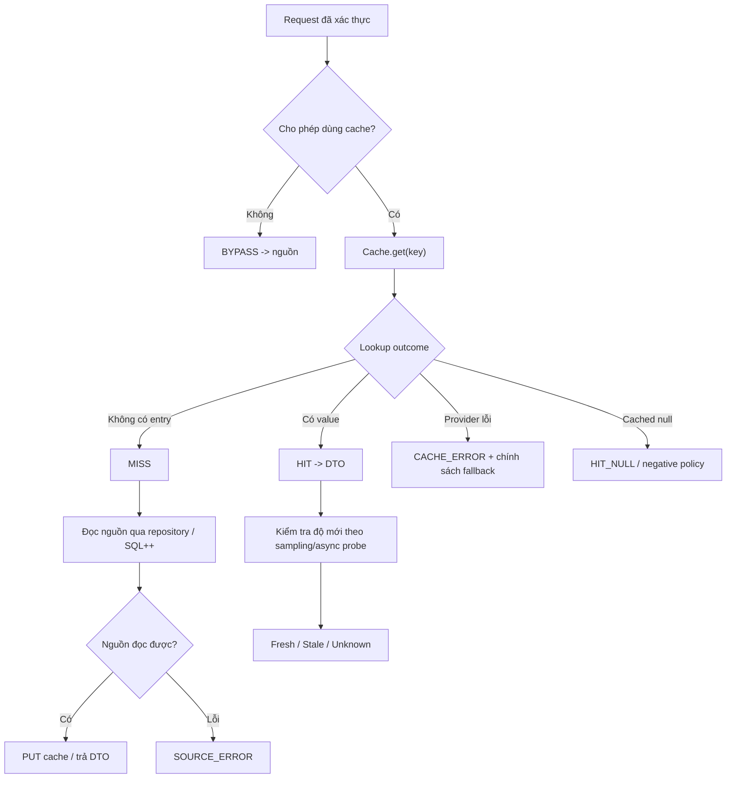
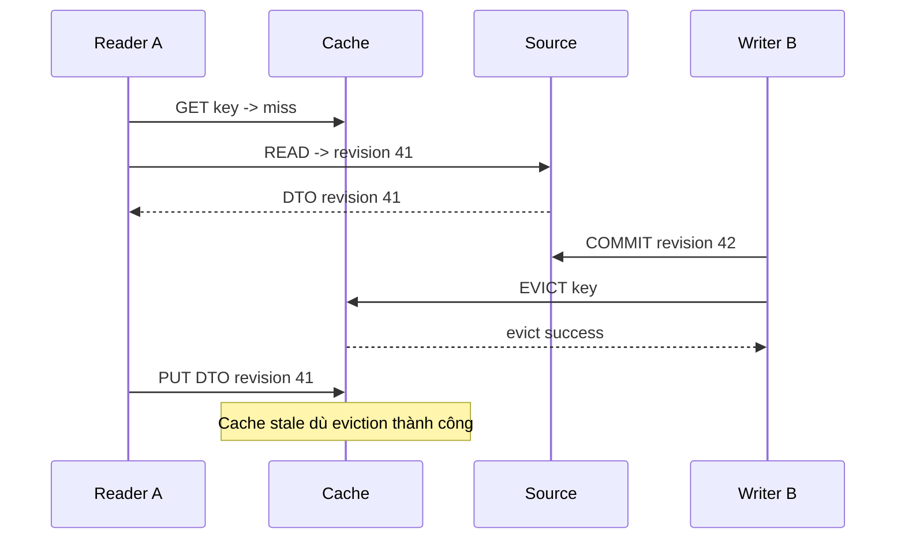
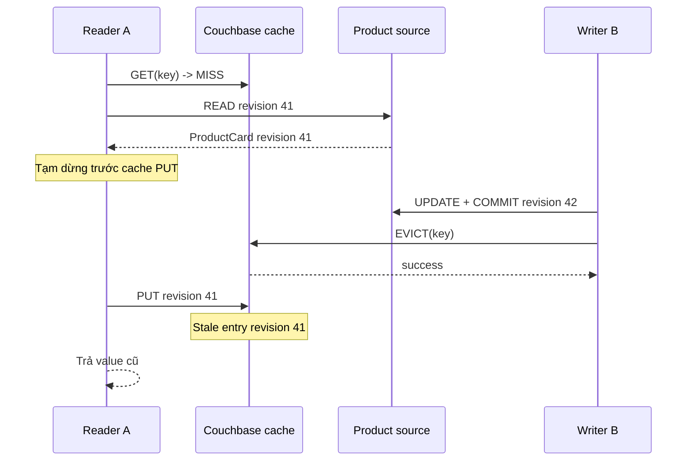

# Quan sát tỉ lệ trúng cache và kiểm thử dữ liệu cũ

## Mục tiêu học tập

Sau bài học, bạn có thể:

1. Định nghĩa **cache hit**, **cache miss**, **cached null**, **bypass**, **provider error**, **source load**, **stale hit** và phân biệt các đại lượng này trong từng lớp của Spring Cache.
2. Tính **tỉ lệ trúng cache** theo một cửa sổ thời gian, hiểu mẫu số, trường hợp không có traffic và lý do hit ratio cao **không đồng nghĩa dữ liệu đúng** hoặc độ trễ tốt.
3. Thiết kế metric bằng Micrometer/Actuator cho lookup, put/evict, lỗi, source calls, latency, stampede và kết quả kiểm tra độ mới; phân biệt metric ứng dụng với metric Couchbase SDK/Server.
4. Cấu hình Spring Cache với `CouchbaseCacheManager` và đo chính xác đường đi `@Cacheable` hoặc cache-aside thủ công, không mặc định Couchbase có hit/miss metrics auto-bound từ Spring Boot.
5. Định nghĩa **freshness contract** theo nghiệp vụ: revision của nguồn, thời điểm commit, độ trễ invalidation, stale window chấp nhận và thời điểm không được phục vụ dữ liệu cũ.
6. Viết kiểm thử có điều phối xác định (deterministic) cho annotation hit/miss, TTL, `@CacheEvict`, cập nhật nguồn, document xóa/tạo, transaction commit/rollback và race **stale repopulation**.
7. Kiểm thử nhiều thread/pod, cache outage, cold cache, schema migration, negative cache, tenant isolation và hiệu năng dưới tải.
8. Lập dashboard, ngưỡng cảnh báo, runbook xử lý **hit ratio giảm** hoặc **stale result tăng**, cùng tiêu chí nghiệm thu trước production.

**Bối cảnh module:** `SPRING_DATA_COUCHBASE` hướng dẫn xây dựng tầng truy cập Couchbase bằng document mapping, repository, `CouchbaseTemplate` và SQL++, gồm thiết kế bucket/scope/collection, chỉ mục, TTL, CAS, giao dịch và lựa chọn API reactive để bảo đảm hiệu năng, nhất quán và khả năng vận hành. Trong chương **Bộ nhớ đệm**, kết quả đọc được lưu bằng Spring Cache trên Couchbase. Vì bản sao đó có thể phục vụ lâu hơn một mutation của document nguồn, cần theo dõi **cả hiệu năng lẫn tính đúng**.

> **Thông điệp chính:** Một cache đạt **99% hit ratio** vẫn có thể trả giá sản phẩm cũ hoặc dữ liệu sai tenant. Mọi chỉ số hiệu năng phải đi kèm thước đo **freshness/consistency và security** phù hợp với nghiệp vụ.

## 1. Hiểu chính xác những trạng thái của một lần đọc cache

Giả sử một method `ProductCardReader.read(tenantId, sku)` trả về DTO sản phẩm:

```java
public record ProductCard(
        String sku,
        String title,
        long priceCents,
        String currency,
        long sourceRevision) {
}
```

Cache được lưu trong `appdata.cache.entries`, còn nguồn trong `appdata.catalog.products`.

| Outcome | Điều đã xảy ra | Có gọi nguồn không? | Cần ghi nhận |
| --- | --- | --- | --- |
| **HIT_VALUE** | Key có entry và decode thành DTO hợp lệ | Thường không | Lookup hit |
| **MISS** | Không có mapping / entry hết TTL | Có thể, nếu caller cần result | Lookup miss |
| **HIT_NULL** | Cache chứa entry mang `null` nếu provider cho phép | Thường không | Hit-null, policy negative caching |
| **BYPASS** | `@Cacheable(condition=false)` hoặc caller bỏ qua cache có chủ đích | Có, nếu business gọi nguồn | Request bypass, **không** tính là cache miss |
| **CACHE_ERROR** | KV GET timeout, mất kết nối, decode/type mismatch | Tùy fail-open/closed | Error riêng, không tự gộp thành miss |
| **SOURCE_ERROR** | Cache miss rồi repository/SQL++ timeout, lỗi xác thực | Đã thử | Source error, cache chưa có DTO mới |
| **STALE_HIT** | Đã hit nhưng value không còn phản ánh source tại thời điểm kiểm chứng | Không trong read path bình thường | Freshness violation trong sample/probe |
| **NEGATIVE_HIT** | Marker `NOT_FOUND` hợp lệ được cache riêng | Không | Negative hit, không đồng nhất với HIT_VALUE |
| **PUT_ERROR / EVICT_ERROR** | Ghi/xóa bản sao thất bại | Không xác định | Alert vì ảnh hưởng miss/stale kế tiếp |

**Phân biệt đặc biệt quan trọng:** `Cache.get(key)` trả `null` wrapper khi **miss**. Nếu provider hỗ trợ cached null, `Cache.get(key)` trả `ValueWrapper` khác null nhưng `wrapper.get()==null` khi **hit-null**. `Cache.get(key, ProductCard.class)==null` không phân biệt được hai trường hợp đó.

### 1.1. Sơ đồ một cache lookup



Không trộn event “source load đã bắt đầu” và “cache miss”: khi có `@Cacheable(sync=true)` hoặc single-flight, **nhiều miss có thể cùng chờ một lần load**, nên số source calls có thể thấp hơn số cache misses. Khi `CacheErrorHandler` fail-open, **source calls có thể tăng** dù lookup ban đầu là lỗi chứ không phải miss thông thường.

### 1.2. Cache hit chưa nói gì về quyền hoặc schema

Một result hit chỉ khẳng định có entry trả được trong path đó. Nó **chưa** chứng minh DTO còn phù hợp với phiên bản mới, người dùng có quyền đọc hay bản sao không stale.

- Authorization phải chạy **trước cache hit**, vì `@Cacheable` thường bỏ qua method body khi hit.
- Cache key phải có tenant, currency, locale, permission scope hoặc những chiều khác làm thay đổi result.
- Value schema có thể không tương thích giữa rolling deployments; decode error là lỗi, không phải not-found.
- TTL chỉ giới hạn vòng đời bản sao theo policy, không cho phép suy ra source không đổi.

## 2. Công thức hit ratio: mẫu số nào mới đúng?

Gọi:

- \(H\) là số **lookup hits** trong khoảng quan sát.
- \(M\) là số **lookup misses** trong cùng khoảng.
- \(E\) là số **lookup errors**.
- \(B\) là số **bypasses**.

Nếu mục tiêu đo hiệu quả **lookup hợp lệ**, định nghĩa:

\[
\text{Hit Ratio} = \frac{H}{H+M}\times 100\%
\]

\[
\text{Miss Ratio} = \frac{M}{H+M}\times 100\%
\]

Nếu \(H+M=0\), **không có hit ratio có ý nghĩa trong cửa sổ**: ghi `N/A` hoặc bỏ series khi denominator zero, không tự hiển thị 100%.

**Error rate** cần báo riêng:

\[
\text{Cache Error Rate}
  = \frac{E}{H+M+E}\times 100\%
\]

Đây là một quy ước đo mẫu cho **những lần thử cache**. Nếu hệ thống chọn tính hit-null hoặc negative-hit vào H, phải ghi rõ; nếu một logical request tra hai cache (positive rồi negative), sẽ có **hai lookup events**, không phải một user request.

### 2.1. Ví dụ tính theo 5 phút

Giả sử cache `catalog.product-card.v1` ghi nhận trong 5 phút:

| Chỉ số | Số lượng |
| --- | ---: |
| HIT_VALUE | 8.100 |
| MISS | 1.500 |
| CACHE_ERROR | 200 |
| BYPASS | 200 |
| Tổng request ứng dụng quan sát | 10.000 |

Với quy ước H=8.100, M=1.500:

\[
\text{Hit Ratio}=\frac{8100}{8100+1500}=84{,}375\%
\]

\[
\text{Cache Error Rate}=\frac{200}{8100+1500+200}\approx2{,}04\%
\]

**Không** tính 200 bypass thành miss vì caller cố tình không tra cache. Nếu một dashboard cho `(H)/(tổng request)=81%`, đó là **request served-from-cache fraction** trong tập ví dụ, không phải hit ratio của các lookup hợp lệ. Cả hai số có thể hữu ích nhưng cần tên khác nhau và cùng phạm vi thời gian.

### 2.2. Bảng chỉ số để tránh giải thích sai

| Chỉ số | Công thức/tín hiệu | Câu hỏi trả lời |
| --- | --- | --- |
| Lookup hit ratio | `H/(H+M)` | Cache lookup hợp lệ thường trúng bao nhiêu? |
| Served-from-cache fraction | Requests trả từ cache / tổng requests hợp lệ | Người dùng được phục vụ từ cache bao nhiêu? |
| Source loads per miss | Source computations / misses | Có stampede hoặc single-flight không? |
| Error rate | Cache errors / cache attempts | Cache provider có ổn định không? |
| Stale-hit rate (sample) | Sampled stale / sampled verifiable hits | Bản hit có sai so với nguồn trong mẫu không? |
| Invalidation lag | Thời gian từ source commit đến cache evict hoàn tất | Có cửa sổ stale sau update dài bao nhiêu? |
| Stale age | Ước lượng thời gian value đã cũ | Mức vi phạm freshness SLA |
| p95/p99 hit latency | Độ trễ của những lần hit | Hit có thực sự nhanh không? |
| p95/p99 miss latency | Độ trễ cache miss + nạp nguồn | Giá người dùng trả khi cold/expired cache |

### 2.3. Hit ratio không tự tương đương “cache có lợi”

Một cache có thể đạt 99% hits nhưng:

- Cache GET qua Couchbase chậm hơn một KV read nguồn đơn giản trong cùng cluster.
- Cache value lớn, serialize/decode tốn CPU và network.
- Cache hit phục vụ dữ liệu cũ sau source commit.
- Cache get rất nhanh nhưng key không phân biệt tenant, trả sai dữ liệu.
- Cache hide một query source không có index; đến lúc expire xảy ra stampede nghiêm trọng.

**Đo p95/p99 endpoint, tải SQL++/KV nguồn, dung lượng cache và freshness SLO bên cạnh hit ratio.**

## 3. Phạm vi đo: method, cache key, provider và SDK không giống nhau

Có ba tầng quan sát khác nhau:

| Tầng | Nhìn thấy | Không nhìn thấy tự động |
| --- | --- | --- |
| **Spring Cache annotation/interceptor** | `@Cacheable` hit/miss path, `@CacheEvict`, điều kiện, cache names | Mọi thao tác SDK raw hoặc external writer |
| **Cache API/provider** | `Cache.get/put/evict`, thời gian lookup/value decode, lỗi | Source freshness hay authorization nếu không có adapter |
| **Couchbase SDK/Server** | KV/query request latency, lỗi/retry, tài nguyên Query Service/Data Service | Một GET KV cụ thể là “cache hit” hay “cache miss” theo nghiệp vụ, trừ khi bổ sung context |

Một ứng dụng có thể dùng cả `repository.findById` và `Cache.get` trên cùng Couchbase cluster. SDK metrics biết cả hai là KV operations; nó không thể **mặc nhiên** phân loại chúng thành “hit product card cache” và “read product source”.

### 3.1. Spring Boot Actuator có tự cung cấp cache.hit cho Couchbase không?

Spring Boot cung cấp cache metrics cho một số provider tích hợp, như Caffeine, Hazelcast, Redis, Cache2k, JCache, v.v. **Trong danh sách cache libraries được hỗ trợ bởi tài liệu metrics hiện tại, Couchbase không được liệt kê.**

Vì thế **không được giả định** chỉ cần có `spring-boot-starter-actuator` và `CouchbaseCacheManager` là dashboard `cache.gets{result=hit/miss}` hoặc hit ratio đã tồn tại. Kiểm tra thật:

1. Bean `CacheManager` thực sự là gì?
2. `/actuator/metrics` liệt kê các meters nào trong phiên bản đang chạy?
3. Những cache instances được tạo lúc startup hay động sau đó?
4. Nếu có metrics, provider có thống kê hits/misses hay chỉ expose generic cache info?
5. Nếu không có, thêm **instrumentation tự xây có contract rõ** ở cache lookup boundary hoặc cache decorator.

Micrometer `CacheMetricsRegistrar` chỉ đăng ký metrics cho loại cache có instrumentation/binder hỗ trợ; **không thể tự tạo hit/miss statistics nếu provider không cung cấp hoặc bạn chưa instrument**.

### 3.2. SDK metrics phục vụ mục đích khác

Couchbase Java SDK có các lựa chọn như `LoggingMeter`, OpenTelemetry integration hoặc Micrometer integration để báo thời gian KV/SQL++ operations. Những số liệu này giúp tìm:

- KV cache GET/PUT/REMOVE quá chậm?
- SQL++ source aggregate p99 tăng khi cache expire?
- SDK request retry/timeout?
- Query Service CPU/index scan/queue bị quá tải?
- Các node Couchbase có latency bất thường?

Nhưng chúng **không chứng minh** read model DTO có revision đúng. Cần application-level freshness probes riêng.

### 3.3. Cache names khởi tạo động

Spring Boot mô tả cache metric auto-binding cho những cache instances có sẵn khi startup ở các provider được hỗ trợ; cache tạo động sau startup có thể cần đăng ký riêng. Đối với Couchbase, dù dùng cache names cố định hoặc dynamic, **trước tiên phải xác minh có binder tương thích**. Nếu tự instrument qua `MeterRegistry` tại API boundary, mỗi tên cache được đo theo chính code; không chờ binder provider.

## 4. Cấu hình nền Spring Data Couchbase + Actuator

Ví dụ Gradle:

```groovy
dependencies {
    implementation 'org.springframework.boot:spring-boot-starter-data-couchbase'
    implementation 'org.springframework.boot:spring-boot-starter-cache'
    implementation 'org.springframework.boot:spring-boot-starter-actuator'
    implementation 'io.micrometer:micrometer-registry-prometheus'

    // Chỉ thêm nếu ví dụ có REST endpoint.
    implementation 'org.springframework.boot:spring-boot-starter-web'

    testImplementation 'org.springframework.boot:spring-boot-starter-test'
    testImplementation 'org.awaitility:awaitility'
}
```

Dùng dependency management/BOM của Spring Boot để quản lý version tương thích. Không tự hardcode version Java SDK/Actuator/Micrometer ngẫu nhiên rồi giải quyết conflict bằng override thiếu kiểm chứng.

### 4.1. Connection, cache manager và management endpoints

```yaml
spring:
  couchbase:
    connection-string: couchbase://localhost
    username: app_user
    password: ${COUCHBASE_PASSWORD}
  data:
    couchbase:
      bucket-name: appdata
  cache:
    type: couchbase
    cache-names: "catalog.product-card.v1,catalog.category-summary.v1"
    couchbase:
      expiration: 5m

management:
  endpoints:
    web:
      exposure:
        include: "health,info,metrics,prometheus"
```

**Triển khai thật:** Các endpoints `/actuator/metrics` và `/actuator/prometheus` phải bị giới hạn truy cập bằng network policy/authentication/authorization; không công khai management port vô điều kiện. Bật endpoints **không** tự cung cấp semantic hit/miss cho Couchbase nếu chưa instrument.

### 4.2. @EnableCaching và Bean cache manager

```java
package com.example.catalog;

import org.springframework.cache.annotation.EnableCaching;
import org.springframework.context.annotation.Configuration;

@Configuration(proxyBeanMethods = false)
@EnableCaching
public class CacheEnablementConfiguration {
}
```

Nếu để Boot auto-configure, `spring.cache.type=couchbase` cùng kết nối Couchbase có thể tạo `CouchbaseCacheManager`. Khi cần scope/collection riêng và TTL từng cache, bạn có thể thay bằng bean thủ công:

```java
package com.example.catalog.cache;

import java.time.Duration;

import org.springframework.context.annotation.Bean;
import org.springframework.context.annotation.Configuration;
import org.springframework.data.couchbase.cache.CouchbaseCacheConfiguration;
import org.springframework.data.couchbase.cache.CouchbaseCacheManager;
import org.springframework.data.couchbase.core.CouchbaseOperations;

@Configuration(proxyBeanMethods = false)
public class ExplicitCacheConfiguration {

    @Bean
    public CouchbaseCacheManager cacheManager(
            CouchbaseOperations operations) {

        var factory = operations.getCouchbaseClientFactory()
                .withScope("cache");

        var base = CouchbaseCacheConfiguration
                .defaultCacheConfig()
                .collection("entries")
                .prefixCacheNameWith("app:catalog:")
                .disableCachingNullValues();

        return CouchbaseCacheManager.builder(factory)
                .withCacheConfiguration(
                        "catalog.product-card.v1",
                        base.entryExpiry(Duration.ofMinutes(5)))
                .withCacheConfiguration(
                        "catalog.category-summary.v1",
                        base.entryExpiry(Duration.ofSeconds(45)))
                .disableCreateOnMissingCache()
                .transactionAware()
                .build();
    }
}
```

**Lựa chọn cấu hình:** Bean thủ công thay đường Boot tự tạo manager mặc định, không phải đặt song song hai bean mà không kiểm soát. Scope `cache` và collection `entries` phải được tạo trước với RBAC đúng, tách khỏi `catalog.products` nguồn.

### 4.3. Cách xác minh môi trường quan sát

Các bước sau chỉ là **quy trình trên môi trường test được cấp quyền**:

1. Xác nhận `CacheManager` là `CouchbaseCacheManager` thực tế trong application context.
2. Kiểm tra `/actuator/health` và Couchbase connectivity dưới quyền giám sát thích hợp.
3. Xem `/actuator/metrics` để biết có meter cache nào; nếu không có, **không suy ra cache chưa hoạt động**.
4. Đưa custom `catalog.cache.lookup` counter vào code, sau đó gọi endpoint vài lần.
5. Xem `/actuator/metrics/catalog.cache.lookup` và tag `cache/outcome`; nếu gửi Prometheus, tên có thể được chuẩn hóa thành snake_case và suffix.
6. Kiểm tra SDK metrics/tracing riêng để quan sát KV/SQL++ latency.
7. Không dùng backend GET timeout như một cache miss giả khi tính ratio.

## 5. DTO nguồn và revision: điều kiện để biết cache có cũ không

Giả sử document nguồn:

```java
package com.example.catalog;

import org.springframework.data.annotation.Id;
import org.springframework.data.annotation.Version;
import org.springframework.data.couchbase.core.mapping.Collection;
import org.springframework.data.couchbase.core.mapping.Document;
import org.springframework.data.couchbase.core.mapping.Field;
import org.springframework.data.couchbase.core.mapping.Scope;

@Document
@Scope("catalog")
@Collection("products")
public class ProductDocument {

    @Id
    private String id;

    @Field
    private String tenantId;

    @Field
    private String sku;

    @Field
    private String title;

    @Field
    private long priceCents;

    @Field
    private String currency;

    @Field
    private boolean published;

    // Domain version: mọi thay đổi ảnh hưởng ProductCard
    // phải tăng giá trị này theo một write protocol.
    @Field
    private long businessRevision;

    @Version
    private Long cas;

    public ProductDocument() {}

    public String getId() { return id; }
    public void setId(String value) { id = value; }

    public String getTenantId() { return tenantId; }
    public void setTenantId(String value) { tenantId = value; }

    public String getSku() { return sku; }
    public void setSku(String value) { sku = value; }

    public String getTitle() { return title; }
    public void setTitle(String value) { title = value; }

    public long getPriceCents() { return priceCents; }
    public void setPriceCents(long value) { priceCents = value; }

    public String getCurrency() { return currency; }
    public void setCurrency(String value) { currency = value; }

    public boolean isPublished() { return published; }
    public void setPublished(boolean value) { published = value; }

    public long getBusinessRevision() { return businessRevision; }
    public void setBusinessRevision(long value) {
        businessRevision = value;
    }

    public Long getCas() { return cas; }
}
```

Repository:

```java
package com.example.catalog;

import org.springframework.data.couchbase.repository.CouchbaseRepository;

public interface ProductRepository
        extends CouchbaseRepository<ProductDocument, String> {
}
```

DTO cache:

```java
package com.example.catalog;

public record ProductCard(
        String sku,
        String title,
        long priceCents,
        String currency,
        long sourceRevision) {
}
```

Ở đây `businessRevision` là **field nghiệp vụ ứng dụng quản lý**, không phải CAS. `@Version Long cas` ánh xạ Couchbase CAS để phát hiện mutation với stale version; **CAS không phải đồng hồ hay sequence tăng đều để so “cũ hơn” toàn cục**.

### 5.1. Điều kiện để businessRevision có nghĩa

- Mọi đường ghi ảnh hưởng value cache (title, price, currency, published/visibility) phải tăng revision theo protocol chung.
- Update phải dùng CAS/transaction phù hợp để không có lost update hoặc revision quay lùi.
- External writer/SDK/batch cũng phải tuân thủ protocol; nếu không, so revision có thể cho kết quả **false fresh**.
- Khi chuyển category làm thay đổi query summary, revision của **summary/domain aggregate** cũng cần được định nghĩa; revision của một product đơn lẻ không đủ cho summary nhiều document.
- Nếu có nhiều region/async replication, cần mô tả version order và đọc nguồn ở mức consistency yêu cầu.

### 5.2. Giá trị cache đúng schema nhưng vẫn stale

```text
T0: ProductDocument(price=159900, businessRevision=41)
T1: Cache ProductCard(price=159900, sourceRevision=41)
T2: Writer commit ProductDocument(price=149900, revision=42)
T3: Reader cache hit ProductCard(revision=41)
```

Một metric đơn thuần `cache_hit_total` tăng ở T3, nhưng **sourceRevision != businessRevision** cho thấy value đã cũ tại thời điểm probe.

Để đo, ứng dụng cần một cách so sánh cache value với **nguồn sự thật**. Không phải mọi hit được đo độ mới tự động: nếu mỗi hit lại đọc source bằng KV/SQL++, lợi ích cache có thể biến mất.

## 6. Định nghĩa freshness contract trước khi thu metric

“Dữ liệu cũ” không có một nghĩa duy nhất; cần kết hợp use case và SLA.

| Read model | Ví dụ độ mới | Nguy cơ khi stale | Lựa chọn |
| --- | --- | --- | --- |
| Product card mô tả/ảnh | Có thể chấp nhận vài chục giây/phút | Hiển thị sai thông tin | TTL + invalidate khi update |
| Price preview tham khảo | Ngắn, theo SLA giá | Khách thấy giá tạm cũ | TTL ngắn + eviction |
| Giá cuối cùng checkout | Phải xác minh nguồn tại quyết định | Tính sai tiền | **Không dựa vào cache làm authority** |
| Category aggregate SQL++ | Có thể chấp nhận lag định trước | Đếm sai khi publish/unpublish | TTL + event/evict + index consistency |
| Permission/visibility | Theo security policy, thường rất nhạy | Tiết lộ dữ liệu | Guard trước cache, invalidation mạnh/bypass |
| Country code/reference list | Có thể dài | Nhìn nhầm code mới | TTL dài + version |

### 6.1. Các thước đo độ mới

| Chỉ số | Cách định nghĩa | Điều kiện |
| --- | --- | --- |
| **Revision mismatch** | `cached.sourceRevision != source.businessRevision` | Revision protocol được mọi writer tuân thủ |
| **Value mismatch** | So sánh normalized DTO cache với DTO mới xây từ nguồn | Có thể có format/order khác mà không đổi nghĩa |
| **Stale age** | Thời gian từ lúc source commit đổi version đến lúc cached result được phục vụ | Có commit timestamp đáng tin, timestamp không trộn timezone |
| **Invalidation lag** | `evict_completed_at - source_commit_at` | Có telemetry hai event, correlation |
| **Post-write visibility delay** | Thời gian từ commit đến lượt reader đầu tiên thấy version mới | Cần test/probe có kiểm soát |
| **Stale-hit ratio** | Số hit được probe và stale / số hit được probe đủ điều kiện | Sampling có thể thiên lệch, cần báo sample size |

**Phân biệt:** Một entry được ghi cách đây 5 phút **không nhất thiết stale** nếu source không đổi. Ngược lại, entry mới ghi 10ms vẫn có thể stale nếu loader đã đọc source cũ, writer commit+evict rồi loader put lại.

### 6.2. Stale/unknown/fresh là ba trạng thái

Một probe có thể không xác định được độ mới khi Couchbase source timeout, schema không nhận diện được, transaction chưa commit hoặc revision protocol bị thiếu:

- **FRESH:** Có bằng chứng value khớp trạng thái nguồn tại thời điểm probe.
- **STALE:** Có bằng chứng value khác source ở thời điểm probe.
- **UNKNOWN:** Không thể so sánh tin cậy; **không gộp vào FRESH** để làm đẹp dashboard.

Probe được chạy sau cache hit và có khoảng trễ, nên bản thân thao tác so sánh có thể nhìn thấy một mutation vừa xảy ra **sau khi response được phục vụ**. Muốn chứng minh vi phạm ở thời điểm user nhận response phải có mô hình time/order mạnh hơn; một sampled mismatch thông thường là chỉ báo/đánh giá gần đúng, không tự là bằng chứng mọi response sai tại cùng thời điểm.

## 7. Quan sát cache hit/miss bằng Micrometer: đường programmatic dễ kiểm chứng

Spring Cache annotations không bảo đảm một meter hit/miss cụ thể với Couchbase; cách dễ chủ động là **đo ngay tại adapter cache-aside bạn tự gọi**. Ví dụ này độc lập với `@Cacheable`: **không** đặt annotation đó lên cùng method để tránh đọc cache hai lần và đếm nhầm.

### 7.1. Contract metrics và cardinality

Đặt meter names (minh họa):

```text
catalog.cache.lookup{cache="catalog.product-card.v1",outcome="hit|miss|error"}
catalog.cache.load{cache="catalog.product-card.v1",outcome="success|error"}
catalog.cache.source.load{cache="catalog.product-card.v1"}  (Timer)
catalog.cache.put{cache="catalog.product-card.v1",outcome="success|error"}
catalog.cache.evict{cache="catalog.product-card.v1",outcome="success|error"}
catalog.cache.stale.probe{cache="catalog.product-card.v1",outcome="fresh|stale|unknown"}
```

Khi xuất Prometheus, tên sẽ được normalize và thêm suffix theo registry. **Không đặt raw tenantId, SKU, document ID, user ID hay key hash có thể deanonymize làm label.** Chỉ cache name/schema version (tập hữu hạn), operation và outcome. Với nhiều node, tag instance/pod do hạ tầng cung cấp ở lớp scrape, không tạo custom label không giới hạn.

### 7.2. Helper metrics nhỏ

```java
package com.example.catalog.cache;

import io.micrometer.core.instrument.MeterRegistry;
import io.micrometer.core.instrument.Timer;
import org.springframework.stereotype.Component;

@Component
public final class CatalogCacheMetrics {

    private final MeterRegistry meters;

    public CatalogCacheMetrics(MeterRegistry meters) {
        this.meters = meters;
    }

    public void lookup(String cacheName, String outcome) {
        meters.counter(
                "catalog.cache.lookup",
                "cache", cacheName,
                "outcome", outcome
        ).increment();
    }

    public void put(String cacheName, String outcome) {
        meters.counter(
                "catalog.cache.put",
                "cache", cacheName,
                "outcome", outcome
        ).increment();
    }

    public void sourceLoad(String cacheName, String outcome) {
        meters.counter(
                "catalog.cache.load",
                "cache", cacheName,
                "outcome", outcome
        ).increment();
    }

    public Timer sourceLoadTimer(String cacheName) {
        return meters.timer(
                "catalog.cache.source.load",
                "cache", cacheName
        );
    }

    public void staleProbe(String cacheName, String outcome) {
        meters.counter(
                "catalog.cache.stale.probe",
                "cache", cacheName,
                "outcome", outcome
        ).increment();
    }
}
```

Với metric class này, `cacheName` và `outcome` **phải** lấy từ tập hằng số/enum có kiểm soát. Nếu truyền raw exception message làm outcome tag, metric time series sẽ tăng không giới hạn. Metrics không lưu DTO/value/PII, nhưng vẫn cần RBAC và retention ở hệ thống observability.

### 7.3. Tách source load timer khỏi cache lookup timer

Latency một request có thể gồm:

```text
API request
  |
  +-- Authorization / argument validation
  +-- Cache GET (KV latency + decode)
  +-- Nếu miss: Source read (KV / SQL++ / remote call)
  +-- Nếu miss: Cache PUT (KV latency + encode)
  +-- Response serialization / network
```

Nếu chỉ đo timer của source load mà không đo cache GET và endpoint, cache hit có thể vẫn chậm do Couchbase network hoặc JSON decode. Tốt nhất đo **tách** cache GET/PUT, source compute và end-to-end API. Tránh “p99 trung bình của p99” khi cộng nhiều pod; thu histogram/distribution phù hợp rồi aggregate theo query của backend metrics.

### 7.4. Tên meter không tự được Actuator cung cấp

Những meter `catalog.cache.*` ở trên **chỉ xuất hiện khi ứng dụng gọi helper**. Tài liệu Boot không bảo đảm chúng tồn tại. Kiểm tra bằng integration test `SimpleMeterRegistry` rồi xem count; trên production kiểm tra lần lookup thật có increment. Nếu đã có cache metrics binder cung cấp tương đương, không instrument đúp và cộng hai metric có semantics khác nhau.

## 8. Ví dụ service cache-aside đo đúng từng lookup

Trong ví dụ này, ứng dụng **tự điều phối cache get/put** bằng Spring `CacheManager`. Do đó các `lookup(hit/miss/error)` tương ứng một lần `Cache.get` được gọi từ service. Đây **không phải** instrumentation tự động cho mọi method `@Cacheable` khác.

### 8.1. Xác thực tenant ở ngoài cache

```java
package com.example.catalog;

public interface CatalogAuthorization {

    /**
     * Chỉ chấp nhận tenant đã được xác thực ở server.
     * Ném exception khi caller không có quyền đọc.
     */
    void requireRead(String authenticatedTenantId);
}
```

Ứng dụng thực phải triển khai từ security context tin cậy, không dùng một giá trị do client tự gửi để coi là đã xác thực. Khi hit, body method `@Cacheable` có thể không chạy; với code cache-aside dưới đây, chúng ta kiểm tra quyền **trước** `Cache.get`.

### 8.2. Service quan sát hit/miss và source load

```java
package com.example.catalog;

import java.util.NoSuchElementException;
import java.util.Optional;

import com.example.catalog.cache.CatalogCacheMetrics;
import io.micrometer.core.instrument.MeterRegistry;
import io.micrometer.core.instrument.Timer;
import org.springframework.cache.Cache;
import org.springframework.cache.CacheManager;
import org.springframework.stereotype.Service;

@Service
public class MeteredProductCardService {

    private static final String CACHE =
            "catalog.product-card.v1";

    private final CatalogAuthorization authorization;
    private final ProductRepository repository;
    private final CacheManager cacheManager;
    private final CatalogCacheMetrics metrics;
    private final MeterRegistry meterRegistry;

    public MeteredProductCardService(
            CatalogAuthorization authorization,
            ProductRepository repository,
            CacheManager cacheManager,
            CatalogCacheMetrics metrics,
            MeterRegistry meterRegistry) {
        this.authorization = authorization;
        this.repository = repository;
        this.cacheManager = cacheManager;
        this.metrics = metrics;
        this.meterRegistry = meterRegistry;
    }

    public ProductCard read(
            String authenticatedTenantId, String sku) {

        authorization.requireRead(authenticatedTenantId);

        Cache cache = cacheManager.getCache(CACHE);
        if (cache == null) {
            throw new IllegalStateException(
                    "Cache chưa được khai báo: " + CACHE);
        }

        String key = authenticatedTenantId + "::" + sku;
        // Demo: validate rằng tenant/SKU không chứa "::"
        // hoặc dùng encoder cho từng segment ở production.

        Cache.ValueWrapper wrapper;
        try {
            wrapper = cache.get(key);
        } catch (RuntimeException cacheError) {
            metrics.lookup(CACHE, "error");
            // Demo: fail-closed. Fail-open nếu muốn phải
            // là policy rõ ràng và có metric riêng.
            throw cacheError;
        }

        if (wrapper != null) {
            Object cached = wrapper.get();

            if (cached == null) {
                metrics.lookup(CACHE, "hit_null");
                throw new IllegalStateException(
                        "Cache product-card không được có null");
            }

            if (!(cached instanceof ProductCard card)) {
                metrics.lookup(CACHE, "error");
                throw new IllegalStateException(
                        "Sai kiểu cache value: " +
                        cached.getClass().getName());
            }

            metrics.lookup(CACHE, "hit");
            return card;
        }

        metrics.lookup(CACHE, "miss");

        Timer.Sample sample = Timer.start(meterRegistry);
        Optional<ProductDocument> source;
        try {
            source = repository.findById(
                    "product::" + authenticatedTenantId +
                    "::" + sku);
        } catch (RuntimeException sourceError) {
            metrics.sourceLoad(CACHE, "error");
            throw sourceError;
        } finally {
            sample.stop(metrics.sourceLoadTimer(CACHE));
        }

        if (source.isEmpty()) {
            metrics.sourceLoad(CACHE, "not_found");
            // Không negative-cache exception/404.
            throw new NoSuchElementException(
                    "Sản phẩm không tồn tại");
        }

        ProductDocument doc = source.get();

        if (!authenticatedTenantId.equals(doc.getTenantId())
                || !doc.isPublished()) {
            metrics.sourceLoad(CACHE, "invalid_source");
            throw new SecurityException(
                    "Không được phục vụ sản phẩm");
        }

        metrics.sourceLoad(CACHE, "success");

        ProductCard card = new ProductCard(
                doc.getSku(),
                doc.getTitle(),
                doc.getPriceCents(),
                doc.getCurrency(),
                doc.getBusinessRevision());

        try {
            cache.put(key, card);
            metrics.put(CACHE, "success");
        } catch (RuntimeException putError) {
            metrics.put(CACHE, "error");
            // Demo: fail-closed để lỗi được nhìn thấy.
            // Production có thể fail-open sau khi đã load nguồn,
            // nhưng phải ghi metric/trace và giới hạn retry.
            throw putError;
        }

        return card;
    }
}
```

**Giới hạn của ví dụ:** Đây là service demo cho một cache đơn, không có full HTTP validation, per-key encode hoặc distributed lock. Nếu source có nhiều request cùng miss, các request có thể cùng chạy repository và put; instrumentation chỉ giúp **phát hiện** stampede, không tự giải quyết.

### 8.3. Vì sao dùng Cache.ValueWrapper?

- `cache.get(key) == null` là **miss** theo Spring Cache contract.
- `wrapper != null && wrapper.get()==null` là **hit-null** theo provider cho phép.
- `cache.get(key, ProductCard.class) == null` không phân biệt hai trường hợp trên.
- Giá trị có thể deserialize thành type sai sau thay đổi serializer/schema; đó là **error**, không được tính miss.
- `NoSuchElementException` từ repository do không tồn tại nguồn là **source not-found**, không phải cache get error.

Ví dụ cấu hình phần 4 đã `disableCachingNullValues()`, do đó `hit_null` là một bất thường cần điều tra, nhất là khi namespace cũ từng cho phép cached null.

### 8.4. Đếm đúng loại metric theo thứ tự

Với một request miss, source đọc thành công và cache put thành công:

```text
catalog.cache.lookup{outcome=miss}        +1
catalog.cache.load{outcome=success}       +1
catalog.cache.source.load Timer           +1 sample
catalog.cache.put{outcome=success}        +1
```

Với một request hit:

```text
catalog.cache.lookup{outcome=hit}         +1
source load                                +0
cache put                                  +0
```

Với cache GET timeout nhưng source chưa đọc:

```text
catalog.cache.lookup{outcome=error}       +1
source load                                +0
```

Một adapter fail-open có thể ghi `cache.lookup(error)` và `source.load(success)` **trong cùng request**. Đừng biến error thành miss chỉ để hit ratio đẹp hơn; theo dõi cả source fallback count.

### 8.5. Đếm “bypass” ở đâu?

Nếu có nhánh chủ động không tra cache, ví dụ request read-your-writes ngay sau mutation, hãy ghi `catalog.cache.access{outcome=bypass}` ở boundary của caller hoặc tính request served-from-cache riêng. Đừng gọi `metrics.lookup(...,"miss")` vì **không hề tra cache**.

Nếu `@Cacheable(condition=false)`, underlying method chạy nhưng thường không có cache get. Một AOP timer đặt quanh method body không thể tự suy ra toàn bộ cache hit/miss: khi hit, body không chạy.

## 9. Với @Cacheable, nên gắn đo ở lớp nào?

Nếu ứng dụng chủ yếu dùng:

```java
@Cacheable(
    cacheNames = "catalog.product-card.v1",
    key = "#p0 + '::' + #p1",
    unless = "#result == null")
public ProductCard read(String tenantId, String sku) {
    return source.load(tenantId, sku);
}
```

thì service ở phần 8 **không phải** code mà annotation sử dụng, và các counter `catalog.cache.lookup` ở service đó không tự xuất hiện.

Có những lựa chọn:

| Chiến lược | Đếm được | Cần chú ý |
| --- | --- | --- |
| **Cache decorator** bọc `Cache.get`/`put`/`evict` của manager | Physical cache operations cho annotation lẫn programmatic paths đi qua decorator | Phải bao phủ đúng overload: `get(key)`, `get(key, Class)`, `get(key, Callable)`, API async và các operation write |
| **Instrument CacheWriter/adapter** nếu version cho phép | KV read/write error, thời gian | API có thể không phân biệt method bypass hay người dùng có nhận value |
| **Interceptor/AOP ở caller và source loader** | End-to-end request, source invocation count | Source method không chạy khi hit; khó kết luận mọi hit nếu không có cache outcome |
| **Programmatic cache-aside** | Logical hit/miss/error rõ ở code | Không tự bao phủ các `@Cacheable` khác |
| **Boot/provider-native binder** nếu có hỗ trợ | Theo tính năng mà binder expose | Couchbase không nằm trong danh sách tự động được bảo đảm bởi tài liệu Boot hiện tại |

**Không chọn cách đếm “@Cacheable source method chạy = miss” rồi đảo thành “không chạy = hit” một cách máy móc**. Một method không chạy có thể do request không gọi, authorization chặn, caching condition, async processing hoặc middleware; method chạy có thể do bypass/provider error/sync/retry. Cần một điểm đo với contract rõ.

### 9.1. Cache decorator cần xử lý trường hợp cache null và sync

Nếu tự viết decorator:

- `Cache.get(key)`: wrapper null = miss; wrapper khác null = hit, có thể cached null.
- `Cache.get(key, Class<T>)`: giá trị null **không cho biết** miss hay cached-null; không giả lập hit/miss bằng suy đoán.
- `Cache.get(key, Callable<T>)`: có thể là lookup kết hợp loader khi `sync=true`; phải biết liệu loader đã được gọi để phân loại miss và tránh đếm hai lần.
- `Cache.retrieve(...)` (nếu framework/provider hỗ trợ): async completion; đo outcome khi hoàn tất, không lúc future vừa được tạo.
- `Cache.putIfAbsent`: không coi mọi putIfAbsent là put mới thành công khi entry đã tồn tại.
- `Cache.evict`/`clear`: phân biệt **yêu cầu thao tác** với **KV operation hoàn tất**, đặc biệt khi transaction-aware cache trì hoãn đến afterCommit.
- Các lệnh programmatic trực tiếp tới SDK bỏ qua Cache API của decorator nếu không đi qua nó.

Decorator phải giữ nguyên behavior của provider, không làm mất `transactionAware()`, key conversion, TTL, loại value hoặc exception. Một implementation mẫu quá sơ lược có thể khiến metrics sai và làm thay đổi semantics caching; chỉ dùng decorator đã có test contract cho từng overload.

### 9.2. CacheErrorHandler không phải bộ đếm hit/miss

Spring `CacheErrorHandler` có callback cho lỗi `get/put/evict/clear` của caching interceptor. Nó hữu ích để phân loại lỗi, nhưng **không nhận callback khi GET thành công hit hoặc miss** để tự xây hit ratio đầy đủ.

Với `@Cacheable(sync=true)`, Spring có thể gọi combined `Cache.get(key,Callable)` và error handling khác đường non-sync; code instrumentation phải kiểm thử đúng hai chế độ. Một số code gọi `CacheManager.getCache(...).get` trực tiếp cũng không tự đi qua error handler của interceptor.

Không nuốt `evictError` vô điều kiện: source đã commit có thể để lại cache stale. Nếu fail-open get, đảm bảo điều kiện bảo mật vẫn đúng và có bulkhead để tránh overload nguồn.

## 10. Prometheus/Actuator: đọc hit ratio có cơ sở

Sau khi ứng dụng thực sự ghi meter `catalog.cache.lookup`, Micrometer Prometheus registry có thể xuất counter dưới dạng như:

```text
catalog_cache_lookup_total{cache="catalog.product-card.v1",outcome="hit"} 8100
catalog_cache_lookup_total{cache="catalog.product-card.v1",outcome="miss"} 1500
catalog_cache_lookup_total{cache="catalog.product-card.v1",outcome="error"} 200
```

Tên series cuối cùng phụ thuộc registry/version và naming convention; hãy kiểm tra thực tế từ `/actuator/prometheus`, không copy query khi meter chưa xuất hiện.

### 10.1. Hit ratio 5 phút theo cache name

```promql
100 *
sum by (cache) (
  rate(catalog_cache_lookup_total{outcome="hit"}[5m])
)
/
clamp_min(
  sum by (cache) (
    rate(catalog_cache_lookup_total{outcome=~"hit|miss"}[5m])
  ),
  1e-9
)
```

Query này tính **% lookup hits trong 5 phút**. Cần thêm panel **lookup volume** và đánh dấu `N/A/insufficient traffic` nếu denominator gần 0; `clamp_min` chỉ giúp tránh chia cho zero, **không biến cửa sổ không có traffic thành một kết quả đo đáng tin**.

### 10.2. Provider error rate theo cache name

```promql
100 *
sum by (cache) (
  rate(catalog_cache_lookup_total{outcome="error"}[5m])
)
/
clamp_min(
  sum by (cache) (
    rate(catalog_cache_lookup_total{outcome=~"hit|miss|error"}[5m])
  ),
  1e-9
)
```

Nếu cache vừa mất kết nối, hit ratio có thể trông “đẹp” trong số ít attempts còn thành công, trong khi **error rate tăng mạnh** và source bị fail-open quá tải. Vì vậy phải đặt các biểu đồ cạnh nhau.

### 10.3. Đếm source loads

```promql
sum by (cache) (
  rate(catalog_cache_load_total{outcome="success"}[5m])
)
```

Muốn phát hiện stampede, thêm `source_load_started_total` và `source_load_inflight` được instrument ở loader thực. Một metric chỉ đếm `success` có thể bỏ sót hàng trăm SQL++ calls đang timeout.

### 10.4. Source load p95/p99

Với Micrometer Timer phân phối histogram qua Prometheus (cần bật histogram phù hợp):

```promql
histogram_quantile(
  0.95,
  sum by (le, cache) (
    rate(catalog_cache_source_load_seconds_bucket[5m])
  )
)
```

Không tính p95 toàn hệ thống bằng cách lấy trung bình số p95 của từng pod. Nếu chưa bật histogram và chỉ có count/sum, không thể dựng percentile từ hai số đó; cần bật histogram/percentiles theo mục tiêu và tính toán chi phí cardinality.

### 10.5. Cửa sổ 5 phút và cửa sổ dài trả lời hai câu hỏi khác nhau

- 1–5 phút: phát hiện stampede, provider outage, mass eviction nhanh.
- 30–60 phút: xem xu hướng sau rollout/traffic changes.
- 24 giờ: nhận diện chu kỳ warm/cold, TTL và ảnh hưởng của batch jobs.

Dashboard có thể báo hit ratio chung 95% nhưng giấu một cache có 40% hoặc một nhóm request nhạy về độ mới. Phải nhóm theo **cache name, read model và app version**, không gom mọi vùng thành một tỷ số khiến vấn đề mất dấu.

## 11. Đo “stale hit” bằng source revision có lấy mẫu

Nếu kiểm tra nguồn sau **mọi** cache hit, ta gần như trả thêm chi phí đọc KV/SQL++ cho mỗi request — phủ nhận lợi ích cache. Vì vậy nên dùng **sampling bounded** hoặc synthetic test riêng để kiểm tra độ mới.

### 11.1. Probe có phân loại FRESH/STALE/UNKNOWN

Ví dụ dành cho `ProductCard` đã xác thực quyền. Chỉ gọi khi **chắc chắn vừa nhận một positive cache hit** ở adapter phần 8; với `@Cacheable` thuần, facade không tự biết result là hit hay miss.

```java
package com.example.catalog.cache;

import java.util.Optional;
import java.util.concurrent.ThreadLocalRandom;

import com.example.catalog.ProductCard;
import com.example.catalog.ProductDocument;
import com.example.catalog.ProductRepository;
import org.springframework.stereotype.Component;

@Component
public final class ProductFreshnessProbe {

    private static final String CACHE =
            "catalog.product-card.v1";

    private final ProductRepository repository;
    private final CatalogCacheMetrics metrics;

    public ProductFreshnessProbe(
            ProductRepository repository,
            CatalogCacheMetrics metrics) {
        this.repository = repository;
        this.metrics = metrics;
    }

    public void maybeCheckHit(
            String authenticatedTenantId,
            String sku,
            ProductCard cached) {

        // Mẫu 1%; production phải cấu hình/budget riêng.
        if (ThreadLocalRandom.current().nextInt(100) != 0) {
            return;
        }

        try {
            Optional<ProductDocument> source =
                    repository.findById(
                            "product::" + authenticatedTenantId
                            + "::" + sku);

            if (source.isEmpty()) {
                metrics.staleProbe(CACHE, "stale");
                return;
            }

            ProductDocument doc = source.get();

            if (!authenticatedTenantId.equals(doc.getTenantId())
                    || !doc.isPublished()) {
                metrics.staleProbe(CACHE, "stale");
                return;
            }

            boolean sameRevision =
                    cached.sourceRevision()
                    == doc.getBusinessRevision();

            boolean sameFields =
                    cached.sku().equals(doc.getSku())
                    && cached.title().equals(doc.getTitle())
                    && cached.priceCents() == doc.getPriceCents()
                    && cached.currency().equals(doc.getCurrency());

            metrics.staleProbe(
                    CACHE,
                    sameRevision && sameFields ? "fresh" : "stale");

        } catch (RuntimeException sourceError) {
            // Một probe thất bại không chứng minh cache fresh.
            metrics.staleProbe(CACHE, "unknown");
        }
    }
}
```

**Không dùng đoạn này làm authorization:** Caller phải được xác thực và kiểm tra quyền **trước** cache hit. Probe nên chạy theo policy ở một **executor có giới hạn**, nếu việc kiểm tra đồng bộ 1% hits có thể làm tăng tail latency. Đặt budget QPS/timeout cho các probe; sampling độc lập đơn giản ở trên chỉ là ví dụ.

### 11.2. Chỗ gọi probe đúng trong cache-aside service

Trong nhánh cache hit của phần 8, sau khi type được xác minh:

```java
metrics.lookup(CACHE, "hit");
freshnessProbe.maybeCheckHit(
        authenticatedTenantId, sku, card);
return card;
```

*Giả sử `freshnessProbe` được inject vào service*. Nếu chuyển thành async probe, không làm việc nhạy cảm trong background bằng security context của một request đã hết vòng đời; capture context tối thiểu đã xác thực và giới hạn quyền của probe service.

### 11.3. Những sai số đo cần ghi chú

1. Revision của nguồn có thể tăng giữa **response hit** và **probe read**, dẫn đến mismatch dù response đúng tại thời điểm hit.
2. Nếu source query SQL++ đi qua index chưa bắt kịp mutation, kết quả probe có thể không phản ánh KV source mới; với product ID ưu tiên KV lookup.
3. Nếu external writer không tăng `businessRevision`, chỉ so revision sẽ bỏ sót stale; so fields hoặc audit protocol giúp phát hiện phần nào.
4. Probe đọc từ replica/region có thể thấy trạng thái khác, tùy consistency của nguồn.
5. Mẫu 1% của hot key có thể chi phối toàn bộ sample; nếu mục tiêu là đo theo cache name/domain, cần stratified sampling và volume đủ.
6. Retry probe có thể tăng tải source; đừng để freshness observability trở thành một stampede mới.
7. Nếu source read fail, outcome phải là **UNKNOWN**; đừng âm thầm tính thành fresh.

### 11.4. Stale-hit ratio ước lượng

Khi có metric của sample:

```promql
100 *
sum by (cache) (
  rate(catalog_cache_stale_probe_total{outcome="stale"}[30m])
)
/
clamp_min(
  sum by (cache) (
    rate(catalog_cache_stale_probe_total{outcome=~"fresh|stale"}[30m])
  ),
  1e-9
)
```

Đây là **tỷ lệ trong những lần probe xác minh được**, không phải tỉ lệ stale được đo chính xác trên mọi user request. Hiển thị thêm sample count, unknown rate và confidence/bias note; không đặt ngưỡng alert trên vài sample mỗi giờ.

### 11.5. Khi không có revision dễ tin cậy

Không tạo một con số version giả chỉ để đo:

- Với aggregate từ SQL++, có thể so hash/canonical result của read model được tính lại theo sample, nhưng chi phí cao và cần query consistency phù hợp.
- Với document đơn, có thể so field projection từ KV nguồn.
- Với dữ liệu cache có metadata `generatedAt` nhưng source không có updatedAt, chỉ đo **tuổi cache** chứ không kết luận stale.
- Với query theo time window, cần ghi rõ request time/filter/locale/tenant vào key và so theo cùng tham số.
- Với giá thanh toán/tồn kho/quyền, đo production samples không thay thế đọc nguồn ở thời điểm quyết định.

## 12. Invalidation lag và nguồn commit: cần đo hai sự kiện

Giả sử command thay giá lúc T0, source commit thành công lúc T1 và cache eviction hoàn tất lúc T2:

\[
\text{Invalidation Lag} = T2 - T1
\]

SLA có thể yêu cầu p99 invalidation lag không vượt quá một ngưỡng. Nhưng có những trường hợp không tính được T2: eviction không được phát, lỗi KV, process crash, external writer không có event. **Missing event** phải được theo dõi bằng count/backlog/timeout, không loại bỏ im lặng khỏi sample p99 rồi báo “eviction nhanh”.

### 12.1. Phân biệt yêu cầu eviction và hoàn tất eviction

- `@CacheEvict` mặc định yêu cầu xóa sau method thành công.
- `CouchbaseCacheManager.transactionAware()` có thể trì hoãn `put/evict/clear` tới afterCommit của Spring-managed transaction.
- `Cache.evictIfPresent` có contract immediate khác `evict`.
- Transaction commit thành công nhưng cache evict có thể timeout; không có atomic commit nguồn+cache.
- Source đã đổi nhưng external writer/batch không đi qua cache annotation; cần outbox/event/TTL.

Vì vậy log/metric nên tách `source_committed`, `eviction_requested`, `eviction_succeeded`, `eviction_failed`, `outbox_replayed` và độ trễ tương ứng. Một metric chỉ đếm số method có `@CacheEvict` được gọi không chứng minh cache key đã biến mất.

### 12.2. Race: stale được nạp lại sau khi evict đúng



**Điều phải kiểm thử:** Một lần evict thành công **không** bảo đảm mọi lookup tương lai thấy revision mới nếu có in-flight loader từ trước. TTL, transaction-aware eviction, CAS nguồn và outbox tăng khả năng kiểm soát nhưng không tự loại bỏ race này. Khi business không chấp nhận stale, cần version fencing/reader bypass hoặc không cache đường đọc đó.

### 12.3. Theo dõi stale-serve window thay vì chỉ hit ratio

Nếu sản phẩm thay giá lúc T1 và một người dùng vẫn nhận giá cũ lúc T3, cửa sổ stale kéo dài ít nhất tới T3; nếu không có quan sát liên tục, chưa chắc biết chính xác kết thúc lúc nào. Dashboard cần phân biệt:

- Thời gian eviction hoàn tất.
- Thời gian response đầu tiên quan sát version mới.
- Số stale responses được sampling phát hiện.
- Trường hợp không thể chứng minh nguồn đã commit hoặc cache invalidation.
- SLO độ mới theo read model, không lấy trung bình toàn module.

## 13. TTL: test với server thật và clock giả ở cấp policy

### 13.1. Cache entry expiry do Couchbase quản lý

`CouchbaseCacheConfiguration.entryExpiry(Duration)` quy định expiry khi put. Không có scheduler Java xóa key chính xác từng millisecond ở application. Bucket/collection `maxExpiry` có thể ảnh hưởng thời hạn hiệu lực; cần xác minh trên test cluster cùng cấu hình.

Đặt test-specific TTL ngắn, ví dụ 2 giây:

```java
CouchbaseCacheConfiguration testConfig =
        CouchbaseCacheConfiguration.defaultCacheConfig()
                .entryExpiry(java.time.Duration.ofSeconds(2))
                .collection("entries");
```

Không dùng TTL production 5 phút rồi viết test `Thread.sleep(5000)`; tốn thời gian, flaky và có thể bất ngờ vì clock/scheduler/expiry rounding.

### 13.2. TTL integration test với Awaitility

```java
import static org.assertj.core.api.Assertions.assertThat;
import static org.awaitility.Awaitility.await;

import java.time.Duration;
import org.springframework.cache.Cache;

// Snippet bên trong @Test: cache "fastTtlProbe" có TTL = 2s
// và được cấu hình trên Couchbase test collection.
Cache cache = cacheManager.getCache("fastTtlProbe");
assertThat(cache).isNotNull();

String key = "ttl-test-key";
cache.put(key, "value");

assertThat(cache.get(key)).isNotNull();

await()
        .atMost(Duration.ofSeconds(15))
        .pollInterval(Duration.ofMillis(250))
        .until(() -> cache.get(key) == null);
```

Test profile phải thật sự khai báo `fastTtlProbe` với expiry 2 giây và manager không chặn tạo tên; snippet này **không tự tạo cache/config**.

**Pass condition:** Cache entry biến mất/được xem là miss sau khi TTL hết trong time budget; document nguồn không bị xóa. Đây là test TTL server, không phải kiểm thử stale sau source mutation.

### 13.3. Không dùng Clock giả để điều khiển Couchbase Server expiry

Bạn có thể inject `Clock` vào application để kiểm thử **freshUntil/staleUntil policy** của custom envelope, nhưng `Clock.fixed(...)` trong JVM **không khiến Couchbase Server hết hạn entry**. Cần phân biệt:

| Loại test | Clock giả hữu ích? | Cần Couchbase thật? |
| --- | --- | --- |
| Policy read model stale window | Có | Không bắt buộc |
| Tính tuổi cache từ metadata | Có | Không bắt buộc |
| `entryExpiry(Duration)` thực tế | Không để ép thời gian server | Có |
| CAS/transaction/invalidation | Không đủ | Có |
| SQL++ index consistency | Không đủ | Có |
| Cross-pod hit/miss | Không đủ | Có multi-process |

### 13.4. TTL không chứng minh freshness

Một test chỉ chứng minh cache miss sau 2 giây **không** chứng minh “giá sửa lúc T0 phải hiện ngay”. Test đó cần cập nhật nguồn, evict, đọc lại và đo revision sau commit. Ngược lại, source không đổi sau TTL và load lại cùng DTO là bình thường, không phải stale.

## 14. Kiểm thử chức năng: hit/miss, null, negative, source update

### 14.1. Test metrics helper bằng SimpleMeterRegistry

Unit test này không cần Couchbase, vì chỉ kiểm tra **hành vi đo metric** của class `CatalogCacheMetrics`:

```java
package com.example.catalog.cache;

import static org.assertj.core.api.Assertions.assertThat;

import io.micrometer.core.instrument.simple.SimpleMeterRegistry;
import org.junit.jupiter.api.Test;

class CatalogCacheMetricsTest {

    @Test
    void recordsHitAndMissSeparately() {
        try (var registry = new SimpleMeterRegistry()) {
            var metrics = new CatalogCacheMetrics(registry);

            metrics.lookup("catalog.product-card.v1", "hit");
            metrics.lookup("catalog.product-card.v1", "hit");
            metrics.lookup("catalog.product-card.v1", "miss");

            assertThat(registry.counter(
                    "catalog.cache.lookup",
                    "cache", "catalog.product-card.v1",
                    "outcome", "hit"
            ).count()).isEqualTo(2.0);

            assertThat(registry.counter(
                    "catalog.cache.lookup",
                    "cache", "catalog.product-card.v1",
                    "outcome", "miss"
            ).count()).isEqualTo(1.0);
        }
    }
}
```

Test này không chứng minh lookup thật gọi helper. Cần integration test gọi `MeteredProductCardService` qua Spring context và kiểm tra counter increment tương ứng.

### 14.2. Unit test contract Cache.ValueWrapper

Dùng in-memory cache **để chứng minh Spring Cache interface**, không suy ra Couchbase provider sẽ hỗ trợ cached null y hệt:

```java
import static org.junit.jupiter.api.Assertions.*;

import org.junit.jupiter.api.Test;
import org.springframework.cache.Cache;
import org.springframework.cache.concurrent.ConcurrentMapCache;

class CacheValueWrapperContractTest {

    @Test
    void missAndCachedNullAreDifferentStates() {
        Cache cache = new ConcurrentMapCache("unitTest");

        assertNull(cache.get("absent"));

        cache.put("cachedNull", null);

        Cache.ValueWrapper wrapper = cache.get("cachedNull");
        assertNotNull(wrapper);
        assertNull(wrapper.get());

        // Typed-get không phân biệt MISS và cached-null.
        assertNull(cache.get("absent", String.class));
        assertNull(cache.get("cachedNull", String.class));
    }
}
```

Với Couchbase cache config `disableCachingNullValues()`, thử `put(key,null)` trên test backend: operation có thể ném lỗi và **không được dùng làm eviction**. Nếu cần xóa, dùng `cache.evict(key)`.

### 14.3. Spring @Cacheable hit/miss thông qua proxy

Tạo một bean đọc source:

```java
package com.example.catalog;

import java.util.concurrent.atomic.AtomicInteger;
import org.springframework.cache.annotation.Cacheable;
import org.springframework.stereotype.Service;

@Service
public class CountingCardLoader {

    private final AtomicInteger loads = new AtomicInteger();

    @Cacheable(
        cacheNames = "catalog.product-card.v1",
        key = "#p0 + '::' + #p1")
    public ProductCard load(String tenant, String sku) {
        loads.incrementAndGet();

        // DTO test đơn giản, không ghi nguồn ở đây.
        return new ProductCard(sku, "Test", 10000, "VND", 1);
    }

    public int loadCount() {
        return loads.get();
    }
}
```

Kịch bản integration test:

```text
1. Cache.evict("testTenant::testSku") trước test.
2. Inject CountingCardLoader từ Spring context.
3. Gọi load(testTenant,testSku) lần 1 -> source method chạy.
4. Gọi lại đúng key lần 2 -> method body không chạy.
5. Xác nhận loads tăng đúng 1 trong cửa sổ đã chọn.
6. Evict key và gọi lần 3 -> loads tăng thêm 1.
```

**Không** `new CountingCardLoader()` trong test rồi kết luận `@Cacheable` không hoạt động: đối tượng mới không qua Spring proxy. Khi test count, có thể có request khác dùng chung key/test cluster; phải cô lập keyspace test và reset/so sánh số đếm theo delta.

### 14.4. Test sau khi nguồn đổi

Với source `ProductDocument` revision 41, cache `ProductCard` revision 41:

1. Read đầu tiên → miss, source call và cache put.
2. Read tiếp → hit revision 41.
3. Writer dùng `@Version`/CAS cập nhật price và `businessRevision=42`, commit thành công.
4. Evict chính xác cache key **sau commit** theo policy.
5. Read tiếp → miss, nạp DTO revision 42.
6. Sample probe sau hit mới → FRESH.
7. Kiểm tra metric `lookup miss/hit`, `source load` và `evict result` tương ứng.

Đây mới là bài test **invalidation/freshness**, khác test TTL. Cần xác minh writer đi qua Spring proxy, hoặc event/outbox/SDK path đã có invalidation nếu writer ngoài ứng dụng.

### 14.5. Test thao tác create/delete

- **Delete:** Evict positive cache để user không tiếp tục đọc document đã xóa; nếu cache hit sau delete mà chưa evict, phát hiện stale.
- **Create:** Nếu đang negative cache `NOT_FOUND`, evict negative marker sau create; nếu không, user thấy stale 404.
- **Publish/unpublish:** Cache dương có thể giữ public DTO sau unpublish; test security guard và invalidation.
- **External writer:** Mutation qua SDK/batch không tự kích hoạt `@CacheEvict` trong application; test cơ chế outbox/event hoặc stale window.
- **Source timeout:** Không cache một exception thành negative `NOT_FOUND` hoặc coi cache error là miss thường.
- **Tenant:** Cùng SKU giữa hai tenant không được dùng chung key/value; security phải chạy trước hit.

### 14.6. Test null và cached not-found đúng semantics

Nếu `@Cacheable` trả `Optional.empty()` và có `unless="#result == null"`, empty thường **không được cache**. Điều này làm nhiều miss liên tiếp cho ID không tồn tại. Nếu chọn negative caching, dùng marker/cache name riêng, TTL ngắn và invalidation khi create.

Không gộp metric `negative_hit` với `positive_hit` nếu dashboard dùng để báo “tỷ lệ request trả DTO từ cache”. Có thể tính thêm tổng cache lookups tiết kiệm source reads, nhưng phải ghi rõ định nghĩa.

## 15. Transaction và kiểm thử dữ liệu cũ sau commit/rollback

### 15.1. Ranh giới after-method và after-commit

`@CacheEvict` mặc định được yêu cầu **sau khi method hoàn tất bình thường**. Nếu một transaction bao ngoài còn hoạt động, điều này chưa chắc là after-commit.

`CouchbaseCacheManager.builder(factory).transactionAware()` có thể trì hoãn `Cache.put/evict/clear` tới phase afterCommit khi có Spring-managed transaction. Nhưng:

- Không có transaction → thao tác có thể chạy ngay.
- `Cache.evictIfPresent` và `Cache.invalidate` có contract immediate khác `evict/clear`.
- Một cache eviction sau commit có thể thất bại dù source đã commit.
- Một reader miss từ trước commit có thể put bản cũ **sau eviction**.
- Transaction-aware decorator không biến cache/source thành một transaction nguyên tử.

### 15.2. Test commit và rollback

Trong test integration có Spring `PlatformTransactionManager` đúng cho Couchbase và manager transaction-aware:

```text
A. Rollback:
  - Seed source revision 41 + cache revision 41.
  - Bắt đầu transaction.
  - Thay source thành revision 42 trong transaction.
  - Yêu cầu cache.evict(key).
  - Rollback.
  - Source vẫn revision 41; cache được giữ khi eviction defer đúng.

B. Commit:
  - Seed source revision 41 + cache revision 41.
  - Bắt đầu transaction.
  - Thay source thành revision 42 trong transaction.
  - Yêu cầu cache.evict(key).
  - Commit thành công.
  - Cache key bị evict, lần đọc kế tiếp tải revision 42.

C. Eviction failure:
  - Source đã commit revision 42.
  - Cache EVICT timeout.
  - Metric/alert phải báo lỗi; không nói source rollback.
  - Outbox/retry/TTL giới hạn thời gian stale.
```

Đây là một test trên **transaction manager/operations thật**, không dùng một mock repository rồi cho rằng đã kiểm tra atomicity. Couchbase Transactions có yêu cầu/giới hạn theo phiên bản; mọi source KV/Template operations phải tham gia đúng context.

### 15.3. Kiểm tra thời gian giữa commit và bản đọc mới

Đo và ghi:

- Khi nào source commit được xác nhận?
- Khi nào eviction được yêu cầu?
- Khi nào KV removal/clear hoàn tất?
- Khi nào reader lần đầu nhận revision mới?
- Có request nào sau commit vẫn nhận revision cũ?
- Có in-flight reader put revision 41 sau khi writer evict không?

Muốn test deterministic, dùng latch/barrier điều phối in-flight reader thay vì chỉ đợi `Thread.sleep`; sai số wall clock không thể thay chứng cứ về thứ tự sự kiện.

## 16. Concurrency và stale repopulation: kiểm thử bằng rào chắn đồng bộ

Một cache test chỉ chạy tuần tự **miss → put → hit → evict → miss** chưa bao phủ race phổ biến. Hãy dựng tình huống hai request đồng thời để thấy bản cũ xuất hiện lại:



**Kết luận:** Invalidation đã evict đúng key và thậm chí thực thi sau commit vẫn không tự ngăn **in-flight reader** nạp lại bản cũ.

### 16.1. Mẫu test điều phối bằng latch

Pseudo-Java để mô tả thứ tự kiểm thử:

```java
CountDownLatch oldValueRead = new CountDownLatch(1);
CountDownLatch allowCachePut = new CountDownLatch(1);

// Reader A ở thread khác:
// 1. Cache GET => MISS
// 2. Source READ => revision 41
oldValueRead.countDown();
allowCachePut.await();
// 3. PUT revision 41 vào cache

// Writer B ở thread test:
oldValueRead.await();
// 4. UPDATE source revision 42, commit
// 5. EVICT cache key, xác minh thành công
allowCachePut.countDown();

// Join Reader A.
// Một lookup sau đó có thể HIT revision 41 (stale).
```

Trong test thực, đặt latch ở một **test double/hook** cho loader giữa source read và cache put; tránh biến production service thành công cụ treo thread. Các assertion cần kiểm tra **revision của source và cached DTO**, không chỉ status 200 hoặc số hit.

### 16.2. @Cacheable(sync=true) giảm stampede, không chứng minh freshness

`@Cacheable(sync=true)` đề nghị provider đồng bộ nhiều loader cho **cùng key**. Khi provider hỗ trợ, nó có thể giảm số lần tính trùng. Nhưng nếu leader đã đọc revision 41 trước khi writer commit 42, các follower vẫn có thể cùng nhận revision 41.

Không viết test “source load count == 1” rồi kết luận “cache luôn đúng”. Phải có **test độc lập về stale race**.

### 16.3. Hai writers và out-of-order @CachePut

Nếu writer A commit revision 42 và writer B commit 43, nhưng cache put của B đến trước A:

```text
Source: revision 43 là mới nhất
Cache PUT from B: revision 43
Cache PUT from A: revision 42
Final cache value: revision 42 (stale)
```

CAS ở document nguồn không tự bảo vệ cache entry. Nếu muốn write-through với ordering guarantee, cần thiết kế version fencing/conditional writes ở cache và kiểm thử. Một lựa chọn đơn giản hơn là **evict** rồi để reader nạp lại nguồn, chấp nhận race và TTL nếu SLA phù hợp.

### 16.4. Phép thử nhiều tenant và permission

Thử cache đã warm bởi tenant A, cùng SKU với tenant B, và caller C không có quyền:

1. Khóa cache phải phân tách tenant và mọi dimension ảnh hưởng result.
2. Cache hit ở tenant A không được trả cho B.
3. C phải bị chặn **trước cache lookup** ở boundary bảo mật, không dựa vào kiểm tra trong `@Cacheable` method body.
4. Cache hit sau khi revoke permission phải tuân thủ security policy; không dùng TTL dài để che thời điểm quyền thay đổi.
5. Metrics/logs không được ghi tenant ID thô làm high-cardinality label hoặc tiết lộ payload.

**Đây là kiểm thử tính đúng có độ ưu tiên cao hơn tối ưu hit ratio.**

## 17. Thử tải: chứng minh cache giúp hiệu năng mà không tăng stale

Một bộ benchmark có thể kết hợp Gatling, JMeter, k6 hoặc một load generator được tổ chức phê duyệt. Không chạy stress test lên production Couchbase cluster hay nguồn dùng chung mà không có kế hoạch capacity.

### 17.1. Ma trận tải đề xuất

| Scenario | Dữ liệu setup | Cần đo |
| --- | --- | --- |
| Cold cache 1 key | Evict key trước test | Nguồn được gọi bao nhiêu lần? p95/p99 miss? |
| Warm hot key | Một key đã cache, traffic cao | Hit ratio, cache GET p99, source calls |
| Nhiều key unique | 5.000 key, ít lặp | Hit ratio thấp là **đúng workload**, không nhất thiết lỗi |
| TTL expire hot key | TTL ngắn, burst đồng thời | Stampede, inflight source, Query Service latency |
| Expire nhiều key | Prewarm đồng loạt | Cache avalanche, tải source và retry |
| Writer cập nhật khi reader chạy | Source revision đổi trong tải | Stale samples, invalidation lag, race |
| Evict đúng key nhiều pod | 2–8 app instances cùng shared cache | Pod khác thấy cache miss sau evict? |
| Cache GET timeout | Cache backend lỗi có kiểm soát | Error rate và fail-open source capacity |
| SQL++ source bị chậm | Index/query bottleneck | Cache miss amplification, tail latency |
| Rolling deployment v1/v2 | Cache name/value schema đổi | Cold cache load, decode errors, stale from old version |
| Negative cache | SKU không tồn tại lặp lại | Negative hit, stale 404 sau create |
| Unauthorized request | Warm cache của tenant khác | Bị từ chối, không có data leak |

### 17.2. Các bước chuẩn hóa benchmark

1. **Baseline không cache:** Cùng request mix, cùng dataset, đo p50/p95/p99 latency và Couchbase KV/SQL++ load.
2. **Cold cache:** Dùng namespace/test key chưa có entry; không `clear()` bừa bãi trên môi trường chung.
3. **Warm cache:** Đặt một cửa sổ warmup đủ rõ; đo phần ổn định sau khi hot keys có entry.
4. **Update/evict:** Đưa tỷ lệ ghi thực tế vào workload; chỉ read-only benchmark dễ làm hit ratio đẹp một cách giả.
5. **Expire:** Cho TTL đúng profile và xem hoạt động lúc hết hạn; tránh chỉ đo trong 1 phút dù TTL 5 phút.
6. **Outage:** Fault injection cache get/put/evict, tách lỗi nguồn; kiểm tra fallback không vượt capacity.
7. **Concurrency:** Đo nhiều pod và số source loads toàn hệ thống, không chỉ counter trong một JVM.
8. **Freshness:** So revision/source ở samples hoặc test được điều phối; không chỉ đo latency/throughput.
9. **Security:** Với test tenants khác nhau, xác minh không phục vụ nhầm value/cached 403.
10. **Rollback:** Thử tắt version mới, bật version cũ; cache value v2 không làm reader v1 giải mã sai.

### 17.3. Bộ kết quả cần đặt cạnh nhau

| Trước cache | Sau cache | Cách đọc |
| --- | --- | --- |
| API p95 180ms | API p95 65ms | Có cải thiện latency trung bình tải mẫu |
| Source QPS 900 | Source QPS 170 | Có giảm source calls |
| Cache hit ratio N/A | 87% | Phù hợp workload; xem theo cache name |
| Cache error 0 | Cache error 0.3% | Cần hiểu fail-open/error budget |
| Stale sample N/A | 0.8% | **Không được bỏ qua** vì latency tốt |
| Eviction failure N/A | 5 events/hour | Có nguy cơ stale sau mutation |
| Cache value bytes N/A | Tăng 2GiB | Đánh giá cluster resource |

Các số trên chỉ là **dữ liệu giả định minh họa**, không phải kết quả benchmark của module. Một lựa chọn tốt không phải “hit ratio cao nhất”, mà là **tổ hợp hiệu năng, resource cost và freshness/security đáp ứng SLA**.

### 17.4. Source load amplification

Nếu 1.000 request cùng miss một hot key rồi 1.000 SQL++ source queries chạy đồng thời, hit ratio ngắn hạn thấp và tài nguyên tăng đột biến. Bật `sync=true` có thể giảm loads trong phạm vi provider hỗ trợ; local single-flight giảm trong một JVM; distributed lease/queue có thể giảm trên nhiều JVM nhưng tăng độ phức tạp.

Metric nên ghi **source loads started/completed/inflight** để phát hiện stampede; đừng chỉ theo dõi cache put count hoặc miss count.

### 17.5. Cache hit cũng tốn tài nguyên Couchbase

Vì `CouchbaseCacheManager` lưu entry trong Couchbase, một cache hit vẫn thường có KV GET và decode. Nếu source cũng là một KV `findById` đơn giản trên cùng cluster, cache có thể không nhanh hoặc tiết kiệm hơn đáng kể. Lợi ích rõ hơn khi cache thay thế query SQL++ aggregate phức tạp/remote call đắt, hoặc giảm serialization/aggregation.

Đo theo **read model**, không áp mục tiêu hit ratio giống nhau cho category summary và product lookup.

## 18. Dashboard, SLO và cảnh báo

Không có một ngưỡng hit ratio áp dụng cho mọi cache. Đặt SLO theo cách sử dụng và tần suất mutation.

### 18.1. Ví dụ bảng chỉ tiêu vận hành

| Read model | Metric quan trọng | Ví dụ mục tiêu ban đầu (phải hiệu chỉnh) |
| --- | --- | --- |
| Product card | Lookup hits, cache GET p95, stale probes | Tỷ lệ hit ổn định, không có stale vượt SLA đã công bố |
| Category summary | Hits, SQL++ source QPS, source p99, stampede | Giảm source query đáng kể mà không tạo avalanche |
| Price preview | Invalidation lag, source revision mismatch | Freshness nghiêm ngặt theo business; checkout luôn xác minh nguồn |
| Negative not-found | Marker hit, stale 404 after create | TTL ngắn, evict khi create, không cache 403/5xx |
| Cache backend | GET/PUT/EVICT errors và p99 | Không để lỗi eviction bị im lặng |
| Outbox invalidation | Pending count, oldest age, retry failures | Backlog trong giới hạn, consumer replay được |
| Multi-tenant | Unauthorized cache responses | **Không có cross-tenant data exposure** |

Không “đặt SLO 0 stale samples” rồi diễn giải thành bằng chứng chưa bao giờ stale; số samples hữu hạn và concurrency race có thể không được mẫu bắt trúng. Kết hợp **synthetic deterministic tests** và audit sự cố.

### 18.2. Dashboard nên có các panel nào?

1. **Per-cache lookup hit ratio (5m/1h)** và lookup volume để biết mẫu số đủ lớn.

2. **Cache error rate** tách GET, PUT, EVICT, decode/type mismatch và cache timeout.

3. **Cache hit/miss latency p95/p99**, source read p95/p99, API p95/p99, không dùng trung bình thay percentile.

4. **Source load started/inflight/QPS**, Query Service CPU/index scan, KV latency và SDK retries.

5. **Freshness probes**: fresh, stale, unknown, sample count và sample methodology.

6. **Source commit → eviction lag** và outstanding invalidation events/outbox backlog.

7. **Keyspace footprint**: cache entry count/bytes, TTL policy, versioned namespace, cold-warm trends.

8. **Security signals**: denied requests ở boundary, cache key isolation tests và schema incompatibility alarms.

### 18.3. Cảnh báo nên có điều kiện lưu lượng tối thiểu

Một cache được hỏi 2 lần/giờ có thể có hit ratio 0% mà không phải sự cố. Ngược lại, một cache hot giảm từ 98% xuống 60% trong 5 phút có thể gây spike SQL++. Alert nên phối hợp:

- Hit ratio thấp **và** đủ lookup volume.
- Source QPS/latency tăng so với baseline.
- Error rate tăng hoặc eviction backlog kéo dài.
- Số lần stale probe có đủ mẫu/điều kiện.
- Cache key/version/schema sau deploy có thay đổi không?
- Có khoảng thời gian warmup hợp lệ sau rollout không?

Không bắn alert trực tiếp trên một con số ratio chưa có denominator hoặc một stale sample đơn lẻ; phân loại severity theo nguy cơ nghiệp vụ, nhất là giá và quyền truy cập.

### 18.4. Những alert cần ưu tiên hơn hit ratio

- **Cross-tenant leak:** Mọi sự kiện đáng tin là mức nghiêm trọng cao, không chờ thêm metric hits.
- **Cache eviction failure sau source commit:** Cần alert/retry, nhất là khi data nhạy.
- **Stale price at checkout:** Phải bảo đảm checkout không dùng cache như authority; phát hiện vi phạm là sự cố tính đúng.
- **Decode/type mismatch after rollout:** Có thể làm mọi hit lỗi hoặc fail-open stampede.
- **Unknown freshness spike:** Source probes hỏng; không kết luận dữ liệu fresh.

## 19. Runbook: khi hit ratio giảm hoặc dữ liệu cũ tăng

### 19.1. Trường hợp hit ratio giảm đột ngột

1. **Đầu tiên kiểm tra denominator**: traffic có đủ lớn không, bypass và errors có đang bị đếm sai thành miss không?
2. So sánh những cache names nào giảm; cache nào mới được tạo sau rollout?
3. Xem TTL có bị đổi ngắn hơn, `maxExpiry` bucket/collection có giới hạn entry sớm không?
4. Xem cache key/prefix/schema version có đổi khiến toàn bộ request thành cold cache không?
5. Kiểm tra `@Cacheable` có còn chạy qua Spring proxy hay bị self-invocation/conditional bypass?
6. Kiểm tra `@CacheEvict(allEntries=true)` hoặc job clear đang chạy quá thường xuyên.
7. Kiểm tra cache GET timeout, missing collection/RBAC/decoder errors; **error không phải miss**.
8. So source load/QPS/CPU với cache miss, xác định hot-key stampede hoặc nhiều key unique.
9. Với cold cache hợp lệ, dùng warmup có giới hạn, không bắn hàng nghìn queries đồng thời.
10. Đánh giá hit ratio cùng latency/freshness; đừng chỉ tăng TTL để “sửa dashboard”.

### 19.2. Trường hợp hit ratio cao nhưng stale result tăng

1. Xác minh **source-of-truth** trực tiếp bằng KV read trong đúng bucket/scope/collection.
2. Kiểm tra business revision/field changes; external writer có tuân thủ revision protocol không?
3. Kiểm tra reader có đúng key/tenant/currency/locale và đúng DTO schema không.
4. Xem writer đã commit hay chỉ có method return; nếu transaction, xác minh commit outcome.
5. Kiểm tra eviction request, completion, error, outbox pending/replay và event delivery.
6. Nếu có `transactionAware()`, xác minh transaction synchronization/advice order trên version thực.
7. Phát hiện in-flight reader đã đọc source cũ và put sau eviction.
8. Kiểm tra TTL cache, cached null, negative marker và source update-after-hit.
9. Nếu dữ liệu nhạy hoặc security-relevant, **bypass cache** theo runbook đến khi tìm được nguyên nhân.
10. Bổ sung một regression test về đúng race/failure đã gây stale, không chỉ xóa entry hiện tại rồi kết luận đã sửa.

### 19.3. Khi số đo không đáng tin

Những dấu hiệu:

- Hit ratio vẫn 100% khi database cache hoàn toàn không trả value.
- Cache error tăng nhưng hit/miss ratio không đổi bất thường.
- Metric chỉ tăng ở một pod dù 8 pod đang phục vụ.
- Source load count bằng 0 trong khi SQL++ đang có hàng nghìn queries.
- Stale-probe series chỉ có vài sample nhưng dashboard hiển thị “0.00% stale” đầy tự tin.
- Một metric có hàng triệu time series do tag raw SKU/tenant.
- Chart dùng trung bình p95 của từng pod để công bố p95 toàn cụm.
- Cache health xanh trong khi queries trả lỗi vì source/cache dùng khác privileges/collection.

Khắc phục bằng **contract tests cho instrumentation**, xác minh điểm đo, tag cardinality, registry/scrape và trace một request đã biết trước khi dùng số liệu quyết định TTL.

### 19.4. Không dùng lệnh clear hàng loạt như bước đầu của runbook

Một `Cache.clear()` trên Couchbase cache backend có thể gây tải Query Service/KV, yêu cầu index/RBAC và làm mọi key đồng loạt miss. Khi chỉ một key sai, ưu tiên evict đúng logical key hoặc version namespace có kế hoạch. Với dữ liệu quan trọng, xử lý security/consistency trước rồi mới tối ưu hit ratio.

## 20. Checklist và bài thực hành

### 20.1. Checklist thiết kế metrics

- [ ] Đã định nghĩa hit, miss, cached null, bypass, error và negative hit bằng contract rõ.
- [ ] Hit ratio có mẫu số `H+M`, error rate riêng, không báo 100% khi denominator zero.
- [ ] Metrics ghi ở đường cache thật sự được dùng, không đo source method rồi suy ra tất cả hits.
- [ ] Không mặc định Boot tự cung cấp hit/miss metrics cho CouchbaseCacheManager; đã xác minh registry thực.
- [ ] Mỗi cache name có series hữu hạn, không gắn raw SKU/tenant/user/key vào labels.
- [ ] Có timer GET/PUT/EVICT, source load và end-to-end API; p95/p99 dựa trên histogram phù hợp.
- [ ] Có source loads/miss, inflight, leader/follower hoặc dấu hiệu stampede.
- [ ] Có phân biệt cache GET error và source error; có fail-open/closed policy được review.
- [ ] Có phân biệt eviction **requested** và **completed**, nhất là after-commit.
- [ ] Có metric stale probes với sample count và outcome UNKNOWN riêng.
- [ ] Có metric invalidation lag/outbox backlog và alert khi không có completion event.
- [ ] Có dashboard theo cache name, app version, thời gian và traffic volume.

### 20.2. Checklist kiểm thử độ mới

- [ ] Read model cache có schema rõ, có thể tái tạo từ source.
- [ ] Business revision/updatedAt có contract thực; không dùng CAS như số thứ tự tuyệt đối.
- [ ] Mọi writer ảnh hưởng cache tuân thủ revision/invalidation policy.
- [ ] Cache key tách tenant/currency/locale/permission khi ảnh hưởng result; auth trước hit.
- [ ] Unit test `Cache.ValueWrapper`, cached null, disabled-null, annotation proxy.
- [ ] Integration test với CouchbaseCacheManager thật, đúng scope/collection/transcoder.
- [ ] TTL test dùng Awaitility/polling và test profile; không nhầm Clock JVM với server expiry.
- [ ] Test source update/commit/evict/read-new, delete/create/unpublish và negative marker.
- [ ] Test transaction commit/rollback và cache operation deferred/afterCommit.
- [ ] Test cache evict failure sau source commit, có retry/alert.
- [ ] Test reader miss/commit/evict/put stale race bằng latch/barrier.
- [ ] Test multi-thread/multi-pod concurrent miss và cold cache performance.
- [ ] Test Spring Data source query/SQL++ index consistency khi cache miss.
- [ ] Test rollout schema v1/v2, decode errors, expiry và rollback.
- [ ] Có synthetic/security tests cho cross-tenant/permission và checkout authority.
- [ ] Đã chạy tải để đo p95/p99, QPS nguồn và độ mới trên môi trường đại diện.

### 20.3. Bài thực hành tổng hợp

Chuẩn bị Couchbase test cluster có bucket `appdata`, scope `catalog`/`cache` và collections `products`/`entries`. Không chạy clear/fault injection trên production.

1. **Định nghĩa:** Viết bảng kết quả của `Cache.get` cho miss/hit-null/hit-value/provider-error; chỉ ra khi nào source được gọi.
2. **Tính toán:** Với 8.100 hits, 1.500 misses, 200 errors và 200 bypasses, tính hit ratio, cache error rate và served-from-cache fraction.
3. **Actuator:** Bật `spring-boot-starter-actuator`, xem `/actuator/metrics` và xác minh có/không có metrics Couchbase native thật.
4. **Micrometer:** Thêm `CatalogCacheMetrics` với counter outcome hit/miss/error và test bằng `SimpleMeterRegistry`.
5. **Manual cache-aside:** Viết reader đọc `Cache.ValueWrapper`; một hit không gọi repository, miss gọi source và put.
6. **Null/negative:** So sánh cached null với `Optional.empty()` không cache; làm negative marker TTL ngắn và evict khi create.
7. **DTO revision:** Đưa `businessRevision` vào `ProductDocument` và `sourceRevision` vào `ProductCard`; dùng CAS để bảo vệ update nguồn.
8. **Freshness sample:** Thử probe 1% hits, ghi fresh/stale/unknown; giải thích sampling bias và chi phí QPS.
9. **PromQL:** Lập panel hit ratio per-cache 5 phút có lookup volume và khi denominator zero hiển thị N/A.
10. **Error rate:** Mô phỏng cache GET timeout, không tính nó thành miss; vẽ panel riêng.
11. **Metric correctness:** Cho 100 requests chỉ bypass, xác minh cache hit/miss không đổi.
12. **Timer:** Đo source load p95 bằng histogram; giải thích vì sao không lấy trung bình p95 của pod.
13. **TTL:** Test entry 2 giây trên Couchbase thật với Awaitility và xác minh source document còn tồn tại.
14. **Clock:** Test custom stale window bằng `Clock.fixed`; giải thích vì sao nó không làm Couchbase entry expiry.
15. **Update:** Writer thay giá và revision, evict cache sau commit; reader tiếp theo phải nạp revision mới.
16. **Delete/unpublish:** Evict positive cache và kiểm thử guard bảo mật trước hit.
17. **Negative 404:** Source tạo product sau khi cache NOT_FOUND; evict marker và đo stale 404 window.
18. **Transaction:** Kiểm thử rollback giữ cache khi eviction defer, commit mới thực hiện evict.
19. **Eviction lỗi:** Commit nguồn thành công nhưng evict timeout; xác minh metric lỗi và outbox/retry policy.
20. **Race:** Điều phối reader V1, writer commit V2 rồi evict, reader put V1; xác minh stale repopulation.
21. **Hot key:** Bắn 50 requests đồng thời tới một key miss; so source load count với miss count và thử `sync=true` nếu provider hỗ trợ.
22. **Multi-pod:** Chạy từ 2–8 pods tới cùng shared cache, so sánh per-pod counters với total source queries.
23. **Cold deploy:** Đổi cache name v1 → v2, đo source QPS/hit ratio sau rollout; đề xuất bounded prewarm.
24. **SQL++:** Cache category summary; thay publish/category và kiểm tra invalidation old/new cache keys.
25. **Cross-tenant:** Thử cùng SKU ở hai tenant và caller thiếu quyền; không được phục vụ cached value sai tenant.
26. **Codec mismatch:** Thay value transcoder ở test, phân biệt decode error với miss/404 và lập version plan.
27. **Outage:** Fail-open cache GET nhưng giới hạn source concurrency, đo p99/errors và rollback.
28. **Dashboard:** Thiết kế 8 panels theo phần 18, có sample size, lookup volume, lag và error alerts.
29. **Runbook:** Mô phỏng hit ratio 99% nhưng stale giá tăng; viết quy trình ưu tiên sửa dữ liệu đúng.
30. **Đánh giá:** So sánh cache vs trực tiếp KV nguồn trên cùng Couchbase; nếu không có lợi, đề xuất bỏ cache cho use case đó.

### Câu hỏi tự kiểm tra

1. Tỉ lệ trúng cache được tính với mẫu số nào, vì sao không gồm bypass?
2. Cache error có được xem như miss khi app fail-open không? Vì sao cần metric riêng?
3. `Cache.get(key)` khác `Cache.get(key, ProductCard.class)` thế nào với cached null?
4. Vì sao 99% hit ratio có thể xảy ra đồng thời với stale price?
5. Spring Boot có bảo đảm `CouchbaseCacheManager` luôn auto-register cache hit/miss metrics không?
6. SDK KV GET metric có biết request là cache hit của domain hay nguồn read không?
7. Vì sao instrument source method invocation không đếm được mọi hit của `@Cacheable`?
8. Một decorator phải xử lý những overload/async semantics nào để đếm đúng?
9. Hit ratio của hai cache names có thể cộng trực tiếp mà không xét traffic mix không?
10. Business revision khác CAS Couchbase và commit timestamp ở điểm nào?
11. Vì sao một entry được ghi 10ms trước có thể đã stale?
12. Probe source mỗi cache hit có ảnh hưởng gì đến giá trị caching?
13. Vì sao stale sampling nên có kết quả UNKNOWN riêng và sample count?
14. `REQUEST_PLUS` có giúp cache hit trở nên mới hơn không?
15. Khi `@CacheEvict` sau method, tại sao vẫn cần kiểm tra transaction commit?
16. Transaction-aware eviction có loại bỏ stale repopulation không?
17. Vì sao test TTL phải dùng Couchbase server thật thay vì chỉ `Clock.fixed`?
18. Vì sao cần test create/delete/unpublish và negative not-found riêng?
19. Một hot key hết TTL tạo stampede nên quan sát những metric nào?
20. Vì sao không được lấy trung bình p95 giữa các pod để ra p95 toàn cụm?
21. Nếu cache/source cùng Couchbase cluster, trường hợp nào cache có thể không giúp hiệu năng?
22. Khi hit ratio giảm nhưng error rate tăng, điều tra theo thứ tự nào?
23. Khi cache ratio cao mà stale-hit sample tăng, chỉ tăng TTL có phải cách sửa không?
24. Tại sao security guard phải chạy trước cache hit và không nên đưa raw tenant/SKU vào metric labels?

## Tài liệu tham khảo chính thức

- [Spring Data Couchbase — Caching](https://docs.spring.io/spring-data/couchbase/reference/couchbase/caching.html).
- [Spring Data Couchbase — CouchbaseCacheConfiguration](https://docs.spring.io/spring-data/couchbase/reference/api/java/org/springframework/data/couchbase/cache/CouchbaseCacheConfiguration.html).
- [Spring Data Couchbase — CouchbaseCacheManager.Builder](https://docs.spring.io/spring-data/couchbase/reference/api/java/org/springframework/data/couchbase/cache/CouchbaseCacheManager.CouchbaseCacheManagerBuilder.html).
- [Spring Framework — Cache API và ValueWrapper](https://docs.spring.io/spring-framework/docs/current/javadoc-api/org/springframework/cache/Cache.html).
- [Spring Framework — Annotation-based Caching, sync, unless và eviction](https://docs.spring.io/spring-framework/reference/integration/cache/annotations.html).
- [Spring Framework — CacheErrorHandler Javadoc](https://docs.spring.io/spring-framework/docs/current/javadoc-api/org/springframework/cache/interceptor/CacheErrorHandler.html).
- [Spring Framework — TransactionAwareCacheDecorator](https://docs.spring.io/spring-framework/docs/current/javadoc-api/org/springframework/cache/transaction/TransactionAwareCacheDecorator.html).
- [Spring Boot — Caching và Couchbase provider](https://docs.spring.io/spring-boot/reference/io/caching.html).
- [Spring Boot — Production-ready Metrics và danh sách cache libraries được instrument](https://docs.spring.io/spring-boot/reference/actuator/metrics.html).
- [Spring Boot — Actuator Endpoints và bảo mật exposure](https://docs.spring.io/spring-boot/reference/actuator/endpoints.html).
- [Micrometer — Cache Instrumentation](https://docs.micrometer.io/micrometer/reference/reference/cache.html).
- [Micrometer — Timers](https://docs.micrometer.io/micrometer/reference/concepts/timers.html).
- [Couchbase Java SDK — Metrics Reporting](https://docs.couchbase.com/java-sdk/current/howtos/observability-metrics.html).
- [Couchbase Java SDK — KV operations, expiry và CAS](https://docs.couchbase.com/java-sdk/current/howtos/kv-operations.html).
- [Couchbase Java SDK — SQL++ queries và query consistency](https://docs.couchbase.com/java-sdk/current/howtos/n1ql-queries-with-sdk.html).

> **Lưu ý phiên bản và phạm vi:** Hành vi `CouchbaseCacheManager`, giá trị `@Cacheable(sync=true)`, null/Optional, transaction-aware eviction, cache metrics auto-binding, Spring Actuator endpoints và Micrometer naming phụ thuộc Spring Framework/Boot/Data Couchbase/SDK phiên bản đã khóa. Các Java/PromQL snippet minh họa cần compile, đối chiếu API và kiểm thử trên **cluster test** của dự án. Bài học này đã được soạn ở **STEP 4**; chưa thực hiện Content QA **STEP 6**, không chạy Gradle/integration test hay load test trong phạm vi worker.
