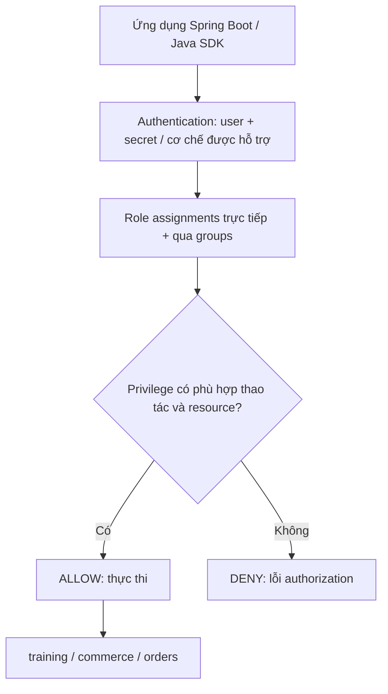
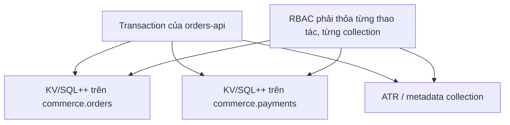

# Phân quyền RBAC theo bucket, scope, collection và dịch vụ

## Mục tiêu bài học

Ứng dụng dùng **Spring Data Couchbase** có thể đăng nhập thành công nhưng vẫn không được đọc một document, không được ghi bằng `CouchbaseTemplate`, hoặc bị từ chối khi `CouchbaseRepository` sinh câu truy vấn **SQL++**. Đó thường là hệ quả của việc **Couchbase kiểm tra quyền theo loại thao tác và tài nguyên**, chứ không phải lỗi kết nối. Cấp quyền quản trị toàn cluster để "sửa nhanh" các lỗi ấy có thể biến một tài khoản ứng dụng bị lộ thành quyền kiểm soát toàn bộ dữ liệu.

Bài thuộc chương **Bảo mật** này trình bày cách thiết kế **Role-Based Access Control (RBAC)** theo **bucket → scope → collection** và theo dịch vụ (Data/KV, Query/SQL++, Index, Search, Analytics, quản trị). Ví dụ xuyên suốt là ứng dụng quản lý đơn hàng trong module `SPRING_DATA_COUCHBASE`, nơi ta còn học document mapping, repository, `CouchbaseTemplate`, chỉ mục, TTL, CAS, giao dịch và API reactive.

Sau khi học, bạn có thể:

- Phân biệt **authentication** (xác minh danh tính) và **authorization** (kiểm tra quyền) khi dùng Couchbase.
- Diễn giải ý nghĩa của role gắn ở mức **bucket**, **scope** hoặc **collection**, và tác động của quyền được kế thừa qua **group**.
- Lựa chọn đúng role cho **KV get/insert/replace/remove**, **SQL++ SELECT/INSERT/UPDATE/DELETE**, **index**, **scope/collection provisioning** và các dịch vụ khác.
- Tạo tài khoản **ứng dụng**, **migration/provisioning**, **quan sát** và **quản trị** tách biệt; tránh `Administrator` trong runtime.
- Phân biệt giới hạn **Community Edition** với **Enterprise Edition** và **Capella Basic/Advanced Access Credentials**.
- Kiểm chứng **allow/deny** qua Web Console, REST API và Java SDK bằng chính user được cấp quyền.
- Thiết kế vòng đời quyền: ghi nhận, review, xoay secret, thu hồi, giám sát và xử lý sự cố.

> **Bối cảnh kỹ thuật:** Ví dụ dùng Couchbase Server hỗ trợ scope/collection (7.0+), bucket `training`, scope `commerce` với collection `orders` và `sessions`. Danh sách role và tên menu phụ thuộc **Server version/edition hoặc Capella plan**. Các role cụ thể theo collection trong bài chỉ nên áp dụng trên **Enterprise/Capella khi môi trường hỗ trợ**; không suy ra chúng luôn có trên Community Edition.

## 1. RBAC giải quyết vấn đề gì?

**Authentication** trả lời: "Ai đang gọi Couchbase?" Ví dụ user `orders-api` với mật khẩu được lưu trong secret manager.

**Authorization/RBAC** trả lời: "Danh tính ấy được làm thao tác gì, lên tài nguyên nào?" Ví dụ `orders-api` có quyền đọc/ghi bằng KV tại `training.commerce.orders`, được `SELECT` qua SQL++ tại cùng collection, nhưng **không** được xóa bucket, thay index, truy cập `sessions` hoặc sửa người dùng khác.



Hai điều quan trọng:

1. **Role không phải tên service.** Ví dụ Query Service đang bật chỉ làm SQL++ endpoint tồn tại; để chạy `SELECT` trên `orders`, user vẫn phải có quyền truy vấn tương ứng. Ngược lại, cấp `Query Select` không tự khởi động Query Service hay xây secondary index.
2. **Role là tập quyền được cấp, không phải quy tắc "deny" ưu tiên.** Nếu user có role rất rộng từ group, việc gán thêm một role hẹp trực tiếp **không thu hồi** quyền rộng ấy. Phải xem **tổng quyền hiệu lực** từ direct assignments và groups.

### 1.1. Từ cluster tới document

```text
Cluster (đơn vị quản trị và authentication)
└── Bucket: training
    ├── Scope: _default
    │   └── Collection: _default
    └── Scope: commerce
        ├── Collection: orders
        │   ├── order::1001
        │   └── order::1002
        └── Collection: sessions
            └── session::abc
```

RBAC data/query được gán ở một trong các mức có hỗ trợ: bucket, scope hoặc collection. **Document key** (`order::1001`) không phải là một cấp gán role chuẩn tương đương collection. RBAC trên collection cũng **không tự động** kiểm soát từng field JSON hay từng dòng thuộc cùng collection.

Nếu cần phân quyền theo **tenant, chủ sở hữu đơn hàng hoặc trạng thái record** trong một collection chung, application/API vẫn phải xác thực caller, kiểm tra tenant/ownership và ràng buộc điều kiện truy vấn; phân vùng sang collection/bucket riêng có thể bổ sung isolation nhưng không thay thế các kiểm tra nghiệp vụ.

Nguồn: [Couchbase Server — Authorization](https://docs.couchbase.com/server/current/learn/security/authorization.html), [Roles](https://docs.couchbase.com/server/current/learn/security/roles.html), [Scopes and Collections](https://docs.couchbase.com/server/current/learn/data/scopes-and-collections.html).

## 2. Hiểu phạm vi cấp quyền

Cho ví dụ một quyền `data_reader` (đọc KV). Trong Couchbase Server Enterprise, cú pháp role có thể được biểu diễn như sau:

```text
data_reader[training]                    # Mọi scope/collection trong bucket training
data_reader[training:commerce]           # Các collection trong scope commerce
data_reader[training:commerce:orders]    # Chỉ collection orders
```

Trong REST API, phần trong ngoặc vuông gồm **bucket:scope:collection**, ngăn bởi dấu `:`. Các thành phần được phép lược bớt tùy loại role và cấp tài nguyên mà nó hỗ trợ. **Không áp dụng mọi mẫu scope trên mọi role**: ví dụ `scope_admin` được cấp theo bucket; một số administrative role là cluster-wide.

### 2.1. Cấp rộng hơn nghĩa là truy cập nhiều hơn

| Phạm vi | Khi nào phù hợp | Hệ quả bảo mật |
| --- | --- | --- |
| Cluster-wide | Các role quản trị thật sự cần quyền toàn cluster | Blast radius lớn; không cấp cho application API. |
| Bucket `training` | Service được phép sử dụng **tất cả** dữ liệu trong bucket | Có thể đọc/ghi cả scope/collection khác trong bucket. |
| Scope `training:commerce` | Service có nhiệm vụ với mọi collection của domain commerce | Quyền có thể bao phủ collection mới trong scope; cần review khi mở rộng schema. |
| Collection `training:commerce:orders` | Service chỉ cần xử lý đơn hàng | Phù hợp **least privilege** cho service tách theo chức năng. |

Các lựa chọn "All Buckets", "All Scopes" hoặc "All Collections" trong UI có thể làm phạm vi rộng hơn dự kiến, kể cả khi có tài nguyên mới về sau. Nếu bạn chỉ định `orders`, kiểm tra lại sau khi lưu rằng không còn wildcard hoặc quyền kế thừa từ group cho `sessions`.

### 2.2. Tránh nhầm `_default` với `commerce`

Một entity Spring Data được gắn `@Scope("commerce")` và `@Collection("orders")` không thể đọc document tại `training._default._default` chỉ nhờ cấp role `data_reader[training:commerce:orders]`. Ngược lại, nếu repository vô tình trỏ về `_default`, bạn sẽ thấy lỗi thiếu quyền hoặc không tìm thấy dữ liệu dù role trên `commerce.orders` hoàn toàn đúng.

**Phân biệt ba câu hỏi:** target resource đã tồn tại chưa? SDK/repository đang nhắm tới resource nào? User có quyền cho đúng resource và thao tác đó không?

## 3. Ma trận role theo giao thức KV và SQL++

Đây là điểm quan trọng nhất với Spring Data Couchbase: **Data Reader/Writer là quyền cho giao thức Key-Value**, trong khi các statement **SQL++** kiểm tra quyền Query tương ứng. Đừng suy từ tên `read/write` rằng nó áp dụng mọi cách truy cập.

| Thao tác | Ví dụ | Role thường cần ở Enterprise | Lưu ý |
| --- | --- | --- | --- |
| KV đọc theo key | `collection.get(id)`, `exists(id)`, `findById(id)` | **Data Reader** (`data_reader`) | Giới hạn tới đúng collection; không tự cấp `SELECT`. |
| KV ghi theo key | `insert`, `upsert`, `replace`, `remove`, `save` | **Data Writer** (`data_writer`) | Không tự cấp quyền đọc hoặc SQL++ mutation. |
| KV đọc + ghi | Dịch vụ CRUD đơn hàng | `data_reader` **và** `data_writer` | Hai role bổ sung nhau; `data_writer` **không** bao gồm KV read. |
| SQL++ truy vấn | `SELECT`, derived query `findByStatus`, `@Query` đọc | **Query Select** (`query_select`) | Cấp trên **từng collection được đọc**; không tự cấp KV read. |
| SQL++ chèn | `INSERT INTO ...` | **Query Insert** (`query_insert`) | Không thay thế `data_writer` khi SDK gọi KV. |
| SQL++ cập nhật | `UPDATE ...` | **Query Update** (`query_update`) | Các statement có thể cần thêm quyền tùy nội dung, như truy cập collection phụ. |
| SQL++ xóa | `DELETE FROM ...` | **Query Delete** (`query_delete`) | Khác với KV `collection.remove`. |
| SQL++ upsert | `UPSERT INTO ...` | Kết hợp **Query Insert + Query Update** theo yêu cầu statement | Xác minh quyền thực tế với Server/statement dùng. |
| SQL++ đọc nhiều collection | `JOIN`, subquery, CTE có truy cập nhiều keyspace | `query_select` trên **mỗi collection** được truy vấn | Không chỉ cấp trên collection nguồn của `FROM` ngoài cùng. |
| Tạo/drop index | `CREATE INDEX`, `DROP INDEX` | **Query Manage Index** (`query_manage_index`) | Dành cho migration/provisioning, không phải account API. |
| Liệt kê index/catalog | `system:indexes` hoặc stats index | **Query System Catalog** (`query_system_catalog`) / **Query List Index** (`query_list_index`) tùy API | Quyền thống kê/catalog không tự cho phép tạo index hay đọc dữ liệu. |
| Tạo/drop scope/collection | Provisioning schema | **Manage Scopes** (`scope_admin`) trên bucket | Không cho phép đọc/ghi document; không cần trên runtime API thông thường. |
| Thay đổi bucket | Quota, settings, xóa bucket | **Bucket Admin** (`bucket_admin`) hoặc role quản trị phù hợp | Quyền ảnh hưởng toàn bucket; tách khỏi application. |
| Quản trị users/roles | Tạo và đổi quyền người dùng | Role quản trị user/security phù hợp | Chỉ cho người/automation được ủy quyền; không cấp cho `orders-api`. |

**Ví dụ phân biệt rõ:** Một tài khoản chỉ có `data_reader[training:commerce:orders]` có thể đọc document bằng `collection.get("order::1001")` nhưng câu SQL++ `SELECT * FROM training.commerce.orders` vẫn bị từ chối vì thiếu `query_select`. Một tài khoản chỉ có `query_select` có thể chạy `SELECT` nhưng SDK `collection.get` **không mặc nhiên** được phép.

### 3.1. Query Service và Index Service khác nhau về role

Thường gặp một chuỗi thao tác:

```sql
-- Dùng tài khoản provisioning có quyền index DDL.
CREATE INDEX idx_orders_status
ON `training`.`commerce`.`orders`(status);

-- Dùng tài khoản ứng dụng có Query Select trên orders.
SELECT META(o).id AS docId, o.status
FROM `training`.`commerce`.`orders` AS o
WHERE o.status = "NEW";
```

Tài khoản chạy `SELECT` **không cần** `query_manage_index` chỉ vì câu query dùng index. Tài khoản indexer/provisioning không cần có quyền rộng toàn cluster nếu role quản lý index đã đủ. Một index online **không** thay cho quyền Query Select; một user có Query Select **không** tự có quyền tạo index.

Từ **Couchbase Server 7.6+**, một số SQL++ query có thể dùng **sequential scan** khi không có index phù hợp. Điều này cần quyền **Query Use Sequential Scans** (`query_use_sequential_scans`) ngoài quyền truy vấn tương ứng, trừ các quyền quản trị đã bao hàm khả năng đó. Không xem sequential scan là giải pháp thay thế chỉ mục cho workload lớn; cũng không cấp role này "cho chắc" trên production nếu không có use case và kiểm soát chi phí.

### 3.2. Query Workbench không phải thước đo quyền SQL++ qua SDK

Tài liệu role nêu `query_select` cho phép chạy `SELECT` nhưng **không cho sử dụng Query Workbench** trong Web Console. Việc một app user không mở được Query Workbench **không chứng minh** rằng SDK `cluster.query(...)` thiếu quyền Query Select. Test query bằng chính user ấy **qua SDK hoặc endpoint Query** là phương pháp phù hợp.

Ngược lại, một admin mở Query Workbench chạy `SELECT` thành công **không chứng minh** quyền của tài khoản `orders-api`. Hai danh tính có role khác nhau.

Nguồn: [Couchbase Server — Data Roles, Query & Index Roles](https://docs.couchbase.com/server/current/learn/security/roles.html).

## 4. Những dịch vụ khác cũng có RBAC riêng

Couchbase không chỉ có KV và SQL++. Khi một hệ thống bổ sung dịch vụ, cần mở rộng ma trận quyền **theo đúng API đang sử dụng**:

| Dịch vụ/chức năng | Role hoặc nhóm quyền tiêu biểu | Có nên cấp mặc định cho Spring Data CRUD? |
| --- | --- | --- |
| **Data (KV)** | `data_reader`, `data_writer` | Chỉ cấp thao tác thật cần. |
| **Query (SQL++)** | `query_select`, `query_insert`, `query_update`, `query_delete` | Chỉ khi truy vấn/mutation qua SQL++. |
| **Index** | `query_manage_index`, `query_list_index` | Thông thường **không cấp quản lý index** cho runtime. |
| **Search Service** | Searcher/index roles như `fts_searcher` tùy edition | Chỉ nếu ứng dụng thực hiện Search API. |
| **Analytics Service** | Các role Analytics Reader/Manager phù hợp | Không cần cho repository KV/SQL++ thông thường. |
| **Eventing Service** | Role Eventing để deploy/operate functions | Dành cho người quản lý function, không mặc định cho API. |
| **DCP/stream** | `data_dcp_reader` | Chỉ cho chương trình cần đọc stream thay đổi dữ liệu. |
| **Backup/restore** | Role backup/restore phù hợp | Giao cho công cụ vận hành, không cho ứng dụng giao dịch. |
| **XDCR** | Role quản lý/điều hành replication | Chỉ khi vận hành replication liên cluster. |
| **Quản trị Server** | `admin`, `cluster_admin`, `bucket_admin`, role user/security | Không cấp tùy tiện; phân tách nhiệm vụ. |

Các role ở bảng chỉ là **ví dụ nhóm quyền**; tên chính xác và phạm vi có thể thay đổi theo version/edition/Capella. Luôn xem **danh sách role thực của cluster** trước khi quyết định.

### 4.1. Cẩn trọng với các quyền có thể mở rộng bề mặt tấn công

Role **Query CURL Access** (`query_external_access`) cho phép câu SQL++ gọi hàm `CURL` thực hiện yêu cầu HTTP tới mạng mà Query Service tiếp cận. Đây là quyền mạnh, có thể tương tác với hệ thống nội bộ qua network của cluster. **Không cấp cho user `orders-api` chỉ để chạy một `SELECT` bình thường**; cần threat model và allowlist mạng nếu có yêu cầu thật.

Các role `admin`, `cluster_admin`, `bucket_admin`, `scope_admin` và `query_manage_index` cũng có phạm vi ảnh hưởng lớn hoặc quyền thay đổi schema. Không cộng "mọi role có vẻ liên quan" thành một account duy nhất.

## 5. Thiết kế least privilege cho một hệ thống đơn hàng

Giả sử cluster Enterprise có:

```text
training
└── commerce
    ├── orders
    └── sessions
```

Ứng dụng có bốn thành phần:

- **`orders-api`:** CRUD bằng KV trên `orders` và truy vấn `findByStatus` bằng SQL++.
- **`session-api`:** chỉ quản lý phiên bằng KV trên `sessions`, dùng TTL khi ghi.
- **`orders-readonly`:** chạy report `SELECT` trên `orders` mà không được ghi.
- **`orders-migrator`:** triển khai scope/collection/index qua pipeline.

Ma trận role gợi ý trong **Couchbase Server Enterprise**:

| Danh tính | Role tối thiểu ban đầu | Không cần |
| --- | --- | --- |
| `orders-api` | `data_reader[training:commerce:orders]`, `data_writer[training:commerce:orders]`, `query_select[training:commerce:orders]` | `admin`, `bucket_admin`, `scope_admin`, `query_manage_index`. |
| `session-api` | `data_reader[training:commerce:sessions]`, `data_writer[training:commerce:sessions]` | SQL++ nếu chỉ KV; mọi role ở `orders`. |
| `orders-readonly` | `query_select[training:commerce:orders]` | KV write, SQL++ mutation, index DDL. |
| `orders-migrator` | `scope_admin[training]` khi phải quản lý collection; `query_manage_index[training:commerce:orders]` để quản lý GSI | Thường không cần tài khoản Full Admin hay quyền đọc hết dữ liệu. |

**Điều chỉnh theo thao tác thực tế:** Nếu `orders-api` chỉ dùng `save`/`findById` mà không có query, bỏ `query_select`. Nếu chạy SQL++ `UPDATE` hoặc `DELETE` từ template hay migration, cần role Query mutation tương ứng; **Data Writer không đủ**. Nếu `orders-readonly` còn gọi `collection.get` thì phải thêm Data Reader. Với SQL++ JOIN sang `customers`, phải cấp Query Select lên collection được JOIN theo nhu cầu.

### 5.1. Vì sao tách identity quan trọng hơn tách class Java?

Hai `@Repository` trong cùng process nhưng dùng **cùng một `Cluster` và một user** sẽ có cùng quyền dữ liệu, dù package Java khác nhau. Annotation `@Scope` hay `@Collection` quyết định **đích truy cập**, không tạo ranh giới bảo mật giữa các bean. Muốn tách quyền thực sự, cần **tách credentials/client/service runtime** theo kiến trúc hoặc chấp nhận rằng một process có quyền hợp nhất của mọi repository sử dụng chung credential.

### 5.2. Quyền trực tiếp và quyền từ group được cộng lại

Nếu `orders-api` trực tiếp có ba role giới hạn tại `orders` nhưng đồng thời thuộc group `commerce-writers` với `data_writer[training:commerce]`, user thực tế có thể ghi vào `sessions`. **Bài negative test phải phát hiện trường hợp này.**

```text
orders-api
  ├── direct: data_reader[training:commerce:orders]
  ├── direct: data_writer[training:commerce:orders]
  ├── direct: query_select[training:commerce:orders]
  └── group: commerce-writers
         └── data_writer[training:commerce]   <-- MỞ RỘNG QUYỀN
```

Thực hành tốt là review cả **roles, groups, external_groups và origins**. Không chỉ đọc bảng role gán trực tiếp rồi kết luận user chỉ có quyền trên `orders`.

Nguồn: [Manage Users, Groups, and Roles](https://docs.couchbase.com/server/current/manage/manage-security/manage-users-and-roles.html), [Understanding Authentication and Authorization](https://docs.couchbase.com/server/current/learn/security/authentication-overview.html).

## 6. Couchbase Server Enterprise: tạo user bằng Web Console

Phần này áp dụng cho **Couchbase Server Enterprise Edition** hỗ trợ các role ở mức collection. Chuẩn bị một cluster lab/staging có bucket `training`, scope `commerce` và collections `orders`, `sessions`. Bạn cần quyền quản lý người dùng để thực hiện provisioning; user runtime chưa tồn tại trước bước này.

### 6.1. Quy trình cấu hình

1. Đăng nhập Web Console của **cluster được phép thao tác** bằng account quản trị/provisioning, không dùng ứng dụng `orders-api`.
2. Mở **Security → Users & Groups → Users → Add User** (tên nút có thể khác theo phiên bản).
3. Chọn **Local user** nếu sử dụng xác thực nội bộ, nhập `orders-api` và mật khẩu được tạo mạnh từ secret manager. Với hệ thống dùng external domain/LDAP, cần thực hiện quy trình tương ứng thay vì tự đặt local password.
4. Trong nhóm **Data**, chọn **Data Reader**. Đặt **Bucket = training**, **Scope = commerce**, **Collection = orders**. Lặp lại với **Data Writer** và cùng phạm vi.
5. Trong nhóm **Query & Index**, chọn **Query Select** trên **đúng `training.commerce.orders`**. Không thêm quyền mutation query hoặc quản lý index nếu API không dùng chúng.
6. Xem kỹ phần quyền đã chọn: không có **All Buckets**, **All Scopes**, **All Collections** hoặc một role khác làm mở rộng phạm vi.
7. Kiểm tra tab **Groups**; không vô tình kế thừa group có `bucket_admin`, `data_writer[training]` hoặc `admin`.
8. Nhấn Save/Add User. Tách username và secret khỏi source code, đưa vào cấu hình runtime chỉ của `orders-api`.
9. **Đăng nhập/kết nối bằng chính `orders-api`** từ Java SDK để thử thao tác thực; không dùng Web Console admin để xác nhận thay app user.

**Tiêu chí PASS:** Runtime user có thể KV read/write và SQL++ SELECT tại `orders`, **không** thể đọc/ghi `sessions`, **không** thể tạo/drop index hoặc quản lý user.

### 6.2. Đọc role đang có bằng REST API

Với **Couchbase Server self-managed trên lab cục bộ**, cổng quản trị được publish vào loopback `127.0.0.1:8091`, có thể dùng các lệnh **chỉ đọc**:

```bash
# Xem danh sách role mà đúng Server/edition báo hỗ trợ.
# curl --user Administrator sẽ yêu cầu nhập mật khẩu.
curl --fail --show-error --user Administrator \
  http://127.0.0.1:8091/settings/rbac/roles

# Xem người dùng và roles hiệu lực (cần quyền quản trị phù hợp).
curl --fail --show-error --user Administrator \
  http://127.0.0.1:8091/settings/rbac/users

# Nếu cần, xem nhóm và role gán cho nhóm.
curl --fail --show-error --user Administrator \
  http://127.0.0.1:8091/settings/rbac/groups
```

**Trên Windows PowerShell 5.1**, dùng `curl.exe` để tránh alias `curl` trỏ tới `Invoke-WebRequest`. Trong môi trường TLS/remote, sử dụng **HTTPS/18091** và CA đúng; không chuyển REST quản trị qua HTTP công khai hoặc dùng `-k` để bỏ kiểm tra chứng chỉ.

Phản hồi `/settings/rbac/users` có thể chứa những trường tương tự:

```json
{
  "id": "orders-api",
  "domain": "local",
  "roles": [
    {
      "role": "data_reader",
      "bucket_name": "training",
      "scope_name": "commerce",
      "collection_name": "orders",
      "origins": [{"type": "user"}]
    },
    {
      "role": "data_writer",
      "bucket_name": "training",
      "scope_name": "commerce",
      "collection_name": "orders",
      "origins": [{"type": "user"}]
    },
    {
      "role": "query_select",
      "bucket_name": "training",
      "scope_name": "commerce",
      "collection_name": "orders",
      "origins": [{"type": "user"}]
    }
  ],
  "groups": [],
  "external_groups": []
}
```

Đây là **mảnh JSON minh họa**, không phải output được đọc từ một cluster thật. Khi phân tích, xem `bucket_name`/`scope_name`/`collection_name` và `origins`. Origin từ group cho biết quyền được kế thừa, cần truy ngược group tương ứng để đánh giá phạm vi thực. `GET /settings/rbac/roles` giúp xác nhận role được edition cho phép gán; role không có trong danh sách hoặc không chọn được trong UI là tín hiệu cần kiểm tra compatibility, không phải lý do "bật chế độ admin cho tất cả".

### 6.3. Có nên tạo user bằng REST?

Couchbase Server hỗ trợ tạo/cập nhật user bằng:

```text
PUT /settings/rbac/users/local/<username>
Content-Type: application/x-www-form-urlencoded

roles=data_reader[training:commerce:orders],data_writer[training:commerce:orders],query_select[training:commerce:orders]
password=<secret>
```

Đây là **mẫu cấu trúc request**, không phải lệnh sẵn để chạy. Tránh gõ mật khẩu vào `curl -d "password=..."` trên terminal dùng chung: secret có thể bị lưu vào shell history, command line/process listing hoặc CI logs. Với provisioning automation, dùng secret store và cơ chế truyền thông tin bí mật an toàn theo môi trường (ví dụ protected config/secret file có vòng đời ngắn), sử dụng TLS và kiểm tra chính xác endpoint.

**Đặc biệt khi UPDATE user:** API `PUT` có thể **thay thế** các roles/groups bạn không truyền lại, khiến user mất hoặc có sai quyền. Đọc trạng thái hiện tại, review payload đầy đủ, rồi xác minh sau cập nhật. Không chạy lặp lại một mẫu user `orders-api` lên cluster không thuộc lab.

Khi chỉ cần **xoay mật khẩu nhưng giữ nguyên role**, Couchbase Server 7.1.1+ có hỗ trợ `PATCH` ở endpoint user phù hợp; vẫn cần kiểm tra chính sách và version đang chạy. Việc thay password phải đi cùng cập nhật secret runtime/rollout không gián đoạn.

Nguồn: [Couchbase Server — Manage Users, Groups and Roles](https://docs.couchbase.com/server/current/manage/manage-security/manage-users-and-roles.html), [RBAC REST API](https://docs.couchbase.com/server/current/rest-api/rbac.html), [Authorization API](https://docs.couchbase.com/server/current/rest-api/rest-authorization.html).

## 7. Giới hạn Community Edition: không sao chép ma trận Enterprise

Tài liệu RBAC của Couchbase Server hiện hành ghi rõ: **Community Edition chỉ cho phép gán** ba role:

```text
admin
ro_admin
bucket_full_access
```

Đây là giới hạn quan trọng với lab Docker Community. Bạn **không thể** dùng CE để chứng minh **least privilege theo từng collection** bằng các role `data_reader`, `data_writer`, `query_select` giống Enterprise, dù hierarchy `bucket/scope/collection` có tồn tại. CE cũng có giới hạn số lượng local users (theo tài liệu hiện hành là **20**).

Role `bucket_full_access` (giao diện có thể gọi **Application Access**) cho phép KV đọc/ghi trong **bucket** được cấp; **không** cho SQL++ `SELECT`. Role này **đã deprecated**, tài liệu khuyến nghị dùng data/query roles thay thế ở môi trường có hỗ trợ.

### 7.1. Cách học phù hợp trên Community lab

| Mục tiêu học | Cách thực hiện an toàn | Không nên diễn giải |
| --- | --- | --- |
| KV `get`/`insert`/`remove` trong `training` | Một user local `kv-lab` được cấp `bucket_full_access[training]` trên **bucket lab duy nhất** | Không coi đây là collection-level RBAC hoặc cấu hình production. |
| Kiểm thử `data_reader`/`data_writer` theo `orders` vs `sessions` | Chuyển sang Enterprise hoặc Capella hỗ trợ quyền chi tiết | Không thể giả lập bằng cách chia repository trong cùng một `bucket_full_access`. |
| SQL++ Query Workbench lab | Dùng tài khoản quản trị **chỉ cho thao tác lab** trên UI | Không nhúng `Administrator` vào Spring Boot runtime. |
| SQL++ SELECT bằng user riêng, kiểm tra role `query_select` | Dùng môi trường Enterprise/Capella đúng plan/role | `bucket_full_access` không tự cho phép SQL++. |

**Không cấp `admin` cho app** chỉ để derived repository query chạy trong CE. Với bài kiểm thử quyền chi tiết, nên ghi kết quả `NOT SUPPORTED BY EDITION` hoặc `NOT RUN` và chạy suite trên môi trường hỗ trợ. Đây là giới hạn môi trường, không phải một assertion cho phép quyền không đạt.

## 8. Capella: Basic/Advanced cluster access khác role trong tài khoản Console

Trên **Couchbase Capella Operational**, tài khoản đăng nhập tổ chức/project (organization/project roles) dùng để quản lý dịch vụ, còn ứng dụng truy cập dữ liệu bằng **Cluster Access Credentials**. Hai hệ thống quyền này có nhiệm vụ khác nhau.

Từ Capella Console, mở cluster đúng môi trường → **Settings → Access Control** hoặc **Cluster Access** tùy phiên bản UI → **Create Access**:

1. Tạo credential name và password mạnh cho riêng `orders-api`; không dùng login của người quản trị Capella.
2. Chọn loại credential theo nhu cầu:
   - **Basic Access Credentials**: dùng mức **Read**, **Write** hoặc **Read/Write** được định nghĩa sẵn, chọn bucket → scope → collection, hỗ trợ các gói Capella theo tài liệu hiện hành.
   - **Advanced Access Credentials**: chọn các role/privilege chi tiết hoặc tạo custom role để giới hạn một thao tác như Query Select, được cung cấp ở **paid plans** theo tài liệu hiện hành.
3. Tránh chọn **All Buckets / All Scopes / All Collections** khi API chỉ sử dụng `orders`.
4. Nếu cần phân biệt KV và SQL++ rất cụ thể, hoặc cần tách quyền quản lý index, dùng **Advanced** nếu plan cho phép; đối chiếu tập privilege có thực và kiểm tra SDK query sau khi lưu.
5. Lưu credential vào secret manager, cấp runtime cho đúng ứng dụng; không chia sẻ credential staging với production.
6. Thực hiện test **cho phép và từ chối** bằng user vừa tạo; quyền Basic Read/Write trên UI không nên được diễn giải máy móc là mọi role SQL++/index của Server self-managed.

**Basic có cấp quyền theo resource** nhưng là các **permission set định trước**; Advanced được thiết kế cho least-privilege chi tiết hơn và role có thể tái sử dụng. Việc dùng Advanced phụ thuộc gói thuê bao. Đừng sao chép cú pháp REST `/settings/rbac/users/local/...` của **Server tự quản lý** sang Capella Management API: Capella có endpoint/cơ chế quản lý credential riêng.

### 8.1. RBAC không thay thế IP allowlist/TLS

Ngay cả khi credential có quyền đúng, Capella public endpoint vẫn cần:

- **Connection string** do **Connect → SDK** cung cấp, thường bắt đầu bằng `couchbases://`.
- **Allowed IP Addresses** cho **public egress/NAT IP** của máy chủ chạy ứng dụng; chờ rule active.
- **DNS SRV**, routing, outbound network/port và **TLS trust chain** hợp lệ.
- Mỗi môi trường staging/prod có credential và network policy riêng.

Nếu TCP/TLS chưa vào được cluster, đó là lỗi **kết nối**, không phải 403 do RBAC. Không mở `0.0.0.0/0` lâu dài hoặc tắt xác minh chứng chỉ để "thử role".

Nguồn: [Capella — Cluster Access and Roles](https://docs.couchbase.com/cloud/clusters/cluster-rbac.html), [Manage Cluster Access Credentials](https://docs.couchbase.com/cloud/clusters/manage-database-users.html), [Capella — Connect](https://docs.couchbase.com/cloud/get-started/connect.html), [Allowed IP Addresses](https://docs.couchbase.com/cloud/clusters/allow-ip-address.html).

## 9. Áp dụng RBAC vào Spring Boot và Spring Data Couchbase

### 9.1. Không đưa tài khoản quản trị vào cấu hình ứng dụng

Với Spring Boot BOM tương thích:

```groovy
dependencies {
    implementation 'org.springframework.boot:spring-boot-starter-data-couchbase'
}
```

Trong `application.yml`:

```yaml
spring:
  couchbase:
    connection-string: ${CB_CONNECTION_STRING}
    username: ${CB_USERNAME}
    password: ${CB_PASSWORD}
  data:
    couchbase:
      bucket-name: ${CB_BUCKET_NAME:training}
```

Ví dụ môi trường **local Enterprise** có thể đặt `CB_USERNAME=orders-api`, `CB_BUCKET_NAME=training` và `CB_CONNECTION_STRING=couchbase://127.0.0.1`. **Không đưa `CB_PASSWORD` vào Git, container image hay log**; staging/prod dùng secret manager và `couchbases://` khi kết nối TLS như Capella.

`spring.data.couchbase.bucket-name` chỉ định bucket; nó **không tự cấp quyền** cho user đó và cũng không tự chọn scope/collection. Quyền kiểm tra ở Server dựa trên target thực tế của operation.

### 9.2. Entity và repository minh họa

```java
package com.example.orders;

import org.springframework.data.annotation.Id;
import org.springframework.data.couchbase.core.mapping.Collection;
import org.springframework.data.couchbase.core.mapping.Document;
import org.springframework.data.couchbase.core.mapping.Scope;

@Document
@Scope("commerce")
@Collection("orders")
public class Order {
    @Id
    private String id;
    private String status;

    public Order() {}

    public Order(String id, String status) {
        this.id = id;
        this.status = status;
    }

    public String getId() { return id; }
    public String getStatus() { return status; }
}
```

Repository riêng:

```java
package com.example.orders;

import java.util.List;
import org.springframework.data.couchbase.repository.CouchbaseRepository;

public interface OrderRepository
        extends CouchbaseRepository<Order, String> {
    List<Order> findByStatus(String status);
}
```

| Method ứng dụng | Giao thức thường dùng | Role cần xem |
| --- | --- | --- |
| `repository.findById("order::1001")` | KV theo key | `data_reader[training:commerce:orders]` |
| `repository.save(new Order(...))` | KV mutation | `data_writer[training:commerce:orders]` và các quyền đọc có liên quan nếu phương thức thực cần |
| `repository.deleteById(id)` | KV mutation | `data_writer[training:commerce:orders]` |
| `repository.findByStatus("NEW")` | SQL++ SELECT | `query_select[training:commerce:orders]` + Query Service/index |
| `CouchbaseTemplate` và `ReactiveCouchbaseTemplate` | Tùy API gọi KV hay SQL++ | Dựa trên operation thực tế, không dựa vào tên class |

**Lưu ý Spring Data metadata:** derived repository query có thể bổ sung filter về loại entity (ví dụ `_class`). Nếu query trả rỗng nhưng không bị authorization denied, hãy kiểm tra mapping, index, scan consistency và document được tạo bằng repository; đừng tăng quyền admin để sửa một vấn đề metadata.

### 9.3. Query được phép, nhưng không được quản trị index

`orders-api` được cấp `query_select` trên `orders` có thể chạy:

```sql
SELECT META(o).id AS documentId, o.status
FROM `training`.`commerce`.`orders` AS o
WHERE o.status = "NEW";
```

Nhưng không được chạy:

```sql
CREATE INDEX idx_unapproved
ON `training`.`commerce`.`orders`(status);
```

Câu DDL này chỉ dùng để **mô tả thao tác phải bị từ chối**; **không chạy `CREATE INDEX` hoặc `DROP INDEX`** trên cluster thực hành đang dùng chung để kiểm tra role. Trên tài khoản runtime không có `query_manage_index`, hệ thống phải từ chối quyền. Nếu DDL chạy thành công trong một lab cô lập, đánh dấu **FAIL bảo mật** và tìm quyền rộng trực tiếp/qua group, thay vì coi đó là tiện ích.

### 9.4. Reactive không thay đổi ranh giới bảo mật

`ReactiveCouchbaseRepository`, reactive `CouchbaseTemplate` hay Java SDK reactive API không có một bộ role mới gọi là "Reactive". Nếu reactive pipeline gọi KV `get`, nó cần Data Reader; nếu gọi `SELECT`, nó cần Query Select. `Mono`/`Flux` chỉ là cách thể hiện luồng bất đồng bộ phía client.

Không nhầm sự kiện "query chạy bất đồng bộ" với việc được quyền truy cập dữ liệu của service khác. Tập quyền phải được kiểm thử cả khi request chạy song song, timeout, retry hoặc thực thi một query có nhiều keyspace.

## 10. RBAC trong TTL, CAS và transaction

Một số tính năng chuyên sâu vẫn sử dụng quyền của **loại thao tác dữ liệu**, nhưng có thêm tài nguyên hoặc điều kiện cần tính đến.

### 10.1. TTL và CAS không yêu cầu "role TTL" hay "role CAS"

- **TTL** của một document: ứng dụng dùng KV insert/upsert/replace với option expiry cần quyền KV write trên collection đích. Cấu hình chính sách **Max TTL của bucket/collection** là thao tác quản trị tài nguyên, không thuộc quyền của user chỉ có `data_writer`.
- **CAS**: đọc document/metadata để lấy CAS cần quyền đọc tương ứng; replace/remove với CAS là mutation, cần quyền ghi. CAS giúp phát hiện optimistic concurrency conflict, **không thay thế RBAC**.
- **`@Version` trong Spring Data**: mapping có thể dùng CAS để kiểm soát cập nhật lạc quan, nhưng role vẫn dựa trên các thao tác KV/SQL++ mà framework thực sự thực hiện.

Vì vậy, một user `orders-api` chỉ có quyền KV trên `orders` vẫn có thể thực hành TTL/CAS ở mức document phù hợp mà **không cần** `bucket_admin`. Nếu service cần thay đổi bucket/collection TTL policy, nên làm qua migration/provisioning account.

### 10.2. Transaction: quyền trên tất cả collection liên quan

Giao dịch Couchbase có thể tác động nhiều document, collection, scope và bucket. Với **KV operations trong transaction**, user cần Data roles phù hợp trên các collection đọc/ghi; với **Query statements trong transaction**, cần Query roles tương ứng.

**Một khác biệt dễ bỏ sót:** khi transaction đã thực thi SQL++ query và chuyển sang **query mode**, những KV operations **sau đó** trong transaction được thực thi theo **query permissions**. Tập quyền Data và Query không giống nhau có thể dẫn đến lỗi chỉ xảy ra trong giao dịch hỗn hợp KV + SQL++.

Transaction cũng sử dụng **Active Transaction Records (ATR)** và metadata trong một collection. Theo cơ chế mặc định, metadata được lưu trong `_default._default` của bucket chứa document đầu tiên được mutate; SDK có thể cấu hình **custom metadata collection**. Nếu đội ngũ đã khóa chặt collection-level roles, phải kiểm tra **quyền trên metadata collection thực tế** và cấu hình transaction/cleanup tương ứng. Không cấp `data_writer[training]` rộng cho mọi user chỉ để tránh phải tìm nguyên nhân.



### 10.3. Gate ngoài RBAC

**Có đủ quyền không bảo đảm transaction thành công.** Vẫn cần Server/SDK hỗ trợ, topology/replica/durability khả thi, NTP/time sync, tài nguyên và latency phù hợp. Lab một node/replica 0 không đại diện cho HA. Khi một transaction thất bại, tách lỗi authorization khỏi `DurabilityImpossibleException`, timeout hoặc xung đột CAS.

Nguồn: [Couchbase Server — Transactions và Permissions](https://docs.couchbase.com/server/current/learn/data/transactions.html), [Couchbase Java SDK — Transactions](https://docs.couchbase.com/java-sdk/current/concept-docs/transactions.html).

## 11. Kiểm chứng quyền bằng phép thử allow/deny

Sau khi cấp role, đừng chỉ đọc danh sách role hay kiểm tra connection string. Hãy **dùng chính `orders-api`** và đối chiếu thao tác được phép với thao tác **bắt buộc phải bị từ chối**. Nên chạy các bài negative test trên **staging/lab biệt lập** với seed biết trước.

### 11.1. Bộ fixture dùng để kiểm thử

Provisioner/admin tạo một số document giả lập:

```text
training.commerce.orders:
    key: order::rbac-1001
    JSON: {"type":"order","status":"NEW","total":150000}

training.commerce.sessions:
    key: session::rbac-1001
    JSON: {"type":"session","state":"ACTIVE"}
```

Để test query theo thuộc tính, provisioning account tạo secondary index `idx_orders_status` trên `orders` và đợi online. Không để account `orders-api` tự tạo index tại application startup.

### 11.2. Bảng kỳ vọng rõ ràng

| # | Test bằng `orders-api` | Kỳ vọng | Bằng chứng |
| --- | --- | --- | --- |
| T1 | KV `get("order::rbac-1001")` trên `orders` | **ALLOW** | Trả body JSON và CAS. |
| T2 | KV insert một key thử ngẫu nhiên trên `orders`, đọc lại và dọn | **ALLOW** | Insert/get/remove thành công; không động tới key khác. |
| T3 | SQL++ `SELECT` trên `orders` | **ALLOW** | Một row có ID đúng khi Query Service/RBAC/index phù hợp. |
| T4 | KV `get("session::rbac-1001")` trên `sessions` | **DENY** | Lỗi authorization, **không phải** `DocumentNotFound`. |
| T5 | SQL++ `SELECT` trên `sessions` | **DENY** | Query bị từ chối theo quyền collection. |
| T6 | SQL++ `UPDATE/DELETE` trên `orders` (runtime chỉ có Query Select) | **DENY** | Không thực hiện mutation; test trên fixture dùng riêng. |
| T7 | `CREATE INDEX` hoặc thay đổi schema | **DENY** | Runtime không được cấp DDL. |
| T8 | Gọi REST quản trị user/roles | **DENY** | Runtime không có quyền quản lý security. |

**Đánh giá một negative test:** Nếu T4 nhận `DocumentNotFoundException`, test **chưa chứng minh** RBAC đã từ chối; có thể key không tồn tại hoặc collection sai. Nếu T5 trả **0 rows** thay vì authorization denied, cũng không chứng minh thiếu quyền: query có thể lọc không khớp. Chuẩn bị fixture từ admin, xác minh nó tồn tại, chạy bằng đúng credentials và kiểm tra **loại lỗi**.

**Ràng buộc an toàn:** T6/T7/T8 có thể là statement nguy hiểm nếu vô tình chạy bằng admin hoặc user có quyền rộng. Trong một lesson này, chúng là **test-case thiết kế**; không chạy `DROP INDEX`/`DROP COLLECTION` hoặc `DELETE` lên cluster chia sẻ. Negative test tự động nên dùng resource riêng, thao tác có thể rollback và kiểm tra identity trước.

### 11.3. Java SDK: phép thử đọc theo key (chỉ đọc)

Đoạn mã dưới đây giả định ứng dụng đã có `com.couchbase.client.java.Cluster cluster` do Spring Boot quản lý. Dùng **`CB_USERNAME=orders-api`** trong môi trường Enterprise/Capella phù hợp:

```java
var bucket = cluster.bucket("training");
bucket.waitUntilReady(java.time.Duration.ofSeconds(30));

var orders = bucket.scope("commerce").collection("orders");
var result = orders.get("order::rbac-1001");

System.out.println("KV ALLOW: status=" +
    result.contentAsObject().getString("status"));
```

Nếu document chưa có, đây là lỗi fixture, không phải authorization. Khi test RBAC, dùng ID chính xác và lập sẵn seed dưới account provisioning. **Không log đầy đủ body** nếu tài liệu thực có PII/secret.

### 11.4. Java SDK: `SELECT` bằng user runtime

Đây là snippet **độc lập với khối trước**, đặt trong method đã có `cluster`:

```java
var result = cluster.query(
    "SELECT META(o).id AS docId, o.status " +
    "FROM `training`.`commerce`.`orders` AS o " +
    "USE KEYS $id",
    com.couchbase.client.java.query.QueryOptions.queryOptions()
        .parameters(
            com.couchbase.client.java.json.JsonObject.create()
                .put("id", "order::rbac-1001")
        )
);

var rows = result.rowsAsObject();
if (rows.size() != 1) {
    throw new IllegalStateException("SQL++ role/fixture smoke failed");
}
System.out.println("SQL++ ALLOW: " + rows.get(0).getString("docId"));
```

`USE KEYS` giúp test **Query Service + Query Select** mà không phụ thuộc secondary index. Sau khi PASS, kiểm tra riêng `WHERE o.status = "NEW"`, chỉ mục và plan cho các repository derived queries. **Không nhầm query thành công bằng admin với query thành công bằng `orders-api`.**

### 11.5. Kiểm tra quyền hạn chế trên collection khác

Chỉ dùng fixture `session::rbac-1001` đã có, chạy từ account `orders-api`:

```java
var sessions = bucket.scope("commerce").collection("sessions");

// EXPECTED: authorization failure, không phải trả dữ liệu.
// Chỉ chạy trong integration test cô lập bằng orders-api.
sessions.get("session::rbac-1001");
```

Vì đoạn code trên **được kỳ vọng ném exception**, đừng đặt nó như startup hook của ứng dụng production. Trong JUnit, assertion cần phân biệt lỗi **authorization** với timeout, network failure, wrong keyspace hoặc missing document; lỗi không đúng loại phải khiến test **FAIL/INCONCLUSIVE**, không được coi tất cả exception đều có nghĩa "đã DENY đúng".

### 11.6. Permission-check API và giới hạn của nó

Với Server self-managed, REST có endpoint `POST /pools/default/checkPermissions` để kiểm tra một **permission specification** của **user đang xác thực**. Nó hữu ích khi biết chính xác cú pháp permission cần xem, nhưng không nên dùng thay cho phép thử bằng Java SDK đối với tất cả use case. Một kết quả permission `true` ở resource/cấp nào đó không chứng minh rằng phương thức Spring Data, index hoặc transaction chạy được.

Trên Capella, dùng API và công cụ kiểm tra credential/roles của Capella; không giả định mọi Server REST endpoint quản trị được expose giống nhau.

## 12. Nhận diện lỗi RBAC và lỗi không liên quan quyền

| Triệu chứng | Nguyên nhân có thể | Thao tác điều tra |
| --- | --- | --- |
| SDK báo authentication failure | Sai username/password, user bị khóa, sai authentication domain/secret chưa cập nhật | Xác minh danh tính và secret, không cấp thêm role khi chưa xác thực được. |
| SDK KV `get` bị access denied | Thiếu `data_reader` trên collection, hoặc app trỏ nhầm scope/collection | Xem target keyspace, roles trực tiếp/via group và `get` bằng app user. |
| KV `get` PASS nhưng `save` FAIL permission | Có Data Reader nhưng thiếu Data Writer | Bổ sung role ghi **chỉ trên collection cần thiết**. |
| KV read/write PASS nhưng `findByStatus` 403 | Thiếu `query_select` hoặc query chạm collection khác | Kiểm tra câu SQL++ framework sinh và role Query Select cho tất cả keyspace. |
| `SELECT` PASS nhưng SQL++ `UPSERT` FAIL | Query Select không tương đương Query Insert/Update | Cấp Query mutation roles nếu thực sự dùng SQL++ UPSERT. |
| Runtime tạo index thất bại | Không có `query_manage_index` | Đây có thể là **đúng thiết kế**; index do provisioning job quản lý. |
| `system:indexes` bị 403 | Thiếu quyền catalog/stats; không chứng minh index bị hỏng | Dùng user monitoring/provisioning hoặc Indexes UI theo quyền riêng. |
| Query Workbench bị cấm nhưng SDK SELECT chạy | `query_select` không cấp sử dụng Workbench | Đây không nhất thiết là lỗi quyền truy vấn. |
| SDK `get` trả `DocumentNotFound` | Key không tồn tại, expiry, mapping sai collection | Kiểm tra ID/TTL/collection trước; không mặc định là 403. |
| Query báo thiếu index/không có plan | Query/Index Service, GSI chưa online, version/scan policy | Kiểm tra Indexes và `EXPLAIN`; không giải quyết bằng admin role. |
| Kết nối timeout trước khi có 403 | DNS, firewall, TLS, alternate addresses, service đang down hoặc quá tải | Kiểm tra network/service; quyền chỉ đánh giá được khi request tới nơi. |
| Transaction KV PASS rồi thất bại sau SQL++ | Chuyển query mode, Query roles thiếu, metadata collection chưa đủ quyền | Rà soát từng operation/collection, ATR config và version SDK. |
| Negative test `sessions` bất ngờ ALLOW | Group role/bucket-wide role mở rộng hoặc dùng nhầm admin credential | Đọc `origins`/groups, xem đúng identity/cluster, **thu hồi quyền thừa**. |
| Chỉ Community không chọn được `query_select` | Giới hạn edition, không phải role typo | Xem `/settings/rbac/roles`; thử Enterprise/Capella phù hợp. |

Quy trình chẩn đoán chuẩn:

1. **Ai?** Xác định username/credential đang chạy, cluster/endpoint và auth domain.
2. **Đụng gì?** Đọc bucket/scope/collection, query plan hoặc statement thực tế.
3. **Làm gì?** Phân biệt KV, SQL++ DML, index DDL, Search, Analytics hay quản trị.
4. **Có quyền nào?** Liệt kê role trực tiếp, inherited groups và wildcard; kiểm tra edition/plan.
5. **Phép thử đúng?** Thử allow/deny trên fixture riêng; phân loại authorization với network/index/fixture errors.
6. **Sửa tối thiểu:** Chỉ thêm đúng role và scope cần thiết, sau đó chạy lại cả positive và negative tests.

## 13. Vòng đời vận hành tài khoản và quyền

### 13.1. Gắn danh tính với trách nhiệm

| Account | Vòng đời | Quyền cần tránh |
| --- | --- | --- |
| `orders-api-prod` | Thường trực trong runtime, secret riêng production | Admin, manage user/index/schema, đọc toàn bucket không cần thiết. |
| `orders-api-staging` | Runtime staging | Truy cập production; dùng chung credential với prod. |
| `orders-migrator` | Chỉ kích hoạt trong deploy/migration window | Trở thành credential của service API. |
| `security-provisioner` | Công cụ quản lý users/roles được ủy quyền | Chia sẻ khóa với ứng dụng nghiệp vụ. |
| `observer` | Monitoring/operations theo scope cần thiết | Data Writer, Query mutation, Admin nếu chỉ cần thống kê. |

**Tách nhiệm vụ:** Người quản lý index không cần quyền thay đổi user; người quản lý user không nhất thiết cần đọc data. Automation phải có audit trail và quyền chỉ đủ cho tập tác vụ được giao.

### 13.2. Dùng group cho quyền lặp lại nhưng không làm quyền bị phình

Group hữu ích khi nhiều service/user cần cùng một role assignment. Tuy nhiên:

- Review group membership trước khi thêm account mới.
- Tài liệu hóa quyền **hiệu lực**, không chỉ quyền trực tiếp.
- Hạn chế group "all-developers-admin" cho mọi môi trường.
- Với external users và LDAP group mapping, kiểm tra ảnh hưởng của thay đổi nhóm từ hệ thống danh tính ngoài Couchbase.
- Khi rời dự án hoặc đổi nhiệm vụ, thu hồi cả **membership** lẫn direct roles, không chỉ xóa một đường cấp quyền.

### 13.3. Secret, TLS và rotation

RBAC kiểm soát quyền **sau khi xác thực**. Nó không bảo vệ password bị lộ, thiếu TLS hay network mở rộng:

- Sinh **mật khẩu mạnh, riêng từng môi trường và từng service**; lưu trong secret manager, không hardcode vào Java/YAML/CI logs.
- Dùng TLS khi kết nối qua mạng không tin cậy; Capella dùng `couchbases://` với trust chain hợp lệ.
- Khi nghi bị lộ secret, **xoay credential**, cập nhật các workload liên quan, theo dõi login errors và audit events; không chỉ sửa file Git rồi cho rằng secret cũ không còn tác dụng.
- Không nhúng username/password vào connection URI, không gửi password qua chat/log và không xuất toàn bộ config của Docker Compose ra log có thể truy cập rộng.
- Khi đổi quyền hoặc thu hồi user, cần tính tới **các kết nối SDK đã mở**, cache/chu kỳ tái xác thực và quy trình rollout. Đánh giá hiệu lực thực tế bằng test; không mặc định mọi session chấm dứt tức thời.

### 13.4. Audit và quyền ở production

Ở môi trường có hỗ trợ auditing:

1. Bật/cấu hình các sự kiện security thích hợp theo policy tổ chức và edition.
2. Ghi nhận **ai thay đổi user/role**, vào lúc nào, qua nguồn nào và lý do ticket/approval.
3. Theo dõi đột biến số lượng 403, authentication failure, role update hoặc quyền quản trị bất ngờ được cấp.
4. Review định kỳ quyền của user/service account, nhất là role scope/bucket rộng hoặc quyền DDL.
5. Khi bổ sung collection/tenant mới, review xem quyền wildcard từ bucket/scope có vô tình bao phủ tài nguyên mới không.

Không log raw document chứa thông tin riêng tư chỉ để điều tra RBAC. Dùng request ID, time, service identity, keyspace và mã lỗi đã redact; giữ logs theo chính sách bảo mật dữ liệu.

## 14. Bài tập tình huống và lời giải

### Bài 1 — Thiết kế quyền cho repository CRUD

`orders-api` thực hiện `findById`, `save`, `deleteById` và `findByStatus` trên `training.commerce.orders`. Service không dùng SQL++ DML, không tạo index, không truy cập `sessions`. Hãy chọn role cho môi trường Enterprise.

**Lời giải gợi ý:** Cấp `data_reader[training:commerce:orders]`, `data_writer[training:commerce:orders]` và `query_select[training:commerce:orders]`. Không cấp `query_insert`/`query_update`/`query_delete` vì thao tác ghi hiện tại là KV; không cấp `query_manage_index` vì index đã được provisioning bởi role khác. Cần xác minh query Spring Data thực tạo có chỉ truy cập `orders` hay không.

### Bài 2 — Vì sao Data Writer chưa đủ?

Một người dùng có `data_writer[training:commerce:orders]`, dùng `collection.upsert` thành công nhưng lệnh SQL++ `UPSERT INTO` bị từ chối. Đây có phải bug Couchbase?

**Lời giải gợi ý:** Không. KV Data Writer không đồng nghĩa quyền SQL++ mutation. Nếu ứng dụng thật sự phải dùng SQL++ UPSERT, cần kiểm tra bộ Query Insert/Update và các quyền bổ sung do statement đòi hỏi. Nếu không cần SQL++, giữ cách ghi KV và không mở rộng quyền chỉ để làm một demo statement hoạt động.

### Bài 3 — Quyền theo scope làm rò phạm vi

`orders-api` có direct roles ở mức `orders` nhưng thỉnh thoảng vẫn đọc/ghi được `sessions`. REST cho thấy user thuộc group `commerce-writers`. Điều gì có thể xảy ra?

**Lời giải gợi ý:** Group có thể cấp role ở phạm vi rộng hơn, như `data_writer[training:commerce]` hoặc `data_reader[training]`. Couchbase cộng quyền trực tiếp và nhóm; thêm direct role hẹp **không triệt tiêu** quyền rộng. Kiểm tra `origins`, `groups` và role của group; bỏ quyền không cần thiết rồi chạy lại cả positive/negative tests.

### Bài 4 — Community Edition giới hạn role

Trong Docker Community, Web Console không có `query_select[training:commerce:orders]`. Người học định gán `admin` cho account Spring Boot để `findByStatus` chạy. Hãy đánh giá.

**Lời giải gợi ý:** Không cấp admin cho runtime. Theo tài liệu hiện hành, Community chỉ gán `admin`, `ro_admin` và `bucket_full_access`; role sau là legacy/deprecated, cho KV ở cấp bucket nhưng không cho SQL++ SELECT. Chỉ dùng CE KV lab với account `bucket_full_access[training]` khi cần; chuyển môi trường Enterprise/Capella có quyền phù hợp để test least privilege theo collection và derived repository query.

### Bài 5 — Index online nhưng `SELECT` bị 403

Người quản trị đã tạo `idx_orders_status` và trạng thái index online, nhưng `orders-api` không thể chạy `findByStatus("NEW")`. Có nên cho thêm `query_manage_index`?

**Lời giải gợi ý:** Không. `query_manage_index` cho quyền quản lý DDL; ứng dụng chỉ đọc query cần **Query Select** cho đúng keyspace. Kiểm tra `query_select` trên `orders`, câu SQL++ thực sinh, các collection khác bị truy cập và môi trường/credential. Index online không cấp quyền đọc dữ liệu.

### Bài 6 — Transaction fail sau SQL++

Một transaction đọc/ghi KV trên `orders` thành công ở bước đầu, sau `SELECT` bằng SQL++ thì một KV mutation tiếp theo thất bại authorization. Vì sao?

**Lời giải gợi ý:** Khi giao dịch đã chuyển **query mode**, các thao tác tiếp theo được kiểm tra theo query permissions. Đối chiếu quyền Data và Query cho mọi collection trong transaction, cấu hình ATR metadata collection và statement thực tế; sau đó kiểm tra topology/durability nếu lỗi không phải permission. Không mở rộng role toàn cluster một cách tùy tiện.

### Bài 7 — Capella Basic hay Advanced?

Một service cần **chỉ SQL++ SELECT** trên `orders`, không cho KV read và không có quyền ghi. Người quản trị chọn Capella Basic Read/Write trên toàn bucket vì dễ cấu hình. Thiết kế nào phù hợp hơn?

**Lời giải gợi ý:** Nếu plan hỗ trợ, chọn **Advanced Access Credentials** và một tập privilege/role Query Select giới hạn tại `orders`. Basic có các permission set định trước Read/Write/Read-Write nhưng không nhất thiết biểu diễn đúng yêu cầu "chỉ Query SELECT, cấm KV". Trên Capella, cần test hành vi bằng SDK và không nhầm Organization/Project role với cluster credentials.

### Bài 8 — Negative test được xem là PASS sai

Một test dùng `orders-api` gọi `get("session::not-exist")` và nhận `DocumentNotFoundException`. Người viết test đánh dấu đã xác nhận account không được đọc `sessions`. Sai ở đâu?

**Lời giải gợi ý:** Không tìm thấy document **không tương đương** bị từ chối quyền. Cần seed key tồn tại bằng account provisioning, xác minh fixture, rồi gọi bằng user bị giới hạn và kiểm tra **authorization failure** cụ thể. Timeout, wrong keyspace hoặc missing document phải được báo là lỗi test/inconclusive, không được xem là DENY thành công.

### Bài 9 — Một process, hai repository

Ứng dụng có `OrdersRepository` và `SessionsRepository` dùng chung `Cluster` với user `orders-api`. Nhóm phát triển tin rằng việc đặt hai repository ở hai package sẽ đảm bảo repository đơn hàng không thể đọc sessions. Điều đó đúng không?

**Lời giải gợi ý:** Không. Package/class Java không phải ranh giới RBAC. Nếu cùng user và `Cluster` có quyền trên cả hai collection, các đoạn mã trong process có thể sử dụng quyền đó. Phải tách identities/service/client hoặc dùng application-level authorization phù hợp; sau đó test quyền hiệu lực của credential.

## 15. Checklist rà soát bảo mật trước khi triển khai

### Kiểm tra tài nguyên và role

- [ ] Đã ghi nhận Server version, edition/Capella plan và tập role thực sự được hỗ trợ.
- [ ] Bucket, scope, collection của ứng dụng được xác định rõ; không còn đường truy cập vô tình tới `_default`.
- [ ] Mỗi operation được phân loại **KV**, **SQL++**, **index DDL**, **schema provisioning** hoặc dịch vụ khác.
- [ ] Role Data Reader/Writer không bị coi là quyền SQL++ Query; Query Select không bị coi là KV Reader.
- [ ] User chỉ có role trên đúng collection khi có thể; các lựa chọn All/Wildcard đã được review.
- [ ] Đã kiểm tra cả role **trực tiếp**, **group-inherited** và external groups.
- [ ] Quyền quản lý bucket/scope/index/user tách khỏi tài khoản runtime.
- [ ] Tài khoản `orders-api` không có `admin`/`bucket_admin`/`query_manage_index`/`scope_admin` khi không có nhu cầu.
- [ ] Quyền Search/Analytics/DCP/Query CURL Access không được cấp mặc định cho ứng dụng CRUD.
- [ ] Nếu có transaction, đã kiểm tra Query mode và RBAC trên toàn bộ collection, bao gồm ATR metadata collection thực tế.

### Kiểm tra tài khoản và môi trường

- [ ] **Local**, **staging**, **production** dùng credentials khác nhau và secret được quản lý ngoài Git.
- [ ] Community lab không bị dùng làm bằng chứng phân quyền collection-level của Enterprise.
- [ ] Capella dùng Cluster Access Credentials; Basic/Advanced được lựa chọn đúng mục đích/plan.
- [ ] Capella hoặc kết nối từ xa dùng TLS, DNS, IP allowlist/network policy hợp lệ.
- [ ] Account runtime không sử dụng `Administrator` hoặc tài khoản đăng nhập Capella Console.
- [ ] Có quy trình credential rotation, khóa/thu hồi user và kiểm tra ảnh hưởng tới application connection pool.
- [ ] Đã bật giám sát/audit cần thiết cho thay đổi role và các sự kiện từ chối quyền.

### Kiểm thử khả năng và ranh giới

- [ ] **Positive tests**: KV GET/write và SQL++ SELECT trên collection được phép thành công.
- [ ] **Negative tests**: không đọc/ghi collection bị cấm, không chạy Query DML/index DDL/manage users ngoài vai trò.
- [ ] Negative tests kiểm tra đúng **authorization failure**, không nhầm thành document missing/timeout.
- [ ] Index đúng đã online cho query theo thuộc tính; runtime không cần quyền tạo/drop index.
- [ ] Kết quả quyền được ghi nhận theo danh tính, thời gian, cluster và resource nhưng **không chứa mật khẩu hoặc dữ liệu nhạy cảm**.

**Tiêu chí nghiệm thu:** Nhóm phát triển có thể mô tả **mỗi tài khoản được truy cập collection nào, qua API nào, để làm gì** và chứng minh cả những thao tác **không được phép** bằng phép thử. Nếu chỉ có một kết quả `SELECT` thành công với tài khoản admin thì chưa hoàn thành bài RBAC.

### Tài liệu tham khảo chính thức

1. [Couchbase Server — Roles and Privileges](https://docs.couchbase.com/server/current/learn/security/roles.html).
2. [Couchbase Server — Authentication Overview](https://docs.couchbase.com/server/current/learn/security/authentication-overview.html).
3. [Couchbase Server — Authorization](https://docs.couchbase.com/server/current/learn/security/authorization.html).
4. [Couchbase Server — Scopes and Collections](https://docs.couchbase.com/server/current/learn/data/scopes-and-collections.html).
5. [Couchbase Server — Manage Users, Groups and Roles](https://docs.couchbase.com/server/current/manage/manage-security/manage-users-and-roles.html).
6. [Couchbase Server — RBAC REST API](https://docs.couchbase.com/server/current/rest-api/rbac.html).
7. [Couchbase Server — Authorization API](https://docs.couchbase.com/server/current/rest-api/rest-authorization.html).
8. [Couchbase Server — Transactions: Permissions và Custom Metadata Collections](https://docs.couchbase.com/server/current/learn/data/transactions.html).
9. [Couchbase Capella — Cluster Access](https://docs.couchbase.com/cloud/clusters/cluster-rbac.html).
10. [Couchbase Capella — Manage Cluster Access Credentials](https://docs.couchbase.com/cloud/clusters/manage-database-users.html).
11. [Couchbase Capella — Connect to Your Cluster](https://docs.couchbase.com/cloud/get-started/connect.html).
12. [Spring Data Couchbase — Repositories](https://docs.spring.io/spring-data/couchbase/reference/couchbase/repository.html).
13. [Spring Data Couchbase — Collection Support](https://docs.spring.io/spring-data/couchbase/reference/couchbase/collections.html).
14. [Couchbase Java SDK — Managing Connections](https://docs.couchbase.com/java-sdk/current/howtos/managing-connections.html).

**Kết luận:** RBAC trong Couchbase cần được thiết kế theo **tài khoản + loại thao tác + tài nguyên cụ thể**. Trong Spring Data Couchbase, phân biệt quyền **KV**, **SQL++**, **Index/Schema** là điều kiện để áp dụng least privilege hiệu quả. Chọn đúng role theo Server edition/Capella plan, tách tài khoản ứng dụng với tài khoản provisioning, và kiểm thử cả **ALLOW/DENY** sẽ giúp bảo vệ các luồng document mapping, repository, `CouchbaseTemplate`, TTL/CAS, giao dịch và reactive API mà không đánh đổi an toàn để lấy sự tiện lợi.
